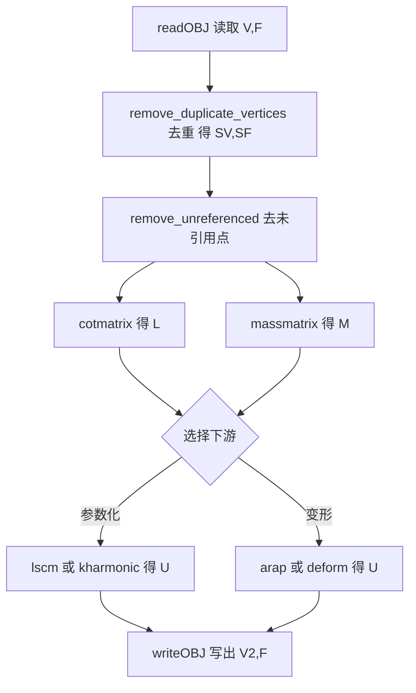
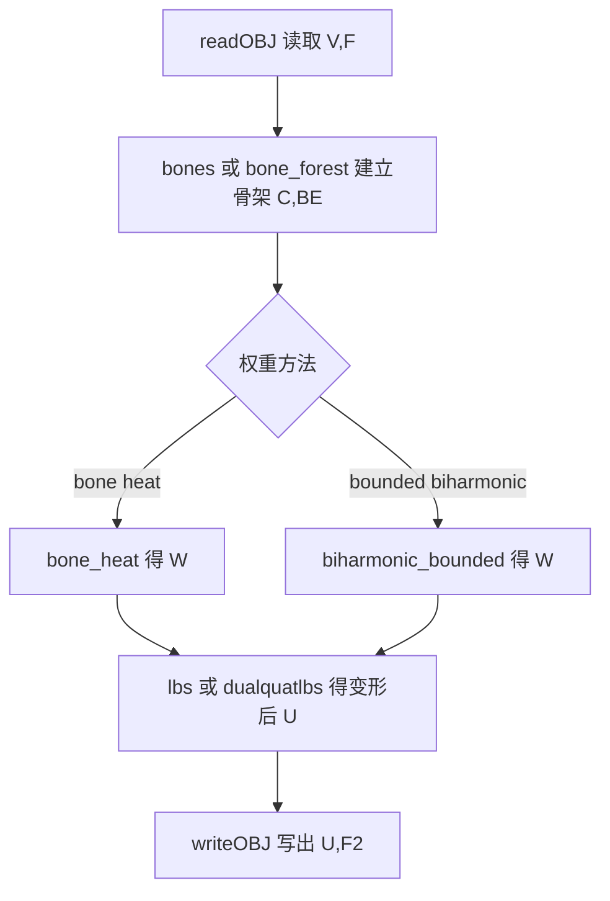
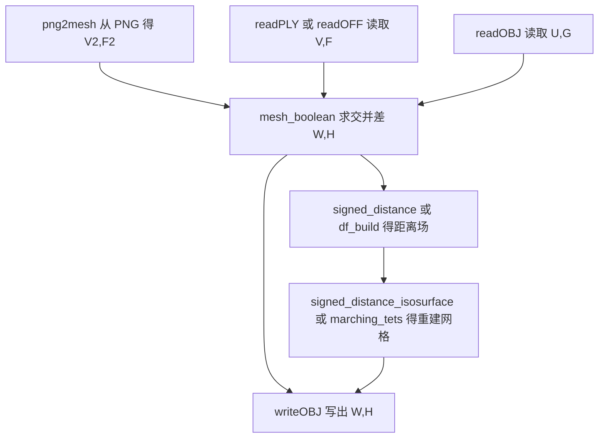

# 项目总览 / Project Overview

> 本文档是 `gptoolbox-1` 逆向工程文档集的第一篇，给出**项目定位、核心能力、顶层结构、
> 全局数据约定与典型使用流程**。
>
> This document is the first entry of the reverse-engineering doc set for `gptoolbox-1`. It
> covers **positioning, core capabilities, top-level layout, global data conventions and
> canonical pipelines**.

- 语言 / Language：中英对照（中文为主）
- 上游依据 / Sources：[README.md](file:///c:/VSWork/gptoolbox-1/README.md#L1-L141)、
  [CLAUDE.md](file:///c:/VSWork/gptoolbox-1/CLAUDE.md#L1-L68)、
  [style.md](file:///c:/VSWork/gptoolbox-1/style.md#L1-L33)
- 相关章节 / See also：[02-architecture.md](02-architecture.md)、
  [docs/README.md](../README.md)

---

## 1. 项目定位 / Positioning

### 1.1 是什么 / What it is

gptoolbox 是一个 **MATLAB 几何处理工具箱（geometry processing toolbox）**，由 Alec Jacobson
及众多贡献者维护。它的定位是：**"有用的 MATLAB 函数集合"（a toolbox of useful MATLAB
functions），是几何处理、约束优化与图像处理场景下可复用的底层工具，而不是独立应用软件。**

> 原文：*"This is a toolbox of useful matlab functions for geometry processing. There are
> also tools related to constrainted optimization and image processing. Typically these are
> utility functions that are not stand alone applications."*
> — [README.md#L9-L11](file:///c:/VSWork/gptoolbox-1/README.md#L9-L11)

**技术形态 / Technical form**：绝大多数代码是**纯 MATLAB `.m` 文件**，只要把目录加入
MATLAB 路径即可运行，无需编译；唯一的例外是 `mex/` 目录，其中包含需要单独编译的 C++ MEX
函数（依赖 Eigen / libigl，可选用 CGAL / Embree）。
（[CLAUDE.md#L5-L7](file:///c:/VSWork/gptoolbox-1/CLAUDE.md#L5-L7)、
[README.md#L50-L62](file:///c:/VSWork/gptoolbox-1/README.md#L50-L62)）

### 1.2 不是什么 / What it is not

| 不是 / Not | 说明 / Notes |
|---|---|
| 不是独立应用 / Not a standalone application | 它是一组"函数库"，没有 GUI 主程序、没有安装包；用法是 `addpath` 后直接调用函数 ([README.md#L9-L11](file:///c:/VSWork/gptoolbox-1/README.md#L9-L11)) |
| 不是自包含的数学库 / Not fully self-contained | 依赖 MATLAB 及其若干工具箱；依赖 `quadprog` 的函数针对 Mosek 做过优化（也可用 Optimization Toolbox 的 `quadprog`）([README.md#L88-L96](file:///c:/VSWork/gptoolbox-1/README.md#L88-L96)) |
| 不是纯 MATLAB 项目 / Not purely MATLAB | `mex/` 为编译型 C++，`wrappers/` 依赖外部可执行文件（TetGen/Triangle/QSlim/meshfix/medit） |
| 不是无第三方授权的代码 / Not license-clean by itself | `external/`、`mex/` 含受限第三方许可，见第 6 节 |

---

## 2. 核心能力清单 / Core Capabilities

以下逐条来自 [README.md#L13-L35](file:///c:/VSWork/gptoolbox-1/README.md#L13-L35)，并补充对应
实现模块与文档章节。

| # | 能力（英 / 中） | 主要所在模块 / Module | 相关文档 |
|---|---|---|---|
| 1 | wrappers for TetGen, Triangle, QSlim, meshfix — TetGen/Triangle/QSlim/meshfix 封装 | `wrappers/` | [50-wrappers](../50-wrappers/README.md) |
| 2 | mesh smoothing — 网格光顺 | `mesh/`（如 `curve_smooth`、`conformalized_mean_curvature_flow`） | [10-mesh](../10-mesh/README.md) |
| 3 | mesh clean up (remove duplicates, remove unreferenced) — 网格清理（去重、去未引用） | `mesh/`（`remove_duplicate_vertices`、`remove_unreferenced`） | [10-mesh](../10-mesh/README.md) |
| 4 | geodesic distances on triangle and tetrahedral meshes — 三角/四面体网格上的测地距离 | `mesh/`、`external/toolbox_fast_marching/`、`mex/exact_geodesic` | [10-mesh](../10-mesh/README.md)、[90-external](../90-external/README.md) |
| 5 | mesh quantities and queries (normals, discrete gaussian curvature, boundary edges, topology, angles, dihedral angles) — 网格量与查询 | `mesh/`（`doublearea`、`discrete_gaussian_curvature`、`boundary_faces`、`dihedral_angles` 等） | [10-mesh](../10-mesh/README.md) |
| 6 | mesh deformation (ARAP, moving least-squares, etc.) — 网格变形（ARAP、MLS 等） | `mesh/`（`arap`、`deform`、`fast_mass_springs`） | [10-mesh](../10-mesh/README.md) |
| 7 | mesh parameterization (harmonic, least squares conformal, ARAP, etc.) — 网格参数化 | `mesh/`（`kharmonic`、`lscm`、`arap`、`harmonic`） | [10-mesh](../10-mesh/README.md) |
| 8 | automatic skinning weight computation (bounded biharmonic weights, bone heat) — 自动蒙皮权重 | `mesh/`（`biharmonic_bounded`、`biharmonic_coordinates`、`bone_heat`） | [10-mesh](../10-mesh/README.md) |
| 9 | 2D triangle mesh from binary image — 从二值图像生成 2D 三角网格 | `mesh/`（`png2mesh`、`bwmesh`） | [10-mesh](../10-mesh/README.md) |
| 10 | Input/Output for many mesh formats — 多格式网格 I/O | `mesh/`（`.obj/.off/.stl/.wrl/.ply/.mesh/.node/.ele/.poly/.smf/.bdl/.face`） | [10-mesh](../10-mesh/README.md) |
| 11 | discrete differential geometry operators (cotangent Laplacian, gradient, divergence) — 离散微分几何算子 | `mesh/`（`cotmatrix`、`grad`、`div`、`massmatrix`） | [10-mesh](../10-mesh/README.md) |
| 12 | quadratic programming, active set solver — 二次规划 / active set 求解器 | `matrix/`（`min_quad_with_fixed`、`min_quad_with_fixed_active_set`、`admm`、`LBFGS`） | [20-matrix](../20-matrix/README.md) |
| 13 | scribble-based image colorization, diffusion curves — 涂鸦着色与扩散曲线 | `imageprocessing/`（`levin`、`lischinski`、`iminpaint`、`get_scribbles`） | [30-imageprocessing](../30-imageprocessing/README.md) |
| 14 | exact (un)signed distance field computation for meshes — 精确（无）符号距离场 | `mesh/`（`df_build`、`df_query`）、`mex/`（`signed_distance`） | [10-mesh](../10-mesh/README.md)、[60-mex](../60-mex/README.md) |
| 15 | constructive solid geometry operations on meshes, booleans — CSG / 布尔运算 | `mex/`（`mesh_boolean`） | [60-mex](../60-mex/README.md) |
| 16 | accelerated point location in triangle and tetrahedral meshes — 加速点定位 | `mesh/`（`point_mesh_squared_distance`、`in_element`）、`mex/` | [10-mesh](../10-mesh/README.md) |
| 17 | image dithering — 图像抖动 | `imageprocessing/`（`dith`、`randdither`） | [30-imageprocessing](../30-imageprocessing/README.md) |
| 18 | deep matlab function dependency — 深度函数依赖 | — 全库特征（函数互相调用层次深） | [appendices/02](../appendices/02-module-dependency-graph.md) |

---

## 3. 顶层目录表 / Top-level Layout

摘自 [docs/README.md#L18-L29](../README.md#L18-L29)。`.m` 文件数为该目录（含子目录）内
MATLAB 文件数量。

| 目录 | .m 文件数 | 一句话职责 / Responsibility | 文档章节 |
|---|---|---|---|
| `mesh/` | 566 | 网格算法核心（最大模块）：I/O、拓扑、DDG 算子、变形、参数化、测地线、曲线 | [10-mesh](../10-mesh/README.md) |
| `matrix/` | 52 | 稀疏矩阵工具与优化求解器（quadprog/active-set/ADMM/LBFGS） | [20-matrix](../20-matrix/README.md) |
| `imageprocessing/` | 43 | 图像着色、扩散曲线、抖动、色彩空间转换 | [30-imageprocessing](../30-imageprocessing/README.md) |
| `utility/` | 41 | 通用工具：缓存、图形导出、色图、路径与版本 | [40-utility](../40-utility/README.md) |
| `wrappers/` | 19 | 外部二进制薄封装：TetGen/Triangle/QSlim/meshfix/medit | [50-wrappers](../50-wrappers/README.md) |
| `mex/` | 57 | 编译型 C++ MEX（libigl/Eigen/CGAL/Embree）；`<name>.m` 为注释桩，实现在 `<name>.cpp` | [60-mex](../60-mex/README.md) |
| `quat/` | 1 | 四元数运算 | [70-quat](../70-quat/README.md) |
| `python/` | 3 | Python 桥接脚本 | [80-python](../80-python/README.md) |
| `images/` | 1 | 示例图像素材与加载器 | [85-images](../85-images/README.md) |
| `external/` | 197 | 第三方 vendored MATLAB 代码（fast marching、colorbrewer 等） | [90-external](../90-external/README.md) |

**路径加载 / addpath**：把所有顶层目录一次性加入路径
（[README.md#L53-L55](file:///c:/VSWork/gptoolbox-1/README.md#L53-L55)）：

```matlab
addpath(strjoin(strcat('/Users/ajx/Repos/gptoolbox/', ...
  {'external','imageprocessing','images','matrix','mesh','mex','quat','utility','wrappers'}),':'))
savepath   % 使改动永久生效
```

---

## 4. 全局数据约定 / Global Data Conventions

这是**重建项目最关键的一节**：所有函数对外的数据接口几乎都遵循同一套约定。

### 4.1 约定速查表 / Convention Cheat-sheet

| 符号 | 形状 | 类型 | 含义 / Meaning |
|---|---|---|---|
| `V` | `#V by 3`（2D 时为 `#V by 2`） | `double` | 顶点坐标矩阵 / vertex positions |
| `F` | `#F by 3` | 整数（通常 `double` 索引） | 三角面索引 / triangle indices into `V` |
| `T` | `#T by 4` | 整数 | 四面体索引 / tetrahedron indices |
| `Q` | `#Q by 4` | 整数 | 四边形索引 / quad indices |
| `E` | `#E by 2` | 整数 | 边索引 / edge indices |
| `C` | `#C by 2/3` 或标量列表 | 混合 | 角标或控制点 / corner or control |
| `W` | `#V by #handles` | `double` | 权重矩阵 / weights |
| `L` | `#V by #V` | `sparse` | 拉普拉斯矩阵 / Laplacian |
| `M` | `#V by #V` | `sparse` | 质量矩阵 / mass matrix |

**硬约定 / Hard rules**：

1. **主数据结构为“矩阵 + 索引”**：几何 = `V`（位置）+ `F`/`T`/`E`（拓扑索引），而非类/对象。
2. **行主序索引 / Row-major indexing**：`#F by 3` 表示“每一行是一个三角形”，即
   `F(i,:)` 是第 `i` 个面的三个顶点索引（对应 [style.md#L16-L30](file:///c:/VSWork/gptoolbox-1/style.md#L16-L30)
   中 `F #F by 3 list of triangle mesh indices` 的惯例）。
3. **1-based 索引 / 1-based indexing**：因为是 MATLAB，索引从 1 开始。示例见
   [wrappers/qslim.m#L8](file:///c:/VSWork/gptoolbox-1/wrappers/qslim.m#L8) 明确标注
   `(1-indexed)`；[wrappers/tetgen.m#L99-L108](file:///c:/VSWork/gptoolbox-1/wrappers/tetgen.m#L99-L108)
   在读取 TetGen 输出后显式处理 0/1-based 转换。
4. **可选参数统一用 `varargin` + `containers.Map`**（见 4.2）。
5. **矩阵尺寸注释统一用 `#V by 3` 记法**（[CLAUDE.md#L65](file:///c:/VSWork/gptoolbox-1/CLAUDE.md#L65)；
   [docs/README.md#L52](../README.md#L52)）。注意个别早期函数用 `x` 而非 `by`（见 4.3 抽查）。

### 4.2 可选参数解析模式 / Optional-argument idiom

标准范式（可直接复用）出现在每个带 `varargin` 的函数中：

```matlab
% default values
robust = false;
% Map of parameter names to variable names
params_to_variables = containers.Map( {'Robust'}, {'robust'});
v = 1;
while v <= numel(varargin)
  param_name = varargin{v};
  if isKey(params_to_variables,param_name)
    assert(v+1<=numel(varargin));
    v = v+1;
    % Trick: use feval on anonymous function to use assignin to this workspace
    feval(@()assignin('caller',params_to_variables(param_name),varargin{v}));
  else
    error('Unsupported parameter: %s',varargin{v});
  end
  v=v+1;
end
```

- 规范来源：[CLAUDE.md#L63](file:///c:/VSWork/gptoolbox-1/CLAUDE.md#L63)（"`varargin` +
  `containers.Map` pattern"，canonical idiom 在 `centroid.m` 或 `arap.m`）。
- 真实锚点：[mesh/centroid.m#L21-L34](file:///c:/VSWork/gptoolbox-1/mesh/centroid.m#L21-L34)、
  [mesh/arap.m#L118-L136](file:///c:/VSWork/gptoolbox-1/mesh/arap.m#L118-L136)、
  [mesh/readOBJ.m#L44-L60](file:///c:/VSWork/gptoolbox-1/mesh/readOBJ.m#L44-L60)。

### 4.3 源码抽查验证 / Verified against source

对任务指定的示范函数逐一核对，结论如下表（行号均经实际读取确认）。

| 函数 / File | 锚点 / Anchor | 验证到的约定 / Verified convention |
|---|---|---|
| `cotmatrix` | [mesh/cotmatrix.m#L1-L33](file:///c:/VSWork/gptoolbox-1/mesh/cotmatrix.m#L1-L33) | 输入注释 `V  #V x dim`、`F  #F x simplex-size`；输出 `L  sparse #V x #V`（L25-L28）。**注意此处用 `x` 而非 `by`**，属历史书写差异，语义同 `#V by dim` |
| `cotmatrix`（内部） | [mesh/cotmatrix.m#L35-L46](file:///c:/VSWork/gptoolbox-1/mesh/cotmatrix.m#L35-L46) | 支持 `size(F,2)` 为 2/3/4 的分支；三角分支调用 `grad`（L38）与 `edge_lengths`（L39）；判定 `size(F,1)==3` 时警告应为 `#F by 3`（L49-L51）→ 印证行主序 |
| `lscm` | [mesh/lscm.m#L1-L28](file:///c:/VSWork/gptoolbox-1/mesh/lscm.m#L1-L28) | 输入 `V #V by dim`、`F #F by 3 list of triangle indices into V`；输出 `U #V by 2`、`Q #V*2 by #V*2`。使用 `varargin`（L31-L49），并在 L118/L130 调用 `min_quad_with_fixed` |
| `arap` | [mesh/arap.m#L1-L80](file:///c:/VSWork/gptoolbox-1/mesh/arap.m#L1-L80) | 输入 `V #V by dim`、`F #F by {3|4}`、`bc #b by dim`；`containers.Map` 解析（L118-L136）；L403/L410/L421 调用 `min_quad_with_fixed` |
| `min_quad_with_fixed` | [matrix/min_quad_with_fixed.m#L1-L10](file:///c:/VSWork/gptoolbox-1/matrix/min_quad_with_fixed.m#L1-L10) | 签名 `[Z,F,Lambda,Lambda_known] = min_quad_with_fixed(A,B,known,Y,Aeq,Beq,F)`；`A` 为 `n by n`、`B` 为 `n by 1`（L12-L15）→ 稀疏/密集二次型统一接口；L81-L103 处理默认参数 |
| `readOBJ` | [mesh/readOBJ.m#L1-L39](file:///c:/VSWork/gptoolbox-1/mesh/readOBJ.m#L1-L39) | 输出 `V #V by 3 list of vertices`、`F #F by 3 list of triangle indices`（L14-L15）；`varargin` 模式在 L44-L60 |

---

## 5. 典型使用流程 / Canonical Pipelines

本节给出 3 条端到端管线。图中节点使用**英文函数名**，并标注输入输出数据
（`V,F` 等）。所有被引用的函数均可在对应模块文档中找到逐函数条目。

### 5.1 管线 A：网格处理（读入 → 清理 → 算子 → 参数化/变形 → 写出）/ Mesh processing



- 真实调用证据：`lscm` 内部走 `cotmatrix`/`massmatrix`（
  [mesh/lscm.m#L123-L126](file:///c:/VSWork/gptoolbox-1/mesh/lscm.m#L123-L126)）；
  `arap` 走 `min_quad_with_fixed`（
  [mesh/arap.m#L403](file:///c:/VSWork/gptoolbox-1/mesh/arap.m#L403)）。
- I/O 命名规范：`readOBJ`/`writeOBJ`（`readEXT`/`writeEXT`，
  [style.md#L6-L9](file:///c:/VSWork/gptoolbox-1/style.md#L6-L9)）。

### 5.2 管线 B：自动蒙皮 / Automatic skinning



- 证据：`bone_heat` 内部用 `bone_visible` 做可见性测试并构建 `cotmatrix`/`massmatrix`
  （[mesh/bone_heat.m#L39-L42](file:///c:/VSWork/gptoolbox-1/mesh/bone_heat.m#L39-L42)、
  [#L177-L179](file:///c:/VSWork/gptoolbox-1/mesh/bone_heat.m#L177-L179)）；
  `biharmonic_bounded` 通过 `quadprog`/`min_quad_with_fixed(_active_set)` 求解
  （[mesh/biharmonic_bounded.m#L187](file:///c:/VSWork/gptoolbox-1/mesh/biharmonic_bounded.m#L187)、
  [#L257](file:///c:/VSWork/gptoolbox-1/mesh/biharmonic_bounded.m#L257)、
  [#L274](file:///c:/VSWork/gptoolbox-1/mesh/biharmonic_bounded.m#L274)）；
  `lbs` 为线性混合蒙皮（[mesh/lbs.m#L1-L15](file:///c:/VSWork/gptoolbox-1/mesh/lbs.m#L1-L15)）。

### 5.3 管线 C：布尔 / 网格重建 / Boolean & reconstruction



- 证据：`png2mesh` 调用 `png2poly` 与 `triangle`
  （[mesh/png2mesh.m#L38](file:///c:/VSWork/gptoolbox-1/mesh/png2mesh.m#L38)、
  [#L54](file:///c:/VSWork/gptoolbox-1/mesh/png2mesh.m#L54)）；
  `mesh_boolean` 为 MEX 实现，签名见
  [mex/mesh_boolean.m#L1-L31](file:///c:/VSWork/gptoolbox-1/mex/mesh_boolean.m#L1-L31)，
  实现在 `mex/mesh_boolean.cpp`。

---

## 6. 许可证与归属 / License & Attribution

### 6.1 主许可证 / Primary license

gptoolbox 本体采用 **MIT 与 Apache 2 双许可**：

> *"This work is dual licensed under MIT and Apache 2."*
> — [README.md#L117-L119](file:///c:/VSWork/gptoolbox-1/README.md#L117-L119)

### 6.2 第三方与受限许可 / Third-party & restricted licenses

| 位置 / Location | 风险 / Notes |
|---|---|
| `external/` | **含外部代码，许可可能更受限**。原文："the `external/` directory contains code from elsewhere with potentially more restricted licenses."（[README.md#L121-L122](file:///c:/VSWork/gptoolbox-1/README.md#L121-L122)）。例如 `external/exactgeodesic/license.txt`、`external/toolbox_fast_marching/license.txt` |
| `mex/` | 多数包含 **libigl 与 Eigen**（部分含 CGAL），各有自己的许可（[README.md#L124-L125](file:///c:/VSWork/gptoolbox-1/README.md#L124-L125)） |
| `wrappers/` | 依赖外部可执行文件（TetGen/Triangle/QSlim/meshfix/medit），其许可由各自上游决定 |

### 6.3 引用 / Citation

学术使用时建议引用所实现论文；整体引用可使用如下 BibTeX
（[README.md#L102-L115](file:///c:/VSWork/gptoolbox-1/README.md#L102-L115)）：

```bibtex
@misc{gptoolbox,
  title = {{gptoolbox}: Geometry Processing Toolbox},
  author = {Alec Jacobson and others},
  note = {http://github.com/alecjacobson/gptoolbox},
  year = {2024},
}
```

---

## 7. 小结 / Summary

- gptoolbox 是一个**以 `<V,F>` 矩阵约定为核心、以纯 MATLAB 为默认形态**的几何处理函数库；
- `mesh/` 承载绝大部分几何算法，`matrix/` 提供优化与稀疏工具，`wrappers/` 与 `mex/` 负责
  外部能力接入，`external/` 为第三方代码；
- **重建时的最小接口约定**：`V`/`F`/`T`/`E` 矩阵、行主序、1-based、`varargin` +
  `containers.Map`、`#V by 3` 注释记法。

下一篇请阅读 [02-architecture.md](02-architecture.md) 了解分层架构与模块依赖。
