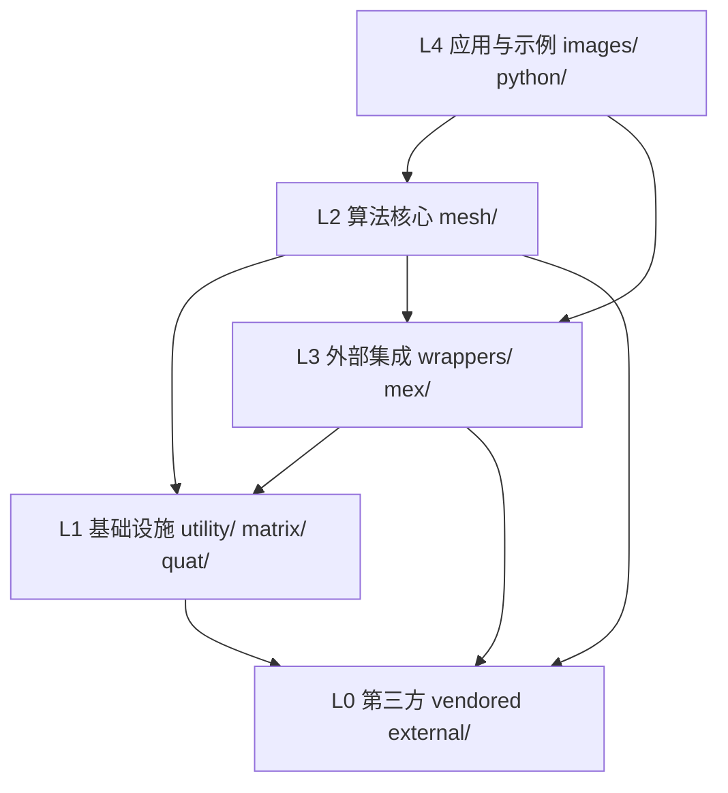
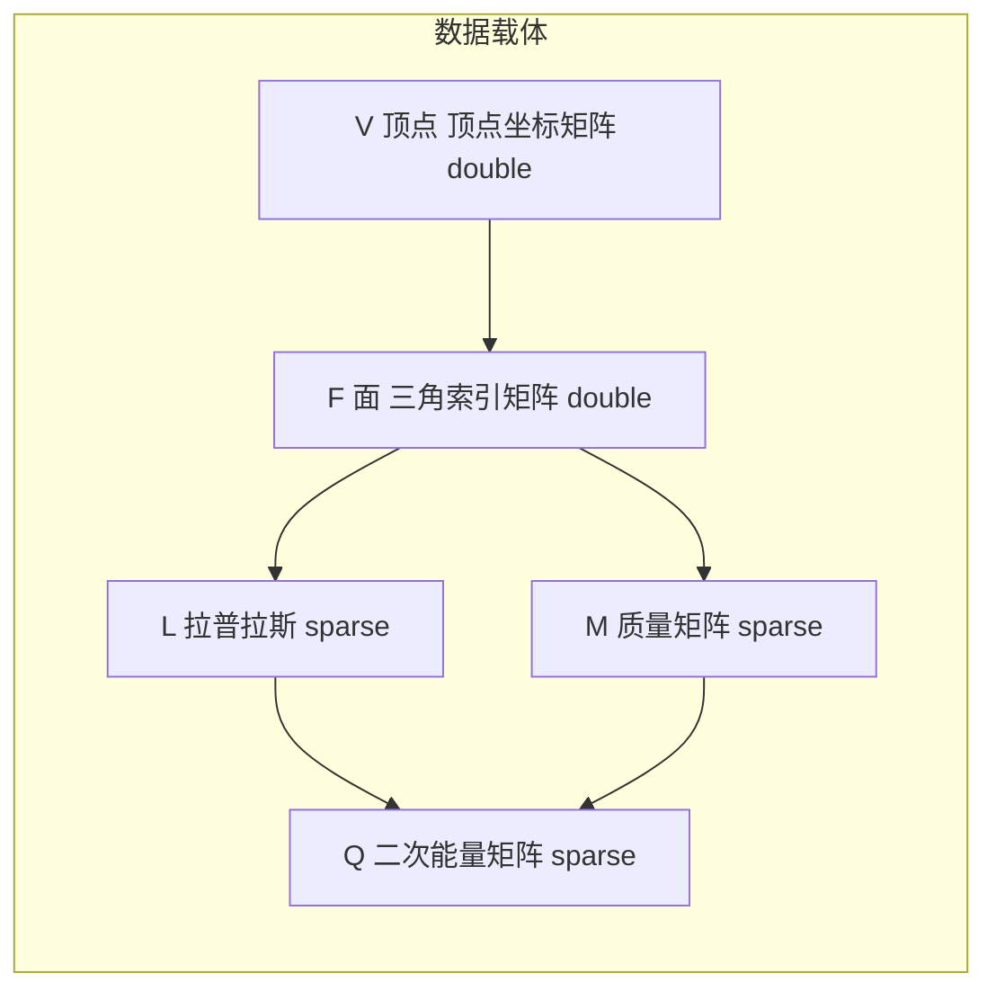

# 架构与模块职责 / Architecture & Module Responsibilities

> 本文档给出 `gptoolbox-1` 的**分层架构、各模块职责与依赖关系、跨模块调用表、关键设计模式、
> 数据流视角与扩展点**。所有结论均以真实源码锚点为准。
>
> This document describes the **layered architecture, module responsibilities and
> dependencies, cross-module call table, key design patterns, data-flow view and extension
> points** of `gptoolbox-1`.

- 上游依据 / Sources：[README.md](file:///c:/VSWork/gptoolbox-1/README.md#L37-L47)、
  [CLAUDE.md#L27-L36](file:///c:/VSWork/gptoolbox-1/CLAUDE.md#L27-L36)、
  [style.md](file:///c:/VSWork/gptoolbox-1/style.md#L1-L33)
- 相关章节 / See also：[01-project-overview.md](01-project-overview.md)、
  [docs/README.md](../README.md)

---

## 1. 分层架构 / Layered Architecture

gptoolbox 自上而下可视为 5 层：上层应用调用算法核心，算法核心依赖基础设施，
基础设施与外部集成层分别建立在第三方代码与已编译二进制之上。



| 层 / Layer | 目录 / Directories | 职责 / Responsibility |
|---|---|---|
| **L4 应用与示例** | `images/`、`python/` | 素材加载器与 Python 桥接脚本，是调用方而非被调用方 |
| **L3 外部集成** | `wrappers/`、`mex/` | 把外部二进制（TetGen/Triangle/QSlim/meshfix/medit）与编译型 C++（libigl/Eigen/CGAL/Embree）接入 MATLAB |
| **L2 算法核心** | `mesh/` | 网格 I/O、拓扑、离散微分几何算子、变形、参数化、测地线、曲线 |
| **L1 基础设施** | `utility/`、`matrix/`、`quat/` | 缓存与 I/O 辅助、稀疏矩阵与优化求解器、四元数 |
| **L0 第三方 vendored** | `external/` | 直接纳入仓库的第三方 MATLAB 代码（fast marching、colorbrewer 等） |

> 说明：L2 与 L3 之间是**双向**关系——`mesh/` 会调用 `wrappers/`（如 `png2mesh` 调用
> `triangle`）与 `mex/`（如 `bone_heat` 探测 `bone_visible_embree`），`wrappers/` 也会
> 调用 `mesh/` 的 I/O 与工具函数。

---

## 2. 各模块职责 / Module Responsibilities

以下每个模块给出：职责、对外暴露的代表性函数、依赖的下层模块、被谁依赖。函数名均取自真实
文件（见各目录文件清单）。

### 2.1 `mesh/` — 网格算法核心（L2）

- **职责 / Responsibility**：三角/四面体网格的 I/O、拓扑与查询、离散微分几何（DDG）算子、
  网格清理与光顺、变形、参数化、测地距离与曲线处理。是全库最大模块。
  （[CLAUDE.md#L29](file:///c:/VSWork/gptoolbox-1/CLAUDE.md#L29)）
- **代表性函数 / Representative functions**：
  `readOBJ`、`writeOBJ`、`remove_duplicate_vertices`、`remove_unreferenced`、`cotmatrix`、
  `massmatrix`、`grad`、`div`、`doublearea`、`edge_lengths`、`arap`、`lscm`、`kharmonic`、
  `biharmonic_bounded`、`bone_heat`、`lbs`、`png2mesh`。
- **依赖下层 / Depends on**：`matrix/`（`min_quad_with_fixed` 等）、`utility/`
  （`tempprefix`、`cache`）、`wrappers/`（`triangle`）、`mex/`（可选加速）。
- **被谁依赖 / Depended by**：`wrappers/`（复用 I/O 与工具）、`imageprocessing/`、
  用户脚本。

抽查证据：
- `cotmatrix` 调用 `grad`、`edge_lengths`（[mesh/cotmatrix.m#L38-L39](file:///c:/VSWork/gptoolbox-1/mesh/cotmatrix.m#L38-L39)）；
- `arap` 调用 `min_quad_with_fixed`（[mesh/arap.m#L403](file:///c:/VSWork/gptoolbox-1/mesh/arap.m#L403)）；
- `lscm` 调用 `cotmatrix`/`massmatrix`/`repdiag`/`min_quad_with_fixed`
  （[mesh/lscm.m#L118-L130](file:///c:/VSWork/gptoolbox-1/mesh/lscm.m#L118-L130)）；
- `bone_heat` 调用 `bone_visible`、`cotmatrix`、`massmatrix`
  （[mesh/bone_heat.m#L42](file:///c:/VSWork/gptoolbox-1/mesh/bone_heat.m#L42)、
  [#L177-L179](file:///c:/VSWork/gptoolbox-1/mesh/bone_heat.m#L177-L179)）。

### 2.2 `matrix/` — 稀疏矩阵与优化求解器（L1）

- **职责 / Responsibility**：稀疏矩阵工具与优化求解器（quadprog 封装、active-set、
  ADMM、LBFGS、线性/最小二乘辅助）。
  （[CLAUDE.md#L30](file:///c:/VSWork/gptoolbox-1/CLAUDE.md#L30)）
- **代表性函数 / Representative functions**：
  `min_quad_with_fixed`、`min_quad_with_fixed_active_set`、`quadprog_box`、`admm`、`LBFGS`、
  `sparse_eigs`、`repdiag`、`schur_complement`、`lu_lagrange`、`affine_null_space`、
  `default_quadprog_param`、`line_search`。
- **依赖下层 / Depends on**：MATLAB 内置稀疏运算、可选 Mosek/`quadprog` 工具箱
  （[README.md#L93-L95](file:///c:/VSWork/gptoolbox-1/README.md#L93-L95)）。
- **被谁依赖 / Depended by**：`mesh/` 中几乎所有基于二次能量的算法
  （参数化、变形、权重计算）。

抽查证据：`min_quad_with_fixed` 把二次型 + 等式约束问题化为带 Lagrange 乘子的鞍点系统，
并做预分解（LDL/LU/Cholesky）以复用
（[matrix/min_quad_with_fixed.m#L1-L10](file:///c:/VSWork/gptoolbox-1/matrix/min_quad_with_fixed.m#L1-L10)、
[#L220-L271](file:///c:/VSWork/gptoolbox-1/matrix/min_quad_with_fixed.m#L220-L271)）。

### 2.3 `utility/` — 通用工具与缓存（L1）

- **职责 / Responsibility**：通用 MATLAB 工具——缓存、图形/动画导出、色图、路径与版本、
  参数提取。
  （[CLAUDE.md#L31](file:///c:/VSWork/gptoolbox-1/CLAUDE.md#L31)）
- **代表性函数 / Representative functions**：
  `cache`、`create_cache`、`find_cache`、`depends`、`tempprefix`、`figpng`、`figgif`、
  `figmp4`、`gptoolbox_version`、`startup`、`extract_arg`、`is_writable`。
- **依赖下层 / Depends on**：几乎无（自底向上）。
- **被谁依赖 / Depended by**：`mesh/`（`tempprefix`）、`wrappers/`
  （`qslim` 用 `tempprefix`）、全库（`cache`、`depends`）。

抽查证据：`cache` 通过 md5 校验输入“状态”来复用 `.mat` 缓存
（[utility/cache.m#L1-L30](file:///c:/VSWork/gptoolbox-1/utility/cache.m#L1-L30)）；
`depends` 用于计算函数依赖（[utility/depends.m#L1-L30](file:///c:/VSWork/gptoolbox-1/utility/depends.m#L1-L30)）；
`tempprefix` 生成唯一临时文件前缀
（[utility/tempprefix.m#L1-L28](file:///c:/VSWork/gptoolbox-1/utility/tempprefix.m#L1-L28)）。

### 2.4 `quat/` — 四元数（L1）

- **职责 / Responsibility**：四元数算术（用于旋转表示）。
  （[CLAUDE.md#L36](file:///c:/VSWork/gptoolbox-1/CLAUDE.md#L36)）
- **代表性函数 / Representative functions**：`quatmultiply`。
- **依赖下层 / Depends on**：无。
- **被谁依赖 / Depended by**：`mesh/` 中涉及旋转的函数（如 `axisangle2quat`、
  `dualquatlbs`）。

### 2.5 `wrappers/` — 外部二进制封装（L3）

- **职责 / Responsibility**：外部可执行程序的薄封装；`path_to_*.m` 告诉 gptoolbox 各二进制
  的位置。
  （[CLAUDE.md#L32](file:///c:/VSWork/gptoolbox-1/CLAUDE.md#L32)）
- **代表性函数 / Representative functions**：
  `tetgen`、`triangle`、`qslim`、`meshfix`、`meshfix_components`、`medit`、`path_to_tetgen`、
  `path_to_triangle`、`path_to_qslim`、`path_to_meshfix`、`path_to_libigl`、`find_first_path`。
- **依赖下层 / Depends on**：`mesh/`（I/O：`writePOLY_tetgen`/`readELE`/`readNODE`/`writeSMF`/
  `readLOG`/`writeOFF`/`readOFF`）、`utility/`（`tempprefix`）、操作系统 `system`。
- **被谁依赖 / Depended by**：`mesh/`（如 `png2mesh` → `triangle`）。

抽查证据：
- `tetgen` 写 `.poly` 调外部程序，再读回 `.ele/.face/.node`，命令拼装引用 `path_to_tetgen`
  （[wrappers/tetgen.m#L58-L102](file:///c:/VSWork/gptoolbox-1/wrappers/tetgen.m#L58-L102)）；
- `qslim` 用 `tempprefix` + `path_to_qslim` + `writeSMF`/`readLOG`/`perform_edge_collapse`
  （[wrappers/qslim.m#L44-L75](file:///c:/VSWork/gptoolbox-1/wrappers/qslim.m#L44-L75)）；
- `meshfix` 用 `writeOFF`/`readOFF` + `path_to_meshfix`
  （[wrappers/meshfix.m#L13-L24](file:///c:/VSWork/gptoolbox-1/wrappers/meshfix.m#L13-L24)）；
- `meshfix_components` 先做连通分量与去未引用，再逐分量调用 `meshfix`
  （[wrappers/meshfix_components.m#L14-L30](file:///c:/VSWork/gptoolbox-1/wrappers/meshfix_components.m#L14-L30)）。

### 2.6 `mex/` — 编译型 C++ MEX（L3）

- **职责 / Responsibility**：需单独编译的 C++ MEX 函数；`<name>.m` 只是注释桩（无 `function`
  行），实现在 `<name>.cpp`；依赖 libigl/Eigen，可选用 CGAL/Embree。
  （[CLAUDE.md#L33](file:///c:/VSWork/gptoolbox-1/CLAUDE.md#L33)、
  [CLAUDE.md#L67-L68](file:///c:/VSWork/gptoolbox-1/CLAUDE.md#L67-L68)）
- **代表性函数 / Representative functions**：
  `mesh_boolean`、`tetrahedralize`、`signed_distance`、`point_mesh_squared_distance`、
  `exact_geodesic`、`ambient_occlusion`、`blue_noise`、`decimate_libigl`、`orient2d`、
  `orient3d`、`winding_number`、`fast_sparse`。
- **依赖下层 / Depends on**：Eigen、libigl、可选 CGAL/Embree（编译期依赖）。
- **被谁依赖 / Depended by**：`mesh/`（如 `bone_heat` 探测 `bone_visible_embree`）、
  用户脚本。

抽查证据：`mex/mesh_boolean.m` 全文为注释桩、无 `function` 行，签名与参数在注释中给出，
实现为 `mex/mesh_boolean.cpp`
（[mex/mesh_boolean.m#L1-L31](file:///c:/VSWork/gptoolbox-1/mex/mesh_boolean.m#L1-L31)）；
`mex/tetrahedralize.m` 同样为纯注释桩，指向 `tetgen`
（[mex/tetrahedralize.m#L1-L21](file:///c:/VSWork/gptoolbox-1/mex/tetrahedralize.m#L1-L21)）。

### 2.7 `imageprocessing/` — 图像处理（L2/L4）

- **职责 / Responsibility**：图像着色、扩散曲线、抖动、色彩空间转换、去噪。
  （[CLAUDE.md#L35](file:///c:/VSWork/gptoolbox-1/CLAUDE.md#L35)）
- **代表性函数 / Representative functions**：
  `dith`、`randdither`、`levin`、`lischinski`、`iminpaint`、`get_scribbles`、`gray2rgb`、
  `rgb2oklab`、`oklab2rgb`、`imcurves`、`denoise`、`color_transfer`。
- **依赖下层 / Depends on**：`mesh/`（网格化颜色/扩散曲线）、`matrix/`（稀疏求解）。
- **被谁依赖 / Depended by**：`mesh/` 中由图像生成网格的函数（如 `bwmesh`/`png2mesh` 系列）。

### 2.8 `external/` — 第三方 vendored（L0）

- **职责 / Responsibility**：直接纳入仓库的第三方 MATLAB 代码。
  （[CLAUDE.md#L34](file:///c:/VSWork/gptoolbox-1/CLAUDE.md#L34)、
  [README.md#L121-L122](file:///c:/VSWork/gptoolbox-1/README.md#L121-L122)）
- **代表性内容 / Representative items**：
  `toolbox_fast_marching/`（快速行进测地距离，含 `compile_mex`）、`exactgeodesic/`
  （精确测地线，含 `geodesic_matlab_api`）、`cbrewer`、`read_ply`、`write_ply`、
  `quaternionrotate`、`viridis`、`combn`、`Hungarian`、`cprintf`。
- **依赖下层 / Depends on**：MATLAB（部分需编译自身 mex，如
  [README.md#L81-L86](file:///c:/VSWork/gptoolbox-1/README.md#L81-L86)）。
- **被谁依赖 / Depended by**：`mesh/` 的测地线函数。

### 2.9 `images/` 与 `python/` — 应用与示例（L4）

- `images/`：示例图像素材与加载器 `imdata`（1 个 `.m`）。
- `python/`：Python 桥接脚本 `pysparse.m`、`marching_cubes_sparse.m`、`remesh_botsch.m`
  （3 个 `.m`）。

---

## 3. 跨模块调用关系表 / Cross-module Call Table

| 调用方 / Caller | 被调用方 / Callee | 证据函数与锚点 / Evidence |
|---|---|---|
| `mesh/cotmatrix` | `mesh/grad`、`mesh/edge_lengths` | [cotmatrix.m#L38-L39](file:///c:/VSWork/gptoolbox-1/mesh/cotmatrix.m#L38-L39) |
| `mesh/arap` | `matrix/min_quad_with_fixed` | [arap.m#L403](file:///c:/VSWork/gptoolbox-1/mesh/arap.m#L403) |
| `mesh/lscm` | `mesh/cotmatrix`、`mesh/massmatrix`、`matrix/repdiag`、`matrix/min_quad_with_fixed` | [lscm.m#L118-L130](file:///c:/VSWork/gptoolbox-1/mesh/lscm.m#L118-L130) |
| `mesh/bone_heat` | `mesh/bone_visible`、`mesh/cotmatrix`、`mesh/massmatrix`、可选 `mex/bone_visible_embree` | [bone_heat.m#L39-L42](file:///c:/VSWork/gptoolbox-1/mesh/bone_heat.m#L39-L42)、[#L177-L179](file:///c:/VSWork/gptoolbox-1/mesh/bone_heat.m#L177-L179) |
| `mesh/biharmonic_bounded` | `matrix/quadprog`、`matrix/min_quad_with_fixed`、`matrix/min_quad_with_fixed_active_set`、`matrix/default_quadprog_param`、`mesh/doublearea` | [biharmonic_bounded.m#L55](file:///c:/VSWork/gptoolbox-1/mesh/biharmonic_bounded.m#L55)、[#L128](file:///c:/VSWork/gptoolbox-1/mesh/biharmonic_bounded.m#L128)、[#L187](file:///c:/VSWork/gptoolbox-1/mesh/biharmonic_bounded.m#L187)、[#L257](file:///c:/VSWork/gptoolbox-1/mesh/biharmonic_bounded.m#L257)、[#L274](file:///c:/VSWork/gptoolbox-1/mesh/biharmonic_bounded.m#L274) |
| `mesh/biharmonic_coordinates` | `mesh/cotmatrix`、`mesh/massmatrix`、`mesh/crouzeix_raviart_massmatrix`、`mesh/crouzeix_raviart_cotmatrix`、`matrix/min_quad_with_fixed` | [biharmonic_coordinates.m#L51-L82](file:///c:/VSWork/gptoolbox-1/mesh/biharmonic_coordinates.m#L51-L82) |
| `mesh/png2mesh` | `mesh/png2poly`、`wrappers/triangle` | [png2mesh.m#L38](file:///c:/VSWork/gptoolbox-1/mesh/png2mesh.m#L38)、[#L54](file:///c:/VSWork/gptoolbox-1/mesh/png2mesh.m#L54) |
| `wrappers/tetgen` | `wrappers/path_to_tetgen`、`mesh/writePOLY_tetgen`、`mesh/readELE`、`mesh/readNODE`、`mesh/readFACE` | [tetgen.m#L58-L102](file:///c:/VSWork/gptoolbox-1/wrappers/tetgen.m#L58-L102) |
| `wrappers/qslim` | `utility/tempprefix`、`wrappers/path_to_qslim`、`mesh/writeSMF`、`mesh/readLOG`、`mesh/perform_edge_collapse` | [qslim.m#L44-L75](file:///c:/VSWork/gptoolbox-1/wrappers/qslim.m#L44-L75) |
| `wrappers/meshfix` | `mesh/writeOFF`、`mesh/readOFF`、`wrappers/path_to_meshfix` | [meshfix.m#L13-L24](file:///c:/VSWork/gptoolbox-1/wrappers/meshfix.m#L13-L24) |
| `wrappers/meshfix_components` | `mesh/connected_components`、`mesh/remove_unreferenced`、`wrappers/meshfix` | [meshfix_components.m#L14-L24](file:///c:/VSWork/gptoolbox-1/wrappers/meshfix_components.m#L14-L24) |

---

## 4. 关键设计模式 / Key Design Patterns

### 4.1 `varargin` + `containers.Map` 可选参数解析

全库统一用 `containers.Map` 把**参数名字符串**映射到**局部变量名**，再用
`feval(@()assignin('caller',...))` 把值写入调用者工作区。

- 规范：[CLAUDE.md#L63](file:///c:/VSWork/gptoolbox-1/CLAUDE.md#L63)、
  [style.md#L16-L30](file:///c:/VSWork/gptoolbox-1/style.md#L16-L30)。
- 锚点：[mesh/centroid.m#L21-L34](file:///c:/VSWork/gptoolbox-1/mesh/centroid.m#L21-L34)
  （最小范例，单参数 `Robust`）、
  [mesh/arap.m#L118-L136](file:///c:/VSWork/gptoolbox-1/mesh/arap.m#L118-L136)
  （多参数范例）。

```matlab
% mesh/centroid.m:21-34
params_to_variables = containers.Map( {'Robust'}, {'robust'});
v = 1;
while v <= numel(varargin)
  param_name = varargin{v};
  if isKey(params_to_variables,param_name)
    assert(v+1<=numel(varargin));
    v = v+1;
    feval(@()assignin('caller',params_to_variables(param_name),varargin{v}));
  else
    error('Unsupported parameter: %s',varargin{v});
  end
  v=v+1;
end
```

### 4.2 I/O 命名规范 `readEXT` / `writeEXT`

文件名等于函数名，小写加下划线；唯一例外是 I/O 函数，用 `readEXT`/`writeEXT`
（`EXT` 为扩展名）。扩展名有歧义时用 `readEXT_program`/`writeEXT_program`。
（[style.md#L6-L9](file:///c:/VSWork/gptoolbox-1/style.md#L6-L9)、
[CLAUDE.md#L40](file:///c:/VSWork/gptoolbox-1/CLAUDE.md#L40)）

示例：`readOBJ`/`writeOBJ`（[mesh/readOBJ.m#L1](file:///c:/VSWork/gptoolbox-1/mesh/readOBJ.m#L1)、
[mesh/writeOBJ.m#L1](file:///c:/VSWork/gptoolbox-1/mesh/writeOBJ.m#L1)）、`readOFF`/`writeOFF`、
`readPLY`/`writePLY`、`readELE`/`readNODE`/`readFACE`、`writeSMF`、`readLOG`。

### 4.3 MEX 桩文件 / MEX stubs

每个 MEX 函数对应一个 `mex/<name>.m`，其中**只有** `%` 注释头块，**没有 `function` 行、没有
代码**；这样在未编译或已编译的情况下 `help <name>` 都能显示文档。实现位于
`mex/<name>.cpp`。
（[CLAUDE.md#L67-L68](file:///c:/VSWork/gptoolbox-1/CLAUDE.md#L67-L68)）

证据：`mex/mesh_boolean.m` 第 1 行即 `% MESH_BOOLEAN ...`（无 `function`），文件在注释处
终止，实现为 `mex/mesh_boolean.cpp`
（[mex/mesh_boolean.m#L1-L31](file:///c:/VSWork/gptoolbox-1/mex/mesh_boolean.m#L1-L31)）；
`mex/tetrahedralize.m` 同理
（[mex/tetrahedralize.m#L1-L21](file:///c:/VSWork/gptoolbox-1/mex/tetrahedralize.m#L1-L21)）。

### 4.4 外部二进制通过 `wrappers/path_to_*.m` 定位

每个外部程序对应一个 `path_to_<prog>.m`，按平台返回绝对路径或系统查找结果；上层封装函数
用它拼装命令行。

- [wrappers/path_to_tetgen.m#L1-L25](file:///c:/VSWork/gptoolbox-1/wrappers/path_to_tetgen.m#L1-L25)：
  Windows 返回硬编码路径，mac/Unix 用 `which` 再回退候选列表；
- [wrappers/path_to_qslim.m#L12-L25](file:///c:/VSWork/gptoolbox-1/wrappers/path_to_qslim.m#L12-L25)：
  同构；
- [wrappers/path_to_libigl.m#L8](file:///c:/VSWork/gptoolbox-1/wrappers/path_to_libigl.m#L8)：
  `find_first_path({'/usr/local/igl/libigl/','/usr/local/libigl/'})`；
- 使用点：[wrappers/tetgen.m#L75](file:///c:/VSWork/gptoolbox-1/wrappers/tetgen.m#L75)、
  [wrappers/qslim.m#L52-L53](file:///c:/VSWork/gptoolbox-1/wrappers/qslim.m#L52-L53)、
  [wrappers/meshfix.m#L18](file:///c:/VSWork/gptoolbox-1/wrappers/meshfix.m#L18)。

> 提示：安装 MEX 库后常需修改 `wrappers/path_to_libigl.m` 等文件以告知路径
> （[README.md#L97-L100](file:///c:/VSWork/gptoolbox-1/README.md#L97-L100)）。

---

## 5. 数据流视角 / Data-flow View

几何数据在 `mesh/` → `matrix/` → `mex/` 间流转时的**载体与类型**：



| 数据 / Data | 产生者 / Producer | 类型 / Type | 消费者 / Consumer |
|---|---|---|---|
| `V`（顶点坐标） | `readOBJ`（[mesh/readOBJ.m#L14](file:///c:/VSWork/gptoolbox-1/mesh/readOBJ.m#L14)） | `double` | 所有几何函数 |
| `F`（面索引） | `readOBJ`、`readELE`（`sscanf` 解析→`double`，[mesh/readELE.m#L20-L26](file:///c:/VSWork/gptoolbox-1/mesh/readELE.m#L20-L26)） | `double`（MATLAB 索引要求） | `cotmatrix`、`massmatrix` 等 |
| `L`（拉普拉斯） | `cotmatrix`（输出注释 `sparse #V x #V`，[mesh/cotmatrix.m#L28](file:///c:/VSWork/gptoolbox-1/mesh/cotmatrix.m#L28)） | `sparse` | `min_quad_with_fixed` 等 |
| `M`（质量矩阵） | `massmatrix`（输出注释 `#V by #V sparse`，[mesh/massmatrix.m#L16](file:///c:/VSWork/gptoolbox-1/mesh/massmatrix.m#L16)） | `sparse` | 参数化/变形 |
| 二次型 `A`/`Q` | 由 `L`/`M` 组装（如 `lscm` L123-L130） | `sparse` | `matrix/min_quad_with_fixed` |

**关键点 / Key points**：

1. **`.m` 侧一律用 `double` 存储索引**（MATLAB 数组下标要求），因此 `F`/`T`/`E` 虽语义是
   整数，实际类型为 `double`。
2. **算子矩阵（`L`/`M`/`Q`）一律为 `sparse`**，以支撑上万顶点规模的隐式求解。
3. **MEX 边界**：编译型 MEX（libigl/Eigen）内部使用 C++ 类型；`mex/readMSH.m` 注释也表明该
   I/O 以 `double` 读取（[mex/readMSH.m#L22-L33](file:///c:/VSWork/gptoolbox-1/mex/readMSH.m#L22-L33)）。
   面索引在 MEX 内部常见 `int32` 表示，具体类型请以 [60-mex](../60-mex/README.md) 各函数条目为准。
4. **`<V,F>` 是贯穿全库的最小接口**：`mesh/` 生产、`matrix/` 消费、`wrappers/` 与 `mex/`
   在边界处做格式/类型转换。

---

## 6. 扩展点 / Extension Points

### 6.1 新增一个 `mesh/` 函数

1. **命名**：文件名 = 函数名，`lowercase_with_underscores.m`；I/O 函数用 `readEXT`/`writeEXT`
   （[style.md#L1-L9](file:///c:/VSWork/gptoolbox-1/style.md#L1-L9)）。
2. **函数头**：写标准头（描述、原型、Inputs/Outputs、可选参数、See also），矩阵尺寸用
   `#V by 3` 记法（[style.md#L11-L33](file:///c:/VSWork/gptoolbox-1/style.md#L11-L33)、
   [CLAUDE.md#L42-L65](file:///c:/VSWork/gptoolbox-1/CLAUDE.md#L42-L65)）。
3. **可选参数**：用 `varargin` + `containers.Map` 范式（复制
   [mesh/centroid.m#L21-L34](file:///c:/VSWork/gptoolbox-1/mesh/centroid.m#L21-L34)）。
4. **复用下层**：需要求解时调用 `matrix/min_quad_with_fixed`，需要算子时调用
   `cotmatrix`/`massmatrix`/`grad`。
5. **加入路径**：确保 `mesh/` 在 MATLAB 路径中（[README.md#L53-L55](file:///c:/VSWork/gptoolbox-1/README.md#L53-L55)）。

### 6.2 新增一个 MEX 函数

1. 在 `mex/` 下新建 `<name>.cpp` 实现（可基于 libigl/Eigen；重 I/O 可参考现有 `.cpp`）。
2. 新建同名的 `mex/<name>.m`，**只写注释头块**（无 `function` 行、无代码），使 `help <name>`
   可用（[CLAUDE.md#L67-L68](file:///c:/VSWork/gptoolbox-1/CLAUDE.md#L67-L68)；
   参照 [mex/mesh_boolean.m#L1-L31](file:///c:/VSWork/gptoolbox-1/mex/mesh_boolean.m#L1-L31)）。
3. 在 `mex/build` 下用 cmake 编译：

   ```bash
   cd mex && mkdir build && cd build
   cmake ..
   make
   ```

   （[CLAUDE.md#L18-L23](file:///c:/VSWork/gptoolbox-1/CLAUDE.md#L18-L23)）
4. 若 cmake 找不到 MATLAB，传 `-DMatlab_ROOT_DIR=<path>`；若报未知 MATLAB 版本，更新
   `mex/cmake/FindMATLAB.cmake` 中的 `MATLAB_VERSIONS_MAPPING`
   （[CLAUDE.md#L25](file:///c:/VSWork/gptoolbox-1/CLAUDE.md#L25)）。
5. 若依赖外部库路径，必要时在 `wrappers/path_to_*.m` 中登记
   （[README.md#L97-L100](file:///c:/VSWork/gptoolbox-1/README.md#L97-L100)）。

### 6.3 接入一个新的外部二进制

1. 新增 `wrappers/path_to_<prog>.m`，按平台返回路径（参照
   [wrappers/path_to_tetgen.m#L9-L24](file:///c:/VSWork/gptoolbox-1/wrappers/path_to_tetgen.m#L9-L24)）。
2. 新增 `wrappers/<prog>.m`：写临时输入文件 → `system` 调用 → 读回输出 → 清理临时文件
   （参照 [wrappers/qslim.m#L44-L75](file:///c:/VSWork/gptoolbox-1/wrappers/qslim.m#L44-L75)）。
