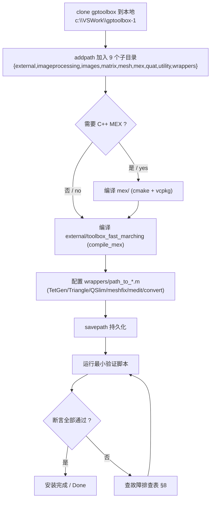
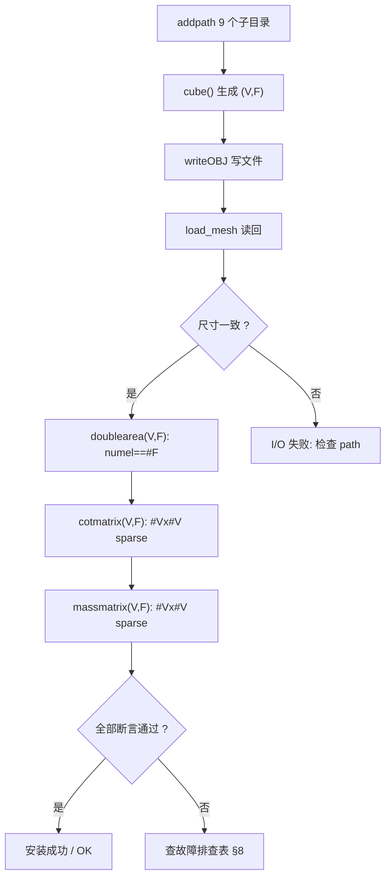

# 03 · 构建与安装 / Build & Installation

> 本章说明如何让 gptoolbox 在本机跑起来：配置 MATLAB 路径、编译 `mex/`、编译
> `external/` 中的 vendored MEX、配置 `wrappers/` 的外部二进制，并给出安装验证与
> 故障排查。
>
> This chapter explains how to get gptoolbox running: configuring the MATLAB path,
> compiling `mex/`, compiling vendored MEX under `external/`, configuring external
> binaries under `wrappers/`, plus verification and troubleshooting.

- 仓库根 / Repo root：`c:\VSWork\gptoolbox-1`
- 上游参考 / Upstream：<https://github.com/alecjacobson/gptoolbox/>

---

## 1. 安装总览 / Installation overview

gptoolbox 的**绝大多数代码是纯 MATLAB**（`*.m`），只要把仓库目录加入 MATLAB 路径即可
运行；**唯一需要编译的是 `mex/`**（C++ MEX），以及 `external/` 中少数 vendored MEX。

The vast majority of gptoolbox is **straight MATLAB** (`*.m`); adding the repo to the
MATLAB path is enough. **Only `mex/` must be compiled**, along with a few vendored MEX
under `external/`.

> 原文依据：[README.md](file:///c:/VSWork/gptoolbox-1/README.md#L49-L62) ——
> "The vast majority of this code is __straight MATLAB__ (`*.m` files). Thus, only
> installing MATLAB and adding the gptoolbox directory … is needed."

| 组件 | 类型 | 是否需要编译 | 说明 / Notes |
|---|---|---|---|
| `mesh/`、`matrix/`、`utility/`、`quat/`、`imageprocessing/`、`images/`、`wrappers/` | 纯 `.m` | 否 / No | 加入 path 即可 |
| `external/` | vendored `.m`（+ 少量 MEX） | 部分 / Partial | `toolbox_fast_marching/` 需 `compile_mex`；`exactgeodesic` 自带预编译库 |
| `mex/` | C++ MEX | 是 / Yes | 需 CMake + vcpkg 构建，依赖 Eigen/libigl（可选 CGAL/Embree） |

安装流程（Install → addpath → Verify）：



---

## 2. MATLAB 路径配置 / MATLAB path configuration

### 2.1 原始命令（README 原文）/ Original command

README 给出的示例假设克隆路径为 `/Users/ajx/Repos/gptoolbox/`，并使用 Unix 路径分隔符
`:`：

> 原文锚点：[README.md#L52-L55](file:///c:/VSWork/gptoolbox-1/README.md#L52-L55)

```matlab
% README 原文（macOS / Linux，分隔符 ':'）
addpath(strjoin(strcat(['/Users/ajx/Repos/gptoolbox/'], ...
  {'external','imageprocessing', 'images', 'matrix', 'mesh', 'mex', 'quat','utility','wrappers'}),':'))
```

等价写法（CLAUDE.md 中的版本）：

> 原文锚点：[CLAUDE.md#L11-L13](file:///c:/VSWork/gptoolbox-1/CLAUDE.md#L11-L13)

```matlab
addpath(strjoin(strcat('/Users/ajx/Repos/gptoolbox/', ...
  {'external','imageprocessing','images','matrix','mesh','mex','quat','utility','wrappers'}),':'))
```

### 2.2 Windows 适配版 / Windows-adapted command

Windows 下路径分隔符为 `;`，且仓库位于 `c:\VSWork\gptoolbox-1`：

```matlab
% Windows 适配版 / Windows-adapted
addpath(strjoin(strcat('c:\VSWork\gptoolbox-1\', ...
  {'external','imageprocessing','images','matrix','mesh','mex','quat','utility','wrappers'}),';'))
```

> 说明 / Notes
> - MATLAB 在 Windows 上也接受正斜杠，`'c:/VSWork/gptoolbox-1/'` 亦可；
>   关键是**拼接分隔符必须用 `;`**（Windows 的 `pathsep`）。
> - 若不想手动改路径，可用变量形式：
>   `root = 'c:\VSWork\gptoolbox-1\'; addpath(strjoin(strcat(root, {…}),';'))`。
> - 也可用 `genpath(root)` 一次性加入所有子目录（会包含 `external/` 的全部子目录，
>   并非 README 的精确集合）。

### 2.3 需要加入 path 的目录集合 / Directory set

README 与 CLAUDE.md 明确列出了 9 个目录（注意：README 正文的功能清单
[README.md#L40-L47](file:///c:/VSWork/gptoolbox-1/README.md#L40-L47) 漏列了 `quat`，
但 `addpath` 命令与 CLAUDE.md 都包含它）：

| 目录 / Dir | 职责 / Role |
|---|---|
| `external/` | vendored 第三方 MATLAB 代码（fast marching、colorbrewer 等） |
| `imageprocessing/` | 图像着色、扩散曲线、抖动 |
| `images/` | 示例图像素材与加载器 |
| `matrix/` | 稀疏矩阵工具与优化求解器 |
| `mesh/` | 网格算法（最大模块） |
| `mex/` | 编译型 C++ MEX（stub `.m` 提供 help） |
| `quat/` | 四元数运算 |
| `utility/` | 通用工具（缓存、图形导出、路径） |
| `wrappers/` | 外部二进制封装与 `path_to_*.m` |

### 2.4 持久化 / Persistence

```matlab
savepath        % 将当前 path 写入 pathdef.m，下次启动自动生效
```

> 原文锚点：[README.md#L57-L59](file:///c:/VSWork/gptoolbox-1/README.md#L57-L59) ——
> "To make this change permanent, then issue: `savepath`"。
> 若 `savepath` 提示无写权限，可用 `savepath userpath/pathdef.m`（或管理员权限）。

---

## 3. MEX 编译 / Compiling the MEX files

`mex/` 使用 **CMake + vcpkg** 构建。README 原话："I've abandoned trying to build a
'pure-matlab' build system. I now use cmake."

> 原文锚点：[mex/README.md#L22-L40](file:///c:/VSWork/gptoolbox-1/mex/README.md#L22-L40)、
> [CLAUDE.md#L16-L25](file:///c:/VSWork/gptoolbox-1/CLAUDE.md#L16-L25)

### 3.1 真实构建命令 / Real build commands

bash（macOS / Linux）：

```bash
cd mex
mkdir build && cd build
cmake ..
make
```

Windows（PowerShell / cmd）：

```powershell
cd mex
mkdir build; cd build
cmake ..
cmake --build . --config Release
```

> 原文锚点（Windows 版）：[mex/README.md#L35-L40](file:///c:/VSWork/gptoolbox-1/mex/README.md#L35-L40)
> —— `mkdir build && cd build` / `cmake ..` / `cmake --build . --config Release`。
>
> 构建产物**输出到 `mex/` 目录本身**（而非 `build/`）：
> [mex/CMakeLists.txt#L12-L22](file:///c:/VSWork/gptoolbox-1/mex/CMakeLists.txt#L12-L22)
> 将 `CMAKE_RUNTIME/ARCHIVE/LIBRARY_OUTPUT_DIRECTORY` 指向 `${PROJECT_SOURCE_DIR}`。

### 3.2 构建选项 / Build options

`mex/CMakeLists.txt` 中的关键 option（默认全部 ON）：

> 锚点：[mex/CMakeLists.txt#L59-L69](file:///c:/VSWork/gptoolbox-1/mex/CMakeLists.txt#L59-L69)

| Option | 默认 | 含义 / Meaning |
|---|---|---|
| `LIBIGL_COPYLEFT_CGAL` | ON | 启用 CGAL（copyleft）|
| `LIBIGL_EMBREE` | ON | 启用 Embree（光线求交/可见性）|
| `LIBIGL_CYCODEBASE` | ON | 启用 cyCodeBase（多项式求根、Bézier 距离）|
| `LIBIGL_PREDICATES` | ON | 启用 Shewchuk 精确谓词（orient2d/orient3d）|
| `LIBIGL_COPYLEFT_TETGEN` | ON | 启用 TetGen（四面体化）|
| `LIBIGL_RESTRICTED_TRIANGLE` | ON | 启用 Triangle（三角化）|
| `LIBIGL_XML` | ON | 启用 XML（`read_mesh_from_xml`）|
| `WITH_ELTOPO` | ON | 拉取并编译 El Topo（`eltopo.cpp`）|
| `WITH_LIBCCD` | ON | 拉取 libccd（GJK/MPR 碰撞）|
| `MATLAB_PROXY` | OFF | 仅用于 CI：拉取 matlab 头文件代理（见 §3.6）|

### 3.3 依赖 / Dependencies

- **必需 / Required**：stl、Eigen、libigl（"Nearly all of the functions depend on
  stl, Eigen and libigl"，[mex/README.md#L49-L53](file:///c:/VSWork/gptoolbox-1/mex/README.md#L49-L53)）。
  libigl 通过 `include(libigl)` 拉取并下载 Eigen：
  [mex/CMakeLists.txt#L131-L135](file:///c:/VSWork/gptoolbox-1/mex/CMakeLists.txt#L131-L135)。
- **可选 / Optional**：CGAL、Embree、El Topo；"Beyond that some may depend on CGAL,
  Embree, and El Topo."
- 依赖由 `cmake ..` 借助 **vcpkg** 自动下载到 `gptoolbox/mex/external/`
  （包括 vcpkg 本身）：[mex/CMakeLists.txt#L80-L114](file:///c:/VSWork/gptoolbox-1/mex/CMakeLists.txt#L80-L114)。

| 依赖 / Dependency | 必要性 | 拉取方式 | 锚点 |
|---|---|---|---|
| Eigen | 必需 | 随 libigl | [CMakeLists.txt#L131-L135](file:///c:/VSWork/gptoolbox-1/mex/CMakeLists.txt#L131-L135) |
| libigl | 必需 | `include(libigl)`（内部 FetchContent） | [CMakeLists.txt#L131-L135](file:///c:/VSWork/gptoolbox-1/mex/CMakeLists.txt#L131-L135) |
| BLAS/LAPACK | 必需（El Topo） | vcpkg `blas`/`lapack` | [vcpkg.json#L1-L8](file:///c:/VSWork/gptoolbox-1/mex/vcpkg.json#L1-L8) |
| CGAL | 可选（部分 mex） | vcpkg（经 libigl） | [CMakeLists.txt#L329-L351](file:///c:/VSWork/gptoolbox-1/mex/CMakeLists.txt#L329-L351) |
| Embree | 可选（部分 mex） | vcpkg（经 libigl） | [CMakeLists.txt#L302-L325](file:///c:/VSWork/gptoolbox-1/mex/CMakeLists.txt#L302-L325) |
| El Topo | 可选 | FetchContent（alecjacobson/eltopo） | [CMakeLists.txt#L138-L152](file:///c:/VSWork/gptoolbox-1/mex/CMakeLists.txt#L138-L152) |
| libccd | 可选 | FetchContent（danfis/libccd v2.1） | [CMakeLists.txt#L185-L206](file:///c:/VSWork/gptoolbox-1/mex/CMakeLists.txt#L185-L206) |

### 3.4 `-DMatlab_ROOT_DIR=<path>` 的用途 / Purpose

CMake 的 `FindMatlab`（vendored：`mex/cmake/FindMATLAB.cmake`）有时找不到 MATLAB；
`mex/README.md` 建议显式指定根目录：

> 原文锚点：[mex/README.md#L45-L47](file:///c:/VSWork/gptoolbox-1/mex/README.md#L45-L47)

```bash
cmake ../ -DMatlab_ROOT_DIR=/apps/matlab-R2019b/
```

CMake 侧调用：

> 锚点：[mex/CMakeLists.txt#L129](file:///c:/VSWork/gptoolbox-1/mex/CMakeLists.txt#L129)
```
find_package(Matlab REQUIRED COMPONENTS MEX_COMPILER MX_LIBRARY ENG_LIBRARY)
```

若报错 `Could NOT find Matlab (missing: Matlab_INCLUDE_DIRS Matlab_MEX_LIBRARY …)`
（[mex/README.md#L75-L83](file:///c:/VSWork/gptoolbox-1/mex/README.md#L75-L83)），
就是没找到 MATLAB —— 显式设置 `-DMatlab_ROOT_DIR=<你的 MATLAB 安装根目录>` 即可。
macOS/arm64 完整示例见
[mex/README.md#L85-L87](file:///c:/VSWork/gptoolbox-1/mex/README.md#L85-L87)。

### 3.5 未知 MATLAB 版本 / Unknown MATLAB version

CMake 需要「发行名（如 `R2018b`）↔ 版本号（如 `9.5`）」的硬编码映射，它会随时间过时。
映射表定义在 **`mex/cmake/FindMATLAB.cmake` 的 `MATLAB_VERSIONS_MAPPING` 变量**：

> 真实锚点：[mex/cmake/FindMATLAB.cmake#L227-L259](file:///c:/VSWork/gptoolbox-1/mex/cmake/FindMATLAB.cmake#L227-L259)

```cmake
set(MATLAB_VERSIONS_MAPPING
  "R2024b=24.2"
  "R2024a=24.1"
  "R2023b=23.2"
  "R2023a=9.14"
  ...
  "R2010b=7.11"

  ${MATLAB_ADDITIONAL_VERSIONS}
  )
```

对照查询逻辑（找不到会**警告**）：

> 锚点：[FindMATLAB.cmake#L273-L285](file:///c:/VSWork/gptoolbox-1/mex/cmake/FindMATLAB.cmake#L273-L285)
> —— `matlab_get_version_from_release_name` 使用正则匹配，未命中时
> `message(WARNING "The release name ${release_name} is not registered")`（[#L281](file:///c:/VSWork/gptoolbox-1/mex/cmake/FindMATLAB.cmake#L281)）。

处理步骤 / Fix：

1. 在 MATLAB 里执行 `version` 命令，查看数值版本（如 `24.2.0.…`）。
2. 打开 `mex/cmake/FindMATLAB.cmake`，在 `MATLAB_VERSIONS_MAPPING` 中加入
   `"R20xxy=<数值>"`（可写入主表，或通过 `MATLAB_ADDITIONAL_VERSIONS` 追加）。
3. 删除 `mex/build/CMakeCache.txt` 后重新 `cmake ..`。

> 原文锚点：[mex/README.md#L63-L73](file:///c:/VSWork/gptoolbox-1/mex/README.md#L63-L73)。

### 3.6 vcpkg.json 的作用 / Role of vcpkg.json

`mex/vcpkg.json` 是 vcpkg 的 **manifest 文件**，声明 MEX 构建所需的系统级依赖清单：

> 真实内容：[mex/vcpkg.json#L1-L8](file:///c:/VSWork/gptoolbox-1/mex/vcpkg.json#L1-L8)

```json
{
    "name": "gp-toolbox-mex",
    "version-string": "0.1.0",
    "dependencies": [
      "blas",
      "lapack"
    ]
  }
```

| 字段 / Field | 值 | 含义 |
|---|---|---|
| `name` | `gp-toolbox-mex` | manifest 名称 |
| `version-string` | `0.1.0` | 版本串 |
| `dependencies` | `blas`, `lapack` | **显式声明的 vcpkg 依赖**：BLAS 与 LAPACK（供 El Topo / 数值线性代数使用） |

> 说明：其余依赖（Eigen、libigl、CGAL、Embree 等）由 libigl 的 CMake / FetchContent
> 机制拉取，未逐条写在本 manifest 中。`cmake ..` 首次运行会自动 `git clone`
> vcpkg 到 `gptoolbox/mex/external/vcpkg` 并 bootstrap：
> [CMakeLists.txt#L82-L108](file:///c:/VSWork/gptoolbox-1/mex/CMakeLists.txt#L82-L108)。
> 若系统已装 vcpkg，可在配置阶段指定其可执行文件（见
> [mex/README.md#L55-L58](file:///c:/VSWork/gptoolbox-1/mex/README.md#L55-L58)）。

### 3.7 依赖 CGAL / Embree 的具体 MEX 函数 / Which mex functions need CGAL or Embree

以下清单**以 `mex/CMakeLists.txt` 的编译分组为权威依据**，并与各 `.cpp` 的
`#include` 证据相互印证。

#### (a) 依赖 CGAL（`LIBIGL_COPYLEFT_CGAL`）

> 权威锚点：[mex/CMakeLists.txt#L329-L351](file:///c:/VSWork/gptoolbox-1/mex/CMakeLists.txt#L329-L351)

| MEX 函数 | 证据文件（`#include` 锚点）|
|---|---|
| `box_intersect` | [box_intersect.cpp#L13-L14](file:///c:/VSWork/gptoolbox-1/mex/box_intersect.cpp#L13-L14) (`CGAL/Bbox_3.h`, `CGAL/box_intersection_d.h`) |
| `form_factor` | [form_factor.cpp#L16-L18](file:///c:/VSWork/gptoolbox-1/mex/form_factor.cpp#L16-L18) |
| `intersect_other` | [intersect_other.cpp#L17-L18](file:///c:/VSWork/gptoolbox-1/mex/intersect_other.cpp#L17-L18) (`igl/copyleft/cgal/…`) |
| `mesh_boolean` | [mesh_boolean.cpp#L1](file:///c:/VSWork/gptoolbox-1/mex/mesh_boolean.cpp#L1) (`igl/copyleft/cgal/mesh_boolean.h`) |
| `outer_hull` | [outer_hull.cpp](file:///c:/VSWork/gptoolbox-1/mex/outer_hull.cpp) (`copyleft/cgal`) |
| `point_mesh_squared_distance` | [point_mesh_squared_distance.cpp](file:///c:/VSWork/gptoolbox-1/mex/point_mesh_squared_distance.cpp) (`copyleft/cgal`) |
| `selfintersect` | [selfintersect.cpp](file:///c:/VSWork/gptoolbox-1/mex/selfintersect.cpp) (`copyleft/cgal`) |
| `signed_distance_isosurface` | [signed_distance_isosurface.cpp](file:///c:/VSWork/gptoolbox-1/mex/signed_distance_isosurface.cpp) |
| `snap_rounding` | [snap_rounding.cpp#L6-L9](file:///c:/VSWork/gptoolbox-1/mex/snap_rounding.cpp#L6-L9) |
| `trim_with_solid` | [trim_with_solid.cpp](file:///c:/VSWork/gptoolbox-1/mex/trim_with_solid.cpp) |
| `upper_envelope` | [upper_envelope.cpp#L19](file:///c:/VSWork/gptoolbox-1/mex/upper_envelope.cpp#L19) |
| `wire_mesh` | [wire_mesh.cpp](file:///c:/VSWork/gptoolbox-1/mex/wire_mesh.cpp) |
| `read_mesh_from_xml` | [read_mesh_from_xml.cpp#L16](file:///c:/VSWork/gptoolbox-1/mex/read_mesh_from_xml.cpp#L16)（同时需要 `LIBIGL_XML`）|
| `triangulate` | [triangulate.cpp#L10-L11](file:///c:/VSWork/gptoolbox-1/mex/triangulate.cpp#L10-L11)（CGAL + Triangle 组合，见 [CMakeLists.txt#L266-L278](file:///c:/VSWork/gptoolbox-1/mex/CMakeLists.txt#L266-L278)）|

> 另有 `segment_segment_intersection.cpp`
> ([#L14-L16](file:///c:/VSWork/gptoolbox-1/mex/segment_segment_intersection.cpp#L14-L16))
> 直接包含 CGAL 头文件，但它未出现在 `compile_each` 列表中（见 §8 问题清单）。

#### (b) 依赖 Embree（`LIBIGL_EMBREE`）

> 权威锚点：[mex/CMakeLists.txt#L302-L325](file:///c:/VSWork/gptoolbox-1/mex/CMakeLists.txt#L302-L325)

| MEX 函数 | 证据文件（`#include` 锚点）|
|---|---|
| `ambient_occlusion` | [ambient_occlusion.cpp#L3](file:///c:/VSWork/gptoolbox-1/mex/ambient_occlusion.cpp#L3) (`igl/embree/ambient_occlusion.h`) |
| `bone_visible_embree` | [bone_visible_embree.cpp#L1](file:///c:/VSWork/gptoolbox-1/mex/bone_visible_embree.cpp#L1) |
| `ray_mesh_intersect` | [ray_mesh_intersect.cpp#L1](file:///c:/VSWork/gptoolbox-1/mex/ray_mesh_intersect.cpp#L1) (`igl/embree/EmbreeIntersector.h`) |
| `ray_mesh_intersect_all` | [ray_mesh_intersect_all.cpp#L1](file:///c:/VSWork/gptoolbox-1/mex/ray_mesh_intersect_all.cpp#L1) |
| `reorient_facets` | [reorient_facets.cpp#L5](file:///c:/VSWork/gptoolbox-1/mex/reorient_facets.cpp#L5) |
| `winding_number` | [winding_number.cpp#L16](file:///c:/VSWork/gptoolbox-1/mex/winding_number.cpp#L16)（同时依赖 CGAL 时为 [CMakeLists.txt#L314-L321](file:///c:/VSWork/gptoolbox-1/mex/CMakeLists.txt#L314-L321)）|

其余分组（可用于交叉核对）：

| 分组 | 函数 | 锚点 |
|---|---|---|
| libigl core | `aabb`,`bone_visible`,`blue_noise`,`collapse_small_triangles`,`decimate_libigl`,`dual_laplacian`,`exact_geodesic`,`fast_sparse`,`fit_rotations_mex`,`fit_cubic_bezier`,`icp`,`isolines`,`isolines_intrinsic`,`in_element_aabb`,`marching_tets`,`psd_project_rows`,`principal_curvature`,`readMSH`,`read_triangle_mesh`,`segment_graph`,`signed_distance`,`simplex_simplex_squared_distance`,`simplify_polyhedron`,`slim`,`split_nonmanifold`,`solid_angle` | [CMakeLists.txt#L208-L239](file:///c:/VSWork/gptoolbox-1/mex/CMakeLists.txt#L208-L239) |
| cyCodeBase | `fast_roots`,`point_spline_squared_distance`,`point_cubic_squared_distance` | [CMakeLists.txt#L248-L256](file:///c:/VSWork/gptoolbox-1/mex/CMakeLists.txt#L248-L256) |
| TetGen | `tetrahedralize`,`refine_tetrahedralization` | [CMakeLists.txt#L258-L264](file:///c:/VSWork/gptoolbox-1/mex/CMakeLists.txt#L258-L264) |
| Triangle | `triangulate`,`refine_triangulation` | [CMakeLists.txt#L266-L283](file:///c:/VSWork/gptoolbox-1/mex/CMakeLists.txt#L266-L283) |
| Predicates | `orient2d`,`orient3d`,`point_spline_signed_distance`,`spline_winding_number` | [CMakeLists.txt#L285-L300](file:///c:/VSWork/gptoolbox-1/mex/CMakeLists.txt#L285-L300) |
| libccd | `gjk_intersect`,`gjk_penetration`,`mpr_intersect`,`mpr_penetration` | [CMakeLists.txt#L185-L206](file:///c:/VSWork/gptoolbox-1/mex/CMakeLists.txt#L185-L206) |
| El Topo | `eltopo` | [CMakeLists.txt#L241-L246](file:///c:/VSWork/gptoolbox-1/mex/CMakeLists.txt#L241-L246) |
| Apple 专有 | `impaste`（仅 `APPLE`）| [CMakeLists.txt#L353-L363](file:///c:/VSWork/gptoolbox-1/mex/CMakeLists.txt#L353-L363) |

### 3.8 CI 构建参考 / CI reference

`.travis.yml` 展示了官方 CI 的构建方式（Linux/macOS，Debug，使用 `MATLAB_PROXY`）：

> 锚点：[.travis.yml#L59-L69](file:///c:/VSWork/gptoolbox-1/.travis.yml#L59-L69)

```yaml
script:
- cd mex
- mkdir build
- cd build
- cmake .. -DMATLAB_PROXY=ON -DEMBREE_ISA_AVX=OFF -DEMBREE_ISA_AVX2=OFF -DEMBREE_ISA_AVX512SKX=OFF ../
- make -j 2
- ctest --verbose
```

> `MATLAB_PROXY=ON` 会拉取 `alecjacobson/matlab` 的 MATLAB 头文件代理，从而**在没有
> 真实 MATLAB 的机器上也能编译**（仅用于 CI）：
> [CMakeLists.txt#L117-L128](file:///c:/VSWork/gptoolbox-1/mex/CMakeLists.txt#L117-L128)。
> CI 还安装了 `libmpfr-dev`、`libboost-*`、`libblas/lapack-dev`、`xorg-dev`、
> `libglu1-mesa-dev` 等系统包（[.travis.yml#L9-L50](file:///c:/VSWork/gptoolbox-1/.travis.yml#L9-L50)）。

---

## 4. `external/` 的编译与预编译库 / Compiling & prebuilt libs under `external/`

### 4.1 `external/toolbox_fast_marching/`

该目录是一个 vendored 的 fast marching（快速行进法）工具箱，其 MEX 需单独编译：

> 原文锚点：[README.md#L81-L86](file:///c:/VSWork/gptoolbox-1/README.md#L81-L86)

```matlab
cd external/toolbox_fast_marching/
compile_mex
```

`compile_mex.m` 的真实内容（逐条 `mex` 调用）：

> 真实源码：[external/toolbox_fast_marching/compile_mex.m#L1-L40](file:///c:/VSWork/gptoolbox-1/external/toolbox_fast_marching/compile_mex.m#L1-L40)

| 编译目标 / Target | 源文件 / Sources | 锚点 |
|---|---|---|
| `perform_front_propagation_2d` | `perform_front_propagation_2d.cpp` + `_2d_mex.cpp` + `fheap/fib.cpp` | [compile_mex.m#L2](file:///c:/VSWork/gptoolbox-1/external/toolbox_fast_marching/compile_mex.m#L2) |
| `perform_front_propagation_3d` | `perform_front_propagation_3d.cpp` + `_3d_mex.cpp` + `fheap/fib.cpp` | [compile_mex.m#L3](file:///c:/VSWork/gptoolbox-1/external/toolbox_fast_marching/compile_mex.m#L3) |
| `perform_circular_front_propagation_2d` | `perform_circular_front_propagation_2d.cpp` + `perform_front_propagation_2d.cpp` + `fheap/fib.cpp` | [compile_mex.m#L4](file:///c:/VSWork/gptoolbox-1/external/toolbox_fast_marching/compile_mex.m#L4) |
| `skeleton` | `mex/skeleton.cpp` | [compile_mex.m#L12](file:///c:/VSWork/gptoolbox-1/external/toolbox_fast_marching/compile_mex.m#L12) |
| `eucdist2` | `mex/eucdist2.c` | [compile_mex.m#L14](file:///c:/VSWork/gptoolbox-1/external/toolbox_fast_marching/compile_mex.m#L14) |
| `perform_front_propagation_mesh` | `mex/perform_front_propagation_mesh.cpp` + `gw/` 下 14 个 `.cpp`（GW_* 系列）| [compile_mex.m#L16-L40](file:///c:/VSWork/gptoolbox-1/external/toolbox_fast_marching/compile_mex.m#L16-L40) |

> 注意：脚本中注释掉的 `anisotropic FM`（[compile_mex.m#L6-L9](file:///c:/VSWork/gptoolbox-1/external/toolbox_fast_marching/compile_mex.m#L6-L9)）
> 标注 "these do not actually exist"，即各向异性 FM 的源文件在本仓库缺失，**不会**被编译。
> 目录内还带有历史预编译产物：`eucdist2.dll`、`eucdist2.mexglx`、`skeleton.dll`。

### 4.2 `external/exactgeodesic/`（预编译库 + 源码）

该目录实现 Mitchell–Mount–Papadimitriou 精确测地线算法。**无需编译即可用**，因为自带了
预编译动态库（Windows 为 `.dll`、macOS 为 `.dylib`）。

> 真实文档：[external/exactgeodesic/readme.txt#L23-L27](file:///c:/VSWork/gptoolbox-1/external/exactgeodesic/readme.txt#L23-L27)
> —— "MATLAB NOTES: you do not have to compile anything; the algorithm is already
> available as C library (it has _debug and _release versions) … only Windows version
> of the library is provided … download C++ code and compile geodesic_matlab_api.c
> into a library."

| 类别 / Kind | 文件 / Files | 说明 |
|---|---|---|
| 预编译库（Windows） | `geodesic_debug.dll`、`geodesic_release.dll` | 32/64 位 Windows 动态库（无后缀路径见下）|
| 预编译库（macOS） | `geodesic_release.dylib`、`src/geodesic.dylib` | macOS 动态库 |
| MATLAB 包装 | `geodesic_new_mesh.m`、`geodesic_propagate.m`、`geodesic_trace_back.m`、`geodesic_delete.m`、`geodesic_distance_and_source.m`、`geodesic_new_algorithm.m`、`geodesic_create_surface_point.m`、`geodesic_convert_surface_points.m` | 通过 `loadlibrary`/`calllib` 调用 |
| C++ 源码（可选重编） | `src/geodesic_algorithm_exact.h`、`src/geodesic_matlab_api.cpp`、`src/geodesic_matlab_api.h` 等 | 其它平台需自行编译 `geodesic_matlab_api.c` |
| 头文件 | `geodesic_matlab_api.h`（根目录与 `src/` 各一份）| `loadlibrary` 使用 |

库加载逻辑（依据平台选择后缀）：

> 真实源码：[external/exactgeodesic/geodesic_new_mesh.m#L1-L11](file:///c:/VSWork/gptoolbox-1/external/exactgeodesic/geodesic_new_mesh.m#L1-L11)

```matlab
global geodesic_library
if ~libisloaded(geodesic_library)
    hfile = 'geodesic_matlab_api.h';
    if ispc
        loadlibrary([geodesic_library '.dll'], hfile);
    elseif ismac
        loadlibrary([geodesic_library '.dylib'], hfile);
    end
end
```

> 说明：全局变量 `geodesic_library` 需事先指向库名（如 `geodesic_release`）。初始化该
> 全局变量的代码不在库内部，使用前请按库作者示例设置。此处在
> [external/exactgeodesic/readme.txt#L25](file:///c:/VSWork/gptoolbox-1/external/exactgeodesic/readme.txt#L25)
> 亦有说明：头文件为 `geodesic_matlab_api.h`，实例化在 `geodesic_matlab_api.c`。

---

## 5. 外部二进制依赖 / External binary dependencies (`wrappers/`)

`wrappers/` 用**薄封装**调用外部命令行程序：先由 `path_to_*.m` 定位可执行文件，再用
`system(...)` 调用。README 特别提示：安装时**可能需要修改 `wrappers/` 里的文件**。

> 原文锚点：[README.md#L97-L100](file:///c:/VSWork/gptoolbox-1/README.md#L97-L100) ——
> "When installing mex libraries, you may need to modify the files in `wrappers/`
> (such as `path_to_libigl.m`) so `gptoolbox` knows where to look."

### 5.1 `path_to_*.m` 一览 / Overview

查找函数 `find_first_path` 逐个探测候选路径，找不到则报错（或 quiet 返回空）：

> 真实源码：[wrappers/find_first_path.m#L1-L13](file:///c:/VSWork/gptoolbox-1/wrappers/find_first_path.m#L1-L13)

| 包装函数 | `path_to_*` 文件 | Windows 默认路径 | 锚点 |
|---|---|---|---|
| TetGen | `path_to_tetgen.m` | `c:/prg/lib/tetgen/Release/tetgen.exe` | [path_to_tetgen.m#L9-L23](file:///c:/VSWork/gptoolbox-1/wrappers/path_to_tetgen.m#L9-L23) |
| Triangle | `path_to_triangle.m` | `c:/prg/lib/triangle/Release/triangle.exe` | [path_to_triangle.m#L10-L20](file:///c:/VSWork/gptoolbox-1/wrappers/path_to_triangle.m#L10-L20) |
| QSlim | `path_to_qslim.m` | `c:/prg/lib/qslim/Release/qslim.exe` | [path_to_qslim.m#L12-L23](file:///c:/VSWork/gptoolbox-1/wrappers/path_to_qslim.m#L12-L23) |
| meshfix | `path_to_meshfix.m` | `c:/prg/lib/meshfix/Release/meshfix.exe` | [path_to_meshfix.m#L9-L22](file:///c:/VSWork/gptoolbox-1/wrappers/path_to_meshfix.m#L9-L22) |
| medit | `path_to_medit.m` | `c:/prg/lib/medit/Release/medit.exe` | [path_to_medit.m#L13-L24](file:///c:/VSWork/gptoolbox-1/wrappers/path_to_medit.m#L13-L24) |
| ImageMagick `convert` | `path_to_convert.m` | `c:/prg/lib/convert/Release/convert.exe` | [path_to_convert.m#L12-L23](file:///c:/VSWork/gptoolbox-1/wrappers/path_to_convert.m#L12-L23) |
| El Topo | `path_to_eltopo.m` | `c:/prg/lib/eltopo/`（头文件/包含目录）| [path_to_eltopo.m#L10-L14](file:///c:/VSWork/gptoolbox-1/wrappers/path_to_eltopo.m#L10-L14) |
| libigl | `path_to_libigl.m` | 探测 `/usr/local/igl/libigl/`、`/usr/local/libigl/` | [path_to_libigl.m#L1-L9](file:///c:/VSWork/gptoolbox-1/wrappers/path_to_libigl.m#L1-L9) |

### 5.2 配置方法 / How to configure

所有 `path_to_*.m` 模式一致：**在 `ispc` 分支把硬编码路径改成你本机真实路径**（非
Windows 分支先 `which`，失败再 `find_first_path` 探测候选）。

以 `path_to_tetgen.m` 为例（真实内容）：

> 锚点：[wrappers/path_to_tetgen.m#L9-L24](file:///c:/VSWork/gptoolbox-1/wrappers/path_to_tetgen.m#L9-L24)

```matlab
if ispc
    % replace this with path
    s = 'c:/prg/lib/tetgen/Release/tetgen.exe';
elseif ismac || isunix
    [status,s] = system('which tetgen');
    s = strtrim(s);
    if status ~= 0
      guesses = { ...
        '/usr/local/bin/tetgen', ...
        '/opt/local/bin/tetgen', ...
        '/Users/ajx/Repos/tetgen/build/tetgen', ...
        '/usr/local/igl/libigl/external/tetgen/tetgen', ...
        '/usr/local/libigl/external/tetgen/tetgen'};
      s = find_first_path(guesses);
    end
end
```

配置步骤（每个二进制同样处理）：

1. 下载 / 编译对应的外部程序（TetGen、Triangle、QSlim、MeshFix、medit、ImageMagick）。
2. 打开 `wrappers/path_to_<tool>.m`，把 `ispc` 分支的字符串改为真实路径。
3. 运行 `path_to_<tool>()` 确认返回了你期望的路径。

### 5.3 各二进制的真实用途与调用片段 / Real usage

| 工具 | 作用 | 包装入口 | 调用证据 |
|---|---|---|---|
| **TetGen** | 由三角网格生成**四面体**体网格 | `tetgen(SV,SF,...)` | [tetgen.m#L1-L40](file:///c:/VSWork/gptoolbox-1/wrappers/tetgen.m#L1-L40) |
| **Triangle** | 平面三角化 / 网格精化（PSLG、凸包） | `triangle(V,F,...)` | [triangle.m#L1-L30](file:///c:/VSWork/gptoolbox-1/wrappers/triangle.m#L1-L30) |
| **QSlim** | 网格简化（边坍缩序列） | `qslim(V,F,t,...)` | [qslim.m#L1-L28](file:///c:/VSWork/gptoolbox-1/wrappers/qslim.m#L1-L28) |
| **meshfix** | 网格修复（水密化 / 孔洞） | `meshfix(V,F)` | [meshfix.m#L13-L28](file:///c:/VSWork/gptoolbox-1/wrappers/meshfix.m#L13-L28) |
| **medit** | 四面体网格可视化 | `medit(V,T,F,...)` | [medit.m#L1-L29](file:///c:/VSWork/gptoolbox-1/wrappers/medit.m#L1-L29) |
| **convert** (ImageMagick) | 图像格式转换 | `path_to_convert` | [path_to_convert.m](file:///c:/VSWork/gptoolbox-1/wrappers/path_to_convert.m) |
| **ELTOPO** | 拓扑变化（自交消除）表面跟踪 | `path_to_eltopo`（头文件路径）| [path_to_eltopo.m](file:///c:/VSWork/gptoolbox-1/wrappers/path_to_eltopo.m) |

`meshfix` 的完整调用链（写 `.off` → `system(command)` → 读回）：

> 真实源码：[wrappers/meshfix.m#L13-L28](file:///c:/VSWork/gptoolbox-1/wrappers/meshfix.m#L13-L28)

```matlab
prefix = tempname;
off_filename = [prefix '.off'];
off_filename_fixed = [prefix '_fixed.off'];
writeOFF(off_filename,V,F);
flags = '';
command = [path_to_meshfix ' ' flags ' ' off_filename];
[status, result] = system(command);
if status ~= 0
  fprintf(command);
  error(result);
end
[W,G] = readOFF(off_filename_fixed);
```

> `wrappers/` 中与本清单无关但同目录的辅助函数：`meshfix_components`、`nested_cages`、
> `plane_drop`、`readSCISIM`、`texture_map`、`find_first_path`。

---

## 6. 环境与版本 / Environment & versions

| 项目 / Item | 要求 / Requirement | 来源 |
|---|---|---|
| MATLAB | 必需；映射表覆盖 **R2010b ~ R2024b**（数值 7.11 ~ 24.2）| [FindMATLAB.cmake#L227-L259](file:///c:/VSWork/gptoolbox-1/mex/cmake/FindMATLAB.cmake#L227-L259) |
| CMake | `cmake_minimum_required(VERSION 3.16.0)` | [CMakeLists.txt#L1](file:///c:/VSWork/gptoolbox-1/mex/CMakeLists.txt#L1) |
| C++ 标准 | C++14（`CMAKE_CXX_STANDARD 14`）| [CMakeLists.txt#L9-L10](file:///c:/VSWork/gptoolbox-1/mex/CMakeLists.txt#L9-L10) |
| Octave | "Many functions should also work with Octave, **though this has not been tested**."（**未测试**）| [README.md#L90-L91](file:///c:/VSWork/gptoolbox-1/README.md#L90-L91) |
| `quadprog` / Mosek | 依赖 `quadprog` 的函数以 **Mosek** 安装为前提做过测试与优化，但也应能用 MATLAB Optimization Toolbox 的 `quadprog` | [README.md#L93-L95](file:///c:/VSWork/gptoolbox-1/README.md#L93-L95) |
| 其它工具链 | CI 使用 gcc 4.8.4 / gcc-7 / clang；依赖 `libmpfr-dev`、`libboost-*`、`libblas/lapack-dev`、`xorg-dev`、`libglu1-mesa-dev`、`python3-setuptools`、`libpython3-dev` | [.travis.yml#L9-L50](file:///c:/VSWork/gptoolbox-1/.travis.yml#L9-L50) |

> 许可 / License：本项目 **MIT + Apache 2 双许可**；但 `external/` 内含许可更严格的
> 第三方代码，`mex/` 内含 libigl、Eigen（部分含 CGAL），各有其自身许可：
> [README.md#L117-L125](file:///c:/VSWork/gptoolbox-1/README.md#L117-L125)。

---

## 7. 验证安装 / Verifying the installation

加入 path 后，运行下面的最小验证脚本。所有断言均基于**真实函数签名**：

- `load_mesh(filename)` → `[V,F]`：
  [mesh/load_mesh.m#L1](file:///c:/VSWork/gptoolbox-1/mesh/load_mesh.m#L1)
- `readOBJ(filename)` → `[V,F,UV,TF,N,NF]`：
  [mesh/readOBJ.m#L1](file:///c:/VSWork/gptoolbox-1/mesh/readOBJ.m#L1)
- `doublearea(V,F)` → `dblA`（`#F` 长度）：
  [mesh/doublearea.m#L1-L11](file:///c:/VSWork/gptoolbox-1/mesh/doublearea.m#L1-L11)
- `cotmatrix(V,F)` → `L`（`#V` by `#V` 稀疏）：
  [mesh/cotmatrix.m#L1-L28](file:///c:/VSWork/gptoolbox-1/mesh/cotmatrix.m#L1-L28)
- `massmatrix(V,F,type)` → `M`（`#V` by `#V` 稀疏，默认 `'voronoi'`）：
  [mesh/massmatrix.m#L1-L19](file:///c:/VSWork/gptoolbox-1/mesh/massmatrix.m#L1-L19)

```matlab
%% ---- gptoolbox 最小验证脚本 / Minimal verification script ----
% 0) 加入路径（Windows）
addpath(strjoin(strcat('c:\VSWork\gptoolbox-1\', ...
  {'external','imageprocessing','images','matrix','mesh','mex','quat','utility','wrappers'}),';'));

% 1) 构造一个已知的立方体网格（纯 .m，无需编译）
[V,F] = cube();
assert(size(V,2) == 3, 'cube: V 应为 #V by 3');
assert(size(F,2) == 3, 'cube: F 应为 #F by 3');

% 2) I/O：写一个 .obj 再读回，验证 read/write 生效
tmp = [tempname '.obj'];
writeOBJ(tmp, V, F);
[Vr,Fr] = load_mesh(tmp);            % load_mesh 内部走 readOBJ/readOFF 等
assert(isequal(size(Vr), size(V)), 'load_mesh: 顶点数量不一致');
assert(isequal(size(Fr), size(F)), 'load_mesh: 面数量不一致');
delete(tmp);

% 3) doublearea：输出长度应等于面数 #F
dblA = doublearea(V,F);
assert(numel(dblA) == size(F,1), 'doublearea: 输出应为 #F 长度');
assert(all(dblA > 0), 'doublearea: 面积应为正');

% 4) cotmatrix：输出应为 #V by #V 稀疏矩阵
L = cotmatrix(V,F);
assert(issparse(L) && isequal(size(L), [size(V,1) size(V,1)]), ...
  'cotmatrix: 应为 #V by #V 稀疏矩阵');

% 5) massmatrix：默认 'voronoi'（三角网格），输出 #V by #V 稀疏
M = massmatrix(V,F);
assert(issparse(M) && isequal(size(M), [size(V,1) size(V,1)]), ...
  'massmatrix: 应为 #V by #V 稀疏矩阵');

% 6) 可选：检查 mex 是否已编译（未编译时 read_triangle_mesh 不存在）
fprintf('read_triangle_mesh 存在? %d\n', exist('read_triangle_mesh','file') == 3);

disp('gptoolbox 最小验证通过 / minimal verification passed');
```

验证逻辑流：



---

## 8. 故障排查 / Troubleshooting

| 现象 / Symptom | 原因 / Cause | 解决 / Fix |
|---|---|---|
| CMake 报 `Could NOT find Matlab (missing: Matlab_INCLUDE_DIRS …)`（"NOTFOUND"）| `FindMatlab` 未定位到 MATLAB | 显式传 `-DMatlab_ROOT_DIR=<MATLAB 根目录>`；macOS/arm64 另加 `-DMatlab_MEX_EXTENSION="mexmaca64" -DCMAKE_OSX_ARCHITECTURES=arm64`（[mex/README.md#L75-L87](file:///c:/VSWork/gptoolbox-1/mex/README.md#L75-L87)）|
| CMake 警告 `The release name R20xxy is not registered` / 未知 MATLAB 版本 | `MATLAB_VERSIONS_MAPPING` 过时 | 在 [FindMATLAB.cmake#L227-L259](file:///c:/VSWork/gptoolbox-1/mex/cmake/FindMATLAB.cmake#L227-L259) 中补一行 `"R20xxy=<版本号>"`；先用 `version` 查数值版本（[mex/README.md#L63-L73](file:///c:/VSWork/gptoolbox-1/mex/README.md#L63-L73)）|
| 找不到 libigl / `igl/…` 头文件 | libigl 未拉取或 `path_to_libigl` 失效 | 确认 `cmake ..` 已执行 `include(libigl)` 下载；或修改 [wrappers/path_to_libigl.m#L8](file:///c:/VSWork/gptoolbox-1/wrappers/path_to_libigl.m#L8) 指向实际 libigl（[README.md#L97-L100](file:///c:/VSWork/gptoolbox-1/README.md#L97-L100)）|
| 包装函数报 `Could not find path`（`find_first_path`）| `wrappers/path_to_*.m` 指向的二进制不存在 | 修改 `path_to_<tool>.m` 的 `ispc` 分支为真实路径，或把二进制加入系统 `PATH`（[find_first_path.m#L9](file:///c:/VSWork/gptoolbox-1/wrappers/find_first_path.m#L9)、[path_to_tetgen.m#L9-L24](file:///c:/VSWork/gptoolbox-1/wrappers/path_to_tetgen.m#L9-L24)）|
| 调用 `perform_fast_marching` 报未定义 / MEX 缺失 | `external/toolbox_fast_marching/` 未编译 | `cd external/toolbox_fast_marching/; compile_mex`（[README.md#L81-L86](file:///c:/VSWork/gptoolbox-1/README.md#L81-L86)、[compile_mex.m#L1-L40](file:///c:/VSWork/gptoolbox-1/external/toolbox_fast_marching/compile_mex.m#L1-L40)）|
| `load_mesh` 走慢速 `readOBJ`（提示 "Fast reader failed"）| libigl 的 `read_triangle_mesh` mex 未编译 | 编译 `mex/`；或忽略该提示（会回退到纯 MATLAB 读取，[load_mesh.m#L36-L63](file:///c:/VSWork/gptoolbox-1/mesh/load_mesh.m#L36-L63)）|
| `geodesic_*` 报 `loadlibrary` 失败 | 平台无对应预编译库（仅 Windows/macOS 提供）| 自行编译 `src/geodesic_matlab_api.c` 生成库；或设置全局 `geodesic_library`（[readme.txt#L23-L27](file:///c:/VSWork/gptoolbox-1/external/exactgeodesic/readme.txt#L23-L27)）|
| `savepath` 报无写权限 | `pathdef.m` 只读 | 以管理员运行 MATLAB，或 `savepath` 到用户可写目录 |

---

## 交叉引用 / Cross references

- 项目总览与功能清单：`docs/00-overview/01-project-overview.md`
- 架构分层：`docs/00-overview/02-architecture.md`
- 编码规范：`docs/00-overview/04-coding-conventions.md`
- MEX 逐函数说明：`docs/60-mex/README.md`
- 上游原文：[README.md](file:///c:/VSWork/gptoolbox-1/README.md)、
  [mex/README.md](file:///c:/VSWork/gptoolbox-1/mex/README.md)、
  [CLAUDE.md](file:///c:/VSWork/gptoolbox-1/CLAUDE.md)

