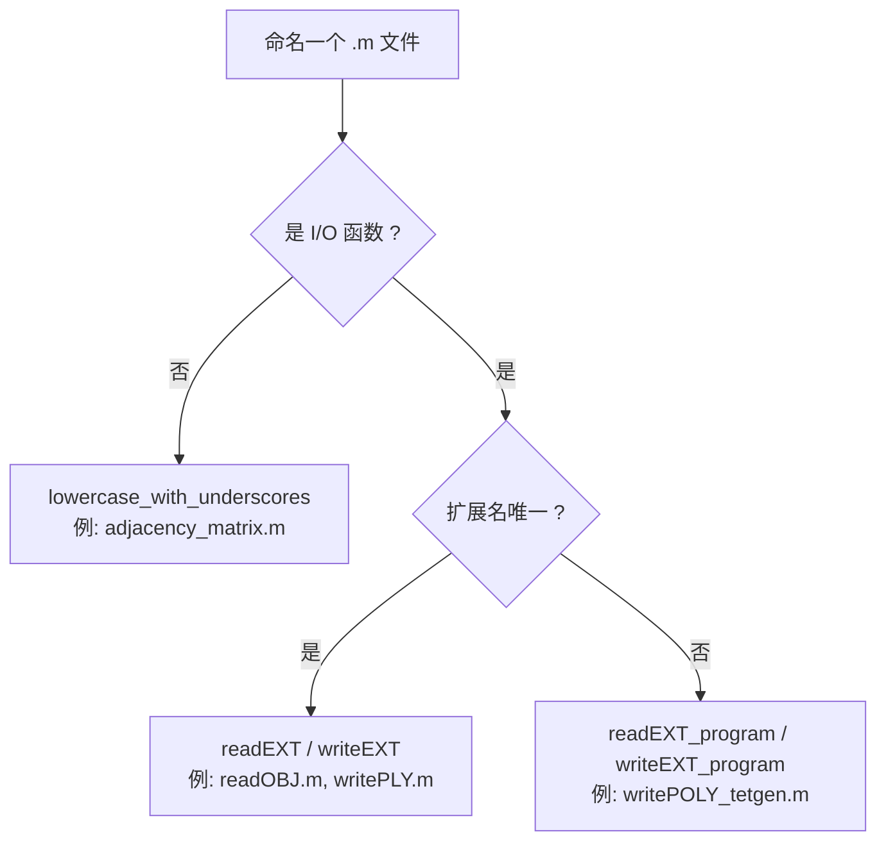
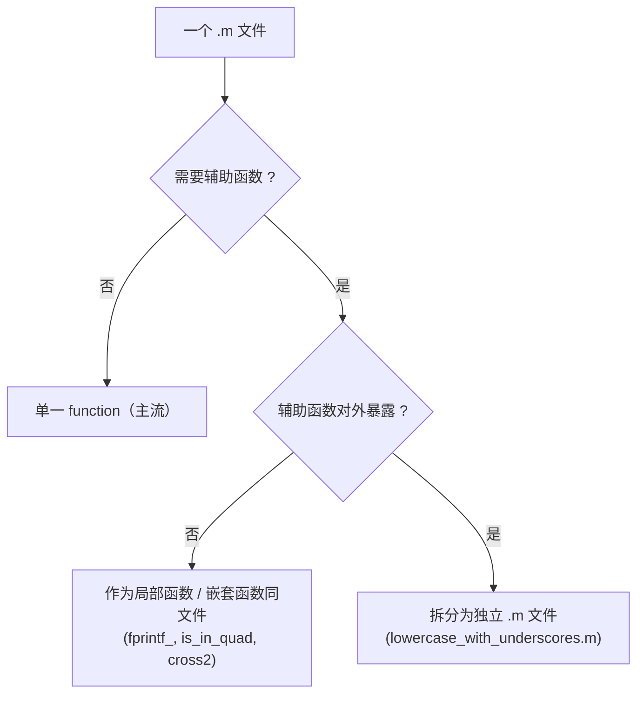
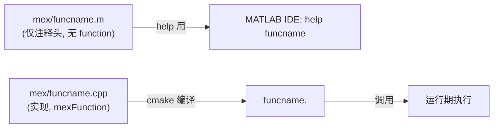
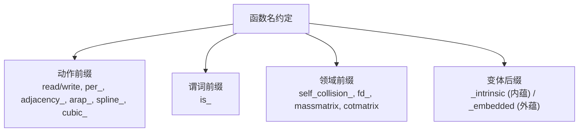
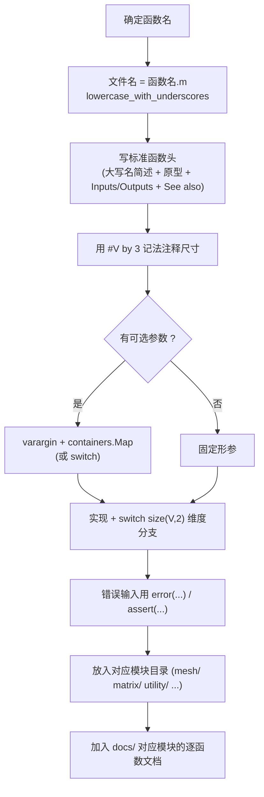

# 04 · 编码规范 / Coding Conventions

> 本章归纳 gptoolbox 的**文件命名、函数头、可选参数、尺寸注释、MEX 桩**等约定，
> 并结合真实源码给出可点击锚点。规范来源：仓库根 `style.md`、`CLAUDE.md`，
> 以及从 `mesh/` 等目录源码的归纳。
>
> This chapter documents gptoolbox's **file naming, function headers, optional
> arguments, size annotations, mex stubs** conventions, each with clickable anchors
> into the real sources. Sources: `style.md`, `CLAUDE.md`, and induction from `mesh/`.

---

## 1. 文件名规范 / File naming

> 原文锚点：[style.md#L1-L9](file:///c:/VSWork/gptoolbox-1/style.md#L1-L9)、
> [CLAUDE.md#L38-L40](file:///c:/VSWork/gptoolbox-1/CLAUDE.md#L38-L40)

**规则 / Rules**

1. 文件名 = 函数名 + `.m`。
2. 使用 `lowercase_with_underscores`（小写 + 下划线），例如 `adjacency_matrix.m`。
3. **例外（I/O）**：文件读写函数用 `readEXT` / `writeEXT`（`EXT` 为文件扩展名）。
4. **例外（歧义扩展名）**：若扩展名有歧义，用 `readEXT_program` / `writeEXT_program`，
   `program` 为生成该文件的程序短名。



**真实示例 / Real examples**

| 类别 | 示例函数名 | 文件 |
|---|---|---|
| 常规 unnamed | `adjacency_matrix`, `cotmatrix`, `massmatrix`, `per_vertex_normals` | [mesh/adjacency_matrix.m](file:///c:/VSWork/gptoolbox-1/mesh/adjacency_matrix.m) |
| `readEXT` / `writeEXT` | `readOBJ`, `writeOBJ`, `readOFF`, `writeOFF`, `readPLY`, `writePLY`, `readMESH`, `writeMESH` | [mesh/readOBJ.m](file:///c:/VSWork/gptoolbox-1/mesh/readOBJ.m)、[mesh/writeOFF.m](file:///c:/VSWork/gptoolbox-1/mesh/writeOFF.m) |
| `readEXT_program` / `writeEXT_program` | `readPOLY_triangle`, `readPOLY_pyramid`, `writePOLY_tetgen`, `writePOLY_triangle` | [mesh/writePOLY_tetgen.m](file:///c:/VSWork/gptoolbox-1/mesh/writePOLY_tetgen.m)、[mesh/readPOLY_triangle.m](file:///c:/VSWork/gptoolbox-1/mesh/readPOLY_triangle.m) |

> README 中列出的支持格式：`.obj,.off,.stl,.wrl,.ply,.mesh,.node,.ele,.poly,.smf,.bdl,.face`
> （[README.md#L25-L26](file:///c:/VSWork/gptoolbox-1/README.md#L25-L26)），对应上表的
> `read*/write*` 家族。

---

## 2. 函数头规范 / Function headers

> 原文锚点：[style.md#L11-L34](file:///c:/VSWork/gptoolbox-1/style.md#L11-L34)、
> [CLAUDE.md#L42-L61](file:///c:/VSWork/gptoolbox-1/CLAUDE.md#L42-L61)

**要求 / Requirement**：每个文件包含**单一暴露函数**，且必须有标准头，包含：
函数描述（首行大写函数名 + 简述）、函数原型、输入/输出说明。

**模板（style.md / CLAUDE.md）/ Template**

```matlab
function [out1,out2] = my_function(V,F,varargin)
  % MY_FUNCTION Short description of what this does
  %
  % out1 = my_function(V,F)
  % [out1,out2] = my_function(V,F,'ParameterName',ParameterValue,...)
  %
  % Inputs:
  %   V  #V by 3 list of mesh vertex positions
  %   F  #F by 3 list of triangle mesh indices
  %   Optional:
  %     'ParamName' followed by description {default}
  % Outputs:
  %   out1  description
  %   out2  description
  %
  % See also: related_function
```

**逐行对照真实源码 / Line-by-line vs. real source**

以 `mesh/centroid.m` 为例（style.md 中的 `centroid.m` 示例即取自此文件）：

| 模板要素 | 真实源码（[mesh/centroid.m#L1-L16](file:///c:/VSWork/gptoolbox-1/mesh/centroid.m#L1-L16)）|
|---|---|
| 签名 | L1 `function [C,vol] = centroid(V,F,varargin)` |
| 首行大写函数名 + 简述 | L2 `% CENTROID Compute the centroid of a closed polyhedron boudned by (V,F)` |
| 原型（2 种调用）| L4 `% C = centroid(V,F)`；L5 `% [C,vol] = centroid(V,F,'ParameterName',ParameterValue, ...)` |
| `Inputs:` | L7-L9（`V` L8、`F` L9）|
| `Optional:` | L10-L12（`'Robust'` L11-L12）|
| `Outputs:` | L13-L15（`C` L14、`vol` L15）|
| `See also:` | 该文件**未含** See also 段（对比 [mesh/adjacency_matrix.m#L17](file:///c:/VSWork/gptoolbox-1/mesh/adjacency_matrix.m#L17) 的 `% See also: facet_adjacency_matrix`）|

带 `See also` 的完整示例：

> 真实源码：[mesh/adjacency_matrix.m#L1-L18](file:///c:/VSWork/gptoolbox-1/mesh/adjacency_matrix.m#L1-L18)

```matlab
function [A] = adjacency_matrix(E)
  % ADJACENCY_MATRIX Build sparse adjacency matrix from edge list or face list
  %
  % [A] = adjacency_matrix(E)
  % [A] = adjacency_matrix(F)
  % [A] = adjacency_matrix(T)
  %
  % Inputs:
  %   E  #E by 2 edges list
  %   or
  %   F  #F by 3 triangle list
  %   or
  %   T  #F by 4 tet list
  % Outputs:
  %   A  #V by #V adjacency matrix (#V = max(E(:)))
  %
  % See also: facet_adjacency_matrix
  %
```

> 对照 style.md 模板（[style.md#L16-L33](file:///c:/VSWork/gptoolbox-1/style.md#L16-L33)），
> 结构完全一致：签名 → 大写名简述 → 原型 → Inputs → Outputs → See also。

---

## 3. 可选参数惯例 / Optional-argument idiom

> 原文锚点：[CLAUDE.md#L63](file:///c:/VSWork/gptoolbox-1/CLAUDE.md#L63) ——
> "Optional parameters are handled via `varargin` + `containers.Map` pattern (see
> `centroid.m` or `arap.m` for the canonical idiom)."

**标准四步法 / Canonical 4-step**

1. 先给每个可选参数设默认值。
2. 用 `containers.Map({'ParamName',...}, {'variableName',...})` 建立「参数名 → 变量名」映射。
3. `while v <= numel(varargin)` 遍历，命中则 `assignin('caller', ...)` 把值写回本函数工作区。
4. 未命中则 `error('Unsupported parameter: %s', varargin{v})`。

**centroid.m 中的实现（规范示例）/ In centroid.m**

> 真实源码：[mesh/centroid.m#L18-L34](file:///c:/VSWork/gptoolbox-1/mesh/centroid.m#L18-L34)

```matlab
  % default values
  robust = false;
  % Map of parameter names to variable names
  params_to_variables = containers.Map( {'Robust'}, {'robust'});
  v = 1;
  while v <= numel(varargin)
    param_name = varargin{v};
    if isKey(params_to_variables,param_name)
      assert(v+1<=numel(varargin));
      v = v+1;
      % Trick: use feval on anonymous function to use assignin to this workspace
      feval(@()assignin('caller',params_to_variables(param_name),varargin{v}));
    else
      error('Unsupported parameter: %s',varargin{v});
    end
    v=v+1;
  end
```

**arap.m 中的实现（多参数）/ In arap.m (many params)**

> 真实源码：[mesh/arap.m#L82-L135](file:///c:/VSWork/gptoolbox-1/mesh/arap.m#L82-L135)，
> 其中默认值集中在 L83-L115，映射表在 L117-L122，解析循环在 L123-L135：

```matlab
  % Map of parameter names to variable names
  params_to_variables = containers.Map( ...
    {'Energy','V0','Data','Tikhonov','Groups','Tol', ...
     'MaxIter','Dynamic','TimeStep','Vm1','RemoveRigid','Debug', ...
     'Aeq','Beq','Flat','Ref','Weight','Youngs'}, ...
    {'energy','U','data','alpha_tik','G','tol','max_iterations','fext', ...
    'h','Vm1','remove_rigid','debug','Aeq','Beq','flat','ref_data','weight','youngs'});
  v = 1;
  while v <= numel(varargin)
    param_name = varargin{v};
    if isKey(params_to_variables,param_name)
      assert(v+1<=numel(varargin));
      v = v+1;
      % Trick: use feval on anonymous function to use assignin to this workspace
      feval(@()assignin('caller',params_to_variables(param_name),varargin{v}));
    else
      error('Unsupported parameter: %s',varargin{v});
    end
    v=v+1;
  end
```

**变体 / Variant**：`load_mesh` 用朴素 `switch` 解析（也见于 `per_vertex_normals`）：

> 真实源码：[mesh/load_mesh.m#L20-L34](file:///c:/VSWork/gptoolbox-1/mesh/load_mesh.m#L20-L34)

```matlab
  % parse any optional input
  v = 1;
  quiet = false;
  while(v <= numel(varargin))
    switch varargin{v}
    case 'Quiet'
      v = v+1;
      assert(v<=nargin);
      quiet = varargin{v};
      quiet = quiet * 1;
    otherwise
      error(['Unsupported parameter: ' varargin{v}]);
    end
    v = v + 1;
  end
```

> 归纳 / Summary：`varargin` + `containers.Map`（`centroid.m`/`arap.m`）是**推荐惯例**，
> 简单场景允许用 `switch`（`load_mesh.m`）。

---

## 4. 尺寸注释规范 / Size-annotation convention

> 原文锚点：[CLAUDE.md#L65](file:///c:/VSWork/gptoolbox-1/CLAUDE.md#L65) ——
> "Matrix size comments: use `#V by dim` notation to document array dimensions."

**记法 / Notation**：用 `#V by 3`、`#F by 3` 等描述数组尺寸，`#V` 表示顶点数。

| 写法 | 含义 |
|---|---|
| `#V by 3` | `#V` 行 3 列的顶点位置 |
| `#F by 3` | `#F` 行 3 列的三角面索引 |
| `#T by 4` | `#T` 行 4 列的四面体索引 |
| `#b by dim` | 约束点数量 × 维度 |

**真实示例 / Real examples**

- `centroid.m`：`%   V  #V by dim list of mesh vertex positions`
  （[mesh/centroid.m#L8](file:///c:/VSWork/gptoolbox-1/mesh/centroid.m#L8)）
- `cotmatrix.m`：`%   V  #V x dim matrix of vertex coordinates` / `L  sparse #V x #V matrix`
  （[mesh/cotmatrix.m#L25-L28](file:///c:/VSWork/gptoolbox-1/mesh/cotmatrix.m#L25-L28)）
- `massmatrix.m`：`%  V  #V x 3 matrix of vertex coordinates` / `M  #V by #V sparse`
  （[mesh/massmatrix.m#L8-L16](file:///c:/VSWork/gptoolbox-1/mesh/massmatrix.m#L8-L16)）
- `doublearea.m`：`%  V #V x dim matrix of vertex coordinates` / `dblA   #F list …`
  （[mesh/doublearea.m#L6-L11](file:///c:/VSWork/gptoolbox-1/mesh/doublearea.m#L6-L11)）

> 注意：源码中同时存在 `#V by 3` 与 `#V x 3` 两种写法；文档层统一采用 `#V by 3`
> （与 [docs/README.md#L52](file:///c:/VSWork/gptoolbox-1/docs/README.md#L52) 及文档模板一致）。

---

## 5. 一个函数一个文件 / One function per file

> 原文锚点：[style.md#L12](file:///c:/VSWork/gptoolbox-1/style.md#L12) ——
> "Each file contains a single exposed function"。

**抽查结果 / Spot check**

以 `mesh/` 为例统计 `^function`（列 0 起的顶层函数定义）：
**577 处定义分布在 564 个文件中**，绝大多数文件为**单一函数**；少数文件含本文件的
**局部辅助函数**（`fprintf_`、`is_in_quad` 等）或 classdef 方法。这是"单一**暴露**函数"
（single *exposed* function）而非"单一定义"的体现。

| 文件 | 顶层函数数 | 额外函数（行号） | 类型 |
|---|---|---|---|
| [mesh/clean_mesh.m](file:///c:/VSWork/gptoolbox-1/mesh/clean_mesh.m#L1) | 2 | `fprintf_` @ [L216](file:///c:/VSWork/gptoolbox-1/mesh/clean_mesh.m#L216) | 局部辅助 |
| [mesh/cdt.m](file:///c:/VSWork/gptoolbox-1/mesh/cdt.m#L1) | 2 | `fprintf_` @ [L446](file:///c:/VSWork/gptoolbox-1/mesh/cdt.m#L446) | 局部辅助 |
| [mesh/encage.m](file:///c:/VSWork/gptoolbox-1/mesh/encage.m#L1) | 2 | `fprintf_` @ [L128](file:///c:/VSWork/gptoolbox-1/mesh/encage.m#L128) | 局部辅助 |
| [mesh/in_quadtree.m](file:///c:/VSWork/gptoolbox-1/mesh/in_quadtree.m#L1) | 2 | `is_in_quad` @ [L51](file:///c:/VSWork/gptoolbox-1/mesh/in_quadtree.m#L51) | 局部辅助 |
| [mesh/initialize_quadtree.m](file:///c:/VSWork/gptoolbox-1/mesh/initialize_quadtree.m#L1) | 4 | `transpose_orientation` @ [L78](file:///c:/VSWork/gptoolbox-1/mesh/initialize_quadtree.m#L78)、`is_in_quad` @ [L89](file:///c:/VSWork/gptoolbox-1/mesh/initialize_quadtree.m#L89)、`subdivide_quad` @ [L97](file:///c:/VSWork/gptoolbox-1/mesh/initialize_quadtree.m#L97) | 局部辅助 |
| [mesh/deform.m](file:///c:/VSWork/gptoolbox-1/mesh/deform.m#L1) | 多个 | classdef `deform`（含多个 method），另有 `lbs` @ [L1651](file:///c:/VSWork/gptoolbox-1/mesh/deform.m#L1651)、`dcm2quat` @ [L1658](file:///c:/VSWork/gptoolbox-1/mesh/deform.m#L1658) | classdef + 局部辅助 |
| [mesh/massmatrix.m](file:///c:/VSWork/gptoolbox-1/mesh/massmatrix.m#L1) | 1 + 嵌套 | 嵌套 `cross2` @ [L21-L27](file:///c:/VSWork/gptoolbox-1/mesh/massmatrix.m#L21-L27)（缩进，nested function） | 嵌套函数 |

结论 / Conclusion：



---

## 6. MEX 桩规范 / Mex stubs

> 原文锚点：[CLAUDE.md#L67-L72](file:///c:/VSWork/gptoolbox-1/CLAUDE.md#L67-L72)、
> [mex/README.md#L1-L7](file:///c:/VSWork/gptoolbox-1/mex/README.md#L1-L7)

**规则 / Rules**

- 每个 MEX 函数 `funcname` 都在 `mex/` 下有配套的 `funcname.m`，其中**只包含 `%` 注释头**
  （**没有 `function` 行、没有代码**），目的是让 `help funcname` 在 MATLAB IDE 中可用。
- 真正的实现位于 `funcname.cpp`。

**真实示例 / Real example**

> 真实源码：[mex/ambient_occlusion.m#L1-L22](file:///c:/VSWork/gptoolbox-1/mex/ambient_occlusion.m#L1-L22)
> —— 全文件均以 `%` 开头，无 `function` 行；实现见 `mex/ambient_occlusion.cpp`。

```matlab
% AMBIENT_OCCLUSION Compute ambient occlusion per given point
%
% S = ambient_occlusion(V,F,P,N,num_samples)
%
% Inputs:
%    V  #V by 3 list of mesh vertex positions
%    F  #F by 3 list of mesh triangle facet indices into V
%    ...
```



> 在逐函数文档中，MEX 条目须标注 `[MEX]`，文件名沿用 `mex/<name>.m`，实现指向
> `<name>.cpp`：见 [appendices/03-doc-template.md#L61](file:///c:/VSWork/gptoolbox-1/docs/appendices/03-doc-template.md#L61)（规则 R8）。

---

## 7. 命名与语义前缀 / Naming & semantic prefixes

从源码归纳的语义前缀约定（每类给出真实函数名）：

| 前缀 / Prefix | 语义 | 真实示例 |
|---|---|---|
| `read*` / `write*` | 文件 I/O | `readOBJ`, `writeOBJ`, `readOFF`, `writeOFF`, `readPLY`, `writePLY`, `readMESH`, `writeMESH` |
| `per_*` | 逐元素（顶点/面/棱/角）量 | `per_vertex_normals`, `per_corner_normals`, `per_edge_normals`, `per_vertex_frames` |
| `is_*` | 布尔谓词（判断） | `is_planar`, `is_acute`, `is_delaunay`, `is_intrinsic_delaunay`, `is_extrinsic_delaunay`, `is_self_intersecting`, `is_boundary_facet`, `is_vertex_nonmanifold` |
| `adjacency_*` | 邻接矩阵/表构造 | `adjacency_matrix`, `adjacency_list`, `adjacency_dihedral_angle_matrix`, `adjacency_edge_cost_matrix`, `adjacency_incident_angle_matrix` |
| `arap_*` | 尽可能刚性变形家族 | `arap`, `arap_dof`, `arap_energy`, `arap_gradient`, `arap_hessian`, `arap_linear_block`, `arap_rhs` |
| `spline_*` | 样条曲线工具 | `spline_area`, `spline_arc_lengths`, `spline_cage`, `spline_closing`, `spline_offset`, `spline_split`, `spline_upsample` |
| `cubic_*` | 三次（Bézier）曲线工具 | `cubic_eval`, `cubic_roots`, `cubic_tangent`, `cubic_subdivide`, `cubic_split`, `cubic_curvature`, `cubic_is_flat` |
| `self_collision_*` | 自碰撞/屏障势 | `self_collision_barrier`, `self_collision_barrier_cap_sym`, `self_collision_barrier_line_sym` |
| `fd_*` | 有限差分（finite difference）算子 | `fd_grad`, `fd_laplacian`, `fd_bilinear_coefficients`, `fd_trilinear_coefficients`, `fd_plot_stencil` |
| `massmatrix*` | 质量矩阵系列 | `massmatrix`, `massmatrix3`, `massmatrix_intrinsic`, `massmatrix_embedded` |
| `cotmatrix*` | 余切拉普拉斯系列 | `cotmatrix`, `cotmatrix3`, `cotmatrix_intrinsic`, `cotmatrix_embedded`, `intrinsic_delaunay_cotmatrix`, `crouzeix_raviart_cotmatrix` |
| `*_intrinsic` | 仅依赖内蕴量（边长/角度，无需坐标） | `massmatrix_intrinsic`, `cotmatrix_intrinsic`, `doublearea_intrinsic`, `volume_intrinsic`, `grad_intrinsic`, `div_intrinsic`, `internalangles_intrinsic` |
| `*_embedded` | 依赖嵌入坐标（外蕴） | `massmatrix_embedded`, `cotmatrix_embedded` |



---

## 8. 代码风格观察 / Observed code style

从源码归纳的若干一致风格：

### 8.1 缩进 2 空格 / 2-space indentation

所有 `mesh/`、`wrappers/` 等文件的函数体均以 **2 个空格**为一级缩进：

> 例如 [mesh/massmatrix.m#L21-L27](file:///c:/VSWork/gptoolbox-1/mesh/massmatrix.m#L21-L27)
> （嵌套函数 `cross2` 的函数体缩进为 4 空格）。

```matlab
function M = massmatrix(V,F, type)
  % MASSMATRIX mass matrix for the mesh given by V and F
  ...
  function r = cross2(a,b)
    % Optimizes r = cross(a,b,2), ...
    r =[a(:,2).*b(:,3)-a(:,3).*b(:,2), ...
        a(:,3).*b(:,1)-a(:,1).*b(:,3), ...
        a(:,1).*b(:,2)-a(:,2).*b(:,1)];
  end
```

### 8.2 用 `error(...)` 报错 / Errors via `error(...)`

非法输入一律 `error(...)`（而非打印后继续）：

> 锚点：[mesh/centroid.m#L31](file:///c:/VSWork/gptoolbox-1/mesh/centroid.m#L31)
> `error('Unsupported parameter: %s',varargin{v});`；
> [mesh/load_mesh.m#L75](file:///c:/VSWork/gptoolbox-1/mesh/load_mesh.m#L75)
> `error('Unknown mesh format: %s',ext);`；
> [wrappers/meshfix.m#L22](file:///c:/VSWork/gptoolbox-1/wrappers/meshfix.m#L22) `error(result);`。

另有 `assert(...)` 用于契约检查，例如
[mesh/centroid.m#L42](file:///c:/VSWork/gptoolbox-1/mesh/centroid.m#L42)
`assert(size(V,2) == 3,'Only 3d supported');`。

### 8.3 默认值写法 / Default-value idiom

简单缺省参数常用 `if ~exist('opt','var') opt = default; end`：

> 真实源码：[mesh/is_planar.m#L18-L20](file:///c:/VSWork/gptoolbox-1/mesh/is_planar.m#L18-L20)

```matlab
  if ~exist('epsilon','var')
    epsilon = 1e-10;
  end
```

对于固定位置的可选参数，则用 `nargin`：

> 真实源码：[mesh/massmatrix.m#L31-L38](file:///c:/VSWork/gptoolbox-1/mesh/massmatrix.m#L31-L38)

```matlab
  % simplex size
  ss = size(F,2);
  if nargin<3
    switch ss
    case 3
      type = 'voronoi';
    case {2,4}
      type = 'barycentric';
    end
  end
```

> gptoolbox 中函数体第 3 行起通常紧跟 `switch size(V,2)` / `switch size(F,2)` 的
> 维度分支模式（见 `doublearea.m`、`cotmatrix.m`、`massmatrix.m`）。

---

## 9. 新增函数 / 新增 MEX 的 checklist / Checklists

### 9.1 新增纯 MATLAB 函数 / Adding a plain function



清单 / Checklist：

- [ ] 文件名符合 `lowercase_with_underscores.m`（I/O 例外见 §1）。
- [ ] 有标准函数头（§2），含 `See also`。
- [ ] 尺寸注释用 `#V by dim` 记法（§4）。
- [ ] 可选参数遵循 `varargin` + `containers.Map`（§3）。
- [ ] 单一暴露函数；辅助函数设为其局部/嵌套函数（§5）。
- [ ] 缩进 2 空格；非法输入 `error(...)` / `assert(...)`（§8）。
- [ ] 归档到正确的模块目录；补文档条目。

### 9.2 新增 MEX 函数 / Adding a mex function

清单 / Checklist：

- [ ] 新建 `mex/<name>.cpp`，实现 `mexFunction`（参考 `mex/aabb.cpp` 的 libigl 用法）。
- [ ] 新建 `mex/<name>.m`，**仅含 `%` 注释头**（§6）。
- [ ] 在 `mex/CMakeLists.txt` 的相应 `compile_each(...)` 分组中加入 `"<name>.cpp;"`
      （如 CGAL 组 [CMakeLists.txt#L329-L351](file:///c:/VSWork/gptoolbox-1/mex/CMakeLists.txt#L329-L351)、
      Embree 组 [CMakeLists.txt#L302-L325](file:///c:/VSWork/gptoolbox-1/mex/CMakeLists.txt#L302-L325)）。
- [ ] 若依赖新的第三方库，更新 `mex/vcpkg.json` 或相应 `find_package`/`FetchContent`（§见构建文档 §3.6）。
- [ ] 重新 `cmake ..` 并构建；产物输出到 `mex/`（[CMakeLists.txt#L12-L22](file:///c:/VSWork/gptoolbox-1/mex/CMakeLists.txt#L12-L22)）。
- [ ] 补逐函数文档条目，标注 `[MEX]`，实现指向 `<name>.cpp`。

---

## 10. 提交规范参考 / Commit-related files

| 文件 | 作用 / Role | 关键内容 | 锚点 |
|---|---|---|---|
| `.mailmap` | 供 `git shortlog` 统一作者姓名/邮箱（修正历史提交中错乱的署名）| 将 `jalec`、`ajx`、`mangledorf`、`dolga`、`panozzo` 等映射为标准姓名 | [.mailmap#L1-L14](file:///c:/VSWork/gptoolbox-1/.mailmap#L1-L14) |
| `.gitignore` | 忽略构建产物与临时文件 | `*.o`、`*.a`、`*.mexmaci64`、`*.mexw64`、`*.mexa64`、`*.cache.mat`、`quat/*`、`quat.zip`、`mex/build*`、`mex/external`、`mesh/cubic_vertex_removal_g.m` 等 | [.gitignore#L1-L19](file:///c:/VSWork/gptoolbox-1/.gitignore#L1-L19) |
| `.travis.yml` | CI 配置（构建 + 测试）| `language: cpp`；Linux/macOS 三组；安装依赖后 `cd mex` → `cmake .. -DMATLAB_PROXY=ON …` → `make -j 2` → `ctest --verbose` | [.travis.yml#L1-L69](file:///c:/VSWork/gptoolbox-1/.travis.yml#L1-L69)、[script 段#L59-L69](file:///c:/VSWork/gptoolbox-1/.travis.yml#L59-L69) |

> `.mailmap` 头部注释说明其来源于 libigl 归档中"被弄乱"的作者署名：
> [.mailmap#L1-L6](file:///c:/VSWork/gptoolbox-1/.mailmap#L1-L6)。
> `.gitignore` 中 `mex/external`、`mex/build*` 被忽略，印证构建依赖与产物不入库
> （对应构建文档 §3.3：依赖下载到 `mex/external/`）。
> CI 的 `-DMATLAB_PROXY=ON` 使无真实 MATLAB 的机器也能编译（见构建文档 §3.8）。

---

## 交叉引用 / Cross references

- 构建与安装：`docs/00-overview/03-build-and-install.md`
- 逐函数文档模板（写作规范）：[docs/appendices/03-doc-template.md](file:///c:/VSWork/gptoolbox-1/docs/appendices/03-doc-template.md)
- 上游原文：[style.md](file:///c:/VSWork/gptoolbox-1/style.md)、
  [CLAUDE.md](file:///c:/VSWork/gptoolbox-1/CLAUDE.md)
