# 模块与关键函数依赖图 / Module & Key-function Dependency Map

> 本文档给出 `gptoolbox-1` 的**模块级依赖关系**与**关键函数级主干调用链**，用于理解
> “谁依赖谁、数据沿哪条路径流动、哪些函数是全局枢纽”。全局（逐函数）索引见
> [appendices/01-global-function-index.md](../appendices/01-global-function-index.md)，
> 全库依赖图总图另见 [appendices/02-module-dependency-graph.md](../appendices/02-module-dependency-graph.md)；
> 本文聚焦**层级与主干**。
>
> This document describes the **module-level dependencies** and **backbone call chains** of
> `gptoolbox-1`. A per-function global index lives in the appendices; this file focuses on
> **layers and main trunks**.

- 语言 / Language：中英对照（中文为主）
- 相关章节 / See also：[01-project-overview.md](01-project-overview.md)、
  [02-architecture.md](02-architecture.md)、[06-glossary.md](06-glossary.md)
- 上游依据 / Sources：`mesh/`、`matrix/`、`utility/`、`wrappers/`、`mex/`、`quat/`、
  `imageprocessing/`、`external/` 内真实源码（下方每条边均附文件锚点）
- 锚点格式 / Anchor format：`file:///c:/VSWork/gptoolbox-1/<相对路径>#Lx-Ly`

---

## 0. 统计口径说明 / Measurement method

本文中“被引用次数”均用以下命令在**四个核心模块**内实测（不含 `mex/`、`external/`、
`wrappers/`，以免第三方代码干扰排名）：

```
Grep(pattern="\b<name>\(", glob="{mesh,matrix,utility,imageprocessing}/**/*.m", output_mode="count")
```

- `\b<name>\(` 使用词边界锚定，因此 `\bcotmatrix\(` **不会**误匹配
  `intrinsic_delaunay_cotmatrix(`、`crouzeix_raviart_cotmatrix(`、`cotmatrix3(` 等变体。
- 计数包含函数**定义行所在文件**的自引用与同名递归调用（例如 `cotmatrix.m` 自身贡献 3 次）。
- 因此表中数字是“**名字精确为 `<name>` 的调用点**”的近似规模，用于判断扇入层级，不追求绝对精确。

---

## 1. 模块级依赖图 / Module-level Dependency Graph

### 1.1 依赖图 / Graph

节点为顶层模块；实线箭头 = `调用方 → 被调用方`；虚线 = 编译期/进程外依赖（非 `.m` 调用）。

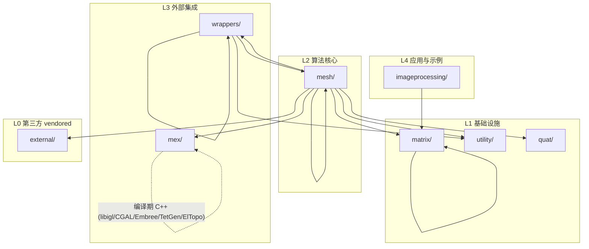

> 说明 / Notes：
> - `mesh/` 与 `wrappers/` 是**双向**的：`mesh/` 调用 `wrappers/triangle`，
>   `wrappers/tetgen` 又调用 `mesh/` 的 I/O（见 §1.2 边 E8、E9）。
> - `mex/` 与 `external/` 之间**没有 `.m` 级调用边**：MEX 的第三方依赖是编译期 C++ 库
>   （libigl/Eigen/CGAL/Embree/TetGen/El Topo），通过 `mex/CMakeLists.txt` 配置，见 §4.1。
> - `quat/`、`utility/`、`external/` 是被依赖的叶子，不反向依赖上层模块。

### 1.2 边证据表 / Edge evidence

| # | 边 / Edge | 代表函数 → 代表函数 | 文件锚点 / Anchor |
|---|---|---|---|
| E1 | `imageprocessing → matrix` | `iminpaint → min_quad_with_fixed` | [imageprocessing/iminpaint.m#L19](file:///c:/VSWork/gptoolbox-1/imageprocessing/iminpaint.m#L19) |
| E2 | `mesh → matrix` | `arap → min_quad_with_fixed` | [mesh/arap.m#L403](file:///c:/VSWork/gptoolbox-1/mesh/arap.m#L403)、[#L410-L412](file:///c:/VSWork/gptoolbox-1/mesh/arap.m#L410-L412) |
| E3 | `mesh → matrix` | `lscm → min_quad_with_fixed`、`repdiag` | [mesh/lscm.m#L118](file:///c:/VSWork/gptoolbox-1/mesh/lscm.m#L118)、[#L123](file:///c:/VSWork/gptoolbox-1/mesh/lscm.m#L123) |
| E4 | `mesh → utility` | `triangulate_curves → tempprefix` | [mesh/triangulate_curves.m#L91](file:///c:/VSWork/gptoolbox-1/mesh/triangulate_curves.m#L91) |
| E5 | `mesh → utility` | `deform → figgif` | [mesh/deform.m#L1600](file:///c:/VSWork/gptoolbox-1/mesh/deform.m#L1600) |
| E6 | `mesh → wrappers` | `png2mesh → triangle` | [mesh/png2mesh.m#L54](file:///c:/VSWork/gptoolbox-1/mesh/png2mesh.m#L54) |
| E7 | `mesh → wrappers` | `triangulate_curves → path_to_triangle` | [mesh/triangulate_curves.m#L104](file:///c:/VSWork/gptoolbox-1/mesh/triangulate_curves.m#L104) |
| E8 | `mesh → mex` | `bone_heat → bone_visible_embree` | [mesh/bone_heat.m#L39-L42](file:///c:/VSWork/gptoolbox-1/mesh/bone_heat.m#L39-L42) |
| E9 | `mesh → mex` | `clean_mesh → selfintersect` | [mesh/clean_mesh.m#L157](file:///c:/VSWork/gptoolbox-1/mesh/clean_mesh.m#L157) |
| E10 | `mesh → quat` | `retarget → quatmultiply` | [mesh/retarget.m#L45](file:///c:/VSWork/gptoolbox-1/mesh/retarget.m#L45)、[mesh/slice_triangles.m#L33](file:///c:/VSWork/gptoolbox-1/mesh/slice_triangles.m#L33) |
| E11 | `mesh → external` | `farthest_points → perform_fast_marching_mesh` | [mesh/farthest_points.m#L122](file:///c:/VSWork/gptoolbox-1/mesh/farthest_points.m#L122) |
| E12 | `mesh → external` | `readPLY → read_ply` | [mesh/readPLY.m#L10](file:///c:/VSWork/gptoolbox-1/mesh/readPLY.m#L10) |
| E13 | `wrappers → mesh` | `tetgen → writePOLY_tetgen`、`readELE`、`readNODE` | [wrappers/tetgen.m#L58](file:///c:/VSWork/gptoolbox-1/wrappers/tetgen.m#L58)、[#L101-L102](file:///c:/VSWork/gptoolbox-1/wrappers/tetgen.m#L101-L102) |
| E14 | `wrappers → mesh` | `triangle → writeNODE`、`readELE`、`readEDGE` | [wrappers/triangle.m#L172](file:///c:/VSWork/gptoolbox-1/wrappers/triangle.m#L172)、[#L231](file:///c:/VSWork/gptoolbox-1/wrappers/triangle.m#L231)、[#L265](file:///c:/VSWork/gptoolbox-1/wrappers/triangle.m#L265) |
| E15 | `wrappers → mesh` | `meshfix_components → connected_components`、`remove_unreferenced` | [wrappers/meshfix_components.m#L14](file:///c:/VSWork/gptoolbox-1/wrappers/meshfix_components.m#L14)、[#L21](file:///c:/VSWork/gptoolbox-1/wrappers/meshfix_components.m#L21) |
| E16 | `wrappers → utility` | `qslim → tempprefix`、`triangle → tempprefix` | [wrappers/qslim.m#L44](file:///c:/VSWork/gptoolbox-1/wrappers/qslim.m#L44)、[wrappers/triangle.m#L165](file:///c:/VSWork/gptoolbox-1/wrappers/triangle.m#L165) |
| E17 | `wrappers → wrappers` | `meshfix_components → meshfix` | [wrappers/meshfix_components.m#L24](file:///c:/VSWork/gptoolbox-1/wrappers/meshfix_components.m#L24) |
| E18 | `matrix → matrix` | `min_quad_with_fixed_active_set → min_quad_with_fixed` | [matrix/min_quad_with_fixed_active_set.m#L1](file:///c:/VSWork/gptoolbox-1/matrix/min_quad_with_fixed_active_set.m) |
| E19 | `matrix → matrix` | `normalizerow → normrow` | [matrix/normalizerow.m#L19](file:///c:/VSWork/gptoolbox-1/matrix/normalizerow.m#L19) |
| E20 | `mesh → mesh` | `intrinsic_delaunay_cotmatrix → cotmatrix_intrinsic`、`flip_edges` | [mesh/intrinsic_delaunay_cotmatrix.m#L51](file:///c:/VSWork/gptoolbox-1/mesh/intrinsic_delaunay_cotmatrix.m#L51)、[#L54](file:///c:/VSWork/gptoolbox-1/mesh/intrinsic_delaunay_cotmatrix.m#L54) |

---

## 2. 主干调用链 / Backbone Call Chains

> 每条链均经实际源码确认（`flowchart TD`）。节点标签内使用英文函数名 + 关键数据。

### 2.1 LSCM 最小二乘共形参数化 / Least-Squares Conformal Map

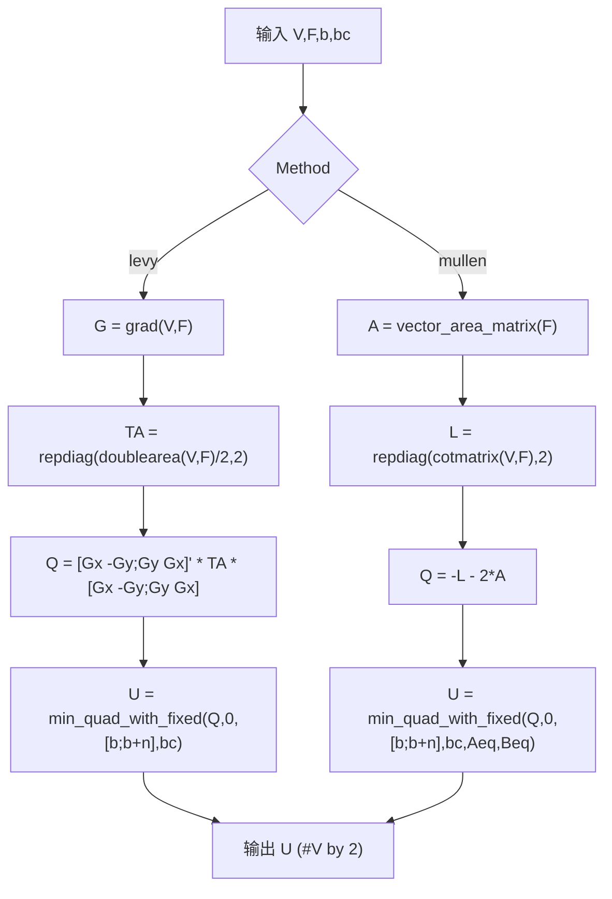

- 锚点：`G=grad` [mesh/lscm.m#L105](file:///c:/VSWork/gptoolbox-1/mesh/lscm.m#L105)；
  `TA=repdiag` [#L112](file:///c:/VSWork/gptoolbox-1/mesh/lscm.m#L112)；
  levy 求解 [#L118](file:///c:/VSWork/gptoolbox-1/mesh/lscm.m#L118)；
  `A=vector_area_matrix` [#L122](file:///c:/VSWork/gptoolbox-1/mesh/lscm.m#L122)；
  `L=repdiag(cotmatrix,...)` [#L123](file:///c:/VSWork/gptoolbox-1/mesh/lscm.m#L123)；
  mullen 求解 [#L130](file:///c:/VSWork/gptoolbox-1/mesh/lscm.m#L130)。
- 枢纽：`min_quad_with_fixed`（RF2 二次型求解）、`cotmatrix`、`repdiag`、`vector_area_matrix`。

### 2.2 ARAP 变形 / As-Rigid-As-Possible Deformation

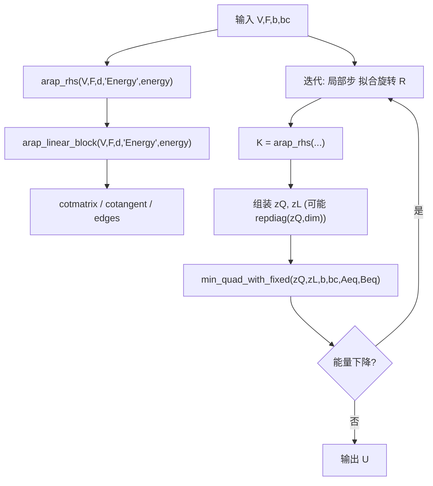

- 锚点：`arap_linear_block` 内 `E=edges(F)` [mesh/arap_linear_block.m#L98](file:///c:/VSWork/gptoolbox-1/mesh/arap_linear_block.m#L98)、
  `L=cotmatrix(V,F)` [#L106](file:///c:/VSWork/gptoolbox-1/mesh/arap_linear_block.m#L106)、
  `C=cotangent(V,F)` [#L141](file:///c:/VSWork/gptoolbox-1/mesh/arap_linear_block.m#L141)；
  `arap_rhs` 调 `arap_linear_block` [mesh/arap_rhs.m#L83-L84](file:///c:/VSWork/gptoolbox-1/mesh/arap_rhs.m#L83-L84)；
  全局步 `min_quad_with_fixed` [mesh/arap.m#L403](file:///c:/VSWork/gptoolbox-1/mesh/arap.m#L403)、[#L410-L412](file:///c:/VSWork/gptoolbox-1/mesh/arap.m#L410-L412)、
  `repdiag(zQ,dim)` [#L417](file:///c:/VSWork/gptoolbox-1/mesh/arap.m#L417)、[#L421](file:///c:/VSWork/gptoolbox-1/mesh/arap.m#L421)。

### 2.3 骨热蒙皮权重 + LBS / Bone-Heat Skinning + LBS

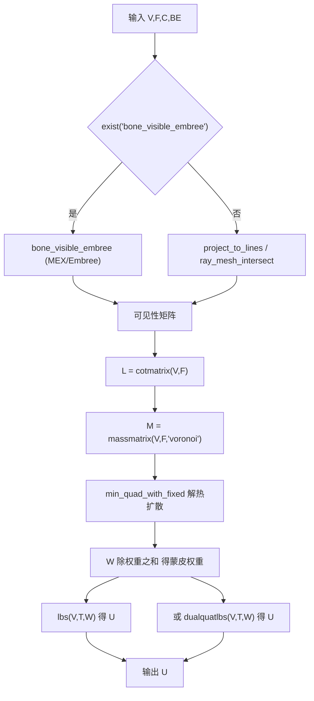

- 锚点：`bone_visible_embree` 探测与包装 [mesh/bone_heat.m#L39-L42](file:///c:/VSWork/gptoolbox-1/mesh/bone_heat.m#L39-L42)；
  `L=cotmatrix` [#L177](file:///c:/VSWork/gptoolbox-1/mesh/bone_heat.m#L177)；
  `M=massmatrix(...,'voronoi')` [#L179](file:///c:/VSWork/gptoolbox-1/mesh/bone_heat.m#L179)；
  `lbs` 签名 [mesh/lbs.m#L1-L15](file:///c:/VSWork/gptoolbox-1/mesh/lbs.m#L1-L15)。
- 备注：`bone_visible` 内部进一步分派到 `bone_visible_embree` / `ray_mesh_intersect` / `project_to_lines`
  （[mesh/bone_visible.m#L22-L24](file:///c:/VSWork/gptoolbox-1/mesh/bone_visible.m#L22-L24)、[#L50-L62](file:///c:/VSWork/gptoolbox-1/mesh/bone_visible.m#L50-L62)）。

### 2.4 有界双调和权重 / Bounded Biharmonic Weights

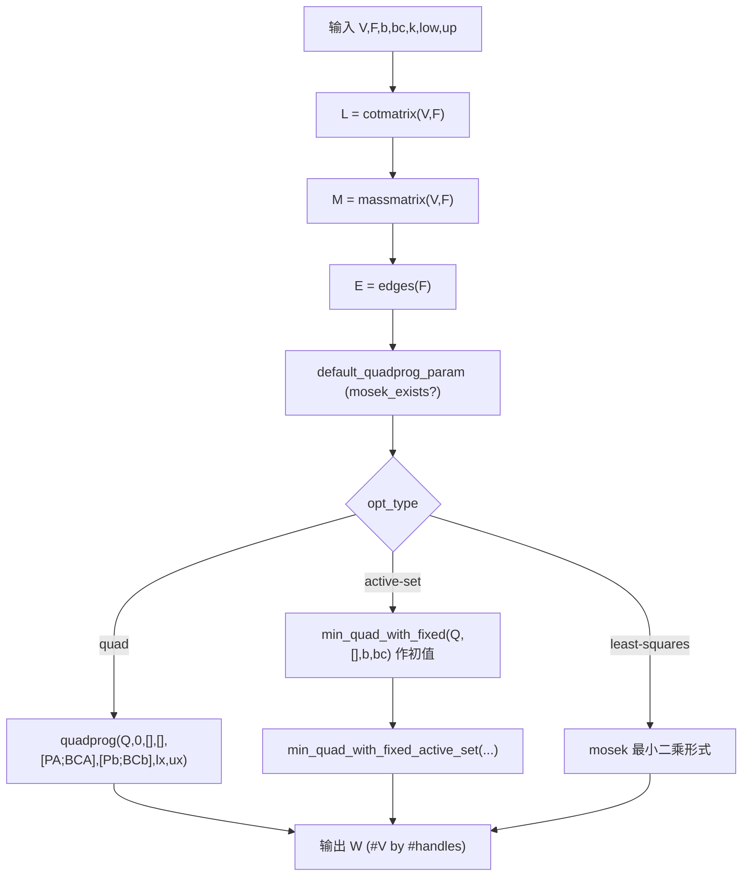

- 锚点：`default_quadprog_param` [mesh/biharmonic_bounded.m#L55](file:///c:/VSWork/gptoolbox-1/mesh/biharmonic_bounded.m#L55)；
  `L=cotmatrix` [#L93](file:///c:/VSWork/gptoolbox-1/mesh/biharmonic_bounded.m#L93)；
  `M=massmatrix` [#L94](file:///c:/VSWork/gptoolbox-1/mesh/biharmonic_bounded.m#L94)；
  `E=edges(F)` [#L112](file:///c:/VSWork/gptoolbox-1/mesh/biharmonic_bounded.m#L112)；
  `quadprog` [#L187](file:///c:/VSWork/gptoolbox-1/mesh/biharmonic_bounded.m#L187)；
  `min_quad_with_fixed` 作 active-set 初值 [#L257](file:///c:/VSWork/gptoolbox-1/mesh/biharmonic_bounded.m#L257)；
  `min_quad_with_fixed_active_set` [#L274](file:///c:/VSWork/gptoolbox-1/mesh/biharmonic_bounded.m#L274)。

### 2.5 k-调和坐标 / k-Harmonic Coordinates

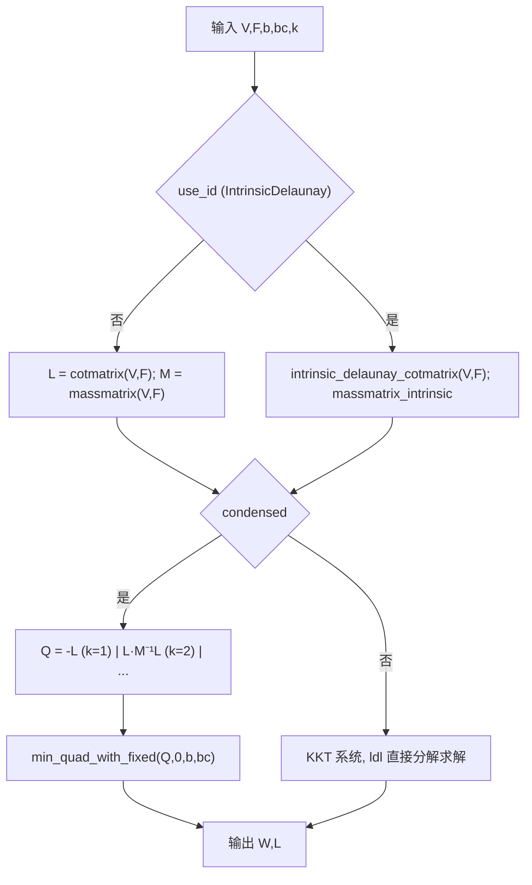

- 锚点：`adjacency_matrix`（n==0 分支）[mesh/kharmonic.m#L67](file:///c:/VSWork/gptoolbox-1/mesh/kharmonic.m#L67)；
  `intrinsic_delaunay_cotmatrix` / `massmatrix_intrinsic` [#L73-L74](file:///c:/VSWork/gptoolbox-1/mesh/kharmonic.m#L73-L74)；
  `cotmatrix` / `massmatrix` [#L76-L77](file:///c:/VSWork/gptoolbox-1/mesh/kharmonic.m#L76-L77)；
  `min_quad_with_fixed` [#L101](file:///c:/VSWork/gptoolbox-1/mesh/kharmonic.m#L101)；
  `repdiag`（KKT 分支）[#L130](file:///c:/VSWork/gptoolbox-1/mesh/kharmonic.m#L130)。

### 2.6 热方法测地距离 / Geodesics in Heat

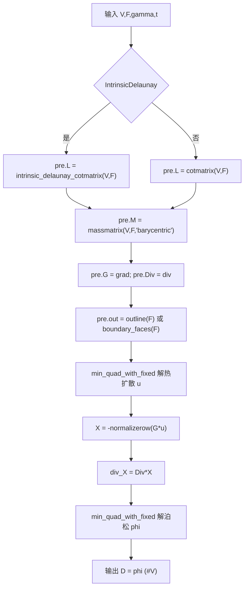

- 锚点：`intrinsic_delaunay_cotmatrix` [mesh/heat_geodesic.m#L145](file:///c:/VSWork/gptoolbox-1/mesh/heat_geodesic.m#L145)；
  `cotmatrix` [#L147](file:///c:/VSWork/gptoolbox-1/mesh/heat_geodesic.m#L147)；
  `massmatrix(...,'barycentric')` [#L149](file:///c:/VSWork/gptoolbox-1/mesh/heat_geodesic.m#L149)；
  `grad`/`div` [#L151-L152](file:///c:/VSWork/gptoolbox-1/mesh/heat_geodesic.m#L151-L152)；
  `outline`/`boundary_faces` [#L158](file:///c:/VSWork/gptoolbox-1/mesh/heat_geodesic.m#L158)、[#L160](file:///c:/VSWork/gptoolbox-1/mesh/heat_geodesic.m#L160)；
  热扩散求解 [#L178](file:///c:/VSWork/gptoolbox-1/mesh/heat_geodesic.m#L178)、[#L187](file:///c:/VSWork/gptoolbox-1/mesh/heat_geodesic.m#L187)；
  `normalizerow` [#L253](file:///c:/VSWork/gptoolbox-1/mesh/heat_geodesic.m#L253)；
  泊松求解 [#L261](file:///c:/VSWork/gptoolbox-1/mesh/heat_geodesic.m#L261)、[#L265](file:///c:/VSWork/gptoolbox-1/mesh/heat_geodesic.m#L265)。

### 2.7 布尔运算 / Boolean（MEX 与纯 MATLAB 双路径）

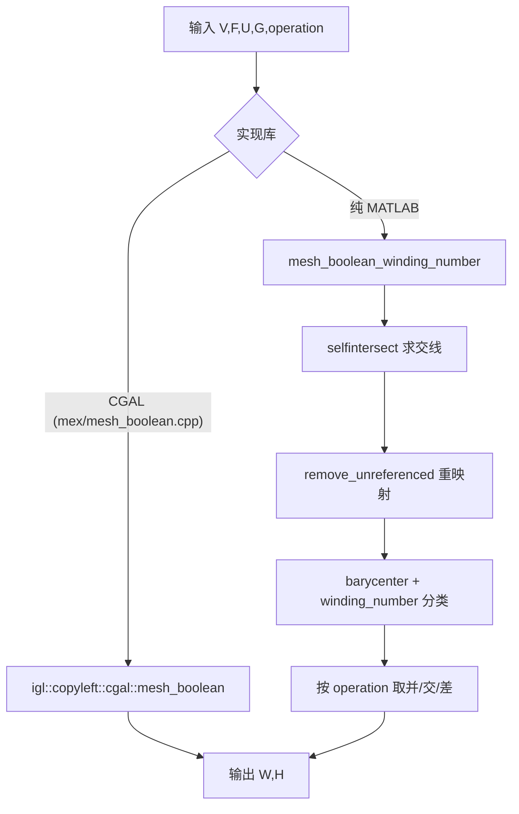

- 锚点：MEX 桩签名 [mex/mesh_boolean.m#L1-L31](file:///c:/VSWork/gptoolbox-1/mex/mesh_boolean.m#L1-L31)（实现在 `mex/mesh_boolean.cpp`，
  `#include <igl/copyleft/cgal/mesh_boolean.h>`）；纯 MATLAB 路径
  `selfintersect` [mesh/mesh_boolean_winding_number.m#L31](file:///c:/VSWork/gptoolbox-1/mesh/mesh_boolean_winding_number.m#L31)、
  `remove_unreferenced` [#L32](file:///c:/VSWork/gptoolbox-1/mesh/mesh_boolean_winding_number.m#L32)、[#L91](file:///c:/VSWork/gptoolbox-1/mesh/mesh_boolean_winding_number.m#L91)、
  `barycenter`/`winding_number` [#L58-L61](file:///c:/VSWork/gptoolbox-1/mesh/mesh_boolean_winding_number.m#L58-L61)。

### 2.8 网格清理管线 / Mesh Clean-up

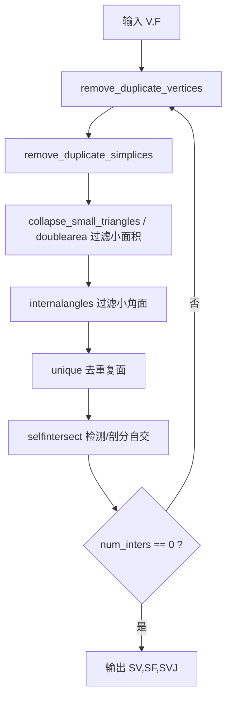

- 锚点：`remove_duplicate_vertices` [mesh/clean_mesh.m#L107](file:///c:/VSWork/gptoolbox-1/mesh/clean_mesh.m#L107)；
  `remove_duplicate_simplices` [#L115](file:///c:/VSWork/gptoolbox-1/mesh/clean_mesh.m#L115)；
  `collapse_small_triangles` [#L133](file:///c:/VSWork/gptoolbox-1/mesh/clean_mesh.m#L133)、
  `doublearea` 过滤 [#L135](file:///c:/VSWork/gptoolbox-1/mesh/clean_mesh.m#L135)；
  `internalangles` [#L143](file:///c:/VSWork/gptoolbox-1/mesh/clean_mesh.m#L143)；
  `unique` [#L148](file:///c:/VSWork/gptoolbox-1/mesh/clean_mesh.m#L148)；
  `selfintersect` [#L157](file:///c:/VSWork/gptoolbox-1/mesh/clean_mesh.m#L157)。

### 2.9 Triangle 封装 / Triangle wrapper

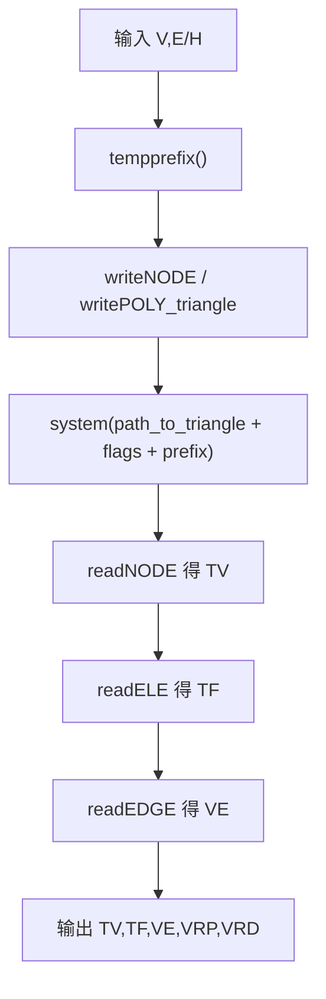

- 锚点：`tempprefix` [wrappers/triangle.m#L165](file:///c:/VSWork/gptoolbox-1/wrappers/triangle.m#L165)；
  `writeNODE` [#L172](file:///c:/VSWork/gptoolbox-1/wrappers/triangle.m#L172)、`writePOLY_triangle` [#L179](file:///c:/VSWork/gptoolbox-1/wrappers/triangle.m#L179)；
  `path_to_triangle` 拼命令 [#L217](file:///c:/VSWork/gptoolbox-1/wrappers/triangle.m#L217)；
  `readNODE` [#L230](file:///c:/VSWork/gptoolbox-1/wrappers/triangle.m#L230)、`readELE` [#L231](file:///c:/VSWork/gptoolbox-1/wrappers/triangle.m#L231)、`readEDGE` [#L265](file:///c:/VSWork/gptoolbox-1/wrappers/triangle.m#L265)。

### 2.10 TetGen 封装 / TetGen wrapper

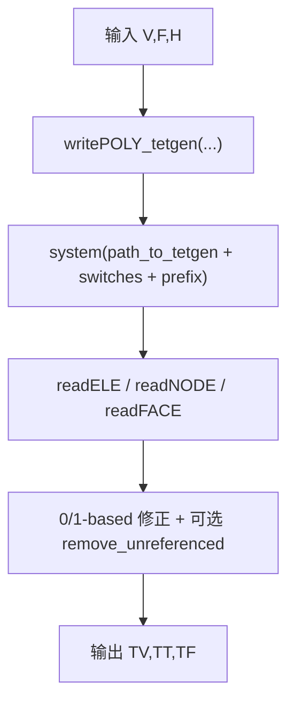

- 锚点：`writePOLY_tetgen` [wrappers/tetgen.m#L58](file:///c:/VSWork/gptoolbox-1/wrappers/tetgen.m#L58)；
  `path_to_tetgen` 拼命令 [#L75](file:///c:/VSWork/gptoolbox-1/wrappers/tetgen.m#L75)；
  `system` [#L79](file:///c:/VSWork/gptoolbox-1/wrappers/tetgen.m#L79)；
  `readFACE` [#L95](file:///c:/VSWork/gptoolbox-1/wrappers/tetgen.m#L95)、`readELE` [#L101](file:///c:/VSWork/gptoolbox-1/wrappers/tetgen.m#L101)、`readNODE` [#L102](file:///c:/VSWork/gptoolbox-1/wrappers/tetgen.m#L102)。

### 2.11 内在 Delaunay 拉普拉斯 / Intrinsic Delaunay Laplacian

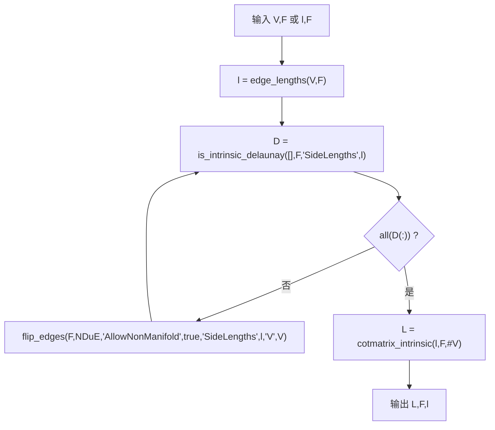

- 锚点：`edge_lengths` [mesh/intrinsic_delaunay_cotmatrix.m#L40](file:///c:/VSWork/gptoolbox-1/mesh/intrinsic_delaunay_cotmatrix.m#L40)；
  `is_intrinsic_delaunay` [#L44](file:///c:/VSWork/gptoolbox-1/mesh/intrinsic_delaunay_cotmatrix.m#L44)；
  `flip_edges` [#L51](file:///c:/VSWork/gptoolbox-1/mesh/intrinsic_delaunay_cotmatrix.m#L51)；
  `cotmatrix_intrinsic` [#L54](file:///c:/VSWork/gptoolbox-1/mesh/intrinsic_delaunay_cotmatrix.m#L54)。

### 2.12 精确测地（MEX 桩，无 `.m` 调用方）/ Exact Geodesic

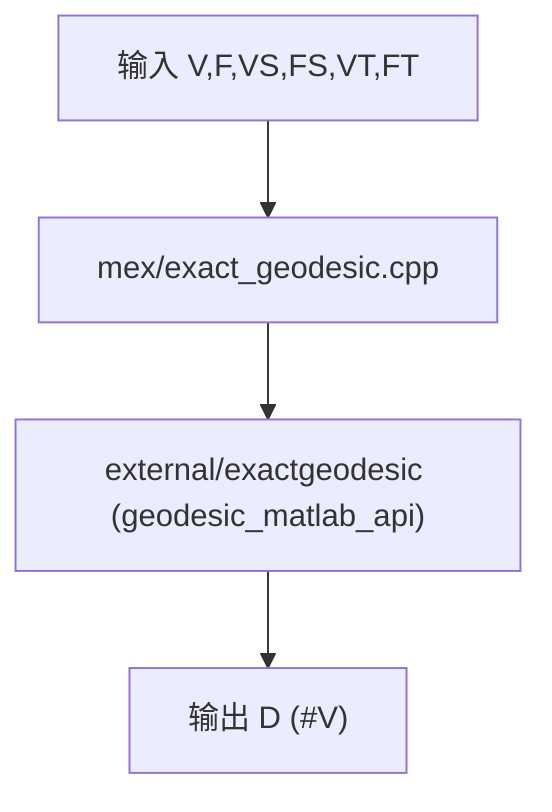

- 锚点：MEX 桩 [mex/exact_geodesic.m#L1-L13](file:///c:/VSWork/gptoolbox-1/mex/exact_geodesic.m#L1-L13)。
- **注意**：在 `.m` 源码中检索 `\bexact_geodesic\(` **无任何匹配**（仅定义桩自身），说明该 MEX
  在库内没有 `.m` 层调用者，属“供用户直接调用的叶子能力”。
  同理 `\btetrahedralize\(` 在 `.m` 中亦无匹配，库内四面体化实际走 `wrappers/tetgen`。

---

## 3. 高扇入函数排行 / High Fan-in Ranking

按 §0 命令在 `{mesh,matrix,utility,imageprocessing}` 内实测的调用点数量降序排列：

| 排名 | 函数 / Function | 调用点 | 文件数 | 角色 / Role | 文件锚点 |
|---|---|---|---|---|---|
| 1 | `normalizerow` | 106 | 58 | 逐行单位化（法线/方向向量），几乎所有几何查询都会用 | [matrix/normalizerow.m#L1-L20](file:///c:/VSWork/gptoolbox-1/matrix/normalizerow.m#L1-L20) |
| 2 | `doublearea` | 81 | 49 | 三角形/四面体面积（或体积），质量矩阵与判定的基础量 | [mesh/doublearea.m](file:///c:/VSWork/gptoolbox-1/mesh/doublearea.m) |
| 3 | `normrow` | 73 | 43 | 逐行 2-范数（鲁棒 norm），距离/长度计算 | [matrix/normrow.m](file:///c:/VSWork/gptoolbox-1/matrix/normrow.m) |
| 4 | `remove_unreferenced` | 60 | 46 | 删除未被引用的顶点并重映射索引，I/O 与布尔后处理标配 | [mesh/remove_unreferenced.m](file:///c:/VSWork/gptoolbox-1/mesh/remove_unreferenced.m) |
| 5 | `min_quad_with_fixed` | 54 | 26 | 二次型 + 等式约束求解器（LDL/LU/Chol 预分解），库内“线性系统心脏” | [matrix/min_quad_with_fixed.m#L1-L10](file:///c:/VSWork/gptoolbox-1/matrix/min_quad_with_fixed.m#L1-L10) |
| 6 | `repdiag` | 50 | 23 | 块对角重复（把标量算子扩到逐坐标维度） | [matrix/repdiag.m](file:///c:/VSWork/gptoolbox-1/matrix/repdiag.m) |
| 7 | `cotmatrix` | 47 | 36 | 余切拉普拉斯（DDG 核心算子） | [mesh/cotmatrix.m#L1-L40](file:///c:/VSWork/gptoolbox-1/mesh/cotmatrix.m#L1-L40) |
| 8 | `adjacency_matrix` | 43 | 33 | 稀疏邻接矩阵（图/连通性基础） | [mesh/adjacency_matrix.m](file:///c:/VSWork/gptoolbox-1/mesh/adjacency_matrix.m) |
| 9 | `massmatrix` | 42 | 33 | 质量矩阵（有限元内积） | [mesh/massmatrix.m](file:///c:/VSWork/gptoolbox-1/mesh/massmatrix.m) |
| 10 | `outline` | 36 | 30 | 有向边界边列表（边界拓扑基础） | [mesh/outline.m](file:///c:/VSWork/gptoolbox-1/mesh/outline.m) |
| 11 | `edges` | 35 | 26 | 无向边列表（从面/四边体导出） | [mesh/edges.m](file:///c:/VSWork/gptoolbox-1/mesh/edges.m) |
| 12 | `boundary_faces` | 32 | 22 | 四面体网格边界面提取 | [mesh/boundary_faces.m](file:///c:/VSWork/gptoolbox-1/mesh/boundary_faces.m) |
| 13 | `on_boundary` | 16 | 13 | 顶点/单纯形是否位于边界 | [mesh/on_boundary.m](file:///c:/VSWork/gptoolbox-1/mesh/on_boundary.m) |
| 14 | `sparse_eigs` | 3 | 2 | 稀疏广义特征值（谱方法） | [matrix/sparse_eigs.m](file:///c:/VSWork/gptoolbox-1/matrix/sparse_eigs.m) |

**解读 / Reading**：

- 排行前列（`normalizerow`/`normrow`/`doublearea`/`repdiag`）都是**极小的数值工具**，说明
  库内大量算法自行组装管线，横向复用这些原子操作。
- `min_quad_with_fixed` 虽只排第 5，但分布在参数化/变形/权重/测地等**几乎所有重型算法**中，
  是“算法核心 ↔ 基础设施”之间最主要的依赖边（见 §1.2 E2/E3）。
- `cotmatrix` / `massmatrix` / `doublearea` 构成 DDG 算子底座；`outline` / `boundary_faces` /
  `on_boundary` / `edges` 构成拓扑查询底座。

---

## 4. 外部依赖边界 / External Dependency Boundaries

gptoolbox 有**两条互不相同**的外部边界：① `mex/` 的**编译期 C++ 库**；② `wrappers/` 的
**运行期外部可执行文件**。此外 `external/` 是 vendored 的第三方 **MATLAB 源码**。

### 4.1 MEX 层：编译期 C++ 依赖 / MEX compile-time C++ deps

| MEX 实现 / Implementation | 依赖库 / Library | 证据 / Evidence |
|---|---|---|
| `mex/mesh_boolean.cpp` | libigl **copyleft/CGAL** | `#include <igl/copyleft/cgal/mesh_boolean.h>`；`igl::copyleft::cgal::mesh_boolean` |
| `mex/tetrahedralize.cpp` | libigl **copyleft/TetGen** | `igl::copyleft::tetgen::tetrahedralize` |
| `mex/slim.cpp` | libigl **slim** + CGAL | `igl::slim` |
| `mex/point_mesh_squared_distance.cpp` | libigl + CGAL `Epeck` | `igl::point_mesh_squared_distance` + CGAL kernel |
| `mex/bone_visible_embree.cpp` | **Embree** 光线求交 | 由 `wrappers/path_to_*` 之外的 cmake 配置启用 |
| `mex/ray_mesh_intersect.cpp`、`mex/ambient_occlusion.cpp` | Embree | `#include <igl/embree/ambient_occlusion.h>`；`igl::embree::ambient_occlusion` |
| `mex/eltopo.cpp` | **El Topo** | `wrappers/path_to_eltopo.m` |
| 全部 `mex/*.cpp` | **Eigen** + **libigl** | `mex/CMakeLists.txt` |

- 关键开关证据（`mex/CMakeLists.txt`）：`LIBIGL_COPYLEFT_CGAL ON`、`LIBIGL_EMBREE ON`、
  `LIBIGL_COPYLEFT_TETGEN ON`、`eltopo`。
- **注意**：`mex/bone_visible_embree` **只有 `.cpp`，没有 `.m` 桩**
  （本仓库存在 [mex/bone_visible_embree.cpp](file:///c:/VSWork/gptoolbox-1/mex/bone_visible_embree.cpp)，
  `bone_heat.m` 用 `exist('bone_visible_embree','file')` 探测，见
  [mesh/bone_heat.m#L39](file:///c:/VSWork/gptoolbox-1/mesh/bone_heat.m#L39)）。
  这与“每个 MEX 都有注释桩”的一般规律不同，属特例。

### 4.2 wrappers 层：运行期外部二进制 / Runtime external binaries

| 封装 / Wrapper | 外部程序 / Binary | 定位函数 / path_to | 调用点证据 |
|---|---|---|---|
| `wrappers/tetgen.m` | `tetgen` | [path_to_tetgen.m](file:///c:/VSWork/gptoolbox-1/wrappers/path_to_tetgen.m) | [tetgen.m#L75-L79](file:///c:/VSWork/gptoolbox-1/wrappers/tetgen.m#L75-L79) |
| `wrappers/triangle.m` | `triangle` | [path_to_triangle.m](file:///c:/VSWork/gptoolbox-1/wrappers/path_to_triangle.m) | [triangle.m#L217](file:///c:/VSWork/gptoolbox-1/wrappers/triangle.m#L217) |
| `wrappers/qslim.m` | `qslim` | [path_to_qslim.m#L12-L25](file:///c:/VSWork/gptoolbox-1/wrappers/path_to_qslim.m#L12-L25) | [qslim.m#L52-L53](file:///c:/VSWork/gptoolbox-1/wrappers/qslim.m#L52-L53) |
| `wrappers/meshfix.m` | `meshfix` | [path_to_meshfix.m](file:///c:/VSWork/gptoolbox-1/wrappers/path_to_meshfix.m) | [meshfix.m#L18](file:///c:/VSWork/gptoolbox-1/wrappers/meshfix.m#L18) |
| `wrappers/medit.m` | `medit` | [path_to_medit.m](file:///c:/VSWork/gptoolbox-1/wrappers/path_to_medit.m) | [medit.m#L80](file:///c:/VSWork/gptoolbox-1/wrappers/medit.m#L80) |

- 三个 `path_to_*.m` 仅为**定位器**：Windows 返回硬编码路径，mac/Unix 用 `which` 回退候选列表。
- `wrappers/path_to_libigl.m`、`wrappers/path_to_eltopo.m`、`wrappers/path_to_convert.m` 同属该层，
  但服务于库路径而非单次进程调用。

### 4.3 external 层：vendored 第三方 MATLAB / Vendored third-party MATLAB

| 被依赖项 / Dependency | 使用方 / Caller | 证据 |
|---|---|---|
| `perform_fast_marching_mesh`（`external/toolbox_fast_marching/`） | `mesh/farthest_points` | [mesh/farthest_points.m#L122](file:///c:/VSWork/gptoolbox-1/mesh/farthest_points.m#L122) |
| `read_ply` / `write_ply` | `mesh/readPLY` / `writePLY` | [mesh/readPLY.m#L10](file:///c:/VSWork/gptoolbox-1/mesh/readPLY.m#L10) |
| `cbrewer` | `mesh/beach_ball`、`mesh/spline_closing`、`imageprocessing/get_scribbles` | [imageprocessing/get_scribbles.m#L46](file:///c:/VSWork/gptoolbox-1/imageprocessing/get_scribbles.m#L46) |
| `combn` | `mesh/bounding_box` | [mesh/bounding_box.m#L39](file:///c:/VSWork/gptoolbox-1/mesh/bounding_box.m#L39) |
| `progressbar` | `mesh/df_build`、`mesh/df_build_fast`、`mesh/bone_visible`、`mesh/point_visible`、`mesh/lazy_cage` | [mesh/bone_visible.m#L46](file:///c:/VSWork/gptoolbox-1/mesh/bone_visible.m#L46) |
| `exactgeodesic`（含 `geodesic_debug.dll`/`geodesic_release.*`） | 无 `.m` 调用方（仅与 `mex/exact_geodesic` 对应） | [external/exactgeodesic.m](file:///c:/VSWork/gptoolbox-1/external/exactgeodesic.m) |
| `quaternionrotate` 等 | 四元数相关路径 | `external/quaternionrotate.m` |

---

## 5. 循环依赖与可疑耦合 / Cycles & Suspicious Coupling

### 5.1 真实存在的模块级循环 / True module cycle

| 循环 / Cycle | 方向 A | 方向 B | 判断 |
|---|---|---|---|
| `mesh ⇄ wrappers` | `mesh/png2mesh → wrappers/triangle`（[png2mesh.m#L54](file:///c:/VSWork/gptoolbox-1/mesh/png2mesh.m#L54)） | `wrappers/tetgen → mesh/writePOLY_tetgen`（[tetgen.m#L58](file:///c:/VSWork/gptoolbox-1/wrappers/tetgen.m#L58)） | **设计使然**：`wrappers/` 是“外部程序的薄壳”，需要复用 `mesh/` 的 I/O；`mesh/` 又需外部网格化能力。重建时二者必须能各自独立编译，循环在**函数级**而非文件级。

### 5.2 函数级自引用/近环 / Function-level self-reference & near-cycles

| 项 / Item | 说明 | 证据 |
|---|---|---|
| `cotmatrix` 自引用 | `cotmatrix.m` 内含 3 处 `cotmatrix(`（定义行 + 内部调用），统计时计入自身 | [mesh/cotmatrix.m](file:///c:/VSWork/gptoolbox-1/mesh/cotmatrix.m) |
| `normalizerow → normrow → normalizerow`？ | 实际**单向**：`normalizerow` 在非稀疏分支调用 `normrow`，`normrow` 不回调，**无环** | [matrix/normalizerow.m#L19](file:///c:/VSWork/gptoolbox-1/matrix/normalizerow.m#L19) |
| `min_quad_with_fixed_active_set → min_quad_with_fixed` | 前者以后者结果作初值，**单向** | [matrix/min_quad_with_fixed_active_set.m](file:///c:/VSWork/gptoolbox-1/matrix/min_quad_with_fixed_active_set.m) |

### 5.3 可疑耦合与文档偏差 / Suspicious coupling & doc drift

1. **`imageprocessing → mesh` 在实际 `.m` 调用中不被证实**。
   [02-architecture.md](../00-overview/02-architecture.md) 列了 `imageprocessing/` 依赖 `mesh/`，
   但在 `imageprocessing/` 内检索 `png2poly|triangulate_curves|bwmesh|cotmatrix|massmatrix|kharmonic|readOBJ|outline|boundary_faces|remove_unreferenced|edges` **均无实际调用匹配**；
   唯一跨模块调用是 `iminpaint → matrix/min_quad_with_fixed`（[iminpaint.m#L19](file:///c:/VSWork/gptoolbox-1/imageprocessing/iminpaint.m#L19)）。
   `image_laplacian.m` 只在 **See also 注释**中提到 `cotmatrix`
   （[imageprocessing/image_laplacian.m#L17](file:///c:/VSWork/gptoolbox-1/imageprocessing/image_laplacian.m#L17)），**非运行时依赖**。
   → 结论：`imageprocessing → mesh` 应视为**弱依赖/文档性引用**，重建时可解耦。

2. **名称遮蔽：`collapse_small_triangles` 与 `selfintersect` 只有 MEX 版本**。
   仓库内不存在 `mesh/collapse_small_triangles.m` 或 `mesh/selfintersect.m`；
   二者仅在 `mex/`（[mex/collapse_small_triangles.m](file:///c:/VSWork/gptoolbox-1/mex/collapse_small_triangles.m)、
   [mex/selfintersect.m](file:///c:/VSWork/gptoolbox-1/mex/selfintersect.m)）。
   因此 `clean_mesh` 对 `selfintersect`/`collapse_small_triangles` 的调用是**硬依赖 MEX**
   （[clean_mesh.m#L133](file:///c:/VSWork/gptoolbox-1/mesh/clean_mesh.m#L133)、[#L157](file:///c:/VSWork/gptoolbox-1/mesh/clean_mesh.m#L157)），
   属于“看起来像纯 MATLAB、实则需编译”的隐藏边界。

3. **`mex/exact_geodesic`、`mex/tetrahedralize` 在库内无 `.m` 调用方**。
   `\bexact_geodesic\(`、`\btetrahedralize\(` 在 `{mesh,matrix,utility,imageprocessing}` 内**零匹配**；
   库内四面体化实际走 `wrappers/tetgen`（见 §2.10）。二者是“用户直呼”的叶子能力，
   不影响主干，但会让人误以为它们被大量引用。

4. **功能重复：`mesh_boolean`（MEX/CGAL）与 `mesh_boolean_winding_number`（纯 MATLAB）**。
   同一语义有两条实现路径（§2.7），前者精度/鲁棒性更高但需 CGAL 编译，后者零编译依赖。
   重建时二者都要保留。

5. **`bone_visible_embree` 缺 `.m` 桩**（见 §4.1）：唯一无注释桩的 MEX，`help` 不可用，
   只能靠 `exist(...,'file')` 探测。

---

## 6. 小结 / Summary

- **模块主干**：`mesh/` 是唯一同时扇出到 `matrix`/`utility`/`wrappers`/`mex`/`quat`/`external`
  的枢纽模块；`matrix/`（尤其 `min_quad_with_fixed`）是所有重型几何算法的共同下游。
- **两条外部边界必须分别对待**：MEX = 编译期 C++（libigl/CGAL/Embree/TetGen/El Topo）；
  wrappers = 运行期外部可执行文件（TetGen/Triangle/QSlim/meshfix/medit）。
- **高扇入原子**：`normalizerow`/`normrow`/`doublearea`/`repdiag`/`edges` 是横向复用的数值/拓扑原子，
  `cotmatrix`/`massmatrix` 是 DDG 算子底座，`min_quad_with_fixed` 是求解底座。
- **需警惕的点**：`mesh ⇄ wrappers` 模块环（设计使然）；`selfintersect`/`collapse_small_triangles`
  的隐藏 MEX 依赖；`imageprocessing → mesh` 为弱依赖（与架构文档不一致）。

下一篇请阅读术语表 [06-glossary.md](06-glossary.md)。
