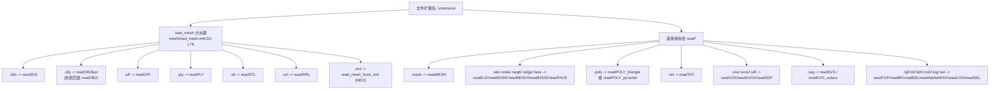

# 10.01 网格读取函数 / Mesh I/O — Readers

> 本文件逐一记录 `mesh/` 目录下所有「读取 / 加载」类函数。
> This document covers every load/read function located under `mesh/`.
>
> 覆盖清单 / Coverage (33 functions):
> `read3DS`, `readAdobeMSH`, `readBDL`, `readBF`, `readEDGE`, `readELE`, `readFACE`, `readIPI`,
> `readLOG`, `readMESH`, `readNEIGH`, `readNODE`, `readOBJ`, `readOBJfast`, `readOBJ_sequence`,
> `readOFF`, `readPLY`, `readPOLY_pyramid`, `readPOLY_triangle`, `readSDF`, `readSEL`, `readSTL`,
> `readSVG`, `readSVG_cubics`, `readSVOX`, `readTET`, `readTGF`, `readVOX`, `readWRL`, `load_mesh`,
> `input_medit`, `catOBJs`, `cat_meshes`

---

## 本章概览 / Chapter overview

### I/O 命名规范 / File-I/O naming convention

依据仓库根目录 [style.md](file:///c:/VSWork/gptoolbox-1/style.md#L5-L9)：

- 文件 I/O 函数统一命名为 `readEXT` / `writeEXT`，其中 `EXT` 替换为文件扩展名。
- 当扩展名存在歧义（多个程序共用同一扩展名）时，命名为 `readEXT_program` / `writeEXT_program`，
  `program` 为生成该文件的程序简称。
- 例外/实例：`.poly` 同时被 Triangle 与 pyramid/svr 使用，故拆为 `readPOLY_triangle` 与
  `readPOLY_pyramid`；`.msh` 被 Adobe Photoshop Liquify 使用（见下方问题说明）。

> Per `style.md`: file-I/O functions are named `readEXT` / `writeEXT`; when an extension is
> ambiguous the suffix is `_program` (e.g. `readPOLY_triangle` vs `readPOLY_pyramid`).

### 全函数总表 / Master table

| 函数 / Function | 格式 · 扩展名 / Format | 返回变量 / Returns | 备注 / Notes |
|---|---|---|---|
| `read3DS` | 3D Studio `.3ds` | `V,F,flag,TC` | 二进制 chunk 遍历 |
| `readAdobeMSH` | Adobe PS Liquify `.msh` | `Dx,Dy` | ⚠ 文件内函数名为 `readMSH`（命名不一致） |
| `readBDL` | bundle `.bdl` | `bundle`(struct) | 多 mesh chunk |
| `readBF` | bone forest `.bf` | `V,WI,P` | 基于 `dlmread` |
| `readEDGE` | Triangle/Voronoi `.edge` | `E,RP,RD` | 支持无限射线 |
| `readELE` | Triangle/Stellar `.ele` | `E,A` | 元素为三角/四面体 |
| `readFACE` | tetgen `.face` | `F,B,P` | 含边界标记 |
| `readIPI` | ipiSoft skeleton | `N,P,M,abs_M` | 相对/绝对变换 |
| `readLOG` | qslim `.log` | `V,F,C` | 边坍缩序列 |
| `readMESH` | INRIA/medit `.mesh` | `V,T,F` | 四面体网格 |
| `readNEIGH` | tetgen `.neigh` | `N` | 邻接信息 |
| `readNODE` | Triangle/Stellar `.node` | `V,I` | 1-based 索引 |
| `readOBJ` | Wavefront `.obj` | `V,F,UV,TF,N,NF` | 完整解析（v/vt/vn/f、负索引、三角化） |
| `readOBJfast` | Wavefront `.obj`（简单） | `V,F` | Unix `grep`/`sed` 加速 |
| `readOBJ_sequence` | `.obj` 序列（glob） | `V,F`（cell/array） | 多帧 |
| `readOFF` | OFF `.off` | `V,F,UV,C,N` | 支持 N/C/ST 扩展 |
| `readPLY` | PLY `.ply` | `V,F` | 薄包装，转调 `external/read_ply` |
| `readPOLY_pyramid` | pyramid/svr `.poly` | `V,E,F,H` | facets 索引 E 而非 V |
| `readPOLY_triangle` | Triangle `.poly` | `V,E,BME` | 仅段（segment） |
| `readSDF` | SDFGen `.sdf` | `S,V,res,h` | 体素符号距离场 |
| `readSEL` | `.sel` | `S` | 选择掩码 |
| `readSTL` | STL `.stl` | `V,F,N` | ascii/binary 自动判别 |
| `readSVG` | SVG `.svg` | `P,S,C,E` | polygon/polyline/rect |
| `readSVG_cubics` | SVG `.svg` | `P,C,I,F,S,W,D,viewBox` | 全部转 cubic Bézier |
| `readSVOX` | sparse voxel `.svox` | `XYZV,I,BC` | 稀疏体素 |
| `readTET` | `.tet` | `V,T` | 两种头部兼容 |
| `readTGF` | `.tgf` | `V,E,P,BE,CE,PE` | 图/骨架 |
| `readVOX` | poly2vox `.vox` | `BW` | 3D 二值体数据 |
| `readWRL` | VRML `.wrl` | `V,F` | `point [`/`coordIndex [` |
| `load_mesh` | `.3ds/.obj/.off/.ply/.stl/.wrl/.xml` | `V,F` | **按扩展名分派器** |
| `input_medit` | （非文件；`V,F,C`） | `C`(varargout) | medit 可视化，非读取 |
| `catOBJs` | `.obj` → `.obj` | （写文件） | 合并多个 OBJ |
| `cat_meshes` | （`V,F,...`） | `V,F` | 顶点重编号后合并 |

### 扩展名 → 分派函数 映射 / Extension → dispatch map



> 说明：`load_mesh` 仅在 `.3ds/.obj/.off/.ply/.stl/.wrl/.xml` 上分派；
> 其余扩展名的读取函数需要用户显式调用。

---

## 逐函数条目 / Per-function entries

### `read3DS` — 读取 3D Studio `.3ds` 三角网格
- **文件 / File**: [mesh/read3DS.m](file:///c:/VSWork/gptoolbox-1/mesh/read3DS.m#L1-L110)
- **签名 / Signature**: `[V,F,flag,TC] = read3DS(filename)`
- **功能 / Purpose**: `EN: Read a triangle mesh from a binary .3ds file by chunk traversal.` / 中文：以二进制 chunk 遍历方式从 `.3ds` 读取三角网格。
- **输入 / Inputs**:

  | 参数 | 尺寸/类型 | 含义 (中 / EN) |
  |---|---|---|
  | `filename` | `string` | `.3ds` 文件路径 / path to .3ds file |

- **输出 / Outputs**:

  | 参数 | 尺寸/类型 | 含义 |
  |---|---|---|
  | `V` | `#V by 3` | 顶点坐标 / vertex positions |
  | `F` | `#F by 3` | 三角面索引 / triangle indices |
  | `flag` | `#F by 1` | 面标志位 / face flags |
  | `TC` | `#TC by 2` | 纹理坐标 / texture coordinates |

- **可选参数 / Optional**: 无 / none

- **变量流动 / Variable flow**: `fp →(读 ushort id + int len)→ 判别 id →(traverse 表命中)→ 读 n 个数据 → V/F/TC 累积 → F(:,4)=flag`
- **算法步骤 / Algorithm**:
  1. 定义需遍历的 chunk id 列表 `traverse`（主块、编辑器块、mesh、三角网格、顶点、纹理、面）与跳过表 `skip`。
  2. `while ~feof` 循环读取：先读 `ushort` id，若为空或 0 则结束；再读 `int` 长度 `len`。
  3. 若 id 属于 `traverse`：增加深度、记录长度与计数；按具体 id 分派读取——`vertices_id` 读顶点（`reshape(v,3,n)'`）、`texture_coords_id` 读纹理、`faces_id` 读面（`reshape(faces,4,n)'+1`，附加顶点偏移）。
  4. 否则 `fseek(len-6,'cof')` 跳过该 chunk。
  5. 通过 `counts/lens` 逐层回退匹配 chunk 结束，修正深度。
  6. 末尾 `flag = F(:,4)`，`F = F(:,1:3)`。

- **流程图 / Flowchart**:

  ```mermaid
  flowchart TD
    A["输入 filename"] --> B["fopen 二进制"]
    B --> C{"feof?"}
    C -- 否 --> D["读 id(ushort) + len(int)"]
    D --> E{"id 在 traverse?"}
    E -- 是 --> F["按 id 读顶点/纹理/面\n累积到 V/F/TC"]
    E -- 否 --> G["fseek 跳过 len-6"]
    F --> H["counts/lens 回退匹配"]
    G --> H
    H --> C
    C -- 是 --> Z["flag=F(:,4); F=F(:,1:3); 输出 V,F,flag,TC"]
  ```

- **依赖 / Dependencies**: 无同库函数（仅内建 `fread/fseek/reshape/scatter3`）
- **See also**: `load_mesh`

---

### `readAdobeMSH` — 读取 Adobe Photoshop Liquify `.msh` 位移场
- **文件 / File**: [mesh/readAdobeMSH.m](file:///c:/VSWork/gptoolbox-1/mesh/readAdobeMSH.m#L1-L48)
- **签名 / Signature**: `[Dx,Dy] = readMSH(filename)`
- **功能 / Purpose**: `EN: Read Adobe Photoshop .msh (Liquify) and return x/y displacement images.` / 中文：读取 Photoshop Liquify 保存的 `.msh`，返回 x/y 方向位移图像。
- **输入 / Inputs**:

  | 参数 | 尺寸/类型 | 含义 (中 / EN) |
  |---|---|---|
  | `filename` | `string` | `.msh` 文件路径 / path to .msh file |

- **输出 / Outputs**:

  | 参数 | 尺寸/类型 | 含义 |
  |---|---|---|
  | `Dx` | `h by w` | x 方向位移图像 / x-displacement |
  | `Dy` | `h by w` | y 方向位移图像 / y-displacement |

- **可选参数 / Optional**: 无 / none

- **变量流动 / Variable flow**: `fp →(读 4 字节魔数 0002)→(读 'MeshLqfy')→(读宽 w、高 h)→(读 double 0)→ 读 2*w*h single → Dx,Dy reshape`
- **算法步骤 / Algorithm**:
  1. 校验若干头部魔数（`[0;0;0;2]`、`MeshLqfy`、`[2;0;0;0]`），不符则调用内部 `warn()` 警告（非致命）。
  2. 读取网格尺寸 `w`（宽）、`h`（高），并断言均大于 0。
  3. 读取一个 `double` 零填充；随后读取 `2*w*h` 个 `single=>double` 位移值。
  4. 检查文件应已到 EOF。
  5. `Dx = reshape(D(1:2:end),w,h)'`，`Dy = reshape(D(2:2:end),w,h)'`（交错存储拆分）。

- **流程图 / Flowchart**:

  ```mermaid
  flowchart TD
    A["输入 filename"] --> B["fopen"]
    B --> C{"头部魔数正确?"}
    C -- 否 --> W["warn() 警告"]
    C -- 是 --> D["读 w,h 并断言>0"]
    W --> D
    D --> E["读 2*w*h 位移值 D"]
    E --> F["Dx=reshape(D(1:2:end))'\nDy=reshape(D(2:2:end))'"]
    F --> Z["输出 Dx,Dy"]
  ```

- **依赖 / Dependencies**: 无（内部局部函数 `warn`）
- **See also**: —
- **⚠ 注意 / Note**: 文件名 `readAdobeMSH.m` 与文件内函数名 `readMSH` 不一致（违反 `style.md` 的「文件名=函数名」约定）。调用时应使用文件名 `readAdobeMSH`（MATLAB 以文件名解析）。

---

### `readBDL` — 读取 `.bdl` bundle 网格包
- **文件 / File**: [mesh/readBDL.m](file:///c:/VSWork/gptoolbox-1/mesh/readBDL.m#L1-L75)
- **签名 / Signature**: `bundle = readBDL(filename)`
- **功能 / Purpose**: `EN: Read one or more meshes from a .bdl bundle file.` / 中文：从 `.bdl` 包文件中读取一个或多个网格。
- **输入 / Inputs**:

  | 参数 | 尺寸/类型 | 含义 (中 / EN) |
  |---|---|---|
  | `filename` | `string` | `.bdl` 文件路径 / path to .bdl file |

- **输出 / Outputs**:

  | 参数 | 尺寸/类型 | 含义 |
  |---|---|---|
  | `bundle.meshes{k}` | `struct` | 第 k 个网格，字段 `V,F,col,baseColor,UV,(nor)` |

- **可选参数 / Optional**: 无 / none

- **变量流动 / Variable flow**: `fp →(逐 chunk 读 magicID)→ magicID==1 → readBDLMeshChunk → bundle.meshes{chunk} → 读下一个`
- **算法步骤 / Algorithm**:
  1. 定义子函数 `readBDLMeshChunk(fp)`：依次读取 `magicID/chunkSize/nV/nF/nVperFace/nCperPos/nCperUV/nCperCol/nCperNor/strip/baseColor`。
  2. 按 `nCperPos` 读顶点并转置；读 UV、颜色、（可选）法向；按 `nVperFace` 读面并 `+1` 变 1-based。
  3. 主函数 `fopen` 后循环：预读 `magicID`，若非 EOF 则回退 4 字节。
  4. 若 `magicID==1` 调用 chunk 读取器存入 `bundle.meshes{chunk}`；否则读 `uint64 chunkSize` 并 `fseek` 跳过。

- **流程图 / Flowchart**:

  ```mermaid
  flowchart TD
    A["输入 filename"] --> B["fopen"]
    B --> C{"~feof?"}
    C -- 是 --> D["读 magicID"]
    D --> E{"magicID==1?"}
    E -- 是 --> F["readBDLMeshChunk\n存入 bundle.meshes{chunk}"]
    E -- 否 --> G["读 chunkSize 并 fseek 跳过"]
    F --> C
    G --> C
    C -- 否 --> Z["输出 bundle"]
  ```

- **依赖 / Dependencies**: 无（内部局部函数 `readBDLMeshChunk`）
- **See also**: —
- **⚠ 注意 / Note**: 源码内存在缺陷——读取 UV 后执行 `mesh.UV = mesh.V';`（应为 `mesh.UV = mesh.UV'`），会覆盖 UV 字段；且主循环末尾缺少 `fclose(fp)`、文件缺少结尾 `end`。按源码如实记录。

---

### `readBF` — 读取 `.bf` 骨骼森林
- **文件 / File**: [mesh/readBF.m](file:///c:/VSWork/gptoolbox-1/mesh/readBF.m#L1-L19)
- **签名 / Signature**: `[V,WI,P] = readBF(filename)`
- **功能 / Purpose**: `EN: Read a skeleton from the .bf bone-forest format.` / 中文：从 `.bf` 骨骼森林格式读取骨架。
- **输入 / Inputs**:

  | 参数 | 尺寸/类型 | 含义 (中 / EN) |
  |---|---|---|
  | `filename` | `string` | `.bf` 文件路径 / path to .bf file |

- **输出 / Outputs**:

  | 参数 | 尺寸/类型 | 含义 |
  |---|---|---|
  | `V` | `#V by 3` | 相对父节点的顶点偏移 / offsets from parents |
  | `WI` | `#V by 1` | 权重索引（0 表示无权重）/ weight indices |
  | `P` | `#V by 1` | 父骨骼索引（0 表示根）/ parent indices |

- **可选参数 / Optional**: 无 / none

- **变量流动 / Variable flow**: `dlmread(filename) → D → 列拆分 → V=D(:,3:end); WI=D(:,1)+1; P=D(:,2)+1`
- **算法步骤 / Algorithm**:
  1. `D = dlmread(filename)` 读入数值矩阵。
  2. 第 1 列（0-based 权重索引）`+1` 得 `WI`。
  3. 第 2 列（父索引）`+1` 得 `P`。
  4. 第 3 列起为顶点偏移，赋给 `V`。

- **流程图 / Flowchart**:

  ```mermaid
  flowchart TD
    A["输入 filename"] --> B["D = dlmread(filename)"]
    B --> C["WI = D(:,1)+1\nP = D(:,2)+1"]
    C --> D["V = D(:,3:end)"]
    D --> Z["输出 V,WI,P"]
  ```

- **依赖 / Dependencies**: 无（内建 `dlmread`）
- **See also**: `readTGF`, `readIPI`

---

### `readEDGE` — 读取 Triangle/Voronoi `.edge` 文件
- **文件 / File**: [mesh/readEDGE.m](file:///c:/VSWork/gptoolbox-1/mesh/readEDGE.m#L1-L70)
- **签名 / Signature**: `[E,RP,RD] = readEDGE(filename)`
- **功能 / Purpose**: `EN: Read .edge file (Triangle) to output Voronoi diagram edges.` / 中文：读取 Triangle 输出的 `.edge` 文件，得到 Voronoi 图边。
- **输入 / Inputs**:

  | 参数 | 尺寸/类型 | 含义 (中 / EN) |
  |---|---|---|
  | `filename` | `string` | `.edge` 文件路径 / path to .edge file |

- **输出 / Outputs**:

  | 参数 | 尺寸/类型 | 含义 |
  |---|---|---|
  | `E` | `#E by 2` | Voronoi 内部边 / internal edges |
  | `RP` | `#RP by 1` | 无限射线起点 / infinite-ray start points |
  | `RD` | `#RP by 2` 或 `#RP by 3` | 无限射线方向 / ray directions |

- **可选参数 / Optional**: 无 / none

- **变量流动 / Variable flow**: `头部(num_e,num_a) → 逐行 sscanf → count==3→E, count==6/5→RP,RD, 否则结束 → min_e==0 时整体 +1`
- **算法步骤 / Algorithm**:
  1. 读头部两个整数：边行数 `num_e`、属性数 `num_a`；若 `num_a~=0` 报错。
  2. `while true` 逐行读：`sscanf(line,'%d %d %d %g %g %g',6)`。
  3. 若 `count==3`：该行是内部边，取 `e(2) e(3)` 追加到 `E`。
  4. 若 `count==6`（或 5）：断言 `e(3)==-1`，`e(2)` 入 `RP`，`e(4:6)`（或 `e(4:5)`）入 `RD`。
  5. 其他情况 `break`。
  6. 追踪最小索引 `min_e`；若为 0（0-based），对 `E`、`RP` 整体 `+1`。

- **流程图 / Flowchart**:

  ```mermaid
  flowchart TD
    A["输入 filename"] --> B["读头部 num_e,num_a"]
    B --> C{"num_a~=0?"}
    C -- 是 --> E1["error 不支持属性"]
    C -- 否 --> D["读一行 sscanf 6 列"]
    D --> F{"count?"}
    F -- "3" --> G["E 追加 e(2),e(3)"]
    F -- "6 或 5" --> H["RP 追加 e(2);\nRD 追加 e(4:end)"]
    F -- "其他" --> I["break"]
    G --> D
    H --> D
    I --> J{"min_e==0?"}
    J -- 是 --> K["E,RP 整体 +1"]
    J -- 否 --> Z["输出 E,RP,RD"]
    K --> Z
  ```

- **依赖 / Dependencies**: 无
- **See also**: `readNODE`

---

### `readELE` — 读取 `.ele` 单元（三角/四面体）文件
- **文件 / File**: [mesh/readELE.m](file:///c:/VSWork/gptoolbox-1/mesh/readELE.m#L1-L60)
- **签名 / Signature**: `[E,A] = readELE(filename)`
- **功能 / Purpose**: `EN: Read face/tet elements from a Triangle/Stellar .ele file.` / 中文：读取 Triangle/Stellar `.ele` 文件中的（三角或四面体）单元。
- **输入 / Inputs**:

  | 参数 | 尺寸/类型 | 含义 (中 / EN) |
  |---|---|---|
  | `filename` | `string` | `.ele` 文件路径 / path to .ele file |

- **输出 / Outputs**:

  | 参数 | 尺寸/类型 | 含义 |
  |---|---|---|
  | `E` | `#E by size_e` | 单元索引（三角=3 或四面体=4）/ element indices |
  | `A` | `#E by num_a` | 属性列 / attributes |

- **可选参数 / Optional**: 无 / none

- **变量流动**: `首行 header(num_e,size_e,num_a) → 构造 parser '%d' + repeat(' %d') → fscanf' → E(:,1) 为行号 → 偏移后剥离行号得 E,A`
- **算法步骤 / Algorithm**:
  1. 读首行 `header`：元素数 `num_e`、单元尺寸 `size_e`、属性数 `num_a`（缺省 0）。
  2. 校验 `size_e>=1`。
  3. 构造 `parser`：`'%d'`（行号）+ 重复 `size_e+num_a` 个 `' %d'`。
  4. `E = fscanf(fp,parser,[num_items,num_e])'` 一次性读入。
  5. 计算偏移 `offset = 1-min(min(E(:,1)),1)`（0-based 校正）。
  6. `A = E(:,(1+size_e)+1:(1+size_e)+num_a)`；`E = E(:,1+(1:size_e))+offset`。

- **流程图 / Flowchart**:

  ```mermaid
  flowchart TD
    A["输入 filename"] --> B["读首行 header"]
    B --> C{"size_e>=1?"}
    C -- 否 --> E1["error"]
    C -- 是 --> D["构造 parser 并按列读入 E"]
    D --> F["offset=1-min(min(E(:,1)),1)"]
    F --> G["A=E(:,size_e+1:end)\nE=E(:,1:size_e)+offset"]
    G --> Z["输出 E,A"]
  ```

- **依赖 / Dependencies**: 无
- **See also**: `readNODE`

---

### `readFACE` — 读取 tetgen `.face` 三角面文件
- **文件 / File**: [mesh/readFACE.m](file:///c:/VSWork/gptoolbox-1/mesh/readFACE.m#L1-L99)
- **签名 / Signature**: `[F,B,P] = readFACE(filename,'Name',Value,...)`
- **功能 / Purpose**: `EN: Read triangular faces from a tetgen .face file.` / 中文：从 tetgen `.face` 文件读取三角面。
- **输入 / Inputs**:

  | 参数 | 尺寸/类型 | 含义 (中 / EN) |
  |---|---|---|
  | `filename` | `string` | `.face` 文件路径 / path to .face file |

- **输出 / Outputs**:

  | 参数 | 尺寸/类型 | 含义 |
  |---|---|---|
  | `F` | `#F by 3` | 三角面索引 / triangle indices |
  | `B` | `#F by 1` | 边界标记 / boundary markers |
  | `P` | `#F by 2` | 父四面体 / parent tetrahedra |

- **可选参数 / Optional**:

  | 名称 | 取值 | 默认 | 含义 |
  |---|---|---|---|
  | `'ForceNoBoundary'` | `logical` | `false` | 逐行强读、忽略边界标记 / force line-wise read |
  | `'ParentTetrahedra'` | `logical` | `false` | tetgen `-nn` 输出含父四面体 / include parent tets |

- **变量流动**: `header(sizeF,bm) → 若 force_no_boundary 逐行扫描 → 否则按 parser fscanf → reshape → 剥离索引/B/父四面体 → F(:,2:4)`
- **算法步骤 / Algorithm**:
  1. 解析可选参数（`ForceNoBoundary`、`ParentTetrahedra`）。
  2. 读头部 `header`：面数 `sizeF`、是否含边界标记 `boundary_markers`。
  3. 若 `force_no_boundary`：逐行 `fgets`，跳过 `#` 注释与空行，`sscanf('%d %d %d %d')`，取 `face(2:4)` 累积并动态扩容。
  4. 否则：按需构造 `parser`（4 列 + 可选边界 + 可选父四面体 2 列），`fscanf` 后 `reshape`。
  5. 按标志取 `B=F(:,5)`、`P=F(:,6:7)`，最终 `F=F(:,2:4)`。

- **流程图 / Flowchart**:

  ```mermaid
  flowchart TD
    A["输入 filename + 选项"] --> B["读 header sizeF,bm"]
    B --> C{"force_no_boundary?"}
    C -- 是 --> D["逐行 fgets\n跳过 # 与空行\nsscanf 取 face(2:4)"]
    C -- 否 --> E["构造 parser\nfscanf + reshape"]
    D --> F["F=F(1:f,:)"]
    E --> G{"bm~=0?"}
    G -- 是 --> H["B=F(:,5)"]
    G -- 否 --> I["B=[]"]
    H --> J["F=F(:,2:4)"]
    I --> J
    J --> Z["输出 F,B,P"]
    F --> Z
  ```

- **依赖 / Dependencies**: 无
- **See also**: `readNODE`, `readELE`, `readNEIGH`

---

### `readIPI` — 读取 ipiSoft 骨架格式
- **文件 / File**: [mesh/readIPI.m](file:///c:/VSWork/gptoolbox-1/mesh/readIPI.m#L1-L78)
- **签名 / Signature**: `[N,P,M,abs_M] = readIPI(filename)`
- **功能 / Purpose**: `EN: Read ipiSoft skeleton format (bones, parents, transforms).` / 中文：读取 ipiSoft 骨架格式（骨骼名、父索引、变换矩阵）。
- **输入 / Inputs**:

  | 参数 | 尺寸/类型 | 含义 (中 / EN) |
  |---|---|---|
  | `filename` | `string` | ipiSoft 文件路径 / path to ipiSoft file |

- **输出 / Outputs**:

  | 参数 | 尺寸/类型 | 含义 |
  |---|---|---|
  | `N` | `#B cell` | 骨骼名 / bone names |
  | `P` | `#B by 1` | 父索引（0 为根）/ parent indices |
  | `M` | `4 by 4 by #B` | 相对变换矩阵 / relative transforms |
  | `abs_M` | `4 by 4 by #B` | 绝对变换矩阵 / absolute transforms |

- **可选参数 / Optional**: 无 / none

- **变量流动**: `逐行 sscanf(id,name,parent,16 个数)→ N/P/M → 迭代合并父变换 → abs_M`
- **算法步骤 / Algorithm**:
  1. `eat_comments` 跳过 `#` 注释行。
  2. `while true`：逐条骨骼读 id、name、parent、16 个矩阵元素；任何 `count` 不符则报错。
  3. `N{id}=name`、`P(id)=p`、`M(:,:,id)=reshape(m,4,4)'`。
  4. 读到行末 `fgets` 后若返回 -1 则结束。
  5. 第二段循环：`next=P`，反复用父矩阵左乘累积得到 `abs_M`（从根向下逐层合成），直到 `next` 全为 0。
  6. 断言 `all(P<=numel(P))`。

- **流程图 / Flowchart**:

  ```mermaid
  flowchart TD
    A["输入 filename"] --> B["eat_comments 跳过注释"]
    B --> C{"还有骨骼?"}
    C -- 是 --> D["读 id,name,parent,16 元素 M"]
    D --> E["N{id}=name; P(id)=p; M(:,:,id)"]
    E --> C
    C -- 否 --> F["迭代: abs_M=M(parent)*abs_M"]
    F --> G{"next 全 0?"}
    G -- 否 --> F
    G -- 是 --> Z["输出 N,P,M,abs_M"]
  ```

- **依赖 / Dependencies**: `eat_comments`
- **See also**: `readTGF`, `readBF`

---

### `readLOG` — 读取 qslim `.log` 边坍缩记录
- **文件 / File**: [mesh/readLOG.m](file:///c:/VSWork/gptoolbox-1/mesh/readLOG.m#L1-L93)
- **签名 / Signature**: `[V,F,C] = readLOG(filename)`
- **功能 / Purpose**: `EN: Read log files output by qslim (input mesh + ordered edge collapses).` / 中文：读取 qslim 输出的 `.log`（输入网格 + 有序边坍缩序列）。
- **输入 / Inputs**:

  | 参数 | 尺寸/类型 | 含义 (中 / EN) |
  |---|---|---|
  | `filename` | `string` | `.log` 文件路径 / path to .log file |

- **输出 / Outputs**:

  | 参数 | 尺寸/类型 | 含义 |
  |---|---|---|
  | `V` | `#V by 3` | 输入网格顶点 / input vertex positions |
  | `F` | `#F by 3` | 输入网格三角面索引（1-based） |
  | `C` | `#collapse` | 坍缩结构数组，字段 `.a,.b,.da,.rm,.mod` |

- **可选参数 / Optional**: 无 / none

- **变量流动**: `读 'begin' 块 → V/F → 读 'end' → 逐行解析 'v% aid bid dax day daz fa&b.. & fa|b..' → C`
- **算法步骤 / Algorithm**:
  1. 首行必须为 `begin`，否则报错。
  2. `V = reshape(fscanf(fp,'v %g %g %g\n'),3,[])';`、`F = reshape(fscanf(fp,'f %d %d %d\n'),3,[])';`。
  3. 随后一行必须为 `end`。
  4. 预分配 `C`（大小按 `size(edges(F),1)` 估计）。
  5. `while true` 逐行：`sscanf(line,'v%% %d %d %g %g %g',5)` 得 `a,b,da`；再解析 `rm`（被移除面，允许 >2）、`&` 分隔符、`mod`（被修改面）。
  6. 累加计数 `ci`，最后 `C = C(1:ci-1)` 只保留真实坍缩。

- **流程图 / Flowchart**:

  ```mermaid
  flowchart TD
    A["输入 filename"] --> B{"首行=='begin'?"}
    B -- 否 --> E1["error"]
    B -- 是 --> C["读 V (v 行), F (f 行)"]
    C --> D{"下一行=='end'?"}
    D -- 否 --> E2["error"]
    D -- 是 --> E[["预分配 C"]]
    E --> F["读一行 'v% a b da fa&b.. & fa|b..'"]
    F --> G{"行结束?"}
    G -- 否 --> H["填充 C(ci).a/b/da/rm/mod; ci++"]
    H --> F
    G -- 是 --> I["C=C(1:ci-1)"]
    I --> Z["输出 V,F,C"]
  ```

- **依赖 / Dependencies**: `edges`
- **See also**: `perform_edge_collapse`

### `readMESH` — 读取 INRIA/medit `.mesh` 网格（含四面体）
- **文件 / File**: [mesh/readMESH.m](file:///c:/VSWork/gptoolbox-1/mesh/readMESH.m#L1-L106)
- **签名 / Signature**: `[V,T,F] = readMESH( filename )`
- **功能 / Purpose**: `EN: Read an INRIA .mesh file with vertex/triangle/tet information.` / 中文：读取透 medit/INRIA 的 `.mesh` 文件（顶点/三角/四面体）。
- **输入 / Inputs**:

  | 参数 | 尺寸/类型 | 含义 (中 / EN) |
  |---|---|---|
  | `filename` | `string` | `.mesh` 文件路径 / path to .mesh file |

- **输出 / Outputs**:

  | 参数 | 尺寸/类型 | 含义 |
  |---|---|---|
  | `V` | `#V by 3` | 顶点坐标 / vertices |
  | `T` | `#T by 4` | 四面体索引 / tet indices |
  | `F` | `#F by 3` | 三角面索引 / triangle indices |

- **可选参数 / Optional**: 无 / none

- **变量流动**: `eat_comments → 校验 'MeshVersionFormatted 1'/'Dimension 3'/'Vertices' → 读 V → (可选 Edges) → 'Triangles' → F → 'Tetrahedra' → T`
- **算法步骤 / Algorithm**:
  1. 读首行（`eat_comments` 去注释）校验需为 `MeshVersionFormatted 1`。
  2. 读 `Dimension 3`（tetgen 可能把 3 换到下一行，故会拼接尝试）。
  3. 读 `Vertices` 关键字，读取顶点数，再读 `4*n` 个数值 `reshape(V,4,n)'`，取前三列。
  4. 若下一关键字为 `Edges`，读取边段并剥离引用。
  5. 读 `Triangles`：读数量，`reshape(F,4,n)'` 取前三列。
  6. 读 `Tetrahedra`：读数量，`reshape(T,5,n)'` 取前四列。
  7. 关闭文件。

- **流程图 / Flowchart**:

  ```mermaid
  flowchart TD
    A["输入 filename"] --> B{"首行=MeshVersionFormatted 1?"}
    B -- 否 --> E1["error"]
    B -- 是 --> C["读 Dimension 3 / Vertices\n读 V (#V by 3, 丢 ref)"]
    C --> D{"关键字=='Edges'?"}
    D -- 是 --> E["读边段并跳过"]
    D -- 否 --> F["读 Triangles -> F"]
    E --> F
    F --> G["读 Tetrahedra -> T"]
    G --> Z["输出 V,T,F"]
  ```

- **依赖 / Dependencies**: `eat_comments`
- **See also**: `readTET`, `readOFF`

---

### `readNEIGH` — 读取 tetgen `.neigh` 邻接信息
- **文件 / File**: [mesh/readNEIGH.m](file:///c:/VSWork/gptoolbox-1/mesh/readNEIGH.m#L1-L42)
- **签名 / Signature**: `N = readNEIGH(filename)`
- **功能 / Purpose**: `EN: Read tetrahedral neighbor information from a .neigh file.` / 中文：读取 tetgen 产生的 `.neigh` 四面体邻接信息。
- **输入 / Inputs**:

  | 参数 | 尺寸/类型 | 含义 (中 / EN) |
  |---|---|---|
  | `filename` | `string` | `.neigh` 文件路径 / path to .neigh file |

- **输出 / Outputs**:

  | 参数 | 尺寸/类型 | 含义 |
  |---|---|---|
  | `N` | `#n by size_e` | 邻接索引（-1 表示边界） |

- **可选参数 / Optional**: 无 / none

- **变量流动**: `首行 (n,size_e) → parser '%d' + repeat(' %d') → fscanf' → 去行号 +1 → 0 变 -1`
- **算法步骤 / Algorithm**:
  1. 读首行两个整数 `n`（元素数）、`size_e`（元素尺寸），不符数量报错。
  2. 构造 `parser`：`'%d'` + `size_e+1` 个 `' %d'`（多 1 列行号）。
  3. `N = fscanf(fp,parser,[size_e+1 n])'`。
  4. `N = N(:,2:end)+1`（去行号并 1-based）；`N(~N) = -1`（把 0 视为边界）。

- **流程图 / Flowchart**:

  ```mermaid
  flowchart TD
    A["输入 filename"] --> B["读首行 n,size_e"]
    B --> C{"count==2?"}
    C -- 否 --> E1["error"]
    C -- 是 --> D["构造 parser 读入 N"]
    D --> F["N=N(:,2:end)+1"]
    F --> G["N(~N)=-1"]
    G --> Z["输出 N"]
  ```

- **依赖 / Dependencies**: 无
- **See also**: `tt`, `tetgen`, `readNODE`, `readELE`, `fixNEIGH`

---

### `readNODE` — 读取 `.node` 顶点文件（Triangle/Stellar/TetGen）
- **文件 / File**: [mesh/readNODE.m](file:///c:/VSWork/gptoolbox-1/mesh/readNODE.m#L1-L61)
- **签名 / Signature**: `[V,I] = readNODE(filename)`
- **功能 / Purpose**: `EN: Read vertex positions from a .node file (Triangle/Stellar/TetGen).` / 中文：从 `.node` 文件读取顶点坐标。
- **输入 / Inputs**:

  | 参数 | 尺寸/类型 | 含义 (中 / EN) |
  |---|---|---|
  | `filename` | `string` | `.node` 文件路径 / path to .node file |

- **输出 / Outputs**:

  | 参数 | 尺寸/类型 | 含义 |
  |---|---|---|
  | `V` | `#V by dim` | 顶点坐标 / vertex positions |
  | `I` | `#V by 1` | 索引列（指示 0/1-based） |

- **可选参数 / Optional**: 无 / none

- **变量流动**: `首行 (num_v,dim,num_a,num_b) → 构造 parser → fscanf' → I 取首列 → V 去索引与边界标记`
- **算法步骤 / Algorithm**:
  1. 读首行 4 个整数：顶点数 `num_v`、维度 `dim`、属性数 `num_a`、边界标记数 `num_b`。
  2. **TetGen/Triangle `.node` 格式约定**：首行是计数行；每行数据为「索引 + 坐标 + 可选属性 + 可选边界标记」，索引为 1-based（本函数不作偏移校正，直接把首列作为 `I` 返回）。
  3. 依 `dim==2`（`%lf %lf`）或 `dim==3`（`%lf %lf %lf`）扩展 `parser`；其他维度报错。
  4. `num_a~=0` 报错（不支持属性）。
  5. `num_b==1` 时追加 `' %d'` 读边界标记；否则须为 0。
  6. `V = fscanf(fp,parser,[num_items,num_v])'`；`I=V(:,1)`，再剥离索引与（若有）边界标记。

- **流程图 / Flowchart**:

  ```mermaid
  flowchart TD
    A["输入 filename"] --> B["读首行 num_v,dim,num_a,num_b"]
    B --> C{"dim==2 或 3?"}
    C -- 否 --> E1["error 维度"]
    C -- 是 --> D{"num_a~=0?"}
    D -- 是 --> E2["error 属性不支持"]
    D -- 否 --> E{"num_b==1?"}
    E -- 是 --> F["parser 追加边界标记列"]
    E -- 否 --> G["无边界标记"]
    F --> H["fscanf 读 V"]
    G --> H
    H --> I["I=V(:,1); 剥离索引/边界标记"]
    I --> Z["输出 V,I"]
  ```

- **依赖 / Dependencies**: 无
- **See also**: `readELE`

---

### `readOBJ` — 读取 Wavefront `.obj`（完整解析）
- **文件 / File**: [mesh/readOBJ.m](file:///c:/VSWork/gptoolbox-1/mesh/readOBJ.m#L1-L260)
- **签名 / Signature**: `[V,F,UV,TF,N,NF] = readOBJ(filename,'Name',Value,...)`
- **功能 / Purpose**: `EN: Read an OBJ file with vertex/face/texture/normal information.` / 中文：读取含顶点/面/纹理/法向信息的 OBJ 文件（支持四边形、多边形三角化、负索引）。
- **输入 / Inputs**:

  | 参数 | 尺寸/类型 | 含义 (中 / EN) |
  |---|---|---|
  | `filename` | `string` | `.obj` 文件路径 / path to .obj file |

- **输出 / Outputs**:

  | 参数 | 尺寸/类型 | 含义 |
  |---|---|---|
  | `V` | `#V by 3` | 顶点 / vertices |
  | `F` | `#F by ss` | 面索引（`ss=3` 或 4）/ face indices |
  | `UV` | `#UV by 2` | 纹理坐标 / texture coords |
  | `TF` | `#F by ss` | 面角纹理索引 / corner texcoords |
  | `N` | `#N by 3` | 法向 / normals |
  | `NF` | `#F by ss` | 面角法向索引 / corner normals |

- **可选参数 / Optional**:

  | 名称 | 取值 | 默认 | 含义 |
  |---|---|---|---|
  | `'Quads'` | `logical` | `false` | 输出 X-by-4 面（>4 度仍三角化，尾部 0 表示三角）/ quads output |
  | `'SimplexSize'` | `int` | `[]`（由 Quads 决定 3/4） | 指定面元大小 `ss` / simplex size |

- **变量流动**: `逐 token 'v/vt/vn/f/#' → V,UV,N 累积；f 行 sscanf 拆 t/tf/nf → 负索引 +1 校正 → 面扇形三角化 → 末尾裁剪数组`
- **算法步骤 / Algorithm**:
  1. 解析可选参数 `Quads`、`SimplexSize`；`ss` 默认 = 4（Quads）或 3。
  2. 预分配增长型数组 `V/F/UV/TF/N/NF`（初始 10000 行）。
  3. `while type 非空` 循环：`fscanf(fp,'%s',1)` 读行首 token。
     - **`v` 行**：`sscanf(line,'%lf %lf %lf')` 读坐标，追踪 `maxdim`，按需扩展列数；写入 `V`。
     - **`vt` 行**：读 2~3 个纹理值，写入 `UV`。
     - **`vn` 行**：读 3 个法向分量，写入 `N`。
     - **`f` 行**：依次尝试 `v/vt/vn`、`v/vt`、`v//vn`、`v`、`v//` 五种格式，拆出顶点 `t`、纹理 `tf`、法向 `nf`。
     - **`#` 行**：注释，忽略。
  4. **面索引 1-based**：OBJ 使用 1-based 索引，`t` 直接使用。
  5. **负索引（相对索引）处理**：`t = t + (t<0).*(numv+1)`、`tf = tf + (tf<0).*(numuv+1)`、`nf = nf + (nf<0).*(numn+1)`——负值表示相对当前已读顶点数的索引。
  6. **多边形面三角化**：当 `numel(t) > ss` 时给出 `Trivially triangulating high degree facets` 警告；用**扇形三角化** `corners=[1 2 3]`，每轮写入一个三角形后执行 `t=t([1 3:end])`（去掉第 2 个顶点），循环直至剩余顶点数 ≤ ss。
  7. 结束后按计数裁剪：`V=V(1:numv,1:maxdim)`、`F=F(1:numf,:)` 等。

- **流程图 / Flowchart**:

  ```mermaid
  flowchart TD
    A["输入 filename + 选项"] --> B["预分配 V/F/UV/TF/N/NF"]
    B --> C["读 token type"]
    C --> D{"type?"}
    D -- "v" --> E1["sscanf 坐标 -> V"]
    D -- "vt" --> E2["读纹理 -> UV"]
    D -- "vn" --> E3["读法向 -> N"]
    D -- "f" --> E4["尝试 v/vt/vn..v//\n拆 t,tf,nf"]
    D -- "#" --> E5["忽略"]
    D -- "空" --> Z["裁剪数组 输出 V,F,UV,TF,N,NF"]
    E4 --> F["负索引 +1 校正"]
    F --> G{"numel(t) > ss?"}
    G -- 否 --> H["整面写入 F/TF/NF"]
    G -- 是 --> I["扇形三角化: corners=[1 2 3]\nt = t([1 3:end])"]
    I --> H
    E1 --> C
    E2 --> C
    E3 --> C
    E5 --> C
    H --> C
  ```

- **依赖 / Dependencies**: 无（内建 `fopen/fscanf/sscanf/cat/reshape`）
- **See also**: `load_mesh`, `readOBJfast`, `readOFF`

---

### `readOBJfast` — 快速读取简单格式 `.obj`
- **文件 / File**: [mesh/readOBJfast.m](file:///c:/VSWork/gptoolbox-1/mesh/readOBJfast.m#L1-L147)
- **签名 / Signature**: `[V,F] = readOBJfast(filename,'Name',Value,...)`
- **功能 / Purpose**: `EN: Read a simply-formatted OBJ file quickly.` / 中文：快速读取格式规整（`v x y z`、`f i j k`）的 OBJ 文件。
- **输入 / Inputs**:

  | 参数 | 尺寸/类型 | 含义 (中 / EN) |
  |---|---|---|
  | `filename` | `string` | `.obj` 文件路径 / path to .obj file |

- **输出 / Outputs**:

  | 参数 | 尺寸/类型 | 含义 |
  |---|---|---|
  | `V` | `#V by 3` | 顶点 / vertices |
  | `F` | `#F by 3`（或 4） | 面索引 / face indices |

- **可选参数 / Optional**:

  | 名称 | 取值 | 默认 | 含义 |
  |---|---|---|---|
  | `'Quads'` | `logical` | `false` | 读四边面 / read quads |

- **变量流动**: `file_wrangler →（Unix: grep '^v ' / grep '^f ' + sed 去纹理）临时文件 → readOBJfast_helper → V,F`
- **算法步骤 / Algorithm**:
  1. 解析 `Quads` 参数。
  2. 若 `error_handler` 分派到 `file_wrangler` 且运行于 Unix：用 `grep "^v "` 抽取顶点、`grep "^f "` 配合 `sed` 去除 `v/vt/vn` 中的纹理/法向后缀，写入临时文件；成功则调用 helper。
  3. `readOBJfast_helper`：`fscanf(fp,' v %lg %lg %lg ',inf)` 读顶点（跳过前缀无关行）；`reshape(V,3,size(V,1)/3)'`。
  4. 依 `quads` 选择 `' f %d %d %d %d '` 或 `' f %d %d %d '` 格式读面；校验可整除；`reshape` 成矩阵。
  5. 若仍未到 EOF，判为格式错误。
  6. 主函数末尾：若面索引全为负，`F=F+size(V,1)+1`（整体相对索引）；部分为负则报错。
  7. 任意失败都调用 `final_error()`（提示改用 `readOBJ`）。

- **流程图 / Flowchart**:

  ```mermaid
  flowchart TD
    A["输入 filename + Quads"] --> B["error_handler = @file_wrangler"]
    B --> C{"可 Unix grep/sed ?"}
    C -- 是 --> D["生成临时文件\nreadOBJfast_helper"]
    C -- 否 --> E["final_error() -> 提示用 readOBJ"]
    D --> F{"面索引全为负?"}
    F -- 是 --> G["F = F+size(V,1)+1"]
    F -- 否 --> H{"存在负索引?"}
    H -- 是 --> E
    H -- 否 --> Z["输出 V,F"]
    G --> Z
  ```

- **依赖 / Dependencies**: 无（依赖系统 `grep`/`sed`；失败回退由 `load_mesh` 处理）
- **See also**: `readOBJ`, `load_mesh`

---

### `readOBJ_sequence` — 读取 `.obj` 序列（多帧）
- **文件 / File**: [mesh/readOBJ_sequence.m](file:///c:/VSWork/gptoolbox-1/mesh/readOBJ_sequence.m#L1-L40)
- **签名 / Signature**: `[V,F] = readOBJ_sequence(prefix)`
- **功能 / Purpose**: `EN: Read a glob-style sequence of OBJ files and try to collapse to arrays.` / 中文：按 glob 读取一串 OBJ 文件，并尽可能折叠为数组。
- **输入 / Inputs**:

  | 参数 | 尺寸/类型 | 含义 (中 / EN) |
  |---|---|---|
  | `prefix` | `string` | glob 风格路径（如 `'mymesh.00*.obj'`）/ glob path |

- **输出 / Outputs**:

  | 参数 | 尺寸/类型 | 含义 |
  |---|---|---|
  | `V` | `cell(#files)` 或 `#V by 3 by #files` 或 `#V by 3` | 各文件顶点 |
  | `F` | `cell(#files)` 或 `#F by 3 by #files` 或 `#F by 3` | 各文件面 |

- **可选参数 / Optional**: 无 / none

- **变量流动**: `system(printf) → 文件列表 → parfor load_mesh → cell V,F → convert_to_array_if_possible → 可能折叠为数组`
- **算法步骤 / Algorithm**:
  1. `system(sprintf('printf "%%s\n" %s',prefix))` 展开通配符得到文件列表，按换行 `strsplit` 去空。
  2. 初始化 `V`、`F` 为 cell。
  3. `parfor fi` 并行对每个文件 `load_mesh`（带 `progressbar`），结果存入 `V{fi},F{fi}`。
  4. 调用内部 `convert_to_array_if_possible`：若所有元素尺寸一致，堆叠为 `#V by 3 by #files`；若各帧完全相同则折叠为单帧 `#V by 3`。

- **流程图 / Flowchart**:

  ```mermaid
  flowchart TD
    A["输入 prefix"] --> B["system printf 展开文件列表"]
    B --> C["parfor: load_mesh 每个文件"]
    C --> D["V,F 为 cell"]
    D --> E{"所有元素尺寸一致?"}
    E -- 是 --> F["cell2mat -> #V by 3 by #files"]
    E -- 否 --> Z["输出 cell V,F"]
    F --> G{"各帧相同?"}
    G -- 是 --> H["折叠为单帧 #V by 3"]
    G -- 否 --> Z
    H --> Z
  ```

- **依赖 / Dependencies**: `load_mesh`, `progressbar`
- **See also**: `load_mesh`, `readOBJ`

---

### `readOFF` — 读取 OFF 文件
- **文件 / File**: [mesh/readOFF.m](file:///c:/VSWork/gptoolbox-1/mesh/readOFF.m#L1-L94)
- **签名 / Signature**: `[V,F,UV,C,N] = readOFF( filename )`
- **功能 / Purpose**: `EN: Read an OFF file (with optional N/C/ST extensions) with vertex/face info.` / 中文：读取 OFF 文件（支持法向 N、颜色 C、纹理 ST 扩展）。
- **输入 / Inputs**:

  | 参数 | 尺寸/类型 | 含义 (中 / EN) |
  |---|---|---|
  | `filename` | `string` | `.off` 文件路径 / path to .off file |

- **输出 / Outputs**:

  | 参数 | 尺寸/类型 | 含义 |
  |---|---|---|
  | `V` | `#V by 3` | 顶点 / vertices |
  | `F` | `#F by 3` | 三角面索引 / triangle indices |
  | `UV` | `#V by 2` | 纹理坐标 / texture coords |
  | `C` | `#V by 3` | 颜色 / colors |
  | `N` | `#V by 3` | 法向 / normals |

- **可选参数 / Optional**: 无 / none

- **变量流动**: `OFFheader →(是否含 N/C/S)→ OFFdim → 读 V 块 → 按标记切列 → 读面 → 多边形三角化`
- **算法步骤 / Algorithm**:
  1. 读首 token 转大写为 `OFFheader`；若不以 `OFF` 结尾则警告并返回空。
  2. 依 header 中的 `N`（法向）、`C`（颜色）、`S`（纹理）字符，逐项给 `OFFdim` 加 3/3/2。
  3. `eat_comments` 跳过 `#` 注释，读计数行得到 `nV,nF,nE`。
  4. 按 `OFFdim` 用对应 `textscan` 读 `nV` 行（3~11 列）。
  5. 从 `OFFV` 依次切出 `V(3)`、（可选）`N(3)`、`C(3)`、`UV(2)`。
  6. 若 `nF~=0`：`textscan` 读面；若所有面度数一致则直接取列 `+1`（1-based）；否则警告并**多边形三角化**（对每面用首顶点扇形剖分）。

- **流程图 / Flowchart**:

  ```mermaid
  flowchart TD
    A["输入 filename"] --> B{"header 以 OFF 结尾?"}
    B -- 否 --> E1["warning 返回空"]
    B -- 是 --> C["依 N/C/S 设 OFFdim"]
    C --> D["eat_comments; 读 nV,nF,nE"]
    D --> E["按 OFFdim textscan 读 V 块"]
    E --> F["切出 V,N,C,UV"]
    F --> G{"nF~=0?"}
    G -- 否 --> Z["F=[] 输出"]
    G -- 是 --> H["textscan 读面"]
    H --> I{"所有面度数一致?"}
    I -- 是 --> J["F=列+1"]
    I -- 否 --> K["多边形三角化(扇形)"]
    J --> Z
    K --> Z
  ```

- **依赖 / Dependencies**: `eat_comments`
- **See also**: `load_mesh`, `readOBJfast`, `readOBJ`

---

### `readPLY` — 读取 PLY（薄包装）
- **文件 / File**: [mesh/readPLY.m](file:///c:/VSWork/gptoolbox-1/mesh/readPLY.m#L1-L12)
- **签名 / Signature**: `[V,F] = readPLY(filename)`
- **功能 / Purpose**: `EN: Wrapper for read_ply.` / 中文：`read_ply` 的薄包装。
- **输入 / Inputs**:

  | 参数 | 尺寸/类型 | 含义 (中 / EN) |
  |---|---|---|
  | `filename` | `string` | `.ply` 文件路径 / path to .ply file |

- **输出 / Outputs**:

  | 参数 | 尺寸/类型 | 含义 |
  |---|---|---|
  | `V` | `#V by 3` | 顶点坐标 / vertex positions |
  | `F` | `#F by 3` | 面索引 / face indices |

- **可选参数 / Optional**: 无 / none

- **变量流动**: `filename → read_ply(filename) → V,F`
- **算法步骤 / Algorithm**:
  1. 直接调用 `[V,F] = read_ply(filename)` 返回。
  2. **PLY 解析在 `external/read_ply.m` 中实现**：该实现处理 `ascii` / `binary_little_endian` / `binary_big_endian` 三种格式，解析 header 中的 `element vertex`、`element face` 声明及 property 列表，再按元素读取顶点坐标与面（含面索引列表）。本文件本身不含解析逻辑。

- **流程图 / Flowchart**:

  ```mermaid
  flowchart TD
    A["输入 filename"] --> B["read_ply(filename)"]
    B --> C["header: format ascii/binary\n元素 vertex/face 解析"]
    C --> Z["输出 V,F"]
  ```

- **依赖 / Dependencies**: `read_ply`（`external/read_ply.m`）
- **See also**: `load_mesh`, `readOFF`

---

### `readPOLY_pyramid` — 读取 pyramid/svr `.poly` 文件
- **文件 / File**: [mesh/readPOLY_pyramid.m](file:///c:/VSWork/gptoolbox-1/mesh/readPOLY_pyramid.m#L1-L87)
- **签名 / Signature**: `[V,E,F,H] = readPOLY_pyramid(filename)`
- **功能 / Purpose**: `EN: Read .poly file produced by pyramid/svr.` / 中文：读取 pyramid/svr 输出的 `.poly` 文件。
- **输入 / Inputs**:

  | 参数 | 尺寸/类型 | 含义 (中 / EN) |
  |---|---|---|
  | `filename` | `string` | `.poly` 文件路径 / path to .poly file |

- **输出 / Outputs**:

  | 参数 | 尺寸/类型 | 含义 |
  |---|---|---|
  | `V` | `#V by dim` | 顶点 / vertices |
  | `E` | `#E by 2` | 段（segment）索引 / segment indices |
  | `F` | `struct` 或 `#F by deg` | facets（`.facets`、`.boundary_markers`）**索引 E 而非 V** |
  | `H` | `#H by dim` | 洞（未实现）/ holes |

- **可选参数 / Optional**: 无 / none

- **变量流动**: `顶点头 → V → 段头 → E,BME → facet 头 → 逐 facet 读多边形 → 可折叠 F → 洞/区域断言为 0`
- **算法步骤 / Algorithm**:
  1. **`.poly` 文件格式（Triangle/TetGen 家族）**：首行 `#vertices dim #attrs #bm`，随后顶点行（索引 + 坐标），再是段段头与段行，再是 facet 头与逐 facet 的多边形行；计数均为 1-based。
  2. 读顶点头 `Vhead`（4 个数），读顶点块并取坐标（`V(2:Vhead(2)+1,:)'`）。
  3. 读段头 `Ehead`（2 个数），读段块，分离边界标记 `BME` 与段 `E`；对索引做 0/1-based 偏移校正。
  4. 读 facet 头 `Fhead`，逐个 facet 读取（`EF(3:end)` 为多边形顶点），存入 `F.facets`；`F.boundary_markers` 置空（不支持）。
  5. 若所有 facet 尺寸一致，折叠为矩阵 `F = cell2mat(F.facets)`。
  6. facet 索引偏移校正。
  7. 读洞头 `Hhead` 与区域头 `Rhead`，断言均为 0（不支持洞/区域）。

- **流程图 / Flowchart**:

  ```mermaid
  flowchart TD
    A["输入 filename"] --> B["读顶点头 Vhead; 读 V"]
    B --> C["读段头 Ehead; 分离 E,BME"]
    C --> D["读 facet 头 Fhead"]
    D --> E{"逐个 facet"}
    E --> F["读多边形 EF(3:end) -> F.facets{f}"]
    F --> E
    E --> G{"facet 尺寸一致?"}
    G -- 是 --> H["F=cell2mat(F.facets)"]
    G -- 否 --> I["保留 struct F"]
    H --> J["读洞/区域头 断言为 0"]
    I --> J
    J --> Z["输出 V,E,F,H"]
  ```

- **依赖 / Dependencies**: `eat_comments`
- **See also**: `readPOLY_triangle`, `writePOLY_tetgen`

---

### `readPOLY_triangle` — 读取 Triangle `.poly` 文件
- **文件 / File**: [mesh/readPOLY_triangle.m](file:///c:/VSWork/gptoolbox-1/mesh/readPOLY_triangle.m#L1-L45)
- **签名 / Signature**: `[V,E,BME] = readPOLY_triangle(filename)`
- **功能 / Purpose**: `EN: Read .poly file produced by Triangle.` / 中文：读取 Triangle 输出的 `.poly` 文件（仅段）。
- **输入 / Inputs**:

  | 参数 | 尺寸/类型 | 含义 (中 / EN) |
  |---|---|---|
  | `filename` | `string` | `.poly` 文件路径 / path to .poly file |

- **输出 / Outputs**:

  | 参数 | 尺寸/类型 | 含义 |
  |---|---|---|
  | `V` | `#V by dim` | 顶点 / vertices |
  | `E` | `#E by 2` | 段（边）索引 / segment indices |
  | `BME` | `#E by 1` | 边界标记 / boundary markers |

- **可选参数 / Optional**: 无 / none

- **变量流动**: `顶点头 → V → 段头 → E,BME → 洞/区域头断言为 0`
- **算法步骤 / Algorithm**:
  1. **`.poly` 格式**：首行 `#vertices dim #attrs #bm`（Triangle 家族），1-based 索引。
  2. 读顶点头并读顶点块，取坐标列。
  3. 读段头 `Ehead`，读段块 `[3+Ehead(2) Ehead(1)]`，`BME = E(4:3+Ehead(2),:)'`、`E = E(2:3,:)'`。
  4. 读洞头 `Hhead` 与区域头 `Rhead`，断言均为 0（不支持）。
  5. `fclose` 返回。

- **流程图 / Flowchart**:

  ```mermaid
  flowchart TD
    A["输入 filename"] --> B["读顶点头; 读 V"]
    B --> C["读段头; 分离 E,BME"]
    C --> D["读洞头/区域头"]
    D --> E{"均为 0?"}
    E -- 否 --> E1["assert 失败"]
    E -- 是 --> Z["输出 V,E,BME"]
  ```

- **依赖 / Dependencies**: `eat_comments`
- **See also**: `readPOLY_pyramid`

### `readSDF` — 读取 SDFGen `.sdf` 符号距离场
- **文件 / File**: [mesh/readSDF.m](file:///c:/VSWork/gptoolbox-1/mesh/readSDF.m#L1-L27)
- **签名 / Signature**: `[S,V,res,h] = readSDF(filename)`
- **功能 / Purpose**: `EN: Read a signed distance field from an SDFGen .sdf file.` / 中文：读取 SDFGen 生成的 `.sdf` 体素符号距离场。
- **输入 / Inputs**:

  | 参数 | 尺寸/类型 | 含义 (中 / EN) |
  |---|---|---|
  | `filename` | `string` | `.sdf` 文件路径 / path to .sdf file |

- **输出 / Outputs**:

  | 参数 | 尺寸/类型 | 含义 |
  |---|---|---|
  | `S` | `#V by 1` | 符号距离值 / signed distances |
  | `V` | `#V by 3` | 网格中心位置 / grid center locations |
  | `res` | `1 by 3` | 网格分辨率 / grid resolution |
  | `h` | `scalar` | 网格间距 / grid spacing |

- **可选参数 / Optional**: 无 / none

- **变量流动**: `读 res → 读 origin → 读 h → 读 prod(res) 个 S → meshgrid 生成 V → S 重排`
- **算法步骤 / Algorithm**:
  1. 读 3 个整数 `res`（分辨率），再读 3 个数 `origin`，再读标量 `h`（间距）。
  2. 读 `prod(res)` 个距离值 `S`，断言数量相符。
  3. 用 `meshgrid` 依 `h*linspace(0,res-1,res)` 与 `origin` 生成网格中心 `V`。
  4. `S = reshape(permute(reshape(S,res),[2 1 3]),[],1)` —— 从 `(y,x,z)` 重排到与 `V` 一致顺序。

- **流程图 / Flowchart**:

  ```mermaid
  flowchart TD
    A["输入 filename"] --> B["读 res, origin, h"]
    B --> C["读 prod(res) 个 S 并断言"]
    C --> D["meshgrid 生成 V (+ origin)"]
    D --> E["S 重排 permute(res,[2 1 3])"]
    E --> Z["输出 S,V,res,h"]
  ```

- **依赖 / Dependencies**: 无（内建 `meshgrid/bsxfun`）
- **See also**: `readSVOX`, `readVOX`

---

### `readSEL` — 读取 `.sel` 选择掩码
- **文件 / File**: [mesh/readSEL.m](file:///c:/VSWork/gptoolbox-1/mesh/readSEL.m#L1-L29)
- **签名 / Signature**: `[S] = readSEL(filename)`
- **功能 / Purpose**: `EN: Read selection from .sel file (deformation survey data).` / 中文：读取 `.sel` 选择文件（变形综述附带数据）。
- **输入 / Inputs**:

  | 参数 | 尺寸/类型 | 含义 (中 / EN) |
  |---|---|---|
  | `filename` | `string` | `.sel` 文件路径 / path to .sel file |

- **输出 / Outputs**:

  | 参数 | 尺寸/类型 | 含义 |
  |---|---|---|
  | `S` | `#V by 1` | 选择 id：0 固定边界、1 内部、2 handle 边界 |

- **可选参数 / Optional**: 无 / none

- **变量流动**: `textscan('#...') 跳过注释 → fscanf('%d') → S`
- **算法步骤 / Algorithm**:
  1. `textscan(fp,'#%[^\n]')` 读掉初始注释行。
  2. `fscanf(fp,'%d')` 逐行读整数得 `S`。
  3. `fclose` 返回。

- **流程图 / Flowchart**:

  ```mermaid
  flowchart TD
    A["输入 filename"] --> B["textscan 跳过 # 注释"]
    B --> C["fscanf('%d') 读 S"]
    C --> Z["输出 S"]
  ```

- **依赖 / Dependencies**: 无
- **See also**: —

---

### `readSTL` — 读取 STL（ascii/binary 自动判别）
- **文件 / File**: [mesh/readSTL.m](file:///c:/VSWork/gptoolbox-1/mesh/readSTL.m#L1-L69)
- **签名 / Signature**: `[V,F,N] = readSTL(filename,'Name',Value,...)`
- **功能 / Purpose**: `EN: Read a triangle mesh from an .stl file (auto-detect ascii/binary).` / 中文：从 `.stl` 读取三角网格（自动判别 ascii/binary）。
- **输入 / Inputs**:

  | 参数 | 尺寸/类型 | 含义 (中 / EN) |
  |---|---|---|
  | `filename` | `string` | `.stl` 文件路径 / path to .stl file |

- **输出 / Outputs**:

  | 参数 | 尺寸/类型 | 含义 |
  |---|---|---|
  | `V` | `#V by 3` | 顶点坐标 / vertex positions |
  | `F` | `#F by 3` | 面索引 / faces |
  | `N` | `#F by 3` | 面法向 / face normals |

- **可选参数 / Optional**:

  | 名称 | 取值 | 默认 | 含义 |
  |---|---|---|---|
  | `'JoinCorners'` | `logical` | `false` | 合并完全重合的角点形成连通网格 / merge identical corners |

- **变量流动**: `读 80 字节 header → is_ascii=startsWith(lower(header),'solid') → ascii: fscanf facet 模式; binary: stlread → (可选) remove_duplicate_vertices 合并角点`
- **算法步骤 / Algorithm**:
  1. **ascii/binary 判别**：以 `'r'` 打开，`fread` 80 字节文件头转 char，`is_ascii = startsWith(lower(header),'solid')`。
  2. 若 `is_ascii`：丢弃 header 行，`fscanf(fp,' facet normal %f %f %f outer loop vertex %f %f %f vertex %f %f %f vertex %f %f %f endloop endfacet ')` 读入 `D`，`reshape(D,12,[])'`；`N=D(:,1:3)`，`V=reshape(D(:,4:12)',3,[])'`，`F=reshape(1:size(V,1),3,size(V,1)/3)'`。
  3. 否则（binary）：调用内建 `stlread`，取 `TR.Points` 与 `TR.ConnectivityList`，`N=[]`。
  4. 若 `join_corners`：`remove_duplicate_vertices(V,0)` 得到映射 `J`，重映射 `F=J(F)`。

- **流程图 / Flowchart**:

  ```mermaid
  flowchart TD
    A["输入 filename + JoinCorners"] --> B["读 80 字节 header"]
    B --> C{"header 以 'solid' 开头?"}
    C -- 是(ascii) --> D["fscanf facet 模式\nD=reshape(D,12,[])'\nN=D(:,1:3); V; F"]
    C -- 否(binary) --> E["stlread -> Points,ConnectivityList\nN=[]"]
    D --> F{"join_corners?"}
    E --> F
    F -- 是 --> G["remove_duplicate_vertices -> J\nF=J(F)"]
    F -- 否 --> Z["输出 V,F,N"]
    G --> Z
  ```

- **依赖 / Dependencies**: `remove_duplicate_vertices`（内建 `stlread`）
- **See also**: `load_mesh`, `readOFF`, `readOBJ`

---

### `readSVG` — 读取 SVG 的多边形/折线/矩形
- **文件 / File**: [mesh/readSVG.m](file:///c:/VSWork/gptoolbox-1/mesh/readSVG.m#L1-L91)
- **签名 / Signature**: `[P,S,C,E] = readSVG(filename)`
- **功能 / Purpose**: `EN: Read <polygon>, <polyline> (and <rect>) from a .svg file.` / 中文：从 `.svg` 读取 `<polygon>`、`<polyline>`（及 `<rect>`）。
- **输入 / Inputs**:

  | 参数 | 尺寸/类型 | 含义 (中 / EN) |
  |---|---|---|
  | `filename` | `string` | `.svg` 文件路径 / path to .svg file |

- **输出 / Outputs**:

  | 参数 | 尺寸/类型 | 含义 |
  |---|---|---|
  | `P` | `#P cell` | 折线列表（闭合多边形首尾相同）/ polylines |
  | `S` | `#P by 3` | 描边颜色 / stroke colors |
  | `C` | `#C by 2` | 所有点拼接的坐标 / concatenated points |
  | `E` | `#E by 2` | 线段索引 / segment indices |

- **可选参数 / Optional**: 无 / none

- **变量流动**: `xmlread → 遍历 rect/polygon/polyline → 累积 P,S → 拼接 C,E`
- **算法步骤 / Algorithm**:
  1. Unix 下先用 `find` 规整文件名，`xmlread(filename)` 解析 XML（`tic/toc` 计时）。
  2. 遍历 `<rect>`：读 `x,y,w,h` 与可选 `transform=matrix(...)`，构造 5 点闭合矩形并应用变换；有 `stroke` 则 `hex2rgb` 转色。
  3. 遍历 `<polygon>`：`sscanf(points,'%g,%g')` 得点集，若首尾不同则补首点闭合；读 `stroke`。
  4. 遍历 `<polyline>`：同上但**不闭合**。
  5. 汇总 `P`：为每条折线在 `C` 追加点、在 `E` 追加相邻点对构成线段。
  6. 注意：源码注释标明输出**顺序不保证**保持原文件顺序。

- **流程图 / Flowchart**:

  ```mermaid
  flowchart TD
    A["输入 filename"] --> B["xmlread 解析 XML"]
    B --> C["遍历 <rect> -> 矩形折线 + 变换"]
    C --> D["遍历 <polygon> -> 闭合折线"]
    D --> E["遍历 <polyline> -> 折线"]
    E --> F["拼接所有点到 C\n生成线段索引 E"]
    F --> Z["输出 P,S,C,E"]
  ```

- **依赖 / Dependencies**: `hex2rgb`（`xmlread` 为 MATLAB 内建）
- **See also**: `readSVG_cubics`

---

### `readSVG_cubics` — 读取 SVG 并全部转 cubic Bézier
- **文件 / File**: [mesh/readSVG_cubics.m](file:///c:/VSWork/gptoolbox-1/mesh/readSVG_cubics.m#L1-L410)
- **签名 / Signature**: `[P,C,I,F,S,W,D,viewBox] = readSVG_cubics(filename,'Name',Value,...)`
- **功能 / Purpose**: `EN: Read paths and shapes from an SVG, converting everything to cubic Bézier curves.` / 中文：读取 SVG 中路径与图形，全部转换为三次 Bézier 曲线。
- **输入 / Inputs**:

  | 参数 | 尺寸/类型 | 含义 (中 / EN) |
  |---|---|---|
  | `filename` | `string` | `.svg` 文件路径 / path to .svg file |

- **输出 / Outputs**:

  | 参数 | 尺寸/类型 | 含义 |
  |---|---|---|
  | `P` | `#P by 2` | 控制点 / control points |
  | `C` | `#C by 4` | 每条 cubic 的 4 个 P 索引 / cubic indices |
  | `I` | `#C by 1` | 所属 svg 对象索引 / object indices |
  | `F` | `#max(I) by 1` | 填充色（NaN 为无）/ fill colors |
  | `S` | `#max(I) by 3` | 描边色 / stroke colors |
  | `W` | `#max(I) by 1` | 线宽 / widths |
  | `D` | `#max(I) by 1` | 显示标记（0=none）/ display |
  | `viewBox` | `1 by 4` | SVG viewBox / viewBox |

- **可选参数 / Optional**:

  | 名称 | 取值 | 默认 | 含义 |
  |---|---|---|---|
  | `'UnsupportedAlert'` | `'error'`/`'warning'`/`'ignore'` | `'error'` | 遇到不支持元素时的行为 |

- **变量流动**: `xmlread → svg 节点 → process_kids(递归) → P,C 累积、I/F/S/W/D 累积 → 输出`
- **算法步骤 / Algorithm**:
  1. 定义一组局部解析函数：`get_color/get_scalar/get_not_none`（从 `style`/属性取色/标量）、`parse_ellipse/circle/rect`、`get_transform`、`parse_points_attribute`、`parse_polygon/polyline/line`。
  2. `parse_path(d)` 把 `<path>` 的 `d` 转为 cubic；直线类元素（line/polyline/rect/polygon）用 `interp1` 细化为 cubic 控制点。
  3. 参数解析决定 `alert` 句柄（error/warning/ignore）。
  4. Unix 下 `find` 规整文件名，`xmlread` 解析；取 `<svg>`（或 `svg:svg`）元素，读 `viewBox`。
  5. `process_kids(kids)` 递归遍历子节点：对 `<g>/<defs>/<clipPath>` 递归并应用变换；对 `<line>/<polyline>/<polygon>/<rect>/<ellipse>/<circle>/<path>` 生成 cubic；对已知无关标签跳过；对 `<use>/<font>/<marker>/<symbol>/<mask>` 调用 `alert` 提示跳过；未知元素按 `alert` 处理。
  6. 累积 `P,C,I,F,S,W,D`（以 `size(P,1)` 平移 cubic 索引），返回。

- **流程图 / Flowchart**:

  ```mermaid
  flowchart TD
    A["输入 filename + UnsupportedAlert"] --> B["设定 alert 句柄"]
    B --> C["xmlread; 取 svg 节点; 读 viewBox"]
    C --> D["process_kids 遍历子节点"]
    D --> E{"元素类型?"}
    E -- "line/polygon/polyline/rect" --> F["解析并细化成 cubic"]
    E -- "ellipse/circle" --> G["ellipse_to_spline"]
    E -- "path" --> H["parse_path(d)"]
    E -- "g/defs/clipPath" --> I["递归 process_kids + 变换"]
    E -- "无关/不支持" --> J["跳过或 alert"]
    F --> K["累积 P,C,I,F,S,W,D"]
    G --> K
    H --> K
    I --> K
    K --> Z["输出 P,C,I,F,S,W,D,viewBox"]
  ```

- **依赖 / Dependencies**: `parse_path`, `parse_svg_transform`, `ellipse_to_spline`, `hex2rgb`
- **See also**: `readSVG`, `spline_to_poly`, `plot_cubic`

---

### `readSVOX` — 读取 `.svox` 稀疏体素文件
- **文件 / File**: [mesh/readSVOX.m](file:///c:/VSWork/gptoolbox-1/mesh/readSVOX.m#L1-L37)
- **签名 / Signature**: `[XYZV,I,BC] = readSVOX(filename)`
- **功能 / Purpose**: `EN: Read a .svox sparse voxel file into occupancy and barycenter grids.` / 中文：读取 `.svox` 稀疏体素文件，得到占据栅格与体素重心。
- **输入 / Inputs**:

  | 参数 | 尺寸/类型 | 含义 (中 / EN) |
  |---|---|---|
  | `filename` | `string` | `.svox` 文件路径 / path to .svox file |

- **输出 / Outputs**:

  | 参数 | 尺寸/类型 | 含义 |
  |---|---|---|
  | `XYZV` | `#XYZV by 4` | 原始稀疏数据（x,y,z,值） |
  | `I` | `y by x by z` | 二值体素占据 / voxel occupancy |
  | `BC` | `y*x*z by 3` | 体素重心栅格 / barycenters |

- **可选参数 / Optional**: 无 / none

- **变量流动**: `读 header(4 uint32) → 读 5 个 magic 数 → 读 4*header(4) 稀疏数据 → I sub2ind 填充 → meshgrid 生成 BC`
- **算法步骤 / Algorithm**:
  1. 读 4 个 `uint32` 头（第 4 个 = 稀疏点数量），再读 5 个 `single` 魔数。
  2. 读 `4*header(4)` 个 `int32` 数据，`reshape(...,4,header(4))'+1` 得 `XYZV`。
  3. `I = zeros(sz)`（`sz = header([2 1 3])`），用 `sub2ind` 按 `(y,x,z)` 填值。
  4. 依魔数（缩放/偏移 `fx,fy,fz,f`）用 `meshgrid` 生成体素重心 `BC`。

- **流程图 / Flowchart**:

  ```mermaid
  flowchart TD
    A["输入 filename"] --> B["读 header(4) + 5 魔数"]
    B --> C["读稀疏数据 -> XYZV (+1)"]
    C --> D["I=zeros(sz); sub2ind 填值"]
    D --> E["meshgrid(依 f,fx,fy,fz) -> BC"]
    E --> Z["输出 XYZV,I,BC"]
  ```

- **依赖 / Dependencies**: 无
- **See also**: `readVOX`, `readSDF`

---

### `readTET` — 读取 `.tet` 网格文件
- **文件 / File**: [mesh/readTET.m](file:///c:/VSWork/gptoolbox-1/mesh/readTET.m#L1-L47)
- **签名 / Signature**: `[V,T] = readTET( filename )`
- **功能 / Purpose**: `EN: Read a TET file with vertex/tet information (two header flavors).` / 中文：读取 `.tet` 文件（兼容两种头部）。
- **输入 / Inputs**:

  | 参数 | 尺寸/类型 | 含义 (中 / EN) |
  |---|---|---|
  | `filename` | `string` | `.tet` 文件路径 / path to .tet file |

- **输出 / Outputs**:

  | 参数 | 尺寸/类型 | 含义 |
  |---|---|---|
  | `V` | `#V by 3` | 顶点 / vertices |
  | `T` | `#T by 4` | 四面体索引 / tet indices |

- **可选参数 / Optional**: 无 / none

- **变量流动**: `首 token TET → 读 nV,nT → V,T (+1) ；否则回退第二格式`
- **算法步骤 / Algorithm**:
  1. 读首 token 大写为 `TETheader`；若末尾三字符为 `TET`：读 `nV,nT`，`V=fscanf('%g %g %g',[3 nV])'`，`T=fscanf('%d %d %d %d',[4 nT])'+1`。
  2. 否则（如 marco attene CDT 的另一头部）：重开文件，`fgetl` 逐行取首数字得到 `nV,nT`，读 `V`，`T=fscanf('%d %d %d %d %d',[5 nT])'+1` 后取 `T(:,2:5)`。
  3. `fclose` 返回。
- **⚠ 注意 / Note**: 头部注释写 `T  #T by 3 list of triangle indices`，但实际读取 4 列（四面体），文档以源码为准。

- **流程图 / Flowchart**:

  ```mermaid
  flowchart TD
    A["输入 filename"] --> B{"首 token 以 TET 结尾?"}
    B -- 是 --> C["读 nV,nT\nV; T=4列+1"]
    B -- 否 --> D["warning 重开\nfgetl 依行首数取 nV,nT"]
    D --> E["V; T=5列+1 取(:, 2:5)"]
    C --> Z["输出 V,T"]
    E --> Z
  ```

- **依赖 / Dependencies**: 无
- **See also**: `load_mesh`, `readMESH`, `readOBJfast`

---

### `readTGF` — 读取 `.tgf` 图/骨架文件
- **文件 / File**: [mesh/readTGF.m](file:///c:/VSWork/gptoolbox-1/mesh/readTGF.m#L1-L62)
- **签名 / Signature**: `[V,E,P,BE,CE,PE] = readTGF(filename)`
- **功能 / Purpose**: `EN: Read a graph from a .tgf file.` / 中文：从 `.tgf` 文件读取图（顶点/边/各类边）。
- **输入 / Inputs**:

  | 参数 | 尺寸/类型 | 含义 (中 / EN) |
  |---|---|---|
  | `filename` | `string` | `.tgf` 文件路径 / path to .tgf file |

- **输出 / Outputs**:

  | 参数 | 尺寸/类型 | 含义 |
  |---|---|---|
  | `V` | `#V by 3` | 顶点坐标 / vertex positions |
  | `E` | `#E by 2` | 边索引 / edges |
  | `P` | `#P by 1` | 点 handle 索引 / point handles |
  | `BE` | `#BE by 2` | 骨骼边 / bone edges |
  | `CE` | `#CE by 2` | 笼边 / cage edges |
  | `PE` | `#PE by 2` | 伪边 / pseudo edges |

- **可选参数 / Optional**: 无 / none

- **变量流动**: `逐行读顶点(遇 # 止)→ V → 逐行读边(到文件末)→ E 并分类 BE/PE/CE → P=未被 BE 引用的顶点`
- **算法步骤 / Algorithm**:
  1. 逐行读，直到行首为 `#`：`sscanf(line,'%d %g %g %g',4)`，首数为索引，取坐标段追加到 `V`。
  2. 读跳过 `#` 后的边行，直到文件结束：`sscanf(line,'%d %d %d %d %d',5)`。
  3. `.tgf` 为 **1-based**；`E` 追加前两列；若 `e(3)` 非零入 `BE`；若 `e(4)` 非零且非骨骼入 `PE`；若 `e(5)` 非零且非骨骼入 `CE`（骨骼边优先）。
  4. `P = 1:size(V,1)` 去掉被 `BE` 引用的顶点（未连骨骼的点作为 handle）。

- **流程图 / Flowchart**:

  ```mermaid
  flowchart TD
    A["输入 filename"] --> B["逐行读顶点"]
    B --> C{"行首=='#'?"}
    C -- 否 --> B
    C -- 是 --> D["逐行读边 sscanf(5)"]
    D --> E{"行空或 '#'?"}
    E -- 否 --> F["E 追加; 依 e(3:5) 分类 BE/PE/CE"]
    F --> D
    E -- 是 --> G["P=1:#V 去掉 BE 引用"]
    G --> Z["输出 V,E,P,BE,CE,PE"]
  ```

- **依赖 / Dependencies**: 无
- **See also**: `readBF`, `readIPI`

---

### `readVOX` — 读取 poly2vox `.vox` 二值体数据
- **文件 / File**: [mesh/readVOX.m](file:///c:/VSWork/gptoolbox-1/mesh/readVOX.m#L1-L42)
- **签名 / Signature**: `BW = readVOX(filename)`
- **功能 / Purpose**: `EN: Read a 3D binary image from a .vox file (ignoring color palette).` / 中文：从 `.vox` 读取 3D 二值体数据（忽略末尾调色板）。
- **输入 / Inputs**:

  | 参数 | 尺寸/类型 | 含义 (中 / EN) |
  |---|---|---|
  | `filename` | `string` | `.vox` 文件路径 / path to .vox file |

- **输出 / Outputs**:

  | 参数 | 尺寸/类型 | 含义 |
  |---|---|---|
  | `BW` | `ny by nx by nz` | 3D 二值图像（logical） |

- **可选参数 / Optional**: 无 / none

- **变量流动**: `读 header(3 uint32) → 读 prod(header) 字节 → reshape/permute/flip → BW`
- **算法步骤 / Algorithm**:
  1. 读 3 个 `uint32` 头（尺寸）。
  2. 读 `prod(header)` 个 `uchar`。
  3. `reshape(BW,fliplr(header))`，`permute(BW,[2 3 1])`。
  4. `BW = BW==0` 转 logical（0 表示实心，取反）。

- **流程图 / Flowchart**:

  ```mermaid
  flowchart TD
    A["输入 filename"] --> B["读 header(3)"]
    B --> C["读 prod(header) uchar"]
    C --> D["reshape + permute([2 3 1])"]
    D --> E["BW = (BW==0)"]
    E --> Z["输出 BW"]
  ```

- **依赖 / Dependencies**: 无
- **See also**: `readSVOX`, `voxel_surface`

---

### `readWRL` — 读取 VRML `.wrl` 网格
- **文件 / File**: [mesh/readWRL.m](file:///c:/VSWork/gptoolbox-1/mesh/readWRL.m#L1-L67)
- **签名 / Signature**: `[V, F] = readWRL(filename)`
- **功能 / Purpose**: `EN: Load a mesh from a VRML file.` / 中文：从 VRML 文件加载网格。
- **输入 / Inputs**:

  | 参数 | 尺寸/类型 | 含义 (中 / EN) |
  |---|---|---|
  | `filename` | `string` | `.wrl` 文件路径 / path to .wrl file |

- **输出 / Outputs**:

  | 参数 | 尺寸/类型 | 含义 |
  |---|---|---|
  | `V` | `#V by 3` | 顶点坐标 / vertex positions |
  | `F` | `#F by 3` | 三角面索引（1-based，`+1`） |

- **可选参数 / Optional**: 无 / none

- **变量流动**: `逐行找 'point [' → 读顶点块 → V' ；找 'coordIndex [' → 读面块 → F'+1`
- **算法步骤 / Algorithm**:
  1. 打开文件（失败报错）。
  2. `while tempstr~=-1` 逐行找 `point [`；命中后 `while nc>0` 循环 `sscanf('%f %f %f,')`，每行必须为 3 的倍数，累积 `V`。
  3. `V=V'`；若 `nargout==1` 提前返回。
  4. 继续逐行找 `coordIndex [`；命中后循环读面，兼容 `'%d %d %d -1,'` 与逗号分隔格式；`F=reshape(...)+1`（0-based 转 1-based）。
  5. 读完后 `fclose` 返回。

- **流程图 / Flowchart**:

  ```mermaid
  flowchart TD
    A["输入 filename"] --> B["逐行找 'point ['"]
    B --> C["循环 sscanf('%f %f %f,') -> V"]
    C --> D{"nargout==1?"}
    D -- 是 --> Z1["仅输出 V"]
    D -- 否 --> E["逐行找 'coordIndex ['"]
    E --> F["循环 sscanf 面索引 -> F (+1)"]
    F --> Z["输出 V,F"]
  ```

- **依赖 / Dependencies**: 无
- **See also**: `load_mesh`, `readOFF`, `readOBJ`

---

### `load_mesh` — 按扩展名分派网格读取器
- **文件 / File**: [mesh/load_mesh.m](file:///c:/VSWork/gptoolbox-1/mesh/load_mesh.m#L1-L77)
- **签名 / Signature**: `[V,F] = load_mesh(filename,'Name',Value,...)`
- **功能 / Purpose**: `EN: Read vertices and faces from a mesh file, dispatching by extension.` / 中文：按扩展名分派读取顶点与面（网格读取的统一入口）。
- **输入 / Inputs**:

  | 参数 | 尺寸/类型 | 含义 (中 / EN) |
  |---|---|---|
  | `filename` | `string` | 网格文件路径 / path to mesh file |

- **输出 / Outputs**:

  | 参数 | 尺寸/类型 | 含义 |
  |---|---|---|
  | `V` | `#V by dim` | 顶点坐标 / vertex positions |
  | `F` | `#F by simplex-size` | 面索引 / face indices |

- **可选参数 / Optional**:

  | 名称 | 取值 | 默认 | 含义 |
  |---|---|---|---|
  | `'Quiet'` | `logical` | `false` | 是否抑制回退提示 / suppress fallback messages |

- **变量流动**: `filename →(若存在 mex read_triangle_mesh → 优先使用)→ 否则 fileparts 取 ext → switch ext → read* → V,F`
- **算法步骤 / Algorithm**（含真实分派表，行号为源码位置）:
  1. 解析 `'Quiet'` 参数（第 20–34 行）。
  2. **若存在 MEX `read_triangle_mesh`**（`exist(...,'file')==3`），优先调用 `read_triangle_mesh(GetFullPath(filename))`；若返回非空 `V,F` 则直接返回（第 37–48 行）。否则继续。
  3. `[~,~,ext] = fileparts(filename)` 并 `lower(ext)`（第 50–51 行）。
  4. `switch ext` 分派（第 52–76 行）：

     | 扩展名 | 分派函数 | 源码行 |
     |---|---|---|
     | `.3ds` | `read3DS` | L53–54 |
     | `.obj` | `readOBJfast`（异常回退 `readOBJ`） | L55–63 |
     | `.off` | `readOFF` | L64–65 |
     | `.ply` | `readPLY` | L66–67 |
     | `.stl` | `readSTL` | L68–69 |
     | `.wrl` | `readWRL` | L70–71 |
     | `.xml` | `read_mesh_from_xml`（MEX，`mex/read_mesh_from_xml.m`） | L72–73 |
     | 其他 | `error('Unknown mesh format: %s',ext)` | L74–75 |

- **流程图 / Flowchart**:

  ```mermaid
  flowchart TD
    A["输入 filename + Quiet"] --> B{"存在 mex read_triangle_mesh?"}
    B -- 是 --> C["read_triangle_mesh(GetFullPath)"]
    C --> D{"V,F 非空?"}
    D -- 是 --> Z["输出 V,F"]
    D -- 否 --> E["继续"]
    B -- 否 --> E
    E --> F["fileparts 取 ext"] --> G{"switch ext"}
    G -- ".obj" --> H["readOBJfast\n失败回退 readOBJ"]
    G -- ".off" --> I["readOFF"]
    G -- ".ply" --> J["readPLY"]
    G -- ".stl" --> K["readSTL"]
    G -- ".wrl" --> L["readWRL"]
    G -- ".3ds" --> M["read3DS"]
    G -- ".xml" --> N["read_mesh_from_xml (MEX)"]
    G -- "其他" --> O["error 未知格式"]
    H --> Z
    I --> Z
    J --> Z
    K --> Z
    L --> Z
    M --> Z
    N --> Z
  ```

- **依赖 / Dependencies**: `read3DS`, `readOBJfast`, `readOBJ`, `readOFF`, `readPLY`, `readSTL`, `readWRL`, `read_mesh_from_xml`(MEX), `read_triangle_mesh`(MEX), `GetFullPath`
- **See also**: `readOBJ`, `readOBJfast`, `readOFF`

---

### `input_medit` — 用 medit 显示输入网格（高亮边界/非流形边）
- **文件 / File**: [mesh/input_medit.m](file:///c:/VSWork/gptoolbox-1/mesh/input_medit.m#L1-L42)
- **签名 / Signature**: `varargout = input_medit(V,F,C)`（`C` 为可选第三参数）
- **功能 / Purpose**: `EN: Display input mesh using medit, highlighting boundary and non-manifold edges.` / 中文：用 medit 显示输入网格，高亮边界边与非流形边。
- **输入 / Inputs**:

  | 参数 | 尺寸/类型 | 含义 (中 / EN) |
  |---|---|---|
  | `V` | `#V by 3` | 顶点坐标 / vertex positions |
  | `F` | `#F by 3` | 三角面索引 / triangle indices |
  | `C` | `#C by 1`（可选） | 连通分量 ID / connected component IDs |

- **输出 / Outputs**:

  | 参数 | 尺寸/类型 | 含义 |
  |---|---|---|
  | `varargout{1}` | `#C by 1` | 实际使用的分量 ID / used component IDs |

- **可选参数 / Optional**: 第三位置参数 `C`（非 `Name,Value`）。

- **变量流动**: `V,F →(nonmanifold_edges/outline)→ E →(可选 C 或 connected_components)→ medit 显示 → 返回 C`
- **算法步骤 / Algorithm**:
  1. `NME = nonmanifold_edges(F)`、`BE = setdiff(outline(F),NME)`，拼成带类型标签的边集 `E`。
  2. 若未提供 `C`：`C = randcycle(connected_components(F))`；为避免所有分量同色，随机把一个分量 ID 加 1（medit 不喜欢全同色）。
  3. 若 `C` 行数不足 `#V`，补 0 并把 0 重新编号为最大 ID+1。
  4. 用 `doublearea>0` 选正面积面，`selfintersect(...,'DetectOnly',true)` 检出自我相交面，作为 `bad` 附加列。
  5. 调用 `medit(V,[],F,'Data',C,'Edges',E,'Wait',false)` 显示；若有输出参数则返回 `C`。
- **⚠ 说明 / Note**: 该函数**不读取文件**，属于网格可视化/调试工具，归入本章因任务清单列入。

- **流程图 / Flowchart**:

  ```mermaid
  flowchart TD
    A["输入 V,F,(C)"] --> B["NME=nonmanifold_edges\nBE=outline 非 NME"]
    B --> C{"提供 C?"}
    C -- 否 --> D["C=randcycle(connected_components)"]
    C -- 是 --> E["沿用 C"]
    D --> F["补齐 C 长度"]
    E --> F
    F --> G["selfintersect 检出相交面 bad"]
    G --> H["medit(V,[],F,'Data',C,'Edges',E)"]
    H --> Z["输出 C (可选)"]
  ```

- **依赖 / Dependencies**: `nonmanifold_edges`, `outline`, `connected_components`, `randcycle`, `doublearea`, `selfintersect`, `medit`
- **See also**: `medit`

---

### `catOBJs` — 合并多个 OBJ 文件为一个
- **文件 / File**: [mesh/catOBJs.m](file:///c:/VSWork/gptoolbox-1/mesh/catOBJs.m#L1-L17)
- **签名 / Signature**: `catOBJs(input_files, output_file)`
- **功能 / Purpose**: `EN: Concatenate meshes from multiple OBJ files into one.` / 中文：把多个 OBJ 文件中的网格合并为一个。
- **输入 / Inputs**:

  | 参数 | 尺寸/类型 | 含义 (中 / EN) |
  |---|---|---|
  | `input_files` | `cell of string` | 输入文件路径列表 / cell of input paths |

- **输出 / Outputs**: 无返回值；写出 `output_file`（OBJ）。 / none (writes file)

  | 参数（写入） | 含义 |
  |---|---|
  | `output_file` | 输出 OBJ 路径 / output OBJ path |

- **可选参数 / Optional**: 无 / none

- **变量流动**: `input_files{1} → load_mesh → V,F →(逐文件)→ cat_meshes(V,F,Vi,Fi)（顶点重编号）→ writeOBJ(output_file,V,F)`
- **算法步骤 / Algorithm**:
  1. `[V,F] = load_mesh(input_files{1})` 读取第一个网格作为基。
  2. `for i=2:numel(input_files)`：`load_mesh` 读第 `i` 个网格 `Vi,Fi`，用 `cat_meshes(V,F,Vi,Fi)` 合并——**跨帧合并时 `cat_meshes` 把 `Fi` 的索引按当前 `#V` 偏移重编号**，从而保持顶点索引一致。
  3. `writeOBJ(output_file,V,F)` 写出合并结果。

- **流程图 / Flowchart**:

  ```mermaid
  flowchart TD
    A["输入 input_files, output_file"] --> B["load_mesh(input_files{1}) -> V,F"]
    B --> C{"还有下一个文件?"}
    C -- 是 --> D["load_mesh -> Vi,Fi"]
    D --> E["cat_meshes(V,F,Vi,Fi)\nFi 按 #V 重编号并拼接"]
    E --> C
    C -- 否 --> F["writeOBJ(output_file,V,F)"]
    F --> Z["写出合并 OBJ"]
  ```

- **依赖 / Dependencies**: `load_mesh`, `cat_meshes`, `writeOBJ`
- **See also**: `cat_meshes`, `writeOBJ`

---

### `cat_meshes` — 拼接多个网格（顶点重编号）
- **文件 / File**: [mesh/cat_meshes.m](file:///c:/VSWork/gptoolbox-1/mesh/cat_meshes.m#L1-L75)
- **签名 / Signature**: `[V,F] = cat_meshes(V1,F1,V2,F2, ...)` 或 `[V,F] = cat_meshes(fvStruct1, ...)`
- **功能 / Purpose**: `EN: Concatenate many meshes, renumbering face indices.` / 中文：拼接多个网格，并对面的顶点索引重新编号。
- **输入 / Inputs**:

  | 参数 | 尺寸/类型 | 含义 (中 / EN) |
  |---|---|---|
  | `V1,F1,V2,F2,...` | `#V by 3` / `#F by s` | 交替的顶点与面输入 / alternating vertex/face inputs |
  | `fvStruct1,...` | `struct array` | 含 `.vertices`、`.faces` 字段的结构 / structs with vertices/faces |

- **输出 / Outputs**:

  | 参数 | 尺寸/类型 | 含义 |
  |---|---|---|
  | `V` | `#V1+#V2+... by 3` | 拼接后的顶点 / concatenated vertices |
  | `F` | `#F1+#F2+... by s` | 重编号后的面索引 / renumbered faces |

- **可选参数 / Optional**: 无 / none

- **变量流动**: `varargin →(若为 struct)→ orderfields/struct2cell 展平 → 校验 → 逐网格 F=Fm+size(V,1); V=[V;Vm]`
- **算法步骤 / Algorithm**:
  1. `assert(~isempty(varargin))`。
  2. 若首个参数为 struct：校验全部为含 `vertices/faces` 的 struct，`orderfields` 后 `struct2cell`、`squeeze`、展平为交替参数（单个 struct 必须含多于一个网格）。
  3. 断言参数个数为偶数；`validateattributes` 校验顶点为 `NaN,3` 有限数值、面为整数。
  4. 初始化 `V=[]; F=[]`。
  5. `for m=1:NoA/2`：`F = [F; Fm+size(V,1)]`（**按当前已累积顶点数偏移**，即重编号）；`V = [V; Vm]`。

- **流程图 / Flowchart**:

  ```mermaid
  flowchart TD
    A["输入 varargin (V1,F1,... 或 structs)"] --> B{"首参为 struct?"}
    B -- 是 --> C["校验/orderfields/struct2cell\n展平为交替参数"]
    B -- 否 --> D["保持交替参数"]
    C --> E["断言偶数个; validateattributes"]
    D --> E
    E --> F["V=[];F=[]"]
    F --> G{"还有网格 m?"}
    G -- 是 --> H["F=[F; Fm+size(V,1)]\nV=[V; Vm]"]
    H --> G
    G -- 否 --> Z["输出 V,F"]
  ```

- **依赖 / Dependencies**: 无（内建 `validateattributes/orderfields/struct2cell`）
- **See also**: `catOBJs`, `writeOBJ`

---

## 附录：本章发现的问题 / Appendix: findings

| # | 类型 | 说明 |
|---|---|---|
| 1 | 命名不一致 | `mesh/readAdobeMSH.m` 内部函数名为 `readMSH`（违反 `style.md`「文件名=函数名」）；MATLAB 以文件名解析，文档按文件名 `readAdobeMSH` 记录。 |
| 2 | 空/薄实现 | `mesh/readPLY.m` 仅调用 `read_ply`（实现在 `external/read_ply.m`），本身无解析逻辑。 |
| 3 | 桩/未实现输出 | `readPOLY_pyramid` 声明输出 `H`（holes）但从未赋值（断言洞/区域计数为 0）；`F.boundary_markers` 置空未实现。 |
| 4 | 注释与实现不符 | `readTET.m` 头部注释称 `T` 为「#T by 3 triangle indices」，实际读取 4 列（四面体）。 |
| 5 | 源码缺陷 | `readBDL.m`：`mesh.UV = mesh.V'`（应为 `mesh.UV'`）会覆盖 UV；主循环缺少 `fclose`；文件缺少结尾 `end`。 |
| 6 | 非读取类 | `input_medit` 为 medit 可视化工具（无文件读取）；`catOBJs`/`cat_meshes` 为合并/写出工具。均按任务清单列入。 |
| 7 | 平台相关 | `readOBJfast` 依赖 Unix `grep`/`sed`（非 Unix 直接报错，由 `load_mesh` 回退 `readOBJ`）。 |
| 8 | 输出顺序 | `readSVG` 明确注明输出顺序不保证与原文件一致。 |

