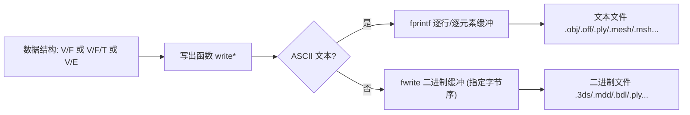

# 10-mesh · 02 网格写出与序列化 / Mesh Writers & Serialization

> 本文档覆盖 `mesh/` 目录下全部「写出 / 序列化」类函数（含 2 个 `tsurf*` 可视化辅助与 2 个 `tsurf → 文件` 转换器），共 **28** 个逐函数条目。
> This chapter documents every mesh **writer / serializer** under `mesh/` (plus 2 `tsurf*` display helpers and 2 `tsurf → file` converters), **28** per-function entries in total.
> 严格遵循 [appendices/03-doc-template.md](../appendices/03-doc-template.md)。
> 纯文档；所有锚点行号均取自真实源码。

---

## 本章概览 / Chapter overview

### 1. I/O 命名规范 / I/O naming conventions

| 约定 | 说明 (中 / EN) |
|---|---|
| 前缀 | 写出函数统一以 `write` 开头（`writeOBJ`、`writePLY`…），读取函数以 `read` 开头 / Writers use the `write` prefix; readers use `read`. |
| 首参 | 几乎全部第一个参数为 `filename`（输出路径字符串），函数内部 `fopen(filename,'w')` 覆写 / first argument is the output `filename`. |
| 几何约定 | `V` = `#V by dim` 顶点；`F` = `#F by 3` 三角索引；`T` = `#T by 4` 四面体；`E` = `#E by 2` 边 / `V` vertices, `F` triangles, `T` tets, `E` edges. |
| 索引基准 | **OBJ / SMF / TGF / WIRE / Node/ELE / MESH / POLY(tetgen/triangle/pyramid)** 与 MATLAB 同为 **1-based**，原样写出；**OFF / PLY / 3DS / DAE / BDL** 为 **0-based**，写出时执行 `F-1` / OBJ-family stays 1-based; OFF/PLY/3DS/DAE/BDL are 0-based and apply `F-1`. |
| 参数风格 | 两类：**位置参数**（`writeOBJ`、`writeOFF`、`writeDAE`、`writePLY`）与 **`'Name',Value` 关键字对**（`writePOLY_tetgen`、`writeNODE`、`writeELE`、`writeGLTF`、`writeSVG_cubics`）。后者多以 `while` + `switch` 手工解析，报错 `Unsupported parameter`。/ two parameter styles: positional vs. `'Name',Value`. |
| 数值格式 | ASCII 顶点普遍使用 `%0.17g`（`writeOBJ/OFF/PLY(tetgen)` 等）或 `%0.16f`（`writeNODE`）以保证往返精度 / high-precision ASCII by default. |
| 文本/二进制 | 文本写出以 `fprintf` 逐行；二进制以 `fwrite`（含 `fopen(...,'wb'|'ieee-le'|'ieee-be')` 指定字节序）/ text via `fprintf`, binary via `fwrite`. |

### 2. 函数总表 / Master table

| 函数 | 输出格式 | ASCII / 二进制 | 关键可选参数 | 备注 |
|---|---|---|---|---|
| `write3DS` | `.3ds`（Autodesk 3DS） | 二进制 | 无 | 手写 chunk；源码注明 meshlab 可能不可读 |
| `writeBB` | `.bb`（medit 解场） | ASCII | `type`(1=单元/2=顶点) | 仅支持向量数据 |
| `writeBDL` | `.bdl`（chunk 二进制） | 二进制 | 无（`mesh` 字段可含 col/UV/baseColor） | chunk 头 `magicID(int32)+nBytes(int64)` |
| `writeBF` | `.bf`（bone forest） | ASCII | 无 | 索引输出前 `-1`（C++ 0-based） |
| `writeDAE` | `.dae`（COLLADA XML） | 文本(XML) | 多个 `(V,F)` 对 | 0-based；Java DOM `xmlwrite` |
| `writeELE` | `.ele`（Triangle/Pyramid） | ASCII | `'MinIndex'` | 1-based |
| `writeGLTF` | `.gltf`（JSON + 内嵌 base64 buffer） | JSON 文本 + 内嵌二进制 | FPS/MagFilter/MinFilter/Morph*/Normals/Skinning*/TextureCoordinates/TextureImage | 材质、贴图、蒙皮、形变目标 |
| `writeMDD` | `.mdd`（Lightwave） | 二进制（big-endian） | 无 | 动画帧序列 |
| `writeMESH` | `.mesh`（Medit/Inria） | ASCII | 无 | 1-based；V/T/F/E 分块 |
| `writeMSH` | `.msh`（Gmsh v2） | ASCII | 无 | 元素 type 4(tet)/2(tri) |
| `writeNODE` | `.node`（Triangle） | ASCII | `'MinIndex'` | 1-based，`%0.16f` |
| `writeOBJ` | `.obj` | ASCII | 位置参数 `UV,TF,N,NF,comment` | 1-based；精度固定 `%0.17g` |
| `writeOFF` | `.off` | ASCII | 位置参数 `UV,C,N` | 0-based（`F-1`） |
| `writePLY` | `.ply` | ASCII 或二进制（LE/BE） | `mode`,`VColor` | 默认 `binary_little_endian` |
| `writePOLY_pyramid` | `.poly`（Pyramid） | ASCII | 无 | facets 索引 **E 而非 V** |
| `writePOLY_tetgen` | `.poly`（TetGen） | ASCII | `'BoundaryMarkers'`,`'BoundaryMarkersNodes'`,`'RegionList'` | 1-based |
| `writePOLY_triangle` | `.poly`（Triangle） | ASCII | 无（输入形式 2/4 变长） | 1-based；2D |
| `writeSEL` | `.sel`（deformation survey） | ASCII | 无 | 每行一个状态码 |
| `writeSMF` | `.smf` | ASCII | 无 | `v`/`f` 极简 |
| `writeSTL` | `.stl` | 由 MATLAB `stlwrite` 决定 | 无 | **委托** `triangulation`+`stlwrite` |
| `writeSVG` | `.svg` | ASCII | 无 | 逐条 `<line>` 元素 |
| `writeSVG_cubics` | `.svg` | ASCII | `'ViewBox'`,`'MergePaths'`,`'Units'` | `<path>` 的绝对 `M`/`C` 命令 |
| `writeTGF` | `.tgf`（图） | ASCII | 无 | 1-based |
| `writeWIRE` | `.wire`（PyMesh） | ASCII | 无 | `v` + `l` |
| `tsurf` | 屏幕（`trisurf`） | 不适用 | `'Outline'`,`'VertexIndices'`,`'FaceIndices'`,`'Tets'`,`'Poly'`,`'ButtonDownFcn'` + 透传 | 非文件写出（可视化包装） |
| `tsurf_cad` | 屏幕（CAD 风格渲染） | 不适用 | 透传 `varargin` 至 `tsurf` | 非文件写出 |
| `write_tsurf_to_gltf` | `.gltf` | JSON 文本 | 无 | 依赖 `writeGLTF_and_validate`（**仓库缺失**） |
| `write_tsurf_to_obj_and_png` | `.obj`+`.mtl`+`.png`+`.mat` | 文本 + PNG 二进制 | 无 | 附带贴图与 `.mat` 数据 |

### 3. 序列化总览 / Serialization pipeline



---

## 逐函数条目 / Per-function entries

### `write3DS` — 写出 Autodesk 3DS 二进制网格
- **文件 / File**: [mesh/write3DS.m](file:///c:/VSWork/gptoolbox-1/mesh/write3DS.m#L1-L114)
- **签名 / Signature**: `write3DS(filename,V,F)`
- **功能 / Purpose**: `EN: Write a mesh (V,F) to a binary .3ds chunk file.` / 中文：把三角网格写出为 Autodesk 3DS 二进制 chunk 文件。
- **输入 / Inputs**:

  | 参数 | 尺寸/类型 | 含义 (中 / EN) |
  |---|---|---|
  | `filename` | `string` | 输出 `.3ds` 路径 / output path |
  | `V` | `#V by 3` | 顶点位置 / vertex positions |
  | `F` | `#F by 3` | 三角面索引 / triangle indices |

- **输出 / Outputs**:

  | 参数 | 尺寸/类型 | 含义 |
  |---|---|---|
  | （无）/ none | — | 直接写盘，无返回值 / writes to disk, no return value |

- **可选参数 / Optional**:

  | 名称 | 取值 | 默认 | 含义 |
  |---|---|---|---|
  | （无）/ none | — | — | 无关键字参数 / no keyword options |

- **变量流动 / Variable flow**: `V,F →(n=#V,m=#F)→ 各 chunk 长度(len) → fopen('wb') → fwrite 主/版本/编辑器/网格/顶点/面 chunk → 结尾 keyframer junk → .3ds`
- **算法步骤 / Algorithm**:
  1. 计算顶点数 `n`、面数 `m`，并预先算出各嵌套 chunk 的字节长度（`v_len/f_len/t_len/m_len/e_len/k_len/main_len…`）。
  2. `fopen(filename,'wb')` 以二进制写模式打开。
  3. 依次 `fwrite` 主 chunk（id `19789`）、版本 chunk（id `15677/15678`，值为 3）、比例 chunk（id `256`）。
  4. 写网格 chunk（id `16384`，含名字 `'mesh'+NUL`），其内写顶点 chunk（id `16656`，`float32`，`V'`）与面 chunk（id `16672`），面索引 `F-1` 并补一列 0（`ushort`）。
  5. 写末尾 keyframer 相关 chunk（id `45056/45058/45104/45072/45075/45088/45089/45090`）作为 meshlab 需要的“填充”。
  6. `fclose`。
- **流程图 / Flowchart**:

  ```mermaid
  flowchart TD
    A["输入 V,F"] --> B["计算 n,m 与各 chunk 长度"]
    B --> C["fopen(wb)"]
    C --> D["写主 chunk 与版本/比例 chunk"]
    D --> E["写网格名 + 顶点 chunk(float32 V)"]
    E --> F["写面 chunk(int F-1, ushort)"]
    F --> G["写 keyframer 结尾垃圾 chunk"]
    G --> Z["关闭文件 .3ds"]
  ```

- **依赖 / Dependencies**: 无同库函数（仅 `fopen/fwrite/fclose`）/ none in-repo.
- **See also**: `read3DS`, `writeOBJ`, `writePLY`

### `writeBB` — 写出 medit 解场数据文件
- **文件 / File**: [mesh/writeBB.m](file:///c:/VSWork/gptoolbox-1/mesh/writeBB.m#L1-L21)
- **签名 / Signature**: `writeBB(filename,D,type)`
- **功能 / Purpose**: `EN: Write medit data file (.bb), vector data only.` / 中文：写出 medit 数据文件（仅支持向量数据）。
- **输入 / Inputs**:

  | 参数 | 尺寸/类型 | 含义 (中 / EN) |
  |---|---|---|
  | `filename` | `string` | 输出 `.bb` 路径 / output path |
  | `D` | `#D by dim` | 数据矩阵 / data matrix |
  | `type` | `int` | 位置标识：`2`=顶点定义，`1`=单元定义 / 2=at vertices, 1=at elements |

- **输出 / Outputs**:

  | 参数 | 尺寸/类型 | 含义 |
  |---|---|---|
  | （无）/ none | — | 写盘 / writes to disk |

- **可选参数 / Optional**:

  | 名称 | 取值 | 默认 | 含义 |
  |---|---|---|---|
  | （无）/ none | — | — | `type` 为位置参数 / `type` is positional |

- **变量流动 / Variable flow**: `D,type → fopen('w') → header "2 1 #D type" → 逐值 %g → .bb`
- **算法步骤 / Algorithm**:
  1. `fopen(filename,'w')`。
  2. 打印头部 `fprintf(f,'%d %d %d %d\n',2,1,size(D,1),type)`（维度=2 表示向量、分量数=1、数据条数、位置 `type`）。
  3. `fprintf(f,'%g\n',D')` 逐值写出。
  4. `fclose`。
- **流程图 / Flowchart**:

  ```mermaid
  flowchart TD
    A["输入 D,type"] --> B["fopen(w)"]
    B --> C["写头部 2 1 #D type"]
    C --> D["逐值 %g 写数据"]
    D --> Z["关闭 .bb"]
  ```

- **依赖 / Dependencies**: 无 / none.
- **See also**: `readBB`, `writeMESH`

### `writeBDL` — 写出 BDL 分块二进制网格
- **文件 / File**: [mesh/writeBDL.m](file:///c:/VSWork/gptoolbox-1/mesh/writeBDL.m#L1-L98)
- **签名 / Signature**: `writeBDL(filename,V,F)`
- **功能 / Purpose**: `EN: Write a mesh to a .bdl file (chunked binary format).` / 中文：把网格写出为 BDL 分块二进制文件。
- **输入 / Inputs**:

  | 参数 | 尺寸/类型 | 含义 (中 / EN) |
  |---|---|---|
  | `filename` | `string` | 输出 `.bdl` 路径 / output path |
  | `V` | `#V by dim` | 网格顶点 / mesh vertices |
  | `F` | `#F by 3` | 三角索引 / triangle indices |

- **输出 / Outputs**:

  | 参数 | 尺寸/类型 | 含义 |
  |---|---|---|
  | （无）/ none | — | 写盘 / writes to disk |

- **可选参数 / Optional**:

  | 名称 | 取值 | 默认 | 含义 |
  |---|---|---|---|
  | （无）/ none | — | — | 内部构造 `mesh` 结构体，未暴露关键字参数 / no keyword options |

- **变量流动 / Variable flow**: `V,F → mesh.V,mesh.F → writeBDLMeshChunk → [nV,nF,nVperFace,nCperPos,...] 头 → V' / F'-1 数据 → 回填 chunk 大小 → .bdl`
- **算法步骤 / Algorithm**:
  1. 组装 `mesh.V=V`、`mesh.F=F`，`fopen(filename,'w')`。
  2. 调用嵌套 `writeBDLMeshChunk`：先 `writeBDLChunkHeader` 写 chunk 头（`magicID=int32`（MESH_CHUNK→1）、`nBytes=int64`），大小先占位 `0`。
  3. 记录 `chunkStart=ftell`，依次写计数：`nV,nF,nVperFace,nCperPos,nCperUV,nCperCol,nCperNormal`（均 `uint32`）。
  4. 写 `strip(uchar)` 与 `baseColor(float32)`（默认 `[1 1 1 1]`）。
  5. 写 `V'`（`float32`）；可选 UV/col；有 F 时写 `F'-1`（`uint32`，0-based）。
  6. `chunkSize = ftell - chunkStart`；`fseek` 回头用真实 `chunkSize` 重写 chunk 头；`fseek(0,'eof')`。
  7. `fclose`。
- **流程图 / Flowchart**:

  ```mermaid
  flowchart TD
    A["输入 V,F"] --> B["mesh.V=V, mesh.F=F"]
    B --> C["写 chunk 头 (magicID=int32, nBytes=占位)"]
    C --> D["写计数 nV/nF/nVperFace/..."]
    D --> E["写 baseColor, V(float32)"]
    E --> F["写 F-1(uint32)"]
    F --> G["ftell 计算 chunk 大小并回填头"]
    G --> Z["关闭 .bdl"]
  ```

- **依赖 / Dependencies**: 无同库函数（嵌套函数 `writeBDLChunkHeader` / `writeBDLMeshChunk` 在同文件内）/ in-file nested helpers only.
- **See also**: `readBDL`

### `writeBF` — 写出骨骼森林 bone forest
- **文件 / File**: [mesh/writeBF.m](file:///c:/VSWork/gptoolbox-1/mesh/writeBF.m#L1-L46)
- **签名 / Signature**: `writeBF(filename,V,WI,P)`
- **功能 / Purpose**: `EN: Write a bone forest to a .bf file.` / 中文：把骨骼森林写出为 `.bf` 文件。
- **输入 / Inputs**:

  | 参数 | 尺寸/类型 | 含义 (中 / EN) |
  |---|---|---|
  | `filename` | `string` | 输出 `.bf` 路径 / output path |
  | `V` | `#V by 2/3` | 相对父节点的顶点偏移 / vertex offsets from parents |
  | `WI` | `#V by 1` | 权重索引（0 表示无权重）/ weight indices (0=no weight) |
  | `P` | `#V by 1` | 父骨骼索引（0 表示根）/ parent indices (0=root) |

- **输出 / Outputs**:

  | 参数 | 尺寸/类型 | 含义 |
  |---|---|---|
  | （无）/ none | — | 写盘 / writes to disk |

- **可选参数 / Optional**:

  | 名称 | 取值 | 默认 | 含义 |
  |---|---|---|---|
  | `WI` | 省略 | `1:#V` | 缺省时假设权重索引等于顺序（并告警）/ default to order |
  | `P` | 省略 | `zeros(#V,1)` | 缺省时假设全为根（并告警）/ all roots |

- **变量流动 / Variable flow**: `V,WI,P →(V 补 z)→(WI,P 转列)→(P-1,WI-1)→ fopen('w') → 每行 "WI P x y z" → .bf`
- **算法步骤 / Algorithm**:
  1. `WI` 缺省置 `1:#V`、`P` 缺省置 0 向量，并各发一次 `warning`。
  2. 若 `V` 为 2D，补零到 3D（告警）。
  3. 断言 `numel(P)==#V` 且 `numel(WI)==#V`；`WI`、`P` 转为列向量。
  4. **索引基准转换**：`P=P-1`、`WI=WI-1`（MATLAB 1-based → C++ 0-based）。
  5. `fopen(filename,'w')`，`fprintf(fp,'%d %d %g %g %g\n',[WI';P';V'])` 每骨骼一行。
  6. `fclose`。
- **流程图 / Flowchart**:

  ```mermaid
  flowchart TD
    A["输入 V,WI,P"] --> B["缺省 WI=1:#V, P=zeros"]
    B --> C{"V 是 2D?"}
    C -- 是 --> D["补 z=0"]
    C -- 否 --> E["保持"]
    D --> F["WI,P 减 1 (0-based)"]
    E --> F
    F --> G["逐骨骼写 'WI P x y z'"]
    G --> Z["关闭 .bf"]
  ```

- **依赖 / Dependencies**: 无 / none.
- **See also**: `readBF`, `writeTGF`

### `writeDAE` — 写出 Collada .dae 场景
- **文件 / File**: [mesh/writeDAE.m](file:///c:/VSWork/gptoolbox-1/mesh/writeDAE.m#L1-L130)
- **签名 / Signature**: `writeDAE(filename,varargin)`（即 `writeDAE(filename,V,F)` 或 `writeDAE(filename,V1,F1,V2,F2,...)`）
- **功能 / Purpose**: `EN: Write one or more meshes to a Collada .dae scene file.` / 中文：将一个或多个网格写出为 Collada `.dae` 场景文件。
- **输入 / Inputs**:

  | 参数 | 尺寸/类型 | 含义 (中 / EN) |
  |---|---|---|
  | `filename` | `string` | 输出 `.dae` 路径 / output path |
  | `V1,F1,V2,F2,...` | `#Vk by 3`, `#Fk by 3` | 交替的顶点/面对 / alternating vertex/face pairs |

- **输出 / Outputs**:

  | 参数 | 尺寸/类型 | 含义 |
  |---|---|---|
  | （无）/ none | — | 写盘 / writes to disk |

- **可选参数 / Optional**:

  | 名称 | 取值 | 默认 | 含义 |
  |---|---|---|---|
  | 额外 `V,F` 对 | 任意组 | — | 每组生成一个 `<geometry>` 与节点 / each pair → geometry+node |

- **变量流动 / Variable flow**: `(V1,F1,...) → Java DOM (COLLADA, unit=inch, Y_UP) → 每组写 node/library_nodes/geometry(float_array=V', p=F'-1) → xmlwrite → .dae`
- **算法步骤 / Algorithm**:
  1. 定义嵌套 `id(p,n,i)`：按组序号生成形如 `pID<n+...>` 的唯一 id。
  2. 用 `com.mathworks.xml.XMLUtils.createDocument('COLLADA')` 建根，写 `xmlns`、`version=1.4.1`。
  3. 写 `asset`：`unit`（`inch`，`meter=0.0254`）与 `up_axis=Y_UP`。
  4. 建 `library_visual_scenes`/`visual_scene(id=ID2)`/`sketchup` 节点与 `library_nodes`、`library_geometries`。
  5. 对每对 `(V,F)`：
     - 写 `node`（含单位矩阵 `matrix`、`instance_node`）挂到 `sketchup` 下；
     - 写 `library_nodes` 中的 `node`（`instance_geometry` + `bind_material/technique_common`）；
     - 写 `geometry/mesh/source/float_array`（`V'`）与 `accessor(stride=3, X/Y/Z)`、`vertices`、`triangles`（`p` 中为 `(F-1)'`，0-based）。
  6. 组装 `scene` + `instance_visual_scene(url=#ID2)`。
  7. `fopen(filename,'w')` 后 `fprintf(f,'%s',xmlwrite(docNode))`，`fclose`。
- **流程图 / Flowchart**:

  ```mermaid
  flowchart TD
    A["输入 (V1,F1,...)"] --> B["创建 COLLADA DOM, asset/unit/Y_UP"]
    B --> C["对每组 V,F"]
    C --> D["写 node/instance_node, instance_geometry"]
    D --> E["写 float_array=V, p=F-1 (0-based)"]
    E --> C
    C --> F["组装 scene 与 instance_visual_scene"]
    F --> G["xmlwrite 写入 .dae"]
  ```

- **依赖 / Dependencies**: Java `com.mathworks.xml.XMLUtils`（MATLAB 内置）/ built-in Java XML DOM.
- **See also**: `readDAE`, `writeGLTF`, `writeOBJ`

### `writeELE` — 写出 Triangle/Pyramid 的 .ele 单元文件
- **文件 / File**: [mesh/writeELE.m](file:///c:/VSWork/gptoolbox-1/mesh/writeELE.m#L1-L55)
- **签名 / Signature**: `writeELE(filename,E,varargin)`
- **功能 / Purpose**: `EN: Write mesh elements to a .ele file.` / 中文：把网格单元写出为 `.ele` 文件（Triangle/Pyramid 约定）。
- **输入 / Inputs**:

  | 参数 | 尺寸/类型 | 含义 (中 / EN) |
  |---|---|---|
  | `filename` | `string` | 输出 `.ele` 路径 / output path |
  | `E` | `#E by k` | 单元（角点）索引 / element corner indices |

- **输出 / Outputs**:

  | 参数 | 尺寸/类型 | 含义 |
  |---|---|---|
  | （无）/ none | — | 写盘 / writes to disk |

- **可选参数 / Optional**:

  | 名称 | 取值 | 默认 | 含义 |
  |---|---|---|---|
  | `'MinIndex'` | `int` | `1` | 输出索引最小值偏移（`1-based`）；注意 `E` 本身需与之一致 / minimum index offset |

- **变量流动 / Variable flow**: `E →(警告检查 min(E) vs min_index)→ fopen('w') → 头 "#E k 0" → 每行 "id 角点..." → .ele`
- **算法步骤 / Algorithm**:
  1. 默认 `min_index=1`；用 `while`+`switch` 解析 `'MinIndex'` 关键字，未知参数报错。
  2. 若 `min(E(:)) < min_index` 或 `min_index < min(E(:))` 发 `warning`（提示需自行保证一致）。
  3. `fopen(filename,'w')`，写头部 `fprintf(fp,'%d %d 0\n',size(E))`（#E × 每单元角点数，属性 0）。
  4. 生成输出索引 `indices=(1:#E)+(min_index-1)`，按列数构造 `%d` 格式串。
  5. `fprintf(fp,str,[indices', E]')` 逐行写出；`fclose`。
- **流程图 / Flowchart**:

  ```mermaid
  flowchart TD
    A["输入 E, 可选 MinIndex"] --> B["解析 MinIndex 关键字"]
    B --> C{"min(E) 与 min_index 不一致?"}
    C -- 是 --> D["warning"]
    C -- 否 --> E["无警告"]
    D --> F["写头部 #E k 0"]
    E --> F
    F --> G["逐单元写 id + 角点"]
    G --> Z["关闭 .ele"]
  ```

- **依赖 / Dependencies**: 无 / none.
- **See also**: `writeNODE`, `writePOLY_triangle`, `readELE`

### `writeGLTF` — 写出 glTF 2.0（JSON + 内嵌 base64 缓冲）
- **文件 / File**: [mesh/writeGLTF.m](file:///c:/VSWork/gptoolbox-1/mesh/writeGLTF.m#L1-L441)
- **签名 / Signature**: `writeGLTF(filename,V,F,varargin)`
- **功能 / Purpose**: `EN: Write a mesh to a glTF 2.0 JSON file with an embedded base64 data buffer, optionally with normals, skinning, morph targets and textures.` / 中文：把网格写出为 glTF 2.0（JSON + 内嵌 base64 buffer），支持法向、蒙皮、形变目标与贴图。
- **输入 / Inputs**:

  | 参数 | 尺寸/类型 | 含义 (中 / EN) |
  |---|---|---|
  | `filename` | `string` | 输出 `.gltf` 路径 / output path |
  | `V` | `#V by 3` | 顶点位置 / vertex positions |
  | `F` | `#F by 3` | 三角索引 / triangle indices |

- **输出 / Outputs**:

  | 参数 | 尺寸/类型 | 含义 |
  |---|---|---|
  | （无）/ none | — | 写盘 / writes to disk |

- **可选参数 / Optional**:

  | 名称 | 取值 | 默认 | 含义 |
  |---|---|---|---|
  | `'FPS'` | `num` | `30` | 动画帧率（时间轴 `t=(0:frames-1)/fps`）/ frames per second |
  | `'MagFilter'` | `'LINEAR'`/`'NEAREST'`/数值 | `LINEAR` | 纹理放大滤波 / magnification filter |
  | `'MinFilter'` | 同上 | `LINEAR_MIPMAP_LINEAR` | 纹理缩小滤波 / minification filter |
  | `'Normals'` | `#V by 3` | `[]` | 顶点法向（写出前 `normalizerow`）/ vertex normals |
  | `'SkinningTransforms'` | `3 by 4 by #T by #A` | `[]` | 全局蒙皮变换 / animated skinning transforms |
  | `'SkinningWeights'` | `#V by #T` | `[]` | 蒙皮权重 / skinning weights |
  | `'MorphTargets'` | `#V by 3 by #M` | `[]` | 形变目标位置 / morph target positions |
  | `'MorphNormals'` | `#V by 3 by #M` | `[]` | 形变目标法向 / morph target normals |
  | `'MorphWeights'` | `#frames by #M` | `[]` | 形变权重时间序列 / morph weights |
  | `'TextureCoordinates'` | `#V by 2` | `[]` | 纹理坐标 / texture coordinates |
  | `'TextureImage'` | 图像矩阵 | `[]` | 贴图（写临时 jpg/png 后内嵌）/ texture image |

- **变量流动 / Variable flow**: `V,F,选项 →(判定各 has_* 标志)→ buffered_data 列表 → prepare_buffer(临时二进制 + 偏移/对齐 + accessor min/max) → base64 → gltf 结构体 → jsonencode → .gltf`
- **算法步骤 / Algorithm**:
  1. 定义 glTF 常量（滤波/环绕枚举、组件类型 `UNSIGNED_SHORT=5123` 等）。
  2. 用 `containers.Map` + `assignin` 解析 `'Name',Value` 关键字（`FPS/MagFilter/…/TextureImage`），未知参数报错。
  3. 由 `F` 最大值选择索引类型：`<2^16` 用 `uint16/UNSIGNED_SHORT`，否则 `uint32/UNSIGNED_INT`。
  4. 组装 `buffered_data` 列表：`F`（`Data-1`，0-based，`ELEMENT_ARRAY_BUFFER`）、`V`、可选 `N`（`normalizerow`）、`MV/MN/MW/MWt`、蒙皮 `WIk/Wk`、变换 `tT/qU/sS/qVT/Tt`、`UV`。
  5. `prepare_buffer`：把数据写入临时二进制（`fwrite`，先 `-1` 偏移再用 `pad_amount` 对齐到 4/8 字节），记录 `bufferViews`/`accessors`（含 `min/max/count/componentType/type`），读回整体并 `base64encode` 成 `data:application/octet-stream;base64,...` 的 `buffer.uri`。
  6. 组装 `mesh.primitives.attributes`（`POSITION/NORMAL/TEXCOORD_0/JOINTS_0/WEIGHTS_0`）与 `indices`；写 `targets`（形变）与 `nodes`（蒙皮节点树 `V-*/TUS-*` + root）。
  7. 生成 `skins/animations`（蒙皮通道 `STEP` 插值；形变权重 `LINEAR`）。
  8. 若有贴图：按滤波选择写临时 `writeGLTF.jpg/png`（`flipud(tex_im)`），`imdata` 转 data-URI，删除临时文件；生成 `images/samplers/textures/materials`（`baseColorTexture`、`metallicFactor=0`、`roughnessFactor=1`）。
  9. `jsonencode(gltf)` 写入 `filename`；`fclose`。
- **流程图 / Flowchart**:

  ```mermaid
  flowchart TD
    A["输入 V,F,选项"] --> B["解析关键字参数"]
    B --> C["按 max(F) 选择 uint16/uint32 索引"]
    C --> D["组装 buffered_data 列表"]
    D --> E["prepare_buffer: 写临时二进制+对齐+accessor"]
    E --> F["读回并 base64 编码为 data URI"]
    F --> G["组装 mesh/nodes/skins/animations"]
    G --> H{"有贴图?"}
    H -- 是 --> I["写临时图片 imdata 转 URI, 建 materials"]
    H -- 否 --> J["跳过材质"]
    I --> K["jsonencode 写入 .gltf"]
    J --> K
  ```

- **依赖 / Dependencies**: `base64encode`, `normalizerow`, `mat2quat`, `quat2mat`（`mesh/`、`quat/`、`utility/`）/ `base64encode`, `normalizerow`, `mat2quat`, `quat2mat`.
- **See also**: `readGLTF`, `writeDAE`, `write_tsurf_to_gltf`

### `writeMDD` — 写出 Lightwave 动画 .mdd
- **文件 / File**: [mesh/writeMDD.m](file:///c:/VSWork/gptoolbox-1/mesh/writeMDD.m#L1-L14)
- **签名 / Signature**: `writeMDD(mdd_filename,VV)`
- **功能 / Purpose**: `EN: Write a mesh animation to a .mdd file (e.g. for Blender).` / 中文：把网格动画写出为 `.mdd` 文件（可用 Blender 读取）。
- **输入 / Inputs**:

  | 参数 | 尺寸/类型 | 含义 (中 / EN) |
  |---|---|---|
  | `mdd_filename` | `string` | 输出 `.mdd` 路径 / output path |
  | `VV` | `#V by 3 by #frames` | 动画顶点序列 / mesh animation |

- **输出 / Outputs**:

  | 参数 | 尺寸/类型 | 含义 |
  |---|---|---|
  | （无）/ none | — | 写盘 / writes to disk |

- **可选参数 / Optional**:

  | 名称 | 取值 | 默认 | 含义 |
  |---|---|---|---|
  | （无）/ none | — | — | 无关键字参数 / no keyword options |

- **变量流动 / Variable flow**: `VV → fopen('w','ieee-be') → 帧数/顶点数/times(float) → permute(VV,[2 1 3]) float → .mdd`
- **算法步骤 / Algorithm**:
  1. `fopen(mdd_filename,'w','ieee-be')` 以**大端**打开。
  2. 写 `#frames`（`uint32`）、`#V`（`uint32`）。
  3. 写时间轴 `linspace(0,1,#frames)`（`float`）。
  4. 写顶点数据 `permute(VV,[2 1 3])`（即按 (x,y,z) 分量优先，`float`）。
  5. `fclose`。
- **流程图 / Flowchart**:

  ```mermaid
  flowchart TD
    A["输入 VV"] --> B["fopen(ieee-be)"]
    B --> C["写帧数, 顶点数 (uint32)"]
    C --> D["写 times=linspace(0,1,#frames)"]
    D --> E["写 permute(VV,[2 1 3]) float"]
    E --> Z["关闭 .mdd"]
  ```

- **依赖 / Dependencies**: 无 / none.
- **See also**: `readMDD`

### `writeMESH` — 写出 Medit/Inria .mesh
- **文件 / File**: [mesh/writeMESH.m](file:///c:/VSWork/gptoolbox-1/mesh/writeMESH.m#L1-L68)
- **签名 / Signature**: `writeMESH(filename,V,T,F,E)`
- **功能 / Purpose**: `EN: Write an MESH (Medit) file with vertices, tetrahedra, triangles and edges.` / 中文：写出含顶点/四面体/三角面/边的 Medit `.mesh` 文件。
- **输入 / Inputs**:

  | 参数 | 尺寸/类型 | 含义 (中 / EN) |
  |---|---|---|
  | `filename` | `string` | 输出 `.mesh` 路径 / output path |
  | `V` | `#V by 3` | 顶点 / vertices |
  | `T` | `#T by 4\|5` | 四面体索引（第 5 列可选为颜色索引）/ tet indices (5th col = color) |
  | `F` | `#F by 3\|4` | 三角面索引（第 4 列可选为颜色索引）/ tri indices (4th col = color) |
  | `E` | `#E by 2\|3` | 可选，边索引（第 3 列可选为颜色索引）/ optional edges |

- **输出 / Outputs**:

  | 参数 | 尺寸/类型 | 含义 |
  |---|---|---|
  | （无）/ none | — | 写盘 / writes to disk |

- **可选参数 / Optional**:

  | 名称 | 取值 | 默认 | 含义 |
  |---|---|---|---|
  | `E` | 省略 | `[]` | 边为空 / empty edges |

- **变量流动 / Variable flow**: `V,T,F,E → fopen('w') → MeshVersionFormatted/Dimension 头 → Vertices 块 → Triangles 块 → Tetrahedra 块 → Edges 块 → End`
- **算法步骤 / Algorithm**:
  1. `E` 缺省置 `[]`；`fopen(filename,'w')`。
  2. 写强制头：`MeshVersionFormatted 1`、`Dimension 3`。
  3. `Vertices` 段：写 `#V`，再写 `%0.15g %0.15g %0.15g 0`（末尾 0 为参考颜色）。
  4. `Triangles` 段：写 `#F`；`F` 4 列写四列，否则补 `0`（颜色）。
  5. `Tetrahedra` 段：写 `#T`；`T` 5 列写五列，否则补 `0`。
  6. `Edges` 段：写 `#E`；`E` 3 列写三列，否则写两列 + `0`。
  7. 写 `End`；`fclose`。全部索引 **1-based**（原样写出）。
- **流程图 / Flowchart**:

  ```mermaid
  flowchart TD
    A["输入 V,T,F,E"] --> B["fopen(w)"]
    B --> C["写头 MeshVersionFormatted/Dimension"]
    C --> D["Vertices: 计数 + 坐标(x y z 0)"]
    D --> E["Triangles: 计数 + 索引(+0)"]
    E --> F["Tetrahedra: 计数 + 索引(+0)"]
    F --> G["Edges: 计数 + 索引(+0)"]
    G --> Z["写 End, 关闭 .mesh"]
  ```

- **依赖 / Dependencies**: 无 / none.
- **See also**: `readMESH`, `writePOLY_tetgen`

### `writeMSH` — 写出 Gmsh v2 .msh
- **文件 / File**: [mesh/writeMSH.m](file:///c:/VSWork/gptoolbox-1/mesh/writeMSH.m#L1-L35)
- **签名 / Signature**: `writeMSH(filename,V,T,F)`
- **功能 / Purpose**: `EN: Write a tet mesh to gmsh's ASCII .msh (v2) format.` / 中文：把四面体网格写出为 Gmsh ASCII `.msh`（v2）。
- **输入 / Inputs**:

  | 参数 | 尺寸/类型 | 含义 (中 / EN) |
  |---|---|---|
  | `filename` | `string` | 输出 `.msh` 路径 / output path |
  | `V` | `#V by 3` | 顶点 / vertices |
  | `T` | `#T by 4` | 四面体索引 / tet indices |
  | `F` | `#F by 3` | 三角面索引 / triangle indices |

- **输出 / Outputs**:

  | 参数 | 尺寸/类型 | 含义 |
  |---|---|---|
  | （无）/ none | — | 写盘 / writes to disk |

- **可选参数 / Optional**:

  | 名称 | 取值 | 默认 | 含义 |
  |---|---|---|---|
  | （无）/ none | — | — | 无关键字参数 / no keyword options |

- **变量流动 / Variable flow**: `V,T,F → fopen('w') → $MeshFormat(2 0 8) → $Nodes → $Elements(tets type4 + tris type2) → $EndElements`
- **算法步骤 / Algorithm**:
  1. `fopen(filename,'w')`；写 `$MeshFormat`，版本行 `2 0 8`（v2、ASCII、数据尺寸 8）与 `$EndMeshFormat`。
  2. `$Nodes` 段：写 `#V`，再逐点 `%d %0.17g %0.17g %0.17g`（id 1-based + 坐标）；`$EndNodes`。
  3. `$Elements` 段：写总数 `#T+#F`。
  4. 写四面体：`%d 4 2 0 1 x y z w`（id、type=4、2 个 tag：物理组 0、几何组 1、四节点）。
  5. 写三角面：`%d 2 2 0 1 a b c`（type=2，id 接在 tet 之后）。
  6. `$EndElements`；`fclose`。
- **流程图 / Flowchart**:

  ```mermaid
  flowchart TD
    A["输入 V,T,F"] --> B["$MeshFormat 2 0 8"]
    B --> C["$Nodes: 计数 + id/坐标"]
    C --> D["$Elements: 计数 = #T+#F"]
    D --> E["写 tets (type 4)"]
    E --> F["写 tris (type 2)"]
    F --> Z["$EndElements, 关闭 .msh"]
  ```

- **依赖 / Dependencies**: 无 / none.
- **See also**: `readMSH`, `writeMESH`

### `writeNODE` — 写出 Triangle .node 顶点文件
- **文件 / File**: [mesh/writeNODE.m](file:///c:/VSWork/gptoolbox-1/mesh/writeNODE.m#L1-L47)
- **签名 / Signature**: `writeNODE(filename,V,varargin)`
- **功能 / Purpose**: `EN: Write vertex positions to a .node file.` / 中文：把顶点坐标写出为 `.node` 文件。
- **输入 / Inputs**:

  | 参数 | 尺寸/类型 | 含义 (中 / EN) |
  |---|---|---|
  | `filename` | `string` | 输出 `.node` 路径 / output path |
  | `V` | `#V by dim` | 顶点坐标 / vertex positions |

- **输出 / Outputs**:

  | 参数 | 尺寸/类型 | 含义 |
  |---|---|---|
  | （无）/ none | — | 写盘 / writes to disk |

- **可选参数 / Optional**:

  | 名称 | 取值 | 默认 | 含义 |
  |---|---|---|---|
  | `'MinIndex'` | `int` | `1` | 输出编号的最小值偏移 / minimum index offset |

- **变量流动 / Variable flow**: `V →(解析 MinIndex)→ fopen('w') → 头 "#V dim 0 1" → 每行 "id x y ... 0" (%0.16f) → .node`
- **算法步骤 / Algorithm**:
  1. 默认 `min_index=1`；`while`+`switch` 解析 `'MinIndex'`，未知参数报错。
  2. `fopen(filename,'w')`，写头 `fprintf(fp,'%d %d 0 1\n',size(V))`（#V、维度、0、1）。
  3. 构造格式串：`%d` + 每维一个 `%0.16f` + ` 0\n`（末尾 0 为标记；注释称用 0.16f 保证 Triangle 能复现输入）。
  4. 计算 `indices=(1:#V)+(min_index-1)`，`fprintf(fp,str,[indices',V]')` 逐点写出。
  5. `fclose`。**1-based**。
- **流程图 / Flowchart**:

  ```mermaid
  flowchart TD
    A["输入 V, 可选 MinIndex"] --> B["fopen(w)"]
    B --> C["写头 #V dim 0 1"]
    C --> D["构造格式 %d + %0.16f..."]
    D --> E["逐点写 id 与坐标 (1-based)"]
    E --> Z["关闭 .node"]
  ```

- **依赖 / Dependencies**: 无 / none.
- **See also**: `writeELE`, `readNODE`, `writePOLY_triangle`

### `writeOBJ` — 写出 Wavefront .obj
- **文件 / File**: [mesh/writeOBJ.m](file:///c:/VSWork/gptoolbox-1/mesh/writeOBJ.m#L1-L82)
- **签名 / Signature**: `writeOBJ(filename, V,F,UV,TF,N,NF,comment)`
- **功能 / Purpose**: `EN: Write an OBJ file with vertex/face information (and optional texture coordinates and normals).` / 中文：写出含顶点/面（可选纹理坐标与法向）的 OBJ 文件。
- **输入 / Inputs**:

  | 参数 | 尺寸/类型 | 含义 (中 / EN) |
  |---|---|---|
  | `filename` | `string` | 输出 `.obj` 路径 / output path |
  | `V` | `#V by 2/3` | 顶点（2 列时补零）/ vertices (2D padded to 3D) |
  | `F` | `#F by k` | 面索引 / face indices |
  | `UV` | `#UV by 2/3` | 纹理坐标 / texture coordinates |
  | `TF` | `#TF by k` | 角纹理索引（into UV）/ corner texture indices |
  | `N` | `#N by 3` | 法向 / normals |
  | `NF` | `#NF by k` | 角法向索引（into N）/ corner normal indices |
  | `comment` | `string` | 文件首行注释 / leading comment |

- **输出 / Outputs**:

  | 参数 | 尺寸/类型 | 含义 |
  |---|---|---|
  | （无）/ none | — | 写盘 / writes to disk |

- **可选参数 / Optional**:

  | 名称 | 取值 | 默认 | 含义 |
  |---|---|---|---|
  | `UV,TF,N,NF` | 位置参数 | 缺省为空 | 有 `UV` 无 `TF` 时 `TF=F`；有 `N` 无 `NF` 时 `NF=F` / TF/NF default to F |
  | `comment` | 位置参数 | 缺省无 | 非空时先写 `# comment` / leading comment line |
  | 精度 / precision | **固定** | `%0.17g` | 无 `'Precision'`/`'Stl'` 关键字，精度硬编码在源码 / precision is hard-coded; there is no `'Precision'`/`'Stl'` option |

- **变量流动 / Variable flow**: `V,F,UV,TF,N,NF,comment → fopen('w') → 可选 "# comment" → v 块 → (vt 块) → (vn 块) → f 行（按 N/UV 组合） → .obj`
- **算法步骤 / Algorithm**:
  1. `fopen(filename,'w')`；若 `comment` 存在且非空，先写 `# %s`。
  2. 若 `size(V,2)==2`，告警并补 z=0 列。
  3. 写顶点：`fprintf(f,['v' repmat(' %0.17g',1,size(V,2)) '\n'],V')`。
  4. 判定 `hasN`、`hasUV`；有 `UV` 时按 2/3 列写 `vt`（`%0.17g`）；有 `N` 时写 `vn`（`%0.17g`）。
  5. `TF`/`NF` 缺省置为 `F`。
  6. 面写出：
     - 无 `N` 且无 `UV`：一次性 `f %d %d %d`（最快分支）；
     - 否则逐面，按每面 `TF/NF` 是否 ≤0 组合选择 `f a`、`f a/b`（`%d/%d`）、`f a//c`（`%d//%d`）、`f a/b/c`（`%d/%d/%d`）；有法向+UV 时断言所有索引 >0。
  7. `fclose`。**索引不偏移（OBJ 与 MATLAB 同为 1-based）**。
- **流程图 / Flowchart**:

  ```mermaid
  flowchart TD
    A["输入 filename,V,F,UV,TF,N,NF,comment"] --> B["fopen(w), 可选写 # comment"]
    B --> C{"V 是 2D?"}
    C -- 是 --> D["补 z=0"]
    C -- 否 --> E["保持"]
    D --> F["写 v 块"]
    E --> F
    F --> G["可选写 vt / vn 块"]
    G --> H{"有 N 或 UV?"}
    H -- 否 --> I["一次性写 f 索引"]
    H -- 是 --> J["逐面按组合写 f a / a/b / a//c / a/b/c"]
    I --> Z["关闭 .obj"]
    J --> Z
  ```

- **依赖 / Dependencies**: 无同库函数 / none in-repo.
- **See also**: `readOBJ`, `writeOFF`, `writeSMF`, `writeWIRE`

### `writeOFF` — 写出 Geomview .off
- **文件 / File**: [mesh/writeOFF.m](file:///c:/VSWork/gptoolbox-1/mesh/writeOFF.m#L1-L68)
- **签名 / Signature**: `writeOFF(filename, V,F,UV,C,N)`
- **功能 / Purpose**: `EN: Write an OFF (Geomview) file with vertex/face information, optionally with texture coordinates, colors and normals.` / 中文：写出 OFF 文件，可选含纹理坐标、颜色与法向。
- **输入 / Inputs**:

  | 参数 | 尺寸/类型 | 含义 (中 / EN) |
  |---|---|---|
  | `filename` | `string` | 输出 `.off` 路径 / output path |
  | `V` | `#V by 3` | 顶点 / vertices |
  | `F` | `#F by k` | 面索引 / face indices |
  | `UV` | `#V by 2` | 纹理坐标 / texture coordinates |
  | `C` | `#V by 3` | 顶点颜色 / colors |
  | `N` | `#V by 3` | 法向 / normals |

- **输出 / Outputs**:

  | 参数 | 尺寸/类型 | 含义 |
  |---|---|---|
  | （无）/ none | — | 写盘 / writes to disk |

- **可选参数 / Optional**:

  | 名称 | 取值 | 默认 | 含义 |
  |---|---|---|---|
  | `UV` | 位置参数 | 空 | 增加前缀 `ST`，追加 2 列 / adds `ST` prefix + 2 cols |
  | `C` | 位置参数 | 空 | 增加前缀 `C`，追加 3 列 / adds `C` prefix + 3 cols |
  | `N` | 位置参数 | 空 | 增加前缀 `N`，追加 3 列 / adds `N` prefix + 3 cols |

- **变量流动 / Variable flow**: `V,F,UV,C,N →(拼接 OFFV=[V N C UV])→(前缀 OFFheader="ST"+"C"+"N"+"OFF")→ fopen(wt) → 头 → 计数 "%d %d 0" → 顶点行 → 面行(F-1) → .off`
- **算法步骤 / Algorithm**:
  1. 判定 `hasN/hasUV/hasC`；初始 `OFFheader='OFF'`、`OFFV=V`。
  2. **前缀与列顺序**：有 `N` → 头前加 `N`、`OFFV=[OFFV N]`；有 `C` → 前加 `C`、追加 `C`；有 `UV` → 前加 `ST`、追加 `UV`。最终头形如 `STCNOFF`。
  3. `fopen(filename,'wt')`；写 `OFFheader` 与计数行 `fprintf('%d %d 0\n',size(V,1),size(F,1))`（#V、#F、0 边）。
  4. 按 `OFFV` 列数（3~11）选择对应 `%0.17g` 格式写顶点。
  5. 面：`F=F-1`（**0-based**），按列数（1~5）写 `valence i j ...`。
  6. `fclose`。
- **流程图 / Flowchart**:

  ```mermaid
  flowchart TD
    A["输入 V,F,UV,C,N"] --> B["判定 hasN/hasC/hasUV"]
    B --> C["拼 OFFheader 前缀 (N/C/ST) 与 OFFV 列"]
    C --> D["写头 OFFheader 与 ' #V #F 0'"]
    D --> E["按列数写顶点 %0.17g"]
    E --> F["F=F-1 (0-based)"]
    F --> G["按 valence 写面行"]
    G --> Z["关闭 .off"]
  ```

- **依赖 / Dependencies**: 无 / none.
- **See also**: `readOFF`, `writeOBJ`, `writePLY`

### `writePLY` — 写出 Stanford .ply（ASCII/二进制）
- **文件 / File**: [mesh/writePLY.m](file:///c:/VSWork/gptoolbox-1/mesh/writePLY.m#L1-L69)
- **签名 / Signature**: `writePLY(filename, V, F, mode, VColor)`
- **功能 / Purpose**: `EN: Write a PLY file (ASCII or binary little/big endian) with optional vertex colors.` / 中文：写出 PLY 文件（ASCII 或二进制 LE/BE），可选顶点颜色。
- **输入 / Inputs**:

  | 参数 | 尺寸/类型 | 含义 (中 / EN) |
  |---|---|---|
  | `filename` | `string` | 输出 `.ply` 路径 / output path |
  | `V` | `#V by 3` | 顶点位置 / vertex positions |
  | `F` | `#F by 3` | 三角索引 / triangle indices |
  | `mode` | `string` | 格式：`'ascii'` / `'binary_little_endian'` / `'binary_big_endian'` |
  | `VColor` | `#V by 3` | 可选顶点颜色 / vertex colors |

- **输出 / Outputs**:

  | 参数 | 尺寸/类型 | 含义 |
  |---|---|---|
  | （无）/ none | — | 写盘 / writes to disk |

- **可选参数 / Optional**:

  | 名称 | 取值 | 默认 | 含义 |
  |---|---|---|---|
  | `mode` | `'ascii'`/`'binary_little_endian'`/`'binary_big_endian'` | `'binary_little_endian'` | 输出格式 / output format |
  | `VColor` | `#V by 3` | `[]` | 非空时头增 `uchar red/green/blue` / adds color properties |

- **变量流动 / Variable flow**: `V,F,mode,VColor → fopen('wt') → 头(格式行+vertex/face 元素块) → concatV=[V,VColor] → FF=[valence F-1] → ascii: fprintf / binary: 重开 'a'+字节序 + fwrite → .ply`
- **算法步骤 / Algorithm**:
  1. `nargin<4` → `mode='binary_little_endian'`；`nargin<5` → `VColor=[]`。
  2. **始终以文本模式** `fopen(filename,'wt')` 写头部：`ply` / `format <mode> 1.0` / `element vertex #V` / `property double x,y,z`；若有色再写 `property uchar red,green,blue` / `element face #F` / `property list int int vertex_indices` / `end_header`。
  3. `concatV=[V,VColor]`（若有色）；`FF=[size(F,2)*ones(#F,1) F-1]`（每面前缀顶点数、**索引 0-based**）。
  4. **ASCII 分支**：用 `%0.17f %0.17f %0.17f`（有色时再加 `%d %d %d`）写顶点，`%d` 写 `FF`。
  5. **二进制分支**：先 `fclose`，再以 `fopen(filename,'a','ieee-le'|'ieee-be')` 追加打开；`fwrite(concatV','double')`、`fwrite(FF','int')`。
  6. `fclose`。未知 `mode` 报 `Unsupported format`。
  7. **注**：有色时头声明 `uchar` 但二进制分支实际以 `double` 写出颜色，存在头/数据不一致（源码原样如此）。
- **流程图 / Flowchart**:

  ```mermaid
  flowchart TD
    A["输入 V,F,mode,VColor"] --> B["fopen(wt) 写 PLY 头 (含属性块)"]
    B --> C["FF = [valence, F-1] (0-based)"]
    C --> D{"mode?"}
    D -- ascii --> E["fprintf 顶点 %0.17f + 面 %d"]
    D -- binary_* --> F["fclose 后以 'a'+字节序 重开"]
    F --> G["fwrite 顶点 double, 面 int"]
    E --> Z["关闭 .ply"]
    G --> Z
  ```

- **依赖 / Dependencies**: 无同库函数（注释提及旧实现 `write_ply`）/ none (legacy `write_ply` mentioned only in comments).
- **See also**: `readPLY`, `writeOBJ`, `writeOFF`

### `writePOLY_pyramid` — 写出 Pyramid 用 .poly（面索引 E）
- **文件 / File**: [mesh/writePOLY_pyramid.m](file:///c:/VSWork/gptoolbox-1/mesh/writePOLY_pyramid.m#L1-L105)
- **签名 / Signature**: `writePOLY_pyramid(filename,V,E,F,H)`
- **功能 / Purpose**: `EN: Print vertices, segments and facets to a .poly file suitable for the PYRAMID mesher.` / 中文：把顶点、线段与多边形面写出为适配 PYRAMID 的 `.poly` 文件。
- **输入 / Inputs**:

  | 参数 | 尺寸/类型 | 含义 (中 / EN) |
  |---|---|---|
  | `filename` | `string` | 输出 `.poly` 路径 / output path |
  | `V` | `#V by 3` | 顶点位置 / vertex positions |
  | `E` | `#E by 2+` | 线段索引（含可选边界标记）/ segment indices + boundary markers |
  | `F` | `struct` 或 `#F by deg` | 面：`.facets`（索引 **E 而非 V**）+ 可选 `.boundary_markers`，或定长面列表 / facets index E, not V |
  | `H` | `#H by 3` | 洞位置 / hole positions |

- **输出 / Outputs**:

  | 参数 | 尺寸/类型 | 含义 |
  |---|---|---|
  | （无）/ none | — | 写盘 / writes to disk |

- **可选参数 / Optional**:

  | 名称 | 取值 | 默认 | 含义 |
  |---|---|---|---|
  | （无）/ none | — | — | 无关键字参数（可选性由 `F` 为 struct/矩阵体现）/ no keyword options |

- **变量流动 / Variable flow**: `V,E,F,H → fopen('w') → Part1 节点 → Part2 线段 → Part2 面(索引 E) → Part3 洞 → .poly`
- **算法步骤 / Algorithm**:
  1. `fopen(filename,'w')`；若 `dim~=3` 报错。
  2. **Part 1 节点**：写计数头 `%d %d 0 0`（#V、dim、0、0），再写 `id x y z`（`%d %.17g %.17g %.17g`，id 1-based）。
  3. **Part 2 线段**：写 `#E` 与 `size(E,2)-2`（边界标记列数），格式 `id i j [marker...]`。
  4. **Part 2 面**：若 `F` 空写 `0`；否则写 `#facets` 与边界标记标志；当所有面等长时一次性写 `valence 索引...`（面索引为 E 的行号，附边界标记），否则逐面写 `f valence idx...`。
  5. **Part 3 洞**：写 `#H`，非空时写 `id x y z`。
  6. `fclose`（源码未显式关闭该句柄前的换行与结尾处理见源码尾部）。
- **流程图 / Flowchart**:

  ```mermaid
  flowchart TD
    A["输入 V,E,F,H"] --> B{"dim 是 3?"}
    B -- 否 --> X["error"]
    B -- 是 --> C["Part1 写节点 (id x y z)"]
    C --> D["Part2 写线段 (id i j markers)"]
    D --> E{"F 为空?"}
    E -- 是 --> F["写 0"]
    E -- 否 --> G["写面 (索引 E, 等长则批量)"]
    F --> H["Part3 写洞"]
    G --> H
    H --> Z["关闭 .poly"]
  ```

- **依赖 / Dependencies**: 无 / none.
- **See also**: `writePOLY_tetgen`, `writePOLY_triangle`, `cdt`

### `writePOLY_tetgen` — 写出 TetGen .poly（PLC）
- **文件 / File**: [mesh/writePOLY_tetgen.m](file:///c:/VSWork/gptoolbox-1/mesh/writePOLY_tetgen.m#L1-L159)
- **签名 / Signature**: `writePOLY_tetgen(filename,V,F,H,varargin)`
- **功能 / Purpose**: `EN: Print vertices and planar facets to a .poly file for TetGen.` / 中文：把顶点与平面面写出为供 TetGen 使用的 `.poly` 文件。
- **输入 / Inputs**:

  | 参数 | 尺寸/类型 | 含义 (中 / EN) |
  |---|---|---|
  | `filename` | `string` | 输出 `.poly` 路径（会覆盖已有文件）/ output path |
  | `V` | `#V by 3` | 顶点位置 / vertex positions |
  | `F` | `struct` 或 `#F by k` | `.facets`（**索引 V**）/ `.boundary_markers` / `.holes`，或定长面列表 / facets index V |
  | `H` | `#H by 3` | 体洞位置 / volume hole positions |

- **输出 / Outputs**:

  | 参数 | 尺寸/类型 | 含义 |
  |---|---|---|
  | （无）/ none | — | 写盘 / writes to disk |

- **可选参数 / Optional**:

  | 名称 | 取值 | 默认 | 含义 |
  |---|---|---|---|
  | `'BoundaryMarkers'` | `#facets by 1` | `[]` | 面边界标记 / facet boundary markers |
  | `'BoundaryMarkersNodes'` | `#V by 1` | `[]` | 节点边界标记 / node boundary markers |
  | `'RegionList'` | `#regions by k` | `[]` | 区域位置/编号/属性 / region list |

- **变量流动 / Variable flow**: `V,F,H,选项 →(解析 BM/BMN/RL)→ fopen('w') → Part1 节点 → Part2 facet → Part3 洞 → Part4 区域 → .poly`
- **算法步骤 / Algorithm**:
  1. `while`+`switch` 解析 `'BoundaryMarkers'`(BM)、`'BoundaryMarkersNodes'`(BMN)、`'RegionList'`(RL)，未知参数报错。
  2. `fopen(filename,'w')`；求 `dim=size(V,2)`（空 V 视为 3），非 3D 报错。
  3. **Part 1 节点**：写注释 `# vertices` / `# Part 1 - node list`，头 `%d %d 0 %d`（#V、dim、0、`~isempty(BMN)`）；有 BMN 时逐点写 `id x y z marker`，否则 `id x y z`（`%.17g`）。
  4. **Part 2 面**：`F` 非 struct 时写 `#F 边界标记标志`，构造批量格式 `1 0 [marker] \n k i j ...` 一次性写出 `[BM F]`；`F` 为 struct 时写 `#facets` 标志 `1`，逐 facet 写 `[num polygons] [num holes] [marker]` 并逐 polygon 写 `[num corners] idx...`、洞点列表。
  5. **Part 3 洞**：写 `#H`，非空写 `id x y z`。
  6. **Part 4 区域**：写 `#RL`，非空按 `%d %.17g...` 写 `[RL]`。
  7. 写空行；`fclose`。
- **流程图 / Flowchart**:

  ```mermaid
  flowchart TD
    A["输入 V,F,H,选项"] --> B["解析 BoundaryMarkers/BoundaryMarkersNodes/RegionList"]
    B --> C["Part1 节点 (id x y z [marker])"]
    C --> D{"F 是 struct?"}
    D -- 否 --> E["批量写 facets (1 0 ...)"]
    D -- 是 --> F["逐 facet 写 polygons 与 holes"]
    E --> G["Part3 写洞"]
    F --> G
    G --> H["Part4 写区域"]
    H --> Z["关闭 .poly"]
  ```

- **依赖 / Dependencies**: 无 / none.
- **See also**: `cdt`, `tetgen`, `writePOLY_triangle`, `writePOLY_pyramid`

### `writePOLY_triangle` — 写出 Triangle .poly（2D）
- **文件 / File**: [mesh/writePOLY_triangle.m](file:///c:/VSWork/gptoolbox-1/mesh/writePOLY_triangle.m#L1-L105)
- **签名 / Signature**: `writePOLY_triangle(varargin)`（两种调用：`(filename,poly_struct)` 或 `(filename,V,E,H)`）
- **功能 / Purpose**: `EN: Print vertices plus edges (E) or facet struct to a 2D .poly file for TRIANGLE.` / 中文：把顶点与边（E）或面结构写出为供 TRIANGLE 使用的 2D `.poly` 文件。
- **输入 / Inputs**:

  | 参数 | 尺寸/类型 | 含义 (中 / EN) |
  |---|---|---|
  | `filename` | `string` | 输出 `.poly` 路径 / output path |
  | `poly` | `struct` | 含 `x,y,hole` 字段 / struct with x,y,hole |
  | 或 `V` | `#V by 2` | 顶点位置 / vertex positions |
  | 或 `E` | `#E by 2` 或 struct | 边索引或 facet 结构 / edges or facet struct |
  | `H` | `#H by 2` | 洞位置 / hole positions |

- **输出 / Outputs**:

  | 参数 | 尺寸/类型 | 含义 |
  |---|---|---|
  | （无）/ none | — | 写盘 / writes to disk |

- **可选参数 / Optional**:

  | 名称 | 取值 | 默认 | 含义 |
  |---|---|---|---|
  | （无）/ none | — | — | 通过 `nargin`(=2 或 4) 区分调用形式 / dispatch by nargin |

- **变量流动 / Variable flow**: `(filename,poly) 或 (filename,V,E,H) →(nargin 分派)→ [V,E,H] → fopen('w') → Part1 节点 → Part2 facets → Part3 洞 → Part4 空 → .poly`
- **算法步骤 / Algorithm**:
  1. `nargin==4`：`filename,V,E,H` 直接取；`nargin==2`：`[V,E,H]=poly2VEH(poly)`；否则报错。
  2. `fopen(filename,'w')`；求 `dim`（空 V 时从 E/struct 推断，最终为 2），非 2D 报错。
  3. **Part 1 节点**：写 `%d %d 0 0` 后再写 `id x y`（`%d %.17g %.17g`）。
  4. 归一化 `E` 为 facet struct `F`（`.facets` 由 `mat2cell` 得到，`.boundary_marker=ones`，`.holes=cell`）。
  5. **Part 2 面**：写 `#facets` 与 `1`，再 `%d %d %d %d` 写 `[1:numel(facets); [cell2mat(facets) boundary_marker]']`（triangle 的 `.poly` 略有不同）。
  6. **Part 3 洞**：写 `#H`，非空写 `id x y`。
  7. **Part 4 区域**：写注释后写 `0`（不支持）。
  8. 写空行；`fclose`。
- **流程图 / Flowchart**:

  ```mermaid
  flowchart TD
    A["输入 (filename,poly) 或 (filename,V,E,H)"] --> B{"nargin?"}
    B -- 2 --> C["poly2VEH 得 V,E,H"]
    B -- 4 --> D["直接取 V,E,H"]
    C --> E["Part1 写节点 (id x y)"]
    D --> E
    E --> F["把 E 规范为 facet struct"]
    F --> G["Part2 写 facets (索引 1-based)"]
    G --> H["Part3 写洞, Part4 写 0"]
    H --> Z["关闭 .poly"]
  ```

- **依赖 / Dependencies**: `poly2VEH`
- **See also**: `png2objandtga`, `png2poly`, `writePOLY_tetgen`

### `writeSEL` — 写出 .sel 选择集
- **文件 / File**: [mesh/writeSEL.m](file:///c:/VSWork/gptoolbox-1/mesh/writeSEL.m#L1-L24)
- **签名 / Signature**: `writeSEL(filename,S)`
- **功能 / Purpose**: `EN: Write a per-vertex selection (.sel) as used by the deformation survey data.` / 中文：写出逐顶点选择状态 `.sel`（Botsch/Sorkine 变形综述数据集格式）。
- **输入 / Inputs**:

  | 参数 | 尺寸/类型 | 含义 (中 / EN) |
  |---|---|---|
  | `filename` | `string` | 输出 `.sel` 路径 / output path |
  | `S` | `#V by 1` | 每顶点状态码：`0`=固定边界，`1`=内部（自由），`2`=手柄边界 / status codes 0/1/2 |

- **输出 / Outputs**:

  | 参数 | 尺寸/类型 | 含义 |
  |---|---|---|
  | （无）/ none | — | 写盘 / writes to disk |

- **可选参数 / Optional**:

  | 名称 | 取值 | 默认 | 含义 |
  |---|---|---|---|
  | （无）/ none | — | — | 无关键字参数 / no keyword options |

- **变量流动 / Variable flow**: `S → fopen('w') → 两行注释 → 每行一个整数 → .sel`
- **算法步骤 / Algorithm**:
  1. `fopen(filename,'w')`。
  2. 写注释 `# per vertex status: 0=fixed, 1=deformable-region, 2=handle` 与 `# #V vertices`。
  3. `fprintf(fp,'%d\n',S(:))` 每顶点一行状态码。
  4. `fclose`。
- **流程图 / Flowchart**:

  ```mermaid
  flowchart TD
    A["输入 S"] --> B["fopen(w)"]
    B --> C["写注释 (status 定义, 顶点数)"]
    C --> D["逐顶点写整数状态"]
    D --> Z["关闭 .sel"]
  ```

- **依赖 / Dependencies**: 无 / none.
- **See also**: `readSEL`

### `writeSMF` — 写出 .smf 极简网格
- **文件 / File**: [mesh/writeSMF.m](file:///c:/VSWork/gptoolbox-1/mesh/writeSMF.m#L1-L17)
- **签名 / Signature**: `writeSMF(filename,V,F)`
- **功能 / Purpose**: `EN: Write a mesh (V,F) to a .smf file.` / 中文：把网格 `(V,F)` 写出为 `.smf` 文件。
- **输入 / Inputs**:

  | 参数 | 尺寸/类型 | 含义 (中 / EN) |
  |---|---|---|
  | `filename` | `string` | 输出路径 / output path |
  | `V` | `#V by 3` | 顶点 / vertices |
  | `F` | `#F by 3` | 三角索引 / triangle indices |

- **输出 / Outputs**:

  | 参数 | 尺寸/类型 | 含义 |
  |---|---|---|
  | （无）/ none | — | 写盘 / writes to disk |

- **可选参数 / Optional**:

  | 名称 | 取值 | 默认 | 含义 |
  |---|---|---|---|
  | （无）/ none | — | — | 无关键字参数 / no keyword options |

- **变量流动 / Variable flow**: `V,F → fopen('w') → "v x y z"(%0.17g) → "f i j k"(1-based) → .smf`
- **算法步骤 / Algorithm**:
  1. `fopen(filename,'w')`。
  2. `fprintf(f,'v %0.17g %0.17g %0.17g\n',V')` 写顶点。
  3. `fprintf(f,'f %d %d %d\n',F')` 写面（**1-based**）。
  4. `fclose`。
- **流程图 / Flowchart**:

  ```mermaid
  flowchart TD
    A["输入 V,F"] --> B["fopen(w)"]
    B --> C["写 v 行 (%0.17g)"]
    C --> D["写 f 行 (1-based)"]
    D --> Z["关闭 .smf"]
  ```

- **依赖 / Dependencies**: 无 / none.
- **See also**: `readSMF`, `writeOBJ`

### `writeSTL` — 写出 STL（委托 MATLAB stlwrite）
- **文件 / File**: [mesh/writeSTL.m](file:///c:/VSWork/gptoolbox-1/mesh/writeSTL.m#L1-L16)
- **签名 / Signature**: `writeSTL(filename, V,F)`
- **功能 / Purpose**: `EN: Write an STL file (single precision) by delegating to MATLAB's triangulation + stlwrite.` / 中文：通过 MATLAB 的 `triangulation` + `stlwrite` 写出 STL（单精度）。
- **输入 / Inputs**:

  | 参数 | 尺寸/类型 | 含义 (中 / EN) |
  |---|---|---|
  | `filename` | `string` | 输出 `.stl` 路径 / output path |
  | `V` | `#V by 3` | 顶点位置（默认单位 mm）/ vertex positions (mm) |
  | `F` | `#F by 3` | 三角索引 / triangle indices |

- **输出 / Outputs**:

  | 参数 | 尺寸/类型 | 含义 |
  |---|---|---|
  | （无）/ none | — | 写盘 / writes to disk |

- **可选参数 / Optional**:

  | 名称 | 取值 | 默认 | 含义 |
  |---|---|---|---|
  | （无）/ none | — | — | **本文件不含任何 ascii/binary 或法向选项**；由 `stlwrite` 决定 / no ascii/binary or normal options here |

- **变量流动 / Variable flow**: `V,F → triangulation(F,V) → TR → stlwrite(TR,filename) → .stl`
- **算法步骤 / Algorithm**:
  1. 由 `(F,V)` 构造 MATLAB `triangulation` 对象 `TR = triangulation(F,V)`。
  2. 调用 `stlwrite(TR,filename)` 落盘。
  3. **重要 / 要点**：本文件中**没有** ascii/binary 分支，也**没有**显式法向计算——面法向与 ASCII/二进制选择均由 **MATLAB 内置 `stlwrite`**（不在本仓库内）完成；源码注释仅声明“Uses single precision”。
- **流程图 / Flowchart**:

  ```mermaid
  flowchart TD
    A["输入 V,F"] --> B["TR = triangulation(F,V)"]
    B --> C["stlwrite(TR, filename) (MATLAB 内置)"]
    C --> Z["生成 .stl (ascii/binary 由 stlwrite 决定)"]
  ```

- **依赖 / Dependencies**: MATLAB 内置 `triangulation`、`stlwrite`（**仓库内无 `stlwrite` 定义**）/ built-in only.
- **See also**: `readSTL`, `writeOBJ`

### `writeSVG` — 写出 SVG（逐条 line 元素）
- **文件 / File**: [mesh/writeSVG.m](file:///c:/VSWork/gptoolbox-1/mesh/writeSVG.m#L1-L36)
- **签名 / Signature**: `writeSVG(filename,V,E,F,S,W)`
- **功能 / Purpose**: `EN: Write a rod/line drawing to an SVG file, one <line> element per edge.` / 中文：把线段/棒状绘制写出为 SVG，每条边一个 `<line>` 元素。
- **输入 / Inputs**:

  | 参数 | 尺寸/类型 | 含义 (中 / EN) |
  |---|---|---|
  | `filename` | `string` | 输出 `.svg` 路径 / output path |
  | `V` | `#V by 2` | 顶点位置 / vertex positions |
  | `E` | `#E by 2` | 边索引 / edge indices into V |
  | `F` | `#E by 3` | 每条边填充色（0~1 小数）/ per-edge fill color |
  | `S` | `#E by 3` | 每条边描边色（0~1 小数）/ per-edge stroke color |
  | `W` | `#E by 1` | 描边宽度 / stroke width |

- **输出 / Outputs**:

  | 参数 | 尺寸/类型 | 含义 |
  |---|---|---|
  | （无）/ none | — | 写盘 / writes to disk |

- **可选参数 / Optional**:

  | 名称 | 取值 | 默认 | 含义 |
  |---|---|---|---|
  | （无）/ none | — | — | 无关键字参数 / no keyword options |

- **变量流动 / Variable flow**: `V,E,F,S,W → fopen('w') → <svg 头(宽高=range(V))> → 一次性 fprintf 全部 <line> → </svg>`
- **算法步骤 / Algorithm**:
  1. `fopen(filename,'w')`。
  2. 写 `<svg version="1.1" ... width="%dmm" height="%dmm" xml:space="preserve">`，宽高均取 `max(V)-min(V)`。
  3. **一次性** `fprintf` 写出所有边：坐标为**绝对** `%fmm`（`V(E(:,1),:)` 与 `V(E(:,2),:)`），颜色以 `round(255*[F S])` 转为 0~255 整数，`style="fill:rgb(...);stroke:rgb(...);stroke-width:%d"`（描边宽度用 `%d`）。
  4. 写 `</svg>`；`fclose`。
  5. **要点**：本函数不使用 SVG 路径命令（无相对/绝对 `M/L`），而是**每个边一个 `<line>`**；坐标绝对、单位 `mm`。
- **流程图 / Flowchart**:

  ```mermaid
  flowchart TD
    A["输入 V,E,F,S,W"] --> B["fopen(w)"]
    B --> C["写 svg 头 (width/height = range(V), mm)"]
    C --> D["一次性 fprintf 全部 line (绝对坐标)"]
    D --> E["颜色 = round(255*[F S])"]
    E --> Z["写 </svg>, 关闭"]
  ```

- **依赖 / Dependencies**: 无 / none.
- **See also**: `writeSVG_cubics`, `readSVG`

### `writeSVG_cubics` — 写出 SVG 三次贝塞尔路径
- **文件 / File**: [mesh/writeSVG_cubics.m](file:///c:/VSWork/gptoolbox-1/mesh/writeSVG_cubics.m#L1-L93)
- **签名 / Signature**: `writeSVG_cubics(filename,P,C,varargin)`
- **功能 / Purpose**: `EN: Write cubic Bezier curves as SVG <path> elements (absolute M/C commands), optionally merged into connected paths.` / 中文：把三次贝塞尔曲线写出为 SVG `<path>`（绝对 `M`/`C` 命令），可选按连通性合并为多段路径。
- **输入 / Inputs**:

  | 参数 | 尺寸/类型 | 含义 (中 / EN) |
  |---|---|---|
  | `filename` | `string` | 输出 `.svg` 路径 / output path |
  | `P` | `#P by 2` | 控制点位置 / control point locations |
  | `C` | `#C by 4` | 每条三次曲线的 4 个控制点索引（into P）/ cubic control-point indices |

- **输出 / Outputs**:

  | 参数 | 尺寸/类型 | 含义 |
  |---|---|---|
  | （无）/ none | — | 写盘 / writes to disk |

- **可选参数 / Optional**:

  | 名称 | 取值 | 默认 | 含义 |
  |---|---|---|---|
  | `'MergePaths'` | `logical` | `false` | 是否把相连曲线合并为单条 `<path>` / merge into connected paths |
  | `'Units'` | `string` | `'mm'`（源码 `units=''` 时回落 `mm`/`px`）/ unit string |
  | `'ViewBox'` | `1 by 4` | `[min(P) range(P)]` | SVG viewBox / viewBox |

- **变量流动 / Variable flow**: `P,C,选项 → fopen('w') → XML/svg 头 + viewBox → (MergePaths? 连通合并 : 逐曲线) → 每条 <path d="M...C..."> → </svg>`
- **算法步骤 / Algorithm**:
  1. 默认 `merge_paths=false`、`units=''`、`illustrator=false`，`viewBox=[min(P(:,1)) min(P(:,2)) range(P(:,1)) range(P(:,2))]`。
  2. `containers.Map`+`assignin` 解析 `'ViewBox'/'MergePaths'/'Units'`，未知参数报错；`units` 为空时按 `illustrator` 取 `px` 否则 `mm`。
  3. `fopen` 后写 `<?xml ...?>` 与 `<svg ... x="0<u>" y="0<u>">`、`viewBox="%f %f %f %f"`。
  4. 描边宽度 `w = min(0.001*normrow(max(P)-min(P)),1)`。
  5. **MergePaths 分支**：以 `E=[C(:,1) C(:,end)]`，用 `manifold_patches` 分连通分量，对每个分量用 `edges_to_path` 得到有序曲线并重定向，拼接 `M` + 连续 `C` 字符串（`sprintf('M%f,%f',...)`、`sprintf('C%f,%f,%f,%f,%f,%f',...)`），写一条 `<path>`。
  6. **非合并分支**：逐条曲线写 `d="M%f,%fC%f,%f,%f,%f,%f,%f"`（**绝对命令**）。
  7. 写 `</svg>`；`fclose`。
- **流程图 / Flowchart**:

  ```mermaid
  flowchart TD
    A["输入 P,C,选项"] --> B["解析 ViewBox/MergePaths/Units"]
    B --> C["写 XML/svg 头 + viewBox"]
    C --> D{"MergePaths?"}
    D -- 是 --> E["manifold_patches 分连通, edges_to_path 排序"]
    E --> F["每分量拼 M + 连续 C 一条 path"]
    D -- 否 --> G["逐曲线写 M...C... path"]
    F --> Z["写 </svg>, 关闭"]
    G --> Z
  ```

- **依赖 / Dependencies**: `manifold_patches`, `edges_to_path`, `normrow`
- **See also**: `writeSVG`

### `writeTGF` — 写出 .tgf 图文件
- **文件 / File**: [mesh/writeTGF.m](file:///c:/VSWork/gptoolbox-1/mesh/writeTGF.m#L1-L28)
- **签名 / Signature**: `writeTGF(filename,V,E)`
- **功能 / Purpose**: `EN: Write a graph to a .tgf file.` / 中文：把图写出为 `.tgf` 文件。
- **输入 / Inputs**:

  | 参数 | 尺寸/类型 | 含义 (中 / EN) |
  |---|---|---|
  | `filename` | `string` | 输出 `.tgf` 路径 / output path |
  | `V` | `#V by 3` | 顶点位置 / vertex positions |
  | `E` | `#E by 2` | 边索引 / edge indices |

- **输出 / Outputs**:

  | 参数 | 尺寸/类型 | 含义 |
  |---|---|---|
  | （无）/ none | — | 写盘 / writes to disk |

- **可选参数 / Optional**:

  | 名称 | 取值 | 默认 | 含义 |
  |---|---|---|---|
  | （无）/ none | — | — | 无关键字参数 / no keyword options |

- **变量流动 / Variable flow**: `V,E →(V 补 z)→ fopen('w') → "id x y z" → "#" 分隔符 → "i j" → .tgf`
- **算法步骤 / Algorithm**:
  1. 若 `size(V,2)~=3`，追加零列补齐到 3D。
  2. `fopen(filename,'w')`。
  3. 逐顶点写 `id x y z`（`%d %g %g %g`，id 1-based）。
  4. 写分隔行 `#`。
  5. 非空 `E` 时逐边写 `i j`（`%d %d`，**1-based**）。
  6. `fclose`。
- **流程图 / Flowchart**:

  ```mermaid
  flowchart TD
    A["输入 V,E"] --> B{"V 是 3D?"}
    B -- 否 --> C["补 z=0"]
    B -- 是 --> D["保持"]
    C --> E["写顶点 id x y z"]
    D --> E
    E --> F["写分隔符 #"]
    F --> G["写边 i j (1-based)"]
    G --> Z["关闭 .tgf"]
  ```

- **依赖 / Dependencies**: 无 / none.
- **See also**: `readTGF`, `writeBF`

### `writeWIRE` — 写出 PyMesh .wire
- **文件 / File**: [mesh/writeWIRE.m](file:///c:/VSWork/gptoolbox-1/mesh/writeWIRE.m#L1-L26)
- **签名 / Signature**: `writeWIRE(filename, V,E)`
- **功能 / Purpose**: `EN: Write a .wire file with vertex/edge information (PyMesh format).` / 中文：写出含顶点/边信息的 `.wire` 文件（PyMesh 格式）。
- **输入 / Inputs**:

  | 参数 | 尺寸/类型 | 含义 (中 / EN) |
  |---|---|---|
  | `filename` | `string` | 输出 `.wire` 路径 / output path |
  | `V` | `#V by 2/3` | 顶点 / vertices |
  | `E` | `#E by 2` | 边索引 / edge indices |

- **输出 / Outputs**:

  | 参数 | 尺寸/类型 | 含义 |
  |---|---|---|
  | （无）/ none | — | 写盘 / writes to disk |

- **可选参数 / Optional**:

  | 名称 | 取值 | 默认 | 含义 |
  |---|---|---|---|
  | （无）/ none | — | — | 无关键字参数 / no keyword options |

- **变量流动 / Variable flow**: `V,E →(V 补 z)→ fopen('w') → v 行 (1-based) → l 行 → .wire`
- **算法步骤 / Algorithm**:
  1. `fopen(filename,'w')`。
  2. 若 `V` 为 2D，补 z=0（告警）；否则断言 3D。
  3. 写 `v %0.17g %0.17g %0.17g`（顶点）。
  4. 断言 `size(E,2)==2`，写 `l %d %d`（边，**1-based**）。
  5. `fclose`。
  6. **注**：文件头注释写作 `writeWIRE(filename,V,F,UV,N)`，但**实际签名/实现为 `(filename,V,E)`**（写 `l` 边行），文档与实现不一致，以实现为准。
- **流程图 / Flowchart**:

  ```mermaid
  flowchart TD
    A["输入 V,E"] --> B{"V 是 2D?"}
    B -- 是 --> C["补 z=0 (warning)"]
    B -- 否 --> D["断言 3D"]
    C --> E["写 v 行 (1-based)"]
    D --> E
    E --> F{"E 是 #E x 2?"}
    F -- 否 --> X["assert 失败"]
    F -- 是 --> G["写 l 行"]
    G --> Z["关闭 .wire"]
  ```

- **依赖 / Dependencies**: 无 / none.
- **See also**: `readWIRE`, `writeOBJ`

### `tsurf` — 三角网格绘图包装（trisurf wrapper）
- **文件 / File**: [mesh/tsurf.m](file:///c:/VSWork/gptoolbox-1/mesh/tsurf.m#L1-L299)
- **签名 / Signature**: `[t,o] = tsurf(varargin)`（即 `[t,o] = tsurf(F,V,...)` 或 `[t,o] = tsurf(PI,PC,V,...)`）
- **功能 / Purpose**: `EN: A trisurf wrapper that plots triangle meshes (with optional face/vertex index labels) and attaches click-to-open callbacks.` / 中文：`trisurf` 包装器，绘制三角网格（可选面/顶点索引标注），并绑定点击回调。**注意：这是可视化函数，不是文件写出函数。**
- **输入 / Inputs**:

  | 参数 | 尺寸/类型 | 含义 (中 / EN) |
  |---|---|---|
  | `F` | `#F by 3`（或 `#F by 4` tets/quads）| 面列表 / list of faces |
  | `V` | `#V by 2/3`（4 列且末列全 1 也接受）| 顶点位置 / vertex positions |
  | `PI,PC` | 多边形索引/角 列表 | 多边形（polyscope 风格）输入 / polygon input |
  | `...` | 键值对 | 透传给 `trisurf` / passed through to `trisurf` |

- **输出 / Outputs**:

  | 参数 | 尺寸/类型 | 含义 |
  |---|---|---|
  | `t` | `handle` | `trisurf/tetramesh` 对象句柄 / handle to surface object |
  | `o` | `handle` | 轮廓对象句柄 / handle to outline object |

- **可选参数 / Optional**:

  | 名称 | 取值 | 默认 | 含义 |
  |---|---|---|---|
  | `'Tets'` | `logical` | 依 `#F` 与 `boundary_faces` 猜测 | 输入是否为四面体 / whether F is tets |
  | `'Outline'` | `logical` 或 `cell` | `false` | 是否另绘轮廓（cell 时作为附加参数）/ draw outline |
  | `'VertexIndices'` | `0/±1/其他` | `0` | 顶点索引标注：`1`=带灰底，`-1`=减 1，`>1`=纯文本 / label vertices |
  | `'FaceIndices'` | `0/±1/其他` | `0` | 面索引标注，含义同上 / label faces |
  | `'Poly'` | `logical` | `false` | 多边形模式 / polygon mode |
  | `'ButtonDownFcn'` | `'default'/'none'/其他` | `'default'` | 点击回调 / click callback |
  | 其余 | — | — | 直接 `set(t_copy,varargin{v:end})` 透传给 trisurf |

- **变量流动 / Variable flow**: `(F,V)/(PI,PC,V) → 解析 flags → V 规整为 2D/3D → 判定 tets/poly → trisurf 或 tetramesh → 索引标注/轮廓 → 回调 → [t,o]`
- **算法步骤 / Algorithm**:
  1. 参数分派：若第 3 参数为字符/结构/元胞则为 `(F,V,...)`；否则按 `(PI,PC,V,...)` 经 `polygons_to_triangles` 转三角。
  2. 解析 `'Poly'/'Outline'/'VertexIndices'/'FaceIndices'/'Tets'/'ButtonDownFcn'`。
  3. `V` 规整：退化 2D（z 全 0）则置 `dim=2`；4 列末列全 1 则取前 3 列；否则报错。
  4. `tets` 判定：`#F` 为 4 列且 `boundary_faces(F)` 数量 `< #F*4` 视为 tet 网格。
  5. 主体：tets → `tetramesh(F,V,'FaceAlpha',0.5)`；否则 `trisurf(F,V(:,1),V(:,2),V(:,3))`。计算 `FC=barycenter`，按 `face_indices` 标注。
  6. 轮廓：`draw_outline` 为 cell 时对三角化后的面调用 `tsurf(outline(tris),V,...)`。
  7. 2D 时 `view(2)`；`vertex_indices` 非 0 时对可见顶点 `text(...)`。
  8. 处理 `cdata` 转 `double`；poly 模式额外 `set CData=J` 并画边。
  9. 透传剩余 `varargin` 到 `set(t_copy,...)`。
  10. 设置点击回调 `ondown`→`onkeypress`（按 `m` 时 `writeOBJ('.vm.obj',V,F)` 并 `system('viewmesh ...')`）。
  11. 有输出时返回 `t=t_copy`、`o=o_copy`。
- **流程图 / Flowchart**:

  ```mermaid
  flowchart TD
    A["输入 (F,V) 或 (PI,PC,V) + 选项"] --> B["参数分派与 flags 解析"]
    B --> C["V 规整为 2D/3D"]
    C --> D{"tet 网格?"}
    D -- 是 --> E["tetramesh(F,V)"]
    D -- 否 --> F["trisurf(F,V)"]
    E --> G["按 FaceIndices/VertexIndices 标注"]
    F --> G
    G --> H{"Outline / Poly ?"}
    H -- 是 --> I["画轮廓/边"]
    H -- 否 --> J["跳过"]
    I --> K["设置回调"]
    J --> K
    K --> Z["返回 [t,o]"]
  ```

- **依赖 / Dependencies**: `polygons_to_triangles`, `boundary_faces`, `barycenter`, `outline`, `writeOBJ`, `point_mesh_squared_distance`, `barycentric_coordinates`
- **See also**: `tsurf_cad`, `trisurf`, `write_tsurf_to_gltf`

### `tsurf_cad` — CAD 风格渲染三角网格
- **文件 / File**: [mesh/tsurf_cad.m](file:///c:/VSWork/gptoolbox-1/mesh/tsurf_cad.m#L1-L119)
- **签名 / Signature**: `[tf,te,to,sc,I,up] = tsurf_cad(F,V,varargin)`
- **功能 / Purpose**: `EN: Display a triangle mesh in a CAD-like style (mesh + sharp edges + boundary + shadow + checkered floor + ambient occlusion).` / 中文：以 CAD 风格显示三角网格（网格 + 锐边 + 边界 + 阴影 + 棋盘地面 + 环境光遮蔽）。**注意：可视化函数，非文件写出。**
- **输入 / Inputs**:

  | 参数 | 尺寸/类型 | 含义 (中 / EN) |
  |---|---|---|
  | `F` | `#F by 3` | 面索引 / face indices |
  | `V` | `#V by 3` | 顶点位置 / vertex positions |
  | `varargin` | 键值对 | 透传给内部 `tsurf` / forwarded to `tsurf` |

- **输出 / Outputs**:

  | 参数 | 尺寸/类型 | 含义 |
  |---|---|---|
  | `tf` | `handle` | 网格面句柄 / mesh handle |
  | `te` | `handle` | 锐边句柄 / sharp-edge handle |
  | `to` | `handle` | 边界边句柄 / boundary-edge handle |
  | `sc` | `handle` | 阴影/地面句柄 / shadow/floor handle |
  | `I` | `#V' by 1` | 沿锐边切开网格的顶点索引 / indices to cut mesh |
  | `up` | `function_handle` | 旋转时重算线条的回调 / rotation reset callback |

- **可选参数 / Optional**:

  | 名称 | 取值 | 默认 | 含义 |
  |---|---|---|---|
  | （透传）| 见 `tsurf` | — | 全部 `varargin` 传给 `tsurf`（如 `'FaceColor'` 等）/ forwarded to `tsurf` |

- **变量流动 / Variable flow**: `F,V → N=normals, BC=barycenter → E=sharp_edges ∪ outline → cut_edges 得 G,I,W → tsurf 绘制 → 阴影/地面/AO → 边界盒 → 回调 up`
- **算法步骤 / Algorithm**:
  1. 记录 `old_hold=ishold`；计算 `N=normals(V,F)`、`BC=barycenter(V,F)`。
  2. 求锐边 `E=sharp_edges(V,F)` 与轮廓合并：`E=union(sort(E,2),sort(outline(F),2),'rows')`。
  3. `[G,I]=cut_edges(F,E)`，`W=V(I,:)` 沿锐边切开以获得清晰法向。
  4. `tf = tsurf(G,W, ...)`（蓝色 per-vertex 数据、低镜面/漫射、环境=1、`EdgeColor none`、`FaceAlpha 0.9`、`fphong` + 透传参数）。
  5. `te = tsurf(E(:,[1 2 2]),V,...)` 画锐边；`to = tsurf([1 1 1],V,...)` 画边界。
  6. 设视角 `view(-9,34)`、`axis equal`、光源 `light(...)`，`add_shadow` 生成阴影与地面变换 `M/g`。
  7. 计算并叠加环境光遮蔽 `AO=ambient_occlusion(...)*0.27`，调整 `tf.FaceVertexCData`。
  8. 用 `bounding_box` 固定坐标范围；投影顶点 `SV=V*M'` 后构建棋盘地面 `sc=surf(...)`。
  9. 设 `axis vis3d`、透视投影、隐藏坐标轴；构造旋转回调 `up`（按视点更新边界与阴影 alpha）并绑定 `rotate3d`。
- **流程图 / Flowchart**:

  ```mermaid
  flowchart TD
    A["输入 F,V,选项"] --> B["N=normals, BC=barycenter"]
    B --> C["E = sharp_edges ∪ outline"]
    C --> D["cut_edges 得 G,I,W"]
    D --> E["tf = tsurf(G,W) 主网格"]
    E --> F["te=锐边, to=边界"]
    F --> G["光照 + add_shadow 阴影/地面"]
    G --> H["ambient_occlusion 叠加到 CData"]
    H --> I["棋盘地面 + 边界盒"]
    I --> J["构造 up 回调 + rotate3d"]
    J --> Z["返回 tf,te,to,sc,I,up"]
  ```

- **依赖 / Dependencies**: `normals`, `barycenter`, `sharp_edges`, `outline`, `cut_edges`, `tsurf`, `add_shadow`, `ambient_occlusion`, `per_vertex_normals`, `bounding_box`, `fphong`
- **See also**: `tsurf`, `add_shadow`, `ambient_occlusion`

### `write_tsurf_to_gltf` — 把 tsurf 图导出为 glTF
- **文件 / File**: [mesh/write_tsurf_to_gltf.m](file:///c:/VSWork/gptoolbox-1/mesh/write_tsurf_to_gltf.m#L1-L35)
- **签名 / Signature**: `write_tsurf_to_gltf(filename, tsh)`
- **功能 / Purpose**: `EN: Export a tsurf plot (per-vertex colormap data) to a .gltf with the colormap baked as a texture.` / 中文：把 `tsurf` 图（逐顶点色图数据）导出为 `.gltf`，并将 colormap 烘焙为贴图。
- **输入 / Inputs**:

  | 参数 | 尺寸/类型 | 含义 (中 / EN) |
  |---|---|---|
  | `filename` | `string` | 输出 `.gltf` 路径 / output path |
  | `tsh` | `handle` | `tsurf` 返回的 surface 句柄（需 `FaceColor='interp'`）/ tsurf handle |

- **输出 / Outputs**:

  | 参数 | 尺寸/类型 | 含义 |
  |---|---|---|
  | （无）/ none | — | 写盘 / writes to disk |

- **可选参数 / Optional**:

  | 名称 | 取值 | 默认 | 含义 |
  |---|---|---|---|
  | （无）/ none | — | — | 无关键字参数 / no keyword options |

- **变量流动 / Variable flow**: `tsh → 断言 interp 且逐顶点 → CM=Colormap, CA=caxis → 填充到 2 的幂 → im → D 归一化 → writeGLTF_and_validate(...) → .gltf`
- **算法步骤 / Algorithm**:
  1. `drawnow`；断言 `tsh.FaceColor='interp'`，且 `FaceVertexCData` 为 `#V by 1`。
  2. 取 `CM=tsh.Parent.Colormap`、`CA=caxis(tsh.Parent)`。
  3. 将 colormap 补零填充到 2 的幂（`pad=2^ceil(log2(#CM))-#CM`），并相应扩展 `CA` 上界。
  4. `im=permute(flipud(CM),[1 3 2])` 作为贴图；`D=(FaceVertexCData-CA(1))/(CA(2)-CA(1))` 归一化到 [0,1]。
  5. 定义 `R=axisangle2matrix([1 0 0],pi/2)`（把 Y-up 转 Z-up 之类）；`VN=-tsh.VertexNormals` 并旋转。
  6. 调 `writeGLTF_and_validate(filename, tsh.Vertices*R, tsh.Faces, 'Normals',VN, 'MagFilter','NEAREST','MinFilter','NEAREST', 'TextureCoordinates',[D D], 'TextureImage',im)`。
- **流程图 / Flowchart**:

  ```mermaid
  flowchart TD
    A["输入 filename, tsh"] --> B["断言 FaceColor=interp 且逐顶点"]
    B --> C["取 Colormap 与 caxis"]
    C --> D["colormap 填充到 2 的幂"]
    D --> E["D 归一化, im = colormap 贴图"]
    E --> F["顶点/法向乘 R 旋转"]
    F --> G["writeGLTF_and_validate(...)"]
    G --> Z["写出 .gltf"]
  ```

- **依赖 / Dependencies**: `writeGLTF_and_validate`（**仓库内未找到定义**，为悬空依赖）、`axisangle2matrix`
- **See also**: `writeGLTF`, `write_tsurf_to_obj_and_png`, `tsurf`

### `write_tsurf_to_obj_and_png` — 导出 tsurf 为 OBJ+MTL+PNG+MAT
- **文件 / File**: [mesh/write_tsurf_to_obj_and_png.m](file:///c:/VSWork/gptoolbox-1/mesh/write_tsurf_to_obj_and_png.m#L1-L46)
- **签名 / Signature**: `write_tsurf_to_obj_and_png(fileprefix, tsh)`
- **功能 / Purpose**: `EN: Export a tsurf plot to a textured OBJ (with .mtl + baked PNG colormap) plus a .mat with the raw data.` / 中文：把 `tsurf` 图导出为带贴图的 OBJ（含 `.mtl` 与烘焙 PNG colormap），并另存 `.mat` 原始数据。
- **输入 / Inputs**:

  | 参数 | 尺寸/类型 | 含义 (中 / EN) |
  |---|---|---|
  | `fileprefix` | `string` | 输出文件前缀（不含扩展名）/ output file prefix |
  | `tsh` | `handle` | `tsurf` surface 句柄（需 `FaceColor='interp'`）/ tsurf handle |

- **输出 / Outputs**:

  | 参数 | 尺寸/类型 | 含义 |
  |---|---|---|
  | （无）/ none | — | 生成 `<prefix>.obj`、`.mtl`、`.png`、`.mat` 四个文件 / writes 4 files |

- **可选参数 / Optional**:

  | 名称 | 取值 | 默认 | 含义 |
  |---|---|---|---|
  | （无）/ none | — | — | 无关键字参数 / no keyword options |

- **变量流动 / Variable flow**: `tsh → 断言 interp → CM → im(方阵,≥1024) → imwrite(.png) → D 归一化 → save(.mat) → writeOBJ(.obj,[D D],F) → 前置 mtllib/usemtl → .mtl`
- **算法步骤 / Algorithm**:
  1. 断言 `tsh.FaceColor='interp'` 且 `FaceVertexCData` 为 `#V by 1`。
  2. 取 `CM=tsh.Parent.Colormap`，`im=permute(flipud(CM),[1 3 2])`，复制成方阵 `repmat(im,[1 size(im,1),1])`，`imresize` 到至少 1024，`imwrite(im,[fileprefix '.png'])`。
  3. `V=tsh.Vertices`、`F=tsh.Faces`、`CA=caxis`；`D=clamp((FaceVertexCData-CA(1))/(CA(2)-CA(1)), 1/#im, 1-1/#im)`。
  4. `save([fileprefix '.mat'],'V','F','CA','D','CM')`。
  5. `writeOBJ([fileprefix '.obj'],V,F,[D D],F)` 先写标准 OBJ（顶点纹理坐标用 `[D D]`）。
  6. `fileread` 读回 OBJ，重写：在文件头插入 `mtllib <prefix>.mtl` 与 `usemtl Textured`，再附原内容。
  7. 写 `<prefix>.mtl`：`newmtl Textured`、`Ka/Kd/Ks/d/illum` 与 `map_Kd <prefix>.png`。
- **流程图 / Flowchart**:

  ```mermaid
  flowchart TD
    A["输入 fileprefix, tsh"] --> B["断言 FaceColor=interp"]
    B --> C["Colormap -> im (方阵, >=1024)"]
    C --> D["imwrite .png"]
    D --> E["D 归一化并 clamp"]
    E --> F["save .mat (V,F,CA,D,CM)"]
    F --> G["writeOBJ .obj (UV=[D D])"]
    G --> H["读回并前置 mtllib/usemtl"]
    H --> I["写 .mtl (map_Kd .png)"]
    I --> Z["完成 4 个文件"]
  ```

- **依赖 / Dependencies**: `writeOBJ`
- **See also**: `write_tsurf_to_gltf`, `writeGLTF`, `tsurf`

---

## 附：核实要点 / Verified notes

- **索引基准**：`writeOFF`/`writePLY`/`write3DS`/`writeDAE`/`writeBDL` 写出时执行 `F-1`（0-based）；`writeOBJ`/`writeSMF`/`writeTGF`/`writeWIRE`/`writeNODE`/`writeELE`/`writeMESH`/`writePOLY_*` 保持 **1-based**（`writeBF` 单独对 `P/WI` 执行 `-1`）。
- **`writePLY` 不一致（源码原样）**：二进制分支下顶点颜色头声明 `uchar`，但 `fwrite` 实际以 `double` 写出 `concatV`。
- **`writeSTL`**：本文件**无** ascii/binary 分支、**无法向计算**，完全委托 MATLAB 内置 `stlwrite`；`stlwrite` 在本仓库中**无定义**。
- **`write_tsurf_to_gltf`**：依赖 `writeGLTF_and_validate`，该函数在仓库中**未找到定义**（悬空依赖），而非常见的 `writeGLTF`。
- **`tsurf`/`tsurf_cad`**：均为 **函数**（非 classdef），属**可视化**范畴、非文件写出；`writeWIRE` 的文件头注释签名 `(filename,V,F,UV,N)` 与实现 `(filename,V,E)` 不一致，以实现为准。
- **`writeOBJ`**：无 `varargin`，无 `'Stl'`/`'Precision'`/`'Comment'` 关键字；`comment` 为第 7 个**位置参数**，精度硬编码 `%0.17g`。
- **`writeSVG`**：输出为逐条 `<line>`（绝对坐标、单位 mm），非路径命令；**`writeSVG_cubics`** 才使用绝对 `M`/`C` 路径命令。
