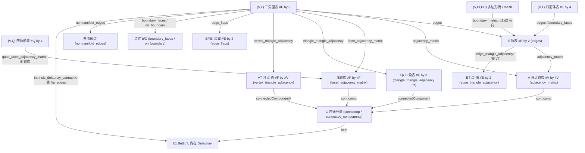

# 10.3 拓扑与邻接 / Topology & Adjacency

> 本章覆盖 `mesh/` 下的**拓扑与邻接（topology & adjacency）**函数：从 `(V,F)` 面表出发，
> 构建/查询各类邻接结构、边表、边界、连通分量，以及拓扑不变量（Betti 数、Delaunay 内向翻转）。
>
> This chapter covers the **topology & adjacency** functions of `mesh/`: building and querying
> adjacency structures, edge lists, boundaries, connected components, and topological
> invariants (Betti numbers, intrinsic Delaunay edge flips), all starting from a `(V,F)` mesh.

- 语言 / Language：中英对照（中文为主）
- 相关章节 / See also：[10-mesh/README.md](README.md)、
  [appendices/03-doc-template.md](../appendices/03-doc-template.md)

---

## 本章概览 / Chapter Overview

### 1. 概念表 / Concept table

| 概念 (中 / EN) | 典型记法 / 形状 | 含义 / Meaning | 本章代表函数 |
|---|---|---|---|
| 邻接矩阵 / adjacency matrix | `A` `#V by #V` sparse | 顶点-顶点邻接；`A(i,j)≠0` 表示 i,j 相邻 | `adjacency_matrix`、`adjacency_edge_cost_matrix`、`adjacency_incident_angle_matrix` |
| 面-面邻接矩阵 / facet adjacency | `#F by #F` sparse | 两个面共享一条边即相邻 | `facet_adjacency_matrix`、`quad_facet_adjacency_matrix`、`adjacency_dihedral_angle_matrix` |
| 边表 / edge list | `E` `#E by 2` | 唯一边行列表（通常每行升序，无向） | `edges`、`exterior_edges`、`nonmanifold_edges`、`cut_edges` |
| 角表 / corner table | `#F by 3` / `#V by #F` | 面-角（对顶点、对边）关系 | `triangle_triangle_adjacency`(`Fp,Fi`)、`edge_flaps`、`vertex_triangle_adjacency`(`VT`) |
| 半边 / half-edge | 有向边 | 每条无向边拆为两个有向半边 | `boundary_matrix`(`d1,d2`)、`edge_flaps`(`E`) |
| 有向 vs 无向 / directed vs undirected | — | 有向保留绕序/符号（±1），无向只记相连 | `edges`（无向）vs `boundary_matrix`（有向） |
| 连通分量 / connected components | `C` `#V`/`#F` | 按边连接关系分组的 id | `conncomp`、`connected_components` |
| 边界 / boundary | `#F by 3`/`#E by 2` | 只被一个面共享的边或面 | `boundary_faces`、`on_boundary`、`exterior_edges` |
| 非流形 / non-manifold | — | 边被 >2 面共享，或顶点邻域按边不连通 | `nonmanifold_edges`、`is_vertex_nonmanifold` |
| 亏格 / Betti | 标量 | 环路数 `b1`（与 genus/Euler 特征相关） | `betti` |

> 稀疏性总则：本模块的矩阵产物**几乎全部为 MATLAB `sparse`**（`adjacency_matrix`、
> `facet_adjacency_matrix`、`vertex_triangle_adjacency`、`boundary_matrix` 等），而
> `triangle_triangle_adjacency`、`edge_triangle_adjacency`、`edge_flaps`、`tet_tet_adjacency`
> 返回**稠密定长表**（`#F by 3`、`#E by 2`、`#T by 4`），以便 O(1) 随机访问；`unique`
> 中间量为稠密。详见各条目的「稀疏性/内存特性」。

### 2. 数据结构相互转换 / Data-structure conversions



---

## 逐函数条目 / Per-function entries

### `adjacency_matrix` — 从边表/面表构建稀疏顶点邻接矩阵
- **文件 / File**: [mesh/adjacency_matrix.m](file:///c:/VSWork/gptoolbox-1/mesh/adjacency_matrix.m#L1-L26)
- **签名 / Signature**: `[A] = adjacency_matrix(E)`（亦可传 `F` 或 `T`）
- **功能 / Purpose**: `EN: Build sparse adjacency matrix from edge list or face list.` / 中文：从边表（或面表/四面体表）构建稀疏顶点邻接矩阵。
- **输入 / Inputs**:

  | 参数 | 尺寸/类型 | 含义 (中 / EN) |
  |---|---|---|
  | `E` | `#E by 2` | 边表 / edge list |
  | （或 `F`） | `#F by 3` | 三角面表 / triangle list |
  | （或 `T`） | `#T by 4` | 四面体表 / tet list |

- **输出 / Outputs**:

  | 参数 | 尺寸/类型 | 含义 |
  |---|---|---|
  | `A` | `#V by #V` `sparse` | 邻接矩阵，`#V = max(E(:))`；`A(i,j)=A(j,i)=1` 表示 i,j 相邻 |

- **可选参数 / Optional**: 无 / none
- **变量流动 / Variable flow**: `E`（或 `F`/`T`）→(若列数 >2 则 `edges(F)` 转边表)→ `E` →(双向列 `[E(:,1) E(:,2)]`/`[E(:,2) E(:,1)]`)→ I,J →(`sparse(I,J,1)`)→ `A`
- **算法步骤 / Algorithm**:
  1. 若 `size(E,2)>2`，说明传入的是 `F`（或 `T`），先 `E = edges(F)` 转为唯一边表。
  2. 以 `[E(:,1);E(:,2)]` 与 `[E(:,2);E(:,1)]` 作为 I,J，值全 `1`，构成对称无向图。
  3. `sparse` 自动以最大索引确定 `#V`，组装 `#V by #V` 稀疏矩阵。
- **流程图 / Flowchart**:

  ```mermaid
  flowchart TD
    A["输入 E (或 F/T)"] --> B{"size(E,2)>2 ?"}
    B -- 是 --> C["E = edges(F) 转边表"]
    B -- 否 --> D["直接用 E"]
    C --> E["I=[E(:,1);E(:,2)] J=[E(:,2);E(:,1)]"]
    D --> E
    E --> F["A = sparse(I,J,1) 对称"]
    F --> Z["输出 A #V by #V sparse"]
  ```

- **依赖 / Dependencies**: `edges`
- **See also**: `facet_adjacency_matrix`, `adjacency_edge_cost_matrix`, `connected_components`

---

### `adjacency_list` — 为指定顶点构建邻接链表（cell array）
- **文件 / File**: [mesh/adjacency_list.m](file:///c:/VSWork/gptoolbox-1/mesh/adjacency_list.m#L1-L36)
- **签名 / Signature**: `A = adjacency_list(F,b)`
- **功能 / Purpose**: `EN: Build adjacency lists for vertices of a triangle mesh.` / 中文：为三角网格中给定顶点构建邻接链表。
- **输入 / Inputs**:

  | 参数 | 尺寸/类型 | 含义 (中 / EN) |
  |---|---|---|
  | `F` | `#F by 3` | 三角面索引 / triangle indices |
  | `b` | `#b by 1` | 可选，需建链表的顶点子集，默认 `1:max(F(:))` / vertices to build lists for |

- **输出 / Outputs**:

  | 参数 | 尺寸/类型 | 含义 |
  |---|---|---|
  | `A` | `#b by 1` `cell` | `A{i}` 为 `b(i)` 的邻居索引（升序，取自 `indices` 逻辑索引） |

- **可选参数 / Optional**:

  | 名称 | 取值 | 默认 | 含义 |
  |---|---|---|---|
  | `b` | `#b by 1` 索引 | `1:max(F(:))` | 仅为该子集建链表（位置参数，非 `varargin`） |

- **变量流动 / Variable flow**: `F →(adjacency_matrix)→ M →(逐 i 取第 b(ii) 行逻辑索引 `indices(logical(M(b(ii),:)))`)→ A{ii} → 组装 → A`
- **算法步骤 / Algorithm**:
  1. `indices = 1:max(F(:))`；若未给 `b` 则 `b = indices`。
  2. 断言 `numel(b)==prod(size(b))`（防止矩阵下标歧义），得 `m=numel(b)`。
  3. 调用 `adjacency_matrix(F)` 得 `M`。
  4. 循环 `ii=1:m`，取 `M` 第 `b(ii)` 行的逻辑非零列，映射回顶点索引填入 `A{ii}`。
- **流程图 / Flowchart**:

  ```mermaid
  flowchart TD
    A["输入 F, b(可选)"] --> B{"b 是否存在?"}
    B -- 否 --> C["b = 1:max(F(:))"]
    B -- 是 --> D["用给定 b"]
    C --> E["M = adjacency_matrix(F)"]
    D --> E
    E --> F["for ii = 1:m"]
    F --> G["A{ii} = indices(logical(M(b(ii),:)))"]
    G -->|循环| F
    G --> Z["输出 A cell array"]
  ```

- **依赖 / Dependencies**: `adjacency_matrix`
- **See also**: `adjacency_matrix`

---

### `adjacency_dihedral_angle_matrix` — 面-面有向二面角矩阵
- **文件 / File**: [mesh/adjacency_dihedral_angle_matrix.m](file:///c:/VSWork/gptoolbox-1/mesh/adjacency_dihedral_angle_matrix.m#L1-L93)
- **签名 / Signature**: `[A,C,E,EMAP] = adjacency_dihedral_angle_matrix(V,F)`
- **功能 / Purpose**: `EN: Build a matrix A such that A(i,j)=θ_ij is the signed dihedral angle between neighboring faces F(i,:),F(j,:), 0 if not neighbors.` / 中文：构建面-面有向二面角矩阵，相邻面间为该二面角，不相邻为 0。
- **输入 / Inputs**:

  | 参数 | 尺寸/类型 | 含义 (中 / EN) |
  |---|---|---|
  | `V` | `#V by 3` | 顶点坐标 / vertex positions |
  | `F` | `#F by 3` | 三角面索引，**不需流形** / triangle indices (need not be manifold) |

- **输出 / Outputs**:

  | 参数 | 尺寸/类型 | 含义 |
  |---|---|---|
  | `A` | `#F by #F` `sparse` | 有向二面角，取值 `[0,2π]`：→0 越凸，→π 越平，→2π 越凹（外视，逆时针） |
  | `C` | `#F by #F` `sparse` | `C(i,j)=c` 表示面 j 通过面 i 的第 c 个角与之相邻 |
  | `E` | `#E by 2` | 唯一无向边 / unique edges |
  | `EMAP` | `3*#F by 1` | 每条半边→`E` 行索引（`unique(...,'rows')` 返回的映射） |

- **可选参数 / Optional**: 无 / none
- **变量流动 / Variable flow**: `V,F →(allE 三向半边)→(unique(sort(allE,2))→E,EMAP)→ FE(边-面关联,值=角号)→(逐轮剥离 FE 行首面)→ 法向 N + 边向量 EV → D12 = π-atan2(...) → 累加到 A,C`
- **算法步骤 / Algorithm**:
  1. 构造全部半边 `allE=[F(:,[2 3]);F(:,[3 1]);F(:,[2 1])]`（注意第三条为反向，用于统一朝向）。
  2. `unique(sort(allE,2),'rows')` 得唯一边 `E` 与映射 `EMAP`；据此建立 `FE`：`FE(i,j)=角号` 表示面 j 通过第几角入射边 i，`NNZ` 通过 `FE` 计数邻居对数。
  3. 预计算单位面法向 `N = normalizerow(normals(V,F))`。
  4. `while nnz(FE)>0`：每轮取每行的第一个面（`max(FE,[],2)`）到 `L`，从 `FE` 中扣除该三元组；对剩余 `(I2,J2,M2)`，用首个面法向 `N1`、另一面法向 `N2` 及边向量 `EV` 计算 `D12 = π-atan2(dot(cross(N1,N2),EV),dot(N1,N2))`。
  5. 将 `D12` 以上三角对称方式累加进 `A`，角号 `C1,C2` 累加进 `C`。
- **流程图 / Flowchart**:

  ```mermaid
  flowchart TD
    A["输入 V,F"] --> B["allE = 3 组半边"]
    B --> C["E,EMAP = unique(sort(allE,2))"]
    C --> D["FE 边-面关联(值=角号)"]
    D --> E["N = normalizerow(normals(V,F))"]
    E --> F{"nnz(FE) > 0 ?"}
    F -- 是 --> G["取每行首面 OM,J; L 查询表"]
    G --> H["FE 扣除 (I,J,M)"]
    H --> I["对剩余 I2,J2 求 N1,N2,EV"]
    I --> J["D12 = pi - atan2(...)"]
    J --> K["A,C 累加"]
    K --> F
    F -- 否 --> Z["输出 A,C,E,EMAP"]
  ```

- **依赖 / Dependencies**: `normalizerow`, `normals`
- **See also**: `planar_patches`, `facet_adjacency_matrix`

---

### `adjacency_edge_cost_matrix` — 以边长加权的邻接矩阵
- **文件 / File**: [mesh/adjacency_edge_cost_matrix.m](file:///c:/VSWork/gptoolbox-1/mesh/adjacency_edge_cost_matrix.m#L1-L31)
- **签名 / Signature**: `[C] = adjacency_edge_cost_matrix(V,E)`
- **功能 / Purpose**: `EN: Build sparse adjacency matrix weighted by edge lengths.` / 中文：以边长为权重的稀疏邻接矩阵。
- **输入 / Inputs**:

  | 参数 | 尺寸/类型 | 含义 (中 / EN) |
  |---|---|---|
  | `V` | `#V by dim` | 顶点坐标 / vertex positions |
  | `E` | `#E by 2`（或传 `F`/`T`） | 边表 / edges（或面/四面体表） |

- **输出 / Outputs**:

  | 参数 | 尺寸/类型 | 含义 |
  |---|---|---|
  | `C` | `#V by #V` `sparse` | 邻接矩阵，`C(i,j)=‖V_i-V_j‖` |

- **可选参数 / Optional**: 无 / none
- **变量流动 / Variable flow**: `V,E →(若列数>2 则 edges(F))→ E →(edge_norms=sqrt(sum(diff^2)))→ edge_norms →(双向列 + repmat)→ C`
- **算法步骤 / Algorithm**:
  1. 若 `size(E,2)>2`，`E = edges(F)` 转边表。
  2. 计算各边欧氏长度 `edge_norms`。
  3. `n=size(V,1)`；以 `[E(:,1);E(:,2)]`、`[E(:,2);E(:,1)]` 与 `repmat(edge_norms,[2 1])` 组装对称稀疏矩阵 `C`。
- **流程图 / Flowchart**:

  ```mermaid
  flowchart TD
    A["输入 V,E"] --> B{"size(E,2)>2 ?"}
    B -- 是 --> C["E = edges(F)"]
    B -- 否 --> D["用 E"]
    C --> E["edge_norms = sqrt(sum(diff^2))"]
    D --> E
    E --> F["C = sparse(双向列, repmat(norms))"]
    F --> Z["输出 C #V by #V sparse"]
  ```

- **依赖 / Dependencies**: `edges`
- **See also**: `adjacency_matrix`, `edge_lengths`

---

### `adjacency_incident_angle_matrix` — 边-边（共顶点）夹角邻接矩阵
- **文件 / File**: [mesh/adjacency_incident_angle_matrix.m](file:///c:/VSWork/gptoolbox-1/mesh/adjacency_incident_angle_matrix.m#L1-L38)
- **签名 / Signature**: `[A,AE] = adjacency_incident_angle_matrix(V,E)`
- **功能 / Purpose**: `EN: Compute an adjacency matrix between edges where non-zeros are angles between adjacent edges sharing a vertex.` / 中文：构建边-边邻接矩阵，非零值为共享同一顶点的两条边的夹角。
- **输入 / Inputs**:

  | 参数 | 尺寸/类型 | 含义 (中 / EN) |
  |---|---|---|
  | `V` | `#V by dim` | 顶点坐标 / vertex positions |
  | `E` | `#E by 2` | 唯一无向边表 / unique edge indices into V |

- **输出 / Outputs**:

  | 参数 | 尺寸/类型 | 含义 |
  |---|---|---|
  | `A` | `#E by #E` `sparse` | `A(i,j)=h≠0` 表示边 i,j 共顶点且夹角为 `h` |
  | `AE` | `#E by #E` `sparse` | 仅标记共顶点的邻接矩阵（防止 `h` 恰为 0） |

- **可选参数 / Optional**: 无 / none
- **变量流动 / Variable flow**: `V,E →(断言 E 唯一)→ V2E(顶点-边关联)→ AE=V2E'*V2E →(triu(AE,1) 找共顶点的边对 I,J)→ C(4 列角号)→ 取 M2(中心点),M1,M3(另一端)→ V12,V23 → H=acos(dot) → A`
- **算法步骤 / Algorithm**:
  1. 断言 `E` 行唯一（`unique(sort(E,2))`）。
  2. `V2E` 为顶点-边关联稀疏矩阵（每列一条边的两个端点），`AE = V2E'*V2E`，非零即两边共顶点。
  3. 取上三角 `[I,J]=find(triu(AE,1))` 得共顶点的边对；用 4 列 `C` 记录每条边对的 4 个顶点出现次数。
  4. `max(C==2)` 找中心顶点 `M2`，再依次 `max` 找 `M1`、`M3`（两条边各自另一端）。
  5. 单位化 `V12=V(M1)-V(M2)`、`V23=V(M3)-V(M2)`，夹角 `H=acos(sum(V12.*V23,2))`。
  6. 以 `[I J]/[J I]` 对称组装 `A`。
- **流程图 / Flowchart**:

  ```mermaid
  flowchart TD
    A["输入 V,E"] --> B["断言 E 唯一"]
    B --> C["V2E 顶点-边关联; AE = V2E'*V2E"]
    C --> D["[I,J] = find(triu(AE,1)) 共顶点边对"]
    D --> E["C 4 列角号; 取 M2 中心 / M1,M3 端"]
    E --> F["V12,V23 单位化; H = acos(dot)"]
    F --> G["A = sparse([I J],[J I],[H H])"]
    G --> Z["输出 A,AE"]
  ```

- **依赖 / Dependencies**: `normalizerow`
- **See also**: `adjacency_matrix`, `edges`

---

### `edge_triangle_adjacency` — 边到其两个相邻面的映射
- **文件 / File**: [mesh/edge_triangle_adjacency.m](file:///c:/VSWork/gptoolbox-1/mesh/edge_triangle_adjacency.m#L1-L34)
- **签名 / Signature**: `ET = edge_triangle_adjacency(F,E)`
- **功能 / Purpose**: `EN: Build an edge-triangle adjacency matrix for a triangle mesh.` / 中文：为三角网格构建边-面邻接映射。
- **输入 / Inputs**:

  | 参数 | 尺寸/类型 | 含义 (中 / EN) |
  |---|---|---|
  | `F` | `#F by 3` | 三角面顶点索引 / triangle corners |
  | `E` | `#E by 2` | 边端点索引 / edge endpoints |

- **输出 / Outputs**:

  | 参数 | 尺寸/类型 | 含义 |
  |---|---|---|
  | `ET` | `#E by 2` `double` 稠密 | 每条边的两个相邻面；边界边第 2 列为 `-1` |

- **可选参数 / Optional**: 无 / none
- **变量流动 / Variable flow**: `F,E →(VT=vertex_triangle_adjacency(F))→ VT →(逐边 i 取两顶点的面集 intersect)→ 相邻面对 → ET(i,:)`
- **算法步骤 / Algorithm**:
  1. 先求顶点-面关联 `VT = vertex_triangle_adjacency(F)`。
  2. 初始化 `ET = zeros(#E,2)`。
  3. 循环每条边 `i`：分别求顶点 `E(i,1)`、`E(i,2)` 所属面集 `CFi1`、`CFi2`，取交集。
  4. 若交集仅 1 个（边界边），补 `-1`；否则取两个相邻面填入 `ET(i,:)`。
- **流程图 / Flowchart**:

  ```mermaid
  flowchart TD
    A["输入 F,E"] --> B["VT = vertex_triangle_adjacency(F)"]
    B --> C["初始化 ET = zeros(#E,2)"]
    C --> D["for i = 1:#E"]
    D --> E["CFi1 = find(VT(:,E(i,1))); CFi2 = find(VT(:,E(i,2)))"]
    E --> F["temp = intersect(CFi1,CFi2)"]
    F --> G{"numel(temp) == 1 ?"}
    G -- 是 --> H["temp = [temp -1] 边界边"]
    G -- 否 --> I["用两面"]
    H --> J["ET(i,:) = temp"]
    I --> J
    J -->|循环| D
    J --> Z["输出 ET #E by 2"]
  ```

- **依赖 / Dependencies**: `vertex_triangle_adjacency`
- **See also**: `triangle_triangle_adjacency`, `vertex_triangle_adjacency`

---

### `triangle_triangle_adjacency` — 流形三角网格的面-面邻接（角表）
- **文件 / File**: [mesh/triangle_triangle_adjacency.m](file:///c:/VSWork/gptoolbox-1/mesh/triangle_triangle_adjacency.m#L1-L69)
- **签名 / Signature**: `[Fp, Fi] = triangle_triangle_adjacency(F)`
- **功能 / Purpose**: `EN: Build a face adjacency data structure for a **manifold** triangle mesh.` / 中文：为**流形**三角网格构建面-面邻接数据结构（从每个面可定位到相邻面的对应边）。
- **输入 / Inputs**:

  | 参数 | 尺寸/类型 | 含义 (中 / EN) |
  |---|---|---|
  | `F` | `#F by 3` | 面索引 / face indices |

- **输出 / Outputs**:

  | 参数 | 尺寸/类型 | 含义 |
  |---|---|---|
  | `Fp` | `#F by 3` `double` 稠密 | `Fp(i,j)` = 第 i 面第 j 边的相邻面索引；边界边为 `-1` |
  | `Fi` | `#F by 3` `double` 稠密 | `Fi(i,j)` = 该相邻面上对应的边位置；边界边为 `-1` |

  > 第 j 条边指**第 j 个顶点所对边**：三角 (a,b,c) 中，1st 边=b→c，2nd=c→a，3rd=a→b。

- **可选参数 / Optional**: 无 / none
- **变量流动 / Variable flow**: `F →(E 全半边, 3 组)→ Ei=sparse(i→j, 边序号) → unadj= Ei>0; nonadj=unadj-unadj' → adj=((unadj+nonadj)==1).*Ei →(find(adj)/find(adj') → si,v)→ E2F=面号 → Fp(si)=E2F(v); I=边位置 → Fi(si)=I(v)`
- **算法步骤 / Algorithm**:
  1. 仅支持 `size(F,2)==3`，否则报错 `Not supported yet...`。
  2. 取三组半边：`E=[F(:,2) F(:,3); F(:,3) F(:,1); F(:,1) F(:,2)]`（1st/2nd/3rd 边）。
  3. `Ei = sparse(E(:,1),E(:,2),1:#E)`：`(i,j)=k` 表示存在有向边 i→j（第 k 条）。比先建邻接表略快。
  4. `unadj=Ei>0`；`nonadj=unadj-unadj'`（`>0` 表示 i→j 存在但 j→i 不存在）；`adj=((unadj+nonadj)==1).*Ei`，从而得到“反向边也存在”的匹配。
  5. `[ii jj si]=find(adj)` 与 `[ii jj v]=find(adj')` 得到稀疏序与原序的映射（比排序快）。
  6. `E2F=repmat(1:#F,1,3)'` 把边序号映射到面；`Fp=-ones(#E,1); Fp(si)=E2F(v); reshape`。
  7. `I=reshape(repmat(1:3,#F,1),1,3*#F)'` 给边位置；`Fi(si)=I(v); reshape`。
- **流程图 / Flowchart**:

  ```mermaid
  flowchart TD
    A["输入 F"] --> B{"size(F,2)==3 ?"}
    B -- 否 --> X["error Not supported yet"]
    B -- 是 --> C["E = 3 组半边"]
    C --> D["Ei = sparse(E(:,1),E(:,2),1:#E)"]
    D --> E["unadj = Ei>0; nonadj = unadj-unadj'"]
    E --> F["adj = ((unadj+nonadj)==1).*Ei"]
    F --> G["find(adj)->si; find(adj')->v"]
    G --> H["E2F=面号; Fp(si)=E2F(v); reshape"]
    H --> I["I=边位置; Fi(si)=I(v); reshape"]
    I --> Z["输出 Fp,Fi #F by 3"]
  ```

- **依赖 / Dependencies**: 无（纯 MATLAB，`sparse`/`find` 内置）
- **See also**: `tt`（旧名）、`connectedComponent`、`facet_adjacency_matrix`

---

### `vertex_triangle_adjacency` — 顶点-面关联稀疏矩阵
- **文件 / File**: [mesh/vertex_triangle_adjacency.m](file:///c:/VSWork/gptoolbox-1/mesh/vertex_triangle_adjacency.m#L1-L16)
- **签名 / Signature**: `[VT] = vertex_triangle_adjacency(F)`
- **功能 / Purpose**: `EN: Build a vertex-triangle adjacency matrix for a triangle mesh.` / 中文：为三角网格构建顶点-面邻接矩阵。
- **输入 / Inputs**:

  | 参数 | 尺寸/类型 | 含义 (中 / EN) |
  |---|---|---|
  | `F` | `#F by 3` | 面索引 / face indices |

- **输出 / Outputs**:

  | 参数 | 尺寸/类型 | 含义 |
  |---|---|---|
  | `VT` | `#F by #V` `sparse` | `VT(i,j)=1` 当且仅当顶点 j 属于面 i（注意：源码注释写 `#F x #V`） |

- **可选参数 / Optional**: 无 / none
- **变量流动 / Variable flow**: `F → i=(1:#F)'; j=F(:) →(重复 i 三次, j 为 F)→ VT = sparse([i i i],j,1)`
- **算法步骤 / Algorithm**:
  1. `i=(1:size(F,1))'` 为面索引列；`j=F` 为面内顶点索引。
  2. `VT = sparse([i i i], j, 1)`：把每一面的 3 个顶点各置 1，得到 `#F by #V` 稀疏 0/1 矩阵。
- **流程图 / Flowchart**:

  ```mermaid
  flowchart TD
    A["输入 F"] --> B["i = (1:#F)'; j = F"]
    B --> C["VT = sparse([i i i], j, 1)"]
    C --> Z["输出 VT #F by #V sparse"]
  ```

- **依赖 / Dependencies**: 无
- **See also**: `edge_triangle_adjacency`, `triangle_triangle_adjacency`

---

### `tet_tet_adjacency` — 四面体-四面体邻接（局部面表）
- **文件 / File**: [mesh/tet_tet_adjacency.m](file:///c:/VSWork/gptoolbox-1/mesh/tet_tet_adjacency.m#L1-L39)
- **签名 / Signature**: `[Tp,Ti,uF,FMAP] = tet_tet_adjacency(T)`
- **功能 / Purpose**: `EN: Build tet-tet adjacency (via shared tet faces).` / 中文：通过共享四面体面构建四面体间邻接。
- **输入 / Inputs**:

  | 参数 | 尺寸/类型 | 含义 (中 / EN) |
  |---|---|---|
  | `T` | `#T by 4` | 四面体索引 / tet indices into V |

- **输出 / Outputs**:

  | 参数 | 尺寸/类型 | 含义 |
  |---|---|---|
  | `Tp` | `#T by 4` `double` 稠密 | 每个局部面相邻的四面体索引（0 为边界） |
  | `Ti` | `#T by 4` `double` 稠密 | 相邻四面体上的局部面索引（0 为边界） |
  | `uF` | `#F by 3` | 唯一四面体面 / unique tet faces |
  | `FMAP` | `#T*4 by 1` | 每个四面体面 → `uF` 行索引 |

- **可选参数 / Optional**: 无 / none
- **变量流动 / Variable flow**: `T →(F=4 组面)→ unique(sort(F,2))→uF,FMAP → T2F(面→tet,值=局部面号) →(max 取前两个 tet)→ J1,J2 → 填 Tp,Ti`
- **算法步骤 / Algorithm**:
  1. 取 4 组四面体面 `F`（按源码固定顶点顺序，输出绕序为外向）。
  2. `[uF,~,FMAP]=unique(sort(F,2),'rows')` 去重；`K` 记录每个面的局部面号 (1..4)。
  3. `T2F = sparse(FMAP, repmat(1:#T,1,4)', K)`：面 i 被哪些 tet、以哪个局部面入射。
  4. `[I1,J1]=max(T2F,[],2)` 取第一个 tet，清零后再 `max` 取第二个 `I2,J2`。
  5. 仅保留 `I2>0`（两个 tet 共享该面）的行；对称写入 `Tp`（邻居 tet 号）与 `Ti`（邻居的局部面号）。
- **流程图 / Flowchart**:

  ```mermaid
  flowchart TD
    A["输入 T"] --> B["F = 4 组四面体面"]
    B --> C["uF,FMAP = unique(sort(F,2))"]
    C --> D["T2F = sparse(FMAP, tet 号, 局部面号)"]
    D --> E["I1,J1 = max(T2F,[],2); 清零"]
    E --> F["I2,J2 = max(T2F,[],2)"]
    F --> G{"I2 > 0 ?"}
    G -- 是 --> H["Tp,Ti 对称写入"]
    G -- 否 --> I["边界, 保持 0"]
    H --> Z["输出 Tp,Ti,uF,FMAP"]
    I --> Z
  ```

- **依赖 / Dependencies**: 无
- **See also**: `boundary_faces`, `crouzeix_raviart_cotmatrix`

---

### `facet_adjacency_matrix` — 面-面邻接矩阵（可选仅流形边）
- **文件 / File**: [mesh/facet_adjacency_matrix.m](file:///c:/VSWork/gptoolbox-1/mesh/facet_adjacency_matrix.m#L1-L66)
- **签名 / Signature**: `[A,uE2F,uE] = facet_adjacency_matrix(F,varargin)`
- **功能 / Purpose**: `EN: Adjacency matrix between facets determined by whether two facets share an edge.` / 中文：按两个面是否共享一条边确定面-面邻接矩阵。
- **输入 / Inputs**:

  | 参数 | 尺寸/类型 | 含义 (中 / EN) |
  |---|---|---|
  | `F` | `#F by 3`（或 `#F by 2`） | 面表 / facets |

- **输出 / Outputs**:

  | 参数 | 尺寸/类型 | 含义 |
  |---|---|---|
  | `A` | `#F by #F` `sparse`（逻辑真值） | 面-面邻接，`A>0` 表示相邻 |
  | `uE2F` | `#E by #F` `sparse` | `(e,f)=1` 表示唯一边 e 入射面 f |
  | `uE` | `#E by 2`（或 `1 by max(F(:))`） | 唯一无向边表 |

- **可选参数 / Optional**:

  | 名称 | 取值 | 默认 | 含义 |
  |---|---|---|---|
  | `'ManifoldOnly'` | `logical` | `false` | 是否仅考虑流形边（valences ≤2）的邻接 |

- **变量流动 / Variable flow**: `F →(若 ss=3: allE=3 组半边; unique(sort(allE,2))→uE,IC)→ uE2F=sparse(IC,tri,1) →(ManifoldOnly 时剔除 sum>2 的边)→ A=uE2F'*uE2F → A=A>0`
- **算法步骤 / Algorithm**:
  1. `containers.Map` 解析可选参数 `'ManifoldOnly'`（默认 `false`）。
  2. `switch size(F,2)`：
     - `case 3`：构造全部半边 `allE=[F(:,[2 3]);F(:,[3 1]);F(:,[1 2])]`，`[uE,~,IC]=unique(sort(allE,2),'rows')`；`uE2F=sparse(IC,repmat(1:#F,1,3)',1)`。
     - `case 2`：此时 `F` 是边，`uE=1:max(F(:))`，`uE2F=sparse(F,repmat(1:#F,2,1)',1)`。
  3. 若 `manifold_only`，将 `sum(uE2F,2)>2` 的边行清零（剔除非流形边）。
  4. `A = (uE2F'*uE2F)>0`（面通过共享边相连），转为逻辑。
- **流程图 / Flowchart**:

  ```mermaid
  flowchart TD
    A["输入 F, 'ManifoldOnly'"] --> B{"size(F,2)?"}
    B -- 3 --> C["allE=3 组半边; unique->uE,IC"]
    B -- 2 --> D["uE=1:max(F(:)); uE2F=sparse(F,...)"]
    C --> E["uE2F = sparse(IC, 面号, 1)"]
    D --> F{"manifold_only ?"}
    E --> F
    F -- 是 --> G["剔除 sum(uE2F,2)>2 的非流形边"]
    F -- 否 --> H["保留全部"]
    G --> I["A = (uE2F'*uE2F) > 0"]
    H --> I
    I --> Z["输出 A,uE2F,uE"]
  ```

- **依赖 / Dependencies**: 无（`containers.Map` 内置）
- **See also**: `adjacency_matrix`, `manifold_patches`, `quad_facet_adjacency_matrix`

---

### `quad_facet_adjacency_matrix` — 四边形面-面邻接矩阵
- **文件 / File**: [mesh/quad_facet_adjacency_matrix.m](file:///c:/VSWork/gptoolbox-1/mesh/quad_facet_adjacency_matrix.m#L1-L14)
- **签名 / Signature**: `A = quad_facet_adjacency_matrix(Q)`
- **功能 / Purpose**: `EN: Adjacency matrix between quads sharing an edge.` / 中文：共享边的四边形面-面邻接矩阵。
- **输入 / Inputs**:

  | 参数 | 尺寸/类型 | 含义 (中 / EN) |
  |---|---|---|
  | `Q` | `#Q by 4` | 四边形索引 / quad indices |

- **输出 / Outputs**:

  | 参数 | 尺寸/类型 | 含义 |
  |---|---|---|
  | `A` | `#Q by #Q` `sparse`（逻辑） | 四边形邻接矩阵 |

- **可选参数 / Optional**: 无 / none
- **变量流动 / Variable flow**: `Q →(allE=4 组边 [1:2;2:3;3:4;4:1])→ unique(sort(allE,2))→E,EMAP → E2Q=sparse(EMAP,quad 号,1) → A=(E2Q'*E2Q)>0`
- **算法步骤 / Algorithm**:
  1. 取四边形四条边 `allE=[Q(:,1:2);Q(:,2:3);Q(:,3:4);Q(:,[4 1])]`。
  2. `[E,~,EMAP]=unique(sort(allE,2),'rows')` 得唯一边与映射。
  3. `E2Q=sparse(EMAP, repmat(1:#Q,1,4)',1)` 为边-四边形关联。
  4. `A=(E2Q'*E2Q)>0`：共享边则相邻。
- **流程图 / Flowchart**:

  ```mermaid
  flowchart TD
    A["输入 Q"] --> B["allE = 4 组四边形边"]
    B --> C["E,EMAP = unique(sort(allE,2))"]
    C --> D["E2Q = sparse(EMAP, quad 号, 1)"]
    D --> E["A = (E2Q'*E2Q) > 0"]
    E --> Z["输出 A #Q by #Q sparse"]
  ```

- **依赖 / Dependencies**: 无
- **See also**: `facet_adjacency_matrix`, `adjacency_matrix`

---

### `boundary_matrix` — 有向边界（关联）矩阵 d1、d2
- **文件 / File**: [mesh/boundary_matrix.m](file:///c:/VSWork/gptoolbox-1/mesh/boundary_matrix.m#L1-L47)
- **签名 / Signature**: `[d1,d2,E] = boundary_matrix(F)` 或 `[d1,d2,E] = boundary_matrix(PI,PC)`
- **功能 / Purpose**: `EN: Oriented boundary (incidence) matrices of a simplicial/streamed polygon complex.` / 中文：构建单纯复形/多边形流的有向边界（关联）矩阵。
- **输入 / Inputs**:

  | 参数 | 尺寸/类型 | 含义 (中 / EN) |
  |---|---|---|
  | `F` | `#F by 3` | 三角面 / triangles（单参形式） |
  | `PI` | `#PI by 1` | 多边形顶点流 / streamed polygon indices |
  | `PC` | `#polys+1 by 1` | 多边形累计计数 / cumulative counts |

- **输出 / Outputs**:

  | 参数 | 尺寸/类型 | 含义 |
  |---|---|---|
  | `d1` | `#V by #E` `sparse` | 有向顶点-边边界矩阵，列取值 `{−1,+1}` |
  | `d2` | `#E by #F` `sparse` | 有向边-面边界矩阵 / oriented boundary |
  | `E` | `#E by 2` | 唯一边表 / unique edges |

- **可选参数 / Optional**: 无 / none
- **变量流动 / Variable flow**: `F → allE(3 组半边) ; K=面号` **或** `PI,PC →(diffPC, PJ 顺序索引)→ I1,I2 ; allE=[I1 I2]; K=面号 →(unique(sort(allE,2))→E,EMAP)→ d1=sparse(E,[1;2]',[-1 1]) ; d2=sparse(EMAP,K,±1)`
- **算法步骤 / Algorithm**:
  1. 依据参数个数分支：
     - `case 1`（`F`）：`n0=max(F(:))`，`n2=#F`，`allE=[F(:,[2 3]);F(:,[3 1]);F(:,[1 2])]`，`K=repmat(1:#F,3,1)'`。
     - `case 2`（`PI,PC`）：`n0=max(PI(:))`，`n2=size(PC,1)-1`；用 `diff(PC)` 计算每个多边形长度，`PJ` 得到多边形内顺序索引（`mod` 回绕），`I2=PI(起点+PJ)`，`allE=[PI I2]`，`K=repelem((1:n2)',diffPC)`。
  2. `[E,~,EMAP]=unique(sort(allE,2),'rows')`，`n1=#E`。
  3. `d1 = sparse(E, repmat(1:n1,2,1)', repmat([-1 1],n1,1), n0, n1)`：起点 `-1`、终点 `+1`。
  4. `d2 = sparse(EMAP, K, 2*(E(EMAP,1)==allE(:,1))-1, n1, n2)`：方向一致为 `+1`，否则 `-1`。
- **流程图 / Flowchart**:

  ```mermaid
  flowchart TD
    A["输入 (F) 或 (PI,PC)"] --> B{"numel(varargin)"}
    B -- 1 --> C["allE=3 组半边; K=面号; n0=max(F)"]
    B -- 2 --> D["diffPC/PJ 顺序; allE=[I1 I2]; K; n0=max(PI)"]
    C --> E["E,EMAP = unique(sort(allE,2))"]
    D --> E
    E --> F["d1 = sparse(E,[1;2]',[-1 1]) 有向顶点-边"]
    F --> G["d2 = sparse(EMAP,K,±1) 有向边-面"]
    G --> Z["输出 d1,d2,E"]
  ```

- **依赖 / Dependencies**: 无
- **See also**: `cells`, `polygons_to_triangles`, `betti`

---

### `boundary_faces` — 求四面体网格的边界面（也支持三角/边）
- **文件 / File**: [mesh/boundary_faces.m](file:///c:/VSWork/gptoolbox-1/mesh/boundary_faces.m#L1-L69)
- **签名 / Signature**: `[F,J,K] = boundary_faces(T)`
- **功能 / Purpose**: `EN: Determine boundary facets of tetrahedra stored in T (also handles triangles/edges).` / 中文：求四面体网格的边界面（对三角网格回退到 `outline`，对边求边界顶点）。
- **输入 / Inputs**:

  | 参数 | 尺寸/类型 | 含义 (中 / EN) |
  |---|---|---|
  | `T` | `#T by simplex-size` | 单元表：4=四面体，3=三角，2=边 / elements |

- **输出 / Outputs**:

  | 参数 | 尺寸/类型 | 含义 |
  |---|---|---|
  | `F` | `n by 3`（或按 simplex-size） | 边界面的顶点索引 / boundary faces |
  | `J` | `n by 1` | 每个边界面所属的 `T` 行索引 / index into T |
  | `K` | `n by 1` | 边界面所对顶点（局部面号） / opposite vertex |

- **可选参数 / Optional**: 无 / none
- **变量流动 / Variable flow**: `T →(ss=4: allF=4 组面; sort; 数值化打包→uF/m/n)→ counts=accumarray →(counts==1)→ I → F=allF(I,:), J=mod(I-1,#T)+1, K=floor((I-1)/#T)+1`
- **算法步骤 / Algorithm**:
  1. 空输入直接返回空 `F/J/K`（`F=zeros(0,size(T,2)-1)`）。
  2. `ss=size(T,2)`：
     - `case 2`（边）：边界“面”是顶点，`F=find(sparse(T,1,1,max(T(:)),1)==1)`；断言 `nargout<=1`。
     - `case 3`（三角）：`F=outline(T)`，再 `ismember` 反查得到 `J`、`K`（`mod` 与 `floor` 分解）。
     - `case 4`（四面体）：构造 4 组面 `allF`，`sort(allF,2)`；为避免 `unique` 慢，将三列打包为 `uint64` 整数（`sortedF(:,1)+sortedF(:,2)*max_f+sortedF(:,3)*max_f^2`，两次溢出保护）。
  3. `[u,m,n]=unique(sortedF,'rows')`；`counts=accumarray(n(:),1)`；`I=m(counts==1)` 取只出现一次的面。
  4. 由 `I` 反解 `J=mod(L,#T)+1`、`K=floor(L/#T)+1`，`F=allF(I,:)`。
- **流程图 / Flowchart**:

  ```mermaid
  flowchart TD
    A["输入 T"] --> B{"isempty(T)?"}
    B -- 是 --> Z0["返回空 F,J,K"]
    B -- 否 --> C{"size(T,2)"}
    C -- 2 --> D["F = find(边计数==1) 顶点"]
    C -- 3 --> E["F = outline(T); ismember->J,K"]
    C -- 4 --> F["allF=4 组面; sort; uint64 打包"]
    F --> G["unique->u,m,n; counts=accumarray"]
    G --> H["I = m(counts==1) 仅一次的面"]
    H --> I["F=allF(I,:); J,K 由 I 分解"]
    D --> Z["输出 F,J,K"]
    E --> Z
    I --> Z
  ```

- **依赖 / Dependencies**: `outline`
- **See also**: `is_boundary_facet`, `on_boundary`, `exterior_edges`

---

### `boundary_conditions` — 由控制点/骨骼/笼边求边界与边界条件
- **文件 / File**: [mesh/boundary_conditions.m](file:///c:/VSWork/gptoolbox-1/mesh/boundary_conditions.m#L1-L162)
- **签名 / Signature**: `[b,bc] = boundary_conditions(V,F,C,P,E,CE)`
- **功能 / Purpose**: `EN: Compute boundary and boundary conditions for correspondence weights over (V,F) with control points/edges.` / 中文：为点/骨骼/笼边控制句柄计算边界顶点与其边界条件（用于权重求解）。
- **输入 / Inputs**:

  | 参数 | 尺寸/类型 | 含义 (中 / EN) |
  |---|---|---|
  | `V` | `#V by dim` | 顶点坐标 / vertex positions |
  | `F` | `#F by 3` | 面索引（**源码注释未使用**） / face indices (not used) |
  | `C` | `#C by dim` | 控制顶点坐标 / control vertex positions |
  | `P` | `#P by 1` | 点控制索引（入 `C`），默认 `1:#C` / point controls |
  | `E` | `#E by 2` | 骨骼（`C` 中索引对），默认 `[]` / bones |
  | `CE` | `#CE by 2` | 笼边（**`P`** 中索引对），默认 `[]` / cage edges |

- **输出 / Outputs**:

  | 参数 | 尺寸/类型 | 含义 |
  |---|---|---|
  | `b` | `#b by 1` | 边界顶点索引列表 / boundary vertices |
  | `bc` | `#b by #handles` `double` | 每个句柄的边界条件，句柄顺序为点句柄后接边句柄 |

- **可选参数 / Optional**: 无 `varargin`；可选性通过**位置参数是否存在**实现（`P` 默认 `1:#C`，`E`/`CE` 默认 `[]`）。
- **变量流动 / Variable flow**: `V,C →（若 #C<100: pdist2/min 否则 knnsearch）→ Cv（最近网格顶点）→ bc=NaN 矩阵 →(点句柄 bc(Cv(P),:)=eye)→(骨骼: project_to_lines 判 on_edge, 归一化, bc(on_edge,np+ii)=1)→(笼边: 线性插值 1-t, t)→(保留有非 NaN 的行 b; NaN→0; 行归一化)→ b,bc`
- **算法步骤 / Algorithm**:
  1. 断言 `size(C,2)==size(V,2)`；整理 `P`（缺省 `1:#C`）、`E`、`CE`（缺省 `[]`）。
  2. 计算句柄数：`np=numel(P)`、`ne=size(E,1)`、`m=np+ne`。
  3. 求每个控制顶点最近的网格顶点 `Cv`：小规模用 `pdist2`+`min`，否则 `knnsearch`；若有控制点共用同一网格顶点则 `warning`。
  4. `bc` 初始化为 `NaN`（`n by m`）；点句柄：`bc(Cv(P),:)=eye(np,m)`。
  5. 估计“在边上”容差 `h`（`F` 空则用包围盒/√#V，否则 `avgedge`）。
  6. 骨骼句柄：对每条骨骼 `project_to_lines` 得投影参数 `t` 与平方距离，`on_edge=((|sqr_d|<h*sqr_d_tol)&(t∈[-1e-10,1+1e-10]))`；把行上已有 NaN 转 0，`bc(on_edge,np+ii)=1`。
  7. 笼边句柄：对每条 `CE` 投影，`bc(on_edge,CE(ii,1))=1-t`、`bc(on_edge,CE(ii,2))=t`。
  8. `b=indices(any(~isnan(bc),2))`；取 `bc=bc(b,:)`；`NaN→0`；对非零行做**单位分割**归一化 `bc=bc./rowsum`。
- **流程图 / Flowchart**:

  ```mermaid
  flowchart TD
    A["输入 V,F,C,P,E,CE"] --> B["整理 P/E/CE 默认值; 计算 np,ne,m"]
    B --> C{"size(C,1) < 100 ?"}
    C -- 是 --> D["D=pdist2(V,C); Cv=min(D)"]
    C -- 否 --> E["Cv = knnsearch(V,C)"]
    D --> F["bc = repmat(NaN,[n m])"]
    E --> F
    F --> G["点句柄: bc(Cv(P),:) = eye(np,m)"]
    G --> H["h = avgedge 或包围盒估计"]
    H --> I{"E 非空?"}
    I -- 是 --> J["逐骨骼 project_to_lines -> on_edge -> bc(:,np+ii)=1"]
    I -- 否 --> K["跳过骨骼"]
    J --> L{"CE 非空?"}
    K --> L
    L -- 是 --> M["逐笼边 -> 线性插值 1-t, t"]
    L -- 否 --> N["跳过笼边"]
    M --> O["b=any(~isnan)行; NaN->0; 行归一化"]
    N --> O
    O --> Z["输出 b,bc"]
  ```

- **依赖 / Dependencies**: `avgedge`, `project_to_lines`（另用内置 `pdist2`、`knnsearch`）
- **See also**: `biharmonic_bounded`, `region_boundary_conditions`, `surface_graph`

---

### `region_boundary_conditions` — 由区域 id 求边界与边界条件
- **文件 / File**: [mesh/region_boundary_conditions.m](file:///c:/VSWork/gptoolbox-1/mesh/region_boundary_conditions.m#L1-L39)
- **签名 / Signature**: `[b,bc] = region_boundary_conditions(R,ii)`
- **功能 / Purpose**: `EN: Compute boundary and boundary conditions from region ids R (0 = interior).` / 中文：由区域 id 列表 `R`（0 表示不属于任何句柄）求边界与边界条件。
- **输入 / Inputs**:

  | 参数 | 尺寸/类型 | 含义 (中 / EN) |
  |---|---|---|
  | `R` | `#V by 1` | 每顶点区域 id，0 为内部 / region ids, 0 = not a handle |
  | `ii` | — | 未在函数体使用（历史遗留形参） |

- **输出 / Outputs**:

  | 参数 | 尺寸/类型 | 含义 |
  |---|---|---|
  | `b` | `#b by 1` | 边界顶点（`R~=0`） / boundary vertices |
  | `bc` | `#b by max(R)` `sparse` | 每个区域句柄的 0/1 边界条件 |

- **可选参数 / Optional**: 无 / none
- **变量流动 / Variable flow**: `R →(转行向量 R=R(:)'; n=numel(R))→ b=indices(R~=0) → bc=sparse(1:#b, R(R~=0), 1, #b, max(R))`
- **算法步骤 / Algorithm**:
  1. 断言 `R` 为向量，转成行向量 `R=R(:)'`。
  2. `n=numel(R)`，`indices=1:n`。
  3. `b = indices(R~=0)`（非内部顶点）。
  4. `bc = sparse(1:numel(b), R(R~=0), 1, numel(b), max(R(R~=0)))`：每个边界顶点在其区域 id 列置 1。
- **流程图 / Flowchart**:

  ```mermaid
  flowchart TD
    A["输入 R,ii"] --> B["R = R(:)'; n = numel(R)"]
    B --> C["b = indices(R ~= 0)"]
    C --> D["bc = sparse(1:#b, R(R~=0), 1, #b, max(R))"]
    D --> Z["输出 b,bc"]
  ```

- **依赖 / Dependencies**: 无
- **See also**: `boundary_conditions`, `readSEL`

---

### `contour_edges` — 从 2D 网格提取等值线边
- **文件 / File**: [mesh/contour_edges.m](file:///c:/VSWork/gptoolbox-1/mesh/contour_edges.m#L1-L53)
- **签名 / Signature**: `[V,E] = contour_edges(X,Y,Z,v)`
- **功能 / Purpose**: `EN: Extract edges of a contour from a 2D grid.` / 中文：从二维网格中提取某个等值的等值线边。
- **输入 / Inputs**:

  | 参数 | 尺寸/类型 | 含义 (中 / EN) |
  |---|---|---|
  | `X` | `h by w` | x 坐标矩阵 / x coordinates |
  | `Y` | `h by w` | y 坐标矩阵 / y coordinates |
  | `Z` | `h by w` | 数值矩阵 / values |
  | `v` | scalar | 要提取的等值 / contour value |

- **输出 / Outputs**:

  | 参数 | 尺寸/类型 | 含义 |
  |---|---|---|
  | `V` | `n by 2` | 等值线顶点 / contour vertices |
  | `E` | `m by 2` | 等值线边 / contour edges |

- **可选参数 / Optional**: 无 / none
- **变量流动 / Variable flow**: `Z,v →(isocontour_off)→ E,V(0-based 索引) →(fliplr(E); V 列交换; -1 转 1-based)→ dims=size(X); XY=[X(:) Y(:)] →(归一化到 [min,max] 坐标域)→ V,E`
- **算法步骤 / Algorithm**:
  1. 调用 `[E,V]=isocontour_off(Z,v)` 得 0-based 的边与顶点。
  2. `E=fliplr(E)`；`V=V(:,[2 1])`（行列互换），`V=V-1` 转 1-based。
  3. `dims=size(X)`，`XY=[X(:) Y(:)]`；`V = V./(dims([2 1])-1).*(max(XY)-min(XY))+min(XY)`，把网格索引映射到 `X,Y` 的实际坐标域。
- **流程图 / Flowchart**:

  ```mermaid
  flowchart TD
    A["输入 X,Y,Z,v"] --> B["[E,V] = isocontour_off(Z,v)"]
    B --> C["E=fliplr(E); V 列交换; V=V-1"]
    C --> D["dims=size(X); XY=[X(:) Y(:)]"]
    D --> E["V 归一化到 X,Y 坐标域"]
    E --> Z["输出 V,E"]
  ```

- **依赖 / Dependencies**: `isocontour_off`
- **See also**: `contourc`, `isocontour_off`

---

### `edges` — 求单纯复形的唯一无向边表
- **文件 / File**: [mesh/edges.m](file:///c:/VSWork/gptoolbox-1/mesh/edges.m#L1-L63)
- **签名 / Signature**: `E = edges(F)`
- **功能 / Purpose**: `EN: Compute the unique undirected edges of a simplicial complex.` / 中文：计算单纯复形的唯一无向边表（按升序排序）。
- **输入 / Inputs**:

  | 参数 | 尺寸/类型 | 含义 (中 / EN) |
  |---|---|---|
  | `F` | `#F by simplex-size` | 单纯形顶点索引 / simplex corners |

- **输出 / Outputs**:

  | 参数 | 尺寸/类型 | 含义 |
  |---|---|---|
  | `E` | `#E by 2` | 唯一边，每行升序 / unique undirected edges (sorted) |

- **可选参数 / Optional**: 无 / none
- **变量流动 / Variable flow**: `F → n=size(F,2); e=nchoosek(1:n,2) → A=sparse(F(:,e1),F(:,e2),1) →(EI,EJ)=find(tril(A+A'))→ E=[EJ EI]`
- **算法步骤 / Algorithm**:
  1. 组数 `n=size(F,2)`，`e=nchoosek(1:n,2)` 为顶点对组合（3 面得 3 对，4 面得 6 对）。
  2. `A=sparse(F(:,e(:,1)),F(:,e(:,2)),1,max(F),max(F))`：以首个组合（如 `(1,2)`）作有向关联。
  3. `[EI,EJ]=find(tril(A+A'))` 取对称矩阵的下三角非零位置（即无序对）。
  4. `E=[EJ EI]` 输出升序对（`EJ<EI>...` 保证行内升序）。
- **流程图 / Flowchart**:

  ```mermaid
  flowchart TD
    A["输入 F"] --> B["n=size(F,2); e=nchoosek(1:n,2)"]
    B --> C["A = sparse(F(:,e1),F(:,e2),1)"]
    C --> D["[EI,EJ] = find(tril(A+A'))"]
    D --> E["E = [EJ EI] 升序"]
    E --> Z["输出 E #E by 2"]
  ```

- **依赖 / Dependencies**: 无
- **See also**: `boundary_faces`, `outline`, `adjacency_matrix`

---

### `edges_to_path` — 由边集串联出经过所有节点的路径/环
- **文件 / File**: [mesh/edges_to_path.m](file:///c:/VSWork/gptoolbox-1/mesh/edges_to_path.m#L1-L57)
- **签名 / Signature**: `[I,J,K] = edges_to_path(E)`
- **功能 / Purpose**: `EN: Given undirected edges forming a single component (0 or 2 valence-1 nodes), find a path visiting all nodes.` / 中文：给定构成单连通、恰有 0 或 2 个度为 1 节点的无向边集，求一条经过所有节点的路径/环。
- **输入 / Inputs**:

  | 参数 | 尺寸/类型 | 含义 (中 / EN) |
  |---|---|---|
  | `E` | `#E by 2` | 无向唯一边 / undirected edges |

- **输出 / Outputs**:

  | 参数 | 尺寸/类型 | 含义 |
  |---|---|---|
  | `I` | `#E+1 by 1` | 有序节点序列（环则 `I(1)==I(end)`） / nodes in order |
  | `J` | `#I-1 by 1` | `I` 中相邻节点对应 `E` 的行索引 / indices into E |
  | `K` | `#I-1 by 1` | 列索引 `∈{1,2}`，指明 `E(J,K)` 靠前 / column order |

- **可选参数 / Optional**: 无 / none
- **变量流动 / Variable flow**: `E →(单边特判)→ E_orig →(unique(E_orig(:))→U,E 重编号)→ V=sparse(E(:),1,1) 度 → minnz 找度为1起点 s →(dfsearch(graph(adjacency_matrix(E)),s))→ I →(若环则补回首点)→ ismember 求 J → K=(E(J,1)~=I(...))+1 → I=U(I)`
- **算法步骤 / Algorithm**:
  1. `size(E,1)==1` 特判：`I=E(:)`，`J=1`，`K=1`。
  2. 保存 `E_orig`，`[U,~,E]=unique(E_orig(:))` 并 `reshape`，把顶点索引压缩重排。
  3. 度 `V=sparse(E(:),1,1)`；断言 `all(V<=2)`（无分叉）；`minnz` 找**最小非零度**顶点作起点 `s`（度为 2 说明是环）。
  4. `I = dfsearch(graph(adjacency_matrix(E)),s)` 做**深度优先搜索**遍历；若 `c==2`（环）则 `I=[I;I(1)]` 闭合。
  5. 若 `nargout>1`：`[F,J]=ismember(sort([I(1:end-1) I(2:end)],2), sort(E,2),'rows')` 求每段边在 `E` 中的行号。
  6. 若 `nargout>2`：`K=(E(J,1)~=I(1:end-1))+1` 标记方向；断言自洽。
  7. `I=U(I)` 把压缩索引映回原顶点编号。
- **流程图 / Flowchart**:

  ```mermaid
  flowchart TD
    A["输入 E"] --> B{"size(E,1)==1 ?"}
    B -- 是 --> Z0["I=E(:),J=1,K=1; 返回"]
    B -- 否 --> C["unique(E_orig(:))->U,E 压缩重排"]
    C --> D["度 V=sparse(E(:),1,1); 断言 all(V<=2)"]
    D --> E["minnz 找起点 s (度1优先, 度2为环)"]
    E --> F["I = dfsearch(graph(adjacency_matrix(E)),s) 遍历"]
    F --> G{"起点度 c == 2 ?"}
    G -- 是 --> H["I = [I; I(1)] 闭环"]
    G -- 否 --> I["保持路径"]
    H --> J["ismember 求 J; K 标记方向"]
    I --> J
    J --> K["I = U(I) 映回原顶点"]
    K --> Z["输出 I,J,K"]
  ```

- **依赖 / Dependencies**: `adjacency_matrix`、`minnz`（另用内置 `graph`、`dfsearch`）
- **See also**: `edges`, `adjacency_matrix`

---

### `exterior_edges` — 流形补片的外边界边
- **文件 / File**: [mesh/exterior_edges.m](file:///c:/VSWork/gptoolbox-1/mesh/exterior_edges.m#L1-L43)
- **签名 / Signature**: `[E,C,aC] = exterior_edges(F)`
- **功能 / Purpose**: `EN: List exterior edges (boundary of manifold patch); in general not the open boundary of the mesh.` / 中文：列出外部边（流形补片的边界），通常不等于网格的开放边界。
- **输入 / Inputs**:

  | 参数 | 尺寸/类型 | 含义 (中 / EN) |
  |---|---|---|
  | `F` | `#F by 3` | 面索引 / facet indices（也支持 `#F by 2`） |

- **输出 / Outputs**:

  | 参数 | 尺寸/类型 | 含义 |
  |---|---|---|
  | `E` | `#E by 2` | 外部边 / exterior edges |
  | `C` | `#E by 1` | 有符号计数 / signed counts |
  | `aC` | `#E by 1` | 无符号计数 / unsigned counts |

- **可选参数 / Optional**: 无 / none
- **变量流动 / Variable flow**: `F(3) → allE=3 组半边; sortallE → C=sparse(s1,s2,(allE1<allE2)*2-1) 有符号 → aC=sparse(s1,s2,1) 无符号 →([~,~,aC]=find((C~=0).*aC); [EI,EJ,C]=find(C))→ E=[EI EJ]`
- **算法步骤 / Algorithm**:
  1. `switch size(F,2)`：
     - `case 2`：把 `F` 当边集，用 `out/in` 计数找端点（`in+out==1`），串成一条边链并按方向翻转修正。
     - `case 3`：`allE=[F(:,[2 3]);F(:,[3 1]);F(:,[1 2])]`，`sortallE=sort(allE,2)`。
  2. 有符号计数 `C=sparse(sortallE(:,1),sortallE(:,2),(allE(:,1)<allE(:,2))*2-1)`：沿排序方向累计 `±1`，非零即**未被配对的边界边**。
  3. 无符号计数 `aC=sparse(...)`；断言 `nnz(tril(C))==0`。
  4. 由 `find((C~=0).*aC)` 得 `aC`，由 `find(C)` 得 `EI,EJ,C`，`E=[EI EJ]`。
- **流程图 / Flowchart**:

  ```mermaid
  flowchart TD
    A["输入 F"] --> B{"size(F,2)"}
    B -- 2 --> C["边链: out/in 计数, 修正方向"]
    B -- 3 --> D["allE=3 组半边; sortallE"]
    D --> E["C=sparse(s1,s2,±1) 有符号计数"]
    E --> F["aC=sparse(s1,s2,1) 无符号计数"]
    F --> G["find(C != 0) -> E,aC; find(C) -> C"]
    C --> Z["输出 E,C,aC"]
    G --> Z
  ```

- **依赖 / Dependencies**: 无
- **See also**: `outline`, `nonmanifold_edges`, `boundary_faces`

---

### `nonmanifold_edges` — 非流形边列表
- **文件 / File**: [mesh/nonmanifold_edges.m](file:///c:/VSWork/gptoolbox-1/mesh/nonmanifold_edges.m#L1-L21)
- **签名 / Signature**: `[E,C] = nonmanifold_edges(F)`
- **功能 / Purpose**: `EN: List non-manifold edges (shared by more than 2 faces, or inconsistent orientation).` / 中文：列出非流形边（被 >2 面共享，或定向不一致）。
- **输入 / Inputs**:

  | 参数 | 尺寸/类型 | 含义 (中 / EN) |
  |---|---|---|
  | `F` | `#F by 3` | 面索引 / facet indices |

- **输出 / Outputs**:

  | 参数 | 尺寸/类型 | 含义 |
  |---|---|---|
  | `E` | `#E by 2` | 非流形边 / nonmanifold edges |
  | `C` | `#E by 1` | 无符号计数（>2） / unsigned counts |

- **可选参数 / Optional**: 无 / none
- **变量流动 / Variable flow**: `F → allE=3 组半边; sortallE → sC=sparse(s1,s2,(allE1<allE2)*2-1) → C=sparse(s1,s2,1) →(find((C>2 | abs(sC)>1).*C))→ EI,EJ,C → E=[EI EJ]`
- **算法步骤 / Algorithm**:
  1. `allE=[F(:,[2 3]);F(:,[3 1]);F(:,[1 2])]`，`sortallE=sort(allE,2)`。
  2. 有符号计数 `sC`（沿排序方向 `±1`）与无符号计数 `C`。
  3. `[EI,EJ,C]=find((C>2 | abs(sC)>1).*C)`：筛选**被 >2 面共享**（`C>2`）或**定向冲突**（`|sC|>1`）的边。
  4. `E=[EI EJ]`。
- **流程图 / Flowchart**:

  ```mermaid
  flowchart TD
    A["输入 F"] --> B["allE=3 组半边; sortallE"]
    B --> C["sC 有符号计数; C 无符号计数"]
    C --> D{"C>2 或 abs(sC)>1 ?"}
    D -- 是 --> E["保留为非流形边"]
    D -- 否 --> F["丢弃"]
    E --> Z["输出 E,C"]
    F --> Z
  ```

- **依赖 / Dependencies**: 无
- **See also**: `exterior_edges`, `is_vertex_nonmanifold`, `manifold_patches`

---

### `cut_edges` — 沿指定边切割（复制顶点使拓扑断开）
- **文件 / File**: [mesh/cut_edges.m](file:///c:/VSWork/gptoolbox-1/mesh/cut_edges.m#L1-L96)
- **签名 / Signature**: `[G,I] = cut_edges(F,E)`
- **功能 / Purpose**: `EN: Replicate vertices along cut edges so they are no longer topologically connected.` / 中文：沿指定边复制顶点，使其在拓扑上断开（可自边界向内切割一条边，但不能只切内部单边）。
- **输入 / Inputs**:

  | 参数 | 尺寸/类型 | 含义 (中 / EN) |
  |---|---|---|
  | `F` | `#F by 3` | 三角面索引 / triangles into V |
  | `E` | `#E by 2` | 要切割的边 / edges to cut |

- **输出 / Outputs**:

  | 参数 | 尺寸/类型 | 含义 |
  |---|---|---|
  | `G` | `#G by 3` | 新三角面索引（入 `W`） / triangles into W |
  | `I` | `#W by 1` | `W` 中顶点对应的原 `V` 顶点索引 / birth vertices |

- **可选参数 / Optional**: 无 / none
- **变量流动 / Variable flow**: `F,E →(uE,IC=unique(sort(allE,2)); uE2F)→ noncut=sparse(保留未切边) →(uE2EE, VV2EE, VV2V 关联)→ A=(VV2EE*uE2EE'*noncut*uE2EE*VV2EE') & (VV2V*VV2V') →(conncomp(A)→J)→(remove_unreferenced)→ G,I`
- **算法步骤 / Algorithm**:
  1. 构造全部半边 `allE=[F(:,[2 3]);F(:,[3 1]);F(:,[1 2])]`，`[uE,~,IC]=unique(sort(allE,2),'rows')`；`uE2F` 为边-面关联。
  2. `m=size(F,1)`，`FF=reshape(1:3m,[],3)`（“角索引”三角）。
  3. `[~,I]=setdiff(sort(uE,2),sort(E,2),'rows')`：保留**未被切割**的唯一边 `noncut`（对角稀疏）。
  4. 构造三个入射矩阵：`uE2EE`（边→半边）、`VV2EE`（角三角的半边相邻关系）、`VV2V`（角→原顶点）。
  5. `A = (VV2EE * (uE2EE'*noncut*uE2EE) * VV2EE') & (VV2V*VV2V')`：仅当两条角记录共享同一原顶点**且**通过未切边相连时置真。
  6. `[~,J]=conncomp(A)` 把角聚类；`I=F(:); VV(J,:)=VV`（虚拟顶点数据）；`I(J)=I`；`FF=J(FF)`。
  7. `[W,IM]=remove_unreferenced(VV,FF)` 去掉未用顶点；`I=I(find(IM<=size(W,1)))`；`G=IM(FF)`。
- **流程图 / Flowchart**:

  ```mermaid
  flowchart TD
    A["输入 F,E"] --> B["allE=3 组半边; uE,IC=unique(sort)"]
    B --> C["uE2F 边-面关联; FF=角三角"]
    C --> D["setdiff(uE,E) -> noncut 未切边"]
    D --> E["uE2EE,VV2EE,VV2V 入射矩阵"]
    E --> F["A = (VV2EE*(uE2EE'*noncut*uE2EE)*VV2EE') & (VV2V*VV2V')"]
    F --> G["[~,J] = conncomp(A) 角聚类"]
    G --> H["I=F(:); FF=J(FF); I(J)=I"]
    H --> I["remove_unreferenced(VV,FF) -> W,IM"]
    I --> Z["输出 G=IM(FF), I"]
  ```

- **依赖 / Dependencies**: `conncomp`, `remove_unreferenced`
- **See also**: `edges`, `remove_unreferenced`, `is_vertex_nonmanifold`

---

### `on_boundary` — 判断每个面是否位于边界
- **文件 / File**: [mesh/on_boundary.m](file:///c:/VSWork/gptoolbox-1/mesh/on_boundary.m#L1-L48)
- **签名 / Signature**: `[I,C] = on_boundary(F)`
- **功能 / Purpose**: `EN: Determine if each face of a manifold mesh is on the boundary (contains at least one boundary edge).` / 中文：判断流形网格的每个面是否在边界上（至少含一条边界边）。
- **输入 / Inputs**:

  | 参数 | 尺寸/类型 | 含义 (中 / EN) |
  |---|---|---|
  | `F` | `#F by simplex-size` | 单元索引 / element indices（simplex-size 3 或 4） |

- **输出 / Outputs**:

  | 参数 | 尺寸/类型 | 含义 |
  |---|---|---|
  | `I` | `#F by 1` `logical` | 每个面是否在边界 / whether on boundary |
  | `C` | `#F by simplex-size` `logical` | 每个面各条对边是否在边界 / whether opposite edge on boundary |

- **可选参数 / Optional**: 无 / none
- **变量流动 / Variable flow**: `F →(ss=3: E=3 组对边; unique→n; counts(n))→ C(reshape, ==1)→ I=any(C,2)`（ss=4 类似，对 4 组面）
- **算法步骤 / Algorithm**:
  1. `switch size(F,2)`：
     - `case 3`：`E=[F(:,2) F(:,3); F(:,3) F(:,1); F(:,1) F(:,2)]`，`sort(E,2)`；若最小索引 >0 则用线性打包 `unique`，否则用 `'rows'`；`counts=accumarray(n(:),1)`；`C=counts(n)` reshape 回 `size(F)`。
     - `case 4`：`T=F`，构造 4 组面 `allF`，`sort`，`unique('rows')`，`accumarray` 计数，reshape 回 `size(T)`。
     - 其它 → `error`。
  2. `C = C==1`（只出现一次 = 边界）；`I = any(C,2)`。
- **流程图 / Flowchart**:

  ```mermaid
  flowchart TD
    A["输入 F"] --> B{"size(F,2)"}
    B -- 3 --> C["E=3 组对边; sort; unique/pack; counts"]
    B -- 4 --> D["allF=4 组面; unique; counts"]
    B -- 其他 --> X["error Unsupported simplex size"]
    C --> E["C = reshape(counts, size) == 1"]
    D --> E
    E --> F["I = any(C,2)"]
    F --> Z["输出 I,C"]
  ```

- **依赖 / Dependencies**: 无
- **See also**: `is_boundary_facet`, `boundary_faces`, `exterior_edges`

---

### `is_boundary_facet` — 判断给定面是否为边界（只出现一次）
- **文件 / File**: [mesh/is_boundary_facet.m](file:///c:/VSWork/gptoolbox-1/mesh/is_boundary_facet.m#L1-L35)
- **签名 / Signature**: `B = is_boundary_facet(E,F)`
- **功能 / Purpose**: `EN: Determine for each facet in E if it is a boundary facet of F (occurs exactly once).` / 中文：判断 `E` 中的每个面是否为 `F` 的边界面（未定向面在 `F` 中恰好出现一次）。
- **输入 / Inputs**:

  | 参数 | 尺寸/类型 | 含义 (中 / EN) |
  |---|---|---|
  | `E` | `#E by element-size-1` | 待求面（子单纯形） / facets to test |
  | `F` | `#F by element-size` | 单元表 / elements |

- **输出 / Outputs**:

  | 参数 | 尺寸/类型 | 含义 |
  |---|---|---|
  | `B` | `#E by 1` `logical` | `true` 当且仅当未定向面恰出现一次（非流形/不存在为 `false`） |

- **可选参数 / Optional**: 无 / none
- **变量流动 / Variable flow**: `E,F →(F 的 3 组或 4 组子面 allE)→(unique(sort([E;allE],2))→EMAP; N=accumarray(EMAP,1))→ B=N(EMAP(1:#E))==2`
- **算法步骤 / Algorithm**:
  1. `switch size(F,2)`：`case 3` 取 `F` 的 3 组边 `allE`；`case 4` 取 `F` 的 4 组面 `allE`。
  2. `[~,~,EMAP]=unique(sort([E;allE],2),'rows')`：把待测面与所有子面合并去重。
  3. `N=accumarray(EMAP,1)` 统计每个唯一样式出现次数。
  4. `B = N(EMAP(1:size(E,1)))==2`：`E` 的每个面“自身一次 + 未定向面一次”恰好为 2。
- **流程图 / Flowchart**:

  ```mermaid
  flowchart TD
    A["输入 E,F"] --> B{"size(F,2)"}
    B -- 3 --> C["allE = F 的 3 组边"]
    B -- 4 --> D["allE = F 的 4 组面"]
    C --> E["unique(sort([E;allE],2)) -> EMAP"]
    D --> E
    E --> F["N = accumarray(EMAP,1)"]
    F --> G["B = N(EMAP(1:#E)) == 2"]
    G --> Z["输出 B #E by 1 logical"]
  ```

- **依赖 / Dependencies**: 无
- **See also**: `boundary_faces`, `on_boundary`, `outline`

---

### `is_vertex_nonmanifold` — 判断每个顶点是否非流形
- **文件 / File**: [mesh/is_vertex_nonmanifold.m](file:///c:/VSWork/gptoolbox-1/mesh/is_vertex_nonmanifold.m#L1-L71)
- **签名 / Signature**: `N = is_vertex_nonmanifold(F)`
- **功能 / Purpose**: `EN: Determine if each vertex is non-manifold (incident faces form more than one edge-connected component).` / 中文：判断每个顶点是否非流形（其入射面按共享边应构成单一连通分量）。
- **输入 / Inputs**:

  | 参数 | 尺寸/类型 | 含义 (中 / EN) |
  |---|---|---|
  | `F` | `#F by 3` | 三角面索引 / triangle indices |

- **输出 / Outputs**:

  | 参数 | 尺寸/类型 | 含义 |
  |---|---|---|
  | `N` | `#V by 1` `logical` | 每个顶点是否非流形 / whether non-manifold |

- **可选参数 / Optional**: 无 / none
- **变量流动 / Variable flow**: `F → m=#F, n=max(F) →(vectorized: V2F; A=face_adjacency(F); [I,J]=find(V2F); UF; U=(UF*A*UF')&(UV*UV'); [~,C]=conncomp(U); V2C) → N = sum(V2C,2)~=1`
- **算法步骤 / Algorithm**:
  1. 局部函数 `face_adjacency(F)`：由 `FE`（边-面关联，值=角号）得 `A=(FE'*FE)>0`（面共享边即相邻）。
  2. `n=max(F(:))`，`m=size(F,1)`，`vectorized=true`。
  3. 向量化分支：`V2F`（顶点-面关联）；`[I,J]=find(V2F)` 为“顶点-面”对；`UF`（每对→面）；`U=(UF*A*UF')>0 & (UV*UV')>0`——只用**同顶点且共享边**的连接。
  4. `[~,C]=conncomp(U)` 在该顶点-面图上求连通分量；`V2C=sparse(I,C,1,n,max(C))>0`。
  5. `N = sum(V2C,2)~=1`：某顶点关联到多个分量即非流形。
- **流程图 / Flowchart**:

  ```mermaid
  flowchart TD
    A["输入 F"] --> B["face_adjacency: FE->A 面邻接"]
    B --> C["V2F; [I,J]=find(V2F); UF,UV"]
    C --> D["U = (UF*A*UF') & (UV*UV') 同顶点且共享边"]
    D --> E["[~,C] = conncomp(U)"]
    E --> F["V2C = sparse(I,C,1,n,max(C)) > 0"]
    F --> G["N = sum(V2C,2) ~= 1"]
    G --> Z["输出 N #V by 1 logical"]
  ```

- **依赖 / Dependencies**: `conncomp`
- **See also**: `manifold_patches`, `nonmanifold_edges`

---

### `vv` — [已废弃] 顶点-顶点邻接矩阵（转发到 `adjacency_matrix`）
- **文件 / File**: [mesh/vv.m](file:///c:/VSWork/gptoolbox-1/mesh/vv.m#L1-L4)
- **签名 / Signature**: `[VV] = vv(V,F)`
- **功能 / Purpose**: `EN: [DEPRECATED] Vertex-vertex adjacency; forwards to adjacency_matrix.` / 中文：[已废弃] 顶点-顶点邻接矩阵，仅转发到 `adjacency_matrix`。
- **输入 / Inputs**:

  | 参数 | 尺寸/类型 | 含义 (中 / EN) |
  |---|---|---|
  | `V` | `#V by 3` | 顶点坐标（**未使用**） / vertex positions (unused) |
  | `F` | `#F by 3` | 三角面索引 / triangle indices |

- **输出 / Outputs**:

  | 参数 | 尺寸/类型 | 含义 |
  |---|---|---|
  | `VV` | `#V by #V` `sparse` | 顶点邻接矩阵（= `adjacency_matrix(F)`） |

- **可选参数 / Optional**: 无 / none
- **变量流动 / Variable flow**: `F →(warning 弃用提示)→ adjacency_matrix(F) → VV`
- **算法步骤 / Algorithm**:
  1. 发出弃用警告：`vv is deprecated, use adjacency_matrix instead.`
  2. `VV = adjacency_matrix(F)`。
- **流程图 / Flowchart**:

  ```mermaid
  flowchart TD
    A["输入 V,F"] --> B["warning: vv is deprecated"]
    B --> C["VV = adjacency_matrix(F)"]
    C --> Z["输出 VV"]
  ```

- **依赖 / Dependencies**: `adjacency_matrix`
- **See also**: `adjacency_matrix`, `connectedComponentV`
- **实现形态 / Form**: **纯 `.m`**（非 MEX、非闭源；不需 `mex/` 或 `external/`）。属遗留 API，建议改用 `adjacency_matrix`。

---

### `tt` — [已废弃] 面-面邻接（转发到 `triangle_triangle_adjacency`）
- **文件 / File**: [mesh/tt.m](file:///c:/VSWork/gptoolbox-1/mesh/tt.m#L1-L4)
- **签名 / Signature**: `[Fp, Fi] = tt(F)`
- **功能 / Purpose**: `EN: [DEPRECATED] Face-face adjacency; forwards to triangle_triangle_adjacency.` / 中文：[已废弃] 面-面邻接，仅转发到 `triangle_triangle_adjacency`。
- **输入 / Inputs**:

  | 参数 | 尺寸/类型 | 含义 (中 / EN) |
  |---|---|---|
  | `F` | `#F by 3` | 三角面索引 / triangle indices |

- **输出 / Outputs**:

  | 参数 | 尺寸/类型 | 含义 |
  |---|---|---|
  | `Fp` | `#F by 3` | 相邻面索引（= `triangle_triangle_adjacency` 的 `Fp`） |
  | `Fi` | `#F by 3` | 相邻面上的边位置（`Fi`） |

- **可选参数 / Optional**: 无 / none
- **变量流动 / Variable flow**: `F →(warning 弃用提示)→ triangle_triangle_adjacency(F) → Fp,Fi`
- **算法步骤 / Algorithm**:
  1. 发出弃用警告：`tt is deprecated, use triangle_triangle_adjacency instead.`
  2. `[Fp,Fi] = triangle_triangle_adjacency(F)`。
- **流程图 / Flowchart**:

  ```mermaid
  flowchart TD
    A["输入 F"] --> B["warning: tt is deprecated"]
    B --> C["[Fp,Fi] = triangle_triangle_adjacency(F)"]
    C --> Z["输出 Fp,Fi"]
  ```

- **依赖 / Dependencies**: `triangle_triangle_adjacency`
- **See also**: `triangle_triangle_adjacency`, `connectedComponent`
- **实现形态 / Form**: **纯 `.m`**（非 MEX、非闭源；不需 `mex/` 或 `external/`）。属遗留 API，建议改用 `triangle_triangle_adjacency`。

---

### `cells` — 由边界矩阵恢复 1-胞与多边形流
- **文件 / File**: [mesh/cells.m](file:///c:/VSWork/gptoolbox-1/mesh/cells.m#L1-L93)
- **签名 / Signature**: `[E,PI,PC] = cells(d1,d2)`
- **功能 / Purpose**: `EN: Recover edges and a streamed polygon list from oriented boundary matrices d1,d2.` / 中文：从有向边界矩阵 `d1,d2` 恢复 1-胞（边）与流式多边形列表。
- **输入 / Inputs**:

  | 参数 | 尺寸/类型 | 含义 (中 / EN) |
  |---|---|---|
  | `d1` | `#V by #E` `sparse` | 有向顶点-边边界矩阵 / oriented boundary |
  | `d2` | `#E by #F` `sparse` | 有向边-面边界矩阵 / oriented boundary |

- **输出 / Outputs**:

  | 参数 | 尺寸/类型 | 含义 |
  |---|---|---|
  | `E` | `#E by 2` | 1-胞边表（空边为 `[0 0]`） / 1-cells |
  | `PI` | `#PI by 1` | 流式多边形顶点索引 / streamed polygon indices |
  | `PC` | `#PC+1 by 1` | 多边形累计计数 / cumulative counts |

- **可选参数 / Optional**: 无 / none
- **变量流动 / Variable flow**: `d1,d2 →(K=sum(abs(d2)>0); 由 d1<0/d1>0 取 EI,EJ)→ E →(half-edge h1=[d1 -d1], h2=[d2>0;d2<0])→ Q=(h1'*(h1==-1)).*(h2*h2') → hn=max(Q==1) →(逐轮沿 hn 走)→ PC=cumsum, PI`
- **算法步骤 / Algorithm**:
  1. `K = full(sum(abs(d2)>0)).'`：每个 2-胞的边数；`blank_edges=all(d1==0,1)`。
  2. 断言每条非空边恰有一个 `-1` 与一个 `+1`；`[valid_I,EI]=max(d1<0)`、`[valid_J,EJ]=max(d1>0)`；`E=[EI;EJ]'`，无效处置 0。
  3. 若 `nargout==1` 提前返回。
  4. 半边：`h1=[d1 -d1]`，`h2=[d2>0;d2<0]`（第二半区为反向）。
  5. `Q=(h1'*(h1==-1)).*(h2*h2')`：候选“下一条半边”必须起点吻合 **且** 共享同一面；`[nv,hn]=max(Q==1,[],2)`，`hn=hn.*nv` 屏蔽边界。
  6. `[~,hi]=max(h2)`（每面取一条半边），`[~,hv]=max(h1==-1)`（半边起点顶点）。
  7. `PC=cumsum([0;K])`，`PI=zeros(PC(end),1)`；循环按 `I` 迭代，沿 `hn` 逐面走一圈填 `PI(PC(I)+c)=hv(hi)`，`hi=hn(hi)`。
- **流程图 / Flowchart**:

  ```mermaid
  flowchart TD
    A["输入 d1,d2"] --> B["K=sum(abs(d2)>0); 由 d1<0 / d1>0 取 E"]
    B --> C{"nargout == 1 ?"}
    C -- 是 --> Z0["仅返回 E"]
    C -- 否 --> D["h1=[d1 -d1]; h2=[d2>0;d2<0]"]
    D --> E["Q = (h1'*(h1==-1)).*(h2*h2')"]
    E --> F["hn = max(Q==1); 屏蔽边界"]
    F --> G["hi 每面半边; hv 半边起点"]
    G --> H["PC = cumsum([0;K]); PI 遍历 hn 填充"]
    H --> Z["输出 E,PI,PC"]
  ```

- **依赖 / Dependencies**: 无
- **See also**: `polygons_to_triangles`, `boundary_matrix`

---

### `faces_first` — 重排顶点使面表顶点排在前面
- **文件 / File**: [mesh/faces_first.m](file:///c:/VSWork/gptoolbox-1/mesh/faces_first.m#L1-L31)
- **签名 / Signature**: `[RV,RT,RF,IM] = faces_first(V,T,F)`
- **功能 / Purpose**: `EN: Reorder vertices so that vertices appearing in F come before those that do not.` / 中文：重排顶点，使出现在面表 `F` 中的顶点排在未出现顶点之前。
- **输入 / Inputs**:

  | 参数 | 尺寸/类型 | 含义 (中 / EN) |
  |---|---|---|
  | `V` | `#V by 3` | 顶点坐标 / vertex positions |
  | `T` | `#T by 4` | 四面体索引 / tetrahedra indices |
  | `F` | `#F by 3` | 面索引 / face indices |

- **输出 / Outputs**:

  | 参数 | 尺寸/类型 | 含义 |
  |---|---|---|
  | `RV` | `#V by 3` | 重排后的顶点 / reordered vertices |
  | `RT` | `#T by 4` | 用 `RV` 重新索引的四面体 / reindexed tets |
  | `RF` | `#F by 3` | 用 `RV` 重新索引的面 / reindexed faces |
  | `IM` | `#V by 1` | 满足 `RF=IM(F)`、`RT=IM(T)`、`RV(IM,:)=V` / index map |

- **可选参数 / Optional**: 无 / none
- **变量流动 / Variable flow**: `V,F → remove_unreferenced(V,F(:)) → IM →(RV(IM,:)=V; RF=reshape(IM(F)); RT=reshape(IM(T)))→ RV,RT,RF,IM`
- **算法步骤 / Algorithm**:
  1. `[~,IM]=remove_unreferenced(V,F(:))`：以 `F` 引用的顶点为“先行集”得到映射 `IM`。
  2. `RV(IM,:)=V` 重排顶点。
  3. `RF=reshape(IM(F),size(F))`、`RT=reshape(IM(T),size(T))` 重索引（`reshape` 兼容 `#F=1`）。
- **流程图 / Flowchart**:

  ```mermaid
  flowchart TD
    A["输入 V,T,F"] --> B["[~,IM] = remove_unreferenced(V,F(:))"]
    B --> C["RV(IM,:) = V 重排顶点"]
    C --> D["RF = reshape(IM(F), size(F))"]
    D --> E["RT = reshape(IM(T), size(T))"]
    E --> Z["输出 RV,RT,RF,IM"]
  ```

- **依赖 / Dependencies**: `remove_unreferenced`
- **See also**: `remove_unreferenced`, `remove_duplicate_vertices`

---

### `three_cliques` — 求图中全部 3-团（三角形）
- **文件 / File**: [mesh/three_cliques.m](file:///c:/VSWork/gptoolbox-1/mesh/three_cliques.m#L1-L100)
- **签名 / Signature**: `F = three_cliques(A,varargin)`
- **功能 / Purpose**: `EN: Compute all 3-cliques (triangles) in a graph.` / 中文：计算图中所有 3-团（三角形）。
- **输入 / Inputs**:

  | 参数 | 尺寸/类型 | 含义 (中 / EN) |
  |---|---|---|
  | `A` | `#V by #V` | 邻接矩阵 / adjacency matrix |

- **输出 / Outputs**:

  | 参数 | 尺寸/类型 | 含义 |
  |---|---|---|
  | `F` | `#F by 3` | 三角形索引（未定向） / triangle indices (unoriented) |

- **可选参数 / Optional**:

  | 名称 | 取值 | 默认 | 含义 |
  |---|---|---|---|
  | `'Triangulation'` | `logical` | `false` | 是否提取与给定边匹配的最小三角剖分（定向补片、填补三角孔） |

- **变量流动 / Variable flow**: `A →(triu(A,1)→E=[EI EJ])→ S2V,D2V → A=A>0; S2N=S2V*A-D2V; D2N=D2V*A-S2V → E2O=(S2N & D2N) →([J,I]=find(E2O'); F=[E(I,:) J])→ remove_duplicate_simplices → F`
- **算法步骤 / Algorithm**:
  1. `containers.Map` 解析 `'Triangulation'`（变量 `cleanup_triangulation`）。
  2. `n=size(A,1)`；`[EI,EJ]=find(triu(A,1))` 得无向边 `E`。
  3. `S2V`（起点→边）、`D2V`（终点→边）稀疏映射；`A=A>0`；`S2N=S2V*A-D2V`、`D2N=D2V*A-S2V`（终点的邻居集合）。
  4. `E2O=(S2N & D2N)`：存在公共第三点为真，`[J,I]=find(E2O')`，`F=[E(I,:) J]`（每个面会找到 3 次）；`remove_duplicate_simplices` 去重。
  5. 若 `cleanup_triangulation`：`bfs_orient` 定向；`manifold_patches` 分补片；按补片大小重排 `C`；仅保留覆盖未覆盖边的补片；再次 `bfs_orient`；用 `outline`+`connected_components` 找 `counts==3` 的三角孔并按需 `fliplr` 补回。
- **流程图 / Flowchart**:

  ```mermaid
  flowchart TD
    A["输入 A, 'Triangulation'"] --> B["[EI,EJ]=find(triu(A,1)); E"]
    B --> C["S2V,D2V; S2N,D2N 邻域"]
    C --> D["E2O = (S2N & D2N) 公共第三点"]
    D --> E["[J,I]=find(E2O'); F=[E(I,:) J]"]
    E --> F["F = remove_duplicate_simplices(F)"]
    F --> G{"cleanup_triangulation ?"}
    G -- 否 --> Z["输出 F"]
    G -- 是 --> H["bfs_orient; manifold_patches 分补片"]
    H --> I["保留覆盖未覆盖边的补片"]
    I --> J["bfs_orient; outline+connected_components 补三角孔"]
    J --> Z
  ```

- **依赖 / Dependencies**: `remove_duplicate_simplices`, `bfs_orient`, `manifold_patches`, `outline`, `connected_components`
- **See also**: `edges`, `remove_duplicate_simplices`

---

### `edge_flaps` — 边翼（半边）数据结构：边→相邻面与角
- **文件 / File**: [mesh/edge_flaps.m](file:///c:/VSWork/gptoolbox-1/mesh/edge_flaps.m#L1-L45)
- **签名 / Signature**: `[EF,EI,uE,EMAP,EJ] = edge_flaps(F)`
- **功能 / Purpose**: `EN: Build half-edge "edge flaps": map each undirected edge to its two incident faces and opposite corners.` / 中文：构建半边“边翼”结构，把每条无向边映射到其两个相邻面及各自的对角。
- **输入 / Inputs**:

  | 参数 | 尺寸/类型 | 含义 (中 / EN) |
  |---|---|---|
  | `F` | `#F by 3` | 面索引 / face indices |

- **输出 / Outputs**:

  | 参数 | 尺寸/类型 | 含义 |
  |---|---|---|
  | `EF` | `#E by 2` `double` 稠密 | 每条边的两个相邻面；`EF(e,1)` 对应有向 `e=(i→j)`，`EF(e,2)` 对应 `(j→i)`（边界为 0） |
  | `EI` | `#E by 2` `double` 稠密 | 每个相邻面上的角号（见上） / edge flap corners |
  | `uE` | `#uE by 2` | 唯一边（升序） / unique edges |
  | `EMAP` | `#F*3 by 1` | 每条有向半边→`uE` 行索引 / map directed→unique |
  | `EJ` | `#uE by 1` | 每个唯一边在 `#F*3` 中的代表序号 |

- **可选参数 / Optional**: 无 / none
- **变量流动 / Variable flow**: `F → E=[F(:,2:3);F(:,[3 1]);F(:,1:2)] → sE=sort(E,2); [uE,EJ,EMAP]=unique(sE,'rows') →(ismember(uE,E)/ismember(uE,fliplr(E))→B1,E1/B2,E2)→ J1,C1,J2,C2 → EF=sparse([I1;I2],[1;2],[J1;J2]); EI=sparse(...,[C1;C2])`
- **算法步骤 / Algorithm**:
  1. 构全部有向半边 `E=[F(:,2:3);F(:,[3 1]);F(:,1:2)]`（三条有序边）；`sE=sort(E,2)`。
  2. `[uE,EJ,EMAP]=unique(sE,'rows')`：唯一边、代表序号、半边→唯一边映射。
  3. `[B1,E1]=ismember(uE,E,'rows')`（正向侧）、`[B2,E2]=ismember(uE,fliplr(E),'rows')`（反向侧）。
  4. 由 `E1/E2` 分解出面号 `J1,J2`（`mod`）与角号 `C1,C2`（`floor((idx-1)/#F)+1`）。
  5. `EF=full(sparse([I1;I2],[1;2],[J1;J2],#uE,2))`；`EI=full(sparse([I1;I2],[1;2],[C1;C2],#uE,2))`（两侧分列 1、2）。
- **流程图 / Flowchart**:

  ```mermaid
  flowchart TD
    A["输入 F"] --> B["E = 3 条有向半边; sE = sort(E,2)"]
    B --> C["[uE,EJ,EMAP] = unique(sE,'rows')"]
    C --> D["ismember(uE,E) -> B1,E1"]
    D --> E["ismember(uE,fliplr(E)) -> B2,E2"]
    E --> F["分解 J1,C1,J2,C2"]
    F --> G["EF = sparse 面号; EI = sparse 角号"]
    G --> Z["输出 EF,EI,uE,EMAP,EJ"]
  ```

- **依赖 / Dependencies**: 无
- **See also**: `triangle_triangle_adjacency`, `boundary_matrix`

---

### `surface_graph` — 由表面采样点近似构造（测地加权）图
- **文件 / File**: [mesh/surface_graph.m](file:///c:/VSWork/gptoolbox-1/mesh/surface_graph.m#L1-L61)
- **签名 / Signature**: `[E,G] = surface_graph(P,V,F)`
- **功能 / Purpose**: `EN: Connect surface points P with edges, approximating a geodesically-weighted maximal planar graph.` / 中文：把落在曲面网格 `(V,F)` 上的点集 `P` 用边连接，近似构造测地加权的极大平面图。
- **输入 / Inputs**:

  | 参数 | 尺寸/类型 | 含义 (中 / EN) |
  |---|---|---|
  | `P` | `#P by 3` | 输入点 / input points |
  | `V` | `#V by 3` | 网格顶点 / mesh vertices |
  | `F` | `#F by 3` | 三角面 / triangles into V |

- **输出 / Outputs**:

  | 参数 | 尺寸/类型 | 含义 |
  |---|---|---|
  | `E` | `#E by 2` | 边索引（入 `P`） / edges into P |
  | `G` | `#G by 3` | 三角形索引（入 `P`） / triangles into P |

- **可选参数 / Optional**: 无 / none
- **变量流动 / Variable flow**: `V,F → remove_unreferenced → P →(point_mesh_squared_distance<eps 过滤)→ upsample → remesh_at_points → 合并 P → remove_duplicate_vertices →(boundary_conditions→kharmonic→Wh)→[~,I]=max(Wh,[],2) → E=unique(sort(I(edges(FF)),2)) →(可选 G=triangles_from_edges(E))`
- **算法步骤 / Algorithm**:
  1. `[V,I]=remove_unreferenced(V,F); F=I(F)`：去未引用顶点。
  2. `P=P(point_mesh_squared_distance(P,V,F)<eps('single'),:)`：仅保留真正落在曲面上的点。
  3. `[VV,FF]=upsample(V,F,'Iterations',2)` 上采样；`FF=remesh_at_points(VV,FF,P)`；`VV=[VV;P]`；`[VV,~,J]=remove_duplicate_vertices(VV,eps); FF=J(FF)`。
  4. 解调和坐标：`[b,bc]=boundary_conditions(VV,FF,P); Wh=kharmonic(VV,FF,b,bc)`（等价于 `min trace(W'LW) s.t. W(P,:)=Id`）。
  5. `[~,I]=max(Wh,[],2)`：把每个网格顶点分配给权重最大的采样点。
  6. `E=unique(sort(I(edges(FF)),2),'rows')`：相邻网格顶点若归属不同采样点，则连接对应采样点。
  7. 若 `nargout>1`，`G=triangles_from_edges(E)` 抽取 3-环用于可视化。
- **流程图 / Flowchart**:

  ```mermaid
  flowchart TD
    A["输入 P,V,F"] --> B["remove_unreferenced(V,F) -> V,F"]
    B --> C["P = P(点在面上)"]
    C --> D["upsample(V,F); remesh_at_points(VV,FF,P)"]
    D --> E["VV=[VV;P]; remove_duplicate_vertices"]
    E --> F["boundary_conditions -> kharmonic -> Wh"]
    F --> G["[~,I] = max(Wh,[],2) 顶点归属采样点"]
    G --> H["E = unique(sort(I(edges(FF)),2))"]
    H --> I{"nargout > 1 ?"}
    I -- 是 --> J["G = triangles_from_edges(E)"]
    I -- 否 --> Z["输出 E"]
    J --> Z
  ```

- **依赖 / Dependencies**: `remove_unreferenced`, `point_mesh_squared_distance`, `upsample`, `remesh_at_points`, `remove_duplicate_vertices`, `boundary_conditions`, `kharmonic`, `edges`, `triangles_from_edges`
- **See also**: `remesh_at_points`, `kharmonic`, `remove_duplicate_vertices`

---

### `conncomp` — 由邻接矩阵求连通分量（`graphconncomp` 替代）
- **文件 / File**: [mesh/conncomp.m](file:///c:/VSWork/gptoolbox-1/mesh/conncomp.m#L1-L22)
- **签名 / Signature**: `[S,C] = conncomp(G)`
- **功能 / Purpose**: `EN: Drop-in replacement for graphconncomp.m; identify connected components of an n-by-n adjacency matrix, an order of magnitude faster.` / 中文：`graphconncomp.m` 的替代实现，识别 `n by n` 邻接矩阵的连通分量，速度约快一个数量级。
- **输入 / Inputs**:

  | 参数 | 尺寸/类型 | 含义 (中 / EN) |
  |---|---|---|
  | `G` | `n by n` `sparse` | 邻接矩阵；`G(i,j)≠0` 表示 i,j 相连 / adjacency matrix |

- **输出 / Outputs**:

  | 参数 | 尺寸/类型 | 含义 |
  |---|---|---|
  | `S` | scalar | 连通分量个数 / number of components |
  | `C` | `n by 1` | 每个顶点的分量 id / component ids |

- **可选参数 / Optional**: 无 / none
- **变量流动 / Variable flow**: `G → G=G'（匹配 graphconncomp）→ A=G+speye(size(G)) →(dmperm(A)→p,r)→ S=numel(r)-1; C=cumsum(full(sparse(1,r(1:end-1),1,1,#G))) → C(p)=C`
- **算法步骤 / Algorithm**:
  1. `G=G'`：转置以匹配 `graphconncomp` 的行为。
  2. `A=G+speye(size(G))`：加单位阵保证对角非零（避免空行）。
  3. `[p,~,r]=dmperm(A)`：用 Dulmage–Mendelsohn 置换得到块结构，`r` 描绘各块边界；`S=numel(r)-1` 为分量数。
  4. `C=cumsum(full(sparse(1,r(1:end-1),1,1,size(G,1))))` 生成分量 id，再用 `C(p)=C` 映回原顺序。
- **流程图 / Flowchart**:

  ```mermaid
  flowchart TD
    A["输入 G"] --> B["G = G' 匹配 graphconncomp"]
    B --> C["A = G + speye(size(G))"]
    C --> D["[p,~,r] = dmperm(A)"]
    D --> E["S = numel(r) - 1"]
    E --> F["C = cumsum(sparse(1,r(1:end-1),1))"]
    F --> G["C(p) = C 映回原序"]
    G --> Z["输出 S,C"]
  ```

- **依赖 / Dependencies**: 无（用内置 `dmperm`、`speye`）
- **See also**: `connected_components`, `manifold_patches`, `cut_edges`

---

### `connected_components` — 网格（按边）的连通分量
- **文件 / File**: [mesh/connected_components.m](file:///c:/VSWork/gptoolbox-1/mesh/connected_components.m#L1-L28)
- **签名 / Signature**: `[C,CF] = connected_components(F)`
- **功能 / Purpose**: `EN: Determine connected components of a mesh with respect to edges (a component may contain non-manifold edges/vertices).` / 中文：按边确定网格连通分量（单分量可含非流形边/顶点）。
- **输入 / Inputs**:

  | 参数 | 尺寸/类型 | 含义 (中 / EN) |
  |---|---|---|
  | `F` | `#F by simplex-size` | 单纯形表 / simplices |

- **输出 / Outputs**:

  | 参数 | 尺寸/类型 | 含义 |
  |---|---|---|
  | `C` | `#V by 1` | 每个顶点的分量 id / ids per vertex |
  | `CF` | `#F by 1` | 每个面的分量 id / ids per face |

- **可选参数 / Optional**: 无 / none
- **变量流动 / Variable flow**: `F → A=adjacency_matrix(F) →([~,C]=conncomp(A))→ C →(可选 CF=C(F(:,1)))→ C,CF`
- **算法步骤 / Algorithm**:
  1. `A=adjacency_matrix(F)` 得顶点邻接矩阵。
  2. `[~,C]=conncomp(A)` 求分量 id。
  3. 若 `nargout>1`，`CF=C(F(:,1))`（用每个面的首顶点代表该面）。
- **流程图 / Flowchart**:

  ```mermaid
  flowchart TD
    A["输入 F"] --> B["A = adjacency_matrix(F)"]
    B --> C["[~,C] = conncomp(A)"]
    C --> D{"nargout > 1 ?"}
    D -- 是 --> E["CF = C(F(:,1))"]
    D -- 否 --> Z["输出 C"]
    E --> Z
  ```

- **依赖 / Dependencies**: `adjacency_matrix`, `conncomp`
- **See also**: `conncomp`, `manifold_patches`, `three_cliques`

---

### `connectedComponent` — 三角面子集的分量（BFS，基于面-面拓扑）
- **文件 / File**: [mesh/connectedComponent.m](file:///c:/VSWork/gptoolbox-1/mesh/connectedComponent.m#L1-L57)
- **签名 / Signature**: `[C] = connectedComponent(TT,TAG)`
- **功能 / Purpose**: `EN: Compute connected components of a subset of triangles on a tri surface (two faces connected iff they share an edge).` / 中文：计算三角曲面上一部分面的连通分量（两面共享边即连通）。
- **输入 / Inputs**:

  | 参数 | 尺寸/类型 | 含义 (中 / EN) |
  |---|---|---|
  | `TT` | `#F by 3` | 面-面拓扑（可由 `triangle_triangle_adjacency` 得到） / face-face topology |
  | `TAG` | `#F by 1` | 参与计算的面子集 / subset of faces |

- **输出 / Outputs**:

  | 参数 | 尺寸/类型 | 含义 |
  |---|---|---|
  | `C` | `1 by nC` `cell` | 每个元素为一个连通分量内的面索引；`size(C)` 给出分量数 |

- **可选参数 / Optional**: 无 / none
- **变量流动 / Variable flow**: `TT,TAG →(TAG~=0→TOVISIT; C 初始化空 cell; I=find(TAG))→(for i=I: 若 TAG(i)==TOVISIT 则 BFS)→ CElem,toVisit → C{n}`
- **算法步骤 / Algorithm**:
  1. 常量 `TOVISIT=1`、`VISITED=2`；`TAG(TAG~=0)=TOVISIT` 把非零标记为待访问。
  2. `C=cell(1,1); Crow=1; I=find(TAG)`。
  3. `for i=I'`：若 `TAG(i)==TOVISIT`（尚未访问），以 `i` 起一个**广度优先搜索**：`CElem=[i]`、`toVisit=[i]`、`TAG(i)=VISITED`。
  4. BFS 内层 `while size(toVisit)~=0`：取队首 `current`，遍历其 3 个邻居 `TT(current,j)`；`neigh==-1` 为边界跳过；若 `TAG(neigh)==TOVISIT` 则标 `VISITED`，加入 `CElem` 与 `toVisit`（队列）。
  5. 把该分量写入 `C{Crow}`，`Crow=Crow+1`。
- **流程图 / Flowchart**:

  ```mermaid
  flowchart TD
    A["输入 TT,TAG"] --> B["TAG(~=0) = TOVISIT; I = find(TAG)"]
    B --> C["for i = I'"]
    C --> D{"TAG(i) == TOVISIT ?"}
    D -- 否 --> C
    D -- 是 --> E["CElem=[i]; toVisit=[i]; TAG(i)=VISITED"]
    E --> F{"size(toVisit) ~= 0 ?"}
    F -- 是 --> G["current=队首; 遍历 TT(current,1:3)"]
    G --> H{"neigh == -1 ?"}
    H -- 是 --> F
    H -- 否 --> I{"TAG(neigh)==TOVISIT ?"}
    I -- 是 --> J["标记 VISITED; 入 CElem 与 toVisit"]
    I -- 否 --> F
    J --> F
    F -- 否 --> K["C{Crow} = CElem; Crow++"]
    K --> C
    K --> Z["输出 C cell array"]
  ```

- **依赖 / Dependencies**: 无（需先由 `triangle_triangle_adjacency` 提供 `TT`）
- **See also**: `triangle_triangle_adjacency`, `connectedComponentV`, `connected_components`
- **实现形态 / Form**: **纯 `.m`**（非 MEX、非闭源）。函数名为 **camelCase 无下划线**（如 `connectedComponent`），与本库主流 `snake_case` 命名不一致，属**旧版/外部来源风格**的遗留 API；配套 `connectedComponentV` 以顶点邻接 `VV` 作同类 BFS。库内其它地方以 `conncomp`/`connected_components` 为准。

---

### `connectedComponentV` — 顶点子集的分量（BFS，基于顶点-顶点拓扑）
- **文件 / File**: [mesh/connectedComponentV.m](file:///c:/VSWork/gptoolbox-1/mesh/connectedComponentV.m#L1-L56)
- **签名 / Signature**: `[C] = connectedComponentV(VV,TAG)`
- **功能 / Purpose**: `EN: Compute connected components of a subset of vertices on a tri surface (two vertices connected iff an edge connects them).` / 中文：计算三角曲面上一部分顶点的连通分量（两顶点有边相连即连通）。
- **输入 / Inputs**:

  | 参数 | 尺寸/类型 | 含义 (中 / EN) |
  |---|---|---|
  | `VV` | `#V by #V` `sparse` | 顶点-顶点拓扑（如 `vv(V,F)` 返回值） / vertex-vertex topology |
  | `TAG` | `#V by 1` | 参与计算的顶点子集 / subset of vertices |

- **输出 / Outputs**:

  | 参数 | 尺寸/类型 | 含义 |
  |---|---|---|
  | `C` | `1 by nC` `cell` | 每个元素为一个连通分量内的顶点索引；`size(C)` 给出分量数 |

- **可选参数 / Optional**: 无 / none
- **变量流动 / Variable flow**: `VV,TAG →(TAG~=0→TOVISIT; I=find(TAG))→(for i=I: BFS; ns=find(VV(:,current)))→ C{n}`
- **算法步骤 / Algorithm**:
  1. `TAG(TAG~=0)=TOVISIT`；`C=cell(1,1); Crow=1; I=find(TAG)`。
  2. `for i=I'`：若 `TAG(i)==TOVISIT`，起 BFS：`CElem=[i]`、`toVisit=[i]`、`TAG(i)=VISITED`。
  3. BFS 内层：取队首 `current`，`ns=find(VV(:,current))` 取其在 `VV` 中的邻居；`neigh==-1` 跳过；若 `TAG(neigh)==TOVISIT` 则标 `VISITED`、入 `CElem` 与 `toVisit`。
  4. 写入 `C{Crow}`，`Crow=Crow+1`。
- **流程图 / Flowchart**:

  ```mermaid
  flowchart TD
    A["输入 VV,TAG"] --> B["TAG(~=0) = TOVISIT; I = find(TAG)"]
    B --> C["for i = I'"]
    C --> D{"TAG(i) == TOVISIT ?"}
    D -- 否 --> C
    D -- 是 --> E["CElem=[i]; toVisit=[i]; TAG(i)=VISITED"]
    E --> F{"size(toVisit) ~= 0 ?"}
    F -- 是 --> G["current=队首; ns = find(VV(:,current))"]
    G --> H{"neigh == -1 ?"}
    H -- 是 --> F
    H -- 否 --> I{"TAG(neigh)==TOVISIT ?"}
    I -- 是 --> J["标记 VISITED; 入 CElem 与 toVisit"]
    I -- 否 --> F
    J --> F
    F -- 否 --> K["C{Crow} = CElem; Crow++"]
    K --> C
    K --> Z["输出 C cell array"]
  ```

- **依赖 / Dependencies**: 无（需先由 `vv`/`adjacency_matrix` 提供 `VV`）
- **See also**: `vv`, `connectedComponent`, `conncomp`
- **实现形态 / Form**: **纯 `.m`**（非 MEX、非闭源）。与 `connectedComponent` 同属 **camelCase 旧版/外部来源风格**的遗留 API（注意其头注释中签名仍写作 `connectedComponent(VV,TAG)`，为复制粘贴遗留）。

---

### `betti` — 计算单纯复形的第一 Betti 数（环路数）
- **文件 / File**: [mesh/betti.m](file:///c:/VSWork/gptoolbox-1/mesh/betti.m#L1-L130)
- **签名 / Signature**: `b1 = betti(F,varargin)`
- **功能 / Purpose**: `EN: Compute the first Betti number (number of loops) of a simplicial mesh.` / 中文：计算单纯复形的第一 Betti 数（环路数）。
- **输入 / Inputs**:

  | 参数 | 尺寸/类型 | 含义 (中 / EN) |
  |---|---|---|
  | `F` | `#F by simplex-size` | 网格索引 / mesh indices |

- **输出 / Outputs**:

  | 参数 | 尺寸/类型 | 含义 |
  |---|---|---|
  | `b1` | scalar | 第一 Betti 数 / first Betti number (loops) |

- **可选参数 / Optional**:

  | 名称 | 取值 | 默认 | 含义 |
  |---|---|---|---|
  | `'Method'` | `'smith-normal-form'` / `'rank'` / `'full-rank'` / `'qr'` / `'eigenanalysis'` | `'eigenanalysis'` | 计算 `b1` 的算法 |

- **变量流动 / Variable flow**: `F → E=3 组半边; [sE,sJ]=sort(E,2); [uE,IA,EMAP]=unique(sE,'rows') → D1(顶点-边), D2(边-面) → switch method → b1`
- **算法步骤 / Algorithm**：
  1. `containers.Map` 解析 `'Method'`（默认 `'eigenanalysis'`）。
  2. `n=max(F(:))`；`E=[F(:,[2 3]);F(:,[3 1]);F(:,[1 2])]`，`[sE,sJ]=sort(E,2)`，`[uE,IA,EMAP]=unique(sE,'rows')`（`sJ` 记录是否翻转）。
  3. 按方法构造关联矩阵并求解 `b1`：
     - `'smith-normal-form'`：**无向** `D1`（顶点-边）、`D2`（边-面）取值 0/1；分别做 **Smith 标准型** `snf`，由秩求零空间维数，`b1 = rZ1 - rB1`（`Z1` 为 1-链零空间维数，`rB1` 为 `D2` 的秩）。
     - `'rank'` / `'full-rank'` / `'qr'`：**有向** `D1=sparse(uE,...,[-1 1])`、`D2=sparse(EMAP,...,sJ(:,1)*2-3)`；分别用稀疏零空间 `spnull`、`rank(full())`、`qr` 求秩，`dZ1 = #E - dB0`，`b1 = dZ1 - dB1`。
     - `'eigenanalysis'`（默认）：构造 1-链**离散拉普拉斯** `L1 = D1'*D1 + D2*D2'`，用 `eigs(-L1,k,'sm')` 求最小特征值；`b1=sum(|λ|<eps)`；若 `b1==k` 则加倍 `k` 重试，直到收敛（`k` 初值 `min(10,#E-1)`）。
  4. 其它方法 `error('Unknown method: ...')`。
- **流程图 / Flowchart**:

  ```mermaid
  flowchart TD
    A["输入 F, 'Method'"] --> B["E=3 组半边; sE,sJ=sort; uE,EMAP=unique"]
    B --> C{"method ?"}
    C -- smith-normal-form --> D["无向 D1,D2; snf 求秩 -> b1 = rZ1 - rB1"]
    C -- rank/full-rank/qr --> E["有向 D1,D2; spnull/rank/qr -> b1 = dZ1 - dB1"]
    C -- eigenanalysis --> F["L1 = D1'*D1 + D2*D2'"]
    F --> G["k=min(10,#E-1); eigs(-L1,k,'sm')"]
    G --> H{"b1 < k ?"}
    H -- 否 --> I["k = k*2; 重试"]
    I --> G
    H -- 是 --> J["b1 = 零特征值个数"]
    C -- 其他 --> X["error Unknown method"]
    D --> Z["输出 b1"]
    E --> Z
    J --> Z
  ```

- **依赖 / Dependencies**: `snf`（mesh）、`spnull`（external）、`eigs`/`rank`/`qr`（内置）
- **See also**: `boundary_matrix`, `cells`, `connected_components`

---

### `manifold_patches` — 由流形边连接的面连通补片
- **文件 / File**: [mesh/manifold_patches.m](file:///c:/VSWork/gptoolbox-1/mesh/manifold_patches.m#L1-L27)
- **签名 / Signature**: `[C,A,uE2F,uE] = manifold_patches(F)`
- **功能 / Purpose**: `EN: Compute connected components of facets connected by manifold edges.` / 中文：计算通过流形边相连的面连通补片。
- **输入 / Inputs**:

  | 参数 | 尺寸/类型 | 含义 (中 / EN) |
  |---|---|---|
  | `F` | `#F by simplex-size` | 面表（simplex-size 3 或 2） / facets |

- **输出 / Outputs**:

  | 参数 | 尺寸/类型 | 含义 |
  |---|---|---|
  | `C` | `#F by 1` | 分量（补片）id / component ids |
  | `A` | `#F by #F` `sparse` | 面邻接矩阵 / adjacency matrix |
  | `uE2F` | `#E by #F` `sparse` | 唯一边-面关联 / unique edge to face |
  | `uE` | `#E by 2` | 唯一边 / unique edges |

- **可选参数 / Optional**: 无 / none
- **变量流动 / Variable flow**: `F →(断言 ss∈{2,3})→ facet_adjacency_matrix(F,'ManifoldOnly',true) → A,uE2F,uE →([~,C]=conncomp(A))→ C`
- **算法步骤 / Algorithm**:
  1. `ss=size(F,2)`，断言 `ss==3 || ss==2`。
  2. `[A,uE2F,uE]=facet_adjacency_matrix(F,'ManifoldOnly',true)`：仅用**流形边**（valences ≤2）建面邻接。
  3. `[~,C]=conncomp(A)`：连通分量即补片。
- **流程图 / Flowchart**:

  ```mermaid
  flowchart TD
    A["输入 F"] --> B{"ss ∈ {2,3} ?"}
    B -- 否 --> X["assert 失败"]
    B -- 是 --> C["facet_adjacency_matrix('ManifoldOnly',true) -> A"]
    C --> D["[~,C] = conncomp(A)"]
    D --> Z["输出 C,A,uE2F,uE"]
  ```

- **依赖 / Dependencies**: `facet_adjacency_matrix`, `conncomp`
- **See also**: `planar_patches`, `is_vertex_nonmanifold`, `three_cliques`

---

### `planar_patches` — 共面（近似）连通补片
- **文件 / File**: [mesh/planar_patches.m](file:///c:/VSWork/gptoolbox-1/mesh/planar_patches.m#L1-L51)
- **签名 / Signature**: `[C,AF] = planar_patches(V,F,varargin)`
- **功能 / Purpose**: `EN: Identify connected patches of co-planar faces.` / 中文：识别相互连通且近似共面的面补片。
- **输入 / Inputs**:

  | 参数 | 尺寸/类型 | 含义 (中 / EN) |
  |---|---|---|
  | `V` | `#V by 3` | 顶点坐标 / vertex positions |
  | `F` | `#F by 3` | 三角面索引 / triangle indices |

- **输出 / Outputs**:

  | 参数 | 尺寸/类型 | 含义 |
  |---|---|---|
  | `C` | `#F by 1` | 补片索引 / patch indices |
  | `AF` | `#F by #F` `sparse`（逻辑） | 面-面邻接：组合相邻且二面角接近 `π` |

- **可选参数 / Optional**:

  | 名称 | 取值 | 默认 | 含义 |
  |---|---|---|---|
  | `'MinDeltaAngle'` | `scalar` | `pi-1e-5` | 视为共面的最小角度阈值 / min coplanar angle |
  | `'Except'` | `#列` 索引列表 | `[]` | 不参与连通性分析的面 / faces to exclude |

- **变量流动 / Variable flow**: `V,F → A=adjacency_dihedral_angle_matrix(V,F) → UA=pi*(A~=0)-abs(pi*(A~=0)-A) → AF=UA>=min_delta_angle; AF(except,:)=0; AF(:,except)=0 →([~,C]=conncomp(AF))→ C=reshape(C,[],1)`
- **算法步骤 / Algorithm**:
  1. `containers.Map` 解析 `'Except'`、`'MinDeltaAngle'`（默认 `pi-1e-5`）。
  2. `A=adjacency_dihedral_angle_matrix(V,F)` 得二面角矩阵。
  3. `UA=pi*(A~=0)-abs(pi*(A~=0)-A)`：把有向二面角转成**无符号**角（0..π）。
  4. `AF=UA>=min_delta_angle`（接近平的邻接）；`AF(except,:)=0; AF(:,except)=0` 排除指定面。
  5. `[~,C]=conncomp(AF)`；`C=reshape(C,numel(C),1)` 强制列向量。
- **流程图 / Flowchart**:

  ```mermaid
  flowchart TD
    A["输入 V,F, 'Except','MinDeltaAngle'"] --> B["A = adjacency_dihedral_angle_matrix(V,F)"]
    B --> C["UA = pi - |pi - A| 无符号角"]
    C --> D["AF = UA >= min_delta_angle"]
    D --> E["AF(except,:)=0; AF(:,except)=0"]
    E --> F["[~,C] = conncomp(AF)"]
    F --> G["C = reshape(C, [], 1)"]
    G --> Z["输出 C,AF"]
  ```

- **依赖 / Dependencies**: `adjacency_dihedral_angle_matrix`, `conncomp`
- **See also**: `manifold_patches`, `facet_adjacency_matrix`

---

### `intrinsic_delaunay_cotmatrix` — 内在 Delaunay（余切）Laplacian
- **文件 / File**: [mesh/intrinsic_delaunay_cotmatrix.m](file:///c:/VSWork/gptoolbox-1/mesh/intrinsic_delaunay_cotmatrix.m#L1-L56)
- **签名 / Signature**: `[L,F,l] = intrinsic_delaunay_cotmatrix(V,F,varargin)`
- **功能 / Purpose**: `EN: Construct the intrinsic Delaunay Laplacian via edge flips (Bobenko & Springborn 2005; Fisher et al. 2006).` / 中文：通过**边翻转**构造内在 Delaunay（余切）Laplacian（Bobenko & Springborn 2005、Fisher et al. 2006）。
- **输入 / Inputs**:

  | 参数 | 尺寸/类型 | 含义 (中 / EN) |
  |---|---|---|
  | `V` | `#V by dim` | 顶点坐标 / vertex positions |
  | `F` | `#F by 3` | 三角面索引 / triangle indices |

- **输出 / Outputs**:

  | 参数 | 尺寸/类型 | 含义 |
  |---|---|---|
  | `L` | `#V by #V` `sparse` | 内在 Delaunay Laplacian / intrinsic cotangent Laplacian |
  | `F` | `#F by 3` | **组合意义上**边翻转后的三角面（非 Fisher 的 overlay graph） |
  | `l` | `#F by 3` | 更新后的边长（对应边 23 31 12） / side lengths |

- **可选参数 / Optional**:

  | 名称 | 取值 | 默认 | 含义 |
  |---|---|---|---|
  | `'SideLengths'` | `#F by 3` | 由 `edge_lengths(V,F)` 计算 | 三角形边长（对应边 23 31 12） / triangle side lengths |

- **变量流动 / Variable flow**: `V,F →(缺省 l=edge_lengths(V,F))→ while: D=is_intrinsic_delaunay([],F,'SideLengths',l) → 若非全 Delaunay: NDE=allE(~D,:); NDuE=unique(sort(NDE,2)); [F,~,l]=flip_edges(F,NDuE,'AllowNonManifold',true,'SideLengths',l,'V',V) → 收敛 → L=cotmatrix_intrinsic(l,F,#V)`
- **算法步骤 / Algorithm**:
  1. `containers.Map` 解析 `'SideLengths'`（变量 `l`）；若空则 `l=edge_lengths(V,F)`。
  2. `while true` 循环：
     a. `D=is_intrinsic_delaunay([],F,'SideLengths',l)`：逐边判断是否满足内在 Delaunay（局部空圆/角和 <π）。
     b. 若 `all(D(:))` 全部满足 → `break`。
     c. `allE=[F(:,[2 3]);F(:,[3 1]);F(:,[1 2])]`；`NDE=allE(~D,:)` 取非 Delaunay 边；`NDuE=unique(sort(NDE,2),'rows')`。
     d. `[F,~,l]=flip_edges(F,NDuE,'AllowNonManifold',true,'SideLengths',l,'V',V)`：**翻转**这些边（内在边翻转），更新面表 `F` 与边长 `l`。
  3. 收敛后 `L=cotmatrix_intrinsic(l,F,size(V,1))` 组装内在余切 Laplacian。
- **流程图 / Flowchart**:

  ```mermaid
  flowchart TD
    A["输入 V,F, 'SideLengths'"] --> B{"l 是否为空?"}
    B -- 是 --> C["l = edge_lengths(V,F)"]
    B -- 否 --> D["用给定 l"]
    C --> E["D = is_intrinsic_delaunay(F,'SideLengths',l)"]
    D --> E
    E --> F{"all(D(:)) ?"}
    F -- 是 --> G["收敛: L = cotmatrix_intrinsic(l,F,#V)"]
    F -- 否 --> H["NDE = allE(~D,:); NDuE = unique(sort)"]
    H --> I["[F,~,l] = flip_edges(...) 边翻转"]
    I --> E
    G --> Z["输出 L,F,l"]
  ```

- **依赖 / Dependencies**: `edge_lengths`, `is_intrinsic_delaunay`, `flip_edges`, `cotmatrix_intrinsic`
- **See also**: `flip_edges`, `cotmatrix_intrinsic`, `intrinsic_delaunay_triangulation`
- **与边翻转关系 / Relation to flip_edges**: **确认调用 `flip_edges`**（[mesh/intrinsic_delaunay_cotmatrix.m#L51](file:///c:/VSWork/gptoolbox-1/mesh/intrinsic_delaunay_cotmatrix.m#L51)）。本函数是 `flip_edges` 的**迭代驱动者**：反复用 `is_intrinsic_delaunay` 找出违例边，毗邻调用 `flip_edges(...,'AllowNonManifold',true)` 完成一次批量内在翻转，直到网格满足内在 Delaunay 条件，最后用 `cotmatrix_intrinsic` 基于（翻转后的）边长直接组装 `L`——因此它与拓扑（边翻转）强相关，故置于本章而非纯 DDG 算子章。

---

## 本章要点小结 / Chapter Summary

- **邻接三件套**：`adjacency_matrix`（顶点-顶点，`#V by #V` sparse）、
  `facet_adjacency_matrix`/`quad_facet_adjacency_matrix`（面-面，`#F by #F` sparse）、
  `triangle_triangle_adjacency`/`edge_flaps`（角表/半边，稠密 `#F by 3`/`#E by 2`）。
- **边与边界**：`edges` 求唯一边；`exterior_edges`/`nonmanifold_edges` 用**有符号计数**区分边界与非流形；
  `boundary_faces`/`on_boundary`/`is_boundary_facet` 判定面是否在边界。
- **连通分量**：核心 `conncomp`（`dmperm` 实现）；`connected_components` 面向网格边；
  `connectedComponent`/`connectedComponentV`（camelCase 遗留 API）为面/顶点的 BFS 变体；
  `manifold_patches`/`planar_patches` 为面邻接上的特化分量。
- **拓扑不变量**：`betti` 默认用 1-链离散拉普拉斯 `L1=D1'D1+D2D2'` 的零特征值个数求 `b1`，
  另提供 `snf`/`rank`/`qr` 方法。
- **遗留与封装**：`vv`/`tt` 为弃用转发（纯 `.m`，无需 MEX）；
  `connectedComponent`/`connectedComponentV` 为纯 `.m` 旧版命名；`conncomp` 为纯 `.m` 快速替换。
- **与边翻转的关联**：`intrinsic_delaunay_cotmatrix` 迭代调用 `flip_edges` 达成内在 Delaunay。

