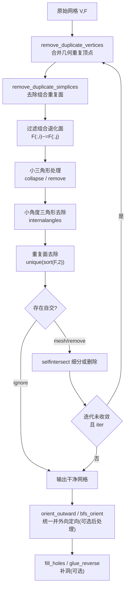

# 网格清理与修复 / Mesh Cleanup & Repair

> 本章覆盖 `mesh/` 中用于**网格清理、去重、定向、去自交、补洞与拓扑修复**的函数。
> 这些函数多处于几何处理流水线的**前置阶段**：先把「脏」输入整备成流形、定向一致、
> 无退化、无自交的干净网格，再交给后续的变形 / 参数化 / 重构 / TetGen 等算法。
>
> This chapter documents the functions in `mesh/` that **clean up, deduplicate,
> orient, de-self-intersect, fill and repair** meshes. They typically form the
> **pre-processing stage** of a geometry pipeline.

- 语言 / Language：中英对照（中文为主）
- 覆盖函数 / Covered functions：30 个（见下）
- 上游依据 / Sources：[mesh/clean_mesh.m](file:///c:/VSWork/gptoolbox-1/mesh/clean_mesh.m#L1-L213) 等
- 相关章节 / See also：[01-mesh-io.md](01-mesh-io.md)、[02-topology.md](02-topology.md)、
  [../appendices/03-doc-template.md](../appendices/03-doc-template.md)

---

## 本章概览 / Chapter Overview

### 1. 病症 → 处方对照表 / Symptom → Prescription

| 病症 / Symptom | 处方函数 / Prescription | 说明 / Notes |
|---|---|---|
| 几何重复顶点 / geometrically duplicate vertices | `remove_duplicate_vertices`, `clean_mesh`, `collapse_close_points` | 按 `epsilon` 容差合并坐标相近的顶点 |
| 未引用顶点 / unreferenced vertices | `remove_unreferenced` | 删除不出现在任何面里的孤立顶点并重映射索引 |
| 退化面 / degenerate faces | `remove_degenerate_faces`, `remove_duplicate_simplices`, `clean_mesh` | 组合退化（重复索引）与几何退化（近零面积 / 近零角） |
| 小连通分量 / small components | `remove_small_components` | 按体积 / 面积阈值剔除碎片 |
| 非流形 / non-manifold | `fixNEIGH`, `flip_edges`, `split_edges` | TetGen 邻居修复；翻转 / 分裂时显式规避非流形边 |
| 定向不一致 / inconsistent orientation | `bfs_orient`, `orient_outward`, `flip_ears`, `glue_reverse` | 先按连通分量 BFS 统一定向，再按外向启发式整体翻转 |
| 自交 / self-intersection | `is_self_intersecting`, `clean_mesh`, `untangle`, `jiggle_duplicates` | 检测、细分 / 删除、或流式展平 |
| 含洞 / holes | `fill_holes`, `glue_reverse` | 沿边界环三角化补面或镜像粘合 |
| 共面重叠 / coplanar overlapped facets | `planarize`, `remove_duplicate_simplices` | 四边形平面化；组合重复面去除 |
| 数值抖动 / numerical jitter | `jiggle_duplicates`, `snap_points`, `snap_points_to_close_edges`, `untangle` | 微扰 / 吸附到最近点或边 |
| 布尔运算 / boolean CSG | `mesh_boolean_winding_number` | 广义绕数布尔，容忍脏输入 |
| 面数控制 / face reduction | `limit_faces`, `perform_edge_collapse`, `collapse_close_points` | 索引筛选、qslim 折叠回放 |

### 2. 推荐清理顺序 / Recommended cleanup order

下图的顺序**直接来自 `clean_mesh` 的内部调用顺序**（源码行号）：
`remove_duplicate_vertices`（[L107](file:///c:/VSWork/gptoolbox-1/mesh/clean_mesh.m#L107)）→
`remove_duplicate_simplices`（[L115](file:///c:/VSWork/gptoolbox-1/mesh/clean_mesh.m#L115)）→
组合退化面过滤（[L119](file:///c:/VSWork/gptoolbox-1/mesh/clean_mesh.m#L119)）→
小三角形（[L131-L138](file:///c:/VSWork/gptoolbox-1/mesh/clean_mesh.m#L131-L138)）→
小角度三角形（[L143](file:///c:/VSWork/gptoolbox-1/mesh/clean_mesh.m#L143)）→
重复面去除（[L148](file:///c:/VSWork/gptoolbox-1/mesh/clean_mesh.m#L148)）→
自交处理（[L157](file:///c:/VSWork/gptoolbox-1/mesh/clean_mesh.m#L157)）。



> 说明：`clean_mesh` 本体只做「去重 + 去退化 + 自交」这几步（不负责定向与补洞）。
> 定向（`orient_outward`）与补洞（`fill_holes`）在实际流水线中通常**在其之后**单独调用，
> 故在上图中以虚线之后的可选后处理形式给出。

---

### `clean_mesh` — 网格清理主流程
- **文件 / File**: [mesh/clean_mesh.m](file:///c:/VSWork/gptoolbox-1/mesh/clean_mesh.m#L1-L213)
- **签名 / Signature**: `[SV,SF,SVJ] = clean_mesh(V,F,'Name',Value,...)`
- **功能 / Purpose**: `EN: Iteratively clean a mesh: merge duplicate vertices, drop duplicate/degenerate
  facets, remove small/small-angle triangles and resolve self-intersections.`
  / 中文：迭代地清理网格——合并重复顶点、删除重复 / 退化面、剔除小三角形与小角度三角形，
  并处理自交，直到不再变化或达到迭代上限。
- **输入 / Inputs**:

  | 参数 | 尺寸/类型 | 含义 (中 / EN) |
  |---|---|---|
  | `V` | `#V by 3` | 顶点坐标 / vertex positions |
  | `F` | `#F by 3` | 三角面索引 / triangle indices |

- **输出 / Outputs**:

  | 参数 | 尺寸/类型 | 含义 |
  |---|---|---|
  | `SV` | `#SV by 3` | 清理后的顶点坐标 / new positions |
  | `SF` | `#SF by 3` | 清理后的三角面 / new triangle indices |
  | `SVJ` | `#V by 1` | 原始顶点 → 新顶点的映射 `V(·) → SVJ` |

- **可选参数 / Optional**（来自真实 `varargin`，见 [L68-L72](file:///c:/VSWork/gptoolbox-1/mesh/clean_mesh.m#L68-L72)）:

  | 名称 | 取值 | 默认 | 含义 |
  |---|---|---|---|
  | `'MaxIter'` | `int` | `100` | 最大迭代次数（[L64](file:///c:/VSWork/gptoolbox-1/mesh/clean_mesh.m#L64)） |
  | `'MinAngle'` | `double (rad)` | `0.001` | 退化三角形最小角阈值（[L56](file:///c:/VSWork/gptoolbox-1/mesh/clean_mesh.m#L56)） |
  | `'MinArea'` | `double` | `1e-7` | 小三角形最小面积阈值（[L55](file:///c:/VSWork/gptoolbox-1/mesh/clean_mesh.m#L55)） |
  | `'MinDist'` | `double` | `1e-7` | 重复顶点最小距离阈值（[L54](file:///c:/VSWork/gptoolbox-1/mesh/clean_mesh.m#L54)） |
  | `'Quiet'` | `logical` | `false` | 是否静默（重定向日志到 `/dev/null`） |
  | `'SelfIntersections'` | `'mesh'`\|`'remove'`\|`'remove-first'`\|`'ignore'` | `'mesh'` | 自交处理策略（[L63](file:///c:/VSWork/gptoolbox-1/mesh/clean_mesh.m#L63)） |
  | `'Single'` | `logical` | `false` | 是否转单精度（每轮 `double(single(SV))`，[L103](file:///c:/VSWork/gptoolbox-1/mesh/clean_mesh.m#L103)） |
  | `'SmallTriangles'` | `'collapse'`\|`'remove'` | `'remove'` | 小三角形处理方式（[L62](file:///c:/VSWork/gptoolbox-1/mesh/clean_mesh.m#L62)） |

- **变量流动 / Variable flow**: `V,F →(初始化 SV=V,SF=F,SVJ=1:#V)→ while iter<max_iter →
  remove_duplicate_vertices→SF=SVJ(SF)→ remove_duplicate_simplices → 过滤组合退化面 →
  SmallTriangles 分支 → 小角度过滤 → 重复面去除 → selfintersect 分支 → SV,SF,SVJ`
- **算法步骤 / Algorithm**:
  1. 解析 `varargin`，用 `containers.Map` + `assignin` 赋值到工作区（[L74-L85](file:///c:/VSWork/gptoolbox-1/mesh/clean_mesh.m#L74-L85)）。
  2. 初始化 `SVJ=1:#V`、`SV=V`、`SF=F`、`iter=0`（[L96-L100](file:///c:/VSWork/gptoolbox-1/mesh/clean_mesh.m#L96-L100)）。
  3. 进入 `while iter<max_iter`：先 `SV=double(single(SV))` 压到单精度（[L102-L103](file:///c:/VSWork/gptoolbox-1/mesh/clean_mesh.m#L102-L103)）。
  4. `min_dist>=0` 时调 `remove_duplicate_vertices(SV,min_dist)`，重映射 `SF=SVJ(SF)`、复合 `SVJ=SVJ(SVJbefore)`（[L106-L114](file:///c:/VSWork/gptoolbox-1/mesh/clean_mesh.m#L106-L114)）。
  5. `remove_duplicate_simplices(SF)` 去组合重复面（[L115](file:///c:/VSWork/gptoolbox-1/mesh/clean_mesh.m#L115)）。
  6. 过滤组合退化面（`SF(:,1,2,3)` 互异）（[L119](file:///c:/VSWork/gptoolbox-1/mesh/clean_mesh.m#L119)）。
  7. 按 `small_triangles` 分支：`'collapse'`→`collapse_small_triangles`；`'remove'`→`doublearea>min_area` 过滤（[L131-L138](file:///c:/VSWork/gptoolbox-1/mesh/clean_mesh.m#L131-L138)）。
  8. `internalangles(SVbefore,SF)<min_angle` 的小角度三角形去除（[L143-L144](file:///c:/VSWork/gptoolbox-1/mesh/clean_mesh.m#L143-L144)）。
  9. `unique(sort(SF,2),'rows','stable')` 再删一次重复面（[L148-L149](file:///c:/VSWork/gptoolbox-1/mesh/clean_mesh.m#L148-L149)）。
  10. 若 `SelfIntersections=='ignore'` 则 `break`；否则 `selfintersect`（`DetectOnly` 由策略决定），
      按 `'mesh'/'remove'/'remove-first'/'remove-optimal'` 分支；若交对数为 0 则 `break`（[L153-L199](file:///c:/VSWork/gptoolbox-1/mesh/clean_mesh.m#L153-L199)）。
  11. `iter=iter+1`，回到步骤 3；退出后断言无组合退化面（[L208-L211](file:///c:/VSWork/gptoolbox-1/mesh/clean_mesh.m#L208-L211)）。
- **流程图 / Flowchart**:

  ```mermaid
  flowchart TD
    A["输入 V,F + 解析 varargin"] --> B["初始化 SV=V,SF=F,SVJ=1:#V,iter=0"]
    B --> C{"iter < max_iter?"}
    C -- 否 --> Z["断言无组合退化面 → 输出 SV,SF,SVJ"]
    C -- 是 --> D["SV = double(single(SV))"]
    D --> E{"min_dist >= 0?"}
    E -- 是 --> F["remove_duplicate_vertices<br/>SF=SVJ(SF); SVJ=SVJ(SVJbefore)"]
    E -- 否 --> G["remove_duplicate_simplices"]
    F --> G
    G --> H["过滤组合退化面"]
    H --> I{"small_triangles"}
    I -- collapse --> J["collapse_small_triangles"]
    I -- remove --> K["doublearea>min_area 过滤"]
    J --> L["去除小角度三角形<br/>internalangles<min_angle"]
    K --> L
    L --> M["unique(sort(SF,2)) 去重复面"]
    M --> N{"SelfIntersections=='ignore'?"}
    N -- 是 --> Z
    N -- 否 --> O["selfintersect 检测/细分"]
    O --> P{"策略分支"}
    P -- mesh --> Q["SV=SVtemp; SF=SFtemp"]
    P -- remove --> R["删除 offending 面"]
    P -- remove-first --> S["删除每对首个面"]
    Q --> T{"num_inters==0?"}
    R --> T
    S --> T
    T -- 是 --> Z
    T -- 否 --> U["iter=iter+1"] --> C
  ```

- **依赖 / Dependencies**: `remove_duplicate_vertices`, `remove_duplicate_simplices`, `collapse_small_triangles`
  `[MEX]`, `doublearea`, `internalangles`, `selfintersect` `[MEX]`（本地 `fprintf_`）
- **See also**: `winding_number_clean`, `remove_degenerate_faces`, `orient_outward`

---

### `clean_tetgen_mesh` — 精简 TetGen 输出网格
- **文件 / File**: [mesh/clean_tetgen_mesh.m](file:///c:/VSWork/gptoolbox-1/mesh/clean_tetgen_mesh.m#L1-L23)
- **签名 / Signature**: `clean_tetgen_mesh(input_file,output_file)`
- **功能 / Purpose**: `EN: Read a TetGen .mesh (vertices+tets), recompute surface
  triangles from the tets, fix orientation and reorder surface vertices first, then
  write a compact .mesh.` / 中文：TetGen 会把**所有四面体面**都写入 `.mesh`；本函数读入
  顶点与四面体（忽略原有三角面），由 `boundary_faces(T)` 重新求表面三角，纠正定向并把
  表面顶点排到前面，再写回文件。
- **输入 / Inputs**:

  | 参数 | 尺寸/类型 | 含义 (中 / EN) |
  |---|---|---|
  | `input_file` | `char path` | 含顶点与四面体的 `.mesh` 文件路径 |
  | `output_file` | `char path` | 输出 `.mesh` 文件路径 |

- **输出 / Outputs**: 无返回值，向 `output_file` 写文件 / writes to file.
- **可选参数 / Optional**: 无 / none
- **变量流动 / Variable flow**: `input_file →(readMESH)→ V,T,F(忽略) → boundary_faces(T)=F →
  F=[F3 F2 F1] 反向 → faces_first(V,T,F) → writeMESH(output_file,V,T,F)`
- **算法步骤 / Algorithm**:
  1. `[V,T,F]=readMESH(input_file)` 读取顶点与四面体（[L14](file:///c:/VSWork/gptoolbox-1/mesh/clean_tetgen_mesh.m#L14)）。
  2. `F=boundary_faces(T)` 由四面体提取边界三角面（[L15](file:///c:/VSWork/gptoolbox-1/mesh/clean_tetgen_mesh.m#L15)）。
  3. `F=[F(:,3) F(:,2) F(:,1)]` 反转定向（注释：TetGen 定向相反）（[L18](file:///c:/VSWork/gptoolbox-1/mesh/clean_tetgen_mesh.m#L18)）。
  4. `faces_first(V,T,F)` 让表面顶点排在内部顶点之前（[L21](file:///c:/VSWork/gptoolbox-1/mesh/clean_tetgen_mesh.m#L21)）。
  5. `writeMESH(output_file,V,T,F)` 写出（[L22](file:///c:/VSWork/gptoolbox-1/mesh/clean_tetgen_mesh.m#L22)）。
- **流程图 / Flowchart**:

  ```mermaid
  flowchart TD
    A["input_file"] --> B["readMESH → V,T,F"]
    B --> C["F = boundary_faces(T)"]
    C --> D["F = [F3 F2 F1] 反转定向"]
    D --> E["faces_first(V,T,F)"]
    E --> F["writeMESH(output_file,V,T,F)"]
  ```

- **依赖 / Dependencies**: `readMESH`, `boundary_faces`, `faces_first`, `writeMESH`
- **See also**: `clean_mesh`, `tetgen`, `cdt`

---

### `clean_dir` — 批量清理目录中所有模型（文件/目录操作，非网格算子）
- **文件 / File**: [mesh/clean_dir.m](file:///c:/VSWork/gptoolbox-1/mesh/clean_dir.m#L1-L56)
- **签名 / Signature**: `clean_dir(dir_arg)`
- **功能 / Purpose**: `EN: Not a mesh operator: it is a batch driver that loops over
  all files matched by a `dir`-style argument, loads each, tries meshfix, falls back to
  `winding_number_clean`, re-tetrahedralizes with tetgen and writes `*_fixed.obj`
  / `*_solid.obj`.`
  / 中文：**这不是网格算子，而是文件 / 目录批处理脚本**。它用 `dir(dir_arg)` 枚举文件，
  逐个 `load_mesh`，先尝试 `meshfix`，失败则退回 `winding_number_clean`，再 `tetgen` 验证，
  最后 `writeOBJ` 输出 `_fixed.obj` 或 `_solid.obj`。
- **输入 / Inputs**:

  | 参数 | 尺寸/类型 | 含义 (中 / EN) |
  |---|---|---|
  | `dir_arg` | `char` | `dir` 风格的通配参数（如 `'*.OBJ'`） |

- **输出 / Outputs**: 无返回值，产生 `*_fixed.obj` / `*_solid.obj` 文件 / side-effect files.
- **可选参数 / Optional**: 无 / none
- **变量流动 / Variable flow**: `dir_arg → dir() → files → for f: load_mesh(file) → V,F →
  try meshfix → else winding_number_clean → tetgen(CV,CF) → writeOBJ(output_name,CV,CF)`
- **算法步骤 / Algorithm**:
  1. `files=dir(dir_arg)` 枚举文件（[L10](file:///c:/VSWork/gptoolbox-1/mesh/clean_dir.m#L10)）。
  2. 循环每个文件，`fileparts` 拆分路径（[L11-L13](file:///c:/VSWork/gptoolbox-1/mesh/clean_dir.m#L11-L13)）。
  3. `load_mesh(file,'Quiet',true)` 载入 `V,F`（[L15](file:///c:/VSWork/gptoolbox-1/mesh/clean_dir.m#L15)）。
  4. `try meshfix(V,F)`；捕获崩溃则标记失败（[L17-L22](file:///c:/VSWork/gptoolbox-1/mesh/clean_dir.m#L17-L22)）。
  5. 若 `meshfix` 删面超过一半则判失败并可视化（[L23-L30](file:///c:/VSWork/gptoolbox-1/mesh/clean_dir.m#L23-L30)）。
  6. 成功→输出 `_fixed.obj`；否则 `winding_number_clean(V,F,'SurfaceOnly',true)` 输出 `_solid.obj`（[L31-L41](file:///c:/VSWork/gptoolbox-1/mesh/clean_dir.m#L31-L41)）。
  7. `tetgen(CV,CF)` 验证能否四面体化（[L42-L48](file:///c:/VSWork/gptoolbox-1/mesh/clean_dir.m#L42-L48)）。
  8. `tsurf` 显示，`writeOBJ(output_name,CV,CF)` 落盘（[L49-L53](file:///c:/VSWork/gptoolbox-1/mesh/clean_dir.m#L49-L53)）。
- **流程图 / Flowchart**:

  ```mermaid
  flowchart TD
    A["dir_arg"] --> B["files = dir(dir_arg)"]
    B --> C{"for f = 1:numel(files)"}
    C --> D["load_mesh(file,'Quiet',true) → V,F"]
    D --> E{"try meshfix(V,F)"}
    E -- 成功 --> F{"删面 > 一半?"}
    E -- 异常 --> H["mesh_fix_success=false"]
    F -- 是 --> H
    F -- 否 --> G["output=_fixed.obj"]
    H --> I{"try winding_number_clean"}
    I -- 成功 --> J["output=_solid.obj"]
    I -- 异常 --> C
    G --> K["try tetgen(CV,CF)"]
    J --> K
    K --> L["tsurf + writeOBJ(output)"]
    L --> C
  ```

- **依赖 / Dependencies**: `load_mesh`, `meshfix` (wrapper), `winding_number_clean`, `tetgen` (wrapper), `tsurf`, `writeOBJ`
- **归属判断 / Placement note**: 该函数体是**目录批处理驱动**，逻辑上更接近 I/O / 脚本层，
  建议归属于**批处理工具**或 `mesh/io` 工具类，而非「网格清理算子」；
  本文档按清单收录但如实标注其真实归属。
- **See also**: `clean_mesh`, `clean_tetgen_mesh`, `winding_number_clean`

---

### `remove_unreferenced` — 移除未引用顶点
- **文件 / File**: [mesh/remove_unreferenced.m](file:///c:/VSWork/gptoolbox-1/mesh/remove_unreferenced.m#L1-L87)
- **签名 / Signature**: `[RV,IM,J,IMF] = remove_unreferenced(V,F,output_bound)`
- **功能 / Purpose**: `EN: Remove rows of V not referenced by F, reindexing so that
  referenced vertices come first.` / 中文：删除 `V` 中未被 `F` 引用的行，并把被引用的顶点
  重排到前面，同时给出正反向索引映射。
- **输入 / Inputs**:

  | 参数 | 尺寸/类型 | 含义 (中 / EN) |
  |---|---|---|
  | `V` | `#V by dim` | 顶点坐标 / vertex positions |
  | `F` | `#F by anything` | 索引列表（按 `F(:)` 处理）/ indices |
  | `output_bound` | `logical` | 是否走 O(#F) 且不输出 `IM` 的分支（默认 `false`） |

- **输出 / Outputs**:

  | 参数 | 尺寸/类型 | 含义 |
  |---|---|---|
  | `RV` | `#unique(F) by dim` | 仅保留被引用顶点，被引用者在前 |
  | `IM` | `#V by 1` | 旧→新索引（`RF=IM(F)`；未引用者置 0 / -1 语义） |
  | `J` | `#RV by 1` | 新→旧索引（`RV=V(J,:)`） |
  | `IMF` | `#F by anything` | `IMF=IM(F)` |

- **可选参数 / Optional**: 无命名参数；第三个**位置参数** `output_bound`（[L30-L32](file:///c:/VSWork/gptoolbox-1/mesh/remove_unreferenced.m#L30-L32)）。
- **变量流动 / Variable flow**:
  `output_bound==false: V,F → sort(F(:)) → 差分为 U(被引用) → NU=未引用 → IM(U)=1:|U|, IM(NU)=|U|+..(后置) → RV(IM,:)=V → 截断 → J,IMF`
- **算法步骤 / Algorithm**:
  1. 若 `F` 为空：返回空 `RV` 与恒等 `IM`（[L54-L59](file:///c:/VSWork/gptoolbox-1/mesh/remove_unreferenced.m#L54-L59)）。
  2. `sF=sort(F(:))`，`I=[true;diff(sF)~=0]` 得到唯一被引用顶点 `U`（更快版 `unique`）（[L64-L66](file:///c:/VSWork/gptoolbox-1/mesh/remove_unreferenced.m#L64-L66)）。
  3. `n=size(V,1)`；`NU=find(0==sparse(U,1,1,n,1))` 求未引用顶点，并断言 `|U|+|NU|==n`（[L70-L72](file:///c:/VSWork/gptoolbox-1/mesh/remove_unreferenced.m#L70-L72)）。
  4. `IM(U)=1:|U|`，`IM(NU)=|U|+(1:|NU|)`（被引用者前置）（[L74-L78](file:///c:/VSWork/gptoolbox-1/mesh/remove_unreferenced.m#L74-L78)）。
  5. `RV(IM,:)=V`，`RV=RV(1:max(IM(F(:))),:)` 截断未引用尾部（[L80-L82](file:///c:/VSWork/gptoolbox-1/mesh/remove_unreferenced.m#L80-L82)）。
  6. `J(IM)=1:n`，`IMF=reshape(IM(F),size(F))`，`J=J(1:max(IMF(:)))`（[L83-L85](file:///c:/VSWork/gptoolbox-1/mesh/remove_unreferenced.m#L83-L85)）。
- **流程图 / Flowchart**:

  ```mermaid
  flowchart TD
    A["输入 V,F,output_bound"] --> B{"output_bound?"}
    B -- 是 --> C{"F 为空?"}
    C -- 是 --> C1["返回空 RV,J,IMF,IM=[]"]
    C -- 否 --> C2["unique(F(:)) → U,J,IMF; RV=V(J,:)"]
    B -- 否 --> D{"F 为空?"}
    D -- 是 --> D1["RV=空, IM=1:#V"]
    D -- 否 --> E["sF=sort(F(:)); U=sF([true;diff~=0])"]
    E --> F["NU=未引用顶点; 断言 |U|+|NU|==n"]
    F --> G["IM(U)=1:|U|; IM(NU)=后置"]
    G --> H["RV(IM,:)=V; 截断"]
    H --> Z["输出 RV,IM,J,IMF"]
  ```

- **依赖 / Dependencies**: 无（仅内置 `sort`/`sparse`/`unique`）
- **See also**: `remove_duplicate_vertices`, `remove_small_components`, `faces_first`

---

### `remove_duplicate_vertices` — 合并容差内重复顶点
- **文件 / File**: [mesh/remove_duplicate_vertices.m](file:///c:/VSWork/gptoolbox-1/mesh/remove_duplicate_vertices.m#L1-L75)
- **签名 / Signature**: `[SV,SVI,SVJ,SVJF] = remove_duplicate_vertices(V,epsilon,'Name',Value,...)`
- **功能 / Purpose**: `EN: Merge vertices that are within a uniqueness tolerance
  `epsilon` (round-and-unique, then average).` / 中文：把间距小于容差 `epsilon` 的顶点合并
  （按 `round(V/epsilon)` 取整后 `unique`，并对每组取均值）。
- **输入 / Inputs**:

  | 参数 | 尺寸/类型 | 含义 (中 / EN) |
  |---|---|---|
  | `V` | `#V by dim` | 顶点坐标 / vertex positions |
  | `epsilon` | `double` | 唯一性容差，`0` 表示精确匹配 |

- **输出 / Outputs**:

  | 参数 | 尺寸/类型 | 含义 |
  |---|---|---|
  | `SV` | `#SV by dim` | 新顶点（重复组取均值） |
  | `SVI` | `#SV by 1` | `SV=V(SVI,:)` |
  | `SVJ` | `#V by 1` | `V=SV(SVJ,:)` |
  | `SVJF` | `size(F)` | `SVJF=SVJ(F)` |

- **可选参数 / Optional**:

  | 名称 | 取值 | 默认 | 含义 |
  |---|---|---|---|
  | `'WhiteList'` | 选择集 | `[]` | 仅合并白名单内顶点（源码标注未正确实现，[L63-L64](file:///c:/VSWork/gptoolbox-1/mesh/remove_duplicate_vertices.m#L63-L64)） |
  | `'F'` | `#F list` | `[]` | 用于计算第 4 输出 `SVJF` |

- **变量流动 / Variable flow**:
  `V,epsilon →(whitelist 空)→ epsilon==0: unique(V,'rows','stable') / epsilon>0: unique(round(V/epsilon)) →
  SVJ → 每组 accumarray(...,@mean) → SV →(nargout≥4)→ SVJF=SVJ(F)`
- **算法步骤 / Algorithm**:
  1. 解析 `WhiteList` / `F`（[L37-L49](file:///c:/VSWork/gptoolbox-1/mesh/remove_duplicate_vertices.m#L37-L49)）。
  2. 无白名单：`epsilon==0` 或 `nargin==1` 用 `unique(V,'rows','stable')`（[L53-L54](file:///c:/VSWork/gptoolbox-1/mesh/remove_duplicate_vertices.m#L53-L54)）。
  3. 否则 `unique(round(V/epsilon))` 得 `SVI,SVJ`，并对每一维 `accumarray(SVJ,V(:,d),[],@mean)` 取均值（[L56-L61](file:///c:/VSWork/gptoolbox-1/mesh/remove_duplicate_vertices.m#L56-L61)）。
  4. 有白名单：当前实现 `error('not implemented correctly')`（[L63-L70](file:///c:/VSWork/gptoolbox-1/mesh/remove_duplicate_vertices.m#L63-L70)）。
  5. `nargout>=4` 时 `SVJF=reshape(SVJ(F),size(F))`（[L72-L74](file:///c:/VSWork/gptoolbox-1/mesh/remove_duplicate_vertices.m#L72-L74)）。
- **流程图 / Flowchart**:

  ```mermaid
  flowchart TD
    A["输入 V,epsilon"] --> B{"whitelist 非空?"}
    B -- 是 --> B1["error('not implemented')"]
    B -- 否 --> C{"epsilon==0 或 nargin==1?"}
    C -- 是 --> D["unique(V,'rows','stable')"]
    C -- 否 --> E["unique(round(V/epsilon))<br/>+ accumarray 均值"]
    D --> F{"nargout>=4?"}
    E --> F
    F -- 是 --> G["SVJF=reshape(SVJ(F),size(F))"]
    F -- 否 --> Z["输出 SV,SVI,SVJ"]
    G --> Z
  ```

- **依赖 / Dependencies**: 无（内置 `unique`/`accumarray`）
- **See also**: `remove_unreferenced`, `clean_mesh`, `remove_duplicate_simplices`

---

### `remove_duplicate_simplices` — 去除组合重复单形
- **文件 / File**: [mesh/remove_duplicate_simplices.m](file:///c:/VSWork/gptoolbox-1/mesh/remove_duplicate_simplices.m#L1-L13)
- **签名 / Signature**: `[SF,SFI,SFJ] = remove_duplicate_simplices(F)`
- **功能 / Purpose**: `EN: Remove duplicate simplices regardless of vertex order.`
  / 中文：忽略顶点顺序地删除重复单形（先对每行排序再 `unique`）。
- **输入 / Inputs**:

  | 参数 | 尺寸/类型 | 含义 (中 / EN) |
  |---|---|---|
  | `F` | `#F by ss` | 单形索引 / simplex indices |

- **输出 / Outputs**:

  | 参数 | 尺寸/类型 | 含义 |
  |---|---|---|
  | `SF` | `#SF by ss` | 唯一单形（保留首次出现顺序） |
  | `SFI` | `#SF by 1` | `SF=F(SFI,:)` |
  | `SFJ` | `#SFI by 1` | `F=SF(SFJ,:)` |

- **可选参数 / Optional**: 无 / none
- **变量流动 / Variable flow**: `F → sort(F,2) → unique(...,'rows','stable') → SFI,SFJ → SF=F(SFI,:)`
- **算法步骤 / Algorithm**:
  1. 对每行排序 `sort(F,2)`（忽略顺序）。
  2. `unique(...,'rows','stable')` 得唯一行与索引（[L11](file:///c:/VSWork/gptoolbox-1/mesh/remove_duplicate_simplices.m#L11)）。
  3. `SF=F(SFI,:)`（[L12](file:///c:/VSWork/gptoolbox-1/mesh/remove_duplicate_simplices.m#L12)）。
- **流程图 / Flowchart**:

  ```mermaid
  flowchart TD
    A["输入 F"] --> B["sort(F,2) 忽略顺序"]
    B --> C["unique(...,'rows','stable') → SFI,SFJ"]
    C --> Z["SF=F(SFI,:) 输出"]
  ```

- **依赖 / Dependencies**: 无
- **See also**: `clean_mesh`, `remove_degenerate_faces`

---

### `remove_degenerate_faces` — 去除退化面（折叠 / 翻转最长边）
- **文件 / File**: [mesh/remove_degenerate_faces.m](file:///c:/VSWork/gptoolbox-1/mesh/remove_degenerate_faces.m#L1-L160)
- **签名 / Signature**: `[VV,FF] = remove_degenerate_faces(V,F,'Name',Value,...)`
- **功能 / Purpose**: `EN: Remove near-degenerate (near-zero-area) faces by flipping
  non-Delaunay longest edges and collapsing short edges, iterating to convergence.`
  / 中文：通过翻转「非 Delaunay 的最长边」与折叠「短边」，迭代消除近退化（近零面积）面。
- **输入 / Inputs**:

  | 参数 | 尺寸/类型 | 含义 (中 / EN) |
  |---|---|---|
  | `V` | `#V by 3` | 顶点坐标 / vertex positions |
  | `F` | `#F by 3` | 三角面索引 / triangle indices |

- **输出 / Outputs**:

  | 参数 | 尺寸/类型 | 含义 |
  |---|---|---|
  | `VV` | `#VV by 3` | 顶点坐标（含折叠） |
  | `FF` | `#FF by 3` | 面索引（指向 `VV`） |

- **可选参数 / Optional**:

  | 名称 | 取值 | 默认 | 含义 |
  |---|---|---|---|
  | `'MaxIter'` | `int` | `100` | 最大迭代（[L20](file:///c:/VSWork/gptoolbox-1/mesh/remove_degenerate_faces.m#L20)） |
  | `'Epsilon'` | `double` | `0` | 视为退化的最大面积（`A/2<=epsilon`）（[L21](file:///c:/VSWork/gptoolbox-1/mesh/remove_degenerate_faces.m#L21)） |

- **变量流动 / Variable flow**: `V,F →(faces_first 边界前置)→ V,FF,J →
  while: is_acute→D; is_intrinsic_delaunay→L(可翻最长边) / IC(可折叠) →
  conservative_edge_matching → flip_edges(EL) + EJ 折叠 ES → 去组合退化面 → remove_unreferenced`
- **算法步骤 / Algorithm**:
  1. 解析参数（[L26-L38](file:///c:/VSWork/gptoolbox-1/mesh/remove_degenerate_faces.m#L26-L38)）。
  2. `faces_first(V,F,boundary_faces(F))` 强制边界顶点靠前，`EJ=1:#V`（[L68-L69](file:///c:/VSWork/gptoolbox-1/mesh/remove_degenerate_faces.m#L68-L69)）。
  3. 进入 `while true`：`is_acute` 得角与面积 `A`，`D=A/2<=epsilon` 标记退化面（[L82-L83](file:///c:/VSWork/gptoolbox-1/mesh/remove_degenerate_faces.m#L82-L83)）。
  4. `L=~is_intrinsic_delaunay & 最长边 & (D&~IA)`：选出可翻转的非 Delaunay 最长边 `EL`（[L85-L89](file:///c:/VSWork/gptoolbox-1/mesh/remove_degenerate_faces.m#L85-L89)）。
  5. `IC=D&~any(L,2)`：无法翻的非锐角退化面走折叠；取其最短边 `ES`（[L91-L94](file:///c:/VSWork/gptoolbox-1/mesh/remove_degenerate_faces.m#L91-L94)）。
  6. 若 `ES`、`EL` 均空则 `break`；否则 `validate_edges` 断言边合法（[L96-L101](file:///c:/VSWork/gptoolbox-1/mesh/remove_degenerate_faces.m#L96-L101)）。
  7. `conservative_edge_matching` 做无冲突匹配，拆分为 `EL`/`ES`（[L113-L117](file:///c:/VSWork/gptoolbox-1/mesh/remove_degenerate_faces.m#L113-L117)）。
  8. 先 `FF=flip_edges(FF,EL)`；再 `EJ(ES(:,2))=ES(:,1)` 折叠 `FF=EJ(FF)`，并去组合退化面（[L133-L140](file:///c:/VSWork/gptoolbox-1/mesh/remove_degenerate_faces.m#L133-L140)）。
  9. `iter==max_iter` 则告警退出，否则 `iter++`（[L142-L146](file:///c:/VSWork/gptoolbox-1/mesh/remove_degenerate_faces.m#L142-L146)）。
  10. 末尾 `remove_unreferenced(V,FF)` 并重映射 `FF=UJ(FF)`、`J=UJ(EJ(J))`（[L150-L152](file:///c:/VSWork/gptoolbox-1/mesh/remove_degenerate_faces.m#L150-L152)）。
- **流程图 / Flowchart**:

  ```mermaid
  flowchart TD
    A["输入 V,F"] --> B["faces_first; EJ=1:#V"]
    B --> C["while true"]
    C --> D["is_acute → A; D=(A/2<=epsilon)"]
    D --> E["L: 非Delaunay 最长边 → EL"]
    E --> F["IC: 可折叠退化面 → ES 最短边"]
    F --> G{"ES 与 EL 均空?"}
    G -- 是 --> H["remove_unreferenced; 重映射"]
    G -- 否 --> I["conservative_edge_matching → EL/ES"]
    I --> J["FF=flip_edges(FF,EL)"]
    J --> K["折叠: EJ(ES2)=ES1; FF=EJ(FF); 去组合退化"]
    K --> L{"iter==max_iter?"}
    L -- 是 --> H
    L -- 否 --> M["iter++"] --> C
    H --> Z["输出 VV,FF"]
  ```

- **依赖 / Dependencies**: `faces_first`, `boundary_faces`, `is_acute`, `is_intrinsic_delaunay`,
  `conservative_edge_matching`, `flip_edges`, `remove_unreferenced`
- **See also**: `flip_edges`, `clean_mesh`, `collapse_close_points`

---

### `remove_small_components` — 移除小连通分量
- **文件 / File**: [mesh/remove_small_components.m](file:///c:/VSWork/gptoolbox-1/mesh/remove_small_components.m#L1-L72)
- **签名 / Signature**: `[U,G,I,J] = remove_small_components(V,F,'Name',Value,...)`
- **功能 / Purpose**: `EN: Keep only connected components whose volume (or area)
  exceeds a tolerance.` / 中文：仅保留体积（或面积）超过阈值的连通分量，剔除碎片。
- **输入 / Inputs**:

  | 参数 | 尺寸/类型 | 含义 (中 / EN) |
  |---|---|---|
  | `V` | `#V by 3` | 顶点坐标 / vertex positions |
  | `F` | `#F by 3` | 面索引 / face indices |

- **输出 / Outputs**:

  | 参数 | 尺寸/类型 | 含义 |
  |---|---|---|
  | `U` | `#U by 3` | 保留下来的顶点 |
  | `G` | `#G by 3` | 保留下来的面 |
  | `I` | `#V by 1` | `G=I(F)` |
  | `J` | `#G by 1` | 保留面在原 `F` 中的索引 |

- **可选参数 / Optional**:

  | 名称 | 取值 | 默认 | 含义 |
  |---|---|---|---|
  | `'Tol'` | `double`\|`'max'` | `0.0001*total_vol` | 最小体积/面积阈值，或 `'max'` 仅留最大分量 |
  | `'Volumetric'` | `logical` | `true` | 用体积还是表面积（[L21](file:///c:/VSWork/gptoolbox-1/mesh/remove_small_components.m#L21)） |

- **变量流动 / Variable flow**: `V,F → connected_components → C → for i: 计算 val(i)（体积/面积）→
  阈值/最大值筛 J → F=F(J,:) → remove_unreferenced → U,I → G=I(F)`
- **算法步骤 / Algorithm**:
  1. 解析参数（[L26-L37](file:///c:/VSWork/gptoolbox-1/mesh/remove_small_components.m#L26-L37)）。
  2. 若 `tol` 空：按 `volumetric` 用 `centroid`（体积）或 `doublearea`（面积）求总量，取 `0.0001*total`（[L40-L47](file:///c:/VSWork/gptoolbox-1/mesh/remove_small_components.m#L40-L47)）。
  3. `connected_components(F)` 得 `C`，`nc=max(C)`（[L50-L51](file:///c:/VSWork/gptoolbox-1/mesh/remove_small_components.m#L50-L51)）。
  4. 对每个分量算体积 / 面积 `val(i)`（[L53-L60](file:///c:/VSWork/gptoolbox-1/mesh/remove_small_components.m#L53-L60)）。
  5. 数值阈值时 `J=find(ismember(C,find(val>tol)))`；`'max'` 时保留最大分量（[L62-L68](file:///c:/VSWork/gptoolbox-1/mesh/remove_small_components.m#L62-L68)）。
  6. `F=F(J,:)`，`remove_unreferenced(V,F)`，`G=I(F)`（[L69-L71](file:///c:/VSWork/gptoolbox-1/mesh/remove_small_components.m#L69-L71)）。
- **流程图 / Flowchart**:

  ```mermaid
  flowchart TD
    A["输入 V,F"] --> B{"tol 为空?"}
    B -- 是 --> C["计算 total(体积/面积); tol=0.0001*total"]
    B -- 否 --> D["connected_components(F) → C"]
    C --> D
    D --> E["for i=1:nc: val(i)=体积/面积"]
    E --> F{"tol 是数值?"}
    F -- 是 --> G["J=find(val>tol) 对应面"]
    F -- 'max' --> H["保留最大分量 J"]
    G --> I["F=F(J,:); remove_unreferenced"]
    H --> I
    I --> Z["G=I(F) 输出 U,G,I,J"]
  ```

- **依赖 / Dependencies**: `connected_components`, `centroid`, `doublearea`, `remove_unreferenced`
- **See also**: `remove_unreferenced`, `mesh_boolean_winding_number`, `clean_mesh`

---

### `collapse_close_points` — 折叠近似重合的点并更新边表
- **文件 / File**: [mesh/collapse_close_points.m](file:///c:/VSWork/gptoolbox-1/mesh/collapse_close_points.m#L1-L138)
- **签名 / Signature**: `[NC,NE] = collapse_close_points(C,E,epsilon)`
- **功能 / Purpose**: `EN: Iteratively collapse points closer than epsilon, updating
  an edge list E (or face list F), removing resulting self-loops/duplicates.`
  / 中文：迭代折叠距离小于 `epsilon` 的点，更新边表 `E`（或面表 `F`），并清除由此产生的
  自环与重复边。
- **输入 / Inputs**:

  | 参数 | 尺寸/类型 | 含义 (中 / EN) |
  |---|---|---|
  | `C` | `#C by dim` | 点坐标 / point positions |
  | `E` | `#E by 2` 或 `#F by 3` | 边表或三角面表 / edges or triangles |
  | `epsilon` | `double` | 折叠后允许的最小间距（默认取最大边长/100） |

- **输出 / Outputs**:

  | 参数 | 尺寸/类型 | 含义 |
  |---|---|---|
  | `NC` | `#NC by dim` | 折叠后的点 |
  | `NE` | `#NE by 2/3` | 更新后的边/面表 |

- **可选参数 / Optional**: 第三位置参数 `epsilon`（缺省时 `maxD/100`，[L55-L64](file:///c:/VSWork/gptoolbox-1/mesh/collapse_close_points.m#L55-L64)）。
- **变量流动 / Variable flow**: `C,E,epsilon → sqr_eps=epsilon^2 → while 点数变化: 成对距离 D →
  minD,q → snap → 消解 snap 级联 → remap NE → 删点 → 重映射 → 去重/去自环`
- **算法步骤 / Algorithm**:
  1. 断言 `size(E,2)` 为 2 或 3；缺省 `epsilon` 取最大边长/100（[L53-L67](file:///c:/VSWork/gptoolbox-1/mesh/collapse_close_points.m#L53-L67)）。
  2. `while prev_count ~= size(NC,1)`：用 `repmat`/`permute` 求全成对平方距离 `D`，对角线置 `inf`（[L77-L83](file:///c:/VSWork/gptoolbox-1/mesh/collapse_close_points.m#L77-L83)）。
  3. `[minD,q]=min(D)` 找最近点；`snap` 收集 `minD<sqr_eps` 的吸附对（去自反重复）（[L85-L91](file:///c:/VSWork/gptoolbox-1/mesh/collapse_close_points.m#L85-L91)）。
  4. 内层 `while any(f)`：消解「级联吸附」（吸附目标本身也被吸附）（[L96-L105](file:///c:/VSWork/gptoolbox-1/mesh/collapse_close_points.m#L96-L105)）。
  5. `remap(snap(:,2))=snap(:,1)`，`NE=remap(NE)`（[L109-L113](file:///c:/VSWork/gptoolbox-1/mesh/collapse_close_points.m#L109-L113)）。
  6. 剔除被吸附点 `NC=NC(valid,:)`，重映射到新点表（[L116-L127](file:///c:/VSWork/gptoolbox-1/mesh/collapse_close_points.m#L116-L127)）。
  7. `NE=unique(sort(NE,2),'rows')` 去重，删自环；面表额外检查另两条边（[L129-L136](file:///c:/VSWork/gptoolbox-1/mesh/collapse_close_points.m#L129-L136)）。
- **流程图 / Flowchart**:

  ```mermaid
  flowchart TD
    A["输入 C,E,epsilon"] --> B["sqr_eps=epsilon^2"]
    B --> C{"点数仍在变化?"}
    C -- 否 --> Z["输出 NC,NE"]
    C -- 是 --> D["全成对距离 D; 对角线 inf"]
    D --> E["minD,q; snap = 近点对"]
    E --> F{"存在级联吸附 f?"}
    F -- 是 --> G["snap(f,1)=snap(r(f),1); unique"]
    G --> F
    F -- 否 --> H["remap(snap2)=snap1; NE=remap(NE)"]
    H --> I["NC=NC(valid); 重映射到新点表"]
    I --> J["NE 去重; 删自环(含面情形)"]
    J --> C
  ```

- **依赖 / Dependencies**: `edges`（面输入时）
- **See also**: `snap_points_to_close_edges`, `remove_duplicate_vertices`, `perform_edge_collapse`

---

### `jiggle_duplicates` — 抖动重复顶点以消除自交
- **文件 / File**: [mesh/jiggle_duplicates.m](file:///c:/VSWork/gptoolbox-1/mesh/jiggle_duplicates.m#L1-L49)
- **签名 / Signature**: `U = jiggle_duplicates(V,F,epsilon,sigma)`
- **功能 / Purpose**: `EN: Perturb (jiggle) duplicated vertices by Gaussian noise to
  remove exact coincidences while keeping the mesh self-intersection free.`
  / 中文：对重复顶点施加高斯微扰，在**保持无自交**的前提下打破完全重合。
- **输入 / Inputs**:

  | 参数 | 尺寸/类型 | 含义 (中 / EN) |
  |---|---|---|
  | `V` | `#V by dim` | 顶点坐标 / vertex positions |
  | `F` | `#F by 3` | 面索引 / triangle indices |
  | `epsilon` | `double` | 判重容差（`>0` 时 `round(U/epsilon)`） |
  | `sigma` | `double` | 抖动标准差 |

- **输出 / Outputs**:

  | 参数 | 尺寸/类型 | 含义 |
  |---|---|---|
  | `U` | `#V by dim` | 抖动后的顶点；超过 `max_iter` 时返回 `[]` |

- **可选参数 / Optional**: 无（全部为位置参数）
- **变量流动 / Variable flow**: `V,F,epsilon,sigma → 断言初始无自交 → A=adjacency_matrix(F) →
  for iter: I=dups(U,epsilon) → 空则返回 → W=U(I)+sigma*randn → 若 W 无自交则接受，
  否则仅移动安全子集 I → 收敛/上限`
- **算法步骤 / Algorithm**:
  1. 内部函数 `selfintersect_free` 用 `selfintersect(...,'DetectOnly',true,'FirstOnly',true)` 判空（[L2-L5](file:///c:/VSWork/gptoolbox-1/mesh/jiggle_duplicates.m#L2-L5)）。
  2. 断言初始 `(V,F)` 无自交（[L6](file:///c:/VSWork/gptoolbox-1/mesh/jiggle_duplicates.m#L6)）。
  3. `dups` 找重复顶点索引（按 `round(U/epsilon)` 或精确 `unique`）（[L9-L17](file:///c:/VSWork/gptoolbox-1/mesh/jiggle_duplicates.m#L9-L17)）。
  4. `A=adjacency_matrix(F)`；`for iter=1:max_iter`：`I=dups(U,epsilon)` 为空即返回（[L21-L27](file:///c:/VSWork/gptoolbox-1/mesh/jiggle_duplicates.m#L21-L27)）。
  5. `W=U; W(I,:)+=sigma*randn`；若 `W` 无自交则 `U=W`（[L28-L33](file:///c:/VSWork/gptoolbox-1/mesh/jiggle_duplicates.m#L28-L33)）。
  6. 否则检测自交对，若全涉及重复点，仅移动「安全」子集（[L34-L44](file:///c:/VSWork/gptoolbox-1/mesh/jiggle_duplicates.m#L34-L44)）。
  7. 超过上限则告警并置 `U=[]`（[L46-L47](file:///c:/VSWork/gptoolbox-1/mesh/jiggle_duplicates.m#L46-L47)）。
- **流程图 / Flowchart**:

  ```mermaid
  flowchart TD
    A["输入 V,F,epsilon,sigma"] --> B["断言初始无自交"]
    B --> C["A=adjacency_matrix(F); iter=1"]
    C --> D{"iter<=max_iter?"}
    D -- 否 --> Z1["warning; U=[]"]
    D -- 是 --> E["I=dups(U,epsilon)"]
    E --> F{"I 为空?"}
    F -- 是 --> Z["返回 U"]
    F -- 否 --> G["W=U; W(I)+=sigma*randn"]
    G --> H{"W 无自交?"}
    H -- 是 --> I["U=W"]
    H -- 否 --> J["检测自交对; 仅移动安全子集"]
    I --> K["iter++"] --> D
    J --> K
  ```

- **依赖 / Dependencies**: `selfintersect` `[MEX]`（mex/selfintersect.cpp）, `adjacency_matrix`
- **See also**: `untangle`, `is_self_intersecting`, `clean_mesh`

---

### `fixNEIGH` — 修复 TetGen 四面体邻居索引
- **文件 / File**: [mesh/fixNEIGH.m](file:///c:/VSWork/gptoolbox-1/mesh/fixNEIGH.m#L1-L66)
- **签名 / Signature**: `[new_TN,mani,correct] = fixNEIGH(TT,TN)`
- **功能 / Purpose**: `EN: TetGen emits neighbor indices inconsistently; rewrite TN so
  that new_TN(i,k)=j means tet i shares the face opposite its kth vertex with tet j.`
  / 中文：TetGen 输出的邻居索引不一致；本函数重写为「`new_TN(i,k)=j` 表示四面体 `i` 与 `j`
  共享其第 `k` 个顶点对面的那个面」。
- **输入 / Inputs**:

  | 参数 | 尺寸/类型 | 含义 (中 / EN) |
  |---|---|---|
  | `TT` | `#TT by dim+1` | 四面体索引 / tet indices |
  | `TN` | `#TT by dim+1` | 邻居索引（`TN(i,k)=j` 仅表示共享某面）/ raw neighbors |

- **输出 / Outputs**:

  | 参数 | 尺寸/类型 | 含义 |
  |---|---|---|
  | `new_TN` | `#TT by dim+1` | 面级一致的邻居索引；非流形/不一致时置 `[]` |
  | `mani` | `logical` | 是否面流形 |
  | `correct` | `logical` | `TN` 是否本就是面邻居 |

- **可选参数 / Optional**: 无 / none
- **变量流动 / Variable flow**: `TT,TN → TE(带顶点号的边) → 对称性断言 → 接口三角面 TTI →
  一致性检查 → for c: 判定每个邻接对应的对面顶点 → TNI → new_TN=sparse(...)`
- **算法步骤 / Algorithm**:
  1. 初始化 `mani=true; correct=true; new_TN=[]`（[L22-L24](file:///c:/VSWork/gptoolbox-1/mesh/fixNEIGH.m#L22-L24)）。
  2. 构造 `TE=[repmat(1:#TT) TN(:)]`，用稀疏矩阵断言邻居关系对称（[L27-L31](file:///c:/VSWork/gptoolbox-1/mesh/fixNEIGH.m#L27-L31)）。
  3. 用接口三角面 `TTI` 加权，检查 `TN` 是否已一致；一致则告警（[L35-L40](file:///c:/VSWork/gptoolbox-1/mesh/fixNEIGH.m#L35-L40)）。
  4. 去掉边界边；`for c=1:size(TT,2)`：找出共享面所对应的对面顶点号 `c`，检测面流形性（[L43-L52](file:///c:/VSWork/gptoolbox-1/mesh/fixNEIGH.m#L43-L52)）。
  5. 若 `TNI>0` 不全成立则 `correct=false`；若非流形或校正失败则提前返回（[L54-L60](file:///c:/VSWork/gptoolbox-1/mesh/fixNEIGH.m#L54-L60)）。
  6. `new_TN=sparse(TE(:,1),TNI,TE(:,2),...)`，边界值置为 `min(min(TN(:)),0)`（[L63-L65](file:///c:/VSWork/gptoolbox-1/mesh/fixNEIGH.m#L63-L65)）。
- **流程图 / Flowchart**:

  ```mermaid
  flowchart TD
    A["输入 TT,TN"] --> B["TE=[1:#TT TN(:)]; 对称性断言"]
    B --> C{"TN 已一致?"}
    C -- 是 --> C1["warning(already consistent)"]
    C -- 否 --> D["去边界边; for c=1:dim+1"]
    C1 --> D
    D --> E{"对面顶点号冲突(TNI)?"}
    E -- 是 --> F["mani=false"]
    E -- 否 --> G["TNI(TNIc)=c"]
    F --> H{"~mani 或 ~correct?"}
    G --> H
    H -- 是 --> Z1["new_TN=[] 返回 mani,correct"]
    H -- 否 --> I["new_TN=sparse(TE1,TNI,TE2)"]
    I --> Z["边界值=min(TN)"]
  ```

- **依赖 / Dependencies**: 无（内置 `sparse`/`bsxfun`）
- **See also**: `cdt`, `clean_tetgen_mesh`, `readMESH`

---

### `flip_faces` — 翻转四面体面（2-3 翻转风格）
- **文件 / File**: [mesh/flip_faces.m](file:///c:/VSWork/gptoolbox-1/mesh/flip_faces.m#L1-L98)
- **签名 / Signature**: `T = flip_faces(T0,F)`
- **功能 / Purpose**: `EN: Flip given faces F of a tet mesh T0 by removing the
  incident tets and re-splitting them (1 face → 3 tets per tetrahedral pair).`
  / 中文：对四面体网格 `T0` 的指定面 `F` 执行翻转：删除相关四面体并把它们按新面重新剖分
  （每对面拆成 3 个新四面体）。
- **输入 / Inputs**:

  | 参数 | 尺寸/类型 | 含义 (中 / EN) |
  |---|---|---|
  | `T0` | `#T0 by 4` | 四面体索引 / tet indices |
  | `F` | `#F by 3` | 待翻转三角面索引 / faces to flip |

- **输出 / Outputs**:

  | 参数 | 尺寸/类型 | 含义 |
  |---|---|---|
  | `T` | `#T' by 4` | 翻转后的四面体索引 |

- **可选参数 / Optional**: 无 / none
- **变量流动 / Variable flow**: `T0,F → allF=4 组面 → unique(sort) → FMAP →
  F2T 稀疏映射 → 找 to_flip → 计算 opps/I/J/R(定向) → 删相关 tet → 追加 3 组新 tet ST`
- **算法步骤 / Algorithm**:
  1. `T=T0`；构造四面体 4 个有序面 `allF`（[L11](file:///c:/VSWork/gptoolbox-1/mesh/flip_faces.m#L11), [L47-L52](file:///c:/VSWork/gptoolbox-1/mesh/flip_faces.m#L47-L52)）。
  2. `unique(sort(allF,2))` 得 `uF,FMAP`；检查定向反转 `rev`（[L53-L59](file:///c:/VSWork/gptoolbox-1/mesh/flip_faces.m#L53-L59)）。
  3. `F2T=sparse(FMAP,...)` 建立面→tet 映射；`ismember` 找 `to_flip`（[L61-L64](file:///c:/VSWork/gptoolbox-1/mesh/flip_faces.m#L61-L64)）。
  4. 断言所有面都能找到、且没有四面体被多面翻转涉及（[L64-L68](file:///c:/VSWork/gptoolbox-1/mesh/flip_faces.m#L64-L68)）。
  5. `O=cumoccurrence(FMAP)`，计算每面的两个相邻 tet 与对面顶点 `opps/I/J/R`（[L70-L80](file:///c:/VSWork/gptoolbox-1/mesh/flip_faces.m#L70-L80)）。
  6. 断言面定向一致（`sum(R,2)<=1`），取 `to_flip` 子集（[L80-L85](file:///c:/VSWork/gptoolbox-1/mesh/flip_faces.m#L80-L85)）。
  7. `IJKAB` 组合面与新顶点，按 `R` 交换 a/b；生成 3 组新四面体 `ST`（[L87-L92](file:///c:/VSWork/gptoolbox-1/mesh/flip_faces.m#L87-L92)）。
  8. `T(I,:)=[]` 删除旧四面体，`T=[T;ST]`（[L93-L94](file:///c:/VSWork/gptoolbox-1/mesh/flip_faces.m#L93-L94)）。
- **流程图 / Flowchart**:

  ```mermaid
  flowchart TD
    A["输入 T0,F"] --> B["allF=4组有向面; unique(sort) → uF,FMAP"]
    B --> C["计算 rev; F2T=sparse(FMAP)"]
    C --> D["ismember(sort(F,2),uF) → to_flip"]
    D --> E{"所有面找到 & 无冲突 tet?"}
    E -- 否 --> E1["assert 失败"]
    E -- 是 --> F["O=cumoccurrence; 求 opps/I/J/R"]
    F --> G{"定向一致 sum(R,2)<=1?"}
    G -- 否 --> G1["assert 失败"]
    G -- 是 --> H["构造 IJKAB(按R交换) → 3组新tet ST"]
    H --> I["T(I,:)=[]; T=[T;ST]"]
    I --> Z["输出 T"]
  ```

- **依赖 / Dependencies**: `cumoccurrence`
- **See also**: `flip_edges`, `cdt`, `perform_edge_collapse`

---

### `flip_edges` — 翻转三角形边
- **文件 / File**: [mesh/flip_edges.m](file:///c:/VSWork/gptoolbox-1/mesh/flip_edges.m#L1-L226)
- **签名 / Signature**: `[FF,I,l] = flip_edges(F,E,'Name',Value,...)`
- **功能 / Purpose**: `EN: Flip edges E of a triangle mesh F (edge-manifold along E),
  batch-matching non-adjacent edges per iteration; optionally update side lengths.`
  / 中文：翻转三角网格 `F` 的边 `E`（需在 `E` 上边流形），每轮对互不邻接的边做匹配并批量
  翻转；可选更新边长。
- **输入 / Inputs**:

  | 参数 | 尺寸/类型 | 含义 (中 / EN) |
  |---|---|---|
  | `F` | `#F by 3` | 三角面索引 / triangle indices |
  | `E` | `#E by 2` | 无向边表 / undirected edges |

- **输出 / Outputs**:

  | 参数 | 尺寸/类型 | 含义 |
  |---|---|---|
  | `FF` | `#F by 3` | 新面索引 |
  | `I` | `#F*3 by 1` | `FF=reshape(F(I),size(F))` |
  | `l` | `#F by 3` | 边长（对应边 23,31,12） |

- **可选参数 / Optional**:

  | 名称 | 取值 | 默认 | 含义 |
  |---|---|---|---|
  | `'AllowNonManifold'` | `logical` | `false` | 是否允许产生非流形边（[L29](file:///c:/VSWork/gptoolbox-1/mesh/flip_edges.m#L29)） |
  | `'SideLengths'` | `#F by 3` | `[]` | 输入边长 |
  | `'MaxIter'` | `int` | `inf` | 最大迭代（[L28](file:///c:/VSWork/gptoolbox-1/mesh/flip_edges.m#L28)） |
  | `'NonConflicting'` | `logical` | `false` | 承诺可无冲突全翻（[L35](file:///c:/VSWork/gptoolbox-1/mesh/flip_edges.m#L35)） |
  | `'Asserts'` / `'V'` | `logical` / `#V by 3` | `false` / `[]` | 调试断言与可视化 |

- **变量流动 / Variable flow**: `F,E → DA/EP 边奇偶矩阵 → 剔除非流形边 NM → while E 非空:
  conservative_edge_matching → 定位左右面 f_left/f_right → 计算新边 new_EE → 检查非流形 →
  (nargout≥3 更新 l) → 写回 FF/I`
- **算法步骤 / Algorithm**:
  1. 解析参数（[L37-L49](file:///c:/VSWork/gptoolbox-1/mesh/flip_edges.m#L37-L49)）。
  2. 构造有向边 `allE` 与奇偶和邻接 `EP`；`NM=EP(...)~=0` 标出非流形边并剔除（[L69-L83](file:///c:/VSWork/gptoolbox-1/mesh/flip_edges.m#L69-L83)）。
  3. `while ~isempty(E)`：用 `conservative_edge_matching`（或 `promise` 时全取）选互不邻接的边 `EE`（[L87-L105](file:///c:/VSWork/gptoolbox-1/mesh/flip_edges.m#L87-L105)）。
  4. `ismember` 定位每条边的左右三角面与角号 `f_left/f_right`，断言双向存在（[L110-L124](file:///c:/VSWork/gptoolbox-1/mesh/flip_edges.m#L110-L124)）。
  5. `new_EE=sort([FF(fJ_left) FF(fJ_right)],2)`；非 `allow_nm` 时若新边已存在则剔除该翻（[L137-L162](file:///c:/VSWork/gptoolbox-1/mesh/flip_edges.m#L137-L162)）。
  6. `nargout>=3` 时按 [Fisher et al. 2007] 用半角和公式更新边长 `l`（[L166-L197](file:///c:/VSWork/gptoolbox-1/mesh/flip_edges.m#L166-L197)）。
  7. 写回 `FF(fI_*)=FF(fJ_*)`、`I(fI_*)=fJ_*`；`iter>=max_iter` 则退出（[L199-L223](file:///c:/VSWork/gptoolbox-1/mesh/flip_edges.m#L199-L223)）。
- **流程图 / Flowchart**:

  ```mermaid
  flowchart TD
    A["输入 F,E"] --> B["构造 EP; NM 非流形边剔除"]
    B --> C{"E 非空?"}
    C -- 否 --> Z["输出 FF,I,l"]
    C -- 是 --> D{"promise?"}
    D -- 是 --> D1["EE=E"]
    D -- 否 --> D2["conservative_edge_matching → EE,mI"]
    D1 --> E["E = E - EE"]
    D2 --> E
    E --> F["定位 f_left/f_right; 断言双向存在"]
    F --> G["new_EE=sort(相邻顶点)"]
    G --> H{"allow_nm?"}
    H -- 否 --> H1["剔除会造非流形的新边翻"]
    H -- 是 --> I{"nargout>=3?"}
    H1 --> I
    I -- 是 --> I1["按半角公式更新边长 l"]
    I -- 否 --> J["写回 FF,I"]
    I1 --> J
    J --> K{"iter>=max_iter?"}
    K -- 是 --> Z
    K -- 否 --> L["iter++"] --> C
  ```

- **依赖 / Dependencies**: `conservative_edge_matching`, `nonmanifold_edges`（`Asserts` 时）
- **See also**: `remove_degenerate_faces`, `split_edges`, `flip_faces`

---

### `flip_ears` — 翻转耳朵三角形
- **文件 / File**: [mesh/flip_ears.m](file:///c:/VSWork/gptoolbox-1/mesh/flip_ears.m#L1-L89)
- **签名 / Signature**: `FF = flip_ears(V,F,'Name',Value,...)`
- **功能 / Purpose**: `EN: Flip ears (triangles with two boundary edges) into their
  neighbors, optionally only when the ear+flop form a planar quad, and optionally
  iterate FlipAndClip.` / 中文：把「耳朵」（含两条边界边的三角形）翻转到相邻面；
  可选仅在耳与 flop 构成平面四边形时翻转，并可选迭代「翻转再裁剪」。
- **输入 / Inputs**:

  | 参数 | 尺寸/类型 | 含义 (中 / EN) |
  |---|---|---|
  | `V` | `#V by 3` | 顶点坐标 / vertex positions |
  | `F` | `#F by 3` | 三角面索引 / triangle indices |

- **输出 / Outputs**:

  | 参数 | 尺寸/类型 | 含义 |
  |---|---|---|
  | `FF` | `#F by 3`（或更少） | 新面索引 |

- **可选参数 / Optional**:

  | 名称 | 取值 | 默认 | 含义 |
  |---|---|---|---|
  | `'PlanarOnly'` | `logical` | `false` | 仅翻平面耳对（[L25](file:///c:/VSWork/gptoolbox-1/mesh/flip_ears.m#L25)） |
  | `'PlanarEpsilon'` | `double` | `1e-8` | 平面性阈值（[L26](file:///c:/VSWork/gptoolbox-1/mesh/flip_ears.m#L26)） |
  | `'FlipAndClip'` | `logical` | `false` | 翻后再裁新耳并迭代（[L27](file:///c:/VSWork/gptoolbox-1/mesh/flip_ears.m#L27)） |

- **变量流动 / Variable flow**: `V,F →(循环)→ find_ears →(PlanarOnly 过滤)→ 改写 ear/flop 的
  对角索引 →(FlipAndClip)→ 重新 find_ears 并裁剪 → FF`
- **算法步骤 / Algorithm**:
  1. 解析参数（[L33-L44](file:///c:/VSWork/gptoolbox-1/mesh/flip_ears.m#L33-L44)）。
  2. `while true`：`[ears,ear_opp,flops,flop_opp]=find_ears(F)`（[L49-L51](file:///c:/VSWork/gptoolbox-1/mesh/flip_ears.m#L49-L51)）。
  3. `planar_only` 时把 `V` 补齐到 3 维，用 `normals` 比较耳与 flop 法向，保留近似平行者（[L58-L68](file:///c:/VSWork/gptoolbox-1/mesh/flip_ears.m#L58-L68)）。
  4. 直接把耳与 flop 的对角顶点互换：改写 `FF` 两个位置（[L72-L75](file:///c:/VSWork/gptoolbox-1/mesh/flip_ears.m#L72-L75)）。
  5. 若 `flip_and_clip`：重找耳朵，空则 `break`，否则裁剪（删除）新耳后继续循环（[L77-L86](file:///c:/VSWork/gptoolbox-1/mesh/flip_ears.m#L77-L86)）。
- **流程图 / Flowchart**:

  ```mermaid
  flowchart TD
    A["输入 V,F"] --> B["while true"]
    B --> C["find_ears → ears,ear_opp,flops,flop_opp"]
    C --> D{"planar_only?"}
    D -- 是 --> D1["法向比较, 仅留平面耳对"]
    D -- 否 --> E["互换 ear/flop 对角顶点 → FF"]
    D1 --> E
    E --> F{"flip_and_clip?"}
    F -- 否 --> Z["输出 FF"]
    F -- 是 --> G["重新 find_ears(FF)"]
    G --> H{"ears 为空?"}
    H -- 是 --> Z
    H -- 否 --> I["裁剪新耳 FF(ears,:)=[]"] --> B
  ```

- **依赖 / Dependencies**: `find_ears`, `normals`, `normalizerow`
- **See also**: `find_ears`, `triangulate`, `flip_edges`, `orient_outward`

> 说明 / Relation: `flip_ears` 与耳切三角化（Ear clipping，见 `triangulate` 及其底层
> libigl/triangle）方向互补——耳切是**从多边形挖耳生成三角**，而 `flip_ears` 是对已生成的
> 三角网格**翻转耳面以改善/修复扇状三角化**（例如把细长耳并入邻面）。

---

### `find_ears` — 查找耳（含两条边界边的面）
- **文件 / File**: [mesh/find_ears.m](file:///c:/VSWork/gptoolbox-1/mesh/find_ears.m#L1-L33)
- **签名 / Signature**: `[ears,ear_opp,flops,flop_opp] = find_ears(F)`
- **功能 / Purpose**: `EN: Find all ears (faces with exactly two boundary edges) and
  their flipping partners.` / 中文：找出所有耳（恰含两条边界边的面）及其翻转配对信息。
- **输入 / Inputs**:

  | 参数 | 尺寸/类型 | 含义 (中 / EN) |
  |---|---|---|
  | `F` | `#F by 3` | 三角面索引 / triangle indices |

- **输出 / Outputs**:

  | 参数 | 尺寸/类型 | 含义 |
  |---|---|---|
  | `ears` | `#ears by 1` | 耳的索引（`F` 的行号） |
  | `ear_opp` | `#ears by 1` | 非边界边编号（连接 flop） |
  | `flops` | `#ears by 1` | 相邻面索引 |
  | `flop_opp` | `#ears by 1` | 连接耳的边编号 |

- **可选参数 / Optional**: 无 / none
- **变量流动 / Variable flow**: `F →(nargout<=2)→ on_boundary → B → sum(B,2)==2 → ears,
  min(B)→ear_opp`；`(nargout>=3)→ triangle_triangle_adjacency → Fp,Fi → Fp==-1 计数=2 → ears,
  max(Fp)→flops,ear_opp → flop_opp=Fi(...)`
- **算法步骤 / Algorithm**:
  1. `nargout<=2`：`on_boundary(F)` 得边界布尔 `B`；`ears=find(sum(B,2)==2)`；`ear_opp=min(B(ears,:))`（[L20-L24](file:///c:/VSWork/gptoolbox-1/mesh/find_ears.m#L20-L24)）。
  2. `nargout>=3`：`triangle_triangle_adjacency(F)` 得 `Fp,Fi`（[L27](file:///c:/VSWork/gptoolbox-1/mesh/find_ears.m#L27)）。
  3. `ears=find(sum(Fp==-1,2)==2)`（[L29](file:///c:/VSWork/gptoolbox-1/mesh/find_ears.m#L29)）。
  4. `[flops,ear_opp]=max(Fp(ears,:),[],2)`；`flop_opp=Fi(sub2ind(...))`（[L30-L31](file:///c:/VSWork/gptoolbox-1/mesh/find_ears.m#L30-L31)）。
- **流程图 / Flowchart**:

  ```mermaid
  flowchart TD
    A["输入 F"] --> B{"nargout<=2?"}
    B -- 是 --> C["on_boundary → B; ears=sum(B,2)==2"]
    C --> C1["ear_opp=min(B(ears,:))"]
    B -- 否 --> D["triangle_triangle_adjacency → Fp,Fi"]
    D --> E["ears=sum(Fp==-1,2)==2"]
    E --> F["flops,ear_opp=max(Fp(ears,:))"]
    F --> G["flop_opp=Fi(...)"]
    C1 --> Z["输出"]
    G --> Z
  ```

- **依赖 / Dependencies**: `on_boundary`, `triangle_triangle_adjacency`
- **See also**: `flip_ears`, `triangle_triangle_adjacency`

---

### `glue_reverse` — 沿边界镜像粘合自身
- **文件 / File**: [mesh/glue_reverse.m](file:///c:/VSWork/gptoolbox-1/mesh/glue_reverse.m#L1-L65)
- **签名 / Signature**: `[VV,FF,RIM] = glue_reverse(V,F,'Name',Value,...)`
- **功能 / Purpose**: `EN: Glue a mesh to itself at its boundary, one copy with Z
  negated, to build a closed mesh from an inflated disk.` / 中文：把网格沿边界与自身粘合，
  其中一份翻转 z 坐标，用于从「充气圆盘」构造封闭网格。
- **输入 / Inputs**:

  | 参数 | 尺寸/类型 | 含义 (中 / EN) |
  |---|---|---|
  | `V` | `#V by 3` | 顶点坐标 / vertex positions |
  | `F` | `#F by 3` | 面索引 / face indices |

- **输出 / Outputs**:

  | 参数 | 尺寸/类型 | 含义 |
  |---|---|---|
  | `VV` | `#VV by 3` | 新顶点 |
  | `FF` | `#FF by 3` | 新面 |
  | `RIM` | `#VV by 1` | `VV=V(RIM,:)` |

- **可选参数 / Optional**:

  | 名称 | 取值 | 默认 | 含义 |
  |---|---|---|---|
  | `'Boundary'` | `#E by 2` | 全部边界边 | 仅沿指定边界子集粘合（[L20-L25](file:///c:/VSWork/gptoolbox-1/mesh/glue_reverse.m#L20-L25)） |

- **变量流动 / Variable flow**: `V,F → VV=[V; V 拷贝且 z 取负] → out=unique(outline(F)) →
  VV(out,3)=0 → Fflip=fliplr(F) → 边界顶点指回原件 → FF=[F;Fflip] →
  faces_first → 截断 → RIM`
- **算法步骤 / Algorithm**:
  1. 解析 `Boundary`（[L26-L38](file:///c:/VSWork/gptoolbox-1/mesh/glue_reverse.m#L26-L38)）。
  2. `VV=[V; V(:,1:2) -1*V(:,3:dim)]` 拼接 z 取反的副本（[L44](file:///c:/VSWork/gptoolbox-1/mesh/glue_reverse.m#L44)）。
  3. 未给 `out` 时 `out=unique(outline(F))`；`VV(out,3:dim)=0` 把边界压平到接缝（[L46-L49](file:///c:/VSWork/gptoolbox-1/mesh/glue_reverse.m#L46-L49)）。
  4. `Fflip=fliplr(F)`（法向翻转）；边界顶点指向原件（`n+…`）（[L52-L54](file:///c:/VSWork/gptoolbox-1/mesh/glue_reverse.m#L52-L54)）。
  5. `FF=[F;Fflip]`；`faces_first(VV,[],FF)` 让面用顶点前置（[L55-L57](file:///c:/VSWork/gptoolbox-1/mesh/glue_reverse.m#L55-L57)）。
  6. `VV=VV(1:max(FF(:)),:)` 截断；`RIM(IM)=[1:n 1:n]` 并截断（[L59-L63](file:///c:/VSWork/gptoolbox-1/mesh/glue_reverse.m#L59-L63)）。
- **流程图 / Flowchart**:

  ```mermaid
  flowchart TD
    A["输入 V,F"] --> B["VV=[V; V拷贝且 z取负]"]
    B --> C{"给 Boundary?"}
    C -- 否 --> C1["out=unique(outline(F))"]
    C -- 是 --> D["VV(out,3:dim)=0"]
    C1 --> D
    D --> E["Fflip=fliplr(F); 边界顶点指回原件"]
    E --> F["FF=[F;Fflip]"]
    F --> G["faces_first(VV,[],FF)"]
    G --> H["截断 VV; RIM(IM)=[1:n 1:n]"]
    H --> Z["输出 VV,FF,RIM"]
  ```

- **依赖 / Dependencies**: `outline`, `faces_first`
- **See also**: `fill_holes`, `orient_outward`, `faces_first`

---

### `orient_outward` — 将各可定向片外向定向
- **文件 / File**: [mesh/orient_outward.m](file:///c:/VSWork/gptoolbox-1/mesh/orient_outward.m#L1-L34)
- **签名 / Signature**: `[FF,I] = orient_outward(V,F,C)`
- **功能 / Purpose**: `EN: Heuristically flip each orientable patch so its normals
  point outward from its area-weighted barycenter.` / 中文：先用 `bfs_orient` 统一各片定向，
  再按「法向与面积加权重心方向的点积」启发式把每片翻到外向。
- **输入 / Inputs**:

  | 参数 | 尺寸/类型 | 含义 (中 / EN) |
  |---|---|---|
  | `V` | `#V by 3` | 顶点坐标 / vertex positions |
  | `F` | `#F by 3` | 三角面索引 / triangle indices |
  | `C` | `#F by 1` | 分量 id（入参但被覆盖）/ component ids |

- **输出 / Outputs**:

  | 参数 | 尺寸/类型 | 含义 |
  |---|---|---|
  | `FF` | `#F by 3` | 可能被翻转的新面 |
  | `I` | `#C by 1` | 每片是否被翻转的布尔 |

- **可选参数 / Optional**: 无 / none
- **变量流动 / Variable flow**: `F → bfs_orient → FF,C → for c=1:max(C): 面积加权重心 BCmean,
  ndot=Σ A·(N·(BC-BCmean)) → ndot<0 则 fliplr 翻转 → FF,I`
- **算法步骤 / Algorithm**:
  1. `[FF,C]=bfs_orient(F)` 先做一致定向（[L18](file:///c:/VSWork/gptoolbox-1/mesh/orient_outward.m#L18)）。
  2. `I=false(max(C),1)`（[L19](file:///c:/VSWork/gptoolbox-1/mesh/orient_outward.m#L19)）。
  3. `for c=1:max(C)`：算该片法向 `N`、面积 `A`、重心 `BC` 与面积加权重心 `BCmean`（[L20-L25](file:///c:/VSWork/gptoolbox-1/mesh/orient_outward.m#L20-L25)）。
  4. `ndot=sum(A.*sum(N.*BC,2))`；`ndot<0` 则 `fliplr` 翻转并 `I(c)=true`（[L26-L32](file:///c:/VSWork/gptoolbox-1/mesh/orient_outward.m#L26-L32)）。
- **流程图 / Flowchart**:

  ```mermaid
  flowchart TD
    A["输入 V,F,C"] --> B["bfs_orient(F) → FF,C"]
    B --> C{"for c=1:max(C)"}
    C --> D["N=normals; A=doublearea; BC=barycenter"]
    D --> E["BCmean=A'*BC/sum(A); ndot=Σ A·(N·(BC-BCmean))"]
    E --> F{"ndot<0?"}
    F -- 是 --> G["FF(C==c,:)=fliplr; I(c)=true"]
    F -- 否 --> H["I(c)=false"]
    G --> C
    H --> C
    C -- 循环结束 --> Z["输出 FF,I"]
  ```
  > 参考注：该函数为**纯 MATLAB** 实现（`bfs_orient`/`normals`/`doublearea`/`barycenter` 均为
  > `.m`）；它**不直接调用任何 MEX**。其常见搭配 `winding_number_clean` 才间接依赖
  > MEX（`selfintersect`、`winding_number`）与 wrappers（`tetgen`）。

- **依赖 / Dependencies**: `bfs_orient`, `normalizerow`, `normals`, `doublearea`, `barycenter`
- **See also**: `bfs_orient`, `manifold_patches`, `winding_number_clean`

---

### `bfs_orient` — 用 BFS 一致定向各片
- **文件 / File**: [mesh/bfs_orient.m](file:///c:/VSWork/gptoolbox-1/mesh/bfs_orient.m#L1-L81)
- **签名 / Signature**: `[F,C] = bfs_orient(F)`
- **功能 / Purpose**: `EN: Consistently orient faces within each orientable manifold
  patch using BFS; returns patch ids.` / 中文：在每个可定向流形片上用广度优先搜索统一
  面定向，并返回分片 id。
- **输入 / Inputs**:

  | 参数 | 尺寸/类型 | 含义 (中 / EN) |
  |---|---|---|
  | `F` | `#F by 3` | 面索引 / faces |

- **输出 / Outputs**:

  | 参数 | 尺寸/类型 | 含义 |
  |---|---|---|
  | `F` | `#F by 3` | 一致定向后的面 |
  | `C` | `#F by 1` | 分量 id |

- **可选参数 / Optional**: 无 / none
- **变量流动 / Variable flow**: `F → manifold_patches → C,A → A=A-diag(diag(A)) →
  for c: bfs_orient_patch(F(C==c,:),A(C==c,C==c)) → F,C`
- **算法步骤 / Algorithm**:
  1. `[C,A]=manifold_patches(F)`；`A=A-diag(diag(A))` 去掉自匹配（[L25-L27](file:///c:/VSWork/gptoolbox-1/mesh/bfs_orient.m#L25-L27)）。
  2. 对每个分量调用内嵌函数 `bfs_orient_patch`（[L29-L31](file:///c:/VSWork/gptoolbox-1/mesh/bfs_orient.m#L29-L31)）。
  3. `bfs_orient_patch`：构造有向边奇偶邻接 `OA` 与方向矩阵 `DA`；边界边清零；`nnz(OA)==0` 直接返回（已一致）（[L34-L44](file:///c:/VSWork/gptoolbox-1/mesh/bfs_orient.m#L34-L44)）。
  4. 初始化队列 `Q=1`、`seen`；弹出 `f`，若已见则跳过（[L46-L58](file:///c:/VSWork/gptoolbox-1/mesh/bfs_orient.m#L46-L58)）。
  5. 取 `AA(:,f)` 的流形邻居；对三条边，若邻居同向则 `fliplr` 翻转，随后 `Q=[Q;neighbors]`（[L59-L75](file:///c:/VSWork/gptoolbox-1/mesh/bfs_orient.m#L59-L75)）。
  6. 结束断言 `all(seen)`（[L78](file:///c:/VSWork/gptoolbox-1/mesh/bfs_orient.m#L78)）。
- **流程图 / Flowchart**:

  ```mermaid
  flowchart TD
    A["输入 F"] --> B["manifold_patches → C,A"]
    B --> C["A=A-diag(diag(A))"]
    C --> D{"for c=1:max(C)"}
    D --> E["bfs_orient_patch(Fc,Ac)"]
    E --> F["构造 OA,DA; 边界边清零"]
    F --> G{"nnz(OA)==0?"}
    G -- 是 --> H["返回(已一致)"]
    G -- 否 --> I["Q=[1]; seen=[]"]
    I --> J{"Q 非空?"}
    J -- 否 --> H
    J -- 是 --> K["f=Q(1); 弹队; seen(f)=true"]
    K --> L{"for ei=1:3: 邻居同向?"}
    L -- 是 --> M["FF(match)=fliplr; Q=[Q;neighbors]"]
    L -- 否 --> J
    M --> J
    H --> D
    D -- 循环结束 --> Z["输出 F,C"]
  ```

- **依赖 / Dependencies**: `manifold_patches`
- **See also**: `orient_outward`, `manifold_patches`

---

### `winding_number_clean` — 基于广义绕数的清理流水线
- **文件 / File**: [mesh/winding_number_clean.m](file:///c:/VSWork/gptoolbox-1/mesh/winding_number_clean.m#L1-L81)
- **签名 / Signature**: `[CV,CF,TV,TT,w,SV,SF] = winding_number_clean(V,F,'Name',Value,...)`
- **功能 / Purpose**: `EN: "Shoot for the moon" default pipeline: clean_mesh → cdt(tetgen)
  → winding-number-based solid extraction → surface option.` / 中文：默认「一步到位」流水线：
  `clean_mesh` → `cdt`（TetGen）→ 按广义绕数抽取实体 → 可选仅返回表面。
- **输入 / Inputs**:

  | 参数 | 尺寸/类型 | 含义 (中 / EN) |
  |---|---|---|
  | `V` | `#V by 3` | 顶点坐标 / vertex positions |
  | `F` | `#F by 3` | 三角面索引 / triangle indices |

- **输出 / Outputs**:

  | 参数 | 尺寸/类型 | 含义 |
  |---|---|---|
  | `CV` | `#CV by 3` | 输出网格顶点 |
  | `CF` | `#CF by 3` | 表面三角（`SurfaceOnly` 时）/ 或 `CT` |
  | `TV` | `#TV by 3` | 四面体网格顶点 |
  | `TT` | `#TT by 4` | 四面体索引 |
  | `w` | `#TT by 1` | 各四面体绕数 |
  | `SV` | `#SV by 3` | `clean_mesh` 得到的「干净」非实体网格顶点 |
  | `SF` | `#SF by 3` | 上述网格面 |

- **可选参数 / Optional**:

  | 名称 | 取值 | 默认 | 含义 |
  |---|---|---|---|
  | `'SurfaceOnly'` | `logical` | `false` | 仅返回表面并删未引用顶点（[L30](file:///c:/VSWork/gptoolbox-1/mesh/winding_number_clean.m#L30)） |

- **变量流动 / Variable flow**: `V,F → clean_mesh → SV,SF → cdt(Tetgen) → TV,TT,TF →
  w=winding_number(V,F,重心) → 符号校正 → CT=TT(w>avg_w) → CF=boundary_faces(CT) →
  (SurfaceOnly) remove_unreferenced → CV,I`
- **算法步骤 / Algorithm**:
  1. 解析 `SurfaceOnly`（[L34-L46](file:///c:/VSWork/gptoolbox-1/mesh/winding_number_clean.m#L34-L46)）。
  2. `[SV,SF]=clean_mesh(V,F,'Quiet',true)`（[L49](file:///c:/VSWork/gptoolbox-1/mesh/winding_number_clean.m#L49)）。
  3. 依次尝试 `cdt(SV,SF,'TetgenFlags','-Y'/'')`；都失败则 `cdt(SV,[],'Quiet',true)`（[L50-L64](file:///c:/VSWork/gptoolbox-1/mesh/winding_number_clean.m#L50-L64)）。
  4. `w=winding_number(V,F,barycenter(TV,TT))`；体积加权均值 `avg_w`；若 `avg_w<0` 取反（[L65-L72](file:///c:/VSWork/gptoolbox-1/mesh/winding_number_clean.m#L65-L72)）。
  5. `CT=TT(w>avg_w,:)` 抽取实体四面体；`CF=boundary_faces(CT)`（[L73-L75](file:///c:/VSWork/gptoolbox-1/mesh/winding_number_clean.m#L73-L75)）。
  6. `SurfaceOnly` 时 `remove_unreferenced(TV,CF)` 并重映射 `CF=I(CF)`（[L76-L79](file:///c:/VSWork/gptoolbox-1/mesh/winding_number_clean.m#L76-L79)）。
- **流程图 / Flowchart**:

  ```mermaid
  flowchart TD
    A["输入 V,F"] --> B["clean_mesh(V,F,'Quiet',true) → SV,SF"]
    B --> C["for flags in {'-Y',''}: cdt(SV,SF)"]
    C --> D{"TT 空?"}
    D -- 是 --> D1["cdt(SV,[],'Quiet',true)"]
    D -- 否 --> E["w=winding_number(V,F,重心)"]
    D1 --> E
    E --> F["avg_w 加权均值"]
    F --> G{"avg_w<0?"}
    G -- 是 --> G1["w=-w; avg_w=-avg_w"]
    G -- 否 --> H["CT=TT(w>avg_w,:); CF=boundary_faces(CT)"]
    G1 --> H
    H --> I{"SurfaceOnly?"}
    I -- 是 --> I1["remove_unreferenced(TV,CF); CF=I(CF)"]
    I -- 否 --> Z["输出 CV,CF,TV,TT,w,SV,SF"]
    I1 --> Z
  ```

- **依赖 / Dependencies**: `clean_mesh`, `cdt`（wrapper `tetgen`）, `winding_number` `[MEX]`,
  `barycenter`, `volume`, `boundary_faces`, `remove_unreferenced`
- **外部调用锚点 / External anchors**: `winding_number` MEX 桩
  [mex/winding_number.m](file:///c:/VSWork/gptoolbox-1/mex/winding_number.m#L1-L40)
  （实现 `mex/winding_number.cpp`）；TetGen 经 `cdt` → wrapper
  [wrappers/tetgen.m](file:///c:/VSWork/gptoolbox-1/wrappers/tetgen.m#L1-L40)。
- **See also**: `clean_mesh`, `mesh_boolean_winding_number`, `cdt`

---

### `is_self_intersecting` — 2D 边集自交检测
- **文件 / File**: [mesh/is_self_intersecting.m](file:///c:/VSWork/gptoolbox-1/mesh/is_self_intersecting.m#L1-L18)
- **签名 / Signature**: `flag = is_self_intersecting(V,O)`
- **功能 / Purpose**: `EN: Determine whether a 2D edge set has any intersections (by
  constrained triangulation vertex-count test).` / 中文：判断 2D 边集是否存在相交（用
  约束三角化后「输出顶点数是否等于输入顶点数」来判定）。
- **输入 / Inputs**:

  | 参数 | 尺寸/类型 | 含义 (中 / EN) |
  |---|---|---|
  | `V` | `#V by 2` | 顶点坐标 / vertex positions |
  | `O` | `#O by 2` | 边索引 / edge indices |

- **输出 / Outputs**:

  | 参数 | 尺寸/类型 | 含义 |
  |---|---|---|
  | `flag` | `logical` | 存在相交（不含共享顶点）则为 `true` |

- **可选参数 / Optional**: 无 / none
- **变量流动 / Variable flow**: `V,O → remove_unreferenced → V,O → triangulate(V,O,'Flags','-c') →
  比较输出顶点数与 #V → flag`
- **算法步骤 / Algorithm**:
  1. `remove_unreferenced(V,O)` 清理孤立顶点（[L14](file:///c:/VSWork/gptoolbox-1/mesh/is_self_intersecting.m#L14)）。
  2. `triangulate(V,O,'Flags','-c')` 做约束三角化；若产生新顶点（即插入交点）则 `size(...)~=size(V,1)`（[L17](file:///c:/VSWork/gptoolbox-1/mesh/is_self_intersecting.m#L17)）。
  3. 返回 `flag`。
- **流程图 / Flowchart**:

  ```mermaid
  flowchart TD
    A["输入 V,O"] --> B["remove_unreferenced(V,O)"]
    B --> C["triangulate(V,O,'Flags','-c')"]
    C --> D{"三角化顶点数 ~= #V?"}
    D -- 是 --> E["flag=true(有相交)"]
    D -- 否 --> F["flag=false(无相交)"]
    E --> Z["输出 flag"]
    F --> Z
  ```

- **依赖 / Dependencies**: `remove_unreferenced`, `triangulate` `[MEX]`
- **外部调用锚点 / External anchor**: `triangulate` 为 libigl/triangle 封装的 MEX 桩
  [mex/triangulate.m](file:///c:/VSWork/gptoolbox-1/mex/triangulate.m#L1-L44)
  （实现 `mex/triangulate.cpp`；`-c` 为三角形保留约束边标志）。
- **See also**: `selfintersect`, `clean_mesh`, `triangulate`

---

### `mesh_boolean_winding_number` — 广义绕数网格布尔
- **文件 / File**: [mesh/mesh_boolean_winding_number.m](file:///c:/VSWork/gptoolbox-1/mesh/mesh_boolean_winding_number.m#L1-L93)
- **签名 / Signature**: `[W,H,J] = mesh_boolean_winding_number(V,F,U,G,operation,'Name',Value,...)`
- **功能 / Purpose**: `EN: Boolean CSG (union/intersect/minus/xor/resolve) on oriented
  meshes by self-intersecting both and classifying parts via generalized winding number.`
  / 中文：对两个有向网格先求自交细分，再用广义绕数判定各部分内外，完成
  并/交/差/异或等布尔运算（对「脏」输入有一定容忍度）。
- **输入 / Inputs**:

  | 参数 | 尺寸/类型 | 含义 (中 / EN) |
  |---|---|---|
  | `V` | `#V by 3` | 第一网格顶点 / mesh 1 positions |
  | `F` | `#F by 3` | 第一网格面 / mesh 1 faces |
  | `U` | `#U by 3` | 第二网格顶点 / mesh 2 positions |
  | `G` | `#G by 3` | 第二网格面 / mesh 2 faces |
  | `operation` | `char` | `'union'`\|`'intersect'`\|`'minus'`\|`'xor'`\|`'resolve'` |

- **输出 / Outputs**:

  | 参数 | 尺寸/类型 | 含义 |
  |---|---|---|
  | `W` | `#W by 3` | 结果网格顶点 |
  | `H` | `#H by 3` | 结果网格面 |
  | `J` | `#H by 1` | 每个面的「出生父面」索引（`[FA;FB]` 内） |

- **可选参数 / Optional**:

  | 名称 | 取值 | 默认 | 含义 |
  |---|---|---|---|
  | `'Thresholds'` | `2-long list` | `[0.5 0.5]` | 内外判定绕数阈值（[L40](file:///c:/VSWork/gptoolbox-1/mesh/mesh_boolean_winding_number.m#L40)） |

- **变量流动 / Variable flow**: `V,F,U,G → VU=[V;U], FG=[F;V+G] → selfintersect → W,SFG,J,IM →
  remove_unreferenced → SF/SG 分离并重映射 → 重心 A,B → wUGA/wVFB 绕数 →
  switch(operation) 按阈值筛选 → H=[SF;SG], J=[JF;JG] → remove_unreferenced`
- **算法步骤 / Algorithm**:
  1. 拼接 `VU=[V;U]`、`FG=[F;size(V,1)+G]`（[L29-L30](file:///c:/VSWork/gptoolbox-1/mesh/mesh_boolean_winding_number.m#L29-L30)）。
  2. `selfintersect(VU,FG)` 得细分网格与出生父面 `J`、唯一顶点映射 `IM`（[L31](file:///c:/VSWork/gptoolbox-1/mesh/mesh_boolean_winding_number.m#L31)）。
  3. `remove_unreferenced(W,IM(SFG))`；按 `J` 是否 `<=size(F,1)` 分离出 `SF`/`SG` 并映射到唯一顶点（[L32-L38](file:///c:/VSWork/gptoolbox-1/mesh/mesh_boolean_winding_number.m#L32-L38)）。
  4. 解析 `Thresholds`（[L40-L57](file:///c:/VSWork/gptoolbox-1/mesh/mesh_boolean_winding_number.m#L40-L57)）。
  5. `A=barycenter(W,SF)`，`B=barycenter(W,SG)`；`wUGA=winding_number(U,G,A)`，`wVFB=winding_number(V,F,B)`（[L58-L61](file:///c:/VSWork/gptoolbox-1/mesh/mesh_boolean_winding_number.m#L58-L61)）。
  6. `switch operation`：按 `wUGA<th(1)`、`wVFB<th(2)` 组合保留面片（`minus` 时对 `SG` 取 `fliplr`）（[L62-L87](file:///c:/VSWork/gptoolbox-1/mesh/mesh_boolean_winding_number.m#L62-L87)）。
  7. `H=[SF;SG]`、`J=[JF;JG]`；`remove_unreferenced(W,H)` 并重映射（[L89-L92](file:///c:/VSWork/gptoolbox-1/mesh/mesh_boolean_winding_number.m#L89-L92)）。
- **流程图 / Flowchart**:

  ```mermaid
  flowchart TD
    A["输入 V,F,U,G,operation"] --> B["VU=[V;U]; FG=[F;V+G]"]
    B --> C["selfintersect(VU,FG) → W,SFG,J,IM"]
    C --> D["remove_unreferenced; 按 J 分 SF/SG"]
    D --> E["A=barycenter(W,SF); B=barycenter(W,SG)"]
    E --> F["wUGA=winding_number(U,G,A)<br/>wVFB=winding_number(V,F,B)"]
    F --> G{"operation"}
    G -- union --> H1["保留 w<th 面"]
    G -- intersect --> H2["保留 w>=th 面"]
    G -- minus --> H3["SF w<th; SG 翻转 w>=th"]
    G -- xor --> H4["内外面合并并翻转一组"]
    G -- resolve --> H5["仅吸附顶点"]
    H1 --> I["H=[SF;SG]; J=[JF;JG]"]
    H2 --> I
    H3 --> I
    H4 --> I
    H5 --> I
    I --> J["remove_unreferenced(W,H); H=IM(H)"]
    J --> Z["输出 W,H,J"]
  ```

- **依赖 / Dependencies**: `selfintersect` `[MEX]`, `remove_unreferenced`, `barycenter`, `winding_number` `[MEX]`
- **外部调用锚点 / External anchors**: `selfintersect` MEX 桩
  [mex/selfintersect.m](file:///c:/VSWork/gptoolbox-1/mex/selfintersect.m#L1-L48)
  （实现 `mex/selfintersect.cpp`）；`winding_number` MEX 桩
  [mex/winding_number.m](file:///c:/VSWork/gptoolbox-1/mex/winding_number.m#L1-L40)
  （实现 `mex/winding_number.cpp`）。
- **See also**: `winding_number_clean`, `selfintersect`, `mesh_boolean`

---

### `untangle` — 展平自交网格（曲率流 + 回弹）
- **文件 / File**: [mesh/untangle.m](file:///c:/VSWork/gptoolbox-1/mesh/untangle.m#L1-L231)
- **签名 / Signature**: `[VV,Uforward,Ubackward] = untangle(V,F,'Name',Value,...)`
- **功能 / Purpose**: `EN: Resolve self-intersections via (conformalized) mean curvature
  flow until self-intersection-free, then re-inflate with collision response.`
  / 中文：先用（共形化）平均曲率流把网格流到「无自交」，再带碰撞响应逐步回弹到原形
  （[Sacht et al. 2013] / [Harmon et al. 2011] 思路）。
- **输入 / Inputs**:

  | 参数 | 尺寸/类型 | 含义 (中 / EN) |
  |---|---|---|
  | `V` | `#V by dim` | 顶点坐标 / vertex positions |
  | `F` | `#F by 3` | 三角面索引 / triangle indices |

- **输出 / Outputs**:

  | 参数 | 尺寸/类型 | 含义 |
  |---|---|---|
  | `VV` | `#V by dim` | 展平后的顶点 |
  | `Uforward` | `#V by dim by steps` | 正向前进（曲率流）轨迹 |
  | `Ubackward` | `#V by dim by steps` | 反向回弹轨迹 |

- **可选参数 / Optional**（真实 `params_to_variables`，见 [L55-L59](file:///c:/VSWork/gptoolbox-1/mesh/untangle.m#L55-L59)）:

  | 名称 | 取值 | 默认 | 含义 |
  |---|---|---|---|
  | `'ExpansionEnergy'` | `'none'`\|`'arap'` | `'none'` | 回弹阶段的能量（[L50](file:///c:/VSWork/gptoolbox-1/mesh/untangle.m#L50)） |
  | `'FinalEnergy'` | `'none'`\|`'arap'` | `'none'` | 最终阶段的能量（[L51](file:///c:/VSWork/gptoolbox-1/mesh/untangle.m#L51)） |
  | `'Delta'` | `double` | `3e-5` | 步长（[L45](file:///c:/VSWork/gptoolbox-1/mesh/untangle.m#L45)；注释称默认 `1`） |
  | `'FinalMaxIter'` | `int` | `100` | 最终最大迭代（`f_max_eit`，[L48](file:///c:/VSWork/gptoolbox-1/mesh/untangle.m#L48)） |
  | `'ExpansionMaxIter'` | `int` | `10` | 回弹最大迭代（`e_max_eit`，[L49](file:///c:/VSWork/gptoolbox-1/mesh/untangle.m#L49)） |
  | `'LaplacianType'` | `'cotangent'`\|`'uniform'` | `'cotangent'` | 拉普拉斯类型（[L47](file:///c:/VSWork/gptoolbox-1/mesh/untangle.m#L47)） |

  > 注 / Note：函数头注释还提到 `'MaxEnergyIter'` / `'RescaleOutput'`（[L27](file:///c:/VSWork/gptoolbox-1/mesh/untangle.m#L27)），
  > 但它们**未出现在 `params_to_variables` 映射中**，传入会触发 `Unsupported parameter`；
  > 属注释与实现的**不一致**，此处按实现为准。

- **变量流动 / Variable flow**: `V,F → conformalized_mean_curvature_flow(UntilSelfIntersectionFree)
  → Uforward → VV=末帧 → for it 由后向前: switch(energy){shape-matching/arap-local-global/arap/none}
  → eltopo 碰撞 → selfintersect 校验无自交 → VV,Ubackward`
- **算法步骤 / Algorithm**:
  1. 内嵌 `append_Ubackward` 记录回弹帧；解析参数（[L35-L72](file:///c:/VSWork/gptoolbox-1/mesh/untangle.m#L35-L72)）。
  2. `'none'` 时把 `e_max_eit` / `f_max_eit` 压为 1（[L74-L79](file:///c:/VSWork/gptoolbox-1/mesh/untangle.m#L74-L79)）。
  3. `conformalized_mean_curvature_flow(...,'UntilSelfIntersectionFree',true,'RescaleOutput',true)` 得 `Uforward`（[L82-L86](file:///c:/VSWork/gptoolbox-1/mesh/untangle.m#L82-L86)）。
  4. 建立 `tsurf` 可视化与 `Ubackward=[]`、`VV=Uforward(:,:,end)`（[L88-L117](file:///c:/VSWork/gptoolbox-1/mesh/untangle.m#L88-L117)）。
  5. `for it=size(Uforward,3)-1:-1:0`：首帧用 `final_energy`，其余用 `expansion_energy`（[L118-L126](file:///c:/VSWork/gptoolbox-1/mesh/untangle.m#L118-L126)）。
  6. 按能量分支：`shape-matching`（`fit_rigid`）、`arap-local-global`（`arap`）、`arap`（`arap_gradient` 带线搜索）、`none`（直接 `eltopo`）（[L127-L224](file:///c:/VSWork/gptoolbox-1/mesh/untangle.m#L127-L224)）。
  7. 每步后 `selfintersect(...,'DetectOnly',true,'FirstOnly',true)` 校验；若仍有自交则 `error('eltopo failed')`（[L226-L229](file:///c:/VSWork/gptoolbox-1/mesh/untangle.m#L226-L229)）。
- **流程图 / Flowchart**:

  ```mermaid
  flowchart TD
    A["输入 V,F"] --> B["解析参数; none→max_eit=1"]
    B --> C["conformalized_mean_curvature_flow<br/>UntilSelfIntersectionFree"]
    C --> D["Uforward; VV=末帧; Ubackward=[]"]
    D --> E{"for it=steps-1:-1:0"}
    E -- 结束 --> Z["输出 VV,Uforward,Ubackward"]
    E --> F["首帧? → final_energy/max; 否则 expansion"]
    F --> G{"energy"}
    G -- shape-matching --> H1["fit_rigid + eltopo"]
    G -- arap-local-global --> H2["arap + eltopo"]
    G -- arap --> H3["arap_gradient 线搜索 + eltopo"]
    G -- none --> H4["eltopo(VV, F, Uforward_it)"]
    H1 --> I["selfintersect 校验"]
    H2 --> I
    H3 --> I
    H4 --> I
    I --> J{"仍有自交?"}
    J -- 是 --> J1["error('eltopo failed')"]
    J -- 否 --> E
  ```

- **依赖 / Dependencies**: `conformalized_mean_curvature_flow`, `selfintersect` `[MEX]`, `eltopo` `[MEX]`,
  `fit_rigid`, `connected_components`, `arap`, `arap_gradient`, `normrow`, `tsurf`, `fphong`
- **外部调用锚点 / External anchors**: `eltopo` MEX 桩
  [mex/eltopo.m](file:///c:/VSWork/gptoolbox-1/mex/eltopo.m#L1-L40)（实现 `mex/eltopo.cpp`）；
  `selfintersect` 见 [mex/selfintersect.m](file:///c:/VSWork/gptoolbox-1/mex/selfintersect.m#L1-L48)。
- **See also**: `jiggle_duplicates`, `is_self_intersecting`, `conformalized_mean_curvature_flow`

---

### `snap_points` — 将点吸附到最近点
- **文件 / File**: [mesh/snap_points.m](file:///c:/VSWork/gptoolbox-1/mesh/snap_points.m#L1-L57)
- **签名 / Signature**: `[I,minD,VI] = snap_points(C,V,'Name',Value,...)`
- **功能 / Purpose**: `EN: Snap each query point in C to its closest point in V
  (optionally under an L^p norm).` / 中文：把查询点集 `C` 各点吸附到数据点集 `V` 中最近点
  （可选 `L^p` 范数）。
- **输入 / Inputs**:

  | 参数 | 尺寸/类型 | 含义 (中 / EN) |
  |---|---|---|
  | `C` | `#C by dim` | 查询点 / query points |
  | `V` | `#V by dim` | 数据点 / data points |

- **输出 / Outputs**:

  | 参数 | 尺寸/类型 | 含义 |
  |---|---|---|
  | `I` | `#C by 1` | 最近点索引（指向 `V`） |
  | `minD` | `#C by 1` | 最近距离（平方 / `^p`） |
  | `VI` | `#C by dim` | `VI=V(I,:)` |

- **可选参数 / Optional**:

  | 名称 | 取值 | 默认 | 含义 |
  |---|---|---|---|
  | `'Norm'` | `int p` | `2` | Minkowski 范数阶（[L24-L27](file:///c:/VSWork/gptoolbox-1/mesh/snap_points.m#L24-L27)） |

- **变量流动 / Variable flow**: `C,V,p → 断言维度一致 → p==2: knnsearch(V,C) /
  p~=2: knnsearch(...,'minkowski','P',p) → I,minD →(nargout==3)→ VI=V(I,:)`
- **算法步骤 / Algorithm**:
  1. 解析 `Norm`（[L21-L32](file:///c:/VSWork/gptoolbox-1/mesh/snap_points.m#L21-L32)）。
  2. 断言 `size(V,2)==size(C,2)`（[L34](file:///c:/VSWork/gptoolbox-1/mesh/snap_points.m#L34)）。
  3. `p~=2` 用 `knnsearch(...,'Distance','minkowski','P',p)`，否则 `knnsearch(V,C)`（[L42-L52](file:///c:/VSWork/gptoolbox-1/mesh/snap_points.m#L42-L52)）。
  4. `nargout==3` 时 `VI=V(I,:)`（[L54-L56](file:///c:/VSWork/gptoolbox-1/mesh/snap_points.m#L54-L56)）。
- **流程图 / Flowchart**:

  ```mermaid
  flowchart TD
    A["输入 C,V"] --> B["断言维度一致"]
    B --> C{"p~=2?"}
    C -- 是 --> D["knnsearch minkowski P=p"]
    C -- 否 --> E["knnsearch(V,C)"]
    D --> F["I,minD"]
    E --> F
    F --> G{"nargout==3?"}
    G -- 是 --> H["VI=V(I,:)"]
    G -- 否 --> Z["输出 I,minD"]
    H --> Z
  ```

- **依赖 / Dependencies**: 无同库依赖（用 `knnsearch`）
- **See also**: `snap_points_to_close_edges`, `jiggle_duplicates`, `remove_duplicate_vertices`

---

### `snap_points_to_close_edges` — 在最近边处打断边
- **文件 / File**: [mesh/snap_points_to_close_edges.m](file:///c:/VSWork/gptoolbox-1/mesh/snap_points_to_close_edges.m#L1-L101)
- **签名 / Signature**: `[NC,NE] = snap_points_to_close_edges(C,E,epsilon)`
- **功能 / Purpose**: `EN: Snap each point to edges closer than epsilon, splitting that
  edge into two edges.` / 中文：把点吸附到距离小于 `epsilon` 的边上，并把该边拆成两条边。
- **输入 / Inputs**:

  | 参数 | 尺寸/类型 | 含义 (中 / EN) |
  |---|---|---|
  | `C` | `#C by dim` | 点坐标 / point positions |
  | `E` | `#E by 2` | 边表 / edges |
  | `epsilon` | `double` | 最小间距（默认最大边长/100） |

- **输出 / Outputs**:

  | 参数 | 尺寸/类型 | 含义 |
  |---|---|---|
  | `NC` | `#NC by dim` | 点（本函数不删点，通常等于 `C`） |
  | `NE` | `#NE by 2` | 打断后的边表 |

- **可选参数 / Optional**: 第三位置参数 `epsilon`（缺省取 `maxD/100`，[L34-L43](file:///c:/VSWork/gptoolbox-1/mesh/snap_points_to_close_edges.m#L34-L43)）。
- **变量流动 / Variable flow**: `C,E → project_to_lines 求投影参数 T 与平方距 sqrD →
  端点距离替换 T<0/T>1 → inf 自距离 → 每边最近点 minD,break_q → close 掩码 →
  unique 首claim → break_e → NE=[未断裂; 前半; 后半]`
- **算法步骤 / Algorithm**:
  1. 缺省 `epsilon` 时按最大边长的 1/100（[L34-L43](file:///c:/VSWork/gptoolbox-1/mesh/snap_points_to_close_edges.m#L34-L43)）。
  2. `while prev_count~=size(NE,1)`：`project_to_lines` 得投影参数 `T` 与平方距离 `sqrD`（[L56-L59](file:///c:/VSWork/gptoolbox-1/mesh/snap_points_to_close_edges.m#L56-L59)）。
  3. 对 `T<0`/`T>1` 用端点到点的距离替换；把端点自距离置 `inf`（[L61-L78](file:///c:/VSWork/gptoolbox-1/mesh/snap_points_to_close_edges.m#L61-L78)）。
  4. `[minD,break_q]=min(sqrD)`；`close=minD<sqr_eps`；`break_q(~close)=-1`（[L80-L84](file:///c:/VSWork/gptoolbox-1/mesh/snap_points_to_close_edges.m#L80-L84)）。
  5. `unique(break_q,'first')` 让每个近点只被**最先**认领的边打断；`break_e=first&close`（[L87-L93](file:///c:/VSWork/gptoolbox-1/mesh/snap_points_to_close_edges.m#L87-L93)）。
  6. `NE=[未断边; (E1,break_q); (break_q,E2)]` 重组，进入下一轮（[L96-L99](file:///c:/VSWork/gptoolbox-1/mesh/snap_points_to_close_edges.m#L96-L99)）。
- **流程图 / Flowchart**:

  ```mermaid
  flowchart TD
    A["输入 C,E,epsilon"] --> B["sqr_eps=epsilon^2"]
    B --> C{"边数仍在变化?"}
    C -- 否 --> Z["输出 NC,NE"]
    C -- 是 --> D["project_to_lines → T,sqrD"]
    D --> E["T<0/T>1 替换为端点距离; 自距离 inf"]
    E --> F["minD,break_q; close=minD<sqr_eps"]
    F --> G{"close?"}
    G -- 否 --> H["break_q=-1"]
    G -- 是 --> I["unique(break_q,'first') → first"]
    H --> I
    I --> J["break_e=first&close"]
    J --> K["NE=[未断; 前半; 后半]"]
    K --> C
  ```

- **依赖 / Dependencies**: `project_to_lines`
- **已知问题 / Known issue**: `epsilon` 缺省分支在**面输入**时计算了 `EE=edges(F)`（[L38](file:///c:/VSWork/gptoolbox-1/mesh/snap_points_to_close_edges.m#L38)），
  但函数签名只有 `(C,E)`，`F` 未定义——该分支实为**潜在缺陷**；正常调用应显式给 `epsilon`。
- **See also**: `collapse_close_points`, `snap_points`, `project_to_lines`

---

### `planarize` — 四边形网格平面化
- **文件 / File**: [mesh/planarize.m](file:///c:/VSWork/gptoolbox-1/mesh/planarize.m#L1-L143)
- **签名 / Signature**: `Q = planarize(V,F,'Name',Value,...)`
- **功能 / Purpose**: `EN: Planarize the quads of a quad mesh with the local-local
  technique of [Poranne et al. 2012].` / 中文：用 [Poranne et al. 2012] 的 local-local
  技术把四边形网格的每个四边形变平（共面）。
- **输入 / Inputs**:

  | 参数 | 尺寸/类型 | 含义 (中 / EN) |
  |---|---|---|
  | `V` | `#V by dim` | 顶点坐标 / vertex positions |
  | `F` | `#F by 4` | 四边形索引 / quad indices |

- **输出 / Outputs**:

  | 参数 | 尺寸/类型 | 含义 |
  |---|---|---|
  | `Q` | `#V by dim` | 平面化后的顶点 |

- **可选参数 / Optional**:

  | 名称 | 取值 | 默认 | 含义 |
  |---|---|---|---|
  | `'MaxIter'` | `int` | `100` | 最大迭代（[L20](file:///c:/VSWork/gptoolbox-1/mesh/planarize.m#L20)） |
  | `'mu'` | `double` | `0.9` | 惩罚系数（[L21](file:///c:/VSWork/gptoolbox-1/mesh/planarize.m#L21)） |
  | `'r'` | `double` | `0.9` | 惩罚收缩因子（[L22](file:///c:/VSWork/gptoolbox-1/mesh/planarize.m#L22)） |

- **变量流动 / Variable flow**: `V,F → 三角化 T → N=normals 初始化平面 →
  M 质量阵, C 角关联 → while: LOCAL(更新每面 N,D) → LOCAL(每顶点解 3x3 系统 Q) →
  收缩 mu=r*mu → Q`
- **算法步骤 / Algorithm**:
  1. 解析参数；`T=[F(:,[1 2 3]);F(:,[1 3 4])]` 三角化四边形（[L27-L46](file:///c:/VSWork/gptoolbox-1/mesh/planarize.m#L27-L46)）。
  2. `N=normalizerow(normals(V,T))`，对每四边形取两三角平均作为初始法向；`A=doublearea`；
     构建质量阵 `M`（[L47-L52](file:///c:/VSWork/gptoolbox-1/mesh/planarize.m#L47-L52)）。
  3. `C=sparse(F(:),repmat(1:m,1,4)',1,n,m)` 角关联；`D=0`（[L63-L67](file:///c:/VSWork/gptoolbox-1/mesh/planarize.m#L63-L67)）。
  4. `while true`：**LOCAL**：对每个四边形做 `eig(Qnc'*Qnc)` 取最小特征向量作 `N(ni,:)`，`D(ni)`（[L73-L81](file:///c:/VSWork/gptoolbox-1/mesh/planarize.m#L73-L81)）。
  5. **LOCAL**：对每个顶点解 `AJ=mu*I+(1-mu)*(NJ'*NJ)`、`Q(v,:)=AJ\bJ`（[L84-L92](file:///c:/VSWork/gptoolbox-1/mesh/planarize.m#L84-L92)）。
  6. `iter>max_iter` 则退出；否则 `mu=r*mu` 收缩惩罚（[L136-L142](file:///c:/VSWork/gptoolbox-1/mesh/planarize.m#L136-L142)）。
- **流程图 / Flowchart**:

  ```mermaid
  flowchart TD
    A["输入 V,F"] --> B["T 三角化四边形; N=normals"]
    B --> C["M 质量阵; C 角关联; D=0"]
    C --> D["while true"]
    D --> E["LOCAL: for ni=1:m<br/>eig 求最小法向 N(ni),D(ni)"]
    E --> F["LOCAL: for v=1:n<br/>Q(v,:)=AJ\bJ"]
    F --> G{"iter>max_iter?"}
    G -- 是 --> Z["输出 Q"]
    G -- 否 --> H["mu=r*mu; iter++"] --> D
  ```

- **依赖 / Dependencies**: `normalizerow`, `normals`, `doublearea`, `repdiag`
- **MEX 依赖说明 / MEX note**: 该函数为**纯 MATLAB** 实现，**不调用任何 MEX**；
  所列依赖均为 `.m`（`normals` / `doublearea` / `repdiag`）。相关外部依赖多见于其
  上层流水线（如 TetGen / libigl），此处**不涉及**。
- **See also**: `normals`, `doublearea`, `snap_points`

---

### `fill_holes` — 补洞
- **文件 / File**: [mesh/fill_holes.m](file:///c:/VSWork/gptoolbox-1/mesh/fill_holes.m#L1-L97)
- **签名 / Signature**: `HF = fill_holes(SV,SF,'Name',Value,...)`
- **功能 / Purpose**: `EN: Fill boundary holes: frontal triangulation in a best-fit
  plane, with a robust ear-clipping backup for non-simple boundaries.`
  / 中文：先简单地把每个边界环投影到最佳拟合平面三角化；对失败（非简单环）的情形用
  稳健的耳切式回退策略补面。补面不保证无自交，但洞边界流形时结果在洞处流形。
- **输入 / Inputs**:

  | 参数 | 尺寸/类型 | 含义 (中 / EN) |
  |---|---|---|
  | `SV` | `#SV by 3` | 顶点坐标 / vertex positions |
  | `SF` | `#SF by 3` | 三角面索引 / triangle indices |

- **输出 / Outputs**:

  | 参数 | 尺寸/类型 | 含义 |
  |---|---|---|
  | `HF` | `#HF by 3` | 补洞新增的三角面（指向 `SV`） |

- **可选参数 / Optional**:

  | 名称 | 取值 | 默认 | 含义 |
  |---|---|---|---|
  | `'Skip'` | `#Skip list` | `[]` | 若某边界环含这些顶点则不补（[L22](file:///c:/VSWork/gptoolbox-1/mesh/fill_holes.m#L22)） |

- **变量流动 / Variable flow**: `SV,SF → O=outline(SF) → connected_components(O)=CO →
  for c: E=O(CO==c,:) →(Skip 过滤)→ remove_unreferenced → affine_fit 投影 →
  triangulate(tV,E) → 若顶点数变化则 outline_loop + 最大面积耳 → 定向 → HF`
- **算法步骤 / Algorithm**:
  1. 解析 `Skip`；`O=outline(SF)` 取边界边；`connected_components(O)` 分环（[L23-L42](file:///c:/VSWork/gptoolbox-1/mesh/fill_holes.m#L23-L42)）。
  2. `for c=1:max(CO)`：取第 `c` 个边界环 `E`；若含 `skip` 顶点则 `continue`（[L44-L48](file:///c:/VSWork/gptoolbox-1/mesh/fill_holes.m#L44-L48)）。
  3. `remove_unreferenced(SV,E)` 取该环局部顶点，`affine_fit` 得平面变换 `A`（[L49-L53](file:///c:/VSWork/gptoolbox-1/mesh/fill_holes.m#L49-L53)）。
  4. `tV=EV*A` 投影到 2D；若存在重复点则逐步加噪直到唯一（[L55-L64](file:///c:/VSWork/gptoolbox-1/mesh/fill_holes.m#L55-L64)）。
  5. `triangulate(tV,E)` 三角化；若输出顶点数不等于输入（说明自交 / 非简单环）则进入回退分支（[L65-L67](file:///c:/VSWork/gptoolbox-1/mesh/fill_holes.m#L65-L67)）。
  6. 回退：`outline_loop` 逐环轮转，用「最小面积耳」`sEF` 逐个切除补面（[L70-L88](file:///c:/VSWork/gptoolbox-1/mesh/fill_holes.m#L70-L88)）。
  7. 用 `ismember(E(1,:),allE)` 判定是否需要 `fliplr` 统一定向；`HF=[HF;J(EF)]`（[L89-L94](file:///c:/VSWork/gptoolbox-1/mesh/fill_holes.m#L89-L94)）。
- **流程图 / Flowchart**:

  ```mermaid
  flowchart TD
    A["输入 SV,SF"] --> B["O=outline(SF); CO=connected_components(O)"]
    B --> C{"for c=1:max(CO)"}
    C -- 结束 --> Z["输出 HF"]
    C --> D["E=边界环; 含 skip?"]
    D -- 是 --> C
    D -- 否 --> E["remove_unreferenced; affine_fit → A"]
    E --> F["tV=EV*A; 重复点加噪至唯一"]
    F --> G["triangulate(tV,E)"]
    G --> H{"顶点数一致(简单环)?"}
    H -- 是 --> I["EF=三角化结果"]
    H -- 否 --> J["回退: outline_loop + 最小面积耳切"]
    I --> K["定向(必要时 fliplr); HF=[HF;J(EF)]"]
    J --> K
    K --> C
  ```

- **依赖 / Dependencies**: `outline`, `connected_components`, `remove_unreferenced`,
  `affine_fit`, `triangulate` `[MEX]`, `outline_loop`, `doublearea`
- **外部调用锚点 / External anchor**: 平面三角化经 `triangulate` MEX 桩
  [mex/triangulate.m](file:///c:/VSWork/gptoolbox-1/mex/triangulate.m#L1-L44)（实现 `mex/triangulate.cpp`）。
- **See also**: `outline`, `glue_reverse`, `triangulate`

---

### `split_edges` — 在边中点分裂边
- **文件 / File**: [mesh/split_edges.m](file:///c:/VSWork/gptoolbox-1/mesh/split_edges.m#L1-L135)
- **签名 / Signature**: `[U,FF,J] = split_edges(V,F,E,'Name',Value,...)`
- **功能 / Purpose**: `EN: Split given edges E at their barycenters within a mesh,
  batching non-adjacent edges per iteration.` / 中文：在边 `E` 的中点分裂网格 `(V,F)` 的边，
  每轮批量处理互不相邻的边。
- **输入 / Inputs**:

  | 参数 | 尺寸/类型 | 含义 (中 / EN) |
  |---|---|---|
  | `V` | `#V by dim` | 顶点坐标 / vertex positions |
  | `F` | `#F by 3` | 三角面索引 / triangle indices |
  | `E` | `#E by 2` | 待分裂边 / edges to split |

- **输出 / Outputs**:

  | 参数 | 尺寸/类型 | 含义 |
  |---|---|---|
  | `U` | `#V+#E by dim` | 新顶点（追加边中点） |
  | `FF` | `#FF by 3` | 新面索引 |
  | `J` | `#FF by 1` | 出生面索引（指向 `F`） |

- **可选参数 / Optional**:

  | 名称 | 取值 | 默认 | 含义 |
  |---|---|---|---|
  | `'MaxIter'` | `int` | `inf` | 最大迭代（[L17](file:///c:/VSWork/gptoolbox-1/mesh/split_edges.m#L17)） |
  | `'V'` | `#V by dim` | 原 `V` | 参数表映射到自身（[L20-L22](file:///c:/VSWork/gptoolbox-1/mesh/split_edges.m#L20-L22)，实为同名，语义存疑） |

- **变量流动 / Variable flow**: `V,F,E → 构造 EP, 剔除非流形边 NM → while E 非空:
  conncomp(adjacency_matrix(E)) 每个连通分量取一条 → 定位左右面 → BC=barycenter(V,EE) →
  U=[V;BC] → 面复制 + 三角化替换 → J`
- **算法步骤 / Algorithm**:
  1. 解析参数；断言 `max(E(:))<=max(F(:))`（[L24-L39](file:///c:/VSWork/gptoolbox-1/mesh/split_edges.m#L24-L39)）。
  2. 构造奇偶邻接 `EP`；`NM` 标出非流形边并剔除（[L41-L56](file:///c:/VSWork/gptoolbox-1/mesh/split_edges.m#L41-L56)）。
  3. `FF=F; J=(1:#F)'`（[L58-L59](file:///c:/VSWork/gptoolbox-1/mesh/split_edges.m#L58-L59)）。
  4. `while ~isempty(E)`：`conncomp(adjacency_matrix(E))` 每个连通分量取一条边 `EE`（[L62-L75](file:///c:/VSWork/gptoolbox-1/mesh/split_edges.m#L62-L75)）。
  5. `ismember` 定位每条边左右面与角号，断言双向存在（[L89-L99](file:///c:/VSWork/gptoolbox-1/mesh/split_edges.m#L89-L99)）。
  6. `BC=barycenter(V,EE)`，`V=[V;BC]`；复制左右面并按新中点重写索引完成分裂（[L107-L119](file:///c:/VSWork/gptoolbox-1/mesh/split_edges.m#L107-L119)）。
  7. `iter>=max_iter` 则退出；`U=V`（[L127-L134](file:///c:/VSWork/gptoolbox-1/mesh/split_edges.m#L127-L134)）。
- **流程图 / Flowchart**:

  ```mermaid
  flowchart TD
    A["输入 V,F,E"] --> B["构造 EP; NM 非流形边剔除"]
    B --> C["FF=F; J=(1:#F)'"]
    C --> D{"E 非空?"}
    D -- 否 --> Z["U=V; 输出 U,FF,J"]
    D -- 是 --> E["conncomp(adjacency_matrix(E)) 每分量取一条 EE"]
    E --> F["定位 f_left/f_right; 断言双向存在"]
    F --> G["BC=barycenter(V,EE); V=[V;BC]"]
    G --> H["复制左右面 + 重写中点索引"]
    H --> I{"iter>=max_iter?"}
    I -- 是 --> Z
    I -- 否 --> J["iter++"] --> D
  ```

- **依赖 / Dependencies**: `conncomp`, `adjacency_matrix`, `barycenter`
- **See also**: `flip_edges`, `insert_vertices`, `split_nonmanifold`

---

### `insert_vertices` — 按重心坐标插点（实现不完整）
- **文件 / File**: [mesh/insert_vertices.m](file:///c:/VSWork/gptoolbox-1/mesh/insert_vertices.m#L1-L162)
- **签名 / Signature**: `[VV,FF,J] = insert_vertices(V,F,FI,B)`
- **功能 / Purpose**: `EN: Insert vertices into faces FI at barycentric coordinates B.
  NOTE: the current revision is incomplete/broken (contains an unconditional error and
  debug rendering).` / 中文：在面 `FI` 内按重心坐标 `B` 插入顶点。
  **注意：当前源码是未完成的实验版本**——循环体内含无条件 `error`（[L93](file:///c:/VSWork/gptoolbox-1/mesh/insert_vertices.m#L93)）
  与调试绘图，实际调用会中断。
- **输入 / Inputs**:

  | 参数 | 尺寸/类型 | 含义 (中 / EN) |
  |---|---|---|
  | `V` | `#V by 3` | 顶点坐标 / vertex positions |
  | `F` | `#F by 3` | 三角面索引 / triangle indices |
  | `FI` | `#P by 1` | 目标面索引 / face indices |
  | `B` | `#P by 3` | 对应面的重心坐标 / barycentric coords |

- **输出 / Outputs**:

  | 参数 | 尺寸/类型 | 含义 |
  |---|---|---|
  | `VV` | `#VV by 3` | 插点后顶点 |
  | `FF` | `#FF by 3` | 插点后面 |
  | `J` | `#FF by 1` | 出生面索引（指向 `F`） |

- **可选参数 / Optional**: 无 / none
- **变量流动 / Variable flow**: `V,F,FI,B → 断言 numel(FI)==size(B,1), ΣB=1 → NZ=sum(B==0,2) →
  分 IV(顶点)/IE(边)/IF(面) → 顶点情形直接映射 → 面情形: graph_coloring 后逐色插点
  (受阻于 error)`
- **算法步骤 / Algorithm**:
  1. 断言输入一致性与重心坐标归一（[L17-L18](file:///c:/VSWork/gptoolbox-1/mesh/insert_vertices.m#L17-L18)）。
  2. `NZ=sum(B==0,2)` 分类：`NZ==2` 落在顶点、`NZ==1` 落在边、`NZ==0` 落在面内（[L23-L30](file:///c:/VSWork/gptoolbox-1/mesh/insert_vertices.m#L23-L30)）。
  3. 顶点情形为 no-op，直接映射到已有 `F` 索引（[L32-L37](file:///c:/VSWork/gptoolbox-1/mesh/insert_vertices.m#L32-L37)）。
  4. 面情形：`graph_coloring` 保证同色面不相邻，逐色插入（[L49](file:///c:/VSWork/gptoolbox-1/mesh/insert_vertices.m#L49)）。
  5. 逐色计算新顶点、拆面；在 [L93](file:///c:/VSWork/gptoolbox-1/mesh/insert_vertices.m#L93) 处存在无条件 `error`，随后还有调试绘制与 `return`——**该路径不可用**。
- **流程图 / Flowchart**:

  ```mermaid
  flowchart TD
    A["输入 V,F,FI,B"] --> B["断言 numel(FI)==size(B,1), ΣB=1"]
    B --> C["NZ=sum(B==0,2)"]
    C --> D{"分类"}
    D -- NZ==2(顶点) --> E["K=已有顶点索引(no-op)"]
    D -- NZ==1(边) --> F["(未实现主路径)"]
    D -- NZ==0(面内) --> G["graph_coloring → 逐色插点"]
    G --> H["计算新顶点/拆面"]
    H --> I["L93: error(未完成)"]
    E --> Z["返回(取决于路径)"]
  ```

- **依赖 / Dependencies**: `graph_coloring`
- **状态 / Status**: 实验性 / 未完成（含 `error`、调试打印 `G1/G2/G3`、`clf/tsurf`）。建议在文档与调用处标注**不可用于生产**。
- **See also**: `split_edges`, `graph_coloring`, `subdivide`

---

### `perform_edge_collapse` — 回放 qslim 折叠记录
- **文件 / File**: [mesh/perform_edge_collapse.m](file:///c:/VSWork/gptoolbox-1/mesh/perform_edge_collapse.m#L1-L74)
- **签名 / Signature**: `[W,G,V2W] = perform_edge_collapse(V,F,C,t)`
- **功能 / Purpose**: `EN: Perform t edge collapses on (V,F) using collapses C read from
  a qslim log, at low memory cost (in-place edits).` / 中文：依据从 qslim 日志读入的折叠记录
  `C`，对网格 `(V,F)` 执行 `t` 次边折叠（就地编辑以省内存）。
- **输入 / Inputs**:

  | 参数 | 尺寸/类型 | 含义 (中 / EN) |
  |---|---|---|
  | `V` | `#V by 3` | 顶点坐标 / vertex positions |
  | `F` | `#F by 3` | 三角面索引（1-based）/ faces |
  | `C` | struct array | 折叠记录（`.a`,`.b`,`.da`,`.rm`,`.mod`） |
  | `t` | `int` | 目标面数（默认 `0`＝全部折叠） |

- **输出 / Outputs**:

  | 参数 | 尺寸/类型 | 含义 |
  |---|---|---|
  | `W` | `#W by 3` | 折叠后顶点 |
  | `G` | `#G by 3` | 折叠后面 |
  | `V2W` | `#V by 1` | 原始顶点 → 新顶点的映射 |

- **可选参数 / Optional**: 第四位置参数 `t`（缺省 `0`，[L29-L31](file:///c:/VSWork/gptoolbox-1/mesh/perform_edge_collapse.m#L29-L31)）。
- **变量流动 / Variable flow**: `V,F,C,t → G=F,W=V,rm_so_far=0,V2W=1:#V →
  for ci: W(a)+=da; G(rm)=1; V2W(b)=a; G(mod) 重映射 b→a → 达到 t 停止 →
  平展间接层 → 去全 1 行 → remove_unreferenced → W,G,V2W`
- **算法步骤 / Algorithm**:
  1. 初始化 `G=F`、`W=V`、`rm_so_far=0`、`V2W=(1:#V)'`（[L26-L38](file:///c:/VSWork/gptoolbox-1/mesh/perform_edge_collapse.m#L26-L38)）。
  2. `for ci=1:numel(C)`：`W(c.a,:)+=c.da`（移动顶点）（[L43](file:///c:/VSWork/gptoolbox-1/mesh/perform_edge_collapse.m#L43)）。
  3. `G(c.rm,:)=1` 标记删除面并累计 `rm_so_far`（[L45-L46](file:///c:/VSWork/gptoolbox-1/mesh/perform_edge_collapse.m#L45-L46)）。
  4. `V2W(c.b)=c.a`；`G(c.mod,:)` 中把 `b` 换成 `a`（[L47-L49](file:///c:/VSWork/gptoolbox-1/mesh/perform_edge_collapse.m#L47-L49)）。
  5. 达到目标面数 `size(F,1)-rm_so_far<=t` 则 `break`（[L50-L52](file:///c:/VSWork/gptoolbox-1/mesh/perform_edge_collapse.m#L50-L52)）。
  6. 平展 `V2W` 的间接层（`while any(~found)`）（[L62-L67](file:///c:/VSWork/gptoolbox-1/mesh/perform_edge_collapse.m#L62-L67)）。
  7. `G=G(~all(G==1,2),:)` 去已删面；`remove_unreferenced` 并重映射 `G,V2W`（[L69-L72](file:///c:/VSWork/gptoolbox-1/mesh/perform_edge_collapse.m#L69-L72)）。
- **流程图 / Flowchart**:

  ```mermaid
  flowchart TD
    A["输入 V,F,C,t"] --> B["G=F; W=V; V2W=1:#V"]
    B --> C{"for ci=1:numel(C)"}
    C -- 结束 --> G["平展 V2W 间接层"]
    C --> D["W(c.a)+=c.da; G(c.rm)=1; rm_so_far+=#rm"]
    D --> E["V2W(c.b)=c.a; G(c.mod) 重映射 b→a"]
    E --> F{"#F-rm_so_far <= t?"}
    F -- 是 --> G
    F -- 否 --> C
    G --> H["G=G(~all(G==1,2),:)"]
    H --> I["remove_unreferenced → W,G,V2W"]
    I --> Z["输出 W,G,V2W"]
  ```

- **依赖 / Dependencies**: `remove_unreferenced`（配合 `readLOG` / `qslim`）
- **See also**: `qslim`, `readLOG`, `collapse_close_points`

---

### `limit_faces` — 按允许索引筛选面
- **文件 / File**: [mesh/limit_faces.m](file:///c:/VSWork/gptoolbox-1/mesh/limit_faces.m#L1-L36)
- **签名 / Signature**: `[LF,in] = limit_faces(F,L,exclusive)`
- **功能 / Purpose**: `EN: Keep only faces whose indices are (all / any) contained in
  the allowed set L.` / 中文：仅保留索引（全部 / 任一）落在允许集合 `L` 中的面。
- **输入 / Inputs**:

  | 参数 | 尺寸/类型 | 含义 (中 / EN) |
  |---|---|---|
  | `F` | `#F by 3` | 面索引 / face indices |
  | `L` | `#L by 1` 或 `#V logical` | 允许索引或布尔掩码 / allowed set |
  | `exclusive` | `logical` | 是否要求**全部**索引都在 `L`（默认 `false`） |

- **输出 / Outputs**:

  | 参数 | 尺寸/类型 | 含义 |
  |---|---|---|
  | `LF` | `#LF by 3` | 保留的面 |
  | `in` | `#F by 1` | 每个面是否被保留 |

- **可选参数 / Optional**: 第三位置参数 `exclusive`（[L26](file:///c:/VSWork/gptoolbox-1/mesh/limit_faces.m#L26)）。
- **变量流动 / Variable flow**: `F,L,exclusive →(L 为 logical)→ L=find(L) →
  exclusive: in=∧(ismember(F(:,i),L)) / 否: in=∨(ismember(F(:,i),L)) → LF=F(in,:)`
- **算法步骤 / Algorithm**:
  1. 若 `L` 为 `logical`，转为索引 `L=indices(L)`（[L20-L23](file:///c:/VSWork/gptoolbox-1/mesh/limit_faces.m#L20-L23)）。
  2. `exclusive` 为真：`in=ismember(F1)&ismember(F2)&ismember(F3)`（全部在 `L`）（[L26-L28](file:///c:/VSWork/gptoolbox-1/mesh/limit_faces.m#L26-L28)）。
  3. 否则：`in=ismember(F1)|ismember(F2)|ismember(F3)`（任一在 `L`）（[L29-L31](file:///c:/VSWork/gptoolbox-1/mesh/limit_faces.m#L29-L31)）。
  4. `LF=F(in,:)`（[L34](file:///c:/VSWork/gptoolbox-1/mesh/limit_faces.m#L34)）。
- **流程图 / Flowchart**:

  ```mermaid
  flowchart TD
    A["输入 F,L,exclusive"] --> B{"L 为 logical?"}
    B -- 是 --> C["L = find(L)"]
    B -- 否 --> D{"exclusive?"}
    C --> D
    D -- 是 --> E["in = ∧ ismember(F(:,i),L)"]
    D -- 否 --> F["in = ∨ ismember(F(:,i),L)"]
    E --> G["LF=F(in,:)"]
    F --> G
    G --> Z["输出 LF,in"]
  ```

- **依赖 / Dependencies**: 无
- **See also**: `remove_unreferenced`, `remove_small_components`

