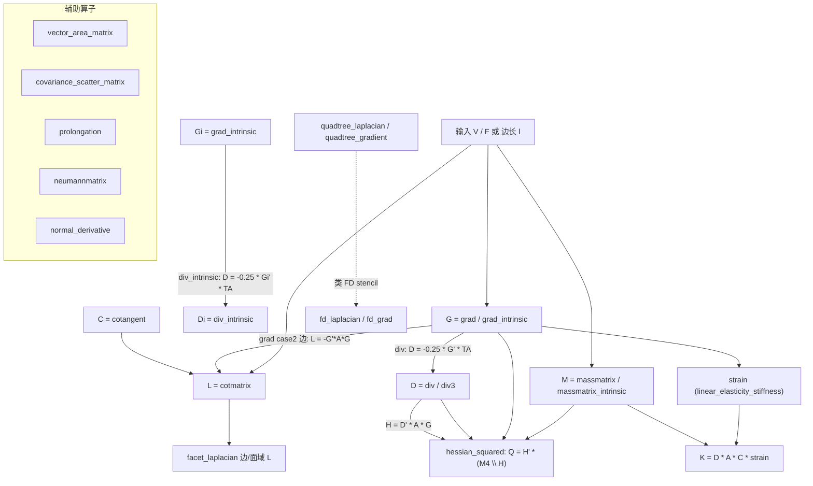

# 10-mesh / 05 离散微分几何算子 (Discrete Differential Geometry Operators)

> 本章覆盖 `mesh/` 下 **39 个离散微分几何（DDG）算子构造函数**，包括：
> 拉普拉斯（cotangent）、质量矩阵（mass）、梯度/散度（grad/div）、法向导数、
> 边/面域算子、quadtree 有限差分算子、半边有限元系数、数值积分（quadrature），
> 以及线性弹性刚度/质量组装。
>
> This chapter documents **39 DDG operator constructors** under `mesh/`.

---

## 本章概览 / Chapter overview

### 1. 算子分类表 / Operator taxonomy

| 类别 (阶/Order) | 作用域 (Domain) | 定义域类型 (Simplex) | 函数 (Functions) | 备注 |
|---|---|---|---|---|
| 0 阶质量 / 0-order mass | 顶点 / vertex | 三角形 | `massmatrix`, `massmatrix_intrinsic`, `massmatrix_embedded` | `M` 质量矩阵 |
| 0 阶质量 / 0-order mass | 顶点 / vertex | 四面体 | `massmatrix` (ss=4), `massmatrix3` | `M`，四面体需 3D |
| 0 阶质量 / 0-order mass | 顶点 / vertex | 边/1D | `massmatrix` (ss=2) | `M` |
| 1 阶梯度 / 1-order gradient | 面 / face | 三角形/四面体 | `grad`, `grad3` | `G`，`#F*dim by #V` |
| 1 阶梯度（intrinsic）/ intrinsic grad | 面 / face | 三角形 | `grad_intrinsic` | 仅用边长 `l` |
| 1 阶散度 / 1-order divergence | 顶点 / vertex | 三角形/四面体 | `div`, `div3`, `divmatrix` | `D`，与 `G` 对偶 |
| 1 阶散度（intrinsic）/ intrinsic div | 顶点 / vertex | 三角形 | `div_intrinsic` | 仅用边长 `l` |
| 1 阶法向导数 / normal derivative | 半边 / half-edge | 三角形/四面体 | `normal_derivative` | `DD` |
| 1 阶 Neumann / Neum. BC | 边界顶点 / boundary | 2D 曲面 | `neumannmatrix` | 需 `hds` |
| 2 阶拉普拉斯 / 2-order Laplacian | 顶点 / vertex | 三角形 | `cotmatrix`, `cotmatrix_intrinsic`, `cotmatrix_embedded` | `L`（质量项已抵消） |
| 2 阶拉普拉斯 / 2-order Laplacian | 顶点 / vertex | 四面体 | `cotmatrix` (ss=4), `cotmatrix3` | `L` |
| 2 阶拉普拉斯 / 2-order Laplacian | 边/面域 / edge-facet | 三角形/四面体 | `facet_laplacian` | `#E by #V` 矩形算子 |
| 2 阶有限差分 / FD Laplacian | 网格节点 / grid node | 2D/3D 规则网格 | `fd_laplacian` | 负对角 |
| 1 阶有限差分 / FD gradient | 交错网格 / staggered | 2D/3D 规则网格 | `fd_grad` | `[Gx;Gy;...]` |
| 2 阶有限差分 / FD Laplacian | 四叉树叶节点 / quadtree leaf | quadtree | `quadtree_laplacian` | Bickel et al. 方案 |
| 1 阶有限差分 / FD gradient | 四叉树叶节点 / quadtree leaf | quadtree | `quadtree_gradient` | 中心差分 |
| 辅助 / helper | — | — | `cotangent` | 逐角余切 |
| 辅助 / helper | — | — | `covariance_scatter_matrix`, `group_sum_matrix`, `monotonicity_matrix`, `vector_area_matrix`, `prolongation` | ARAP/拓扑/面积/多重网格 |
| 辅助 / helper | — | — | `fd_bilinear_coefficients`, `fd_trilinear_coefficients`, `fd_plot_stencil` | 双/三线性插值、stencil 可视化 |
| 积分 / quadrature | — | 三角形 | `gauss_legendre_quadrature`, `quadrature_points` | 数值积分 |
| 力学 / mechanics | — | 三角形/四面体 | `hessian_squared`, `linear_elasticity`, `linear_elasticity_stiffness`, `stvk_modal_derivatives` | 二阶能量/弹性 |

**维度约定 / Intrinsic vs extrinsic vs embedded**

- **Extrinsic（外蕴）**：`cotmatrix` / `massmatrix` / `grad` / `div` 直接使用顶点坐标 `V`（支持 `dim=2` 或 `dim=3`，四面体要求 `dim=3`）。
- **Intrinsic（内蕴）**：`cotmatrix_intrinsic` / `massmatrix_intrinsic` / `grad_intrinsic` / `div_intrinsic` **只使用边长 `l`**（`#F by 3`，边编号与对角顶点一致：`l(:,1)` 为 23 边，`l(:,2)` 为 31 边，`l(:,3)` 为 12 边）。
- **Embedded（嵌入）**：`cotmatrix_embedded` / `massmatrix_embedded` 是「先在任意维空间算边长、再调用 intrinsic 版本」的包装器，将 `cotmatrix` / `massmatrix` 推广到 `size(V,2) ≠ 2,3` 的嵌入空间。

### 2. 算子关系图 / Operator relationships

> 下图中所有恒等式均**逐字取自源码**（见各条目「变量流动」），不引入源码未出现的公式。
> Every identity below is taken verbatim from the source.



### 3. 关于 `-M^{-1} G' M` 的说明 / Note on `-M^{-1} G' M`

源码头文件**并未**以 `D = -M^{-1} G' M` 形式书写对偶关系。实际实现为：

- `div.m`：`D = -0.25 * G' * repdiag(diag(sparse(dblvol)),dim)`（`dblvol` 为三角形双倍面积或四面体 2 倍体积）；
- `div_intrinsic.m`：`D = -0.25 * grad_intrinsic(l,F)' * repdiag(diag(doublearea_intrinsic(l)),2)`。

换言之，源码把"质量加权"折叠成对角面积矩阵 `TA`，而非显式求逆 `M^{-1}`。本文件不作超出源码的公式演绎。

### 4. MEX 依赖与纯 `.m` 确认 / MEX dependency and pure-`.m` check

- **39 个函数全部是纯 `.m` 实现**，均含 `function` 定义（已用 Grep 逐一确认；其中 `massmatrix.m`、`fd_grad.m`、`fd_laplacian.m`、`stvk_modal_derivatives.m` 另含**嵌套函数**，故 `function` 出现次数为 2）。
- **无一个函数本身是 MEX stub**。
- 但**两个函数通过依赖间接需要编译型 MEX**（`mex/` 下仅存在 `.m` 注释桩与 `.cpp`，`mesh/` 无对应 `.m`）：
  - `prolongation` → `in_element_aabb`（MEX）、`point_mesh_squared_distance`（MEX）；
  - `symmetric_dirichlet` → `psd_project_rows`（MEX）、`fast_sparse`（MEX）。
- 其余依赖（`edge_lengths`、`doublearea`、`volume`、`normals`、`boundary_faces`、`barycentric_coordinates`、`crouzeix_raviart_cotmatrix`、`arap_linear_block`、`min_quad_with_fixed`、`full_sparse`、`repdiag`、`minnz` 等）均存在纯 `.m` 实现。

---

## 逐函数条目 / Per-function entries

### `cotmatrix` — 余切拉普拉斯算子（余切权重，质量/面积项已抵消）
- **文件 / File**: [mesh/cotmatrix.m](file:///c:/VSWork/gptoolbox-1/mesh/cotmatrix.m#L1-L118)
- **签名 / Signature**: `L = cotmatrix(V,F)`
- **功能 / Purpose**: `EN: Computes the cotangent matrix (Laplacian mesh operator); mass/area terms already cancelled out.` / 中文：计算余切拉普拉斯矩阵，面积/质量项已在构造中抵消（纯几何构造）。
- **输入 / Inputs**:

  | 参数 | 尺寸/类型 | 含义 (中 / EN) |
  |---|---|---|
  | `V` | `#V by dim` | 顶点坐标（`dim=2` 或 `3`）/ vertex coordinates |
  | `F` | `#F by ss`，`ss∈{2,3,4}` | 单纯形索引（边/三角形/四面体）/ simplex indices |

- **输出 / Outputs**:

  | 参数 | 尺寸/类型 | 含义 |
  |---|---|---|
  | `L` | `sparse #V by #V` | 余切权重拉普拉斯 / cot-weight Laplacian |

- **可选参数 / Optional**: 无 / none（按 `size(F,2)` 三分支）。
- **变量流动 / Variable flow**:
  `V,F →(ss==2: A=diag(edge_lengths(V,F)); L=-G'*A*G)→ L`；
  `V,F →(ss==3: 边向量 v1,v2,v3 → 双倍面积 dblA → cot12,cot23,cot31 → 对角 diag1..3 → sparse(i,j,v))→ L`；
  `V,F →(ss==4: C=cotangent(V,F) → sparse 组装 + L':=L+L'; 对角:=L-diag(sum(L,2)))→ L`
- **算法步骤 / Algorithm**:
  1. `ss=size(F,2)`；`switch ss`。
  2. **case 2（边）**：`G=grad(V,F)`；`A=diag(sparse(edge_lengths(V,F)))`；`L=-G'*A*G`（L35–40）。
  3. **case 3（三角形）**：若 `size(F,1)==3` 给出转置告警；`F=F'`；`i1,i2,i3`；`v1=V(i3)-V(i2), v2=V(i1)-V(i3), v3=V(i2)-V(i1)`；按 `size(V,2)` 求无符号双倍面积 `dblA`（2D 行列式 / 3D 叉积模长）；`cot12=-dot(v1,v2)/dblA/2` 等（L77）；对角由行和为零（原文注释写作"rows sum up to 1"）给出 `diag1=-cot12-cot31` 等（L80）；用 `sparse(i,j,v,...)` 组装，重复 `(i,j)` 自动求和（L81–88）。
  4. **case 4（四面体）**：若 `size(F,1)==4` 告警；`C=cotangent(V,F)`（L96）；`L=sparse(F(:,[2 3 1 4 4 4]),F(:,[3 1 2 1 2 3]),C,n,n)`；`L=L+L'`；`L=L-diag(sum(L,2))`；若 `all(diag(L)>0)` 则翻转符号并告警（L101–116）。
- **流程图 / Flowchart**:

  ```mermaid
  flowchart TD
    A["输入 V,F"] --> B{"size(F,2)?"}
    B -- 2 --> C["G=grad; A=diag(edge_lengths); L=-G'*A*G"]
    B -- 3 --> D["F=F'; 边向量 v1,v2,v3 -> dblA"]
    D --> E["cot12,cot23,cot31; diag1..3"]
    E --> F["sparse(i,j,v) 组装"]
    B -- 4 --> G["C=cotangent(V,F)"]
    G --> H["L=L+L'; L=L-diag(sum(L,2))"]
    H --> I{"all(diag(L)>0)?"}
    I -- 是 --> J["L=-L 并告警"]
    C --> Z["输出 L"]
    F --> Z
    I -- 否 --> Z
    J --> Z
  ```
- **依赖 / Dependencies**: `grad`, `edge_lengths`, `cotangent`, `doublearea_intrinsic`(经 `cotangent`), `dihedral_angles`(经 `cotangent`), `volume_intrinsic`(经 `cotangent`)
- **See also**: `cotangent`, `cotmatrix_intrinsic`, `cotmatrix_embedded`, `massmatrix`

### `cotmatrix3` — （已废弃）四面体余切拉普拉斯包装器
- **文件 / File**: [mesh/cotmatrix3.m](file:///c:/VSWork/gptoolbox-1/mesh/cotmatrix3.m#L1-L33)
- **签名 / Signature**: `K = cotmatrix3(V,T)`
- **功能 / Purpose**: `EN: Deprecated wrapper that forwards to cotmatrix for tet meshes.` / 中文：已废弃，直接转调 `cotmatrix`。
- **输入 / Inputs**:

  | 参数 | 尺寸/类型 | 含义 (中 / EN) |
  |---|---|---|
  | `V` | `#V by 3` | 顶点坐标 / vertex coordinates |
  | `T` | `#T by 4` | 四面体索引 / tet indices |

- **输出 / Outputs**:

  | 参数 | 尺寸/类型 | 含义 |
  |---|---|---|
  | `K` | `#V by #V` | 余切权重矩阵 |

- **可选参数 / Optional**: 无 / none。
- **变量流动 / Variable flow**: `V,T →(warning Deprecated)→ cotmatrix(V,T) → K`
- **算法步骤 / Algorithm**:
  1. `warning('Deprecated. Call cotmatrix directly.')`。
  2. `K = cotmatrix(V,T)`。
- **流程图 / Flowchart**:

  ```mermaid
  flowchart TD
    A["输入 V,T"] --> B["warning Deprecated"] --> C["K = cotmatrix(V,T)"] --> Z["输出 K"]
  ```
- **依赖 / Dependencies**: `cotmatrix`
- **See also**: `cotmatrix`, `massmatrix3`

### `cotmatrix_embedded` — 嵌入网格余切拉普拉斯（intrinsic 包装器）
- **文件 / File**: [mesh/cotmatrix_embedded.m](file:///c:/VSWork/gptoolbox-1/mesh/cotmatrix_embedded.m#L1-L34)
- **签名 / Signature**: `L = cotmatrix_embedded(V,F)`
- **功能 / Purpose**: `EN: Cotangent Laplacian for a mesh embedded in size(V,2)-dim space; wrapper for cotmatrix_intrinsic.` / 中文：对嵌入在 `size(V,2)` 维空间的网格计算余切拉普拉斯，是 `cotmatrix_intrinsic` 的包装器。
- **输入 / Inputs**:

  | 参数 | 尺寸/类型 | 含义 (中 / EN) |
  |---|---|---|
  | `V` | `#V by dim` | 顶点坐标 / vertex coordinates |
  | `F` | `#F by 3` | 三角形索引 / triangle indices |

- **输出 / Outputs**:

  | 参数 | 尺寸/类型 | 含义 |
  |---|---|---|
  | `L` | `sparse #V by #V` | 余切权重矩阵 |

- **可选参数 / Optional**: 无 / none。
- **变量流动 / Variable flow**: `V,F →(逐面算三条边长 l)→ l → cotmatrix_intrinsic(l,F,#V) → L`
- **算法步骤 / Algorithm**:
  1. 按对角顶点编号算边长：`l(:,1)=|V(F2)-V(F3)|`、`l(:,2)=|V(F3)-V(F1)|`、`l(:,3)=|V(F1)-V(F2)|`（L28–32）。
  2. `L = cotmatrix_intrinsic(l,F,size(V,1))`（L33）。
- **流程图 / Flowchart**:

  ```mermaid
  flowchart TD
    A["输入 V,F"] --> B["逐面求边长 l: 23,31,12"] --> C["L = cotmatrix_intrinsic(l,F,#V)"] --> Z["输出 L"]
  ```
- **依赖 / Dependencies**: `cotmatrix_intrinsic`
- **See also**: `cotmatrix`, `cotmatrix_intrinsic`

### `cotmatrix_intrinsic` — 仅用边长的内蕴余切拉普拉斯
- **文件 / File**: [mesh/cotmatrix_intrinsic.m](file:///c:/VSWork/gptoolbox-1/mesh/cotmatrix_intrinsic.m#L1-L54)
- **签名 / Signature**: `L = cotmatrix_intrinsic(l,F,nvert)`
- **功能 / Purpose**: `EN: Compute cotangent Laplacian using edge lengths (not vertex positions).` / 中文：仅用边长构造余切拉普拉斯（不依赖顶点坐标）。
- **输入 / Inputs**:

  | 参数 | 尺寸/类型 | 含义 (中 / EN) |
  |---|---|---|
  | `l` | `#F by 3` | 与对角顶点编号一致的边长（23,31,12）/ edge lengths opposite each face corner |
  | `F` | `#F by 3` | 三角形索引 / triangle indices |
  | `nvert` | scalar | 顶点数，仅用于设定矩阵尺寸 / number of vertices |

- **输出 / Outputs**:

  | 参数 | 尺寸/类型 | 含义 |
  |---|---|---|
  | `L` | `sparse nvert by nvert` | 余切权重矩阵 |

- **可选参数 / Optional**: 无 / none。
- **变量流动 / Variable flow**: `l,F,nvert →(半周长 s → Heron 面积 dblA)→ cot12,cot23,cot31 →(对角 diag1..3)→ sparse(i,j,v,nvert,nvert) → L`
- **算法步骤 / Algorithm**:
  1. 若 `size(F,1)==3` 告警；`F=F'`（L25–28）。
  2. `l1,l2,l3 = l(:,1..3)`；半周长 `s=(l1+l2+l3)*0.5`（L34–36）。
  3. Heron 公式得 `dblA = 2*sqrt(s(s-l1)(s-l2)(s-l3))`（L38）。
  4. 由余弦定理：`cot12=(l1²+l2²-l3²)/dblA/4`，`cot23`、`cot31` 同理（L41–43）。
  5. 对角由行和为零得 `diag1=-cot12-cot31`、`diag2=-cot12-cot23`、`diag3=-cot31-cot23`（L46）。
  6. `sparse(i,j,v,nvert,nvert)` 组装（L48–53）。
- **流程图 / Flowchart**:

  ```mermaid
  flowchart TD
    A["输入 l,F,nvert"] --> B["F=F'"] --> C["半周长 s"]
    C --> D["Heron: dblA"] --> E["cot12,cot23,cot31"]
    E --> F["diag1..3"] --> G["sparse(i,j,v)"] --> Z["输出 L"]
  ```
- **依赖 / Dependencies**: 无（纯 `.m` 内部实现）
- **See also**: `cotmatrix`, `cotmatrix_embedded`, `massmatrix_intrinsic`

### `cotangent` — 逐角余切（三角形 3 列 / 四面体 6 列）
- **文件 / File**: [mesh/cotangent.m](file:///c:/VSWork/gptoolbox-1/mesh/cotangent.m#L1-L158)
- **签名 / Signature**: `C = cotangent(V,F,varargin)`
- **功能 / Purpose**: `EN: Compute cotangents of each angle in a mesh (V,F).` / 中文：计算网格每个"角"的余切；三角形返回 3 列，四面体返回 6 列（二面角相关量）。
- **输入 / Inputs**:

  | 参数 | 尺寸/类型 | 含义 (中 / EN) |
  |---|---|---|
  | `V` | `#V by dim` | 顶点坐标（当给出 `'SideLengths'` 时可忽略）/ vertex positions |
  | `F` | `#F by {3\|4}` | 三角形或四面体索引 / triangle or tet indices |

- **输出 / Outputs**:

  | 参数 | 尺寸/类型 | 含义 |
  |---|---|---|
  | `C` | `#F by {3\|6}` | 三角形：边 23,31,12 的角余切；四面体：`1/6 * l .* cos_theta ./ sin_theta`（注释标注已知 bug/口径不一致） |

- **可选参数 / Optional**:

  | 名称 | 取值 | 默认 | 含义 |
  |---|---|---|---|
  | `'SideLengths'` | `#F by 3`（三角）或 `#T by 6`（四面体，顺序 41 42 43 23 31 12） | `[]` | 直接给出边长，忽略 `V` |
  | `'FaceAreas'` | `#T by 4` | `[]`（由 `doublearea_intrinsic` 计算） | 四面体面面积（仅 ss==4） |

- **变量流动 / Variable flow**:
  三角：`V,F →(若未给 SideLengths 则算边长 l)→ l → 半周长/Heron dblA → C=[...]`；
  四面体：`V,T →(l=6 条棱; s=4 个面面积)→ dihedral_angles(SideLengths,FaceAreas)→ cos_theta; volume_intrinsic→vol → sin_theta → C=1/6*l.*cos_theta./sin_theta`
- **算法步骤 / Algorithm**:
  1. `switch size(F,2)`。
  2. **case 3**：参数解析用 `containers.Map({'SideLengths'},{'l'})` 并经 `assignin`（L41–56）；若 `l` 为空按对角顶点编号算边长（L61–65）；半周长 + Heron 面积（L70–72）；`C=[(l2²+l3²-l1²)/dblA/4, (l1²+l3²-l2²)/dblA/4, (l1²+l2²-l3²)/dblA/4]`（L75–79）。
  3. **case 4**：手写 `while` 解析 `'SideLengths'`、`'FaceAreas'`（L87–101）；边长顺序 41,42,43,23,31,12（L104–111）；面面积由 `doublearea_intrinsic` 计算（L115–119）；`dihedral_angles`（L122）；`volume_intrinsic`（L125）；`sin_theta = vol /((2./(3*l)) .* s([2 3 1 4 4 4]) .* s([3 1 2 1 2 3]))`（L144）；`C = 1/6 * l .* cos_theta ./ sin_theta`（L150）。
- **流程图 / Flowchart**:

  ```mermaid
  flowchart TD
    A["输入 V,F,varargin"] --> B{"size(F,2)?"}
    B -- 3 --> C["解析 SideLengths; 若空则算 l"]
    C --> D["s 半周长 -> dblA (Heron)"] --> E["C = 3 列余切"]
    B -- 4 --> F["解析 SideLengths / FaceAreas"]
    F --> G["dihedral_angles -> cos_theta"]
    G --> H["volume_intrinsic -> vol; sin_theta"]
    H --> I["C = 1/6*l.*cos_theta./sin_theta"]
    E --> Z["输出 C"]
    I --> Z
  ```
- **依赖 / Dependencies**: `doublearea_intrinsic`, `dihedral_angles`, `volume_intrinsic`
- **See also**: `cotmatrix`, `facet_laplacian`, `normal_derivative`

### `massmatrix` — 质量矩阵（full / barycentric / voronoi）
- **文件 / File**: [mesh/massmatrix.m](file:///c:/VSWork/gptoolbox-1/mesh/massmatrix.m#L1-L194)
- **签名 / Signature**: `M = massmatrix(V,F,type)`
- **功能 / Purpose**: `EN: Mass matrix for the mesh given by V and F.` / 中文：构造网格的质量矩阵，支持分片线性有限元满质量、集中（barycentric）与真实 Voronoi 面积三种类型。
- **输入 / Inputs**:

  | 参数 | 尺寸/类型 | 含义 (中 / EN) |
  |---|---|---|
  | `V` | `#V by {2\|3}` | 顶点坐标（ss==4 必须 3D）/ vertex positions |
  | `F` | `#F by ss`，`ss∈{2,3,4}` | 单纯形索引 / simplex indices |
  | `type` | `char` | 质量矩阵类型（**位置参数，非 varargin**）：`'full'`、`'barycentric'`、`'voronoi'` |

- **输出 / Outputs**:

  | 参数 | 尺寸/类型 | 含义 |
  |---|---|---|
  | `M` | `sparse #V by #V` | 质量矩阵 |

- **可选参数 / Optional**（第 3 位置参数 `type`，默认值随 `ss` 变化）:

  | 名称 | 取值 | 默认 | 含义 |
  |---|---|---|---|
  | `type` | `'full'` | — | 分片线性 FEM 满质量矩阵 / full p.w. linear FEM |
  | `type` | `'barycentric'` | `ss∈{2,4}` | 对角集中质量（求和 1/3 面积/体积）/ lumped diagonal |
  | `type` | `'voronoi'` | `ss==3` | 真实 Voronoi 面积；钝角三角形用 1/2,1/4,1/4（仅 ss==3）/ true Voronoi area |

  > 说明：源码中 `type` 以**全小写**字符串比较（`strcmp(type,'full')` 等），并非 `'Full'`/`'Voronoi'` 驼峰形式。默认分支（L31–38）：`ss==3 → 'voronoi'`，`ss∈{2,4} → 'barycentric'`。

- **变量流动 / Variable flow**:
  `ss==2: V,F → l=edge_lengths → 对角/满质量 spread`；
  `ss==3: V,F → 边向量 → dblA → {'full': off=dblA/24, diag=dblA/12 | 'barycentric': diag=dblA/6 | 'voronoi': l → massmatrix_intrinsic(...,'voronoi')} → M`；
  `ss==4: V,F → vol=|volume(V,F)| → {'full': vol/20 off, vol/10 diag | 'barycentric': vol/4 对角 | 'voronoi': 外心 cc → 各角部分体积 pv} → M`
- **算法步骤 / Algorithm**:
  1. 内嵌 `cross2` 辅助函数（L21–27）。
  2. `ss=size(F,2)`；`nargin<3` 时按 `ss` 设默认 `type`（L30–38）。
  3. **case 2**：`l=edge_lengths`；`'voronoi'/'barycentric'` 用 `M=sparse(F(:),F(:),[l l]/size(V,2),...)`（L45）；`'full'` 用 `[l/4 l/4 l/2 l/2]` 组装（L49–52）。
  4. **case 3**：`F=F'`；边向量 `v1,v2,v3`；2D/3D 求 `dblA`；`'full'`：off=`dblA/24`, diag=`dblA/12`（L79–88）；`'barycentric'`：diag=`dblA/6`（L89–95）；`'voronoi'`：算边长 `l` 后调 `massmatrix_intrinsic(l,F',#V,'voronoi')`（L96–107）。行全零告警（L113–115）。
  5. **case 4**：断言 `size(V,2)==3`；`'full'`：`I,J` 索引 + `[repmat(vol/20,1,12) repmat(vol/10,1,4)]`（L133–137）；`'barycentric'`：`sparse(F(:),F(:),repmat(|vol|,1,4)/4,...)`（L145–156）；`'voronoi'`：计算四面体外心 `cc` 与四角部分体积 `pv`，`M=sparse(F,F,pv,...)`（L157–188）。
- **流程图 / Flowchart**:

  ```mermaid
  flowchart TD
    A["输入 V,F,type"] --> B{"nargin<3?"}
    B -- 是 --> C["默认 type: ss==3 voronoi; 否则 barycentric"]
    B -- 否 --> D["使用给定 type"]
    C --> E{"size(F,2)?"}
    D --> E
    E -- 2 --> F["l=edge_lengths; 按 type 组装"]
    E -- 3 --> G["dblA; full/barycentric/voronoi"]
    E -- 4 --> H{"type?"}
    H -- full --> I["vol/20 与 vol/10"]
    H -- barycentric --> J["vol/4 对角"]
    H -- voronoi --> K["外心 cc; 部分体积 pv"]
    F --> Z["输出 M"]
    G --> Z
    I --> Z
    J --> Z
    K --> Z
  ```
- **依赖 / Dependencies**: `edge_lengths`, `massmatrix_intrinsic`, `volume`
- **See also**: `massmatrix_intrinsic`, `massmatrix_embedded`, `cotmatrix`, `barycentric_massmatrix`

### `massmatrix3` — （已废弃）四面体质量矩阵包装器
- **文件 / File**: [mesh/massmatrix3.m](file:///c:/VSWork/gptoolbox-1/mesh/massmatrix3.m#L1-L25)
- **签名 / Signature**: `M = massmatrix3(V,T,type)`
- **功能 / Purpose**: `EN: Deprecated wrapper forwarding to massmatrix.` / 中文：已废弃，转调 `massmatrix`。
- **输入 / Inputs**:

  | 参数 | 尺寸/类型 | 含义 (中 / EN) |
  |---|---|---|
  | `V` | `#V by 3` | 顶点坐标 |
  | `T` | `#T by 4` | 四面体索引 |
  | `type` | `char` | 类型（`'barycentric'` 已支持；`'full'`/`'voronoi'` 源码标注未支持） |

- **输出 / Outputs**:

  | 参数 | 尺寸/类型 | 含义 |
  |---|---|---|
  | `M` | `#V by #V` | 质量矩阵 |

- **可选参数 / Optional**: 同 `massmatrix` 的第 3 位置参数 `type`。
- **变量流动 / Variable flow**: `V,T,type →(warning Deprecated)→ massmatrix(V,T,type) → M`
- **算法步骤 / Algorithm**:
  1. `warning('Deprecated. Call massmatrix directly')`。
  2. `M = massmatrix(V,T,type)`。
- **流程图 / Flowchart**:

  ```mermaid
  flowchart TD
    A["输入 V,T,type"] --> B["warning Deprecated"] --> C["M = massmatrix(V,T,type)"] --> Z["输出 M"]
  ```
- **依赖 / Dependencies**: `massmatrix`
- **See also**: `massmatrix`, `cotmatrix3`

### `massmatrix_embedded` — 嵌入网格质量矩阵（intrinsic 包装器）
- **文件 / File**: [mesh/massmatrix_embedded.m](file:///c:/VSWork/gptoolbox-1/mesh/massmatrix_embedded.m#L1-L39)
- **签名 / Signature**: `M = massmatrix_embedded(V,F,type)`
- **功能 / Purpose**: `EN: Mass matrix for a mesh embedded in size(V,2)-dim space; wrapper for massmatrix_intrinsic.` / 中文：对嵌入网格计算质量矩阵，是 `massmatrix_intrinsic` 的包装器。
- **输入 / Inputs**:

  | 参数 | 尺寸/类型 | 含义 (中 / EN) |
  |---|---|---|
  | `V` | `#V by dim` | 顶点坐标 |
  | `F` | `#F by 3` | 三角形索引 |
  | `type` | `char` | `'full'` / `'barycentric'` / `'voronoi'` |

- **输出 / Outputs**:

  | 参数 | 尺寸/类型 | 含义 |
  |---|---|---|
  | `M` | `sparse #V by #V` | 质量矩阵 |

- **可选参数 / Optional**: 第 3 位置参数 `type`（同 `massmatrix`）。
- **变量流动 / Variable flow**: `V,F,type →(算边长 l)→ l → massmatrix_intrinsic(l,F,#V,type) → M`
- **算法步骤 / Algorithm**:
  1. 按对角顶点编号算边长 `l`（L32–36）。
  2. `M = massmatrix_intrinsic(l,F,size(V,1),type)`（L37）。
- **流程图 / Flowchart**:

  ```mermaid
  flowchart TD
    A["输入 V,F,type"] --> B["算边长 l"] --> C["M = massmatrix_intrinsic(l,F,#V,type)"] --> Z["输出 M"]
  ```
- **依赖 / Dependencies**: `massmatrix_intrinsic`
- **See also**: `massmatrix`, `massmatrix_intrinsic`

### `massmatrix_intrinsic` — 仅用边长的内蕴质量矩阵
- **文件 / File**: [mesh/massmatrix_intrinsic.m](file:///c:/VSWork/gptoolbox-1/mesh/massmatrix_intrinsic.m#L1-L86)
- **签名 / Signature**: `M = massmatrix_intrinsic(l,F,nvert,masstype)`
- **功能 / Purpose**: `EN: Compute the mass matrix from edge lengths only.` / 中文：仅由边长计算质量矩阵（与 `massmatrix` 几乎相同，仅面积计算方式不同）。
- **输入 / Inputs**:

  | 参数 | 尺寸/类型 | 含义 (中 / EN) |
  |---|---|---|
  | `l` | `#F by 3` | 边长 / edge lengths |
  | `F` | `#F by 3` | 三角形索引 |
  | `nvert` | scalar | 顶点数（设定尺寸） |
  | `masstype` | `char` | `'full'` / `'barycentric'` / `'voronoi'` |

- **输出 / Outputs**:

  | 参数 | 尺寸/类型 | 含义 |
  |---|---|---|
  | `M` | `sparse nvert by nvert` | 质量矩阵 |

- **可选参数 / Optional**: 第 4 位置参数 `masstype`（无默认，必须给出）。
- **变量流动 / Variable flow**: `l,F →(Heron: dblA)→ {full: dblA/24 off, dblA/12 diag | barycentric: dblA/6 | voronoi: cosines → barycentric → normalized → partial_triangle_areas → quads（钝角分支）} → sparse(i,j,v,nvert,nvert) → M`
- **算法步骤 / Algorithm**:
  1. `F=F'`；`l1,l2,l3`；半周长 `s`；Heron 面积 `dblA`（L26–33）。
  2. `'full'`：off=`dblA/24`、diag=`dblA/12`（L38–46）。
  3. `'barycentric'`：diag=`dblA/6`（L47–52）。
  4. `'voronoi'`：由余弦定理算 `cosines`（L54–57）；`barycentric=cosines.*l`；归一化；`areas=0.5*doublearea_intrinsic(l,0)`（注意第二参数 0，用于 clamp 避免 sqrt 复数）；`partial_triangle_areas`；`quads` 为相邻部分面积平均（L66–69）；对 `cosines(:,k)<0` 的钝角情形覆盖为 `[0.5,0.25,0.25]*areas` 转置形式（L71–76）；`v=reshape(quads,...)`。
  5. `sparse(i,j,v,nvert,nvert)`（L85）。
- **流程图 / Flowchart**:

  ```mermaid
  flowchart TD
    A["输入 l,F,nvert,masstype"] --> B["F=F'; s; Heron dblA"]
    B --> C{"masstype?"}
    C -- full --> D["off=dblA/24; diag=dblA/12"]
    C -- barycentric --> E["diag=dblA/6"]
    C -- voronoi --> F["cosines -> normalized barycentric"]
    F --> G["partial areas -> quads"]
    G --> H{"钝角 cos<0?"}
    H -- 是 --> I["覆盖为 0.5/0.25/0.25 面积"]
    H -- 否 --> J["保持 quads"]
    D --> Z["sparse -> 输出 M"]
    E --> Z
    I --> Z
    J --> Z
  ```
- **依赖 / Dependencies**: `doublearea_intrinsic`
- **See also**: `massmatrix`, `massmatrix_embedded`, `cotmatrix_intrinsic`

### `grad` — 梯度算子（三角形 / 四面体）
- **文件 / File**: [mesh/grad.m](file:///c:/VSWork/gptoolbox-1/mesh/grad.m#L1-L190)
- **签名 / Signature**: `G = grad(V,F)`
- **功能 / Purpose**: `EN: Compute the numerical gradient operator for triangle or tet meshes.` / 中文：构造分片线性标量场的梯度算子（面域常数梯度）。
- **输入 / Inputs**:

  | 参数 | 尺寸/类型 | 含义 (中 / EN) |
  |---|---|---|
  | `V` | `#V by dim` | 顶点坐标 |
  | `F` | `#F by ss`，`ss∈{2,3,4}` | 边/三角形/四面体索引 |

- **输出 / Outputs**:

  | 参数 | 尺寸/类型 | 含义 |
  |---|---|---|
  | `G` | `ss*dim by #V`（即 `#F*dim by #V`） | 梯度算子 `[Gx;Gy;(Gz)]` |

- **可选参数 / Optional**: 无 / none。
- **变量流动 / Variable flow**:
  `ss==2: V,F → len=normrow(V2-V1) → G=sparse(...,[1 -1]./len,...)`（交错网格一阶差分）；
  `ss==3: V,F → 边向量 v32,v13,v21 → n=cross(v32,v13) → dblA=normrow(n) → u=normalizerow(n) → eperp21=cross(u,v21)/dblA, eperp13=cross(u,v13)/dblA → sparse(GI,GJ,GV,3#F,#V) → G`；
  `ss==4: V,T → 四个面 A=doublearea/2, N=normalizerow(normals), vol=volume → GV=repmat(A./(3*vol),3,1).*N(:) → sparse(...) → G`
- **算法步骤 / Algorithm**:
  1. `dim=size(V,2)`；`switch size(F,2)`。
  2. **case 2**：`len=|V(F2)-V(F1)|`；`G=sparse(repmat(1:#F,2,1)',F,[1 -1]./len,#F,#V)`（L29–31）。
  3. **case 3**：若 dim==2 补零到 3 列（L34–36）；算 `v32,v13,v21`；`n=cross(v32,v13,2)`；`dblA=normrow(n)`；`u=normalizerow(n)`；`eperp21=bsxfun(@times,cross(u,v21),1./dblA)`、`eperp13` 同理（L66–67）；用 `GI,GJ,GV` 组装 `G`；若原本 `dim==2` 则截断为前 `#F*dim` 行（L109–111）。
  4. **case 4**：`T=F`，断言 `dim==3`；若 `m==1 && ~isnumeric(V)` 走**符号**分支（`sym('P')` + `jacobian`）直接返回（L133–155）；否则取 4 个面、`A=doublearea(V,F)/2`、`N=normalizerow(normals(V,F))`、`vol=volume(V,T)`；`GV=repmat(A./(3*repmat(vol,4,1)),3,1).*N(:)`；`sparse(GI,GJ,GV,3*m,n)`（L168–187）。
- **流程图 / Flowchart**:

  ```mermaid
  flowchart TD
    A["输入 V,F"] --> B{"size(F,2)?"}
    B -- 2 --> C["len; G=[1 -1]./len 交错差分"]
    B -- 3 --> D["v32,v13,v21; n; dblA; u"]
    D --> E["eperp21, eperp13"]
    E --> F["sparse(GI,GJ,GV)"]
    F --> G{"dim==2?"}
    G -- 是 --> H["截断前 #F*dim 行"]
    B -- 4 --> I{"m==1 且 V 非数值?"}
    I -- 是 --> J["符号 jacobian 直接返回"]
    I -- 否 --> K["面 A; 法向 N; vol"]
    K --> L["GV=A./(3vol).*N"]
    C --> Z["输出 G"]
    H --> Z
    L --> Z
    J --> Z
  ```
- **依赖 / Dependencies**: `normrow`, `normalizerow`, `doublearea`, `normals`, `volume`
- **See also**: `div`, `grad_intrinsic`, `cotmatrix`, `hessian_squared`

### `grad3` — （已废弃）四面体梯度包装器
- **文件 / File**: [mesh/grad3.m](file:///c:/VSWork/gptoolbox-1/mesh/grad3.m#L1-L21)
- **签名 / Signature**: `G = grad3(V,T)`
- **功能 / Purpose**: `EN: Deprecated wrapper forwarding to grad.` / 中文：已废弃，转调 `grad`。
- **输入 / Inputs**:

  | 参数 | 尺寸/类型 | 含义 (中 / EN) |
  |---|---|---|
  | `V` | `#V by 3` | 顶点坐标 |
  | `T` | `#T by 4` | 四面体索引 |

- **输出 / Outputs**:

  | 参数 | 尺寸/类型 | 含义 |
  |---|---|---|
  | `G` | `#T*3 by #V` | 梯度算子 |

- **可选参数 / Optional**: 无 / none。
- **变量流动 / Variable flow**: `V,T →(warning Deprecated)→ grad(V,T) → G`
- **算法步骤 / Algorithm**:
  1. `warning('Deprecated. Call grad directly.')`。
  2. `G = grad(V,T)`。
- **流程图 / Flowchart**:

  ```mermaid
  flowchart TD
    A["输入 V,T"] --> B["warning Deprecated"] --> C["G = grad(V,T)"] --> Z["输出 G"]
  ```
- **依赖 / Dependencies**: `grad`
- **See also**: `grad`, `div3`

### `grad_intrinsic` — 内蕴梯度算子（仅用边长）
- **文件 / File**: [mesh/grad_intrinsic.m](file:///c:/VSWork/gptoolbox-1/mesh/grad_intrinsic.m#L1-L23)
- **签名 / Signature**: `G = grad_intrinsic(l,F)`
- **功能 / Purpose**: `EN: Construct an intrinsic gradient operator from edge lengths.` / 中文：仅用边长构造内蕴梯度算子。
- **输入 / Inputs**:

  | 参数 | 尺寸/类型 | 含义 (中 / EN) |
  |---|---|---|
  | `l` | `#F by 3` | 边长（`l(:,1)` 为 23 边）/ edge lengths |
  | `F` | `#F by 3` | 三角形索引 |

- **输出 / Outputs**:

  | 参数 | 尺寸/类型 | 含义 |
  |---|---|---|
  | `G` | `#F*2 by #V` | `G=[Gx;Gy]`，`x` 沿 23 边，`y` 为逆时针 90° 方向 |

- **可选参数 / Optional**: 无 / none。
- **变量流动 / Variable flow**: `l,F → x=(l2²-l1²-l3²)/(-2 l1); y=sqrt(l3²-x²) → V2=[x y;Z Z;l1 Z]; F2=reshape(1:3m,m,3) → G2=grad(V2,F2); P=sparse(F2,F,1,3m,n) → G=G2*P`
- **算法步骤 / Algorithm**:
  1. 由余弦定理把每个三角形嵌入 2D：`x=(l(:,2).^2-l(:,1).^2-l(:,3).^2)./(-2.*l(:,1))`；`y=sqrt(l(:,3).^2-x.^2)`（L12–13）。
  2. 构造每个面独立的 2D 三角形顶点 `V2=[x y;Z Z;l(:,1) Z]` 与局部面索引 `F2=reshape(1:3*m,m,3)`（L17–18）。
  3. `G2=grad(V2,F2)`（复用外蕴梯度）。
  4. 用 `P=sparse(F2,F,1,m*3,n)` 把局部顶点映射回全局索引，`G=G2*P`（L20–21）。
- **流程图 / Flowchart**:

  ```mermaid
  flowchart TD
    A["输入 l,F"] --> B["x,y: 余弦定理展开到 2D"] --> C["V2,F2 每面局部"]
    C --> D["G2 = grad(V2,F2)"] --> E["P 局部->全局索引"] --> F["G = G2 * P"] --> Z["输出 G"]
  ```
- **依赖 / Dependencies**: `grad`
- **See also**: `grad`, `div_intrinsic`, `cotmatrix_intrinsic`

### `div` — 散度算子（与 `grad` 对偶）
- **文件 / File**: [mesh/div.m](file:///c:/VSWork/gptoolbox-1/mesh/div.m#L1-L60)
- **签名 / Signature**: `D = div(V,F)`
- **功能 / Purpose**: `EN: Compute the numerical divergence at each vertex of a vector field defined at each face.` / 中文：把定义在面上的向量场映射到顶点的散度。
- **输入 / Inputs**:

  | 参数 | 尺寸/类型 | 含义 (中 / EN) |
  |---|---|---|
  | `V` | `#V by dim` | 顶点坐标 |
  | `F` | `#F by ss`，`ss∈{3,4}` | 三角形/四面体索引 |

- **输出 / Outputs**:

  | 参数 | 尺寸/类型 | 含义 |
  |---|---|---|
  | `D` | `#V by #F*dim` | 散度算子（`DX = D*X(:)`） |

- **可选参数 / Optional**: 无 / none。
- **变量流动 / Variable flow**:
  `V,F → G=grad(V,F) →{ss==3: dblvol=doublearea(V,F) | ss==4: dblvol=2*volume(V,F)} → TA=repdiag(diag(sparse(dblvol)),dim) → D=-0.25*G'*TA`
- **算法步骤 / Algorithm**:
  1. 大量注释给出了**积分散度**的手工推导（L14–47），最终采用等价实现。
  2. `G=grad(V,F)`（L50）。
  3. `switch size(F,2)`：三角形 `dblvol=doublearea(V,F)`；四面体 `dblvol=2*volume(V,F)`（L51–56）。
  4. `TA=repdiag(diag(sparse(dblvol)),size(V,2))`；`D=-0.25*G'*TA`（L57–58）。
- **流程图 / Flowchart**:

  ```mermaid
  flowchart TD
    A["输入 V,F"] --> B["G = grad(V,F)"]
    B --> C{"size(F,2)?"}
    C -- 3 --> D["dblvol = doublearea"]
    C -- 4 --> E["dblvol = 2*volume"]
    D --> F["TA = repdiag(diag(dblvol),dim)"]
    E --> F
    F --> G["D = -0.25 * G' * TA"]
    G --> Z["输出 D"]
  ```
- **依赖 / Dependencies**: `grad`, `doublearea`, `volume`, `repdiag`
- **See also**: `grad`, `div3`, `div_intrinsic`, `divmatrix`

### `div3` — （已废弃）四面体散度包装器
- **文件 / File**: [mesh/div3.m](file:///c:/VSWork/gptoolbox-1/mesh/div3.m#L1-L20)
- **签名 / Signature**: `D = div3(V,T)`
- **功能 / Purpose**: `EN: Deprecated wrapper forwarding to div.` / 中文：已废弃，转调 `div`。
- **输入 / Inputs**:

  | 参数 | 尺寸/类型 | 含义 (中 / EN) |
  |---|---|---|
  | `V` | `#V by dim` | 顶点坐标 |
  | `T` | `#T by 3`（注释口径） | 四面体索引 |

- **输出 / Outputs**:

  | 参数 | 尺寸/类型 | 含义 |
  |---|---|---|
  | `D` | `#V by #T*3` | 散度算子 |

- **可选参数 / Optional**: 无 / none。
- **变量流动 / Variable flow**: `V,T →(warning Deprecated)→ div(V,T) → D`
- **算法步骤 / Algorithm**:
  1. `warning('Deprecated. Call grad directly.')`（原文如此）。
  2. `D = div(V,T)`。
- **流程图 / Flowchart**:

  ```mermaid
  flowchart TD
    A["输入 V,T"] --> B["warning Deprecated"] --> C["D = div(V,T)"] --> Z["输出 D"]
  ```
- **依赖 / Dependencies**: `div`
- **See also**: `div`, `grad3`

### `div_intrinsic` — 内蕴散度算子（仅用边长）
- **文件 / File**: [mesh/div_intrinsic.m](file:///c:/VSWork/gptoolbox-1/mesh/div_intrinsic.m#L1-L17)
- **签名 / Signature**: `D = div_intrinsic(l,F)`
- **功能 / Purpose**: `EN: Construct an intrinsic divergence operator.` / 中文：仅用边长构造内蕴散度算子。
- **输入 / Inputs**:

  | 参数 | 尺寸/类型 | 含义 (中 / EN) |
  |---|---|---|
  | `l` | `#F by 3` | 边长 |
  | `F` | `#F by 3` | 三角形索引 |

- **输出 / Outputs**:

  | 参数 | 尺寸/类型 | 含义 |
  |---|---|---|
  | `D` | `#V by #F*2` | 散度矩阵（注释写作 `G`） |

- **可选参数 / Optional**: 无 / none。
- **变量流动 / Variable flow**: `l,F → G=grad_intrinsic(l,F) → TA=repdiag(sparse(diag(doublearea_intrinsic(l))),2) → D=-0.25*G'*TA`
- **算法步骤 / Algorithm**:
  1. `G=grad_intrinsic(l,F)`（L13）。
  2. `TA=repdiag(sparse(diag(doublearea_intrinsic(l))),2)`（L14）。
  3. `D=-0.25*G'*TA`（L15）。
- **流程图 / Flowchart**:

  ```mermaid
  flowchart TD
    A["输入 l,F"] --> B["G = grad_intrinsic(l,F)"] --> C["TA = repdiag(diag(doublearea_intrinsic(l)),2)"] --> D["D = -0.25*G'*TA"] --> Z["输出 D"]
  ```
- **依赖 / Dependencies**: `grad_intrinsic`, `doublearea_intrinsic`, `repdiag`
- **See also**: `grad_intrinsic`, `div`

### `divmatrix` — （过时）逐边散度权重矩阵
- **文件 / File**: [mesh/divmatrix.m](file:///c:/VSWork/gptoolbox-1/mesh/divmatrix.m#L1-L19)
- **签名 / Signature**: `D = divmatrix(V,F)`
- **功能 / Purpose**: `EN: Obsolete vertex-by-vertex grad-weight matrix.` / 中文：过时接口，构造 `#V by #V` 的差分权重矩阵（正比于边长）。
- **输入 / Inputs**:

  | 参数 | 尺寸/类型 | 含义 (中 / EN) |
  |---|---|---|
  | `V` | `#V by 3` | 顶点坐标 |
  | `F` | `3 by #F`（注释口径） | 三角形索引 |

- **输出 / Outputs**:

  | 参数 | 尺寸/类型 | 含义 |
  |---|---|---|
  | `D` | `#V by #V` | 逐边权重稀疏矩阵 |

- **可选参数 / Optional**: 无 / none。
- **变量回顾 / Variable flow**: `V,F → FT=F'; E=unique(sort(边三组),'rows') → norms=|V(E1)-V(E2)| → sparse(i,j,[norms norms -norms -norms]) → D`
- **算法步骤 / Algorithm**:
  1. `warning('Obsolete, use div instead')`。
  2. `FT=F'`；由三组边 `[FT1 FT2;FT2 FT3;FT3 FT1]` 排序去重得 `E`（L9–12）。
  3. `norms=|V(E(:,1))-V(E(:,2))|`；`i=[E1 E2 E1 E2]`、`j=[E2 E1 E1 E2]`、`v=[norms norms -norms -norms]`；`sparse(i,j,v,#V,#V)`（L13–18）。
- **流程图 / Flowchart**:

  ```mermaid
  flowchart TD
    A["输入 V,F"] --> B["warning Obsolete"] --> C["E = unique 边"] --> D["norms = 边长"] --> E["sparse(i,j,[norms -norms])"] --> Z["输出 D"]
  ```
- **依赖 / Dependencies**: 无（纯 `.m` 内部实现）
- **See also**: `div`, `grad`

### `normal_derivative` — 沿（半）边方向的法向导数算子
- **文件 / File**: [mesh/normal_derivative.m](file:///c:/VSWork/gptoolbox-1/mesh/normal_derivative.m#L1-L115)
- **签名 / Signature**: `[DD,E] = normal_derivative(V,F)`
- **功能 / Purpose**: `EN: Computes the directional derivative normal to all (half-)edges of a triangle mesh (integrated along the edge).` / 中文：计算对**所有**（半）边法向的方向导数（沿边积分：逐面常数梯度点乘旋转后的边向量）。
- **输入 / Inputs**:

  | 参数 | 尺寸/类型 | 含义 (中 / EN) |
  |---|---|---|
  | `V` | `#V by dim` | 顶点坐标 |
  | `F` | `#F by ss`，`ss∈{3,4}` | 三角形/四面体索引 |

- **输出 / Outputs**:

  | 参数 | 尺寸/类型 | 含义 |
  |---|---|---|
  | `DD` | `#F*ss by #V` | 逐面逐边方向导数算子（三角形为 `#F*3 by #V`，四面体为 `#F*4 by #V`；三角形次序为所有 23、再 31、再 12） |
  | `E` | `#F*ss by 2` | 与 `DD`、`N` 匹配的边向量列表 |

- **可选参数 / Optional**: 无 / none（注释示例中提及第三个输出 `N`，但函数实际只返回两个）。
- **变量流动 / Variable flow**:
  `ss==4: C=cotangent(V,T); F=[T(:,[2 3 4]);T(:,[1 4 3]);T(:,[1 2 4]);T(:,[1 3 2])] → DD=2*sparse(...)*diag(repmat([1,-1],1,3*4)) → DD; E=F`；
  `ss==3: E=[F2 F3; F3 F1; F1 F2]; C=cotangent(V,F) → DD=2*sparse(...)*diag(repmat([1,-1],1,2*3))`
- **算法步骤 / Algorithm**:
  1. **case 4**：`T=F`；`C=cotangent(V,T)`；重排得到 4 个面的顶点三元组；用 `sparse(reshape(bsxfun(@plus,repmat(1:m,1,6)',m*(0:3)),m,6*4), T(:,[...]), C(:,[...]))` 组装再乘对角 `diag(repmat([1,-1],1,12))`，整体乘 2（L46–60）。
  2. **case 3**：`E` 为三条边；`C=cotangent(V,F)`；`DD=2*sparse(...m*3,#V)`（L77–90）。
  3. 文件中保留了等价的参考实现（基于 `grad`/`normals`）作为注释（L61–76、L91–113）。
- **流程图 / Flowchart**:

  ```mermaid
  flowchart TD
    A["输入 V,F"] --> B{"size(F,2)?"}
    B -- 3 --> C["E=[23;31;12]; C=cotangent"]
    C --> D["DD=2*sparse(...)*diag([1 -1])"]
    B -- 4 --> E["C=cotangent(V,T); 重排 4 面"]
    E --> F["DD=2*sparse(...)*diag([1 -1])"]
    D --> Z["输出 DD, E"]
    F --> Z
  ```
- **依赖 / Dependencies**: `cotangent`
- **See also**: `cotangent`, `grad`, `neumannmatrix`

### `neumannmatrix` — Neumann 边界条件矩阵
- **文件 / File**: [mesh/neumannmatrix.m](file:///c:/VSWork/gptoolbox-1/mesh/neumannmatrix.m#L1-L49)
- **签名 / Signature**: `[Nu,Nv] = neumannmatrix(mmesh,V,nlayers)`
- **功能 / Purpose**: `EN: Computes matrices for computing Neumann boundary conditions.` / 中文：构造用于 Neumann 边界条件的矩阵，把边界顶点上给定的 `dx/du`、`dx/dv` 线性插值后计算 `<dx/dn, phi_j>` 加权和。
- **输入 / Inputs**:

  | 参数 | 尺寸/类型 | 含义 (中 / EN) |
  |---|---|---|
  | `mmesh` | `hds` 结构 | 半边网格表示，需含 `layers`/`interior`/`layershe`/`tail`/`tip`/`nvert` 字段 / hds mesh |
  | `V` | `#V by dim` | 顶点坐标 |
  | `nlayers` | scalar | 使用第几个 layer |

- **输出 / Outputs**:

  | 参数 | 尺寸/类型 | 含义 |
  |---|---|---|
  | `Nu` | `sparse #V by #V` | u 方向 Neumann 矩阵（仅边界行列非零，索引与原网格一致） |
  | `Nv` | `sparse #V by #V` | v 方向 Neumann 矩阵 |

- **可选参数 / Optional**: 无 / none。
- **变量流动 / Variable flow**:
  `mmesh,V,nlayers → N0=layers{nlayers}; N0he=layershe{nlayers} → tails=mmesh.tail(N0he)', tips=mmesh.tip(N0he)' → p1,p2 → e=p2-p1 → eperp=[e2,-e1] → i,j 与 val_u=eperp(:,1)/6 或 /3, val_v=eperp(:,2)/6 或 /3 → Nu,Nv`
- **算法步骤 / Algorithm**:
  1. 从 `mmesh` 取第 `nlayers` 层的边：`tails`、`tips`（L25–31）。
  2. `p1=V(tails,:)`、`p2=V(tips,:)`；`e=p2-p1`；`eperp=[e(:,2),-e(:,1)]`（L32–35）。
  3. 稀疏索引 `i=[tails tips tips tails]`、`j=[tips tails tips tails]`（L38–39）。
  4. 权重：非对角为 `eperp/6`，对角为 `eperp/3`（L44–45）；`Nu=sparse(i,j,val_u,mmesh.nvert,mmesh.nvert)`、`Nv` 同理（L46–47）。
- **流程图 / Flowchart**:

  ```mermaid
  flowchart TD
    A["输入 mmesh,V,nlayers"] --> B["取 layer 边 tails/tips"] --> C["e=p2-p1; eperp"] --> D["i,j 索引"] --> E["val_u,val_v: /6 与 /3"] --> F["sparse -> Nu,Nv"] --> Z["输出 Nu,Nv"]
  ```
- **依赖 / Dependencies**: 依赖 `hds` 网格结构（字段约定），未直接调用其它同库函数
- **See also**: `hds`, `normal_derivative`

### `facet_laplacian` — 边/面域拉普拉斯（`#E by #V` 矩形算子）
- **文件 / File**: [mesh/facet_laplacian.m](file:///c:/VSWork/gptoolbox-1/mesh/facet_laplacian.m#L1-L101)
- **签名 / Signature**: `[L,E] = facet_laplacian(V,F)`
- **功能 / Purpose**: `EN: Builds an edge-based Laplacian L, an #E by #V rectangular matrix mapping vertex scalar functions to Laplacian values living at edges (facets for tets).` / 中文：构造"基于边"的拉普拉斯，把顶点标量场映射到边上的拉普拉斯值（四面体时"边"变为"面/facet"）。
- **输入 / Inputs**:

  | 参数 | 尺寸/类型 | 含义 (中 / EN) |
  |---|---|---|
  | `V` | `#V by dim` | 顶点坐标 |
  | `F` | `#F by element-size` | 三角形/四面体索引 |

- **输出 / Outputs**:

  | 参数 | 尺寸/类型 | 含义 |
  |---|---|---|
  | `L` | `#E by #V` | 边域拉普拉斯 |
  | `E` | `#E by 2` | 边列表 |

- **可选参数 / Optional**: 无 / none。
- **变量流动 / Variable flow**:
  `ss==3: V,F → C=cotangent(V,F) → F2E=reshape(1:3m,m,3) → LI,LJ,LV=[C2+C3,-C3,-C2; ...] → L=sparse(LI,LJ,LV,3m,n) → allE=[23;31;12]; [E,~,EMAP]=unique(sort(allE,2),'rows') → L=sparse(EMAP,F2E(:),1,#E,3m)*L`；
  `ss==4: → [Lcr,E]=crouzeix_raviart_cotmatrix(V,F); A=sparse(边->顶点); Df=diag(sum(A,2)); L=0.5*3*Lcr*(Df\A)`
- **算法步骤 / Algorithm**:
  1. **case 3**：`n=#V`、`m=#F`；`C=cotangent(V,F)`；`F2E=reshape(1:3*m,m,3)`（把每个面-边映射到唯一局部索引）；按三行组装 `LI/LJ/LV`（对角为 `C(:,2)+C(:,3)`，非对角为 `-C(:,3)`、`-C(:,2)` 等，L60–65）；`L=sparse(LI,LJ,LV,3*m,n)`；`allE=[F23;F31;F12]`；`[E,~,EMAP]=unique(sort(allE,2),'rows')`；`L=sparse(EMAP,F2E(:),1,#E,3*m)*L`（L79–85）。注释指出边界边只积分"半个 butterfly" ⇒ 相当于 **负法向导数**（L87–91）。
  2. **case 4**：调 `crouzeix_raviart_cotmatrix`；用 `A`（`#E by #V` 关联）构造对角 `Df`；`L=0.5*3*Lcr*(Df\A)`（L92–98），`0.5*3` 为与三角形版本对齐的 legacy 因子。
- **流程图 / Flowchart**:

  ```mermaid
  flowchart TD
    A["输入 V,F"] --> B{"size(F,2)?"}
    B -- 3 --> C["C=cotangent; F2E"]
    C --> D["组装 LI,LJ,LV -> L 3m by n"]
    D --> E["unique 边 -> EMAP"]
    E --> F["L = EMAP 聚合 * L  (#E by #V)"]
    B -- 4 --> G["crouzeix_raviart_cotmatrix -> Lcr,E"]
    G --> H["A 关联; Df=diag(sum(A,2))"]
    H --> I["L = 0.5*3*Lcr*(Df\\A)"]
    F --> Z["输出 L, E"]
    I --> Z
  ```
- **依赖 / Dependencies**: `cotangent`, `crouzeix_raviart_cotmatrix`
- **See also**: `crouzeix_raviart_cotmatrix`, `is_boundary_edge`, `cotmatrix`

### `quadtree_laplacian` — 四叉树有限差分拉普拉斯
- **文件 / File**: [mesh/quadtree_laplacian.m](file:///c:/VSWork/gptoolbox-1/mesh/quadtree_laplacian.m#L1-L142)
- **签名 / Signature**: `[L, stored_at] = quadtree_laplacian(C,W,CH,D,A)`
- **功能 / Purpose**: `EN: Builds a finite difference Laplacian on a quadtree following the scheme suggested by Bickel et al. "Adaptative Simulation of Electrical Discharges".` / 中文：按 Bickel 等人的自适应方案，在四叉树叶节点上构造有限差分拉普拉斯。
- **输入 / Inputs**:

  | 参数 | 尺寸/类型 | 含义 (中 / EN) |
  |---|---|---|
  | `C` | `#nodes by 3` | 单元中心 |
  | `W` | `#nodes` | 单元宽度（**非半宽**） |
  | `CH` | `#nodes by 4` | 子节点索引（叶节点为 `-1`） |
  | `D` | `#nodes` | 树深度 |
  | `A` | `sparse #nodes by #nodes` | 邻接矩阵，`(i,j)=a` 表示节点 j 位于 i 的第 a 个方向（1:left, 2:right, 3:bottom, 4:top） |

- **输出 / Outputs**:

  | 参数 | 尺寸/类型 | 含义 |
  |---|---|---|
  | `L` | `sparse #num_children by #num_children` | 拉普拉斯矩阵（负半定：源码注释 "THE LAPLACIAN IS NEGATIVE SEMI DEFINITE!"） |
  | `stored_at` | `#num_children by 3` | 存储 L 的子单元中心 `C(children,:)` |

- **可选参数 / Optional**: 无 / none。
- **变量流动 / Variable flow**:
  `C,W,CH,D,A → children=find(CH(:,1)==-1); cell_to_children 映射 → for each child: for j=1:4 找 j 方向最低深度邻居 → l(j)=(W(child)+W(neighbor))/2 → 系数 1/(l(1)(l(1)+l(2))) 等; 对角 1/(l(1)l(2))+1/(l(3)l(4)) → L=-2*sparse(I,J,vals,#children,#children)`
- **算法步骤 / Algorithm**:
  1. 叶节点 `children=find(CH(:,1)==-1)`；`cell_to_children` 映射（L63–66）。
  2. 对每个叶节点：从注释可读的差分式 `u(child+W*[1,0])/(hr(hl+hr)) - 2u(child)/(hl hr) + u(child-W*[1,0])/(hr(hl+hr))`（L82–86）出发，沿 `j=1:4` 找 `A(child,:)==j` 的邻居（L87–88）。
  3. 邻居深度 `<= d`：直接取该邻居，权重 `-1`，`l(j)=(W(child)+W(nbr))/2`（L96–104）；否则（graded 假设）取两个深度 `d+1` 邻居，各给 `-0.5`（L105–117）。
  4. 对角项 `+1.0`；系数按方向除以边长组合（`new_vals(new_dirs==1)=.../(l(1)*(l(1)+l(2)))` 等，L126–129），对角为 `1/(l(1)*l(2)) + 1/(l(3)*l(4))`（L130）。
  5. `L=-2*sparse(I,J,vals,#children,#children)`（整体系数 `-2`，L139）；`stored_at=C(children,:)`（L140）。
- **流程图 / Flowchart**:

  ```mermaid
  flowchart TD
    A["输入 C,W,CH,D,A"] --> B["children = 叶节点; cell_to_children"]
    B --> C{"遍历每个 child"}
    C --> D{"for j=1:4 找 j 方向邻居"}
    D -- 邻居深度 <= d --> E["取该邻居, 权重 -1; l(j) 平均宽度"]
    D -- 邻居更深 --> F["取两个 d+1 邻居, 各 -0.5"]
    E --> G["对角 +1; 系数除边长组合"]
    F --> G
    G --> C
    C --> H["L = -2*sparse(I,J,vals)"]
    H --> Z["输出 L, stored_at"]
  ```
- **依赖 / Dependencies**: 无（示例用到 `initialize_quadtree`、`bad_quad_mesh_from_quadtree`，非函数体依赖）
- **See also**: `quadtree_gradient`, `initialize_quadtree`, `fd_laplacian`

### `quadtree_gradient` — 四叉树中心差分梯度
- **文件 / File**: [mesh/quadtree_gradient.m](file:///c:/VSWork/gptoolbox-1/mesh/quadtree_gradient.m#L1-L162)
- **签名 / Signature**: `[G, stored_at] = quadtree_gradient(C,W,CH,D,A)`
- **功能 / Purpose**: `EN: Builds a finite difference gradient on a quadtree with a centered finite difference scheme (Bickel et al.).` / 中文：按 Bickel 等人的自适应方案，在四叉树叶节点上构造中心差分梯度。
- **输入 / Inputs**: 与 `quadtree_laplacian` 相同（`C,W,CH,D,A`）。

- **输出 / Outputs**:

  | 参数 | 尺寸/类型 | 含义 |
  |---|---|---|
  | `G` | `sparse 2*#num_children by #num_children` | 梯度矩阵（前 `#num_children` 行为 x 导数，后为 y 导数） |
  | `stored_at` | `#num_children by 3` | 子单元中心 |

- **可选参数 / Optional**: 无 / none。
- **变量流动 / Variable flow**:
  `... → 邻居搜索同 quadtree_laplacian → 方向 1/2: -1/(l1+l2), +1/(l1+l2); 方向 3/4: -1/(l3+l4), +1/(l3+l4) → 方向 3/4 的行号 += #children → G=sparse(I,J,vals,2*#children,#children)`
- **算法步骤 / Algorithm**:
  1. 同 `quadtree_laplacian` 的叶节点与邻居搜索（L73–132）。
  2. **边界/角点处理**：对 `l(j)==0`（无邻居）的方向，加自反 `+1.0`，使 stencil 在该方向由中心差分退化为前/后向差分（源码注释 "cheeky way ... backwards-forwards"，L133–142）。
  3. 符号与归一化：方向 1 为 `-v/(l1+l2)`、方向 2 为 `+v/(l1+l2)`、方向 3 为 `-v/(l3+l4)`、方向 4 为 `+v/(l3+l4)`（L144–147）。
  4. y 导数写入下半块：`new_I(new_dirs==3|4) += #children`（L148–150）。
  5. `G=sparse(I,J,vals,2*#children,#children)`；`stored_at=C(children,:)`（L159–160）。
- **流程图 / Flowchart**:

  ```mermaid
  flowchart TD
    A["输入 C,W,CH,D,A"] --> B["children; cell_to_children"]
    B --> C{"遍历每个 child: for j=1:4"}
    C -- 有邻居 --> D["取最低深度邻居, 权重 1"]
    C -- 无邻居 --> E["自反 +1, 前后向差分"]
    D --> F["方向 1..4 分别 /(l1+l2) 或 /(l3+l4), 带符号"]
    E --> F
    F --> G["方向 3/4 行号 += #children"]
    G --> C
    C --> H["G = sparse(I,J,vals,2#ch,#ch)"]
    H --> Z["输出 G, stored_at"]
  ```
- **依赖 / Dependencies**: 无（示例用 `initialize_quadtree`、`bad_quad_mesh_from_quadtree`）
- **See also**: `quadtree_laplacian`, `fd_grad`, `initialize_quadtree`

### `covariance_scatter_matrix` — ARAP 协方差散布矩阵
- **文件 / File**: [mesh/covariance_scatter_matrix.m](file:///c:/VSWork/gptoolbox-1/mesh/covariance_scatter_matrix.m#L1-L87)
- **签名 / Signature**: `CSM = covariance_scatter_matrix(V,F,varargin)`
- **功能 / Purpose**: `EN: Builds a scatter matrix for constructing the covariance matrices used in ARAP energy minimization.` / 中文：构造用于 ARAP 能量最小化的协方差散布矩阵（沿对角线含特殊拉普拉斯块，加速协方差计算）。
- **输入 / Inputs**:

  | 参数 | 尺寸/类型 | 含义 (中 / EN) |
  |---|---|---|
  | `V` | `#V by dim` | 初始顶点位置 |
  | `F` | `#F by simplex-size` | 三角形/四面体索引 |

- **输出 / Outputs**:

  | 参数 | 尺寸/类型 | 含义 |
  |---|---|---|
  | `CSM` | `sparse dim*nr by dim*n` | 散布矩阵；`nr` 为 best-fit 旋转个数（取决于 `energy`）；`CSM*repmat(U,dim,1)` 得到协方差矩阵元素 |

- **可选参数 / Optional**:

  | 名称 | 取值 | 默认 | 含义 |
  |---|---|---|---|
  | `'Energy'` | `'spokes'` | ✔ | 旋转定义在顶点（Sorkine & Alexa 2007） |
  | `'Energy'` | `'elements'` | | 旋转定义在单元（三角形/四面体上） |
  | `'Energy'` | `'spokes-and-rims'` | | 旋转定义在顶点，影响入射边与对边（Chao et al. 2010 / 4.2 节） |

- **变量流动 / Variable flow**:
  `V,F,'Energy' → nr(#V 或 #F) → KX=arap_linear_block(V,F,1,'Energy',energy); KY=...2... → Z=sparse(#V,nr) → dim==2: CSM=[KX Z;Z KY]'; dim==3: 再加 KZ → CSM=[KX Z Z;Z KY Z;Z Z KZ]'`
- **算法步骤 / Algorithm**:
  1. 解析 `varargin`（仅 `'Energy'`，L54–65）。
  2. 依 `energy` 设旋转数 `nr`：`spokes`/`spokes-and-rims` 为 `#V`，`elements` 为 `#F`（L68–75）。
  3. `KX=arap_linear_block(V,F,1,'Energy',energy)`；`KY=...2`（L77–78）。
  4. 按 `dim` 拼装 `CSM=[KX Z;Z KY]'`（2D）或 `[KX Z Z;Z KY Z;Z Z KZ]'`（3D，另加 `KZ`）（L80–85）。
- **流程图 / Flowchart**:

  ```mermaid
  flowchart TD
    A["输入 V,F,'Energy'"] --> B["解析 energy"]
    B --> C{"energy?"}
    C -- spokes/spokes-and-rims --> D["nr = #V"]
    C -- elements --> E["nr = #F"]
    D --> F["KX,KY(,KZ) = arap_linear_block"]
    E --> F
    F --> G{"dim?"}
    G -- 2 --> H["CSM=[KX Z;Z KY]'"]
    G -- 3 --> I["CSM=[KX Z Z;Z KY Z;Z Z KZ]'"]
    H --> Z["输出 CSM"]
    I --> Z
  ```
- **依赖 / Dependencies**: `arap_linear_block`
- **See also**: `arap_linear_block`, `arap`

### `group_sum_matrix` — 分组求和矩阵
- **文件 / File**: [mesh/group_sum_matrix.m](file:///c:/VSWork/gptoolbox-1/mesh/group_sum_matrix.m#L1-L30)
- **签名 / Signature**: `A = group_sum_matrix(G,k)`
- **功能 / Purpose**: `EN: Builds a matrix A such that A*V computes the sum of vertices in each group specified by G.` / 中文：构造矩阵 A，使 `A*V` 得到每组顶点之和。
- **输入 / Inputs**:

  | 参数 | 尺寸/类型 | 含义 (中 / EN) |
  |---|---|---|
  | `G` | `#V` 向量 | 每个顶点所属组索引（1..k） |
  | `k` | scalar | 组数，默认 `max(G)` |

- **输出 / Outputs**:

  | 参数 | 尺寸/类型 | 含义 |
  |---|---|---|
  | `A` | `sparse #groups by #V` | `A*V = group_sums` |

- **可选参数 / Optional**:

  | 名称 | 取值 | 默认 | 含义 |
  |---|---|---|---|
  | `k` | scalar | `max(G)` | 组数（第 2 位置参数） |

- **变量流动 / Variable flow**: `G,k → n=numel(G) → indices=1:n → A=sparse(G,indices,1,k,n)`
- **算法步骤 / Algorithm**:
  1. `n=numel(G)`；`if ~exist('k','var') k=max(G)`（L18–22）。
  2. `A=sparse(G,1:n,1,k,n)`（L28）。
- **流程图 / Flowchart**:

  ```mermaid
  flowchart TD
    A["输入 G,k"] --> B{"存在 k?"}
    B -- 否 --> C["k = max(G)"]
    B -- 是 --> D["使用给定 k"]
    C --> E["A = sparse(G,1:n,1,k,n)"]
    D --> E
    E --> Z["输出 A"]
  ```
- **依赖 / Dependencies**: 无
- **See also**: `centroid_matrix`, `adjacency_matrix`

### `monotonicity_matrix` — 单调性邻接矩阵（DAG）
- **文件 / File**: [mesh/monotonicity_matrix.m](file:///c:/VSWork/gptoolbox-1/mesh/monotonicity_matrix.m#L1-L138)
- **签名 / Signature**: `A = monotonicity_matrix(S,F,varargin)`
- **功能 / Purpose**: `EN: Computes a "monotonicity adjacency matrix" describing the directed acyclic monotonicity graph of [Weinkauf, Gingold, Sorkine 2010].` / 中文：计算描述有向无环"单调性图"的邻接矩阵，`A(i,j)` 非零当且仅当 `S(j)>S(i)`（j 是 i 的"父节点"），取值为 `S(j)-S(i)`。
- **输入 / Inputs**:

  | 参数 | 尺寸/类型 | 含义 (中 / EN) |
  |---|---|---|
  | `S` | `#V by 1` | 顶点标量值 |
  | `F` | `#F by 3` | 三角形索引 |

- **输出 / Outputs**:

  | 参数 | 尺寸/类型 | 含义 |
  |---|---|---|
  | `A` | `sparse #V by #V` | 单调性邻接矩阵（`S` 多列时返回 cell） |

- **可选参数 / Optional**:

  | 名称 | 取值 | 默认 | 含义 |
  |---|---|---|---|
  | `'OneInOneOut'` | `logical` | `false` | 是否限制每顶点至少一入一出 |
  | `'OneInOneOutPolicy'` | `'max'` | ✔ | 用最大差值添加两条边 |
  | `'OneInOneOutPolicy'` | `'min'` | | 用最小非零差值添加两条边 |
  | `'OneInOneOutPolicy'` | `'strict'` | | 类 max，再贪心移除多余弱边 |
  | `'EnforceExtrema'` | `logical` | `true` | 是否显式强制所有极值 |

- **变量流动 / Variable flow**:
  `S,F → (size(F,2)>2? E=edges(F): E=F) → E=[E;fliplr(E)] → 逐列: A{ii}=sparse(E1,E2,(S(E1)<S(E2)).*(S(E2)-S(E1)),n,n) → (one_in_one_out? 按 policy 修剪; enforce_extrema? sub2ind 强制局部极值) → A`
- **算法步骤 / Algorithm**:
  1. 解析可选参数（L42–60）。
  2. `size(F,2)>2` 时 `E=edges(F)`，否则 `E=F`；`E=[E;fliplr(E)]` 得到双向（L63–69）。
  3. 对 `S` 每列构造 `A{ii}=sparse(E1,E2,(S(E1)<S(E2)).*(S(E2)-S(E1)),n,n)`（L73–77）。
  4. 若 `one_in_one_out`：`'max'` 用 `max` 取上下各一条边（L80–83）；`'min'` 用 `minnz`（L84–87）；`'strict'` 走贪心修剪循环（L88–113）。
  5. 若 `enforce_extrema`：用 `local_max`/`local_min` 找到极值，`sub2ind` 强制相关边（L118–127）。
  6. `size(S,2)==1` 时解包为单个矩阵（L135–137）。
- **流程图 / Flowchart**:

  ```mermaid
  flowchart TD
    A["输入 S,F,va"] --> B["解析参数"]
    B --> C{"size(F,2)>2?"}
    C -- 是 --> D["E=edges(F)"]
    C -- 否 --> E["E=F"]
    D --> F["E=[E;fliplr(E)]"]
    E --> F
    F --> G["A = sparse(差分)"]
    G --> H{"one_in_one_out?"}
    H -- 是 --> I["按 policy max/min/strict 修剪"]
    H -- 否 --> J["跳过"]
    I --> K{"enforce_extrema?"}
    J --> K
    K -- 是 --> L["local_max/min 强制极值边"]
    K -- 否 --> M["跳过"]
    L --> Z["输出 A"]
    M --> Z
  ```
- **依赖 / Dependencies**: `edges`, `minnz`, `local_max`, `local_min`
- **See also**: `adjacency_matrix`, `topological_order`

### `vector_area_matrix` — 向量面积矩阵
- **文件 / File**: [mesh/vector_area_matrix.m](file:///c:/VSWork/gptoolbox-1/mesh/vector_area_matrix.m#L1-L31)
- **签名 / Signature**: `A = vector_area_matrix(F)`
- **功能 / Purpose**: `EN: Constructs the symmetric area matrix A such that V(:)'*A*V(:) is the vector area of (V,F).` / 中文：构造对称面积矩阵 A，使 `V(:)'*A*V(:)` 等于网格的向量面积。
- **输入 / Inputs**:

  | 参数 | 尺寸/类型 | 含义 (中 / EN) |
  |---|---|---|
  | `F` | `#F by 3` | 三角形索引 |

- **输出 / Outputs**:

  | 参数 | 尺寸/类型 | 含义 |
  |---|---|---|
  | `A` | `sparse #V*2 by #V*2` | 面积矩阵（作用于向量化的顶点） |

- **可选参数 / Optional**: 无 / none。
- **变量流动 / Variable flow**: `F → n=max(F(:)); O=outline(F) → A=sparse([O;O(:,[2 1])+n],[O(:,[2 1])+n;O],repmat([1 -1]/4,#O*2,1),2n,2n)`
- **算法步骤 / Algorithm**:
  1. `n=max(F(:))`；`O=outline(F)` 取边界边（L14–15）。
  2. 由向量面积的散度定理形式 `½∑_{ij∈∂Ω}[vi-vj]⟂[vi+vj]/2`（注释 L16–28）得到装配。
  3. `A=sparse([O;O(:,[2 1])+n],[O(:,[2 1])+n;O],repmat([1 -1]/4,#O*2,1),2*n,2*n)`（L29–30）。
- **流程图 / Flowchart**:

  ```mermaid
  flowchart TD
    A["输入 F"] --> B["n=max(F(:)); O=outline(F)"] --> C["按边界边 + 上下块偏移装配"] --> D["A = sparse(...,2n,2n)"] --> Z["输出 A"]
  ```
- **依赖 / Dependencies**: `outline`
- **See also**: `symmetric_dirichlet`, `outline`, `lscm`

### `prolongation` — 粗网格解到细网格的延拓算子
- **文件 / File**: [mesh/prolongation.m](file:///c:/VSWork/gptoolbox-1/mesh/prolongation.m#L1-L97)
- **签名 / Signature**: `P = prolongation(CV,CF,V,varargin)`
- **功能 / Purpose**: `EN: Build a linear prolongation operator taking solutions on a coarse mesh (CV,CF) and prolongating them onto vertices of a fine mesh V. Useful for multigrid and embedded mesh deformations.` / 中文：构造线性延拓算子，把粗网格 `(CV,CF)` 上的解上采样到细网格顶点 `V`；用于多重网格与嵌入网格变形。
- **输入 / Inputs**:

  | 参数 | 尺寸/类型 | 含义 (中 / EN) |
  |---|---|---|
  | `CV` | `#CV by dim` | 粗网格顶点 |
  | `CF` | `#CF by dim+1` | 粗网格单元索引（三角形/四面体） |
  | `V` | `#V by dim` | 细网格顶点 |

- **输出 / Outputs**:

  | 参数 | 尺寸/类型 | 含义 |
  |---|---|---|
  | `P` | `sparse #V by #CV` | 延拓矩阵，`X=P*CX` |

- **可选参数 / Optional**:

  | 名称 | 取值 | 默认 | 含义 |
  |---|---|---|---|
  | `'Extrapolation'` | `'linear'` | ✔ | 找最近单元并用重心坐标（可为负权），线性精确 |
  | `'Extrapolation'` | `'constant'` | | 找最近点取其重心坐标（非负），仅常量精确 |

- **变量流动 / Variable flow**:
  `CV,CF,V → I=in_element_aabb(CV,CF,V); I0=find(I==0) → 解析 Extrapolation →{CF 4 列: BF=boundary_faces; 对 I0 用 point_mesh_squared_distance 吸附 → B=barycentric_coordinates(4点) | CF 3 列: 补 3D 后同上用 3 点} → P=sparse(repmat(1:#V,ss,1)', CF(IV,:), B, #V, #CV)`
- **算法步骤 / Algorithm**:
  1. `I=in_element_aabb(CV,CF,V)`；`I0=find(I==0)`（外包顶点）（L25–26）。
  2. 解析 `'Extrapolation'`（默认 `'linear'`，L27–44）。
  3. **CF 4 列（四面体）**：`[BF,BJ,BK]=boundary_faces(CF)`；对 `I0` 用 `point_mesh_squared_distance(V(I0,:),CV,BF)` 吸附到边界，`I(I0)=BJ(BI)`；`'constant'` 时把 `BV(I0,:)` 换为最近点；取 `IV=max(I,[],2)`；用 `barycentric_coordinates(...,4 点)` 得 `B`（L46–67）。
  4. **CF 3 列（三角形）**：临时补零到 3D；`[~,I(I0),pBVI0]=point_mesh_squared_distance(pV(I0,:),pCV,CF)`；用 `barycentric_coordinates(...,3 点)` 得 `B`（L68–90）。
  5. `P=sparse(repmat(1:#V,ss,1)', CF(IV,:), B, #V, #CV)`（L92–96）。
- **流程图 / Flowchart**:

  ```mermaid
  flowchart TD
    A["输入 CV,CF,V,'Extrapolation'"] --> B["I=in_element_aabb; I0=find(I==0)"]
    B --> C{"size(CF,2)?"}
    C -- 4 --> D["BF=boundary_faces; 吸附 I0"]
    D --> E["barycentric_coordinates(4 点) -> B"]
    C -- 3 --> F["补 3D; point_mesh_squared_distance 吸附"]
    F --> G["barycentric_coordinates(3 点) -> B"]
    E --> H["P = sparse(...,CF(IV,:),B)"]
    G --> H
    H --> Z["输出 P"]
  ```
- **依赖 / Dependencies**: `in_element_aabb` **[MEX]**, `boundary_faces`, `point_mesh_squared_distance` **[MEX]**, `barycentric_coordinates`
- **See also**: `in_element_aabb`, `barycentric_coordinates`, `point_mesh_squared_distance`

### `symmetric_dirichlet` — 对称 Dirichlet 能量（值/梯度/Hessian）
- **文件 / File**: [mesh/symmetric_dirichlet.m](file:///c:/VSWork/gptoolbox-1/mesh/symmetric_dirichlet.m#L1-L134)
- **签名 / Signature**: `[f,G,H] = symmetric_dirichlet(U,F,P,varargin)`
- **功能 / Purpose**: `EN: Compute the symmetric Dirichlet energy (and derivatives) for 2D parameterization of a strictly feasible 2D mesh. See "Bijective Parameterization with Free Boundaries" [Smith and Schaefer 2015].` / 中文：计算 2D 参数化的对称 Dirichlet 能量及其一阶/二阶导数。
- **输入 / Inputs**:

  | 参数 | 尺寸/类型 | 含义 (中 / EN) |
  |---|---|---|
  | `U` | `#V by 2` | 2D 网格顶点（待求参数化） |
  | `F` | `#F by 3` | 三角形索引 |
  | `P` | `#P by 2\|3` 或 `#F*3 by 2\|3` | 3D 顶点位置（或 `P=V(F,:)`，如 `plane_project` 输出） |

- **输出 / Outputs**:

  | 参数 | 尺寸/类型 | 含义 |
  |---|---|---|
  | `f` | scalar | 总目标值（能量） |
  | `G` | `#U*2` | 梯度 |
  | `H` | `sparse #U*2 by #U*2` | Hessian |

- **可选参数 / Optional**:

  | 名称 | 取值 | 默认 | 含义 |
  |---|---|---|---|
  | `'PSD'` | `logical` | `true` | 是否对逐面 Hessian 作 PSD 投影（`psd_project_rows`） |

- **变量流动 / Variable flow**:
  `U,F,P → P 补 0 列并按尺寸展开; UI=reshape(F(:)+...) → 若 symmetric_dirichlet_sym.m 不存在则符号生成 sf/gradient/hess 并 matlabFunction 写出 → aux_handle(U,P) → faux,gaux,Haux → f=sum(faux); G=full_sparse(UI,...,reshape(dfdU,...)); H=fast_sparse(...,psd_project_rows(reshape(d2fdU2,[],36)))`
- **算法步骤 / Algorithm**:
  1. 解析 `'PSD'`（默认 `true`，L25–42）。
  2. 归一化 `P`：补第 3 列零；若 `size(P,1)==size(U,1)` 则按面展开为 `#F by 3*3`，否则若 `size(P,1)==numel(F)` 则 `reshape`（L46–54）；同样展开 `U` 为 `#F by 3*2`（L57–59）。
  3. **符号生成**：若 `<本文件>_sym.m` 不存在，用 `sym('U',[1 6])`、`sym('P',[1 9])` 定义符号，写出对称 Dirichlet 密度（含"对称化"预因子 `1 + sD2P/sD2U`，即 `|J|` 与 `|J^{-1}|` 的对称形式的面积比项，L83–87），用 `matlabFunction(sf,gradient(sf,sU),hess(sf,sU),'File',aux)` 生成 `symmetric_dirichlet_sym.m`（L62–92）；否则 `str2func` 加载。
  4. 按 `nargout` 调 `aux_handle(U,P)` 取 `faux/gaux/Haux`（L98–106）。
  5. `f=sum(faux)`；`G=full_sparse(UI,ones(size(UI)),reshape(dfdU,size(UI)),nu,1)`（L112–117）。
  6. `d2fdU2=reshape(d2fdU2,[],36)`；若 `psd_project` 则 `psd_project_rows`；`HI,HJ` 由 `UI` 展开，`H=fast_sparse(HI(:),HJ(:),d2fdU2(:),nu,nu)`（L121–130）。

  > **对称化技巧说明**：能量密度中含因子 `(1 + sD2P./sD2U)`，其中 `sD2P`、`sD2U` 分别为 P 与 U 中三角形平方面积 ⇒ 该因子把 `|J|²` 型项与 `1/|J|²` 型项对称地组合（"symmetric"）。与此相关的"对称面积项"构造可参见 `vector_area_matrix`（用于把面积/向量面积约束写成对称二次型）。
- **流程图 / Flowchart**:

  ```mermaid
  flowchart TD
    A["输入 U,F,P,'PSD'"] --> B["P 补 0 列; 展开 P 与 U 到逐面"]
    B --> C{"_sym.m 存在?"}
    C -- 否 --> D["sym + matlabFunction 生成 _sym.m"]
    C -- 是 --> E["str2func 加载"]
    D --> F["aux_handle(U,P)"]
    E --> F
    F --> G["f=sum(faux)"]
    G --> H["G=full_sparse(UI,...,gaux)"]
    H --> I{"nargout>=3?"}
    I -- 是 --> J["reshape 36; PSD 投影; H=fast_sparse(...)"]
    I -- 否 --> Z["输出 f,(G)"]
    J --> Z
  ```
- **依赖 / Dependencies**: `full_sparse`, `psd_project_rows` **[MEX]**, `fast_sparse` **[MEX]**；运行时调用 `symmetric_dirichlet_sym`
- **See also**: `symmetric_dirichlet_sym`, `vector_area_matrix`, `sliding_conformal_energy`

### `symmetric_dirichlet_sym` — 符号生成的对称 Dirichlet 值/梯度/Hessian
- **文件 / File**: [mesh/symmetric_dirichlet_sym.m](file:///c:/VSWork/gptoolbox-1/mesh/symmetric_dirichlet_sym.m#L1-L283)
- **签名 / Signature**: `[sf,out2,out3] = symmetric_dirichlet_sym(in1,in2)`
- **功能 / Purpose**: `EN: Auto-generated (Symbolic Math Toolbox 8.6) implementation returning the symmetric Dirichlet energy, its gradient and Hessian.` / 中文：由 Symbolic Math Toolbox 自动生成的代码，返回对称 Dirichlet 能量及其梯度、Hessian。
- **输入 / Inputs**:

  | 参数 | 尺寸/类型 | 含义 (中 / EN) |
  |---|---|---|
  | `in1` | `#F by 6` | 逐面展开的 `U`（`[u1..u6]`） |
  | `in2` | `#F by 9` | 逐面展开的 `P`（`[p1..p9]`） |

- **输出 / Outputs**:

  | 参数 | 尺寸/类型 | 含义 |
  |---|---|---|
  | `sf` | `#F by 1` | 逐面能量值 |
  | `out2` | `#F by 6`（`nargout>1`） | 逐面梯度 |
  | `out3` | `#F by 36`（`nargout>2`） | 逐面 Hessian（行主序 6×6 展开） |

- **可选参数 / Optional**: 无 / none。
- **变量流动 / Variable flow**: `in1,in2 → 一堆中间量 t2..t255 → sf=...; out2=[...]; out3=[...]`（纯数值化符号表达式）
- **算法步骤 / Algorithm**:
  1. 解包 `P1..P9`、`U1..U6`（L8–22）。
  2. 逐行布尔/符号表达式构造中间量（`t2..t255`），由 `symmetric_dirichlet.m` 的符号推导自动生成（L23–205 为 `sf`）。
  3. `nargout>1` 时给出梯度 `out2`（L207–226）；`nargout>2` 时给出 Hessian `out3`（L227–282）。
- **流程图 / Flowchart**:

  ```mermaid
  flowchart TD
    A["输入 in1,in2 (逐面 U,P)"] --> B["解包变量, 构造中间量 t2..t255"] --> C["sf = -t122*(t146-t150)"]
    C --> D{"nargout>1?"}
    D -- 是 --> E["out2 = 梯度 6 列"]
    D -- 否 --> Z["输出 sf"]
    E --> F{"nargout>2?"}
    F -- 是 --> G["out3 = Hessian 36 列"]
    F -- 否 --> Z
    G --> Z
  ```
- **依赖 / Dependencies**: 无（纯生成式数值代码；由 `symmetric_dirichlet` 在缺失时生成）
- **See also**: `symmetric_dirichlet`

### `fd_grad` — 规则网格有限差分梯度（交错网格）
- **文件 / File**: [mesh/fd_grad.m](file:///c:/VSWork/gptoolbox-1/mesh/fd_grad.m#L1-L85)
- **签名 / Signature**: `[G,GI] = fd_grad(side)`
- **功能 / Purpose**: `EN: Build a finite difference gradient for a regular grid. Components live on different staggered grids (d/dx staggered half-step in x).` / 中文：为规则网格构造有限差分梯度；各分量位于不同交错网格上（`d/dx` 在 x 方向错开半步）。
- **输入 / Inputs**:

  | 参数 | 尺寸/类型 | 含义 (中 / EN) |
  |---|---|---|
  | `side` | `1 by dim` | 各方向节点数（源码约定 `[w h t]`，函数内部转为 `[h w t]`） |

- **输出 / Outputs**:

  | 参数 | 尺寸/类型 | 含义 |
  |---|---|---|
  | `G` | `sum(prod(repmat(side,numel(side),1)-eye(numel(side)),2)) by prod(side)` | 梯度矩阵 `[Gx;Gy;(Gz)]`（前向差分，`±1` 系数） |
  | `GI` | `1 by numel(side)+1` | `Gx;Gy;...` 各行块的结束行号（`GI=[0 ...]`） |

- **可选参数 / Optional**: 无 / none。
- **变量流程 / Variable flow**:
  `side=side([2 1 3:end]) → n=prod(side); GI=[0] → 2D: for d=1:2 用 sub2ind 求 J(缩减网格) 与 I(全网格) → G=[G; sparse(J,I(1:end-...),-1)+sparse(J,I(...+1:end),1)]; GI=[GI size(G,1)]`
- **算法步骤 / Algorithm**:
  1. 注意源码中 `side` 约定与 `fd_laplacian`/`fd_plot_stencil` 的 `[h w t]` **不一致**，故先做 `side=side([2 1 3:end])`（L45–47）。
  2. `2D`：`I=sub2ind([side(2) side(1)],1:n)'` 重排；`for d=1:2`，`m=(side(2)-(d==2))*(side(1)-(d==1))`，构造前向导数（`-1` 取当前节点、`+1` 取 `d` 方向下一节点），堆叠入 `G` 并记录 `GI`（L58–69）。
  3. `3D`：同构实现，`for d=1:3`（内含 `assert('wtf is going on with side')` 的调试断言，L70–83）。
- **流程图 / Flowchart**:

  ```mermaid
  flowchart TD
    A["输入 side"] --> B["side = side([2 1 3:end])"]
    B --> C{"numel(side)?"}
    C -- 2 --> D["for d=1:2: 前向差分块"]
    C -- 3 --> E["for d=1:3: 前向差分块"]
    D --> F["G=[G; 块]; GI 记录行块"]
    E --> F
    F --> Z["输出 G, GI"]
  ```
- **依赖 / Dependencies**: 无（示例用 `fd_laplacian`）
- **See also**: `fd_laplacian`, `quadtree_gradient`, `grad`

### `fd_laplacian` — 规则网格有限差分拉普拉斯
- **文件 / File**: [mesh/fd_laplacian.m](file:///c:/VSWork/gptoolbox-1/mesh/fd_laplacian.m#L1-L37)
- **签名 / Signature**: `L = fd_laplacian(side)`
- **功能 / Purpose**: `EN: Build a finite difference Laplacian for a regular grid.` / 中文：为规则网格构造有限差分拉普拉斯（负对角）。
- **输入 / Inputs**:

  | 参数 | 尺寸/类型 | 含义 (中 / EN) |
  |---|---|---|
  | `side` | `1 by {2\|3}` | 各方向节点数 `[h,w,(t)]` |

- **输出 / Outputs**:

  | 参数 | 尺寸/类型 | 含义 |
  |---|---|---|
  | `L` | `sparse prod(side) by prod(side)` | 拉普拉斯（负对角） |

- **可选参数 / Optional**: 无 / none。
- **变量流程 / Variable flow**:
  `side → 2D: h,w; I=bsxfun(@plus,h*(0:w-1),(1:h)') → L=sparse([I(2:end,:) I(:,2:end)],[I(1:end-1,:) I(:,1:end-1)],1,w*h,w*h) → L=L+L'; L=L-diag(sum(L,2))`；
  `3D: sub2ind(side([2 1 3]),...) 重排 → 类似的三个方向邻接 → 同上对称化`
- **算法步骤 / Algorithm**:
  1. 局部 `vec` 辅助（L14–16）。
  2. **2D**：`I` 为线性索引网格（L22）；用相邻格点索引构造邻接矩阵（`L=sparse(...)`，L23–26）。
  3. **3D**：`I=sub2ind(side([2 1 3]),1:prod(side))'` 重排后同构构造（L27–34）。
  4. `L=L+L'`；`L=L-diag(sum(L,2))`（得到负对角）（L35–36）。
- **流程图 / Flowchart**:

  ```mermaid
  flowchart TD
    A["输入 side"] --> B{"numel(side)?"}
    B -- 2 --> C["I 线性索引网格 -> 邻接 sparse"]
    B -- 3 --> D["sub2ind 重排 -> 邻接 sparse"]
    C --> E["L=L+L'; L=L-diag(sum(L,2))"]
    D --> E
    E --> Z["输出 L"]
  ```
- **依赖 / Dependencies**: 无（示例用 `fd_grad`）
- **See also**: `fd_grad`, `quadtree_laplacian`, `cotmatrix`

### `fd_bilinear_coefficients` — 双线性插值系数矩阵
- **文件 / File**: [mesh/fd_bilinear_coefficients.m](file:///c:/VSWork/gptoolbox-1/mesh/fd_bilinear_coefficients.m#L1-L35)
- **签名 / Signature**: `[A,C] = fd_bilinear_coefficients(mn,mx,side,V)`
- **功能 / Purpose**: `EN: Given a grid from min corner mn to max corner mx with side nodes per axis, compute matrix A so that V=A*C if C are the node centers.` / 中文：给定从 `mn` 到 `mx`、每轴 `side` 个节点的网格，构造 `V=A*C`（`C` 为节点中心）。
- **输入 / Inputs**:

  | 参数 | 尺寸/类型 | 含义 (中 / EN) |
  |---|---|---|
  | `mn` | `1 by 2` | 最小角点（3D 位置注释，实际用于前 2 维） |
  | `mx` | `1 by 2` | 最大角点 |
  | `side` | `1 by 2` | 各方向节点数 `[x y]` |
  | `V` | `#V by 2` | 查询点 |

- **输出 / Outputs**:

  | 参数 | 尺寸/类型 | 含义 |
  |---|---|---|
  | `A` | `x*y by #V`（源码为 `#V` 行、`prod(side)` 列） | 插值系数矩阵 |
  | `C` | `x*y by 2`（源码为 `#V` 注释，实际 `prod(side) by 2`） | 节点中心坐标 `[X(:) Y(:)]` |

- **可选参数 / Optional**: 无 / none。
- **变量流程 / Variable flow**:
  `mn,mx,side → [X,Y]=meshgrid(linspace(...)); C=[X(:) Y(:)]; r=(mx-mn)./(side-1) → I=floor(((V-mn)./(mx-mn)).*(side-1)) → 双层 for x,y → Ixy=sub2ind(side([2 1]),I2+x,I1+y); Axy=prod(r-|V-C(Ixy,:)|)/prod(r); A=A+sparse(...)`
- **算法步骤 / Algorithm**:
  1. `meshgrid` + `linspace` 得节点坐标 `C`；间距 `r=(mx-mn)./(side-1)`（L18–22）。
  2. 定位查询点所在单元左下索引 `I=floor(bsxfun(@times,bsxfun(@rdivide,bsxfun(@minus,V,mn),mx-mn),side-1))`（L24）。
  3. `for x=1:2, for y=1:2`：取四角节点，权重 `Axy=prod(r-|V-Sxy|)/prod(r)`（双线性基函数），累加到 `A`（L26–33）。
- **流程图 / Flowchart**:

  ```mermaid
  flowchart TD
    A["输入 mn,mx,side,V"] --> B["meshgrid -> C; r"] --> C["I = floor 所在单元"] --> D["for x,y in 1:2: 四角权重 Axy"] --> E["A = A + sparse(...)"] --> Z["输出 A, C"]
  ```
- **依赖 / Dependencies**: 无
- **See also**: `fd_trilinear_coefficients`, `fd_grad`

### `fd_trilinear_coefficients` — 三线性插值系数矩阵
- **文件 / File**: [mesh/fd_trilinear_coefficients.m](file:///c:/VSWork/gptoolbox-1/mesh/fd_trilinear_coefficients.m#L1-L38)
- **签名 / Signature**: `[A,C] = fd_trilinear_coefficients(mn,mx,side,V)`
- **功能 / Purpose**: `EN: Given a grid from mn to mx with side nodes per axis, compute matrix A so that V=A*C (C = node centers).` / 中文：三维版本的三线性插值系数矩阵。
- **输入 / Inputs**:

  | 参数 | 尺寸/类型 | 含义 (中 / EN) |
  |---|---|---|
  | `mn` | `1 by 3` | 最小角点 |
  | `mx` | `1 by 3` | 最大角点 |
  | `side` | `1 by 3` | 各方向节点数 `[x y z]` |
  | `V` | `#V by 3` | 查询点 |

- **输出 / Outputs**:

  | 参数 | 尺寸/类型 | 含义 |
  |---|---|---|
  | `A` | `prod(side) by #V` | 插值系数矩阵 |
  | `C` | `prod(side) by 3` | 节点中心坐标 |

- **可选参数 / Optional**: 无 / none。
- **变量流程 / Variable flow**: `meshgrid(3 维) → C=[X(:) Y(:) Z(:)]; r=(mx-mn)./(side-1) → I=floor(...) → 三层 for x,y,z → Ixyz=sub2ind(side([2 1 3]),...); Axyz=prod(r-|V-Sxyz|)/prod(r); 累加 → A`
- **算法步骤 / Algorithm**:
  1. 构造 3D 节点坐标 `C` 与间距 `r`（L18–23）。
  2. 定位单元索引 `I`（L25）。
  3. `for x,y,z in 1:2`（8 个角点）计算三线性基函数权重并累加（L27–36）。
- **流程图 / Flowchart**:

  ```mermaid
  flowchart TD
    A["输入 mn,mx,side,V"] --> B["meshgrid 3D -> C; r"] --> C["I = floor 所在单元"] --> D["for x,y,z: 8 角权重"] --> E["A 累加"] --> Z["输出 A, C"]
  ```
- **依赖 / Dependencies**: 无
- **See also**: `fd_bilinear_coefficients`

### `fd_plot_stencil` — 有限差分 stencil 可视化
- **文件 / File**: [mesh/fd_plot_stencil.m](file:///c:/VSWork/gptoolbox-1/mesh/fd_plot_stencil.m#L1-L28)
- **签名 / Signature**: `[s,t] = fd_plot_stencil(side,V)`
- **功能 / Purpose**: `EN: Visualization of the stencil (non-zeros in a row V of a matrix).` / 中文：可视化矩阵某一行 `V` 的 stencil（非零分布）。
- **输入 / Inputs**:

  | 参数 | 尺寸/类型 | 含义 (中 / EN) |
  |---|---|---|
  | `side` | `1 by 2` | `[h w]` |
  | `V` | `h*w by 1` | 稀疏矩阵的一行 |

- **输出 / Outputs**:

  | 参数 | 尺寸/类型 | 含义 |
  |---|---|---|
  | `s` | handle | `surf` 图句柄 |
  | `t` | handle | 文本句柄 |

- **可选参数 / Optional**: 无 / none。
- **变量流程 / Variable flow**: `side,V → h,w; meshgrid((1:w+1)-0.5,(1:h+1)-0.5) → s=surf(...,reshape(V,side)) → meshgrid((1:w),(1:h)) → t=text(...,num2str(V(:))) → view(2); axis equal`
- **算法步骤 / Algorithm**:
  1. `h=side(1)`、`w=side(2)`（L17–18）。
  2. `surf` 绘制 stencil 网格（L19–20）。
  3. `text` 标注每个格点的数值（`%0.1f`）（L21–25）。
  4. `view(2)`、`axis equal`（L26–27）。
- **流程图 / Flowchart**:

  ```mermaid
  flowchart TD
    A["输入 side,V"] --> B["meshgrid 网格"] --> C["surf 绘制 stencil"] --> D["text 标注数值"] --> E["view(2); axis equal"] --> Z["输出 s,t"]
  ```
- **依赖 / Dependencies**: 无
- **See also**: `fd_laplacian`, `fd_grad`

### `gauss_legendre_quadrature` — Gauss-Legendre 求积节点与权重
- **文件 / File**: [mesh/gauss_legendre_quadrature.m](file:///c:/VSWork/gptoolbox-1/mesh/gauss_legendre_quadrature.m#L1-L79)
- **签名 / Signature**: `[y,u,x,w] = gauss_legendre_quadrature(N0,a,b)`
- **功能 / Purpose**: `EN: Compute Legendre-Gauss nodes and weights on [a,b] with truncation order N.` / 中文：计算 `[a,b]` 上的 Legendre-Gauss 求积节点与权重（改编自 `lgwt.m`）。
- **输入 / Inputs**:

  | 参数 | 尺寸/类型 | 含义 (中 / EN) |
  |---|---|---|
  | `N0` | scalar | 求积点数（内部 `N=N0-1`） |
  | `a` | scalar | 积分下界（默认 `0`） |
  | `b` | scalar | 积分上界（默认 `1`） |

- **输出 / Outputs**:

  | 参数 | 尺寸/类型 | 含义 |
  |---|---|---|
  | `y` | `N0 by 1` | Legendre 多项式零点（`[-1,1]`） |
  | `u` | `N0 by 1` | 原始权重（`w=(b-a).*u`） |
  | `x` | `N0 by 1`（`nargout>2`） | 映射到 `[a,b]` 的求积点 `x=(a*(1-y)+b*(1+y))/2` |
  | `w` | `N0 by 1`（`nargout>2`） | 求积权重 `w=(b-a).*u` |

- **可选参数 / Optional**:

  | 名称 | 取值 | 默认 | 含义 |
  |---|---|---|---|
  | `a` | scalar | `0` | 下界（第 2 位置参数） |
  | `b` | scalar | `1` | 上界（第 3 位置参数） |

- **变量流程 / Variable flow**: `N0 → N=N0-1; N1=N+1; N2=N+2 → 初始猜测 y → Newton-Raphson 迭代求 Legendre 零点 → Lp → u=(N2/N1)²/((1-y²)Lp²) → (nargout>2) x=(a(1-y)+b(1+y))/2; w=(b-a).u`
- **算法步骤 / Algorithm**:
  1. `N=N0-1; N1=N+1; N2=N+2`；初始猜测 `y=-(cos((2*(0:N)'+1)*pi/(2*N+2))+(0.27/N1)*sin(pi*xu*N/N2))`（L31–37）。
  2. Newton-Raphson 迭代（`while max(abs(y-y0))>eps`）：构造 Legendre-Gauss Vandermonde 矩阵 `L` 与导数 `Lp`，更新 `y=y0-L(:,N2)./Lp`（L48–60）。
  3. `u=(N2/N1)^2./((1-y.^2).*Lp.^2)`（L63）。
  4. 若 `nargout>2`：处理 `a`/`b` 默认值，`x=(a*(1-y)+b*(1+y))/2`；`w=(b-a).*u`（L65–76）。
- **流程图 / Flowchart**:

  ```mermaid
  flowchart TD
    A["输入 N0,a,b"] --> B["N=N0-1; 初始猜测 y"] --> C{"max abs 更新 > eps?"}
    C -- 是 --> D["Newton-Raphson 更新 y"] --> C
    C -- 否 --> E["u = 权重"]
    E --> F{"nargout>2?"}
    F -- 是 --> G["x 映射到 a,b; w=(b-a).*u"]
    F -- 否 --> Z["输出 y,u"]
    G --> Z
  ```
- **依赖 / Dependencies**: 无
- **See also**: `quadrature_points`, `barycenter`

### `quadrature_points` — 三角形求积点采样
- **文件 / File**: [mesh/quadrature_points.m](file:///c:/VSWork/gptoolbox-1/mesh/quadrature_points.m#L1-L68)
- **签名 / Signature**: `[Q,w,S] = quadrature_points(V,F,k)`
- **功能 / Purpose**: `EN: Sample quadrature points on a triangle (or tetrahedron).` / 中文：在三角形（源码当前仅支持三角形）上采样 `k` 个对称求积点。
- **输入 / Inputs**:

  | 参数 | 尺寸/类型 | 含义 (中 / EN) |
  |---|---|---|
  | `V` | `#V by dim` | 顶点坐标 |
  | `F` | `#F by simplex-size` | 单纯形索引 |
  | `k` | scalar | 求积点数 `{1,3,6}` |

- **输出 / Outputs**:

  | 参数 | 尺寸/类型 | 含义 |
  |---|---|---|
  | `Q` | `#F by dim by k` | 求积点 |
  | `w` | `#k by 1` | 权重（均匀 `1/#lambda`） |
  | `S` | `#F*k by #V` | 稀疏矩阵使 `Q ~= S*V`（重排后相等） |

- **可选参数 / Optional**:

  | 名称 | 取值 | 默认 | 含义 |
  |---|---|---|---|
  | `k` | `1` / `3` / `6` | 无 | 求积点数（第 3 位置参数；其它值报错） |

- **变量流程 / Variable flow**: `V,F,k → switch ss==3 → switch k: {1: lambda=[1/3 1/3 1/3]; 3: a=0.15, perms; 6: a=0.05,b=0.1, perms} → w=ones/size(lambda,1) → QQ=cat(4, V(F1),V(F2),V(F3)) → S=sparse(...) → Q=sum(QQ.*lambda,4)`
- **算法步骤 / Algorithm**:
  1. `ss=size(F,2)`；仅支持 `ss==3`，否则报错（L28–50）。
  2. 依 `k` 取重心坐标 `lambda`：`k=1` 用 `[1/3 1/3 1/3]`；`k=3` 用 `a=0.15` 的 `perms`；`k=6` 用 `a=0.05,b=0.1` 的 `perms`（来源注释：`"A SET OF SYMMETRIC QUADRATURE RULES ON TRIANGLES AND TETRAHEDRA", Table 2.2`）（L30–44）。
  3. 均匀权重 `w=ones(...)/size(lambda,1)`（L46）。
  4. 用 `cat(4,...)` 与 `lambda` 加权求和得 `Q`（L47、L62–63）。
  5. 构造 `S`（L53–59），并用 `assert` 验证 `Q` 与 `S*V` 在重排后一致（L66）。
- **流程图 / Flowchart**:

  ```mermaid
  flowchart TD
    A["输入 V,F,k"] --> B{"ss==3?"}
    B -- 否 --> X["报错"]
    B -- 是 --> C{"k?"}
    C -- 1 --> D["lambda=[1/3 1/3 1/3]"]
    C -- 3 --> E["a=0.15 perms"]
    C -- 6 --> F["a=0.05 b=0.1 perms"]
    D --> G["w 均匀; QQ=cat(4,...)"]
    E --> G
    F --> G
    G --> H["S=sparse(...); Q=sum(QQ.*lambda,4)"]
    H --> Z["输出 Q, w, S"]
  ```
- **依赖 / Dependencies**: 无（示例用 `permute`/`reshape`）
- **See also**: `barycenter`, `gauss_legendre_quadrature`

### `hessian_squared` — 积分平方 Hessian 能量矩阵（混合有限元）
- **文件 / File**: [mesh/hessian_squared.m](file:///c:/VSWork/gptoolbox-1/mesh/hessian_squared.m#L1-L87)
- **签名 / Signature**: `[Q,H,M4,D,A,G,int] = hessian_squared(V,F,varargin)`
- **功能 / Purpose**: `EN: Construct a matrix to compute the integrated squared Hessian of a function over a triangle mesh using the mixed finite element method.` / 中文：用混合有限元构造矩阵，使 `X'*Q*X` 度量标量函数 X 的积分平方 Hessian 能量。
- **输入 / Inputs**:

  | 参数 | 尺寸/类型 | 含义 (中 / EN) |
  |---|---|---|
  | `V` | `#V by dim` | 顶点坐标 |
  | `F` | `#F by {2\|3\|4}` | 曲线/三角形/四面体索引 |
  | `extraint`（`varargin{1}`） | 索引列表 | 显式视为内部的边界顶点 |

- **输出 / Outputs**:

  | 参数 | 尺寸/类型 | 含义 |
  |---|---|---|
  | `Q` | `sparse #V by #V` | 使 `X'*Q*X` 为积分平方 Hessian 能量 |
  | `H` | — | 中间矩阵（`D'*A*G`，曲线情形为 `cotmatrix`） |
  | `M4` | `sparse #V*dim² by #V*dim²` | 块对角质量矩阵 `repdiag(M,dim²)` |
  | `D` | `sparse...` | 块转置梯度（散度算子） |
  | `A` | `sparse...` | 对角面积矩阵 |
  | `G` | `sparse` | 梯度算子 |
  | `int` | 索引向量 | 内部顶点索引 |

- **可选参数 / Optional**:

  | 名称 | 取值 | 默认 | 含义 |
  |---|---|---|---|
  | `extraint` | 顶点索引 | `[]` | 追加为内部的边界顶点（第 1 个位置参数） |

- **变量流程 / Variable flow**:
  `ss==2（曲线）: E=F; int=内部顶点; b=边界; M=massmatrix(V,E); H=cotmatrix(V,E); H(b,:)=0; Q=H'*(M\H)`；
  `ss≥3: G=grad(V,F); M=massmatrix(V,F); M4=repdiag(M,dim²); GG=[G 的 dim 个 m×n 竖块]; D=repdiag(GG,dim); A=repdiag(diag(doublearea/2 或 volume),dim); H=D'*A*G; int=内部(+extraints); int4=(0:dim²-1)*n+int; H(notint4,:)=0; Q=H'*(M4\H)`
- **算法步骤 / Algorithm**:
  1. 读取可选 `extraints`（L18–21）。
  2. **曲线特例 `size(F,2)==2`**：`M=massmatrix`、`H=cotmatrix`；`H(b,:)=0`（边界置零）；`Q=H'*(M\H)`；`M4=M`；直接返回（L24–36）。
  3. 否则：`G=grad(V,F)`（断言 `size(G,1)==dim*m`）；`M=massmatrix(V,F)`；`M4=repdiag(M,dim^2)`；`GG` 取 `G` 各 `dim` 竖块拼成 `m by dim*n`；`D=repdiag(GG,dim)`（L46–55）。
  4. `A` 按 `ss` 取 `repdiag(diag(sparse(doublearea(V,F)*0.5)),dim)`（三角形）或 `repdiag(diag(sparse(volume(V,F))),dim)`（四面体）；`H=D'*A*G`（L70–76）。
  5. `b=unique(boundary_faces(F))`；`int=setdiff(1:n,b)`；拼接 `extraints`；`int4=(0:(dim^2-1))*n+int`；`notint4=setdiff(...)`；`H(notint4,:)=0`；`Q=H'*(M4\H)`（L78–86）。
- **流程图 / Flowchart**:

  ```mermaid
  flowchart TD
    A["输入 V,F,extraint"] --> B{"size(F,2)==2?"}
    B -- 是 --> C["M=massmatrix; H=cotmatrix; H(b,:)=0"]
    C --> D["Q = H'*(M\\H); M4=M"] --> Z["输出 ..."]
    B -- 否 --> E["G=grad; M=massmatrix; M4=repdiag(M,dim^2)"]
    E --> F["GG=[G 竖块]; D=repdiag(GG,dim)"]
    F --> G["A=面积/体积对角; H=D'*A*G"]
    G --> H["int=b 的补 + extraints; H(notint4,:)=0"]
    H --> I["Q = H'*(M4\\H)"]
    I --> Z
  ```
- **依赖 / Dependencies**: `massmatrix`, `cotmatrix`, `grad`, `boundary_faces`, `doublearea`, `volume`, `repdiag`
- **See also**: `grad`, `massmatrix`, `cotmatrix`, `min_quad_with_fixed`

### `linear_elasticity` — 线性弹性变形（隐式时间步）
- **文件 / File**: [mesh/linear_elasticity.m](file:///c:/VSWork/gptoolbox-1/mesh/linear_elasticity.m#L1-L153)
- **签名 / Signature**: `[U,Ud,data] = linear_elasticity(V,F,b,bc,varargin)`
- **功能 / Purpose**: `EN: Compute the deformation of a 2D solid object according to a linear elasticity model (linear isotropic material).` / 中文：按线性各向同性材料模型计算 2D 固体的变形（隐式积分 + `min_quad_with_fixed` 求解）。
- **输入 / Inputs**:

  | 参数 | 尺寸/类型 | 含义 (中 / EN) |
  |---|---|---|
  | `V` | `#V by d` | 顶点位置 |
  | `F` | `#F by d+1` | 单元索引（三角形/四面体） |
  | `b` | `#b` | 固定顶点索引 |
  | `bc` | `#bc by d` | 固定顶点位置 |

- **输出 / Outputs**:

  | 参数 | 尺寸/类型 | 含义 |
  |---|---|---|
  | `U` | `#V by d` | 顶点位移 |
  | `Ud` | `#V by d` | 顶点速度 |
  | `data` | struct | 预计算数据（`A,K,M,strain,dt,C,mqwf,solve`） |

- **可选参数 / Optional**:

  | 名称 | 取值 | 默认 | 含义 |
  |---|---|---|---|
  | `'Lambda'` | scalar 或 `#F by 1` | `K-2/3*mu`（`mu=0.0115, K=1.75`） | 第一 Lamé 参数 |
  | `'Mu'` | scalar 或 `#F by 1` | `0.0115` | 剪切模量 |
  | `'Young'` | scalar 或 `#F by 1` | `[]` | 杨氏模量 |
  | `'Nu'` | scalar 或 `#F by 1` | `[]` | 泊松比 |
  | `'U0'` | `#V by d` | `zeros` | 上一时刻位移 |
  | `'Ud0'` | `#V by d` | `zeros` | 上一时刻速度 `(U0-Um1)/dt` |
  | `'BodyForces'` | `#V by d` | `zeros` | 体力 |
  | `'TimeStep'` | scalar | `0.1` | 时间步 |
  | `'Data'` | struct | `[]` | 预计算数据（复用可跳过重算） |

- **变量流程 / Variable flow**:
  `V,F,b,bc,varargin → 解析; 若 Data 空: [K,C,strain,A,M]=linear_elasticity_stiffness(...); A_mat=M+dt²K → B=M*(dt²*fext + U0 + dt*Ud0) → bb 展开各坐标 → 首次: [U,mqwf]=min_quad_with_fixed(A_mat,-2B,bb,bc) 并生成 data.solve; 否则 U=data.solve(B,bc) → U=reshape; Ud=(U-U0)/dt`
- **算法步骤 / Algorithm**:
  1. 设默认参数：`dt=0.1`、`mu=0.0115`、`K=1.75`、`lambda=K-2/3*mu`、`U0/Ud0/fext=0`（L56–68）。
  2. 用 `containers.Map` 解析可选参数（L74–89）。
  3. 首次求解（`data` 为空）：断言 `(lambda,mu)` 或 `(young,nu)` 至少一组；若给 `Young/Nu` 则换算 `lambda,mu`（L97–103）；调 `linear_elasticity_stiffness` 得 `K,C,strain,A,M`（L107–108）。
  4. 组装隐式步：`A_mat=data.M+data.dt^2*data.K`（L122）；`B=data.M*(dt²*fext + U0 + dt*Ud0)`（L140）。
  5. 首次：`bb` 为把 `b` 在 d 个坐标上展开（L143），`[U,data.mqwf]=min_quad_with_fixed(A_mat,-2*B,bb,bc(:))`，并生成 `data.solve` 闭包（L145–146）；否则 `U=data.solve(B,bc(:))`（L148）。
  6. `U=reshape(U,size(V))`；`Ud=(U-U0)/data.dt`（L150–151）。
- **流程图 / Flowchart**:

  ```mermaid
  flowchart TD
    A["输入 V,F,b,bc,varargin"] --> B["默认参数; 解析可选"]
    B --> C{"data 为空?"}
    C -- 是 --> D["linear_elasticity_stiffness -> K,C,strain,A,M"]
    D --> E["A_mat=M+dt²K"]
    E --> F["B=M*(dt²fext+U0+dt*Ud0)"]
    F --> G["min_quad_with_fixed -> U,mqwf; 生成 solve"]
    C -- 否 --> H["U=data.solve(B,bc)"]
    G --> I["U=reshape; Ud=(U-U0)/dt"]
    H --> I
    I --> Z["输出 U,Ud,data"]
  ```
- **依赖 / Dependencies**: `linear_elasticity_stiffness`, `min_quad_with_fixed`
- **See also**: `linear_elasticity_stiffness`, `min_quad_with_fixed`

### `linear_elasticity_stiffness` — 线性弹性刚度/质量/应变/本构矩阵
- **文件 / File**: [mesh/linear_elasticity_stiffness.m](file:///c:/VSWork/gptoolbox-1/mesh/linear_elasticity_stiffness.m#L1-L200)
- **签名 / Signature**: `[K,C,strain,A,M] = linear_elasticity_stiffness(V,F,varargin)`
- **功能 / Purpose**: `EN: Assemble the stiffness matrix and related operators for linear isotropic elasticity (Voigt notation).` / 中文：组装线性各向同性弹性的刚度矩阵及相关算子（采用 Voigt 记法）。
- **输入 / Inputs**:

  | 参数 | 尺寸/类型 | 含义 (中 / EN) |
  |---|---|---|
  | `V` | `#V by d` | 顶点位置 |
  | `F` | `#F by d+1` | 单元索引 |

- **输出 / Outputs**:

  | 参数 | 尺寸/类型 | 含义 |
  |---|---|---|
  | `K` | `sparse #V*d by #V*d` | 刚度矩阵 `K=D*A*C*strain` |
  | `C` | `sparse #F*(d(d+1)/2) by 同` | 本构矩阵（按面块对角） |
  | `strain` | `sparse #F*(d(d+1)/2) by #V*d` | 应变矩阵 |
  | `A` | `sparse #F*(d(d+1)/2) by 同` | 对角单元面积/体积矩阵 |
  | `M` | `sparse #V*d by #V*d` | 质量矩阵 `repdiag(M,dim)` |

- **可选参数 / Optional**:

  | 名称 | 取值 | 默认 | 含义 |
  |---|---|---|---|
  | `'Lambda'` | scalar 或 `#F by 1` | `K-2/3*mu`（`mu=0.0115, K=1.75`） | 第一 Lamé 参数 |
  | `'Mu'` | scalar 或 `#F by 1` | `0.0115` | 剪切模量 |
  | `'Young'` | scalar 或 `#F by 1` | `[]` | 杨氏模量 |
  | `'Nu'` | scalar 或 `#F by 1` | `[]` | 泊松比 |
  | `'Density'` | `#F by 1` | `1` | 每单元密度 |

  > 说明：源码**不存在** `'StiffnessType'` 参数；`lambda`/`mu` 与 `young`/`nu` 需给其一（L60–62 断言）。

- **变量流程 / Variable flow**:
  `V,F,varargin → 解析; (young,nu)→(lambda,mu) → G=grad(V,F) →{dim==2: G1,G2; strain=[G1 Z;Z G2;G2 G1]; C=[(λ+2μ)I λI 0;λI (λ+2μ)I 0;0 0 μI]; A=diag(density.*doublearea/2) | dim==3: G1,G2,G3; strain=[...6 块]; C=6x6 块; A=diag(volume)} → D=strain'; A=repdiag(A,dim(dim+1)/2); K=D*A*C*strain; M=massmatrix(V,F) 或密度加权 → M=repdiag(M,size(V,2))`
- **算法步骤 / Algorithm**:
  1. 默认 `mu=0.0115`、`K=1.75`、`lambda=K-2/3*mu`、`density=1`（L34–41）；`containers.Map` 解析参数（L42–58）；断言 `(lambda,mu)` 或 `(young,nu)`；换算（L60–66）。
  2. `dim=size(V,2)`；`G=grad(V,F)`；`I=speye(#F)`、`Z=sparse(#F,#V)`；`lambda`、`mu` 化为对角块（L68–79）。
  3. **dim==2**：`G1,G2` 为 `G` 的两块；`strain=[G1 Z;Z G2;G2 G1]`（3#F by 2#V）；`C=[(λ+2μ)I λI 0;λI (λ+2μ)I 0;0 0 μI]`；`A=diag(sparse(density.*doublearea(V,F)/2))`（L92–167）。
  4. **dim==3**：`strain` 为 6 块（`[G1 Z Z;Z G2 Z;Z Z G3;Z G3 G2;G3 Z G1;G2 G1 Z]`）；`C` 6×6（`λ,μ` 组合）；`A=diag(sparse(volume(V,F)))`；断言 `density==1`（L168–182）。
  5. `D=strain'`；`A=repdiag(A,dim*(dim+1)/2)`；`K=D*A*C*strain`（L183–186）。
  6. 质量矩阵：`density==1` 时 `M=massmatrix(V,F)`，否则用 `A` 的前 `#F` 项构造 barycentric 型（L189–197）；`M=repdiag(M,size(V,2))`（L198）。
- **流程图 / Flowchart**:

  ```mermaid
  flowchart TD
    A["输入 V,F,varargin"] --> B["默认 lambda,mu,density; 解析参数"]
    B --> C{"给 young/nu?"}
    C -- 是 --> D["换算 lambda,mu"]
    C -- 否 --> E["保持 lambda,mu"]
    D --> F["G=grad(V,F); I,Z"]
    E --> F
    F --> G{"dim?"}
    G -- 2 --> H["strain 3 块; C 3x3; A=doublearea/2"]
    G -- 3 --> I["strain 6 块; C 6x6; A=volume"]
    H --> J["K = D*A*C*strain"]
    I --> J
    J --> K{"density==1?"}
    K -- 是 --> L["M=massmatrix(V,F)"]
    K -- 否 --> M["barycentric 密度加权 M"]
    L --> N["M=repdiag(M,dim)"]
    M --> N
    N --> Z["输出 K,C,strain,A,M"]
  ```
- **依赖 / Dependencies**: `grad`, `doublearea`, `volume`, `massmatrix`, `repdiag`
- **See also**: `linear_elasticity`, `grad`, `massmatrix`

### `stvk_modal_derivatives` — St.Venant-Kirchhoff 模态导数
- **文件 / File**: [mesh/stvk_modal_derivatives.m](file:///c:/VSWork/gptoolbox-1/mesh/stvk_modal_derivatives.m#L1-L438)
- **签名 / Signature**: `[U,phi,vals,K,M] = stvk_modal_derivatives(V,T,nummodes,varargin)`
- **功能 / Purpose**: `EN: Compute linear modal basis and (if enabled) St.Venant-Kirchhoff modal derivatives following Barbic 2005 (code modified from Paul Kry).` / 中文：计算线性模态基，并（在内部开关打开时）按 Barbic 2005 计算 STVK 模态导数。
- **输入 / Inputs**:

  | 参数 | 尺寸/类型 | 含义 (中 / EN) |
  |---|---|---|
  | `V` | `#V by 3` | 顶点位置 |
  | `T` | `#T by 4` | 四面体索引 |
  | `nummodes` | scalar | 模态数 |

- **输出 / Outputs**:

  | 参数 | 尺寸/类型 | 含义 |
  |---|---|---|
  | `U` | `#V by dim by (#nummodes+modeoffset)` | 模态位移（`permute(reshape(...))` 后） |
  | `phi` | `#V by dim by #pairs` | 模态导数 |
  | `vals` | 向量 | 广义特征值 `diag(Dii)*sigma` |
  | `K` | `sparse #V*3 by #V*3` | 刚度矩阵（按坐标重排 `[x;y;z]`） |
  | `M` | `sparse #V*3 by #V*3` | 质量矩阵 |

- **可选参数 / Optional**:

  | 名称 | 取值 | 默认 | 含义 |
  |---|---|---|---|
  | `'Regularization'` | `'null-orthogonal'` 等 | `'null-orthogonal'` | 模态导数求解的正则化方式（内部 `switch`） |
  | `'Aeq'` | 约束矩阵 | `[]` | 线性约束（空则跳过前 6 个刚体模态） |
  | `'young'` | scalar | `100` | 杨氏模量 |
  | `'nu'` | scalar | `0.45` | 泊松比 |

- **变量流程 / Variable flow**:
  `V,T,nummodes,varargin → 解析; nu,young 展开为 #T; lambda,mu 换算 → STVKPolys3D(V,T,nummodes,reg_method,Aeq,mu,lambda) → [U,phi,vals,K,M] → K,M 按 [1:3:end 2:3:end 3:3:end] 重排; U,phi 用 permute(reshape) 还原`
  （内部 `STVKPolys3D`：`M=kroneye(massmatrix(p,t,'barycentric'),3)`；`vol=-volume(p,t)`；`B=grad(V,T)` 重排并 `kroneye`；符号生成 `stvk_d/d2/d3`；`bigC=diag(-repelem(vol,9))*CC`；`K=B'*bigC*B` 对称化；`eigs(Kii,Mii,...)` 求模态；`computeModalDerivatives` 时用 `stvk_d3` 组装 `Hel` 并解 `K_solve` 得 `phi{i,j}=Uij/norm_mass`）
- **算法步骤 / Algorithm**:
  1. 默认 `reg_method='null-orthogonal'`、`Aeq=[]`、`nu=0.45`、`young=100`（L2–5）；`containers.Map` 解析（L7–22）。
  2. `nu`、`young` 展开为 `#T by 1`；由 `(young,nu)` 换算 `lambda`、`mu`（L23–26）；`Aeq` 做每坐标复制（L27）。
  3. 调内部函数 `STVKPolys3D(...)` 完成：质量矩阵（barycentric `kroneye`）、`vol=-volume`、`B=grad(V,T)`（重排 + `kroneye`）；若 `stvk_d*.m` 不存在，用符号 `F` 推导 STVK 能量密度的一/二/三阶导并 `matlabFunction` 生成 `stvk_d.m`、`stvk_d2.m`、`stvk_d3.m`（L102–126）；组装 `bigC=diag(sparse(-repelem(vol,9)))*CC`，`K=B'*bigC*B`，`K=0.5*(K+K')`（L128–143）。
  4. 广义特征值：`sigma=max(max(abs(K(ii,ii))))`；`eigs(Kiisigma,M(ii,ii),nummodes+modeoffset,'sm')`（有 `Aeq` 时用扩张系统）（L173–182）。
  5. `computeModalDerivatives=true` 时：按 `reg_method` 构造 `K_solve`（`none`/`null-orthogonal`/`tikonov`，或带 `Aeq`），逐对 `(i,j)` 用 `stvk_d3` 计算 `rhs`，解出 `Uij` 并**质量归一化** `Uij=Uij/sqrt(Uij'*M*Uij)`，存入 `phi{i,j}`（L187–260）。
  6. 返回前在主函数中把 `K,M` 按 `[1:3:end 2:3:end 3:3:end]` 重排，`U,phi` 用 `permute(reshape(...))` 还原为 `#V by dim by k`（L28–32）。
- **流程图 / Flowchart**:

  ```mermaid
  flowchart TD
    A["输入 V,T,nummodes,varargin"] --> B["解析; (young,nu)->(lambda,mu)"]
    B --> C["STVKPolys3D"]
    C --> D["M=kroneye(massmatrix barycentric); vol=-volume; B=grad"]
    D --> E{"stvk_d*.m 存在?"}
    E -- 否 --> F["符号推导 STVK 一/二/三阶导 -> matlabFunction"]
    E -- 是 --> G["加载 stvk_d/d2/d3"]
    F --> H["bigC; K=B'*bigC*B; K=0.5(K+K')"]
    G --> H
    H --> I["eigs(Kii,Mii,...) -> U, vals"]
    I --> J{"computeModalDerivatives?"}
    J -- 是 --> K["逐对 i<=j: stvk_d3 -> rhs; K_solve 解 Uij; 质量归一化 phi{i,j}"]
    J -- 否 --> L["跳过"]
    K --> M["K,M 重排 [x;y;z]; U,phi reshape"]
    L --> M
    M --> Z["输出 U,phi,vals,K,M"]
  ```
- **依赖 / Dependencies**: `massmatrix`, `grad`, `volume`, `boundary_faces`；生成的 `stvk_d`/`stvk_d2`/`stvk_d3`
- **See also**: `linear_elasticity_stiffness`, `massmatrix`, `grad`

---

## 本章小结 / Chapter notes

- 本章 39 个函数**均为纯 `.m` 实现**（含 `function` 定义），无 MEX stub。
- **直接或间接依赖编译型 MEX** 的仅两个：`prolongation`（`in_element_aabb`、`point_mesh_squared_distance`）、`symmetric_dirichlet`（`psd_project_rows`、`fast_sparse`）。
- 已确认的**源码与任务描述不符之处**：
  1. `massmatrix` 的类型参数是**第 3 个位置参数 `type`（全小写：`'full'`/`'barycentric'`/`'voronoi'`）**，不是名为 `'Voronoi'`/`'Full'` 的 varargin 名称-值对。
  2. `linear_elasticity_stiffness` **不存在** `'StiffnessType'` 可选参数；其真实可选参数为 `'Lambda'`、`'Mu'`、`'Young'`、`'Nu'`、`'Density'`。
  3. 源码中**没有** `D = -M^{-1} G' M` 的写法：`div` 实际为 `D=-0.25*G'*TA`，`div_intrinsic` 为 `D=-0.25*G'*TA`（`TA` 为对角面积块）。
  4. 反编译/生成型文件 `symmetric_dirichlet_sym.m`（283 行）由 `symmetric_dirichlet.m` 运行时按需生成；`stvk_modal_derivatives` 同样会按需生成 `stvk_d.m`/`stvk_d2.m`/`stvk_d3.m`。
  5. 已废弃包装器共 4 个：`cotmatrix3`、`massmatrix3`、`grad3`、`div3`；过时接口 1 个：`divmatrix`。
