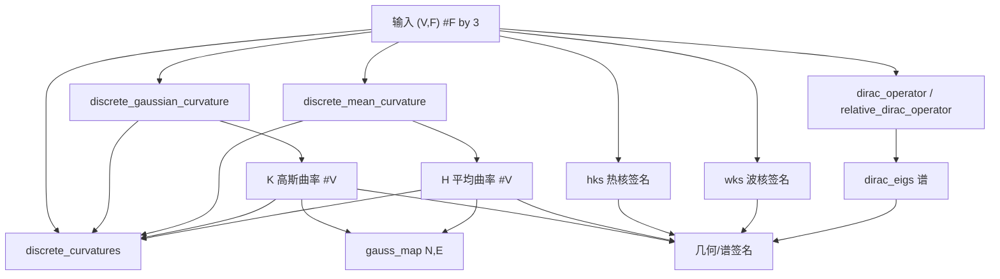

# 10.6 网格量与曲率 / Mesh Quantities & Curvature

> 本章覆盖 `mesh/` 下的三类函数：
> **(a) 网格量（mesh quantities）**——面积/体积/边长/内角/二面角/重心/惯性张量/立体角；
> **(b) 几何谓词与几何查询（geometric predicates & queries）**——锐角/平面/Delaunay 系列/凸性，以及最小包围球、最远点、Hausdorff、统计；
> **(c) 曲率与谱分析（curvature & spectral analysis）**——高斯/平均曲率、Gauss map、HKS/WKS 谱签名、Dirac 算子及其特征值。
>
> This chapter covers three families of `mesh/` functions: **(a) mesh quantities** (area, volume,
> edge length, internal angle, dihedral angle, barycenter, inertia tensor, solid angle);
> **(b) geometric predicates & queries** (acute/planar/Delaunay/ convexity, minimal bounding sphere,
> farthest points, Hausdorff, statistics); **(c) curvature & spectral analysis** (Gaussian/mean
> curvature, Gauss map, HKS/WKS signatures, Dirac operator and its eigen-decomposition).

- 语言 / Language：中英对照（中文为主）
- 相关章节 / See also：[10-mesh/README.md](README.md)、
  [appendices/03-doc-template.md](../appendices/03-doc-template.md)、
  [10-mesh/03-topology-and-adjacency.md](03-topology-and-adjacency.md)

---

## 本章概览 / Chapter Overview

### (a) 网格量 / Mesh quantities

| 量 (中 / EN) | 代表函数 | 主要输出尺寸 | 说明 / Notes |
|---|---|---|---|
| 面积 / double area | `doublearea` | `#F by 1` | 坐标式；2D 有符号；3D 由叉积（投影法） |
| 内蕴面积 / intrinsic area | `doublearea_intrinsic` | `#F by 1` | 仅由边长 `l` `#F by 3` 计算（Kahan-Heron） |
| 体积 / volume | `volume` | `#T by 1` | 三向量混合积（行列式）；3D 有符号 |
| 内蕴体积 / intrinsic volume | `volume_intrinsic` | `#T by 1` | 由 6 条边长计算（Heron 型四面体公式） |
| 边长 / edge lengths | `edge_lengths` | `#F by s` | 支持 simplex 大小 2/3/4（边/三角/四面体） |
| 内角 / internal angles | `internalangles`、`internalangles_intrinsic` | `#F by 3` | 返回角度与余弦两套 |
| 二面角 / dihedral angles | `dihedral_angles` | `#T by 6` | 四面体 6 个二面角（弧度 + 余弦） |
| 外接半径 / circumradius | `circumradius` | `#T by 1` | 可附圆心 `C`、重心坐标 `B` |
| 内心 / incenter | `incenter` | `#F by 3` | 附重心坐标 `B`、内切半径 `R` |
| 垂心 / orthocenter | `orthocenter` | `#F by 3` | 由法向 × 余弦组合 |
| 简单重心 / barycenter | `barycenter` | `#F by dim` | 面顶点**等权**算术平均 |
| 平均边长 / average edge | `avgedge` | 标量 | 唯一边长均值（边界边权半） |
| 体心/质心 / centroid | `centroid` | `dim` 向量（+ `vol`） | 封闭多面体的**体积加权**质心 |
| 包围盒 / bounding box | `bounding_box` | `2^dim by dim` | 附面片 `BF`、四边片 `BQ` |
| 惯性张量 / inertia tensor | `inertia_tensor` | `3x3`（+`A`,`cen`,`vol`） | 由散度定理矩积分得到 |
| 立体角 / solid angle | `solid_angle` | `#O by #F` | Van Oosterom–Strackee 公式（2D/3D） |

### (b) 几何谓词与查询 / Geometric predicates & queries

| 概念 (中 / EN) | 代表函数 | 输出 | 说明 / Notes |
|---|---|---|---|
| 锐角三角形 / acute | `is_acute` | `#F` 逻辑 | 由 `s-r > 2R` 判定；附 `IO` 钝角标志 |
| 平面性 / planarity | `is_planar` | 标量逻辑 + `s` | 基于 PCA 最小特征值 |
| Delaunay 分发 / dispatcher | `is_delaunay` | — | **错误桩**，仅提示改用显式函数 |
| 外在 Delaunay / extrinsic | `is_extrinsic_delaunay` | `#F by 3` | 自然 2D 网格；圆周率判据 |
| 内在 Delaunay / intrinsic | `is_intrinsic_delaunay` | `#F by 3` | 由 `cotmatrix_intrinsic` 符号判定 |
| 凸性 / convexness | `convexness` | 标量 `[0,1]` | 视线可见性采样；附 `S,E,flag` |
| 最小包围球 / min bounding sphere | `minimal_bounding_sphere`、`_welzl` | 圆心+半径 | 锥规划（MOSEK）/ Welzl 随机增量 |
| 最远点 / farthest points | `farthest_points` | `P`,`PI` | 贪心最大化最小间距 |
| Hausdorff 距离 / Hausdorff | `hausdorff` | 标量 + `pair` | 基于 `point_mesh_squared_distance` |
| 有向出现次数 / signed occurrences | `total_signed_occurrences` | `S,uF,I,J` | 多重集与定向计数 |
| 网格统计 / statistics | `statistics` | 结构体 `S` | 计数/拓扑/退化统计集合 |

### (c) 曲率与谱分析 / Curvature & spectral analysis

| 概念 (中 / EN) | 代表函数 | 输出 | 说明 / Notes |
|---|---|---|---|
| 高斯曲率 / Gaussian | `discrete_gaussian_curvature` | `#V by 1` | 角亏（angle defect），无逆面积项 |
| 平均曲率 / mean | `discrete_mean_curvature` | `#V by 1` | 积分平均曲率 `½Σ l φ` |
| 主曲率 / principal | `discrete_curvatures` | `k` `#V by 2` | 由 `H,K` 与质量矩阵解出 |
| 曲线曲率 / curve curvature | `curvature` | `#P` | 闭合折线点曲率 |
| 总符号曲率 / total signed | `total_signed_curvature` | 标量 | 平面闭合曲线外角之和 |
| Gauss 映射 / Gauss map | `gauss_map` | `N`,`E` | 法向球面图（面法向 + 球面边） |
| 热核签名 / HKS | `hks` | `#V by #K` | Laplace–Beltrami 谱签名 |
| 波核签名 / WKS | `wks` | `#V by #K` | 量子力学能量域签名 |
| Dirac 算子 / Dirac | `dirac_operator` | `4#F by 4#V` | 四元数块稀疏矩阵 |
| 相对 Dirac / relative | `relative_dirac_operator` | `4#F by 4#V` | 用顶点法向差构造 |
| Dirac 特征值 / Dirac eigs | `dirac_eigs` | `eVec`,`eVal` | 四元数谱（含正则化） |

### 「曲率管路」/ The curvature pipeline



---

## 关键实现要点 / Key implementation notes

- **`doublearea` vs `doublearea_intrinsic`（坐标叉积 vs 边长公式）**：
  `doublearea` 依赖顶点坐标，见 [mesh/doublearea.m](file:///c:/VSWork/gptoolbox-1/mesh/doublearea.m#L19-L39)：
  2D 用叉积 `r(1)s(2)-r(2)s(1)`（[L21-L23](file:///c:/VSWork/gptoolbox-1/mesh/doublearea.m#L21-L23)，**有符号**）；
  3D 把它归约为三次 2D 子问题再开方（[L25-L28](file:///c:/VSWork/gptoolbox-1/mesh/doublearea.m#L25-L28)）；
  其它维度先算边长再转 `doublearea_intrinsic`（[L33-L38](file:///c:/VSWork/gptoolbox-1/mesh/doublearea.m#L33-L38)）。
  `doublearea_intrinsic` 只吃边长 `l` `#F by 3`（边 23,31,12），用 **Kahan 改进的 Heron 公式**（边长/半周长形式，等价于余弦定理的边长表达）：
  先降序排序 `l`（[L14-L15](file:///c:/VSWork/gptoolbox-1/mesh/doublearea_intrinsic.m#L14-L15)），
  断言 `l3-(l1-l2)>=0`（[L19-L21](file:///c:/VSWork/gptoolbox-1/mesh/doublearea_intrinsic.m#L19-L21)），
  再算 `arg=(l1+(l2+l3))(l3-(l1-l2))(l3+(l1-l2))(l1+(l2-l3))` 与 `dblA=0.5*sqrt(arg)`（[L27-L28](file:///c:/VSWork/gptoolbox-1/mesh/doublearea_intrinsic.m#L27-L28)），
  并可选将退化面回填 `degenerate_replacement`（[L29-L31](file:///c:/VSWork/gptoolbox-1/mesh/doublearea_intrinsic.m#L29-L31)）。

- **`volume` vs `volume_intrinsic`（散度定理/行列式 vs 边长公式）**：
  `volume` 用三向量混合积（等价行列式/散度定理），见 [mesh/volume.m](file:///c:/VSWork/gptoolbox-1/mesh/volume.m#L13-L23)：
  `a,b,c,d` 为四面体四顶点，`v=-sum((a-d).*cross2(b-d,c-d),2)./6`（内置 `cross2` 是逐行叉积优化，[L24-L30](file:///c:/VSWork/gptoolbox-1/mesh/volume.m#L24-L30)），
  负号使典型 tetgen 网格为正。`volume_intrinsic` 只吃 6 条边长 `l` `#T by 6`（`[23 31 12 41 42 43]`），
  用 **Heron 型四面体体积公式**，见 [mesh/volume_intrinsic.m](file:///c:/VSWork/gptoolbox-1/mesh/volume_intrinsic.m#L17-L34)（构造 `x,y,z,X,Y,Z` 后取平方根组合），结果恒正。

- **`centroid` 的 `'Robust'` 选项**：默认为 `false`（[L19](file:///c:/VSWork/gptoolbox-1/mesh/centroid.m#L19)）。
  `robust=true` 时（[L41-L50](file:///c:/VSWork/gptoolbox-1/mesh/centroid.m#L41-L50)）：先 `cdt(V,F)` 对近乎封闭输入做约束 Delaunay 四面体化，
  用 `winding_number(V,F,·)/(4π)` 作为内外判据（保留 `|w|>0.5` 的四面体），再以 `volume` 加权求质心，适合**近似封闭**网格。
  默认分支按维度/面元变化：2D 多边形用鞋带公式（[L55-L63](file:///c:/VSWork/gptoolbox-1/mesh/centroid.m#L55-L63)），
  3D 三角面用散度定理（[L64-L76](file:///c:/VSWork/gptoolbox-1/mesh/centroid.m#L64-L76)），3D 四面体用体积加权（[L77-L83](file:///c:/VSWork/gptoolbox-1/mesh/centroid.m#L77-L83)）。

- **`barycenter` vs `centroid`**：`barycenter` 是每个面（单纯形）顶点的**等权算术平均**（[mesh/barycenter.m L15-L18](file:///c:/VSWork/gptoolbox-1/mesh/barycenter.m#L15-L18)），返回 `#F by dim`。
  `centroid` 是**封闭多面体**的体（体积加权）质心，返回单个 `dim` 向量与总体积。二者不可互换。

- **`discrete_gaussian_curvature`（角亏 / angle defect）**：见 [mesh/discrete_gaussian_curvature.m L19-L21](file:///c:/VSWork/gptoolbox-1/mesh/discrete_gaussian_curvature.m#L19-L21)。
  对每个顶点累加其所有内角：`k = 2π - Σθ`（用 `accumarray(vec(F),vec(internalangles(V,F)),[#V 1])`）。
  边界顶点再减 `π`（`k(b)=k(b)-π`，`b=unique(outline(F))`）。按 Meyer 等公式但**不含逆面积项**，故为积分量。

- **`discrete_mean_curvature` 与 `cotmatrix`/`massmatrix` 的关系**：源码本身**不调用** `cotmatrix`/`massmatrix`，而是用
  `adjacency_dihedral_angle_matrix`（[L20-L24](file:///c:/VSWork/gptoolbox-1/mesh/discrete_mean_curvature.m#L20-L24)）与 `edge_lengths` 组装
  `H = ½ Σ l_ij φ_ij`（[L32-L35](file:///c:/VSWork/gptoolbox-1/mesh/discrete_mean_curvature.m#L32-L35)），返回**积分**平均曲率 `#V by 1`。
  它与 `massmatrix` 的关系是"归一化"：`discrete_curvatures` 用 `M=massmatrix(V,F)` 把 `H,K` 组合成逐点主曲率
  `k = H ± sqrt(H.^2 - M*K)`（[mesh/discrete_curvatures.m L24-L32](file:///c:/VSWork/gptoolbox-1/mesh/discrete_curvatures.m#L24-L32)）。

- **`hks`/`wks` 的谱求解**：源码使用 **MATLAB 内置 `eigs`**——`hks` [L53-L55](file:///c:/VSWork/gptoolbox-1/mesh/hks.m#L53-L55)、`wks` [L50-L52](file:///c:/VSWork/gptoolbox-1/mesh/wks.m#L50-L52)——
  即 `eigs(-L,M,k,'sm')`，其中 `L = cotmatrix(V,F)`、`M = massmatrix(V,F)`（**均属 `mesh/` 模块**）。
  注意：任务清单提到"依赖 `sparse_eigs`（`matrix` 模块）"，但**这两个文件并未调用 `sparse_eigs`**；`matrix/sparse_eigs.m` 只是库内另一独立求解器。详见文末「发现的问题」。

- **`dirac_eigs` 的谱计算**：见 [mesh/dirac_eigs.m](file:///c:/VSWork/gptoolbox-1/mesh/dirac_eigs.m)。
  先由 `dirac_operator` 或 `relative_dirac_operator` 得 `D`（[L59-L70](file:///c:/VSWork/gptoolbox-1/mesh/dirac_eigs.m#L59-L70)），
  构造平方算子 `Dsquare=D'*MF*D`（`MF=kroneye(diag(sparse(A)),4)`）与"质量矩阵" `massMat=B'*MF*D` 并对称化（[L73-L79](file:///c:/VSWork/gptoolbox-1/mesh/dirac_eigs.m#L73-L79)）；
  相对模式可选与 `cotmatrix`/`massmatrix` 按 `tao` 混合（[L81-L87](file:///c:/VSWork/gptoolbox-1/mesh/dirac_eigs.m#L81-L87)）；
  由内嵌 `QuaternionEigs` 调 `eigs`（带 `sigma` 移频，[L24-L36](file:///c:/VSWork/gptoolbox-1/mesh/dirac_eigs.m#L24-L36)）求得特征对，最后归一化四元数特征向量（[L92-L146](file:///c:/VSWork/gptoolbox-1/mesh/dirac_eigs.m#L92-L146)）。

- **MEX / 模块依赖标注总则**：`solid_angle`（建议编译 `mex/solid_angle.cpp`）、`convexness`（`winding_number`、`ray_mesh_intersect`）、
  `hausdorff`（`point_mesh_squared_distance`）、`statistics`（`selfintersect` 等）在 `mex/` 有多种 MEX 后端；
  `matrix/` 模块函数：`normrow`、`normalizerow`、`kroneye`、`sparse_eigs`；`external/` 模块：`combn`、`perform_fast_marching_mesh`。

---

## 逐函数条目 / Per-function entries

### `doublearea` — 计算三角面二倍面积（坐标式）
- **文件 / File**: [mesh/doublearea.m](file:///c:/VSWork/gptoolbox-1/mesh/doublearea.m#L1-L41)
- **签名 / Signature**: `dblA = doublearea(V,F)`
- **功能 / Purpose**: `EN: Compute twice the area of each triangle from vertex coordinates.` / 中文：由顶点坐标计算每个三角面的二倍面积（2D 时为有符号）。
- **输入 / Inputs**:

  | 参数 | 尺寸/类型 | 含义 (中 / EN) |
  |---|---|---|
  | `V` | `#V by dim` | 顶点坐标 / vertex coordinates |
  | `F` | `#F by 3` | 三角面索引 / triangle indices |

- **输出 / Outputs**:

  | 参数 | 尺寸/类型 | 含义 |
  |---|---|---|
  | `dblA` | `#F by 1` `dense` | 二倍面积；`dim=2` 为有符号量 |

- **可选参数 / Optional**: 无 / none
- **变量流动 / Variable flow**: `V,F →(switch size(V,2))→ {2D: r,s 叉积} | {3D: 三次 2D 子调用} | {其它: l=边长 → doublearea_intrinsic} → dblA`
- **算法步骤 / Algorithm**:
  1. 按 `size(V,2)` 分支（[L19](file:///c:/VSWork/gptoolbox-1/mesh/doublearea.m#L19)）。
  2. `dim=2`：`r=V(F1)-V(F3)`, `s=V(F2)-V(F3)`，`dblA=r1*s2-r2*s1`（有符号叉积）。
  3. `dim=3`：对三个坐标平面投影分别递归调用自身，`dblA=sqrt(sum3(.^2))`。
  4. 其它维度：先按边长 `l`（边 23,31,12），再调 `doublearea_intrinsic(l)`。
- **流程图 / Flowchart**:

  ```mermaid
  flowchart TD
    A["输入 V,F"] --> B{"size(V,2)?"}
    B -- 2 --> C["r,s 叉积 dblA=r1 s2-r2 s1"]
    B -- 3 --> D["三次 2D 子调用再 sqrt(sum sq)"]
    B -- 其它 --> E["l=边长(23,31,12)"]
    E --> F["dblA=doublearea_intrinsic(l)"]
    C --> Z["输出 dblA #F by 1"]
    D --> Z
    F --> Z
  ```
- **依赖 / Dependencies**: `doublearea_intrinsic`
- **See also**: `doublearea_intrinsic`, `edge_lengths`, `volume`

### `doublearea_intrinsic` — 由边长计算二倍面积（内蕴）
- **文件 / File**: [mesh/doublearea_intrinsic.m](file:///c:/VSWork/gptoolbox-1/mesh/doublearea_intrinsic.m#L1-L32)
- **签名 / Signature**: `dblA = doublearea_intrinsic(l,degenerate_replacement)`
- **功能 / Purpose**: `EN: Compute twice the triangle area from edge lengths only (Kahan-Heron).` / 中文：仅由三条边长用 Kahan 改进的 Heron 公式计算二倍面积。
- **输入 / Inputs**:

  | 参数 | 尺寸/类型 | 含义 (中 / EN) |
  |---|---|---|
  | `l` | `#F by 3` | 每面的边长（边 23,31,12） / edge lengths |
  | `degenerate_replacement` | 标量（可选） | 退化面（`arg<0`）的替换值 / replacement for degenerate faces |

- **输出 / Outputs**:

  | 参数 | 尺寸/类型 | 含义 |
  |---|---|---|
  | `dblA` | `#F by 1` `dense` | 二倍面积（非负，除非回填负值） |

- **可选参数 / Optional**: 位置参数 `degenerate_replacement`（非名称/值对）；给出时用于回填 `arg<0` 的项。
- **变量流动 / Variable flow**: `l →(降序排序)→ l1,l2,l3 →(Kahan 断言)→ arg=(l1+(l2+l3))(l3-(l1-l2))(l3+(l1-l2))(l1+(l2-l3)) → dblA=0.5*sqrt(arg) →(可选)→ 退化回填`
- **算法步骤 / Algorithm**:
  1. 每行降序排序，取 `l1>=l2>=l3`（[L14-L15](file:///c:/VSWork/gptoolbox-1/mesh/doublearea_intrinsic.m#L14-L15)）。
  2. 断言 Kahan 不等式 `l3-(l1-l2)>=0`，否则警告（[L19-L21](file:///c:/VSWork/gptoolbox-1/mesh/doublearea_intrinsic.m#L19-L21)）。
  3. 组装 `arg` 并 `dblA=2*0.25*sqrt(arg)=0.5*sqrt(arg)`（[L27-L28](file:///c:/VSWork/gptoolbox-1/mesh/doublearea_intrinsic.m#L27-L28)）。
  4. 若给 `degenerate_replacement`，将 `arg<0` 处置为该值（[L29-L31](file:///c:/VSWork/gptoolbox-1/mesh/doublearea_intrinsic.m#L29-L31)）。
- **流程图 / Flowchart**:

  ```mermaid
  flowchart TD
    A["输入 l #F by 3"] --> B["降序排序 l1 l2 l3"]
    B --> C{"l3-(l1-l2) < 0 ?"}
    C -- 是 --> C2["警告 Failed Kahan assertion"]
    C -- 否 --> D["arg=(l1+l2+l3)(l3-l1+l2)(l3+l1-l2)(l1+l2-l3)"]
    C2 --> D
    D --> E["dblA=0.5 sqrt(arg)"]
    E --> F{"给出 degenerate_replacement ?"}
    F -- 是 --> G["dblA(arg<0)=replacement"]
    F -- 否 --> Z["输出 dblA"]
    G --> Z
  ```
- **依赖 / Dependencies**: 无 / none（纯算术）
- **See also**: `doublearea`, `internalangles_intrinsic`, `volume_intrinsic`

### `volume` — 计算四面体体积
- **文件 / File**: [mesh/volume.m](file:///c:/VSWork/gptoolbox-1/mesh/volume.m#L1-L31)
- **签名 / Signature**: `[v,sv] = volume(V,T)`
- **功能 / Purpose**: `EN: Compute volumes of tets from vertex coordinates (triple product).` / 中文：由顶点坐标用三向量混合积（行列式）计算每个四面体体积。
- **输入 / Inputs**:

  | 参数 | 尺寸/类型 | 含义 (中 / EN) |
  |---|---|---|
  | `V` | `#V by dim`，`dim>=3` | 顶点坐标 / vertex positions |
  | `T` | `#T by 4` | 四面体索引 / tet indices |

- **输出 / Outputs**:

  | 参数 | 尺寸/类型 | 含义 |
  |---|---|---|
  | `v` | `#T by 1` `dense` | 四面体体积；`dim=3` 时有符号 |
  | `sv` | 未赋值 | 声明但源码未返回（保留位） |

- **可选参数 / Optional**: 无 / none
- **变量流动 / Variable flow**: `V,T →(取 a,b,c,d=V(T(:,k),:))→ a,b,c,d →(cross2(b-d,c-d))→ n →(-sum((a-d).*n,2)/6)→ v`
- **算法步骤 / Algorithm**:
  1. 取四个顶点 `a,b,c,d`（[L13-L16](file:///c:/VSWork/gptoolbox-1/mesh/volume.m#L13-L16)）。
  2. 逐行叉积 `cross2(b-d,c-d)`（内置优化，[L24-L30](file:///c:/VSWork/gptoolbox-1/mesh/volume.m#L24-L30)）。
  3. `v=-sum((a-d).*n,2)/6`，负号使 tetgen 输出为正（[L23](file:///c:/VSWork/gptoolbox-1/mesh/volume.m#L23)）。
- **流程图 / Flowchart**:

  ```mermaid
  flowchart TD
    A["输入 V,T"] --> B["a,b,c,d = V(T(:,1:4),:)"]
    B --> C["n = cross2(b-d, c-d)"]
    C --> D["v = -sum((a-d).*n,2)/6"]
    D --> Z["输出 v #T by 1"]
  ```
- **依赖 / Dependencies**: 无（内置 `cross2`）
- **See also**: `volume_intrinsic`, `centroid`, `inertia_tensor`

### `volume_intrinsic` — 由边长计算四面体体积（内蕴）
- **文件 / File**: [mesh/volume_intrinsic.m](file:///c:/VSWork/gptoolbox-1/mesh/volume_intrinsic.m#L1-L36)
- **签名 / Signature**: `[vol] = volume_intrinsic(l)`
- **功能 / Purpose**: `EN: Compute tet volumes from the six edge lengths (Heron-type formula).` / 中文：仅由 6 条边长用 Heron 型四面体公式计算体积（恒正）。
- **输入 / Inputs**:

  | 参数 | 尺寸/类型 | 含义 (中 / EN) |
  |---|---|---|
  | `l` | `#T by 6` | 边长 `[23 31 12 41 42 43]` / tet edge lengths |

- **输出 / Outputs**:

  | 参数 | 尺寸/类型 | 含义 |
  |---|---|---|
  | `vol` | `#T by 1` `dense` | 四面体体积（始终为正） |

- **可选参数 / Optional**: 无 / none
- **变量流动 / Variable flow**: `l →(拆分 u,v,w,U,V,W)→ 中间量 X,x,Y,y,Z,z → a,b,c,d=sqrt 组合 → vol=sqrt(四因子积)/(192 u v w)`
- **算法步骤 / Algorithm**:
  1. 拆边：`u=l1..w=l3`，`U=l4..W=l6`（[L17-L18](file:///c:/VSWork/gptoolbox-1/mesh/volume_intrinsic.m#L17-L18)）。
  2. 构造 `X,x,Y,y,Z,z` 六项（[L19-L24](file:///c:/VSWork/gptoolbox-1/mesh/volume_intrinsic.m#L19-L24)）。
  3. `a,b,c,d = sqrt(xYZ), sqrt(yZX), sqrt(zXY), sqrt(xyz)`（[L25-L28](file:///c:/VSWork/gptoolbox-1/mesh/volume_intrinsic.m#L25-L28)）。
  4. `vol = sqrt((-a+b+c+d)(a-b+c+d)(a+b-c+d)(a+b+c-d))/(192uvw)`（[L29-L34](file:///c:/VSWork/gptoolbox-1/mesh/volume_intrinsic.m#L29-L34)）。
- **流程图 / Flowchart**:

  ```mermaid
  flowchart TD
    A["输入 l #T by 6"] --> B["拆 u,v,w,U,V,W"]
    B --> C["X,x,Y,y,Z,z 六项"]
    C --> D["a,b,c,d = sqrt 组合"]
    D --> E["vol = sqrt(prod4)/(192uvw)"]
    E --> Z["输出 vol #T by 1"]
  ```
- **依赖 / Dependencies**: 无 / none
- **See also**: `volume`, `dihedral_angles`

### `internalangles` — 计算每面内角（度）
- **文件 / File**: [mesh/internalangles.m](file:///c:/VSWork/gptoolbox-1/mesh/internalangles.m#L1-L23)
- **签名 / Signature**: `[A,cA] = internalangles(V,F)`
- **功能 / Purpose**: `EN: Compute per-face internal angles (and cosines) from coordinates.` / 中文：由坐标计算每个三角面的三个内角及其余弦。
- **输入 / Inputs**:

  | 参数 | 尺寸/类型 | 含义 (中 / EN) |
  |---|---|---|
  | `V` | `#V by 3` | 顶点坐标 / vertex coordinates |
  | `F` | `#F by 3` | 三角面索引 / triangle indices |

- **输出 / Outputs**:

  | 参数 | 尺寸/类型 | 含义 |
  |---|---|---|
  | `A` | `#F by 3` `dense` | 三角面三个角（弧度，按 23,31,12 边次序） |
  | `cA` | `#F by 3` `dense` | 对应角的余弦 |

- **可选参数 / Optional**: 无 / none
- **变量流动 / Variable flow**: `V,F →(normrow 三条边)→ s12,s13,s23 → l=[s23 s13 s12] → internalangles_intrinsic(l) → A,cA`
- **算法步骤 / Algorithm**:
  1. 由坐标差取三条边长 `s12,s13,s23`（`normrow`，[L15-L17](file:///c:/VSWork/gptoolbox-1/mesh/internalangles.m#L15-L17)）。
  2. 组装 `l=[s23 s13 s12]`（[L19](file:///c:/VSWork/gptoolbox-1/mesh/internalangles.m#L19)）。
  3. 调 `internalangles_intrinsic(l)` 得角度与余弦（[L21](file:///c:/VSWork/gptoolbox-1/mesh/internalangles.m#L21)）。
- **流程图 / Flowchart**:

  ```mermaid
  flowchart TD
    A["输入 V,F"] --> B["s12,s13,s23 = normrow(坐标差)"]
    B --> C["l = [s23 s13 s12]"]
    C --> D["internalangles_intrinsic(l)"]
    D --> Z["输出 A,cA #F by 3"]
  ```
- **依赖 / Dependencies**: `internalangles_intrinsic`, `normrow`（`matrix/`）
- **See also**: `internalangles_intrinsic`, `discrete_gaussian_curvature`, `is_acute`

### `internalangles_intrinsic` — 由边长计算每面内角
- **文件 / File**: [mesh/internalangles_intrinsic.m](file:///c:/VSWork/gptoolbox-1/mesh/internalangles_intrinsic.m#L1-L28)
- **签名 / Signature**: `[A,cA] = internalangles_intrinsic(l)`
- **功能 / Purpose**: `EN: Compute per-face internal angles (and cosines) from edge lengths.` / 中文：仅由边长用余弦定理计算三个内角与余弦。
- **输入 / Inputs**:

  | 参数 | 尺寸/类型 | 含义 (中 / EN) |
  |---|---|---|
  | `l` | `#F by 3` | 边长 `s23,s31,s12` / edge lengths |

- **输出 / Outputs**:

  | 参数 | 尺寸/类型 | 含义 |
  |---|---|---|
  | `A` | `#F by 3` `dense` | 三个内角（弧度） |
  | `cA` | `#F by 3` `dense` | 三个角的余弦 |

- **可选参数 / Optional**: 无 / none
- **变量流动 / Variable flow**: `l → s12,s31,s23 → 余弦 ca23,ca31,ca12 → acos → A；cA=[ca23 ca31 ca12]`
- **算法步骤 / Algorithm**:
  1. 取三边 `s23=l1, s31=l2, s12=l3`（[L14-L16](file:///c:/VSWork/gptoolbox-1/mesh/internalangles_intrinsic.m#L14-L16)）。
  2. 余弦定理：`ca23=(s12²+s31²-s23²)/(2 s12 s31)` 等三项（[L17-L19](file:///c:/VSWork/gptoolbox-1/mesh/internalangles_intrinsic.m#L17-L19)）。
  3. `acos` 得角度 `a23,a31,a12`，组装 `cA`,`A`（[L21-L26](file:///c:/VSWork/gptoolbox-1/mesh/internalangles_intrinsic.m#L21-L26)）。
- **流程图 / Flowchart**:

  ```mermaid
  flowchart TD
    A["输入 l #F by 3"] --> B["取 s23,s31,s12"]
    B --> C["余弦定理 ca23,ca31,ca12"]
    C --> D["a = acos(ca)"]
    D --> Z["输出 A,cA #F by 3"]
  ```
- **依赖 / Dependencies**: 无 / none
- **See also**: `internalangles`, `doublearea_intrinsic`

### `dihedral_angles` — 计算四面体二面角
- **文件 / File**: [mesh/dihedral_angles.m](file:///c:/VSWork/gptoolbox-1/mesh/dihedral_angles.m#L1-L75)
- **签名 / Signature**: `[theta,cos_theta] = dihedral_angles(V,T,'ParameterName',Value,...)`
- **功能 / Purpose**: `EN: Compute the six dihedral angles of each tet via the law of cosines.` / 中文：对每个四面体计算 6 个二面角（弧度）及其余弦。
- **输入 / Inputs**:

  | 参数 | 尺寸/类型 | 含义 (中 / EN) |
  |---|---|---|
  | `V` | `#V by dim` | 顶点坐标 / vertex positions |
  | `T` | `#V by 4` | 四面体索引 / tet indices |

- **输出 / Outputs**:

  | 参数 | 尺寸/类型 | 含义 |
  |---|---|---|
  | `theta` | `#T by 6` `dense` | 6 个二面角（弧度） |
  | `cos_theta` | `#T by 6` `dense` | 6 个二面角余弦 |

- **可选参数 / Optional**:

  | 名称 | 取值 | 默认 | 含义 |
  |---|---|---|---|
  | `'SideLengths'` | `#T by 6` | 自动计算 | 边长 `41 42 43 23 31 12` |
  | `'FaceAreas'` | `#T by 4` | 自动计算 | 四个面面积（对面 1..4） |

- **变量流动 / Variable flow**: `varargin →(解析)→ l,s →(缺省时算 l 与 s)→ H_sqr(由边长) → cos_theta=(H_sqr-s²-s²)/(-2 s s) → theta=acos(cos_theta)`
- **算法步骤 / Algorithm**:
  1. 解析 `'SideLengths'`/`'FaceAreas'`（[L23-L37](file:///c:/VSWork/gptoolbox-1/mesh/dihedral_angles.m#L23-L37)）。
  2. 若缺 `l`，按 23,31,12,41,42,43 次序计算边长（[L38-L48](file:///c:/VSWork/gptoolbox-1/mesh/dihedral_angles.m#L38-L48)）。
  3. 若缺 `s`，用 `doublearea_intrinsic` 求 4 个对面面积（[L49-L56](file:///c:/VSWork/gptoolbox-1/mesh/dihedral_angles.m#L49-L56)）。
  4. 由余弦定理 `H_sqr` 与面面积得 `cos_theta`，`theta=acos(cos_theta)`（[L58-L70](file:///c:/VSWork/gptoolbox-1/mesh/dihedral_angles.m#L58-L70)）。
- **流程图 / Flowchart**:

  ```mermaid
  flowchart TD
    A["输入 V,T,varargin"] --> B["解析 SideLengths / FaceAreas"]
    B --> C{"l 为空 ?"}
    C -- 是 --> C2["按 23,31,12,41,42,43 算 l"]
    C -- 否 --> D{"s 为空 ?"}
    C2 --> D
    D -- 是 --> D2["s=0.5 doublearea_intrinsic(l 的四组)"]
    D -- 否 --> E["H_sqr 与 cos_theta"]
    D2 --> E
    E --> F["theta=acos(cos_theta)"]
    F --> Z["输出 theta,cos_theta #T by 6"]
  ```
- **依赖 / Dependencies**: `doublearea_intrinsic`
- **See also**: `adjacency_dihedral_angle_matrix`, `discrete_mean_curvature`, `volume_intrinsic`

### `edge_lengths` — 计算单纯形边长
- **文件 / File**: [mesh/edge_lengths.m](file:///c:/VSWork/gptoolbox-1/mesh/edge_lengths.m#L1-L40)
- **签名 / Signature**: `l = edge_lengths(V,F)`
- **功能 / Purpose**: `EN: Compute edge lengths for edge/triangle/tet simplex lists.` / 中文：对边（2 列）/三角（3 列）/四面体（4 列）单纯形表计算边长。
- **输入 / Inputs**:

  | 参数 | 尺寸/类型 | 含义 (中 / EN) |
  |---|---|---|
  | `V` | `#V by dim` | 顶点坐标 / vertex positions |
  | `F` | `#F by s`（`s∈{2,3,4}`） | 单纯形索引 / simplex indices |

- **输出 / Outputs**:

  | 参数 | 尺寸/类型 | 含义 |
  |---|---|---|
  | `l` | `#F by 1` / `#F by 3` / `#F by 6` `dense` | 边长；三角为 23,31,12；四面体为 23,31,12,41,42,43 |

- **可选参数 / Optional**: 无 / none
- **变量流动 / Variable flow**: `V,F →(switch size(F,2))→ {2: 单边} | {3: 三边 23,31,12} | {4: 六边对面} → l`
- **算法步骤 / Algorithm**:
  1. `s=2`：`normrow(V(F2)-V(F1))`（[L18-L19](file:///c:/VSWork/gptoolbox-1/mesh/edge_lengths.m#L18-L19)）。
  2. `s=3`：算 `s12,s13,s23`，`l=[s23 s13 s12]`（[L20-L25](file:///c:/VSWork/gptoolbox-1/mesh/edge_lengths.m#L20-L25)）。
  3. `s=4`：按 `23 31 12 41 42 43` 六边（[L26-L36](file:///c:/VSWork/gptoolbox-1/mesh/edge_lengths.m#L26-L36)）。
  4. 其它大小报错（[L37-L38](file:///c:/VSWork/gptoolbox-1/mesh/edge_lengths.m#L37-L38)）。
- **流程图 / Flowchart**:

  ```mermaid
  flowchart TD
    A["输入 V,F"] --> B{"size(F,2)?"}
    B -- 2 --> C["l=normrow(F2-F1)"]
    B -- 3 --> D["l=[s23 s13 s12]"]
    B -- 4 --> E["l=六条对面边"]
    B -- 其它 --> F["报错 Unsupported simplex size"]
    C --> Z["输出 l"]
    D --> Z
    E --> Z
  ```
- **依赖 / Dependencies**: `normrow`（`matrix/`）
- **See also**: `doublearea`, `internalangles`, `incenter`

### `circumradius` — 计算外接半径（含圆心/重心坐标）
- **文件 / File**: [mesh/circumradius.m](file:///c:/VSWork/gptoolbox-1/mesh/circumradius.m#L1-L118)
- **签名 / Signature**: `[R,C,B] = circumradius(V,T)`
- **功能 / Purpose**: `EN: Compute circumradius (and circumcenter/barycentric coords) per simplex.` / 中文：计算每个单纯形的外接半径，可选圆心与重心坐标。
- **输入 / Inputs**:

  | 参数 | 尺寸/类型 | 含义 (中 / EN) |
  |---|---|---|
  | `V` | `#V by dim` | 顶点坐标 / vertex positions |
  | `T` | `#T by (dim+1)` | 单纯形索引 / simplex indices |

- **输出 / Outputs**:

  | 参数 | 尺寸/类型 | 含义 |
  |---|---|---|
  | `R` | `#T by 1` `dense` | 外接半径 |
  | `C` | `#T by dim` `dense` | 外接圆心/球心 |
  | `B` | `#T by simplex-size` `dense` | 重心坐标（`C(t,:)=B(t,:)*V(T(t,:),:)`），**仅三角支持** |

- **可选参数 / Optional**: 无 / none
- **变量流动 / Variable flow**: `V,T →{三角且 double: l → R=abc/(4A) → B 归一 → C} | {通用: 组装 [2VᵀV 1;1ᵀ 0] 解 α,λ → C=Uα, R=sqrt(λ+|C|²)}`
- **算法步骤 / Algorithm**:
  1. 若能走三角快路径（`size(T,2)==3` 且 `V` 为 `double`，[L20](file:///c:/VSWork/gptoolbox-1/mesh/circumradius.m#L20)）：
     算边长 `l` 与 `dblA`，`R=prod(l,2)/(2*dblA)`（[L24-L31](file:///c:/VSWork/gptoolbox-1/mesh/circumradius.m#L24-L31)），
     由 `l` 得重心坐标 `B` 并归一，再线性组合得 `C`（[L33-L43](file:///c:/VSWork/gptoolbox-1/mesh/circumradius.m#L33-L43)）。
  2. 否则通用路径（[L44-L103](file:///c:/VSWork/gptoolbox-1/mesh/circumradius.m#L44-L103)）：解线性系统 `[2VᵀV 𝟙; 𝟙ᵀ 0][α;λ]=[w;1]`，`C=Uα`，`R=sqrt(λ+‖C‖²)`；支持 `dlarray`/符号（`my_pagemldivide`，[L105-L117](file:///c:/VSWork/gptoolbox-1/mesh/circumradius.m#L105-L117)）。
- **流程图 / Flowchart**:

  ```mermaid
  flowchart TD
    A["输入 V,T"] --> B{"size(T,2)==3 且 V 为 double ?"}
    B -- 是 --> C["l=边长 dblA=doublearea"]
    C --> D["R=prod(l,2)/(2 dblA)"]
    D --> E["B 由 l 归一 → C=B*V(T)"]
    B -- 否 --> F["解 [2VtV 1;1t 0][α;λ]=[w;1]"]
    F --> G["C=U α  R=sqrt(λ+|C|^2)"]
    E --> Z["输出 R,C,B"]
    G --> Z
  ```
- **依赖 / Dependencies**: `doublearea`（快路径）
- **See also**: `minimal_bounding_sphere_welzl`, `incenter`, `orthocenter`

### `incenter` — 计算三角形内心
- **文件 / File**: [mesh/incenter.m](file:///c:/VSWork/gptoolbox-1/mesh/incenter.m#L1-L28)
- **签名 / Signature**: `[I,B,R] = incenter(V,F)`
- **功能 / Purpose**: `EN: Compute the incenter (and inradius/barycentric coords) of each triangle.` / 中文：计算每个三角面的内心、重心坐标与内切圆半径。
- **输入 / Inputs**:

  | 参数 | 尺寸/类型 | 含义 (中 / EN) |
  |---|---|---|
  | `V` | `#V by 3` | 顶点坐标 / vertex positions |
  | `F` | `#F by 3` | 三角面索引 / triangle indices |

- **输出 / Outputs**:

  | 参数 | 尺寸/类型 | 含义 |
  |---|---|---|
  | `I` | `#F by 3` `dense` | 内心坐标 |
  | `B` | `#F by 3` `dense` | 内心重心坐标（= 边长归一） |
  | `R` | `#F by 1` `dense` | 内切半径（`nargout>2` 才计算） |

- **可选参数 / Optional**: 无 / none
- **变量流动 / Variable flow**: `V,F →(edge_lengths)→ l → B=l./sum(l,2) →(可选 A=doublearea, S=sum(l,2), R=A./S)→ I=B1 V1+B2 V2+B3 V3`
- **算法步骤 / Algorithm**:
  1. `l=edge_lengths(V,F)`，`B=l/sum(l,2)`（边长加权重心坐标）（[L17-L18](file:///c:/VSWork/gptoolbox-1/mesh/incenter.m#L17-L18)）。
  2. `nargout>2` 时算面积 `A`、周长 `S`、内切半径 `R=A/S`（[L20-L25](file:///c:/VSWork/gptoolbox-1/mesh/incenter.m#L20-L25)）。
  3. `I=B(:,1).*V(F1,:)+B(:,2).*V(F2,:)+B(:,3).*V(F3,:)`（[L27](file:///c:/VSWork/gptoolbox-1/mesh/incenter.m#L27)）。
- **流程图 / Flowchart**:

  ```mermaid
  flowchart TD
    A["输入 V,F"] --> B["l=edge_lengths"]
    B --> C["B=l/sum(l,2)"]
    C --> D{"nargout>2 ?"}
    D -- 是 --> E["A=doublearea S=sum(l,2) R=A/S"]
    D -- 否 --> F["I=B*V(F)"]
    E --> F
    F --> Z["输出 I,B,R"]
  ```
- **依赖 / Dependencies**: `edge_lengths`, `doublearea`
- **See also**: `barycenter`, `orthocenter`, `circumradius`

### `orthocenter` — 计算三角形垂心
- **文件 / File**: [mesh/orthocenter.m](file:///c:/VSWork/gptoolbox-1/mesh/orthocenter.m#L1-L34)
- **签名 / Signature**: `O = orthocenter(V,F)`
- **功能 / Purpose**: `EN: Compute the orthocenter of each triangle.` / 中文：计算每个三角面的垂心。
- **输入 / Inputs**:

  | 参数 | 尺寸/类型 | 含义 (中 / EN) |
  |---|---|---|
  | `V` | `#V by 3` | 顶点坐标 / vertex positions |
  | `F` | `#F by 3` | 三角面索引 / triangle indices |

- **输出 / Outputs**:

  | 参数 | 尺寸/类型 | 含义 |
  |---|---|---|
  | `O` | `#F by 3` `dense` | 垂心坐标 |

- **可选参数 / Optional**: 无 / none
- **变量流动 / Variable flow**: `V,F → E=对面边向量(cat3) → N=normals → P=normalize(cross(E,N)) → cosA=internalangles → G=cosA 分量积 → O=sum(P.*G,3)`
- **算法步骤 / Algorithm**:
  1. 构造三条边向量 `E`（cat(3)）（[L17-L20](file:///c:/VSWork/gptoolbox-1/mesh/orthocenter.m#L17-L20)）。
  2. `N=normals(V,F)`，`P=normalize(cross(E,N))`（边-法向叉积方向）（[L21-L23](file:///c:/VSWork/gptoolbox-1/mesh/orthocenter.m#L21-L23)）。
  3. 取角余弦 `cosA`，`G` 为对应余弦乘积，`O=sum(P.*G,3)`（[L25-L31](file:///c:/VSWork/gptoolbox-1/mesh/orthocenter.m#L25-L31)）。
- **流程图 / Flowchart**:

  ```mermaid
  flowchart TD
    A["输入 V,F"] --> B["E=cat3 对面边向量"]
    B --> C["N=normals"]
    C --> D["P=normalize(cross(E,N))"]
    D --> E["cosA=internalangles"]
    E --> F["O=sum(P.*G,3)"]
    F --> Z["输出 O #F by 3"]
  ```
- **依赖 / Dependencies**: `normals`, `internalangles`
- **See also**: `barycenter`, `incenter`, `circumradius`

### `barycenter` — 计算每面简单重心
- **文件 / File**: [mesh/barycenter.m](file:///c:/VSWork/gptoolbox-1/mesh/barycenter.m#L1-L20)
- **签名 / Signature**: `[B] = barycenter(V,F)`
- **功能 / Purpose**: `EN: Compute the equal-weight barycenter of every simplex.` / 中文：计算每个单纯形顶点的等权算术平均（面重心）。
- **输入 / Inputs**:

  | 参数 | 尺寸/类型 | 含义 (中 / EN) |
  |---|---|---|
  | `V` | `#V by dim` | 顶点坐标 / vertex coordinates |
  | `F` | `#F by simplex_size` | 单纯形索引 / simplex indices |

- **输出 / Outputs**:

  | 参数 | 尺寸/类型 | 含义 |
  |---|---|---|
  | `B` | `#F by dim` `dense` | 每个面的重心（顶点平均） |

- **可选参数 / Optional**: 无 / none
- **变量流动 / Variable flow**: `V,F →(循环 simplex 顶点数 s)→ B = Σ (1/s) V(F(:,ii),:) → B`
- **算法步骤 / Algorithm**:
  1. 初始化 `B=zeros(#F,dim)`（[L15](file:///c:/VSWork/gptoolbox-1/mesh/barycenter.m#L15)）。
  2. 对 `ii=1:size(F,2)` 累加 `1/size(F,2)*V(F(:,ii),:)`（[L16-L18](file:///c:/VSWork/gptoolbox-1/mesh/barycenter.m#L16-L18)）。
- **流程图 / Flowchart**:

  ```mermaid
  flowchart TD
    A["输入 V,F"] --> B["B=zeros(#F,dim)"]
    B --> C["循环 ii=1..simplex_size"]
    C --> D["B += V(F(:,ii),:)/simplex_size"]
    D --> C
    C --> Z["输出 B #F by dim"]
  ```
- **依赖 / Dependencies**: 无 / none
- **See also**: `centroid`, `incenter`, `quadrature_points`

### `avgedge` — 计算平均边长
- **文件 / File**: [mesh/avgedge.m](file:///c:/VSWork/gptoolbox-1/mesh/avgedge.m#L1-L24)
- **签名 / Signature**: `[b] = avgedge(V,F)`
- **功能 / Purpose**: `EN: Average edge length of the mesh (unique undirected edges).` / 中文：网格的平均边长（唯一边）。
- **输入 / Inputs**:

  | 参数 | 尺寸/类型 | 含义 (中 / EN) |
  |---|---|---|
  | `V` | `#V by 3` | 顶点坐标 / vertex coordinates |
  | `F` | `#F by #simplex` | 单纯形索引 / simplex indices |

- **输出 / Outputs**:

  | 参数 | 尺寸/类型 | 含义 |
  |---|---|---|
  | `b` | 标量 `dense` | 平均边长 |

- **可选参数 / Optional**: 无 / none
- **变量流动 / Variable flow**: `V,F →(edges(F))→ E →(normrow)→ B(#E) →(mean)→ b`
- **算法步骤 / Algorithm**:
  1. `E=edges(F)` 取唯一边表（[L19](file:///c:/VSWork/gptoolbox-1/mesh/avgedge.m#L19)）。
  2. `B=normrow(V(E1)-V(E2))` 每条边长度（[L20](file:///c:/VSWork/gptoolbox-1/mesh/avgedge.m#L20)）。
  3. `b=mean(B)`（[L22](file:///c:/VSWork/gptoolbox-1/mesh/avgedge.m#L22)）。注：注释指出边界边权为内部边一半（取决于 `edges`）。
- **流程图 / Flowchart**:

  ```mermaid
  flowchart TD
    A["输入 V,F"] --> B["E=edges(F)"]
    B --> C["B=normrow(V(E1)-V(E2))"]
    C --> D["b=mean(B)"]
    D --> Z["输出 b 标量"]
  ```
- **依赖 / Dependencies**: `edges`, `normrow`（`matrix/`）
- **See also**: `edge_lengths`, `statistics`

### `centroid` — 封闭多面体的质心与体积
- **文件 / File**: [mesh/centroid.m](file:///c:/VSWork/gptoolbox-1/mesh/centroid.m#L1-L88)
- **签名 / Signature**: `[C,vol] = centroid(V,F,'ParameterName',Value,...)`
- **功能 / Purpose**: `EN: Compute the volume-weighted centroid of a closed polyhedron bounded by (V,F).` / 中文：计算由 (V,F) 围成的封闭多面体的体积加权质心与总体积。
- **输入 / Inputs**:

  | 参数 | 尺寸/类型 | 含义 (中 / EN) |
  |---|---|---|
  | `V` | `#V by dim` | 顶点坐标 / vertex positions |
  | `F` | `#F by dim` | 表面面片索引 / surface facet indices |

- **输出 / Outputs**:

  | 参数 | 尺寸/类型 | 含义 |
  |---|---|---|
  | `C` | `dim` 向量 `dense` | 质心位置 |
  | `vol` | 标量 `dense` | 多面体总体积 |

- **可选参数 / Optional**:

  | 名称 | 取值 | 默认 | 含义 |
  |---|---|---|---|
  | `'Robust'` | `logical` | `false` | 对近似封闭输入用更稳健但更贵的方法（`cdt` + `winding_number`） |

- **变量流动 / Variable flow**: `V,F,varargin →(解析 Robust)→ {robust: cdt → barycenter → winding_number/(4π) 过滤 → volume 加权} | {默认: 2D 鞋带 / 3D 三角散度定理 / 3D 四面体体积加权} → C,vol`
- **算法步骤 / Algorithm**:
  1. 解析 `'Robust'`（默认 `false`，[L19-L34](file:///c:/VSWork/gptoolbox-1/mesh/centroid.m#L19-L34)）。
  2. `robust`：`cdt(V,F)` 构造四面体，保留 `|winding_number/(4π)|>0.5` 者，`C=Σ vol·BC/Σ vol`，`vol=Σ vol`（[L41-L50](file:///c:/VSWork/gptoolbox-1/mesh/centroid.m#L41-L50)）。
  3. 默认：按 `size(V,2)`、`size(F,2)` 分支——
     2D 多边形鞋带公式（[L55-L63](file:///c:/VSWork/gptoolbox-1/mesh/centroid.m#L55-L63)）；
     3D 三角面散度定理（[L64-L76](file:///c:/VSWork/gptoolbox-1/mesh/centroid.m#L64-L76)）；
     3D 四面体 `vol` 加权重心（[L77-L83](file:///c:/VSWork/gptoolbox-1/mesh/centroid.m#L77-L83)）。
- **流程图 / Flowchart**:

  ```mermaid
  flowchart TD
    A["输入 V,F,varargin"] --> B["解析 Robust 默认 false"]
    B --> C{"robust ?"}
    C -- 是 --> D["cdt → barycenter"]
    D --> E["winding_number/(4pi) 过滤 |w|>0.5"]
    E --> F["C=Σ vol*BC/Σ vol  vol=Σvol"]
    C -- 否 --> G{"size(V,2)?"}
    G -- 2 --> H["2D 鞋带公式"]
    G -- 3 --> I{"size(F,2)?"}
    I -- 3 --> J["3D 三角散度定理"]
    I -- 4 --> K["3D 四面体体积加权"]
    F --> Z["输出 C,vol"]
    H --> Z
    J --> Z
    K --> Z
  ```
- **依赖 / Dependencies**: `cdt`, `barycenter`, `winding_number`（`mex/`）, `volume`
- **See also**: `barycenter`, `inertia_tensor`, `volume`

### `bounding_box` — 计算包围盒
- **文件 / File**: [mesh/bounding_box.m](file:///c:/VSWork/gptoolbox-1/mesh/bounding_box.m#L1-L53)
- **签名 / Signature**: `[BB,BF,BQ] = bounding_box(V,'ParameterName',Value,...)`
- **功能 / Purpose**: `EN: Compute the axis-aligned bounding box (vertices, facets, quads) of points.` / 中文：计算点集的轴对齐包围盒顶点、面片与四边片。
- **输入 / Inputs**:

  | 参数 | 尺寸/类型 | 含义 (中 / EN) |
  |---|---|---|
  | `V` | `#V by dim` | 点集 / points |

- **输出 / Outputs**:

  | 参数 | 尺寸/类型 | 含义 |
  |---|---|---|
  | `BB` | `2^dim by dim` `dense` | 包围盒顶点 |
  | `BF` | `#BF by dim` `dense` | 面片（`dim=2` 为 4 条边，`dim=3` 为 12 个三角） |
  | `BQ` | `#BQ by 4` `dense` | 四边片（仅 `dim==3`，6 个四边形） |

- **可选参数 / Optional**:

  | 名称 | 取值 | 默认 | 含义 |
  |---|---|---|---|
  | `'Epsilon'` | 标量 | `0` | 对 min/max 的偏移量 |

- **变量流动 / Variable flow**: `V,varargin →(解析 Epsilon)→ minV,maxV → C=combn([0 1],dim)==1 → BB=(C.*minV)+((~C).*maxV) →(按 dim 表)→ BF,BQ`
- **算法步骤 / Algorithm**:
  1. 解析 `'Epsilon'`（[L17-L33](file:///c:/VSWork/gptoolbox-1/mesh/bounding_box.m#L17-L33)）。
  2. `minV=min(V)-ε`, `maxV=max(V)+ε`，`C=combn([0 1],dim)==1`，`BB=C.*minV+(~C).*maxV`（[L36-L40](file:///c:/VSWork/gptoolbox-1/mesh/bounding_box.m#L36-L40)）。
  3. 按 `dim` 查表给出 `BF`（2D/3D）与 `BQ`（3D）（[L42-L50](file:///c:/VSWork/gptoolbox-1/mesh/bounding_box.m#L42-L50)）。
- **流程图 / Flowchart**:

  ```mermaid
  flowchart TD
    A["输入 V,varargin"] --> B["解析 Epsilon"]
    B --> C["minV=min-ε maxV=max+ε"]
    C --> D["C=combn([0 1],dim)==1"]
    D --> E["BB=C.*minV+(~C).*maxV"]
    E --> F{"dim?"}
    F -- 2 --> G["BF 4 条边"]
    F -- 3 --> H["BF 12 三角 + BQ 6 四边形"]
    F -- 其它 --> I["报错 Only 2D/3D"]
    G --> Z["输出 BB,BF,BQ"]
    H --> Z
  ```
- **依赖 / Dependencies**: `combn`（`external/`）
- **See also**: `minimal_bounding_sphere`, `statistics`

### `inertia_tensor` — 计算惯性张量与主轴
- **文件 / File**: [mesh/inertia_tensor.m](file:///c:/VSWork/gptoolbox-1/mesh/inertia_tensor.m#L1-L98)
- **签名 / Signature**: `[I,A,cen,vol] = inertia_tensor(V,F)`
- **功能 / Purpose**: `EN: Inertia tensor (and principal axes, centroid, volume) of a solid mesh.` / 中文：计算实心网格的惯性张量、主轴、质心与体积。
- **输入 / Inputs**:

  | 参数 | 尺寸/类型 | 含义 (中 / EN) |
  |---|---|---|
  | `V` | `#V by 3` | 顶点坐标 / vertex positions |
  | `F` | `#F by 3` | 面索引 / face indices |

- **输出 / Outputs**:

  | 参数 | 尺寸/类型 | 含义 |
  |---|---|---|
  | `I` | `3x3` `dense` | 惯性张量 |
  | `A` | `3x3` `dense` | 主轴（按行），非 double 输入时为 `nan` |
  | `cen` | `1 by 3` `dense` | 质心位置 |
  | `vol` | 标量 `dense` | 体积 |

- **可选参数 / Optional**: 无 / none
- **变量流动 / Variable flow**: `V,F → FN=cross(面边) → 零/一/二阶矩 m000,m100..,m200.. → Ixx,Iyy,Izz,Ixy,Ixz,Iyz → I=[..] →(svd)→ A；cen=[m100 m010 m001]/m000`
- **算法步骤 / Algorithm**:
  1. 面积加权法向 `FN=cross(X2-X1,X3-X1,2)`（[L23-L26](file:///c:/VSWork/gptoolbox-1/mesh/inertia_tensor.m#L23-L26)）。
  2. 零阶矩 `m000`（体积）（[L28-L30](file:///c:/VSWork/gptoolbox-1/mesh/inertia_tensor.m#L28-L30)）；一阶矩 `m100,m010,m001`（[L32-L48](file:///c:/VSWork/gptoolbox-1/mesh/inertia_tensor.m#L32-L48)）。
  3. 二阶矩 `m200,m020,m002,m110,m101,m011`（[L50-L73](file:///c:/VSWork/gptoolbox-1/mesh/inertia_tensor.m#L50-L73)）。
  4. 组装惯性张量 `I`（[L75-L83](file:///c:/VSWork/gptoolbox-1/mesh/inertia_tensor.m#L75-L83)）；`svd` 得主轴 `A`（[L85-L94](file:///c:/VSWork/gptoolbox-1/mesh/inertia_tensor.m#L85-L94)）；`vol=m000`, `cen`（[L96-L97](file:///c:/VSWork/gptoolbox-1/mesh/inertia_tensor.m#L96-L97)）。
- **流程图 / Flowchart**:

  ```mermaid
  flowchart TD
    A["输入 V,F"] --> B["FN=cross(面边) 面积加权法向"]
    B --> C["零阶矩 m000"]
    C --> D["一阶矩 m100 m010 m001"]
    D --> E["二阶矩 m200.. m011"]
    E --> F["组装 I = [Ixx -Ixy -Ixz; ...]"]
    F --> G{"nargout>1 且 double ?"}
    G -- 是 --> H["svd → 主轴 A"]
    G -- 否 --> I["A=nan(3,3)"]
    H --> Z["输出 I,A,cen,vol"]
    I --> Z
  ```
- **依赖 / Dependencies**: 无（内置 `cross`/`svd`）
- **See also**: `centroid`, `volume`, `bounding_box`

### `solid_angle` — 计算三角面/四面体立体角
- **文件 / File**: [mesh/solid_angle.m](file:///c:/VSWork/gptoolbox-1/mesh/solid_angle.m#L1-L118)
- **签名 / Signature**: `[S,detF] = solid_angle(V,F,O,legacy)`
- **功能 / Purpose**: `EN: Solid angle subtended by each triangle at each origin (Van Oosterom–Strackee).` / 中文：计算每个原点处由每个三角面张成的立体角。
- **输入 / Inputs**:

  | 参数 | 尺寸/类型 | 含义 (中 / EN) |
  |---|---|---|
  | `V` | `#V by dim` | 顶点坐标 / vertex positions |
  | `F` | `#F by dim` | 三角面（`dim=3`）/边（`dim=2`）索引 |
  | `O` | `#O by dim` | 原点位置，默认 `[0 0 0]` / origins |
  | `legacy` | `logical` | 是否用旧版向量化路径（可选） |

- **输出 / Outputs**:

  | 参数 | 尺寸/类型 | 含义 |
  |---|---|---|
  | `S` | `#O by #F` `dense` | 立体角（3D）或角（2D，弧度） |
  | `detF` | 同 `#O by #F` | 三个向量的行列式（中间量，`legacy` 路径） |

- **可选参数 / Optional**: 位置参数 `legacy`（默认 `false`）；源码提示"编译 `mex/solid_angle.cpp` 以获得更好性能"（[L12](file:///c:/VSWork/gptoolbox-1/mesh/solid_angle.m#L12)）。
- **变量流动 / Variable flow**: `V,F,O →(平移到以 O 为原点)→ {3D legacy: detF + NF → S=2*atan2(...)} | {3D 非 legacy: 逐面循环} | {2D: atan2 有向角}`
- **算法步骤 / Algorithm**:
  1. 断言 `size(F,2)==dim`，解析 `legacy`（[L14-L19](file:///c:/VSWork/gptoolbox-1/mesh/solid_angle.m#L14-L19)）。
  2. `dim=3`：`legacy` 时向量化算 `detF` 与边长 `NF`，`S=2*atan2(detF, prod(NF,3)+Σ...)`（[L23-L49](file:///c:/VSWork/gptoolbox-1/mesh/solid_angle.m#L23-L49)）；否则逐面循环（[L51-L94](file:///c:/VSWork/gptoolbox-1/mesh/solid_angle.m#L51-L94)）。
  3. `dim=2`：用 `atan2` 求有向角 `S`（[L95-L114](file:///c:/VSWork/gptoolbox-1/mesh/solid_angle.m#L95-L114)）。
- **流程图 / Flowchart**:

  ```mermaid
  flowchart TD
    A["输入 V,F,O,legacy"] --> B["平移到以 O 为原点"]
    B --> C{"dim?"}
    C -- 3 --> D{"legacy ?"}
    D -- 是 --> E["detF + NF → S=2 atan2(...)"]
    D -- 否 --> F["逐面循环 求 S(:,f)"]
    C -- 2 --> G["atan2 有向角 S"]
    E --> Z["输出 S,detF"]
    F --> Z
    G --> Z
  ```
- **依赖 / Dependencies**: 无（建议 `mex/solid_angle.cpp` 加速）
- **See also**: `gauss_map`, `doublearea`, `winding_number`

### `statistics` — 计算网格的多种统计量
- **文件 / File**: [mesh/statistics.m](file:///c:/VSWork/gptoolbox-1/mesh/statistics.m#L1-L309)
- **签名 / Signature**: `S = statistics(V,F,'ParameterName',Value,...)`
- **功能 / Purpose**: `EN: Compute a struct of counts/topology/degeneracy statistics about a mesh.` / 中文：计算网格的计数、拓扑与退化等多项统计量，返回结构体 `S`。
- **输入 / Inputs**:

  | 参数 | 尺寸/类型 | 含义 (中 / EN) |
  |---|---|---|
  | `V` | `#V by 3` | 顶点坐标 / vertex positions |
  | `F` | `#F by 3`（或 `4` 四面体） | 面索引 / triangle (or tet) indices |

- **输出 / Outputs**:

  | 参数 | 尺寸/类型 | 含义 |
  |---|---|---|
  | `S` | `struct` | 统计字段集合；三角网格含 `num_faces/num_edges/num_small_triangles/num_small_angles/num_connected_components/num_handles/euler_characteristic/num_boundary_loops/num_boundary_edges/num_ears/num_nonmanifold_edges/num_duplicate_vertices/num_unreferenced_vertices/`、`~Fast` 时 `num_selfintersecting_pairs` 等；四面体网格含 `num_tetrahedra/volume/num_boundary_faces` 等 |

- **可选参数 / Optional**:

  | 名称 | 取值 | 默认 | 含义 |
  |---|---|---|---|
  | `'Fast'` | `logical` | `false` | 跳过昂贵的自交统计 |
  | `'MinArea'` | 标量 | `1e-7` | 小三角面积阈系数（×bbox 对角线²） |
  | `'MinDist'` | 标量 | `1e-7` | 近顶点距离阈系数 |
  | `'MinAngle'` | 标量 | `0.01`（弧度） | 小角阈值 |
  | `'MinVolume'` | 标量 | `1e-7` | 小四面体体积阈（tet 分支） |

- **变量流动 / Variable flow**: `V,F,varargin →(解析选项)→ bbd=(max(V)-min(V)) 范数 →(switch size(F,2))→ {4: 四面体统计} | {3: 三角统计: edges/C/DA/OA/BC/dblA/internalangles/edge_lengths → S}`
- **算法步骤 / Algorithm**:
  1. 解析 `'Fast'`/`'MinArea'`/`'MinDist'`/`'MinAngle'`/`'MinVolume'`（[L69-L102](file:///c:/VSWork/gptoolbox-1/mesh/statistics.m#L69-L102)）。
  2. `bbd=sqrt(sum((max(V)-min(V)).^2,2))`（[L105](file:///c:/VSWork/gptoolbox-1/mesh/statistics.m#L105)）。
  3. `size(F,2)==4`（[L107-L184](file:///c:/VSWork/gptoolbox-1/mesh/statistics.m#L107-L184)）：由 4 个面重组 `allF`、`unique` 计数得到边/边界、`volume`、连通分量等。
  4. `size(F,2)==3`（[L186-L306](file:///c:/VSWork/gptoolbox-1/mesh/statistics.m#L186-L306)）：`edges`、`connected_components`、`DA/OA` 邻接判定非流形/边界/定向冲突，`find_ears`、`is_vertex_nonmanifold`、`conncomp`、Euler/genus、`doublearea`、`internalangles`、`edge_lengths`，`~fast` 时 `selfintersect`。
- **流程图 / Flowchart**:

  ```mermaid
  flowchart TD
    A["输入 V,F,varargin"] --> B["解析 Fast/MinArea/MinDist/MinAngle"]
    B --> C["bbd=norm(max-min)"]
    C --> D{"size(F,2)?"}
    D -- 4 --> E["四面体重组 allF → 边/边界/volume/CC"]
    D -- 3 --> F["edges/CC/DA/OA/ears/Euler"]
    F --> G["doublearea/internalangles/edge_lengths"]
    G --> H{"fast ?"}
    H -- 否 --> I["selfintersect 统计自交对"]
    H -- 是 --> Z["输出 S"]
    I --> Z
    E --> Z
  ```
- **依赖 / Dependencies**: `edges`, `connected_components`, `conncomp`, `find_ears`, `is_vertex_nonmanifold`, `remove_duplicate_vertices`, `doublearea`, `internalangles`, `edge_lengths`, `volume`, `nonmanifold_edges`, `selfintersect`（`mex/`）
- **See also**: `is_planar`, `avgedge`, `hausdorff`

### `convexness` — 计算形状凸性得分
- **文件 / File**: [mesh/convexness.m](file:///c:/VSWork/gptoolbox-1/mesh/convexness.m#L1-L35)
- **签名 / Signature**: `[c,S,E,flag] = convexness(V,F,n)`
- **功能 / Purpose**: `EN: Score how convex a shape is, in [0,1], via line-of-sight sampling.` / 中文：通过采样点对视线可见性给出形状的凸性得分（0–1）。
- **输入 / Inputs**:

  | 参数 | 尺寸/类型 | 含义 (中 / EN) |
  |---|---|---|
  | `V` | `#V by 3` | 顶点坐标 / vertex positions |
  | `F` | `#F by 3` | 面索引 / face indices |
  | `n` | 标量（默认 `1000`） | 采样点数 / number of samples |

- **输出 / Outputs**:

  | 参数 | 尺寸/类型 | 含义 |
  |---|---|---|
  | `c` | 标量 `[0,1]` | 凸性得分（可见对比例） |
  | `S` | `#S by n` | 采样位置 |
  | `E` | `#S-choose-2 by 2` | 采样点对 |
  | `flag` | `#E by 1` | 视线是否通畅的标志 |

- **可选参数 / Optional**: 位置参数 `n`（默认 `1000`）。
- **变量流动 / Variable flow**: `V,F,n →(random_points_on_mesh)→ S,I →(内推 + winding_number 过滤)→ S →(nchoosek 配对)→ E →(ray_mesh_intersect)→ T → flag=(T 不在 (ε,1-ε) 内) → c=mean(flag)`
- **算法步骤 / Algorithm**:
  1. `random_points_on_mesh(V,F,n)` 采样 `S,I`，沿法向内推（[L16-L20](file:///c:/VSWork/gptoolbox-1/mesh/convexness.m#L16-L20)）。
  2. `winding_number(V,F,S,'Fast',true)` 剔除位于外部（`|W|<=0.5`）的点（[L21-L23](file:///c:/VSWork/gptoolbox-1/mesh/convexness.m#L21-L23)）。
  3. `nchoosek` 配对 `E` 并射线求交 `ray_mesh_intersect`（[L25-L29](file:///c:/VSWork/gptoolbox-1/mesh/convexness.m#L25-L29)）。
  4. `bad = T>ε & T<1-ε`，`flag=~bad`，`c=mean(flag)`（[L31-L34](file:///c:/VSWork/gptoolbox-1/mesh/convexness.m#L31-L34)）。
- **流程图 / Flowchart**:

  ```mermaid
  flowchart TD
    A["输入 V,F,n"] --> B["S,I=random_points_on_mesh"]
    B --> C["S 沿法向内推"]
    C --> D["winding_number 过滤 |W|>0.5"]
    D --> E["E=nchoosek 采样点对"]
    E --> F["ray_mesh_intersect → T"]
    F --> G["flag=~bad  c=mean(flag)"]
    G --> Z["输出 c,S,E,flag"]
  ```
- **依赖 / Dependencies**: `normalizerow`（`matrix/`）, `normals`, `random_points_on_mesh`, `winding_number`（`mex/`）, `ray_mesh_intersect`（`mex/`）
- **See also**: `is_planar`, `statistics`

### `is_acute` — 判断三角形是否锐角
- **文件 / File**: [mesh/is_acute.m](file:///c:/VSWork/gptoolbox-1/mesh/is_acute.m#L1-L27)
- **签名 / Signature**: `[IA,IO,e,A] = is_acute(V,F)`
- **功能 / Purpose**: `EN: Determine whether each triangle is acute (and obtuse).` / 中文：判断每个三角面是否为锐角三角形（并给出钝角标志）。
- **输入 / Inputs**:

  | 参数 | 尺寸/类型 | 含义 (中 / EN) |
  |---|---|---|
  | `V` | `#V by dim` | 顶点坐标 / vertex positions |
  | `F` | `#F by 3` | 面索引 / face indices |

- **输出 / Outputs**:

  | 参数 | 尺寸/类型 | 含义 |
  |---|---|---|
  | `IA` | `#F` 逻辑 | 是否锐角 |
  | `IO` | `#F` 逻辑 | 是否钝角 |
  | `e` | `#F by 3` | 边长 |
  | `A` | `#F by 1` | 二倍面积 |

- **可选参数 / Optional**: 无 / none
- **变量流动 / Variable flow**: `V,F → e=edge_lengths → s=sum(e,2)/2 → A=doublearea → R=abc/(4A), r=A/s → IA=(s-r>2R), IO=(s-r<2R)`
- **算法步骤 / Algorithm**:
  1. `e=edge_lengths`，`s=sum(e,2)/2`，`A=doublearea`（[L17-L20](file:///c:/VSWork/gptoolbox-1/mesh/is_acute.m#L17-L20)）。
  2. 外接半径 `R=e1 e2 e3/(4A)`，内切半径 `r=A/s`（[L22-L23](file:///c:/VSWork/gptoolbox-1/mesh/is_acute.m#L22-L23)）。
  3. `IA = s-r > 2R`，`IO = s-r < 2R`（[L24-L25](file:///c:/VSWork/gptoolbox-1/mesh/is_acute.m#L24-L25)）。
- **流程图 / Flowchart**:

  ```mermaid
  flowchart TD
    A["输入 V,F"] --> B["e=edge_lengths s=sum(e,2)/2"]
    B --> C["A=doublearea"]
    C --> D["R=abc/(4A)  r=A/s"]
    D --> E["IA=(s-r>2R)  IO=(s-r<2R)"]
    E --> Z["输出 IA,IO,e,A"]
  ```
- **依赖 / Dependencies**: `edge_lengths`, `doublearea`
- **See also**: `internalangles`, `is_delaunay`, `circumradius`

### `minimal_bounding_sphere` — 锥规划求最小包围球
- **文件 / File**: [mesh/minimal_bounding_sphere.m](file:///c:/VSWork/gptoolbox-1/mesh/minimal_bounding_sphere.m#L1-L74)
- **签名 / Signature**: `[c,r] = minimal_bounding_sphere(P,R)`
- **功能 / Purpose**: `EN: Minimum enclosing sphere of points via a conic program (MOSEK).` / 中文：用二阶锥规划（MOSEK）求点集的最小包围球。
- **输入 / Inputs**:

  | 参数 | 尺寸/类型 | 含义 (中 / EN) |
  |---|---|---|
  | `P` | `#P by d` | 点集 / points |
  | `R` | `#P by 1`（可选） | 每点的半径偏移 / per-point offsets |

- **输出 / Outputs**:

  | 参数 | 尺寸/类型 | 含义 |
  |---|---|---|
  | `c` | `1 by d` `dense` | 球心 |
  | `r` | 标量 `dense` | 半径 |

- **可选参数 / Optional**: 位置参数 `R`；缺省时先 `convhull` 取凸包顶点并令 `R=0`（[L39-L46](file:///c:/VSWork/gptoolbox-1/mesh/minimal_bounding_sphere.m#L39-L46)）。
- **变量流动 / Variable flow**: `P,(R) →(可选 convhull 约简)→ 建锥规划(prob) → mosekopt('minimize') → c=xx(1:d), r=xx(d+1)`
- **算法步骤 / Algorithm**:
  1. 若未给 `R`，用 `convhull` 取凸包并置 `R=0`（[L39-L46](file:///c:/VSWork/gptoolbox-1/mesh/minimal_bounding_sphere.m#L39-L46)）。
  2. 组装锥规划：目标 `min r`，约束 `d_i+c=p_i`、`‖d_i‖<=k_i`、`k_i-r=0`（[L49-L68](file:///c:/VSWork/gptoolbox-1/mesh/minimal_bounding_sphere.m#L49-L68)）。
  3. `mosekopt('minimize')` 求解，取 `c`、`r`，并做可行性断言（[L69-L73](file:///c:/VSWork/gptoolbox-1/mesh/minimal_bounding_sphere.m#L69-L73)）。
- **流程图 / Flowchart**:

  ```mermaid
  flowchart TD
    A["输入 P,(R)"] --> B{"nargin<2 ?"}
    B -- 是 --> C["convhull 取凸包 R=0"]
    B -- 否 --> D["直接用 P,R"]
    C --> E["组装锥规划 prob"]
    D --> E
    E --> F["mosekopt minimize"]
    F --> G["c=xx(1:d)  r=xx(d+1)"]
    G --> Z["输出 c,r"]
  ```
- **依赖 / Dependencies**: `mosekopt`（外部 MOSEK）, `convhull`（MATLAB）
- **See also**: `minimal_bounding_sphere_welzl`, `bounding_box`, `circumradius`

### `minimal_bounding_sphere_welzl` — Welzl 最小包围球
- **文件 / File**: [mesh/minimal_bounding_sphere_welzl.m](file:///c:/VSWork/gptoolbox-1/mesh/minimal_bounding_sphere_welzl.m#L1-L46)
- **签名 / Signature**: `[c,r] = minimal_bounding_sphere_welzl(P)`
- **功能 / Purpose**: `EN: Minimum enclosing sphere via Welzl's randomized incremental algorithm.` / 中文：用 Welzl 随机增量算法求最小包围球。
- **输入 / Inputs**:

  | 参数 | 尺寸/类型 | 含义 (中 / EN) |
  |---|---|---|
  | `P` | `#P by dim` | 点集 / points |

- **输出 / Outputs**:

  | 参数 | 尺寸/类型 | 含义 |
  |---|---|---|
  | `c` | `1 by dim` `dense` | 球心 |
  | `r` | 标量 `dense` | 半径 |

- **可选参数 / Optional**: 无 / none
- **变量流动 / Variable flow**: `P →(randperm 打乱)→ 递归 helper(P,k,RI) →{k=0 或 |RI|=dim+1: trivial(P,RI)} | {点在外: 加入 RI 递归} → c,r`
- **算法步骤 / Algorithm**:
  1. 内嵌 `trivial(P,RI)`：按 `|RI|` 给 0/1/2 点或超定 `circumradius` 求最小球（[L13-L29](file:///c:/VSWork/gptoolbox-1/mesh/minimal_bounding_sphere_welzl.m#L13-L29)）。
  2. 递归 `helper`：若点 `k` 在球外则把它加入 `RI` 重算（[L31-L43](file:///c:/VSWork/gptoolbox-1/mesh/minimal_bounding_sphere_welzl.m#L31-L43)）。
  3. `randperm` 打乱后调用（期望线性时间）（[L45](file:///c:/VSWork/gptoolbox-1/mesh/minimal_bounding_sphere_welzl.m#L45)）。
- **流程图 / Flowchart**:

  ```mermaid
  flowchart TD
    A["输入 P"] --> B["randperm 打乱 P"]
    B --> C["helper(P,n,[])"]
    C --> D{"k==0 或 |RI|==dim+1 ?"}
    D -- 是 --> E["trivial(P,RI) → c,r"]
    D -- 否 --> F["helper(P,k-1,RI)"]
    F --> G{"点 k 在球外 ?"}
    G -- 否 --> E
    G -- 是 --> H["helper(P,k-1,[RI k])"]
    H --> E
    E --> Z["输出 c,r"]
  ```
- **依赖 / Dependencies**: `circumradius`
- **See also**: `minimal_bounding_sphere`, `bounding_box`

### `farthest_points` — 迭代式最远点采样
- **文件 / File**: [mesh/farthest_points.m](file:///c:/VSWork/gptoolbox-1/mesh/farthest_points.m#L1-L149)
- **签名 / Signature**: `[P,PI] = farthest_points(V,k,'ParameterName',Value,...)`
- **功能 / Purpose**: `EN: Greedily sample k points maximizing min pairwise distance.` / 中文：贪心采样 k 个点，使每点到最近已选点的距离最大化。
- **输入 / Inputs**:

  | 参数 | 尺寸/类型 | 含义 (中 / EN) |
  |---|---|---|
  | `V` | `#V by dim` | 点集 / points |
  | `k` | 标量 | 输出点数 / number of points |

- **输出 / Outputs**:

  | 参数 | 尺寸/类型 | 含义 |
  |---|---|---|
  | `P` | `k by dim` `dense` | 采样得到的点 |
  | `PI` | `k by 1` `dense` | 索引使 `P=V(PI,:)` |

- **可选参数 / Optional**:

  | 名称 | 取值 | 默认 | 含义 |
  |---|---|---|---|
  | `'Distance'` | `'euclidean'` / `'biharmonic'` / `'geodesic'` | `'euclidean'` | 距离度量 |
  | `'F'` | `#F by 3` | `[]` | 面（`biharmonic`/`geodesic` 需要） |
  | `'Repellent'` | `#S` 索引 | `[]` | 排斥点索引 |
  | `'Visualize'` | `logical` | `false` | 可视化 |

- **变量流动 / Variable flow**: `V,k,varargin →(解析)→ PI 初值(含排斥) → EV=嵌入 →(knnsearch)→ I,D →(迭代: 逐点重定位, 更新 D/pi)→ PI,P`
- **算法步骤 / Algorithm**:
  1. `k=0` 直接返回空（[L27-L31](file:///c:/VSWork/gptoolbox-1/mesh/farthest_points.m#L27-L31)）；解析参数（[L33-L53](file:///c:/VSWork/gptoolbox-1/mesh/farthest_points.m#L33-L53)）。
  2. `PI` 初值包含排斥点 `S`（[L55-L59](file:///c:/VSWork/gptoolbox-1/mesh/farthest_points.m#L55-L59)）；按 `Distance` 选择嵌入 `EV`（[L72-L84](file:///c:/VSWork/gptoolbox-1/mesh/farthest_points.m#L72-L84)）。
  3. `knnsearch` 初始化 `I,D`（[L86](file:///c:/VSWork/gptoolbox-1/mesh/farthest_points.m#L86)）；迭代最多 `max_iter=100` 次逐点重定位直至不再变化（[L87-L144](file:///c:/VSWork/gptoolbox-1/mesh/farthest_points.m#L87-L144)）。
- **流程图 / Flowchart**:

  ```mermaid
  flowchart TD
    A["输入 V,k,varargin"] --> B{"k==0 ?"}
    B -- 是 --> Z0["返回空 P,PI"]
    B -- 否 --> C["解析 Distance/F/Repellent"]
    C --> D["PI 初值(含排斥 S)"]
    D --> E["EV 按 Distance 嵌入"]
    E --> F["knnsearch → I,D"]
    F --> G["迭代 pi=1..k"]
    G --> H{"有变化且 iter<=100 ?"}
    H -- 是 --> G
    H -- 否 --> I["PI=PI(1:k) P=V(PI,:)"]
    I --> Z["输出 P,PI"]
  ```
- **依赖 / Dependencies**: `biharmonic_embedding`, `perform_fast_marching_mesh`（`external/`）, `knnsearch`（MATLAB）
- **See also**: `random_points_on_mesh`, `convexness`

### `hausdorff` — 计算两网格 Hausdorff 距离
- **文件 / File**: [mesh/hausdorff.m](file:///c:/VSWork/gptoolbox-1/mesh/hausdorff.m#L1-L41)
- **签名 / Signature**: `[d,pair] = hausdorff(VA,FA,VB,FB)`
- **功能 / Purpose**: `EN: Vertex-wise Hausdorff distance between two meshes (determiner points returned).` / 中文：计算两网格的（顶点采样）Hausdorff 距离及决定性点对。
- **输入 / Inputs**:

  | 参数 | 尺寸/类型 | 含义 (中 / EN) |
  |---|---|---|
  | `VA`,`FA` | `#VA by 3`, `#FA by 3` | 网格 A / mesh A |
  | `VB`,`FB` | `#VB by 3`, `#FB by 3` | 网格 B / mesh B |

- **输出 / Outputs**:

  | 参数 | 尺寸/类型 | 含义 |
  |---|---|---|
  | `d` | 标量 `dense` | Hausdorff 距离 |
  | `pair` | `2 by 3` `dense` | `pair(1,:)` 来自 A，`pair(2,:)` 来自 B |

- **可选参数 / Optional**: 无 / none
- **变量流动 / Variable flow**: `VA,FA,VB,FB → point_mesh_squared_distance(VB,VA,FA) → max_sqrDBA,CBA → point_mesh_squared_distance(VA,VB,FB) → max_sqrDAB,CAB → max 比较 → d=sqrt(max), pair`
- **算法步骤 / Algorithm**:
  1. 求 B 到 A 的顶点-网格平方距离并取最大 `max_sqrDBA` 与最近点 `CBA`（[L28-L30](file:///c:/VSWork/gptoolbox-1/mesh/hausdorff.m#L28-L30)）。
  2. 求 A 到 B 的对应量 `max_sqrDAB`,`CAB`（[L31-L33](file:///c:/VSWork/gptoolbox-1/mesh/hausdorff.m#L31-L33)）。
  3. 取较大者开方得到 `d` 与决定性点 `pair`（[L34-L40](file:///c:/VSWork/gptoolbox-1/mesh/hausdorff.m#L34-L40)）。注：仅顶点采样，不含边-边情形。
- **流程图 / Flowchart**:

  ```mermaid
  flowchart TD
    A["输入 VA,FA,VB,FB"] --> B["point_mesh_squared_distance(VB,VA,FA)"]
    B --> C["max_sqrDBA, CBA"]
    C --> D["point_mesh_squared_distance(VA,VB,FB)"]
    D --> E["max_sqrDAB, CAB"]
    E --> F{"max_sqrDBA > max_sqrDAB ?"}
    F -- 是 --> G["d=sqrt(max_sqrDBA) pair=max_CBA"]
    F -- 否 --> H["d=sqrt(max_sqrDAB) pair=max_CAB"]
    G --> Z["输出 d,pair"]
    H --> Z
  ```
- **依赖 / Dependencies**: `point_mesh_squared_distance`（`mex/`）
- **See also**: `statistics`, `convexness`

### `total_signed_occurrences` — 统计多边形有向出现次数
- **文件 / File**: [mesh/total_signed_occurrences.m](file:///c:/VSWork/gptoolbox-1/mesh/total_signed_occurrences.m#L1-L38)
- **签名 / Signature**: `[S,uF,I,J] = total_signed_occurrences(F)`
- **功能 / Purpose**: `EN: Compute total signed occurrences of each polygon (modulo rotation).` / 中文：统计每个多边形（模旋转/反向）的有向出现次数。
- **输入 / Inputs**:

  | 参数 | 尺寸/类型 | 含义 (中 / EN) |
  |---|---|---|
  | `F` | `#F by d` | 简单多边形索引 / polygon indices |

- **输出 / Outputs**:

  | 参数 | 尺寸/类型 | 含义 |
  |---|---|---|
  | `S` | `#uF by 1` `dense` | 每个唯一多边形有向出现次数 |
  | `uF` | `#uF by d` | 唯一多边形（规范化） |
  | `I` | `#uF by 1` | 索引到 `F` |
  | `J` | `#F by 1` | 索引到 `uF` |

- **可选参数 / Optional**: 无 / none
- **变量流动 / Variable flow**: `F →(旋转使最小索引在前 + 保证第二<最后)→ sF → M 判断是否匹配原方向 → unique(sF) → S=sparse(J,1,2M-1)`
- **算法步骤 / Algorithm**:
  1. 逐行旋转，使最小索引位于首位（[L16-L22](file:///c:/VSWork/gptoolbox-1/mesh/total_signed_occurrences.m#L16-L22)）。
  2. 若 `sF(:,d)<sF(:,2)` 则翻转尾部，规范化方向（[L23-L24](file:///c:/VSWork/gptoolbox-1/mesh/total_signed_occurrences.m#L23-L24)）。
  3. `M` 标记规范化后与原方向一致的旋转次数（[L26-L33](file:///c:/VSWork/gptoolbox-1/mesh/total_signed_occurrences.m#L26-L33)）。
  4. `unique(sF,'rows','stable')` 得 `uF,I,J`，`S=full(sparse(J,1,2*M-1))`（[L36-L37](file:///c:/VSWork/gptoolbox-1/mesh/total_signed_occurrences.m#L36-L37)）。
- **流程图 / Flowchart**:

  ```mermaid
  flowchart TD
    A["输入 F #F by d"] --> B["旋转使最小索引在首位"]
    B --> C["若 sF(d)<sF(2) 翻转眼部"]
    C --> D["M=是否与原方向一致"]
    D --> E["unique(sF,'rows','stable') → uF,I,J"]
    E --> F["S=sparse(J,1,2M-1)"]
    F --> Z["输出 S,uF,I,J"]
  ```
- **依赖 / Dependencies**: 无 / none
- **See also**: `statistics`, `edges`

### `is_planar` — 判断网格是否共面
- **文件 / File**: [mesh/is_planar.m](file:///c:/VSWork/gptoolbox-1/mesh/is_planar.m#L1-L38)
- **签名 / Signature**: `[f,s] = is_planar(V,epsilon)`
- **功能 / Purpose**: `EN: Return whether a 3D point set/mesh is planar (PCA smallest variance).` / 中文：基于 PCA 最小特征值判断点集/网格是否共面。
- **输入 / Inputs**:

  | 参数 | 尺寸/类型 | 含义 (中 / EN) |
  |---|---|---|
  | `V` | `#V by 3` | 顶点坐标 / vertex coordinates |
  | `epsilon` | 标量（默认 `1e-10`） | 最小特征值阈值 / threshold |

- **输出 / Outputs**:

  | 参数 | 尺寸/类型 | 含义 |
  |---|---|---|
  | `f` | 逻辑标量 | 是否共面 |
  | `s` | 标量 `dense` | 最小主成分方差 |

- **可选参数 / Optional**: 位置参数 `epsilon`（默认 `1e-10`，[L18-L20](file:///c:/VSWork/gptoolbox-1/mesh/is_planar.m#L18-L20)）。
- **变量流动 / Variable flow**: `V,epsilon →{dim==2: f=true,s=0} | {pcacov(V) → l → s=min(l) → f=(s<epsilon)}`
- **算法步骤 / Algorithm**:
  1. `dim==2` 直接判为平面（[L23-L27](file:///c:/VSWork/gptoolbox-1/mesh/is_planar.m#L23-L27)）。
  2. `[c,l]=pcacov(V)`，`s=min(l)`，`f=s<epsilon`（[L31-L36](file:///c:/VSWork/gptoolbox-1/mesh/is_planar.m#L31-L36)）。
- **流程图 / Flowchart**:

  ```mermaid
  flowchart TD
    A["输入 V,epsilon"] --> B{"size(V,2)==2 ?"}
    B -- 是 --> C["f=true  s=0"]
    B -- 否 --> D["[c,l]=pcacov(V)"]
    D --> E["s=min(l)  f=s<epsilon"]
    C --> Z["输出 f,s"]
    E --> Z
  ```
- **依赖 / Dependencies**: `pcacov`（MATLAB）
- **See also**: `is_delaunay`, `convexness`, `statistics`

### `is_delaunay` — Delaunay 判定分发桩（已废弃）
- **文件 / File**: [mesh/is_delaunay.m](file:///c:/VSWork/gptoolbox-1/mesh/is_delaunay.m#L1-L3)
- **签名 / Signature**: `[O1,O2] = is_delaunay(varargin)`
- **功能 / Purpose**: `EN: Deprecated dispatcher that raises an error directing to explicit variants.` / 中文：已废弃的分发桩，调用即报错，提示改用 `is_intrinsic_delaunay` 或 `is_extrinsic_delaunay`。
- **输入 / Inputs**:

  | 参数 | 尺寸/类型 | 含义 (中 / EN) |
  |---|---|---|
  | `varargin` | — | 任意参数，**未被使用** / unused |

- **输出 / Outputs**:

  | 参数 | 尺寸/类型 | 含义 |
  |---|---|---|
  | `O1`,`O2` | — | 从不返回（函数总是报错） |

- **可选参数 / Optional**: 无 / none（任何调用都会触发 `error`）。
- **变量流动 / Variable flow**: `varargin → error('Call is_intrinsic_delaunay or is_extrinsic_delaunay directly') →(永不返回)`
- **算法步骤 / Algorithm**:
  1. 直接 `error`（[L2](file:///c:/VSWork/gptoolbox-1/mesh/is_delaunay.m#L2)）。
- **流程图 / Flowchart**:

  ```mermaid
  flowchart TD
    A["输入 varargin"] --> B["error 提示改用显式函数"]
    B --> Z["永不返回（抛异常）"]
  ```
- **依赖 / Dependencies**: 无 / none
- **See also**: `is_extrinsic_delaunay`, `is_intrinsic_delaunay`

### `is_extrinsic_delaunay` — 判定外在 Delaunay 边
- **文件 / File**: [mesh/is_extrinsic_delaunay.m](file:///c:/VSWork/gptoolbox-1/mesh/is_extrinsic_delaunay.m#L1-L64)
- **签名 / Signature**: `D = is_extrinsic_delaunay(V,F,'ParameterName',Value,...)`
- **功能 / Purpose**: `EN: Whether each edge of a 2D mesh is (extrinsically) locally Delaunay.` / 中文：判定 2D 网格每条边是否局部（外在）Delaunay。
- **输入 / Inputs**:

  | 参数 | 尺寸/类型 | 含义 (中 / EN) |
  |---|---|---|
  | `V` | `#V by 2` | 平面顶点坐标 / 2D vertices |
  | `F` | `#F by 3` | 三角面索引 / triangles |

- **输出 / Outputs**:

  | 参数 | 尺寸/类型 | 含义 |
  |---|---|---|
  | `D` | `#F by 3` 逻辑 | 各条对边是否局部 Delaunay（边界边默认为真） |

- **可选参数 / Optional**:

  | 名称 | 取值 | 默认 | 含义 |
  |---|---|---|---|
  | `'Tol'` | 标量 | `0` | 外接圆半径检查容差（长度单位） |

- **变量流动 / Variable flow**: `V,F,varargin →(解析 Tol)→ {有边界: 追加无穷远点递归} | {无边界: triangle_triangle_adjacency → Fopp → circumradius → D} → 对称化 → D`
- **算法步骤 / Algorithm**:
  1. 断言 `V` 为 2D，解析 `'Tol'`（[L18-L37](file:///c:/VSWork/gptoolbox-1/mesh/is_extrinsic_delaunay.m#L18-L37)）。
  2. 若有边界，追加无穷远点构造封闭网格递归处理，并把边界边置真（[L38-L50](file:///c:/VSWork/gptoolbox-1/mesh/is_extrinsic_delaunay.m#L38-L50)）。
  3. 否则用 `triangle_triangle_adjacency` 找对顶点 `Fopp`，由 `circumradius` 判定并对称化 `D = D & D(opp_ind)`（[L52-L62](file:///c:/VSWork/gptoolbox-1/mesh/is_extrinsic_delaunay.m#L52-L62)）。
- **流程图 / Flowchart**:

  ```mermaid
  flowchart TD
    A["输入 V,F,varargin"] --> B["断言 2D 解析 Tol"]
    B --> C["O=outline  B=on_boundary"]
    C --> D{"有边界 O 非空 ?"}
    D -- 是 --> E["追加无穷远点 递归调用"]
    E --> F["取前 #F 行 D(B)=true"]
    D -- 否 --> G["triangle_triangle_adjacency → Fopp"]
    G --> H["circumradius → D"]
    H --> I["D = D & D(opp_ind) 对称化"]
    F --> Z["输出 D #F by 3"]
    I --> Z
  ```
- **依赖 / Dependencies**: `outline`, `on_boundary`, `triangle_triangle_adjacency`, `circumradius`, `normrow`（`matrix/`）
- **See also**: `is_intrinsic_delaunay`, `is_delaunay`, `is_acute`

### `is_intrinsic_delaunay` — 判定内在 Delaunay 边
- **文件 / File**: [mesh/is_intrinsic_delaunay.m](file:///c:/VSWork/gptoolbox-1/mesh/is_intrinsic_delaunay.m#L1-L75)
- **签名 / Signature**: `[D,allE] = is_intrinsic_delaunay(V,F,'ParameterName',Value,...)`
- **功能 / Purpose**: `EN: Whether each edge is intrinsically (locally) Delaunay, via cotangent signs.` / 中文：由内蕴余切符号判定每条边是否局部内在 Delaunay。
- **输入 / Inputs**:

  | 参数 | 尺寸/类型 | 含义 (中 / EN) |
  |---|---|---|
  | `V` | `#V by dim` | 顶点坐标 / vertex positions |
  | `F` | `#F by 3` | 三角面索引 / triangles |

- **输出 / Outputs**:

  | 参数 | 尺寸/类型 | 含义 |
  |---|---|---|
  | `D` | `#F by 3` 逻辑 `dense` | 对应边（23,31,12）是否局部 Delaunay |
  | `allE` | `3#F by 2` `dense` | 全部半边（`[F(:,[2 3]);F(:,[3 1]);F(:,[1 2])]`） |

- **可选参数 / Optional**:

  | 名称 | 取值 | 默认 | 含义 |
  |---|---|---|---|
  | `'SideLengths'` | `#F by 3` | 由 `edge_lengths` 计算 | 边长（23,31,12） |
  | `'Tol'` | 标量 | `0` | 判定容差 |
  | `'BoundaryDefault'` | `logical` | `true` | 边界边是否判为 Delaunay |

- **变量流动 / Variable flow**: `V,F,varargin →(解析)→ l → cotmatrix_intrinsic(l,F,nv) → L → D=full(reshape(L(边索引)>=-|tol|)) →(可选边界置真)→ D`
- **算法步骤 / Algorithm**:
  1. 解析 `'SideLengths'`/`'Tol'`/`'BoundaryDefault'`，缺省用 `edge_lengths`（[L25-L47](file:///c:/VSWork/gptoolbox-1/mesh/is_intrinsic_delaunay.m#L25-L47)）。
  2. `nv=max(F(:))`，`L=cotmatrix_intrinsic(l,F,nv)`（[L48-L49](file:///c:/VSWork/gptoolbox-1/mesh/is_intrinsic_delaunay.m#L48-L49)）。
  3. 对每条半边检查 `L(i,j)>=-|tol|`（等价 `α_left+α_right>=π`，[Fisher 2007]）得到 `D`（[L51-L57](file:///c:/VSWork/gptoolbox-1/mesh/is_intrinsic_delaunay.m#L51-L57)）。
  4. 若 `boundary_default`，把边界边置真（[L59-L62](file:///c:/VSWork/gptoolbox-1/mesh/is_intrinsic_delaunay.m#L59-L62)）。
- **流程图 / Flowchart**:

  ```mermaid
  flowchart TD
    A["输入 V,F,varargin"] --> B["解析 SideLengths/Tol/BoundaryDefault"]
    B --> C{"l 为空 ?"}
    C -- 是 --> C2["l=edge_lengths(V,F)"]
    C -- 否 --> D["L=cotmatrix_intrinsic(l,F,nv)"]
    C2 --> D
    D --> E["allE=[F23;F31;F12]"]
    E --> F["D=full(L(allE)>=-|tol|)"]
    F --> G{"boundary_default ?"}
    G -- 是 --> H["D(B)=true"]
    G -- 否 --> Z["输出 D,allE"]
    H --> Z
  ```
- **依赖 / Dependencies**: `edge_lengths`, `cotmatrix_intrinsic`, `on_boundary`
- **See also**: `is_extrinsic_delaunay`, `is_delaunay`, `intrinsic_delaunay_cotmatrix`

### `discrete_curvatures` — 离散平均/高斯/主曲率
- **文件 / File**: [mesh/discrete_curvatures.m](file:///c:/VSWork/gptoolbox-1/mesh/discrete_curvatures.m#L1-L53)
- **签名 / Signature**: `[k,H,K,M,T] = discrete_curvatures(V,F)`
- **功能 / Purpose**: `EN: Compute discrete mean, Gaussian and principal curvatures (integrated).` / 中文：计算离散平均曲率、高斯曲率与主曲率（积分量）。
- **输入 / Inputs**:

  | 参数 | 尺寸/类型 | 含义 (中 / EN) |
  |---|---|---|
  | `V` | `#V by 3` | 顶点坐标 / vertex positions |
  | `F` | `#F by 3` | 三角面索引 / triangle indices |

- **输出 / Outputs**:

  | 参数 | 尺寸/类型 | 含义 |
  |---|---|---|
  | `k` | `#V by 2` `dense` | 主曲率（major, minor） |
  | `H` | `#V by 1` `dense` | 积分平均曲率 |
  | `K` | `#V by 1` `dense` | 积分高斯曲率 |
  | `M` | `#V by #V` `sparse` | 质量矩阵 `massmatrix(V,F)` |
  | `T` | `#V by 3 by 2` | 预留（源码未完成，`nargout>4` 时仅初始化） |

- **可选参数 / Optional**: 无 / none
- **变量流动 / Variable flow**: `V,F → K=discrete_gaussian_curvature → H=discrete_mean_curvature → M=massmatrix → k=H±sqrt(H.^2-M*K) → k,H,K,M`
- **算法步骤 / Algorithm**:
  1. `K=discrete_gaussian_curvature(V,F)`（[L15](file:///c:/VSWork/gptoolbox-1/mesh/discrete_curvatures.m#L15)）；`H=discrete_mean_curvature(V,F)`（[L16](file:///c:/VSWork/gptoolbox-1/mesh/discrete_curvatures.m#L16)）。
  2. `M=massmatrix(V,F)`（[L24](file:///c:/VSWork/gptoolbox-1/mesh/discrete_curvatures.m#L24)）。
  3. 主曲率 `k = H + [1 -1].*sqrt(H.^2 - M*K)`（[L32](file:///c:/VSWork/gptoolbox-1/mesh/discrete_curvatures.m#L32)）。
  4. `nargout>4` 时初始化 `T`（实现未完成，[L34-L51](file:///c:/VSWork/gptoolbox-1/mesh/discrete_curvatures.m#L34-L51)）。
- **流程图 / Flowchart**:

  ```mermaid
  flowchart TD
    A["输入 V,F"] --> B["K=discrete_gaussian_curvature"]
    A --> C["H=discrete_mean_curvature"]
    B --> D["M=massmatrix(V,F)"]
    C --> D
    D --> E["k=H+[1 -1].*sqrt(H^2-M*K)"]
    E --> F{"nargout>4 ?"}
    F -- 是 --> G["初始化 T (未完成)"]
    F -- 否 --> Z["输出 k,H,K,M"]
    G --> Z
  ```
- **依赖 / Dependencies**: `discrete_gaussian_curvature`, `discrete_mean_curvature`, `massmatrix`
- **See also**: `discrete_gaussian_curvature`, `discrete_mean_curvature`, `gauss_map`

### `discrete_gaussian_curvature` — 离散高斯曲率（角亏）
- **文件 / File**: [mesh/discrete_gaussian_curvature.m](file:///c:/VSWork/gptoolbox-1/mesh/discrete_gaussian_curvature.m#L1-L25)
- **签名 / Signature**: `k = discrete_gaussian_curvature(V,F)`
- **功能 / Purpose**: `EN: Discrete Gaussian curvature via angle defect (Meyer et al. 02, no inverse area).` / 中文：用角亏（angle defect）计算离散高斯曲率（Meyer 等公式，无逆面积项）。
- **输入 / Inputs**:

  | 参数 | 尺寸/类型 | 含义 (中 / EN) |
  |---|---|---|
  | `V` | `#V by 3` | 顶点坐标 / vertex positions |
  | `F` | `#F by 3` | 面索引 / face indices |

- **输出 / Outputs**:

  | 参数 | 尺寸/类型 | 含义 |
  |---|---|---|
  | `k` | `#V by 1` `dense` | 顶点高斯曲率（积分量，无逆面积） |

- **可选参数 / Optional**: 无 / none
- **变量流动 / Variable flow**: `V,F →(vec)→ accumarray(vec(F),vec(internalangles)) → Σθ → k=2π-Σθ →(边界 b)→ k(b)=k(b)-π`
- **算法步骤 / Algorithm**:
  1. `k = 2π - accumarray(vec(F),vec(internalangles(V,F)),[#V 1])`（[L18-L19](file:///c:/VSWork/gptoolbox-1/mesh/discrete_gaussian_curvature.m#L18-L19)）。
  2. 边界顶点减 `π`：`b=unique(outline(F)); k(b)=k(b)-π`（[L20-L21](file:///c:/VSWork/gptoolbox-1/mesh/discrete_gaussian_curvature.m#L20-L21)）。
- **流程图 / Flowchart**:

  ```mermaid
  flowchart TD
    A["输入 V,F"] --> B["θ=internalangles(V,F)"]
    B --> C["k=2π-accumarray(F,θ) #V"]
    C --> D["b=unique(outline(F))"]
    D --> E["k(b)=k(b)-π 边界修正"]
    E --> Z["输出 k #V by 1"]
  ```
- **依赖 / Dependencies**: `internalangles`, `outline`
- **See also**: `discrete_mean_curvature`, `discrete_curvatures`, `solid_angle`

### `discrete_mean_curvature` — 离散平均曲率（积分）
- **文件 / File**: [mesh/discrete_mean_curvature.m](file:///c:/VSWork/gptoolbox-1/mesh/discrete_mean_curvature.m#L1-L36)
- **签名 / Signature**: `[H] = discrete_mean_curvature(V,F)`
- **功能 / Purpose**: `EN: Integrated mean curvature per vertex (Cohen-Steiner & Morvan 2003).` / 中文：按 Cohen-Steiner & Morvan 计算每个顶点的积分平均曲率。
- **输入 / Inputs**:

  | 参数 | 尺寸/类型 | 含义 (中 / EN) |
  |---|---|---|
  | `V` | `#V by 3` | 顶点坐标 / vertex positions |
  | `F` | `#F by 3` | 三角面索引 / triangle indices |

- **输出 / Outputs**:

  | 参数 | 尺寸/类型 | 含义 |
  |---|---|---|
  | `H` | `#V by 1` `dense` | 积分平均曲率（逐点平均曲率需再除以 `massmatrix`） |

- **可选参数 / Optional**: 无 / none
- **变量流动 / Variable flow**: `V,F → [A,C]=adjacency_dihedral_angle_matrix → (AI,AJ,AV),(CI,CJ,CV) → l=edge_lengths → opp/inc 索引 → H=sparse(F(inc),1,0.5*0.5*0.5*(π-AV).*l(opp))`
- **算法步骤 / Algorithm**:
  1. `[A,C]=adjacency_dihedral_angle_matrix(V,F)` 取邻接与角（[L20-L24](file:///c:/VSWork/gptoolbox-1/mesh/discrete_mean_curvature.m#L20-L24)）。
  2. `l=edge_lengths(V,F)`，构造对边/邻边索引 `opp,inc`（[L25-L31](file:///c:/VSWork/gptoolbox-1/mesh/discrete_mean_curvature.m#L25-L31)）。
  3. `H=full(sparse(F(inc),1,0.5*0.5*0.5*repmat((π-AV).*l(opp),1,2),#V,1))`（[L35](file:///c:/VSWork/gptoolbox-1/mesh/discrete_mean_curvature.m#L35)）。
- **流程图 / Flowchart**:

  ```mermaid
  flowchart TD
    A["输入 V,F"] --> B["adjacency_dihedral_angle_matrix"]
    B --> C["l=edge_lengths(V,F)"]
    C --> D["opp,inc 索引"]
    D --> E["H=sparse(F(inc),0.5*0.5*0.5*(π-AV).*l(opp))"]
    E --> Z["输出 H #V by 1"]
  ```
- **依赖 / Dependencies**: `adjacency_dihedral_angle_matrix`, `edge_lengths`（注：**未**调用 `cotmatrix`/`massmatrix`；逐点归一需外部用 `massmatrix`）
- **See also**: `discrete_gaussian_curvature`, `discrete_curvatures`, `massmatrix`

### `curvature` — 平面闭合折线的点曲率
- **文件 / File**: [mesh/curvature.m](file:///c:/VSWork/gptoolbox-1/mesh/curvature.m#L1-L46)
- **签名 / Signature**: `[kappa,alpha,ev,l] = curvature(P,E)`
- **功能 / Purpose**: `EN: Pointwise curvature of a closed piecewise-linear curve.` / 中文：计算闭合折线（2D 曲线）各顶点的离散曲率。
- **输入 / Inputs**:

  | 参数 | 尺寸/类型 | 含义 (中 / EN) |
  |---|---|---|
  | `P` | `#P by 2` | 曲线顶点 / curve vertices |
  | `E` | `#E by 2`（可选） | 有向边索引，默认相邻环 / directed edges |

- **输出 / Outputs**:

  | 参数 | 尺寸/类型 | 含义 |
  |---|---|---|
  | `kappa` | `#P by 1` `dense` | 曲率 |
  | `alpha` | `#P by 1` `dense` | 外角 |
  | `ev` | `#P by 2` `dense` | 边向量 `P(i)→P(i+1)` |
  | `l` | `#P by 1` `dense` | 边向量长度 |

- **可选参数 / Optional**: 位置参数 `E`（默认 `[1:n;2:n 1]'`）。
- **变量流动 / Variable flow**: `P,(E) → ev=P(E2)-P(E1) → A=sparse 定向 → EI/EO → evI,evO → alpha=atan2 外角 → kappa=alpha/(0.5*(lI+lO))`
- **算法步骤 / Algorithm**:
  1. 默认构造闭环边 `E`（[L21-L26](file:///c:/VSWork/gptoolbox-1/mesh/curvature.m#L21-L26)）。
  2. 边向量 `ev`（[L28](file:///c:/VSWork/gptoolbox-1/mesh/curvature.m#L28)），用稀疏有向矩阵找入边/出边 `EI,EO`（[L31-L36](file:///c:/VSWork/gptoolbox-1/mesh/curvature.m#L31-L36)）。
  3. 外角 `alpha=atan2(...)`，`kappa=alpha/(0.5*(lI+lO))`（[L39-L45](file:///c:/VSWork/gptoolbox-1/mesh/curvature.m#L39-L45)）。
- **流程图 / Flowchart**:

  ```mermaid
  flowchart TD
    A["输入 P,(E)"] --> B{"nargin?"}
    B -- 1 --> C["E=[1:n;2:n 1]'"]
    B -- 2 --> D["E=varargin{1}"]
    C --> E["ev=P(E2)-P(E1)"]
    D --> E
    E --> F["EI,EO 入边/出边"]
    F --> G["alpha=atan2 外角"]
    G --> H["kappa=alpha/(0.5*(lI+lO))"]
    H --> Z["输出 kappa,alpha,ev,l"]
  ```
- **依赖 / Dependencies**: 无 / none
- **See also**: `total_signed_curvature`, `discrete_mean_curvature`

### `total_signed_curvature` — 平面闭合曲线总符号曲率
- **文件 / File**: [mesh/total_signed_curvature.m](file:///c:/VSWork/gptoolbox-1/mesh/total_signed_curvature.m#L1-L42)
- **签名 / Signature**: `[tsc,alpha,V] = total_signed_curvature(P,E)`
- **功能 / Purpose**: `EN: Total discrete signed curvature of a closed planar curve (≈ 2π·k).` / 中文：计算平面闭合折线的总符号曲率（应为 `2π·k`）。
- **输入 / Inputs**:

  | 参数 | 尺寸/类型 | 含义 (中 / EN) |
  |---|---|---|
  | `P` | `#P by 2` | 曲线顶点 / curve vertices |
  | `E` | `#E by 2`（可选） | 有向边索引 / oriented edges |

- **输出 / Outputs**:

  | 参数 | 尺寸/类型 | 含义 |
  |---|---|---|
  | `tsc` | 标量 `dense` | 总符号曲率（`2π k`） |
  | `alpha` | `#P by 1` `dense` | 各顶点外角（边界为 0） |
  | `V` | `#E by 2` `dense` | 边向量 |

- **可选参数 / Optional**: 位置参数 `E`（默认闭环，[L19-L21](file:///c:/VSWork/gptoolbox-1/mesh/total_signed_curvature.m#L19-L21)）。
- **变量流动 / Variable flow**: `P,(E) → V=P(E2)-P(E1) → IV,OV=sparse 入/出向量 → alpha=atan2(...) →(NaN/Inf 置 0)→ tsc=sum(alpha)`
- **算法步骤 / Algorithm**:
  1. 边向量 `V`（[L24](file:///c:/VSWork/gptoolbox-1/mesh/total_signed_curvature.m#L24)）；入/出向量 `IV,OV` 用稀疏组装（[L28-L29](file:///c:/VSWork/gptoolbox-1/mesh/total_signed_curvature.m#L28-L29)）。
  2. 外角 `alpha=atan2(IV1*OV2-IV2*OV1, IV1*OV1+IV2*OV2)`（[L33-L35](file:///c:/VSWork/gptoolbox-1/mesh/total_signed_curvature.m#L33-L35)）。
  3. `alpha(isnan|isinf)=0`，`tsc=sum(alpha)`（[L37-L40](file:///c:/VSWork/gptoolbox-1/mesh/total_signed_curvature.m#L37-L40)）。
- **流程图 / Flowchart**:

  ```mermaid
  flowchart TD
    A["输入 P,(E)"] --> B{"nargin==1 ?"}
    B -- 是 --> C["E 默认闭环"]
    B -- 否 --> D["E=varargin{1}"]
    C --> E["V=P(E2)-P(E1)"]
    D --> E
    E --> F["IV,OV 入/出向量"]
    F --> G["alpha=atan2(...)"]
    G --> H["NaN/Inf 置 0"]
    H --> I["tsc=sum(alpha)"]
    I --> Z["输出 tsc,alpha,V"]
  ```
- **依赖 / Dependencies**: 无 / none
- **See also**: `curvature`, `discrete_gaussian_curvature`

### `gauss_map` — 计算网格的 Gauss 映射
- **文件 / File**: [mesh/gauss_map.m](file:///c:/VSWork/gptoolbox-1/mesh/gauss_map.m#L1-L45)（注：函数名为 `gaussmap`，文件名为 `gauss_map.m`）
- **签名 / Signature**: `[N,E] = gaussmap(V,F)`
- **功能 / Purpose**: `EN: Compute the Gauss map (normal sphere image) of a mesh.` / 中文：计算网格的 Gauss 映射：面法向（球面点）与球面边。
- **输入 / Inputs**:

  | 参数 | 尺寸/类型 | 含义 (中 / EN) |
  |---|---|---|
  | `V` | `#V by 3` | 顶点坐标 / vertex positions |
  | `F` | `#F by 3` | 三角面索引 / triangle indices |

- **输出 / Outputs**:

  | 参数 | 尺寸/类型 | 含义 |
  |---|---|---|
  | `N` | `#F by 3` `dense` | 单位面法向（单位球上的点） |
  | `E` | `#E by 2` `dense` | 球面边（法向邻接对） |

- **可选参数 / Optional**: 无 / none
- **变量流动 / Variable flow**: `V,F → N=normalizerow(normals) → allE=[F23;F31;F12] → unique(sort(allE)) → uE2F=sparse → A=uE2F'*uE2F → [EI,EJ]=find(A) → E`
- **算法步骤 / Algorithm**:
  1. `N=normalizerow(normals(V,F))`（[L28](file:///c:/VSWork/gptoolbox-1/mesh/gauss_map.m#L28)）。
  2. 构造全部半边 `allE`，排序后 `unique` 得唯一无向边 `uE`，`uE2F=sparse` 面-边关联（[L30-L38](file:///c:/VSWork/gptoolbox-1/mesh/gauss_map.m#L30-L38)）。
  3. 面-面邻接 `A=uE2F'*uE2F`，`[EI,EJ,~]=find(A)` 得球面边 `E`（[L39-L43](file:///c:/VSWork/gptoolbox-1/mesh/gauss_map.m#L39-L43)）。
- **流程图 / Flowchart**:

  ```mermaid
  flowchart TD
    A["输入 V,F"] --> B["N=normalizerow(normals(V,F))"]
    B --> C["allE=[F23;F31;F12]"]
    C --> D["unique(sort(allE)) → uE2F sparse"]
    D --> E["A=uE2F'*uE2F"]
    E --> F["[EI,EJ]=find(A)"]
    F --> Z["输出 N,E"]
  ```
- **依赖 / Dependencies**: `normals`, `normalizerow`（`matrix/`）
- **See also**: `discrete_gaussian_curvature`, `solid_angle`, `spherical_subdivision`

### `hks` — 热核签名（HKS）
- **文件 / File**: [mesh/hks.m](file:///c:/VSWork/gptoolbox-1/mesh/hks.m#L1-L72)
- **签名 / Signature**: `[K,MK,data] = hks(V,F,'ParameterName',Value,...)`
- **功能 / Purpose**: `EN: Heat Kernel Signature (Sun et al. 2009) multi-scale point descriptor.` / 中文：计算热核签名（Sun 等 2009）逐顶点多尺度特征。
- **输入 / Inputs**:

  | 参数 | 尺寸/类型 | 含义 (中 / EN) |
  |---|---|---|
  | `V` | `#V by dim` | 顶点坐标 / vertex positions |
  | `F` | `#F by ss` | 元素索引 / element indices |

- **输出 / Outputs**:

  | 参数 | 尺寸/类型 | 含义 |
  |---|---|---|
  | `K` | `#V by #K` `dense` | HKS 特征向量 |
  | `MK` | `#K by 1` `dense` | 质量加权空间和 |
  | `data` | `struct` | 含 `lambda,phi,phi_sqr,exp_m_lambda,t,M,L` |

- **可选参数 / Optional**:

  | 名称 | 取值 | 默认 | 含义 |
  |---|---|---|---|
  | `'NumModes'`(`k`) | 标量 | `300` | 特征模数 |
  | `'NumTimeSteps'`(`nt`) | 标量 | `100` | 时间采样数 |
  | `'tmin'`/`'tmax'` | 标量 | 自动 | 时间范围 |
  | `'Data'` | `struct` | `[]` | 复用已有谱数据 |

- **变量流动 / Variable flow**: `V,F,varargin → L=cotmatrix, M=massmatrix → eigs(-L,M,k,'sm') → lambda,phi → phi_sqr,exp(-lambda) → t=logspace → K=phi_sqr*(exp(-λ)^t) → MK=diag(M)'*K`
- **算法步骤 / Algorithm**:
  1. 解析参数（[L25-L50](file:///c:/VSWork/gptoolbox-1/mesh/hks.m#L25-L50)）。
  2. 若 `data` 为空：`L=cotmatrix(V,F)`、`M=massmatrix(V,F)`，`eigs(-L,M,k,'sm')` 求广义特征对，`lambda=diag(...)`，`phi_sqr=phi.^2`，`exp_m_lambda=exp(-lambda)`（[L52-L59](file:///c:/VSWork/gptoolbox-1/mesh/hks.m#L52-L59)）。
  3. 由 `lambda` 定 `tmin,tmax`，`t=exp(linspace(log(tmin),log(tmax),nt))`（[L60-L67](file:///c:/VSWork/gptoolbox-1/mesh/hks.m#L60-L67)）。
  4. `K=(phi_sqr)*(exp_m_lambda.^t)`，`MK=diag(M)'*K`（[L69-L70](file:///c:/VSWork/gptoolbox-1/mesh/hks.m#L69-L70)）。
- **流程图 / Flowchart**:

  ```mermaid
  flowchart TD
    A["输入 V,F,varargin"] --> B["解析 NumModes/NumTimeSteps"]
    B --> C{"data 为空 ?"}
    C -- 是 --> D["L=cotmatrix M=massmatrix"]
    D --> E["eigs(-L,M,k,'sm') → lambda,phi"]
    E --> F["phi_sqr exp(-lambda)"]
    C -- 否 --> G["复用 data"]
    F --> H["t=exp(linspace(log tmin,log tmax))"]
    G --> H
    H --> I["K=phi_sqr*exp(-λ)^t"]
    I --> J["MK=diag(M)'*K"]
    J --> Z["输出 K,MK,data"]
  ```
- **依赖 / Dependencies**: `cotmatrix`, `massmatrix`（`mesh/`）, `eigs`（MATLAB 内置；**非** `matrix/sparse_eigs`）
- **See also**: `wks`, `dirac_eigs`, `sparse_eigs`

### `wks` — 波核签名（WKS）
- **文件 / File**: [mesh/wks.m](file:///c:/VSWork/gptoolbox-1/mesh/wks.m#L1-L94)
- **签名 / Signature**: `[K,data] = wks(V,F,'ParameterName',Value,...)`
- **功能 / Purpose**: `EN: Wave Kernel Signature (Aubry et al. 2011) energy-domain point descriptor.` / 中文：计算波核签名（Aubry 等 2011）逐顶点能量域特征。
- **输入 / Inputs**:

  | 参数 | 尺寸/类型 | 含义 (中 / EN) |
  |---|---|---|
  | `V` | `#V by dim` | 顶点坐标 / vertex positions |
  | `F` | `#F by ss` | 元素索引 / element indices |

- **输出 / Outputs**:

  | 参数 | 尺寸/类型 | 含义 |
  |---|---|---|
  | `K` | `#V by #K` `dense` | WKS 特征向量 |
  | `data` | `struct` | 含 `E,phi,phi_sqr,M,L,e,fE,Ce` |

- **可选参数 / Optional**:

  | 名称 | 取值 | 默认 | 含义 |
  |---|---|---|---|
  | `'NumModes'`(`k`) | 标量 | `300` | 特征模数 |
  | `'NumTimeSteps'`(`nt`) | 标量 | `100` | 能量采样数 |
  | `'emax'`/`'emin'`/`'sigma'` | 标量 | 断言为空（由线性系统解出） | 能量参数 |
  | `'Data'` | `struct` | `[]` | 复用已有谱数据 |

- **变量流动 / Variable flow**: `V,F,varargin → L=cotmatrix, M=massmatrix → eigs(-L,M,k,'sm') → E,phi → phi_sqr → 解 4x4 线性系统得 emax,emin,sigma,delta → e=linspace → fE=exp(...) → Ce=1/ΣfE → K=phi_sqr*fE./Ce`
- **算法步骤 / Algorithm**:
  1. 解析参数（[L25-L47](file:///c:/VSWork/gptoolbox-1/mesh/wks.m#L25-L47)）。
  2. 若 `data` 为空：`L=cotmatrix(V,F)`、`M=massmatrix(V,F)`，`eigs(-L,M,k,'sm')`（[L49-L55](file:///c:/VSWork/gptoolbox-1/mesh/wks.m#L49-L55)）。
  3. 断言 `emax/emin/sigma` 为空后，解 4×4 线性系统得到 `emax,emin,sigma,delta`（[L74-L86](file:///c:/VSWork/gptoolbox-1/mesh/wks.m#L74-L86)）。
  4. `e=linspace(emin,emax,nt)`，`fE=exp(-(e-log(E)).^2/(2σ²))`，`Ce=sum(fE).^-1`，`K=(phi_sqr*fE)./Ce`（[L88-L92](file:///c:/VSWork/gptoolbox-1/mesh/wks.m#L88-L92)）。
- **流程图 / Flowchart**:

  ```mermaid
  flowchart TD
    A["输入 V,F,varargin"] --> B["解析 NumModes/NumTimeSteps"]
    B --> C{"data 为空 ?"}
    C -- 是 --> D["L=cotmatrix M=massmatrix"]
    D --> E["eigs(-L,M,k,'sm') → E,phi"]
    E --> F["phi_sqr"]
    C -- 否 --> G["复用 data"]
    F --> H["解 4x4 线性系统 → emax,emin,sigma,delta"]
    G --> H
    H --> I["e=linspace  fE=exp(...)"]
    I --> J["Ce=1/ΣfE  K=phi_sqr*fE./Ce"]
    J --> Z["输出 K,data"]
  ```
- **依赖 / Dependencies**: `cotmatrix`, `massmatrix`（`mesh/`）, `eigs`（MATLAB 内置；**非** `matrix/sparse_eigs`）
- **See also**: `hks`, `dirac_eigs`, `sparse_eigs`

### `dirac_operator` — 离散四元数 Dirac 算子
- **文件 / File**: [mesh/dirac_operator.m](file:///c:/VSWork/gptoolbox-1/mesh/dirac_operator.m#L1-L26)
- **签名 / Signature**: `D = dirac_operator(V,F)`
- **功能 / Purpose**: `EN: Construct the discrete quaternionic Dirac operator (Crane et al. 2011).` / 中文：构造 3D 三角网格的离散四元数 Dirac 算子（Crane 等 2011）。
- **输入 / Inputs**:

  | 参数 | 尺寸/类型 | 含义 (中 / EN) |
  |---|---|---|
  | `V` | `#V by 3` | 顶点坐标 / vertex positions |
  | `F` | `#F by 3` | 三角面索引 / triangle indices |

- **输出 / Outputs**:

  | 参数 | 尺寸/类型 | 含义 |
  |---|---|---|
  | `D` | `4#F by 4#V` `sparse` | 四元数块稀疏 Dirac 矩阵；每个 4×4 块表示四元数 `(w,x,y,z)` |

- **可选参数 / Optional**: 无 / none
- **变量流动 / Variable flow**: `V,F → A=doublearea → EV=[0, V(F[2 3 1])-V(F[3 1 2])] → Q(16x4 常数) → II,JJ 四元数块索引 → D=sparse(II,JJ,-EV*Q./A)`
- **算法步骤 / Algorithm**:
  1. `A=doublearea(V,F)`（[L14](file:///c:/VSWork/gptoolbox-1/mesh/dirac_operator.m#L14)）；`EV` 由三个旋转后的顶点差构造（含 0 列）（[L15](file:///c:/VSWork/gptoolbox-1/mesh/dirac_operator.m#L15)）。
  2. 常数矩阵 `Q`（16×4，四元数乘法结构）（[L17-L21](file:///c:/VSWork/gptoolbox-1/mesh/dirac_operator.m#L17-L21)）。
  3. 组装行/列索引 `II,JJ`，`D=sparse(II,JJ,-EV*Q./[A;A;A],4#F,4#V)`（[L23-L25](file:///c:/VSWork/gptoolbox-1/mesh/dirac_operator.m#L23-L25)）。
- **流程图 / Flowchart**:

  ```mermaid
  flowchart TD
    A["输入 V,F"] --> B["A=doublearea(V,F)"]
    B --> C["EV=[0, 旋转顶点差]"]
    C --> D["常数 Q (16x4)"]
    D --> E["II,JJ 四元数块索引"]
    E --> F["D=sparse(II,JJ,-EV*Q./A)"]
    F --> Z["输出 D 4#F by 4#V sparse"]
  ```
- **依赖 / Dependencies**: `doublearea`
- **See also**: `relative_dirac_operator`, `dirac_eigs`

### `relative_dirac_operator` — 相对 Dirac 算子
- **文件 / File**: [mesh/relative_dirac_operator.m](file:///c:/VSWork/gptoolbox-1/mesh/relative_dirac_operator.m#L1-L27)
- **签名 / Signature**: `DR = relative_dirac_operator(V,F)`
- **功能 / Purpose**: `EN: Discrete quaternionic relative Dirac operator (Liu, Jacobson, Crane 2017).` / 中文：构造离散四元数相对 Dirac 算子（Liu, Jacobson, Crane 2017），用顶点法向差。
- **输入 / Inputs**:

  | 参数 | 尺寸/类型 | 含义 (中 / EN) |
  |---|---|---|
  | `V` | `#V by 3` | 顶点坐标 / vertex positions |
  | `F` | `#F by 3` | 三角面索引 / triangle indices |

- **输出 / Outputs**:

  | 参数 | 尺寸/类型 | 含义 |
  |---|---|---|
  | `DR` | `4#F by 4#V` `sparse` | 四元数块稀疏相对 Dirac 矩阵 |

- **可选参数 / Optional**: 无 / none
- **变量流动 / Variable flow**: `V,F → A=doublearea → N=per_vertex_normals → dN=[0, N(F[2 3 1])-N(F[3 1 2])] → Q → II,JJ → DR=sparse(II,JJ,-dN*Q./A)`
- **算法步骤 / Algorithm**:
  1. `A=doublearea(V,F)`；`N=per_vertex_normals(V,F)`；`dN` 由法向差构造（[L14-L16](file:///c:/VSWork/gptoolbox-1/mesh/relative_dirac_operator.m#L14-L16)）。
  2. 常数矩阵 `Q`（[L18-L22](file:///c:/VSWork/gptoolbox-1/mesh/relative_dirac_operator.m#L18-L22)）。
  3. 组装 `II,JJ`，`DR=sparse(II,JJ,-dN*Q./repmat([A;A;A],1,16),4#F,4#V)`（[L24-L26](file:///c:/VSWork/gptoolbox-1/mesh/relative_dirac_operator.m#L24-L26)）。
- **流程图 / Flowchart**:

  ```mermaid
  flowchart TD
    A["输入 V,F"] --> B["A=doublearea  N=per_vertex_normals"]
    B --> C["dN=[0, 法向差]"]
    C --> D["常数 Q"]
    D --> E["DR=sparse(II,JJ,-dN*Q./A)"]
    E --> Z["输出 DR 4#F by 4#V sparse"]
  ```
- **依赖 / Dependencies**: `doublearea`, `per_vertex_normals`
- **See also**: `dirac_operator`, `dirac_eigs`

### `dirac_eigs` — Dirac 算子特征值与特征向量
- **文件 / File**: [mesh/dirac_eigs.m](file:///c:/VSWork/gptoolbox-1/mesh/dirac_eigs.m#L1-L148)
- **签名 / Signature**: `[eVec,eVal] = dirac_eigs(V,F,k,'ParameterName',Value,...)`
- **功能 / Purpose**: `EN: Eigen-decomposition of the discrete quaternionic Dirac operator.` / 中文：计算离散四元数 Dirac 算子的特征值与（归一化四元数）特征向量。
- **输入 / Inputs**:

  | 参数 | 尺寸/类型 | 含义 (中 / EN) |
  |---|---|---|
  | `V` | `#V by 3` | 顶点坐标 / vertex positions |
  | `F` | `#F by 3` | 三角面索引 / triangle indices |
  | `k` | 标量 | 特征模数 / number of eigenmodes |

- **输出 / Outputs**:

  | 参数 | 尺寸/类型 | 含义 |
  |---|---|---|
  | `eVec` | `#V by 4 by k` `dense` | 特征向量；每个 4×1 子块为四元数 `(w,x,y,z)` |
  | `eVal` | `k by 1` `dense` | 特征值 |

- **可选参数 / Optional**:

  | 名称 | 取值 | 默认 | 含义 |
  |---|---|---|---|
  | `'Relative'` | `logical` | `false` | 使用相对 Dirac 算子 |
  | `'Tao'` | 标量 | `0.999999` | 相对算子与 Laplace 的混合系数（仅 `Relative=true`） |

- **变量流动 / Variable flow**: `V,F,k,varargin → D=dirac/relative_dirac → A=doublearea/2, MF=kroneye → Dsquare=D'MF D, massMat=B'MF D →(相对: 按 tao 与 L,M 混合)→ QuaternionEigs(eigs) → eVal,eVec → 四元数归一化 → eVec,eVal`
- **算法步骤 / Algorithm**:
  1. 解析 `'Relative'`/`'Tao'`（[L38-L57](file:///c:/VSWork/gptoolbox-1/mesh/dirac_eigs.m#L38-L57)）；构造 `D`（[L59-L70](file:///c:/VSWork/gptoolbox-1/mesh/dirac_eigs.m#L59-L70)）。
  2. `A=doublearea(V,F)/2`，`MF=kroneye(diag(sparse(A)),4)`，`Dsquare=D'*MF*D`；`B` 由顶点→面平均，`massMat=B'*MF*D` 并对称化（[L73-L79](file:///c:/VSWork/gptoolbox-1/mesh/dirac_eigs.m#L73-L79)）。
  3. 若 `relative && tao<1`：与 `kroneye(cotmatrix)`、`kroneye(massmatrix)` 按 `tao` 混合（[L81-L87](file:///c:/VSWork/gptoolbox-1/mesh/dirac_eigs.m#L81-L87)）。
  4. `QuaternionEigs` 内用 `eigs`（带 `sigma` 移频、按 `|eVal|` 排序）求解（[L24-L36](file:///c:/VSWork/gptoolbox-1/mesh/dirac_eigs.m#L24-L36)、[L89](file:///c:/VSWork/gptoolbox-1/mesh/dirac_eigs.m#L89)）。
  5. 用顶点面积加权求四元数逆并归一化特征向量（[L92-L146](file:///c:/VSWork/gptoolbox-1/mesh/dirac_eigs.m#L92-L146)）；`eVal=eVal(1:4:end)`（[L143](file:///c:/VSWork/gptoolbox-1/mesh/dirac_eigs.m#L143)）。
- **流程图 / Flowchart**:

  ```mermaid
  flowchart TD
    A["输入 V,F,k,varargin"] --> B["解析 Relative/Tao"]
    B --> C{"relative ?"}
    C -- 是 --> D["D=relative_dirac_operator"]
    C -- 否 --> E["D=dirac_operator"]
    D --> F["A=doublearea/2 MF=kroneye"]
    E --> F
    F --> G["Dsquare=D'MF D  massMat=B'MF D"]
    G --> H{"relative 且 tao<1 ?"}
    H -- 是 --> I["按 tao 混合 L,M (cotmatrix/massmatrix)"]
    H -- 否 --> J["QuaternionEigs: eigs → eVal,eVec"]
    I --> J
    J --> K["四元数逆 + 归一化"]
    K --> Z["输出 eVec,eVal"]
  ```
- **依赖 / Dependencies**: `dirac_operator`, `relative_dirac_operator`, `doublearea`, `cotmatrix`, `massmatrix`, `kroneye`（`matrix/`）, `normalizerow`（`matrix/`）, `eigs`（MATLAB 内置）
- **See also**: `dirac_operator`, `relative_dirac_operator`, `hks`, `wks`

---

## 本章小结 / Chapter summary

- **(a) 网格量**：`doublearea`/`volume` 走坐标式（叉积/混合积），并各有 `_intrinsic` 版本仅依赖边长
  （`doublearea_intrinsic` 用 Kahan-Heron；`volume_intrinsic` 用 Heron 型四面体公式）；
  `barycenter`（等权面重心）与 `centroid`（体积加权体心，含 `'Robust'` 分支）语义不同。
- **(b) 几何谓词与查询**：`is_delaunay` 为报错桩，真正实现为 `is_extrinsic_delaunay`（圆周率判据）与
  `is_intrinsic_delaunay`（`cotmatrix_intrinsic` 符号）；`convexness`/`hausdorff`/`solid_angle`/`statistics` 依赖 `mex/` 后端。
- **(c) 曲率与谱**：`discrete_gaussian_curvature` 用角亏、`discrete_mean_curvature` 用 `½Σ l φ` 均返回**积分**量；
  `discrete_curvatures` 借 `massmatrix` 组合出主曲率；`gauss_map` 给出法向球面图；
  `hks`/`wks` 与 `dirac_eigs` 均基于 `mesh/` 的 `cotmatrix`/`massmatrix` 与 **MATLAB 内置 `eigs`** 求谱。

