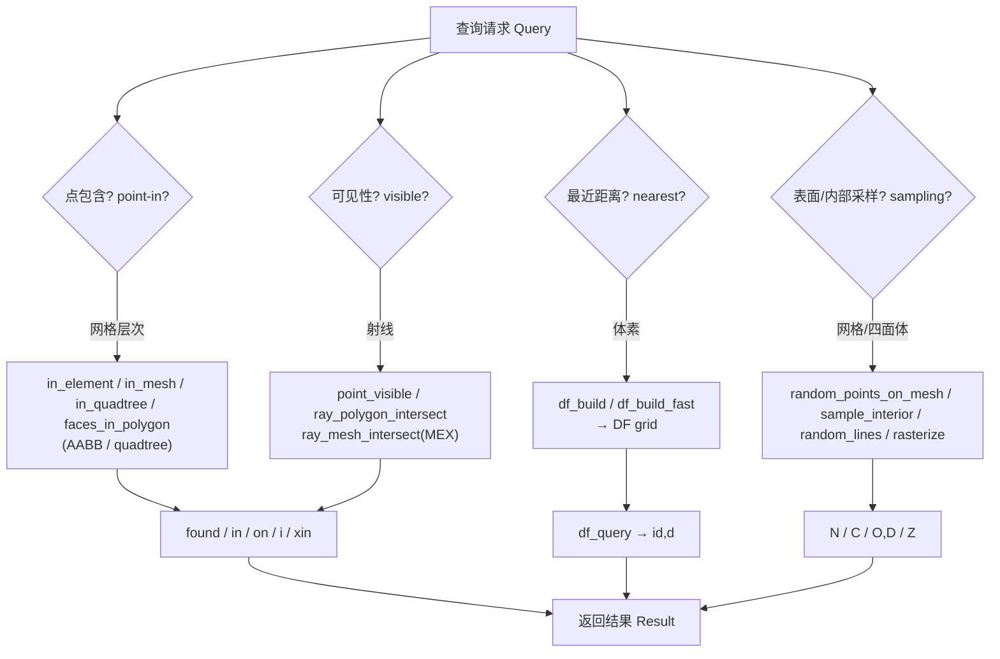

# 10.7 几何查询与定位 / Geometry Queries & Location

> 本章覆盖 `mesh/` 下的**几何查询、空间定位、法向与特征边、距离场与采样**函数：
> 从 `(V,F)` 出发，构建包围体/空间加速结构（AABB 树、四叉树、八叉树、球树），
> 执行点包含、可见性、射线-多边形相交测试，计算各类法向与特征边，
> 以及基于距离场的采样 / 光线步进 / 光栅化。
>
> This chapter covers the **geometry query, spatial location, normals/sharp-edges, and
> distance-field/sampling** functions of `mesh/`: building bounding volumes and spatial
> acceleration structures (AABB tree, quadtree, octree, sphere tree), performing
> point-containment / visibility / ray-polygon intersection tests, computing various
> families of normals and sharp edges, and distance-field-based sampling / sphere
> tracing / rasterization.

- 语言 / Language：中英对照（中文为主）
- 相关章节 / See also：[10-mesh/README.md](README.md)、
  [appendices/03-doc-template.md](../appendices/03-doc-template.md)
- 命名约定 / Notation：`V` 顶点 `#V by dim`、`F` 三角面 `#F by 3`、
  `E` 边 `#E by 2`、`T` 四面体 `#T by 4`、`P/Q` 查询点集 `#P by dim`

---

## 本章概览 / Chapter Overview

### (a) 包围体与空间加速结构 / Bounding volumes & spatial structures

| 函数 | 结构 / 表示 | 主要输出 | 说明 |
|---|---|---|---|
| `box_each_element` | 每个元素的轴对齐包围盒 / per-element AABB | `B1,B2` `#F by dim` | 逐元素 min/max 角点，是 `aabb` 的输入 |
| `aabb` | Eytzinger 完全二叉 AABB 树 / binary AABB tree | `B1,B2,leaf` | 自底向上分割，用于快速剔除/查询 |
| `sphere_tree` | 包围球层次树 / bounding-sphere hierarchy | `c,r,D` | 递归二叉分割，叶子覆盖单点 |
| `initialize_quadtree` | 自适应(可选 graded)四叉树 / quadtree | `C,W,CH,PAR,D,A` | 2D，含父子与邻接信息 |
| `in_quadtree` | 四叉树点定位 / quadtree point location | `i,others` | 对数时间找到包含点的最小叶单元 |
| `lipschitz_octree` | Lipschitz 八叉树 / sparse octree SDF | `ijk,D,uD,uV,uI,uJ` | 稀疏采样 SDF，用 Lipschitz 界剪枝空单元 |
| `box_height_field` | 高度场挤出网格 / height-field box mesh | `V,F` | 由图像高度场生成(近)水密箱体表面 |

### (b) 点包含 / 可见性 / 相交 / Point containment, visibility & intersection

| 函数 | 测试 / Test | 主要输出 | 维度 |
|---|---|---|---|
| `in_element` | 点是否落在每个单纯形内 / point-in-simplex | `found,I,J,L` | dim=1,2,3 |
| `in_elements` | 面是否为某元素的面 / facet-in-element | `I,R,C` | dim=2,3 |
| `in_mesh` | 2D 点在网格内/边界 / 2D point-in-mesh | `in,on,B,L` | 2D |
| `in_quadtree` | 点所在最小叶单元 / point-in-quadtree-cell | `i,others` | 2D |
| `point_inside_polygon` | 求多边形内部一点 / interior point | `interior_point` | 2D |
| `point_visible` | 顶点对某点的可见性 / vertex visibility | `flag` | 2D/3D |
| `ray_polygon_intersect` | 2D 射线-多边形边相交 / ray-polygon | `flag,t,lambda,S` | 2D |
| `half_space_intersect` | 闭网格 ∩ 半空间 / mesh ∩ half-space | `VV,FF,birth` | 3D |
| `faces_in_polygon` | 面是否在 2D 多边形内 / face-in-polygon | `xin,iin,cin` | 2D |

### (c) 法向与特征边 / Normals & sharp edges

| 函数 | 返回 / Returns | 尺寸 | 是否归一化 |
|---|---|---|---|
| `normals` | 每面**未归一化**法向 / unnormalized face normals | `#F by 3`（边为 `#E by 3`） | **否** |
| `per_vertex_normals` | 每顶点加权法向 / per-vertex normals | `#V by 3` | 是（`normalizerow`） |
| `per_edge_normals` | 每边法向 / per-edge normals | `#E by 3` | 是 |
| `per_corner_normals` | 每角法向 / per-corner (per-face-corner) normals | `3*#F by 3` | 是（来自顶点法向） |
| `sharp_edges` | 特征边（二面角阈值）/ sharp edges | `#SE by 2` | — |

### (d) 距离场与采样 / Distance fields & sampling

| 函数 | 目的 / Purpose | 主要输出 | 数据结构 |
|---|---|---|---|
| `df_build` | 体素距离场 + 最近点索引（暴力）/ voxel DF (brute force) | `DF` struct | 规则网格 `C+1` 采样点 |
| `df_build_fast` | 体素距离场（kdtree 加速）/ voxel DF (kdtree) | `DF` struct | 规则网格 + kdtree |
| `df_query` | 用 `DF` 近似最近点/距离 / approximate NN | `id,d` | 读 `DF.N/DF.D` |
| `sphere_tracing` | SDF 光线步进求交 / SDF ray marching | `tI,tt,tC` | 函数句柄 `f(X)` |
| `sample_interior` | 实体内部均匀采样 / interior sampling | `C` `n by 3` | 拒绝采样 |
| `random_points_on_mesh` | 网格表面随机采样 / surface sampling | `N,I,B,r` | 白/蓝噪声 |
| `random_lines` | 超立方体内均匀随机线 / random lines | `O,D,T,N` | Slab 法裁剪到 `[-1,1]^dim` |
| `rasterize` | 2D 折线 Bresenham 光栅化 / polyline rasterization | `Z` w×h | 索引图 |

> **MEX 依赖总则 / MEX note**：本清单中的 `in_element`（`'ray-stabbing'` 路径）、
> `point_visible`、`half_space_intersect`（`cap`）、`sample_interior`、
> `point_inside_polygon` 会经由同库非本清单函数**间接调用 MEX**：
> `ray_mesh_intersect`（[mex/ray_mesh_intersect.m](file:///c:/VSWork/gptoolbox-1/mex/ray_mesh_intersect.m)）、
> `winding_number`（[mex/winding_number.m](file:///c:/VSWork/gptoolbox-1/mex/winding_number.m)）、
> `signed_distance`（[mex/signed_distance.m](file:///c:/VSWork/gptoolbox-1/mex/signed_distance.m)）、
> `point_mesh_squared_distance`（[mex/point_mesh_squared_distance.m](file:///c:/VSWork/gptoolbox-1/mex/point_mesh_squared_distance.m)）。
> 清单中的 `per_vertex_normals` 家族**不调用任何 MEX**（纯 MATLAB，依赖 `matrix/normalizerow`）。
> `in_element_aabb` **不在**本清单（其 MEX 桩见
> [mex/in_element_aabb.m](file:///c:/VSWork/gptoolbox-1/mex/in_element_aabb.m)）。

### 查询请求 → 选择结构 → 返回结果 / Query → structure → result



---

## 逐函数条目 / Per-function entries

### `aabb` — 构建 Eytzinger 完全二叉 AABB 树 / Build an Eytzinger AABB tree
- **文件 / File**: [mesh/aabb.m](file:///c:/VSWork/gptoolbox-1/mesh/aabb.m#L1-L90)
- **签名 / Signature**: `[B1,B2,leaf] = aabb(PB1,PB2)`
- **功能 / Purpose**: `EN: Build an Eytzinger BFS-layout binary AABB tree over primitive boxes.` / 中文：对一组图元包围盒构建 **Eytzinger（BFS 布局的完全二叉树）** AABB 层次树。
- **输入 / Inputs**:

  | 参数 | 尺寸/类型 | 含义 (中 / EN) |
  |---|---|---|
  | `PB1` | `#P by dim` | 图元包围盒最小角点 / primitive box min corners |
  | `PB2` | `#P by dim` | 图元包围盒最大角点 / primitive box max corners |

- **输出 / Outputs**:

  | 参数 | 尺寸/类型 | 含义 |
  |---|---|---|
  | `B1` | `#B by dim` | 各节点包围盒最小角点 / node box min corners |
  | `B2` | `#B by dim` | 各节点包围盒最大角点 / node box max corners |
  | `leaf` | `#B by 1` | 叶节点对应的图元索引，非叶为 `0`（初始化 `-1`）/ leaf primitive index or 0 |

- **可选参数 / Optional**: 无 / none
- **变量流动 / Variable flow**: `PB1,PB2 →(取中心 PBC = 0.5*(PB1+PB2))→ PBC →(递归 recursive_helper: 按最长轴中位数分割)→ B1,B2,leaf`
- **算法步骤 / Algorithm**:
  1. 计算图元中心 `PBC = 0.5*(PB1+PB2)`；节点数取 `complete_m = 2^(ceil(log2(m))+1)`，使树为完全二叉树（Eytzinger 布局：左子 `2*i`、右子 `2*i+1`）。
  2. `leaf`/`B1`/`B2` 预置为 `-1`/`NaN` 填充到 `complete_m`。
  3. `recursive_helper(i,I)`：对当前节点包含的图元集合 `I` 取 `min`/`max` 得该节点包围盒；若只剩 1 个图元则标记为叶并记录其索引。
  4. 选取包围盒最长维度 `dir`，以 `median(PBC(I,dir))` 为中位数分割值，`<` 与 `>` 各自成组，`==` 的均分两半，分别递归到左右子节点。
- **流程图 / Flowchart**:

  ```mermaid
  flowchart TD
    A["输入 PB1,PB2"] --> B["PBC = 0.5*(PB1+PB2)"]
    B --> C["complete_m = 2^(ceil(log2(m))+1)"]
    C --> D["recursive_helper(1, I)"]
    D --> E{"|I| == 1 ?"}
    E -- 是 --> F["标记为叶 leaf(i)=I(1)"]
    E -- 否 --> G["按最长轴中位数分割 I 为 left/right"]
    G --> H["递归 helper(2i, left) 与 helper(2i+1, right)"]
    F --> Z["输出 B1,B2,leaf"]
    H --> Z
  ```

- **依赖 / Dependencies**: 无同库依赖（仅内置 `min/max/median/log2/repmat`）/ none (built-ins only)
- **See also**: `box_each_element`, `repmesh`, `in_element_aabb` (MEX stub)

### `box_each_element` — 每个元素的轴对齐包围盒 / Per-element axis-aligned bounding boxes
- **文件 / File**: [mesh/box_each_element.m](file:///c:/VSWork/gptoolbox-1/mesh/box_each_element.m#L1-L18)
- **签名 / Signature**: `[B1,B2] = box_each_element(V,F)`
- **功能 / Purpose**: `EN: Compute min/max corners of the axis-aligned bounding box of each element.` / 中文：计算每个元素（三角形/四面体/边）的**轴对齐包围盒**的 min/max 角点。
- **输入 / Inputs**:

  | 参数 | 尺寸/类型 | 含义 (中 / EN) |
  |---|---|---|
  | `V` | `#V by dim` | 网格顶点坐标 / mesh vertex positions |
  | `F` | `#F by ss` | 元素索引表（`ss` 为每元素顶点数）/ simplex indices |

- **输出 / Outputs**:

  | 参数 | 尺寸/类型 | 含义 |
  |---|---|---|
  | `B1` | `#F by dim` | 每元素盒最小角点 / per-element box min corners |
  | `B2` | `#F by dim` | 每元素盒最大角点 / per-element box max corners |

- **可选参数 / Optional**: 无 / none
- **变量流动 / Variable flow**: `V,F →(reshape(V(F,:)') 转成 dim × ss × #F)→ →(bounds(...,3) 沿第 3 维取 min/max)→ B1',B2'`
- **算法步骤 / Algorithm**:
  1. 将 `V(F,:)` 变形为 `dim × ss × #F` 的三维数组。
  2. 调用 `bounds(X,3)`（外部函数，见下）沿第 3 维（元素维）求 min/max。
  3. 转置得到 `#F by dim` 的 `B1,B2`。
- **流程图 / Flowchart**:

  ```mermaid
  flowchart TD
    A["输入 V,F"] --> B["reshape(V(F,:)', dim, ss, #F)"]
    B --> C["bounds(X,3) 沿元素维取 min/max"]
    C --> D["转置为 #F by dim"]
    D --> Z["输出 B1,B2"]
  ```

- **依赖 / Dependencies**: `bounds`（**外部函数，本仓库未 vendored** / external, not vendored in this repo）
- **See also**: `aabb`, `in_element`, `repmesh`

### `box_height_field` — 由高度场挤出箱体网格 / Extrude a height field into a box mesh
- **文件 / File**: [mesh/box_height_field.m](file:///c:/VSWork/gptoolbox-1/mesh/box_height_field.m#L1-L257)
- **签名 / Signature**: `[V,F] = box_height_field(im,'Closed',closed)`
- **功能 / Purpose**: `EN: Create a height field of boxes (each pixel extruded into a square column); result is water-tight except the outer boundary.` / 中文：把每个像素**挤出一个方形柱体**形成箱体高度场；结果除外部边界外基本水密（鞍点 `[1 0;0 1]` 处会产生非流形边）。
- **输入 / Inputs**:

  | 参数 | 尺寸/类型 | 含义 (中 / EN) |
  |---|---|---|
  | `im` | `h by w` | 规则网格上的高度场 / height field on a regular grid |

- **输出 / Outputs**:

  | 参数 | 尺寸/类型 | 含义 |
  |---|---|---|
  | `V` | `#V by 3` | 3D 表面顶点 / surface vertex positions |
  | `F` | `#F by 3` | 3D 三角形索引 / surface triangle indices |

- **可选参数 / Optional**:

  | 名称 | 取值 | 默认 | 含义 |
  |---|---|---|---|
  | `'Closed'` | `logical` | `true` | 是否生成封闭网格（较慢）/ produce closed mesh (slower) |

- **变量流动 / Variable flow**: `im →(非 float 则 double 化)→ im →(Closed? 选 closed/fast 实现)→ (左-右 strips + 上-下 strips 拼接)→ V,F →(remove_duplicate_vertices → unique(排序面) → doublearea>0 定向 → remove_unreferenced)→ V,F`
- **算法步骤 / Algorithm**:
  1. 解析 `'Closed'` 参数；若非浮点则转 `double`。
  2. `Closed=true` 走 `box_height_field_closed`：沿行方向 `strips` 生成左右相邻柱体间的侧壁（含上下方插值点 `Zabove/Zbelow`），再沿列方向 `strips(Y',X',Z')` 生成上下相邻柱体侧壁，两段 `[VLR;VTB]`、`[fliplr(FLR); size(VLR,1)+FTB]` 拼接；顶面由 `tops=true` 生成。
  3. `Closed=false` 走 `box_height_field_fast`：只生成柱体之间的边界（更简单更快）。
  4. 统一清理：`remove_duplicate_vertices` 合并重复顶点，`unique(sort(F,2),'rows')` 去重面，`doublearea(V,F)>0` 保留正定向面，`remove_unreferenced` 压缩顶点。
- **流程图 / Flowchart**:

  ```mermaid
  flowchart TD
    A["输入 im"] --> B{"Closed ?"}
    B -- 是 --> C["box_height_field_closed: strips 左右+上下"]
    B -- 否 --> D["box_height_field_fast: 柱间边界"]
    C --> E["V,F 拼接"]
    D --> E
    E --> F["remove_duplicate_vertices"]
    F --> G["unique(sort(F,2)) 去重面"]
    G --> H["保留 doublearea>0 的面"]
    H --> I["remove_unreferenced"]
    I --> Z["输出 V,F"]
  ```

- **依赖 / Dependencies**: `remove_duplicate_vertices`, `remove_unreferenced`, `doublearea`
- **See also**: `voxel_grid`, `voxel_surface`, `cubic_aabb`

### `in_element` — 点是否落在每个元素内 / Test points against each element
- **文件 / File**: [mesh/in_element.m](file:///c:/VSWork/gptoolbox-1/mesh/in_element.m#L1-L437)
- **签名 / Signature**: `[found,I,J,L] = in_element(V,F,P,'Method',m,'First',first,'Quiet',quiet,'Epsilon',eps,'Polish',polish)`
- **功能 / Purpose**: `EN: For each query point in P, test whether it lies inside each element in F defined over V; returns matches and barycentric coordinates.` / 中文：对每个查询点 `P`，测试其是否落在由 `V` 定义的每个元素 `F` 内部，返回匹配对与重心坐标。
- **输入 / Inputs**:

  | 参数 | 尺寸/类型 | 含义 (中 / EN) |
  |---|---|---|
  | `V` | `#V by dim` | 顶点坐标 / vertex positions |
  | `F` | `#F by dim+1` | 元素（单纯形）索引 / element indices |
  | `P` | `#P by dim` | 查询点 / query positions |

- **输出 / Outputs**:

  | 参数 | 尺寸/类型 | 含义 |
  |---|---|---|
  | `found` | `#P by 1` | 是否**存在**匹配元素 / flags whether a point was found |
  | `I` | `#I by 1` | 命中点在 `P` 中的索引 / indices into `P` |
  | `J` | `#I by 1` | 命中元素在 `F` 中的索引 / indices into `F` |
  | `L` | `#I by dim+1` | 命中点的重心坐标 / barycentric coordinates of `P(I,:)` in `F(J,:)` |

- **可选参数 / Optional**（**注释与实现不一致：源码实际接受下列 5 个键** / header lists a subset; the parser accepts 5 keys）:

  | 名称 | 取值 | 默认 | 含义 |
  |---|---|---|---|
  | `'Method'` | `'brute-force'`/`'edge-walk'`/`'knn'`/`'spatial-hash'`/`'ray-stabbing'` | `1D:brute-force；否则 knn` | 加速策略 / acceleration strategy |
  | `'First'` | `logical` | `false` | 只保留首个匹配（**当前实现断言未支持**：`assert(first==false,'not (re)implemented')`）/ keep first match (asserted unimplemented) |
  | `'Quiet'` | `logical` | `false` | 抑制警告 / suppress warnings |
  | `'Epsilon'` | `double` | `eps` | 包含判定阈值 / epsilon for inclusion |
  | `'Polish'` | `double` | `eps` | 若真值则重算 `L` / forces recompute of `L` |

- **变量流动 / Variable flow**: `V,F,P →(参数解析, method 缺省推断)→ method →(brute-force: 单纯形体积/Heron 面积判据)→ I →(find)→ I,J →(nargout>3 时 barycentric_coordinates)→ L`；`ray-stabbing` 分支额外：`U=[V(F,:) -face_id] → ray_mesh_intersect → 递归剔除命中面 → I,J,L`
- **算法步骤 / Algorithm**:
  1. 解析 `Method/First/Quiet/Epsilon/Polish`；若未指定 `Method`：1D 用 `'brute-force'`，否则 `'knn'`。
  2. `'brute-force'`：`dim=3` 用四面体体积判据（`sumvol ≈ vol`）；`dim=2` 用 Heron 公式算点-三角形面积和与真实面积比较；`dim=1` 用区间包含。返回稀疏指示矩阵后 `find` 出 `I,J`。
  3. `'spatial-hash'`：对 `#F` 均匀分格，对 `V,P` 哈希入格，仅在同格内做暴力测试；再用 `winding_number` 对"疑似内部但未命中"的点修正（对 `F` 先取 `outline`/`boundary_faces`）。
  4. `'edge-walk'`：2D 三角网格沿共享边走向查询点所在面（`lineSegmentIntersect` 判交、`on_boundary` 处理边界跳转）。
  5. `'ray-stabbing'`：把 2D 网格挤成带面 id 的"fake 3D"，从查询点向 `-z` 发射线，`ray_mesh_intersect` 命中则递归剔除已命中面（`ray_stab_recursive`）。
  6. `'knn'`：`knnsearch` 找最近面重心，用 `barycentric_coordinates` 判定是否在面内，未命中点逐步增大 `k`。
  7. 汇总 `I,J`，`found = accumarray(I,1)>0`；若 `nargout>3` 计算重心坐标 `L`。
- **流程图 / Flowchart**:

  ```mermaid
  flowchart TD
    A["输入 V,F,P"] --> B{"Method 指定?"}
    B -- 否 --> B1["1D→brute-force; 其余→knn"]
    B -- 是 --> C["解析 Method"]
    B1 --> C
    C --> D{"选择分支"}
    D -->|brute-force| E1["体积/Heron 面积判据 → I"]
    D -->|spatial-hash| E2["分格哈希 + winding_number 修正"]
    D -->|edge-walk| E3["沿边行走 + lineSegmentIntersect"]
    D -->|ray-stabbing| E4["ray_mesh_intersect 递归剔除"]
    D -->|knn| E5["knnsearch + barycentric_coordinates"]
    E1 --> F["find → I,J"]
    E2 --> F
    E3 --> F
    E4 --> F
    E5 --> F
    F --> G["found = accumarray(I,1)>0"]
    G --> H{"nargout>3 ?"}
    H -- 是 --> I2["L = barycentric_coordinates"]
    H -- 否 --> J2["跳过 L"]
    I2 --> Z["输出 found,I,J,L"]
    J2 --> Z
  ```

- **依赖 / Dependencies**: `volume`, `doublearea`, `barycentric_coordinates`, `barycenter`, `outline`, `boundary_faces`, `on_boundary`, `snap_points`, `winding_number`(MEX), `ray_mesh_intersect`(MEX), `lineSegmentIntersect`(external)
- **See also**: `in_elements`, `in_mesh`, `in_element_aabb`(MEX), `barycentric_coordinates`, `snap_points`

### `in_elements` — 面是否为某元素的面 / Check whether facets appear in an element list
- **文件 / File**: [mesh/in_elements.m](file:///c:/VSWork/gptoolbox-1/mesh/in_elements.m#L1-L29)
- **签名 / Signature**: `[I,R,C] = in_elements(F,T)`
- **功能 / Purpose**: `EN: Check whether each facet in F truly appears as a facet of at least one element in T.` / 中文：检查 `F` 中每个面是否**真的**作为 `T` 中某个元素的面出现。
- **输入 / Inputs**:

  | 参数 | 尺寸/类型 | 含义 (中 / EN) |
  |---|---|---|
  | `F` | `#F by dim` | 面表 / facet list |
  | `T` | `#T by dim+1` | 元素表 / element list |

- **输出 / Outputs**:

  | 参数 | 尺寸/类型 | 含义 |
  |---|---|---|
  | `I` | `#F by 1` | 是否为元素面的指示 / indicator |
  | `R` | `#F by 1` | 首个匹配元素索引 / first tet index |
  | `C` | `#F by 1` | 在该元素中的位置 / position within the first tet |

- **可选参数 / Optional**: 无 / none
- **变量流动 / Variable flow**: `F,T →(枚举 T 的所有面 allF)→ sort(F,2),sort(allF,2) →(ismember,...)→ LOCB →(mod/floor 解码)→ R,C`
- **算法步骤 / Algorithm**:
  1. 断言 `size(F,2)+1 == size(T,2)`。
  2. 枚举 `T` 的全部面 `allF`（`dim=2` 为 3 个面，`dim=3` 为 4 个面）。
  3. `ismember(sort(F,2),sort(allF,2),'rows')` 得到布尔 `I` 与位置 `LOCB`。
  4. `R = mod(LOCB-1,size(T,1))+1`；`C = floor((LOCB-1)/size(T,1))+1`。
- **流程图 / Flowchart**:

  ```mermaid
  flowchart TD
    A["输入 F,T"] --> B["枚举 allF = T 的所有面"]
    B --> C["ismember(sort(F),sort(allF)) → I,LOCB"]
    C --> D["R = mod(LOCB-1,#T)+1"]
    D --> E["C = floor((LOCB-1)/#T)+1"]
    E --> Z["输出 I,R,C"]
  ```

- **依赖 / Dependencies**: 无同库依赖（`ismember` 为内置）/ none (built-in `ismember`)
- **See also**: `in_element`, `boundary_faces`

### `in_mesh` — 2D 点是否在网格内/边界 / 2D point-in-mesh test
- **文件 / File**: [mesh/in_mesh.m](file:///c:/VSWork/gptoolbox-1/mesh/in_mesh.m#L1-L39)
- **签名 / Signature**: `[in,on,B,L] = in_mesh(V,F,Q)`
- **功能 / Purpose**: `EN: Test whether a list of points are inside a given 2D mesh (via its outline polygon).` / 中文：测试一批点是否在给定 2D 网格内（借助网格的外轮廓多边形）。
- **输入 / Inputs**:

  | 参数 | 尺寸/类型 | 含义 (中 / EN) |
  |---|---|---|
  | `V` | `#V by 2` | 顶点坐标（**仅 2D**）/ vertex positions |
  | `F` | `#F by 3` | 面索引 / face indices |
  | `Q` | `#Q by 2` | 查询点 / query points |

- **输出 / Outputs**:

  | 参数 | 尺寸/类型 | 含义 |
  |---|---|---|
  | `in` | `#Q by 1` | 是否在多边形内部 / inside flags |
  | `on` | `#Q by 1` | 是否在边界上 / on-boundary flags |
  | `B` | `#B by 1` | 网格外轮廓边索引 / outline edges |
  | `L` | `#loops+1 by 1` | 边界环起始索引 / boundary loop starts |

- **可选参数 / Optional**: 无 / none
- **变量流动 / Variable flow**: `V,F → ordered_outline → B,L →(断言仅 1 个环)→ 闭合多边形顶点 → inpolygon(Q) → in,on`
- **算法步骤 / Algorithm**:
  1. 断言 `dim==2`。
  2. `[B,L] = ordered_outline(F)` 取有序外轮廓边与环起点。
  3. 断言只有一个环（`numel(L)==2`），不支持孔洞/多连通分量。
  4. 将环重新闭合后调用 `inpolygon` 得到 `in,on`。
- **流程图 / Flowchart**:

  ```mermaid
  flowchart TD
    A["输入 V,F,Q"] --> B["ordered_outline(F) → B,L"]
    B --> C{"numel(L)==2 ?"}
    C -- 否 --> C1["断言失败: 不支持孔洞/多分量"]
    C -- 是 --> D["闭合环顶点"]
    D --> E["inpolygon"]
    E --> Z["输出 in,on,B,L"]
  ```

- **依赖 / Dependencies**: `ordered_outline`
- **See also**: `near_mesh`, `faces_in_polygon`, `inpolygon`(MATLAB)

### `in_quadtree` — 四叉树中点定位 / Point location in a quadtree
- **文件 / File**: [mesh/in_quadtree.m](file:///c:/VSWork/gptoolbox-1/mesh/in_quadtree.m#L1-L79)
- **签名 / Signature**: `[i,others] = in_quadtree(point,C,W,CH)`
- **功能 / Purpose**: `EN: Traverse a quadtree in logarithmic time to find the smallest cell containing a given 2D point.` / 中文：以对数时间遍历四叉树，找到包含给定 2D 点的**最小单元**。
- **输入 / Inputs**:

  | 参数 | 尺寸/类型 | 含义 (中 / EN) |
  |---|---|---|
  | `point` | `1 by 2`（文档写 size-3）| 查询点 / query point |
  | `C` | `#nodes by 3` | 单元中心 / cell centers |
  | `W` | `#nodes by 1` | 单元宽度（**非半宽**）/ cell widths |
  | `CH` | `#nodes by 4` | 子节点索引（叶为 -1）/ child indices |

- **输出 / Outputs**:

  | 参数 | 尺寸/类型 | 含义 |
  |---|---|---|
  | `i` | 标量 | 最小包含单元的索引（找不到为 -1）/ smallest containing cell index |
  | `others` | `#k by 1` | 其他包含该点的非叶单元 / other non-leaf containing cells |

- **可选参数 / Optional**: 无 / none
- **变量流动 / Variable flow**: `point,C,W,CH →(BFS 队列 queue)→(is_in_quad 判包含)→ others →(遇叶单元)→ i`
- **算法步骤 / Algorithm**:
  1. 初始化 `queue=1`、`i=-1`、`others=[]`。
  2. 从队列弹出一个单元 `q`，用 `is_in_quad`（min/max 角点比较）判断点是否在其中；若是则加入 `others`。
  3. 若 `q` 是叶（`CH(q,1)==-1`）则记录 `i=q` 并结束；否则将其 4 个子节点入队。
  4. 队列空则结束。
- **流程图 / Flowchart**:

  ```mermaid
  flowchart TD
    A["输入 point,C,W,CH"] --> B["queue=[1], i=-1, others=[]"]
    B --> C{"queue 非空?"}
    C -- 否 --> Z["输出 i,others"]
    C -- 是 --> D["弹出 q"]
    D --> E{"is_in_quad(point) ?"}
    E -- 是 --> F["others 追加 q"]
    F --> G{"CH(q,1)==-1 (叶)?"}
    G -- 是 --> H["i=q 结束"]
    G -- 否 --> I["子节点入队"]
    E -- 否 --> C
    I --> C
    H --> Z
  ```

- **依赖 / Dependencies**: `initialize_quadtree`（配合使用）
- **See also**: `initialize_quadtree`, `bad_quad_mesh_from_quadtree`

### `initialize_quadtree` — 构建自适应(可选 graded)四叉树 / Build an adaptive quadtree
- **文件 / File**: [mesh/initialize_quadtree.m](file:///c:/VSWork/gptoolbox-1/mesh/initialize_quadtree.m#L1-L270)
- **签名 / Signature**: `[C,W,CH,PAR,D,A] = initialize_quadtree(P,'MinDepth',min_depth,'MaxDepth',max_depth,'Graded',graded)`
- **功能 / Purpose**: `EN: Build an adaptively refined (optionally graded) quadtree keeping track of all parentage and adjacency information.` / 中文：构建自适应细分（可选 graded）的四叉树，记录全部父子与邻接信息，便于遍历与差分计算（**刻意不做超出渐近复杂度的优化**，侧重可读与可移植）。
- **输入 / Inputs**:

  | 参数 | 尺寸/类型 | 含义 (中 / EN) |
  |---|---|---|
  | `P` | `#P by 3`（前 2 维有效）| 点集，点多的区域更细分 / input points |

- **输出 / Outputs**:

  | 参数 | 尺寸/类型 | 含义 |
  |---|---|---|
  | `C` | `#nodes by 3` | 单元中心 / cell centers |
  | `W` | `#nodes by 1` | 单元宽度（非半宽）/ cell widths |
  | `CH` | `#nodes by 4` | 子节点索引（叶为 -1）/ child indices |
  | `PAR` | `#nodes by 1` | 父节点索引 / parent indices |
  | `D` | `#nodes by 1` | 深度 / tree depths |
  | `A` | `#nodes by #nodes` `sparse` | 邻接矩阵，`A(i,j)=a` 表示 j 在 i 的第 a 方向（1左 2右 3下 4上）/ adjacency |

- **可选参数 / Optional**:

  | 名称 | 取值 | 默认 | 含义 |
  |---|---|---|---|
  | `'MinDepth'` | 整数 | `1` | 最小树深 / min depth |
  | `'MaxDepth'` | 整数 | `7` | 最大树深（最小边长 = bbox 长 ×`2^-MaxDepth`）/ max depth |
  | `'Graded'` | `logical` | `true` | 是否保证相邻四叉块深度差 ≤1 / graded |

- **变量流动 / Variable flow**: `P →(bbox: Vmin,Vmax)→ 根单元 C,W →(循环: 若含点或未达 MinDepth 且未达 MaxDepth 则 subdivide_quad)→ 递归细分 + 邻接更新 A →(Graded 时对邻居递归细分)→ C,W,CH,PAR,D,A`
- **算法步骤 / Algorithm**:
  1. 解析 `MinDepth/MaxDepth/Graded`。
  2. 用 `P` 的包围盒初始化根单元 `C,W`，`CH=[-1 -1 -1 -1]`、`D=1`、`A=sparse(1,1)`、`PAR=-1`。
  3. 顺序遍历持续增长单元列表 `C`：若单元是叶、且（深度 `<MinDepth` 或 含有点）且深度 `<MaxDepth`，则调用 `subdivide_quad`。
  4. `subdivide_quad`：新增 4 个半宽子单元，更新 `C2/W2/CH2/PAR2/D2`，并按方向编码用 `rect_mat`/`square_mat`/`transpose_orientation` 重建邻接 `A2`（含邻居深度更高时向上回溯定位）。
  5. 若 `Graded`，对深度比当前低 1 的邻居再递归细分以保证平衡。
- **流程图 / Flowchart**:

  ```mermaid
  flowchart TD
    A["输入 P"] --> B["bbox → 根单元 C,W; CH=-1; D=1; A=sparse(1,1)"]
    B --> C{"quad_ind <= #C ?"}
    C -- 否 --> Z["输出 C,W,CH,PAR,D,A"]
    C -- 是 --> D{"是叶 且 (D<MinDepth 或 含点) 且 D<MaxDepth ?"}
    D -- 否 --> C
    D -- 是 --> E["subdivide_quad: 新增 4 子 + 重建邻接 A"]
    E --> F{"Graded ?"}
    F -- 是 --> G["对更浅的邻居递归细分"]
    F -- 否 --> C
    G --> C
  ```

- **依赖 / Dependencies**: 无同库依赖（内置 `sparse` 等）/ none
- **See also**: `in_quadtree`, `bad_quad_mesh_from_quadtree`
### `lipschitz_octree` — Lipschitz 八叉树稀疏采样 SDF / Sparse octree sampling for distance fields
- **文件 / File**: [mesh/lipschitz_octree.m](file:///c:/VSWork/gptoolbox-1/mesh/lipschitz_octree.m#L1-L127)
- **签名 / Signature**: `[ijk,D,uD,uV,uI,uJ] = lipschitz_octree(origin,h0,max_depth,udf,sdf)`
- **功能 / Purpose**: `EN: Build a sparse (pruned) octree that evaluates an unsigned distance function on cell corners, pruning cells guaranteed empty via a Lipschitz bound; optionally refines the surviving leaf cells with a signed distance.` / 中文：构建**稀疏（剪枝）八叉树**：在单元角点求（无符号）距离函数，用 **Lipschitz 界**剪掉保证为空的单元；最后可用**有符号**距离函数细化保留下来的叶单元。典型用途：高效生成可在其上跑 marching cubes 的窄带 SDF 采样。
- **输入 / Inputs**:

  | 参数 | 尺寸/类型 | 含义 (中 / EN) |
  |---|---|---|
  | `origin` | `1 by 3` | 包围盒原点 / bbox origin |
  | `h0` | 标量 | 深度 0 单元边长 / root cell edge length |
  | `max_depth` | 整数 | 最大深度 / max depth |
  | `udf` | 函数句柄 | 无符号距离 `udf(P): #P by 3 → #P` / unsigned distance |
  | `sdf` | 函数句柄（可选）| 有符号距离 `sdf(P)`；缺省 `[]` / signed distance |

- **输出 / Outputs**:

  | 参数 | 尺寸/类型 | 含义 |
  |---|---|---|
  | `ijk` | `#leaf by 3` | 叶单元整数坐标 / leaf cell integer coords |
  | `D` | `#cells by 8` | 叶单元角点（有符号）距离 / per-cell corner values |
  | `uD` | `#unique by 1` 等价形 | 计算得到的距离值 / evaluated values |
  | `uV` | `#unique by 3` | 唯一角点位置 / unique corner positions |
  | `uI` | `#… by 1` | 唯一化索引 / unique indices |
  | `uJ` | `#cells*8 by 1` | 角点 → 唯一值映射（可 `reshape([],8)`）/ corner→unique map |

- **可选参数 / Optional**: 无（`sdf` 为第 5 位参，缺省 `[]`）/ none (5th positional arg `sdf`)
- **变量流动 / Variable flow**: `origin,h0 →(逐深度 depth=0..max_depth: h=h0/2^depth)→ 角点 ijk →(unique_corners 去重)→ uV →(udf 求值)→ U →(Lipschitz 界: U > h*sqrt(3) 剪枝)→ 保留 ijk →(×2 + 偏移展开 8 子)→ 下一层` 直到 `depth==max_depth` 用 `sdf` 求 `D`。
- **算法步骤 / Algorithm**:
  1. 若未给 `sdf` 则置 `[]`。
  2. 从 `ijk=[0 0 0]` 开始，逐层 `depth=0..max_depth`，边长 `h = h0/2^depth`。
  3. 非最深层：用 `udf` 在 8 角点求值（`eval_on_corners` → `unique_corners` 去重），用 Lipschitz 判据 `sufficient_1 = any(U > h*sqrt(3))` 与 `sufficient_2 = all(U > h*sqrt(3)/2)` 标记"空单元"并剔除，其余单元 8 分裂（`ijk*2 + {0,1}^3`）。
  4. 最深层且给定 `sdf`：用 `sdf` 求角点值 `D`，`necessary = all(D>0,2)|all(D<0,2)` 剔除非跨界单元后退出。
- **流程图 / Flowchart**:

  ```mermaid
  flowchart TD
    A["输入 origin,h0,max_depth,udf,sdf"] --> B["ijk=[0 0 0], depth=0"]
    B --> C["h = h0 / 2^depth"]
    C --> D{"depth == max_depth 且 sdf 非空 ?"}
    D -- 是 --> E["sdf 求 D; 剔除 all(同号) 单元"]
    E --> Z["输出 ijk,D,uD,uV,uI,uJ"]
    D -- 否 --> F["udf 求 U (角点去重)"]
    F --> G["Lipschitz 剪枝: 保留非空单元"]
    G --> H{"depth == max_depth ?"}
    H -- 是 --> Z
    H -- 否 --> I["8 分裂 ijk*2+offset"]
    I --> C
  ```

- **依赖 / Dependencies**: `point_mesh_squared_distance`(MEX, 示例用), `marching_cubes_sparse`(示例), `draw_boxes`(调试)
- **See also**: `sphere_tracing`, `df_build`, `signed_distance`(MEX)

### `sphere_tree` — 覆盖点的包围球层次树 / Bounding-sphere tree
- **文件 / File**: [mesh/sphere_tree.m](file:///c:/VSWork/gptoolbox-1/mesh/sphere_tree.m#L1-L57)
- **签名 / Signature**: `[c,r,D] = sphere_tree(P,R)`
- **功能 / Purpose**: `EN: Compute a tree of spheres that cover the points in P with radii R.` / 中文：计算一棵**包围球树**，用给定的半径 `R` 覆盖点集 `P`。
- **输入 / Inputs**:

  | 参数 | 尺寸/类型 | 含义 (中 / EN) |
  |---|---|---|
  | `P` | `#P by dim` | 点集 / points |
  | `R` | `#P by 1`（可选，默认全 0）| 每点半径 / radii |

- **输出 / Outputs**:

  | 参数 | 尺寸/类型 | 含义 |
  |---|---|---|
  | `c` | `#c by dim` | 球心 / sphere centers |
  | `r` | `#c by 1` | 半径 / radii |
  | `D` | `#c by 2` | 左右子索引；若 `D(i,1)` 为 `NaN` 则 i 为叶且 `D(i,2)` 为其覆盖点的索引 / child indices |

- **可选参数 / Optional**: 无 / none
- **变量流动 / Variable flow**: `P,R →(单点? 直接返回叶)→ minimal_bounding_sphere → c_root,r_root →(沿最大跨度维排序取中点二分)→ 递归 left/right → 索引重映射 → 拼接 c,r,D`
- **算法步骤 / Algorithm**:
  1. 若未给 `R` 则全 0；若 `P` 仅 1 点返回叶 `D=[nan 1]`。
  2. `minimal_bounding_sphere(P,R)` 求根球（并断言覆盖成立）。
  3. 求 `P` 跨度最大维度，沿该维排序，取中点一分为二，递归构建子树。
  4. 将子树的叶索引映射回原点索引、内部子树索引加偏移，拼接成 `c=[c_root;c1;c2]`、`r`、`D`。
- **流程图 / Flowchart**:

  ```mermaid
  flowchart TD
    A["输入 P,R"] --> B{"size(P,1)==1 ?"}
    B -- 是 --> Z1["叶: c=P,r=R,D=[nan 1]"]
    B -- 否 --> C["minimal_bounding_sphere → c_root,r_root"]
    C --> D["按最大跨度维排序, 中点二分"]
    D --> E["递归 sphere_tree(left), sphere_tree(right)"]
    E --> F["索引重映射 + 拼接"]
    F --> Z["输出 c,r,D"]
  ```

- **依赖 / Dependencies**: `minimal_bounding_sphere`
- **See also**: `minimal_bounding_sphere_welzl`, `aabb`, `farthest_points`

### `near_mesh` — 点是否在网格内或近旁 / Points near or inside a 2D mesh
- **文件 / File**: [mesh/near_mesh.m](file:///c:/VSWork/gptoolbox-1/mesh/near_mesh.m#L1-L68)
- **签名 / Signature**: `[near,in,on,B,L] = near_mesh(V,F,Q,epsilon)`
- **功能 / Purpose**: `EN: Test whether a list of points are in or near a given 2D mesh, within an epsilon band around the boundary.` / 中文：测试一批点是否在给定 2D 网格**内部或近旁**（距边界 `epsilon` 之内）。
- **输入 / Inputs**:

  | 参数 | 尺寸/类型 | 含义 (中 / EN) |
  |---|---|---|
  | `V` | `#V by 2` | 顶点坐标（仅 2D）/ vertex positions |
  | `F` | `#F by 3` | 面索引 / face indices |
  | `Q` | `#Q by 2` | 查询点 / query points |
  | `epsilon` | 标量（可选）| 允许距离阈值，默认取最小边长的一半 / distance threshold |

- **输出 / Outputs**:

  | 参数 | 尺寸/类型 | 含义 |
  |---|---|---|
  | `near` | `#Q by 1` | 是否在网格内或边界附近 / near flags |
  | `in` | `#Q by 1` | 是否严格在网格内 / inside flags |
  | `on` | `#Q by 1` | 是否在边界上 / on-boundary flags |
  | `B` | `#B by 1` | 外轮廓边 / outline edges |
  | `L` | `#loops+1 by 1` | 边界环起点 / boundary loop starts |

- **可选参数 / Optional**: 位置参数 `epsilon`（**非**名值对）/ positional `epsilon`

  | 名称 | 取值 | 默认 | 含义 |
  |---|---|---|---|
  | `epsilon` | 标量 | `min(边长)/2` | 近旁判定距离阈值 / near threshold |

- **变量流动 / Variable flow**: `V,F,Q → in_mesh → in,on,B,L →(边界边 BE, project_to_lines → T,sqrD)→(端点距离修正)→ minD → near = (minD<eps²) | in`
- **算法步骤 / Algorithm**:
  1. 若未给 `epsilon`，取所有边长的最小值除以 2。
  2. 断言 2D；`in_mesh` 得到 `in,on,B,L`。
  3. 由 `B` 构造边界线段 `BE`，`project_to_lines` 求投影参数 `T` 与平方距离 `sqrD`。
  4. 当投影落在端点外侧（`T<0`/`T>1`）时用点到端点的平方距离替换；取每点最小平方距离 `minD`。
  5. `near = (minD < epsilon²) | in`（严格在内的点也算 near）。
- **流程图 / Flowchart**:

  ```mermaid
  flowchart TD
    A["输入 V,F,Q,epsilon"] --> B{"epsilon 给定?"}
    B -- 否 --> B1["epsilon = min(边长)/2"]
    B -- 是 --> C["使用 epsilon"]
    B1 --> C
    C --> D["in_mesh → in,on,B,L"]
    D --> E["BE 边界线段; project_to_lines → T,sqrD"]
    E --> F["端点外侧用端点距离替换; minD"]
    F --> G["near = (minD<eps²) | in"]
    G --> Z["输出 near,in,on,B,L"]
  ```

- **依赖 / Dependencies**: `in_mesh`, `edges`, `project_to_lines`
- **See also**: `in_mesh`, `faces_in_polygon`, `inpolygon`(MATLAB)

### `point_inside_polygon` — 求多边形内部一点 / Find a point inside a polygon
- **文件 / File**: [mesh/point_inside_polygon.m](file:///c:/VSWork/gptoolbox-1/mesh/point_inside_polygon.m#L1-L91)
- **签名 / Signature**: `interior_point = point_inside_polygon(V)`
- **功能 / Purpose**: `EN: Return some point inside the given 2D polygon.` / 中文：返回给定 2D 多边形内部的某一点。
- **输入 / Inputs**:

  | 参数 | 尺寸/类型 | 含义 (中 / EN) |
  |---|---|---|
  | `V` | `n by 2` | 多边形顶点（顺序连接）/ polygon vertices |

- **输出 / Outputs**:

  | 参数 | 尺寸/类型 | 含义 |
  |---|---|---|
  | `interior_point` | `1 by 2` | 多边形内一点 / a point inside V |

- **可选参数 / Optional**: 无 / none
- **变量流动 / Variable flow**（有 `triangulate`）：`V →(去重 + 去退化边)→ E → triangulate → Vt,Ft → barycenter → BC → point_mesh_squared_distance(BC,V,E) → D →(max)→ interior_point`
  回退路径：`V → p(上方点) → first_hits → 最近 first_hit → 射线与各边直线求交(线-线交点公式) → 剪辑到线段上 → second_hits → 最近 second_hit → 中点`
- **算法步骤 / Algorithm**:
  1. 断言 `size(V,1)>=3`。
  2. **若存在 `triangulate`**：把 `V` 去重、剔除退化边成边表 `E`，三角化得 `Vt,Ft`，取所有三角形重心 `BC`，计算各重心到多边形边的最小平方距离 `D`，取 `D` 最大者即为内部点（离边界最远的重心）。
  3. **否则回退**：令 `p` 为多边形上方一点；先取各边中点中离 `p` 最近者 `first_hit`；用线-线交点公式求 `p→first_hit` 射线与各边的第二交点，筛出真正落在线段上的 `second_hit`；再取离 `first_hit` 最近者，返回 `(first_hit+second_hit)/2`。
- **流程图 / Flowchart**:

  ```mermaid
  flowchart TD
    A["输入 V"] --> B{"存在 triangulate ?"}
    B -- 是 --> C["去重/去退化 → triangulate → Vt,Ft"]
    C --> D["BC = barycenter(Vt,Ft)"]
    D --> E["D = point_mesh_squared_distance(BC,V,E)"]
    E --> F["interior_point = BC(argmax D)"]
    B -- 否 --> G["p = 上方点; first_hit = 最近边中点"]
    G --> H["线-线交点求 second_hits, 剪辑到线段"]
    H --> I["second_hit = 离 first_hit 最近者"]
    I --> J["interior_point = (first_hit+second_hit)/2"]
    F --> Z["输出 interior_point"]
    J --> Z
  ```

- **依赖 / Dependencies**: `remove_duplicate_vertices`, `barycenter`, `point_mesh_squared_distance`(MEX)
- **See also**: `triangulate`, `in_mesh`, `barycenter`

### `point_visible` — 网格顶点对某点的可见性 / Visibility of mesh vertices from a point
- **文件 / File**: [mesh/point_visible.m](file:///c:/VSWork/gptoolbox-1/mesh/point_visible.m#L1-L99)
- **签名 / Signature**: `[flag] = point_visible(V,F,o,heuristic_ratio)`
- **功能 / Purpose**: `EN: Test whether the vertices of a mesh are visible (unobstructed) from a viewpoint o.` / 中文：测试网格各顶点对观测点 `o` 是否**可见（无遮挡）**。
- **输入 / Inputs**:

  | 参数 | 尺寸/类型 | 含义 (中 / EN) |
  |---|---|---|
  | `V` | `#V by 3` | 顶点坐标 / vertex positions |
  | `F` | `#F by 3` | 三角面索引 / triangle indices |
  | `o` | `1 by 3` | 观测点 / viewpoint |
  | `heuristic_ratio` | 标量（可选）| 启发式只测试一部分顶点 / fraction of vertices |

- **输出 / Outputs**:

  | 参数 | 尺寸/类型 | 含义 |
  |---|---|---|
  | `flag` | `#V by 1` | 可见 (true) / 被遮挡 (false) / visibility flags |

- **可选参数 / Optional**: 位置参数 `heuristic_ratio`（**非**名值对）/ positional `heuristic_ratio`

  | 名称 | 取值 | 默认 | 含义 |
  |---|---|---|---|
  | `heuristic_ratio` | `<1` 视为占比，`>=1` 视为数量 | 无 | 随机抽样测试的顶点数 / number or fraction of vertices |

- **变量流动 / Variable flow**: `V,F,o →(若 3D 且有 mex→ bone_visible_embree / bone_visible)→ flag`；否则纯 MATLAB：`→(逐顶点: dir=vjj-o → ray_mesh_intersect / ray_polygon_intersect → 判定 t<|dir|)→ flag`
- **算法步骤 / Algorithm**:
  1. 若 `dim==3` 且存在 `bone_visible_embree`：调用加速 MEX。否则若存在 `bone_visible`（MEX）亦用之（并告警"未加速"）。否则进入纯 MATLAB。
  2. 纯 MATLAB：`dim==2` 时取 `outline(F)`；`dim==3` 时用 `ray_mesh_intersect`。
  3. 对每个（抽样）顶点 `jj`，方向 `dir = V(jj,:)-o`，剔除包含 `jj` 的面后向 `o→顶点` 发射线，若**没有**命中距离小于 `|dir|` 的交点则可见。
  4. 若给了 `heuristic_ratio`：用随机子集 + 邻接矩阵 `L` 做拉普拉斯式扩散补全标记。
- **流程图 / Flowchart**:

  ```mermaid
  flowchart TD
    A["输入 V,F,o"] --> B{"dim==3 且有 embree mex?"}
    B -- 是 --> E1["bone_visible_embree"]
    B -- 否 --> C{"存在 bone_visible mex?"}
    C -- 是 --> E2["bone_visible (告警: 未加速)"]
    C -- 否 --> D["纯 MATLAB 路径"]
    D --> F{"dim"}
    F -- 3 --> G["ray_mesh_intersect (逐顶点)"]
    F -- 2 --> H["ray_polygon_intersect (outline)"]
    G --> I["flag(jj) = ~any(t < |dir|)"]
    H --> I
    I --> J{"heuristic_ratio ?"}
    J -- 是 --> K["L 扩散补全 flag"]
    J -- 否 --> Z["输出 flag"]
    K --> Z
    E1 --> Z
    E2 --> Z
  ```

- **依赖 / Dependencies**: `ray_mesh_intersect`(MEX), `ray_polygon_intersect`, `outline`, `adjacency_matrix`；`bone_visible`/`bone_visible_embree`(MEX)
- **See also**: `bone_visible`(MEX), `bone_visible_embree`(MEX), `in_element`, `ray_polygon_intersect`

### `project_point_to_line_segment` — 点投影到线段（已弃用）/ Project point onto a line segment
- **文件 / File**: [mesh/project_point_to_line_segment.m](file:///c:/VSWork/gptoolbox-1/mesh/project_point_to_line_segment.m#L1-L39)
- **签名 / Signature**: `[q] = project_point_to_line_segment(A,B,p)`
- **功能 / Purpose**: `EN: Project a point p onto the line segment AB (deprecated; call project_to_lines).` / 中文：把点 `p` 投影到线段 `AB` 上（**已弃用**，请改用 `project_to_lines`，运行时会发 `warning`）。
- **输入 / Inputs**:

  | 参数 | 尺寸/类型 | 含义 (中 / EN) |
  |---|---|---|
  | `A` | `1 by dim` | 线段起点 / segment source |
  | `B` | `1 by dim` | 线段终点 / segment dest |
  | `p` | `1 by dim` | 待投影点 / point to project |

- **输出 / Outputs**:

  | 参数 | 尺寸/类型 | 含义 |
  |---|---|---|
  | `q` | `1 by dim` | `p` 在线段上最近点 / closest point on segment |

- **可选参数 / Optional**: 无 / none
- **变量流动 / Variable flow**: `A,B,p → AB=B-A, AB_squared=dot(AB,AB) →(AB_squared==0 ? q=A)→ t = dot(p-A,AB)/AB_squared →(t<0→A; t>1→B; 否则→A+t*AB)→ q`
- **算法步骤 / Algorithm**:
  1. 发弃用警告。
  2. 计算 `AB`、`AB_squared`；若退化（`AB_squared==0`）返回 `A`。
  3. 计算投影参数 `t`；`t<0` 返回 `A`，`t>1` 返回 `B`，否则返回 `A+t*AB`。
- **流程图 / Flowchart**:

  ```mermaid
  flowchart TD
    A["输入 A,B,p"] --> B["AB=B-A; AB_squared=dot(AB,AB)"]
    B --> C{"AB_squared==0 ?"}
    C -- 是 --> D["q = A"]
    C -- 否 --> E["t = dot(p-A,AB)/AB_squared"]
    E --> F{"t<0 ?"}
    F -- 是 --> G["q = A"]
    F -- 否 --> H{"t>1 ?"}
    H -- 是 --> I["q = B"]
    H -- 否 --> J["q = A + t*AB"]
    D --> Z["输出 q"]
    G --> Z
    I --> Z
    J --> Z
  ```

- **依赖 / Dependencies**: 无（已弃用，指向 `project_to_lines`）/ none (deprecated)
- **See also**: `project_to_lines`, `segment_segment_squared_distance`

### `project_to_lines` — 点投影到向量/线段 / Project points onto vectors or segments
- **文件 / File**: [mesh/project_to_lines.m](file:///c:/VSWork/gptoolbox-1/mesh/project_to_lines.m#L1-L94)
- **签名 / Signature**: `[T,sqrD] = project_to_lines(P,S,D,'Segments',segments)`
- **功能 / Purpose**: `EN: Project points onto vectors: find parameter t and squared distance to each line/segment defined by (S,D).` / 中文：把点投影到由 `(S,D)` 定义的向量上，求参数 `t` 与到直线/线段的**平方距离**。
- **输入 / Inputs**:

  | 参数 | 尺寸/类型 | 含义 (中 / EN) |
  |---|---|---|
  | `P` | `#P by dim` | 待投影点 / points |
  | `S` | `#vec by dim` | 向量起点 / start positions |
  | `D` | `#vec by dim` | 向量终点 / destination positions |

- **输出 / Outputs**:

  | 参数 | 尺寸/类型 | 含义 |
  |---|---|---|
  | `T` | `#P by #vec` | 每对(点,向量)的投影参数 / projection parameters |
  | `sqrD` | `#P by #vec` | 平方距离（`nargout>1` 时才计算）/ squared distances |

- **可选参数 / Optional**:

  | 名称 | 取值 | 默认 | 含义 |
  |---|---|---|---|
  | `'Segments'` | `logical` | `false` | 是否投影到线段（把 `T` 截断到 `[0,1]`）/ clamp to segment |

- **变量流动 / Variable flow**: `P,S,D →(单点对单线特化: T = -sum((S-P).(D-S))/|D-S|²)→ T →(segments 时 T=min(max(T,0),1))→(nargout>1: sqrD=sum((P-((1-T)S+TD))²))`；否则多维向量化 `→ T = -dot(SP-PV,DP-SP,3)/|D-S|² → sqrD`
- **算法步骤 / Algorithm**:
  1. 解析 `'Segments'`；检查维度与 `#S==#D`。
  2. 若只有 1 点 1 向量：用标量公式直接求 `T`；`Segments` 时把 `T` 截断到 `[0,1]`；`sqrD` 用投影点 `(1-T)S+TD` 计算。
  3. 否则用 `repmat/permute` 广播，`T = -dot(SP-PV, DP-SP, 3)./|D-S|²`（逐行按需 `sqrD`）。
- **流程图 / Flowchart**:

  ```mermaid
  flowchart TD
    A["输入 P,S,D"] --> B{"#vec==1 且 #P==1 ?"}
    B -- 是 --> C["标量式 T"]
    B -- 否 --> D["向量化 T = -dot(SP-PV,DP-SP,3)/|D-S|²"]
    C --> E{"Segments ?"}
    D --> E
    E -- 是 --> F["T = min(max(T,0),1)"]
    E -- 否 --> G["保持 T"]
    F --> H{"nargout>1 ?"}
    G --> H
    H -- 是 --> I["sqrD = 到投影点的平方距离"]
    H -- 否 --> Z["只输出 T"]
    I --> Z
  ```

- **依赖 / Dependencies**: 无同库依赖 / none
- **See also**: `project_point_to_line_segment`, `near_mesh`, `segment_segment_squared_distance`

### `ray_polygon_intersect` — 2D 射线-多边形相交 / 2D ray/polygon intersection
- **文件 / File**: [mesh/ray_polygon_intersect.m](file:///c:/VSWork/gptoolbox-1/mesh/ray_polygon_intersect.m#L1-L101)
- **签名 / Signature**: `[flag, t, lambda, S] = ray_polygon_intersect(o,d,V,E)`
- **功能 / Purpose**: `EN: 2D ray/polygon (edge-set) intersection, returning hit flags, distances and edge parameters.` / 中文：2D 射线与多边形边集的相交测试，返回命中标志、距离与边上参数。
- **输入 / Inputs**:

  | 参数 | 尺寸/类型 | 含义 (中 / EN) |
  |---|---|---|
  | `o` | `1 by 2` | 射线原点 / ray origin |
  | `d` | `1 by 2` | 射线方向 / ray direction |
  | `V` | `#V by 2` | 顶点坐标 / vertex positions |
  | `E` | `#E by 2` | 边索引 / edge indices |

- **输出 / Outputs**:

  | 参数 | 尺寸/类型 | 含义 |
  |---|---|---|
  | `flag` | `#E by 1`（多射线时 `#E by n`）| 是否相交 / hit flags |
  | `t` | `#E by 1` | 自射线原点的距离 / distances from origin |
  | `lambda` | `#E by 1` | 命中点在 `E(:,1)→E(:,2)` 间的参数 / hit parameter |
  | `S` | `#E by #o` | 符号（多射线分支给出）/ signs |

- **可选参数 / Optional**: 无 / none
- **变量流动 / Variable flow**: `o,d,V,E → 边向量 e12, 垂直 pe12 →(单射线: t=dot2(pe12,p1-o)/dot(pe12,d), lambda=dotrow(o+d-p1,pd)/dotrow(e12,pd))→ flag(裁剪 lambda/t)→(多射线: 向量化同式)→ flag,t,S`
- **算法步骤 / Algorithm**:
  1. 断言 2D；`p1,p2` 取边端点，`e12=p2-p1`，`pe12=perp(e12)`。
  2. 单射线：归一化 `d`，`t = dot2(pe12,p1-o)/pe12dd`（沿射线距离），`lambda = dotrow(o+d-p1,pd)/dotrow(e12,pd)`（边上参数）。
  3. `flag=true`，`lambda>1` 或 `lambda<0` 或 `t<0` 置 0。
  4. 多射线：把 `d,o` 升维广播，向量化计算 `t/lambda`，`S` 取 `sign(pe12dd)`。
- **流程图 / Flowchart**:

  ```mermaid
  flowchart TD
    A["输入 o,d,V,E"] --> B["p1,p2,e12=p2-p1,pe12=perp(e12)"]
    B --> C{"单射线 (numel(d)==2) ?"}
    C -- 是 --> D["t,lambda 标量式"]
    C -- 否 --> E["向量化 t,lambda; S=sign(pe12dd)"]
    D --> F["flag=true; lambda>1/<0/t<0 置 0"]
    E --> F
    F --> Z["输出 flag,t,lambda,S"]
  ```

- **依赖 / Dependencies**: 无同库依赖（局部 `perp/dot2/dotrow/plusrow`）/ none (local helpers)
- **See also**: `point_visible`, `ray_mesh_intersect`(MEX), `segment_segment_intersection`
### `normals` — 每面未归一化法向 / Unnormalized per-face normals
- **文件 / File**: [mesh/normals.m](file:///c:/VSWork/gptoolbox-1/mesh/normals.m#L1-L94)
- **签名 / Signature**: `[N] = normals(V,F,'Stable',stable,'UseSVD',use_svd)`
- **功能 / Purpose**: `EN: Compute *unnormalized* per-face normals (magnitude equals twice the triangle area for triangles).` / 中文：计算每面**未归一化**法向（对三角形其模长等于面积的两倍）。
- **输入 / Inputs**:

  | 参数 | 尺寸/类型 | 含义 (中 / EN) |
  |---|---|---|
  | `V` | `#V by 3` | 顶点坐标 / vertex coordinates |
  | `F` | `#F by 3`（或 `#E by 2`）| 三角面/边索引 / triangle or edge indices |

- **输出 / Outputs**:

  | 参数 | 尺寸/类型 | 含义 |
  |---|---|---|
  | `N` | `#F by 3`（`F` 为边时 `#E by 3`）| **未归一化**法向 / unnormalized normals |

- **可选参数 / Optional**:

  | 名称 | 取值 | 默认 | 含义 |
  |---|---|---|---|
  | `'Stable'` | `logical` | `false` | 用三次叉积平均使结果对顶点顺序稳定（更贵）/ order-stable |
  | `'UseSVD'` | `logical` | `false` | 用 SVD 求法向（慢）/ use SVD |

- **变量流动 / Variable flow**: `V,F →(F 为边: N=V(F2)-V(F1) 后乘 [0 -1;1 0] 旋转 90°)→ 否则 p1,p2,p3 →(UseSVD? 逐面 svd 取第 3 奇异向量并统一符号)→ 否则 N1=cross(p2-p1,p3-p1,2) →(Stable? N=(N1+N2+N3)/3 via sum3)→ N`
- **算法步骤 / Algorithm**:
  1. 解析 `'Stable'/'UseSVD'`。
  2. 若 `F` 为 2 列（边）：`N = V(F2)-V(F1)` 再左乘旋转矩阵 `[0 -1;1 0]` 转 90°。
  3. 若 `UseSVD`：逐面减重心后 `svd` 取第三个奇异向量为法向，并用普通 `normals` 修正整体朝向。
  4. 否则 `N1 = cross(p2-p1, p3-p1, 2)`；若 `Stable`，再算 `N2,N3` 并用 `sum3`（按绝对值排序后求和，提升数值稳定性）取平均。
- **流程图 / Flowchart**:

  ```mermaid
  flowchart TD
    A["输入 V,F"] --> B{"size(F,2)==2 (边) ?"}
    B -- 是 --> C["N = (V(F2)-V(F1)) * [0 -1;1 0]"]
    B -- 否 --> D{"UseSVD ?"}
    D -- 是 --> E["逐面 svd 取第 3 向量 + 符号统一"]
    D -- 否 --> F["N1 = cross(p2-p1,p3-p1,2)"]
    F --> G{"Stable ?"}
    G -- 是 --> H["N = sum3(N1,N2,N3)/3"]
    G -- 否 --> I["N = N1"]
    C --> Z["输出 N (未归一化)"]
    E --> Z
    H --> Z
    I --> Z
  ```

- **依赖 / Dependencies**: `barycenter`（`UseSVD` 分支）
- **See also**: `per_vertex_normals`, `per_edge_normals`, `per_corner_normals`, `normalizerow`

### `per_vertex_normals` — 每顶点加权法向 / Per-vertex weighted normals
- **文件 / File**: [mesh/per_vertex_normals.m](file:///c:/VSWork/gptoolbox-1/mesh/per_vertex_normals.m#L1-L65)
- **签名 / Signature**: `N = per_vertex_normals(V,F,'Weighting',weighting,'FaceNormals',FN)`
- **功能 / Purpose**: `EN: Compute per-vertex (area/angle/uniform weighted) normals over a mesh (V,F).` / 中文：计算每顶点**加权**法向（默认面积权重）。
- **输入 / Inputs**:

  | 参数 | 尺寸/类型 | 含义 (中 / EN) |
  |---|---|---|
  | `V` | `#V by 3` | 顶点坐标 / vertex positions |
  | `F` | `#F by 3`（或 `#F by 2`）| 三角面/边索引 / triangle indices |

- **输出 / Outputs**:

  | 参数 | 尺寸/类型 | 含义 |
  |---|---|---|
  | `N` | `#V by 3` | 每顶点归一化法向 / per-vertex normals |

- **可选参数 / Optional**:

  | 名称 | 取值 | 默认 | 含义 |
  |---|---|---|---|
  | `'Weighting'` | `{'area'}`/`'uniform'`/`'angle'` | `'area'` | 面法向聚合权重 / weighting scheme |
  | `'FaceNormals'` | `#F by 3` | `[]` | 预设面法向（避免重算）/ precomputed face normals |

- **变量流动 / Variable flow**: `V,F →(FN 空则 FN=normalizerow(normals(V,F)+eps))→ FN →(按 Weighting 生成 W: area→doublearea×3 / angle→internalangles / uniform→全 1)→ W 稀疏聚合到顶点(W*FN)→ normalizerow → N`
- **算法步骤 / Algorithm**:
  1. 解析 `'Weighting'`（默认 `'area'`）与 `'FaceNormals'`。
  2. 若未给面法向：`FN = normalizerow(normals(V,F)+eps)`（**先归一化面法向**，`+eps` 防止零向量）。
  3. 计算权重 `W`：`area` 用 `doublearea`（或边长），`angle` 用 `internalangles`，`uniform` 全 1。
  4. 用稀疏矩阵 `W = sparse(F(:), repmat(1:#F,1,ss), W, #V, #F)` 把面法向按顶点累加，再整体 `normalizerow` 得到**单位**顶点法向。
- **流程图 / Flowchart**:

  ```mermaid
  flowchart TD
    A["输入 V,F,Weighting"] --> B["FN = normalizerow(normals(V,F)+eps)"]
    B --> C{"Weighting"}
    C -- area --> D["W = doublearea(V,F) (或 edge_lengths)"]
    C -- angle --> E["W = internalangles(V,F)"]
    C -- uniform --> F["W = 1"]
    D --> G["W = sparse(F(:), face_id, W, #V, #F)"]
    E --> G
    F --> G
    G --> H["N = normalizerow(W*FN)"]
    H --> Z["输出 N #V by 3 (单位化)"]
  ```

- **依赖 / Dependencies**: `normalizerow`(matrix), `normals`, `doublearea`, `internalangles`, `edge_lengths`
- **粒度说明 / Note**: **不调用任何 MEX**（纯 MATLAB）。
- **See also**: `normals`, `per_edge_normals`, `per_corner_normals`

### `per_edge_normals` — 每边法向 / Per-edge normals
- **文件 / File**: [mesh/per_edge_normals.m](file:///c:/VSWork/gptoolbox-1/mesh/per_edge_normals.m#L1-L27)
- **签名 / Signature**: `[N,E,EMAP] = per_edge_normals(V,F)`
- **功能 / Purpose**: `EN: Compute per-edge normals as area-weighted sums of adjacent face normals.` / 中文：计算每边法向——按**面积加权**累加该边相邻面的面法向。
- **输入 / Inputs**:

  | 参数 | 尺寸/类型 | 含义 (中 / EN) |
  |---|---|---|
  | `V` | `#V by 3` | 顶点坐标 / vertex positions |
  | `F` | `#F by 3` | 三角面索引 / triangle indices |

- **输出 / Outputs**:

  | 参数 | 尺寸/类型 | 含义 |
  |---|---|---|
  | `N` | `#E by 3` | 每边归一化法向 / per-edge normals |
  | `E` | `#E by 2` | 唯一边表 / edge indices |
  | `EMAP` | `#F*3 by 1` | 面-角-边 → 唯一边映射 / unique map of edges |

- **可选参数 / Optional**: 无 / none
- **变量流动 / Variable flow**: `V,F → allE=[F(:,[2 3]);F(:,[3 1]);F(:,[1 2])] →(unique(sort(allE,2)))→ E,EMAP →(FN=normalizerow(normals+eps))→ A=sparse(EMAP,F2E,dblA重复, #E, #F) → normalizerow(A*FN) → N`
- **算法步骤 / Algorithm**:
  1. 枚举 3 条面-角边 `allE`，`unique(sort(allE,2),'rows')` 得唯一边 `E` 与映射 `EMAP`。
  2. 构造面-边关联稀疏矩阵 `A`（值为每面的 `doublearea`，重复 3 次）。
  3. 面法向归一化后 `N = normalizerow(A*FN)`。
- **流程图 / Flowchart**:

  ```mermaid
  flowchart TD
    A["输入 V,F"] --> B["allE = F 的 3 条边"]
    B --> C["unique(sort(allE,2)) → E,EMAP"]
    C --> D["FN = normalizerow(normals(V,F)+eps)"]
    D --> E["A = sparse(EMAP, face_id, doublearea, #E, #F)"]
    E --> F["N = normalizerow(A*FN)"]
    F --> Z["输出 N,E,EMAP"]
  ```

- **依赖 / Dependencies**: `normalizerow`(matrix), `normals`, `doublearea`
- **See also**: `normals`, `per_vertex_normals`, `per_corner_normals`

### `per_corner_normals` — 每角法向 / Per-corner normals
- **文件 / File**: [mesh/per_corner_normals.m](file:///c:/VSWork/gptoolbox-1/mesh/per_corner_normals.m#L1-L65)
- **签名 / Signature**: `[N,cN,cF] = per_corner_normals(V,F,'Angle',angle)`
- **功能 / Purpose**: `EN: Compute per-corner (per triangle-vertex) normals by cutting the mesh at sharp edges and averaging.` / 中文：沿**特征边切开**网格后对未切开的角共享平均，得到每角法向。
- **输入 / Inputs**:

  | 参数 | 尺寸/类型 | 含义 (中 / EN) |
  |---|---|---|
  | `V` | `#V by 3` | 顶点坐标 / vertex positions |
  | `F` | `#F by 3` | 三角面索引 / triangle indices |

- **输出 / Outputs**:

  | 参数 | 尺寸/类型 | 含义 |
  |---|---|---|
  | `N` | `3*#F by 3` | 每角法向（按面角展开）/ expanded per-corner normals |
  | `cN` | `#cN by 3` | 展开前每角法向 / per-corner normals before expanding |
  | `cF` | `#F by 3` | 面角到 `cN` 的索引 / indices into `cN` |

- **可选参数 / Optional**:

  | 名称 | 取值 | 默认 | 含义 |
  |---|---|---|---|
  | `'Angle'` | 弧度 | `pi*0.11` | 视为特征边的二面角阈值 / sharp-angle threshold |

- **变量流动 / Variable flow**: `V,F → sharp_edges(参数 Angle 未透传, 用默认) → E → cut_edges(F,E) → cF,I → cV=V(I,:) → per_vertex_normals(cV,cF) → cN → N = cN(cF,:)`
- **算法步骤 / Algorithm**:
  1. 解析 `'Angle'` 参数（**注意：源码解析后未把 `angle` 传给 `sharp_edges`，实际用其默认阈值**）。
  2. `E = sharp_edges(V,F)` 求特征边。
  3. `[cF,I] = cut_edges(F,E)` 沿特征边把顶点"切开"；`cV = V(I,:)`。
  4. 在切开网格上 `cN = per_vertex_normals(cV,cF)`，再 `N = cN(cF,:)` 展开为 `3*#F by 3`。
- **流程图 / Flowchart**:

  ```mermaid
  flowchart TD
    A["输入 V,F,Angle"] --> B["E = sharp_edges(V,F)"]
    B --> C["[cF,I] = cut_edges(F,E)"]
    C --> D["cV = V(I,:)"]
    D --> E["cN = per_vertex_normals(cV,cF)"]
    E --> F["N = cN(cF,:)"]
    F --> Z["输出 N,cN,cF"]
  ```

- **依赖 / Dependencies**: `sharp_edges`, `cut_edges`, `per_vertex_normals`
- **See also**: `sharp_edges`, `per_vertex_normals`, `per_edge_normals`, `writeOBJ`

### `sharp_edges` — 特征边（二面角阈值）/ Sharp edges by dihedral angle
- **文件 / File**: [mesh/sharp_edges.m](file:///c:/VSWork/gptoolbox-1/mesh/sharp_edges.m#L1-L51)
- **签名 / Signature**: `[SE,II,J] = sharp_edges(V,F,'Angle',angle)`
- **功能 / Purpose**: `EN: Given a mesh, compute sharp edges whose dihedral angle exceeds a threshold.` / 中文：给定网格，计算二面角超过阈值的**特征边**。
- **输入 / Inputs**:

  | 参数 | 尺寸/类型 | 含义 (中 / EN) |
  |---|---|---|
  | `V` | `#V by 3` | 顶点坐标 / vertex positions |
  | `F` | `#F by 3` | 三角面索引 / triangle indices |

- **输出 / Outputs**:

  | 参数 | 尺寸/类型 | 含义 |
  |---|---|---|
  | `SE` | `#SE by 2` | 特征边索引 / sharp edge indices into `V` |
  | `II` | `#II by 2` | 索引对，使 `SE=unique(sort(F(II),2),'rows')` / indices into `F` |
  | `J` | `#SE by 2` | 索引对，使 `SE=sort(F(J,:),2)` / indices into `F` |

- **可选参数 / Optional**:

  | 名称 | 取值 | 默认 | 含义 |
  |---|---|---|---|
  | `'Angle'` | 弧度 | `pi*0.11` | 视为特征边的二面角阈值 / sharp-angle threshold |

- **变量流动 / Variable flow**: `V,F → adjacency_dihedral_angle_matrix → A(面-面二面角),C →(find 稀疏) → AI,AJ,AV → keep=|AV-pi|>angle & ~isnan → A →(find(C.*A))→ CI,CV → II=[CI+mod(CV,3)*#F, CI+mod(CV+1,3)*#F] → E=F(II) →(unique(sort(E,2)))→ SE,J`
- **算法步骤 / Algorithm**:
  1. 解析 `'Angle'`（默认 `pi*0.11`）。
  2. `[A,C] = adjacency_dihedral_angle_matrix(V,F)` 得面-面二面角矩阵 `A` 与角索引 `C`。
  3. 保留 `abs(AV-pi) > angle`（即二面角显著偏离平角）且非 `NaN` 的项。
  4. 由 `C.*A` 的稀疏项构造每条特征边对应的两个面角索引 `II`，`E=F(II)`，再 `unique(sort(E,2),'rows')` 得 `SE` 与 `J`。
- **流程图 / Flowchart**:

  ```mermaid
  flowchart TD
    A["输入 V,F,Angle"] --> B["adjacency_dihedral_angle_matrix → A,C"]
    B --> C["find(A) → AI,AJ,AV"]
    C --> D["keep = |AV-pi|>angle & ~isnan(AV)"]
    D --> E["A = sparse(AI(keep),AJ(keep),1)"]
    E --> F["find(C.*A) → CI,CV → II"]
    F --> G["E = F(II)"]
    G --> H["unique(sort(E,2)) → SE,J"]
    H --> Z["输出 SE,II,J"]
  ```

- **依赖 / Dependencies**: `adjacency_dihedral_angle_matrix`
- **See also**: `per_corner_normals`, `cut_edges`, `dihedral_angles`

### `half_space_intersect` — 闭网格与半空间求交 / Intersect a closed mesh with a half-space
- **文件 / File**: [mesh/half_space_intersect.m](file:///c:/VSWork/gptoolbox-1/mesh/half_space_intersect.m#L1-L168)
- **签名 / Signature**: `[VV,FF,birth,UT,E] = half_space_intersect(V,F,p,n,'Cap',cap,'Manifold',manifold,'Method',method,'RemeshCap',remesh_cap)`
- **功能 / Purpose**: `EN: Intersect a closed mesh (V,F) with a half-space defined by a point p on the plane and plane normal n.` / 中文：把闭网格 `(V,F)` 与由平面上点 `p` 和法向 `n` 确定的**半空间**求交。
- **输入 / Inputs**:

  | 参数 | 尺寸/类型 | 含义 (中 / EN) |
  |---|---|---|
  | `V` | `#V by 3` | 顶点坐标 / vertex positions |
  | `F` | `#F by 3` | 三角面索引 / triangle indices |
  | `p` | `1 by 3` | 平面上一点 / point on plane |
  | `n` | `1 by 3` | 平面法向 / plane normal |

- **输出 / Outputs**:

  | 参数 | 尺寸/类型 | 含义 |
  |---|---|---|
  | `VV` | `#VV by 3` | 新网格顶点 / new vertex positions |
  | `FF` | `#FF by 3` | 新网格面 / new triangle indices |
  | `birth` | `#FF by 1` | 每个面的出生父面索引，`0` 表示封盖面 / birth parents |
  | `UT` | `#U by 2` | 封盖用的 2D 投影顶点 / 2D projected cap vertices |
  | `E` | `#E by 2` | 封盖边界边 / cap boundary edges |

- **可选参数 / Optional**:

  | 名称 | 取值 | 默认 | 含义 |
  |---|---|---|---|
  | `'Cap'` | `logical` | `true` | 是否沿平面封盖 / include a cap |
  | `'Manifold'` | `logical` | `true` | 是否缝合成流形网格 / stitch into manifold |
  | `'Method'` | `{'fast'}`/`'exact'` | `'fast'` | `fast`: 浮点近似切分；`exact`: 真正构造平面求交 / method |
  | `'RemeshCap'` | `logical` | `false` | 仅 `exact` 有意义：重网格化封盖 / remesh cap |

- **变量流动 / Variable flow**：
  `fast`：`V,F,p,n → plane=[n, -dot(p,n)] → IV=sum([V 1].*plane,2) → IF=IV(F) →(恰好一个负: one_below; 恰好一个正: one_below(-IF))→ VV,FF,birth,E →(Manifold: remove_duplicate_vertices 缝合)→(Cap: 投影到平面 → triangulate → winding_number 过滤 → 追加翻面封盖)→ remove_unreferenced`
  `exact`：`→ cube + 旋转对齐 → mesh_boolean(V,F,CV,CF,'intersect') → J →(可选 remesh_cap)→ birth`
- **算法步骤 / Algorithm**:
  1. 解析 `Method/Cap/Manifold/RemeshCap`。
  2. **`exact`**：构造一个覆盖包围盒的立方体并按 `n`（`vrrotvec2mat`）旋转对齐平面，中心退到投影后的 `mean(V)`；`mesh_boolean(...,'intersect')` 求交；`birth` 由布尔结果的来源标记（`>size(F,1)` 记为 0）；可选 `remesh_planar_patches` 重网格封盖。
  3. **`fast`**：用齐次平面方程得每个顶点符号值 `IV`；对"恰好一个顶点在负侧"的面调 `one_below`（构造两个交点 `E`，把四面体劈成 below/above 三角），对"恰好一个在正侧"的面调 `one_below(-IF)` 处理；组装 `VV,FF,birth,E`。
  4. `Manifold` 时 `remove_duplicate_vertices` 缝合；`Cap` 时把开放边界投影到平面、用 `triangulate`（`-Yc`）网格化、`winding_number` 过滤掉不属于内部的三角形，翻面后追加，`birth=0`；最后 `remove_unreferenced`。
- **流程图 / Flowchart**:

  ```mermaid
  flowchart TD
    A["输入 V,F,p,n,Method"] --> B{"Method"}
    B -- exact --> C["cube 旋转对齐平面 → mesh_boolean intersect"]
    C --> C1{"RemeshCap ?"}
    C1 -- 是 --> C2["remesh_planar_patches 重网格封盖"]
    C1 -- 否 --> D["birth 标记"]
    C2 --> D
    B -- fast --> E["plane; IV; IF=IV(F)"]
    E --> F["one_below 处理 1负/1正 面 → VV,FF,E"]
    F --> G{"Manifold ?"}
    G -- 是 --> H["remove_duplicate_vertices 缝合"]
    G -- 否 --> I["跳过缝合"]
    H --> J{"Cap ?"}
    I --> J
    J -- 是 --> K["投影到平面 → triangulate → winding_number 过滤 → 追加封盖"]
    J -- 否 --> L["不做封盖"]
    K --> M["remove_unreferenced"]
    L --> M
    D --> Z["输出 VV,FF,birth,UT,E"]
    M --> Z
  ```

- **依赖 / Dependencies**: `cube`, `mesh_boolean`, `remove_unreferenced`, `remove_duplicate_vertices`, `remesh_planar_patches`, `triangulate`, `barycenter`, `winding_number`(MEX), `adjacency_matrix`, `normrow`(matrix)
- **See also**: `mesh_boolean`, `slice_tets`, `cut_edges`, `winding_number`(MEX)

### `faces_in_polygon` — 面是否在 2D 多边形内 / Face-in-polygon test
- **文件 / File**: [mesh/faces_in_polygon.m](file:///c:/VSWork/gptoolbox-1/mesh/faces_in_polygon.m#L1-L61)
- **签名 / Signature**: `[xin,iin,cin] = faces_in_polygon(V,F,X,Y,Vin)`
- **功能 / Purpose**: `EN: Test whether faces of a 2D mesh are inside a given polygon (all corners / at least one corner / barycenter).` / 中文：测试 2D 网格的面是否在给定多边形内（所有角在内 / 至少一角在内 / 重心在内）。
- **输入 / Inputs**:

  | 参数 | 尺寸/类型 | 含义 (中 / EN) |
  |---|---|---|
  | `V` | `#V by 2` | 顶点坐标 / vertex positions |
  | `F` | `#F by 3` | 面索引 / face indices |
  | `X` | `#P by 1` | 多边形 x 坐标 / polygon x-coords |
  | `Y` | `#P by 1` | 多边形 y 坐标 / polygon y-coords |
  | `Vin` | `#V by 1`（可选）| 覆盖默认的内点判定 / overriding inside flags |

- **输出 / Outputs**:

  | 参数 | 尺寸/类型 | 含义 |
  |---|---|---|
  | `xin` | `#F by 1` | 面所有角都在多边形内 / all corners inside |
  | `iin` | `#F by 1` | 面至少一个角在内 / at least one corner inside |
  | `cin` | `#F by 1` | 面重心在多边形内（`nargout>=3`）/ barycenter inside |

- **可选参数 / Optional**: 位置参数 `Vin`（**非**名值对）/ positional `Vin`

  | 名称 | 取值 | 默认 | 含义 |
  |---|---|---|---|
  | `Vin` | `#V by 1` | `inpolygon(V(:,1),V(:,2),X,Y)` | 覆盖内置内点判定 / override inside flags |

- **变量流动 / Variable flow**: `V,F,X,Y →(Vin 缺省则 inpolygon)→ Vin →(limit_faces(F,Vin,true)→xin; limit_faces(F,Vin,false)→iin)→(nargout>=3: B=barycenter(V,F) → inpolygon → cin)`
- **算法步骤 / Algorithm**:
  1. 断言 `X,Y` 无 `NaN`，`dim==2`。
  2. 若未给 `Vin`，用 `inpolygon` 判定每个顶点是否在多边形内。
  3. `limit_faces(F,Vin,true)` 得"所有角在内"的 `xin`；`limit_faces(F,Vin,false)` 得"至少一角在内"的 `iin`。
  4. `nargout>=3` 时用 `barycenter` + `inpolygon` 求重心是否在内的 `cin`。
- **流程图 / Flowchart**:

  ```mermaid
  flowchart TD
    A["输入 V,F,X,Y,Vin"] --> B{"Vin 给定?"}
    B -- 否 --> B1["Vin = inpolygon(V)"]
    B -- 是 --> C["使用 Vin"]
    B1 --> C
    C --> D["limit_faces(F,Vin,true) → xin"]
    C --> E["limit_faces(F,Vin,false) → iin"]
    D --> F{"nargout>=3 ?"}
    E --> F
    F -- 是 --> G["B = barycenter(V,F); cin = inpolygon(B)"]
    F -- 否 --> Z["输出 xin,iin"]
    G --> Z2["输出 xin,iin,cin"]
  ```

- **依赖 / Dependencies**: `limit_faces`, `barycenter`
- **See also**: `in_mesh`, `near_mesh`, `inpolygon`(MATLAB), `limit_faces`

### `sample_interior` — 实体内均匀采样 / Uniform sampling of a solid interior
- **文件 / File**: [mesh/sample_interior.m](file:///c:/VSWork/gptoolbox-1/mesh/sample_interior.m#L1-L61)
- **签名 / Signature**: `[C,D] = sample_interior(V,F,n,'MinDist',min_dist)`
- **功能 / Purpose**: `EN: Sample the interior of a solid bounded by triangle mesh (V,F) via rejection sampling in the bounding box.` / 中文：在包围盒内**拒绝采样**，得到被闭合三角网格 `(V,F)` 包围的实体内部样本。
- **输入 / Inputs**:

  | 参数 | 尺寸/类型 | 含义 (中 / EN) |
  |---|---|---|
  | `V` | `#V by 3` | 顶点坐标 / vertex positions |
  | `F` | `#F by 3` | 三角面索引 / triangle indices |
  | `n` | 整数 | 采样数 / number of samples |

- **输出 / Outputs**:

  | 参数 | 尺寸/类型 | 含义 |
  |---|---|---|
  | `C` | `n by 3` | 内部采样点 / interior samples |
  | `D` | `n by 1` | 各样本的有符号距离 / signed distances |

- **可选参数 / Optional**:

  | 名称 | 取值 | 默认 | 含义 |
  |---|---|---|---|
  | `'MinDist'` | 标量 | `0` | 内部最小距离；负值表示允许外部这么多 / min distance inside |

- **变量流动 / Variable flow**: `V,F,n → out=1:n →(循环: C(out)=sample_bounding_box → D(out)=-signed_distance(C,V,F) → out=out(D<min_dist))→ C,D`
- **算法步骤 / Algorithm**:
  1. 解析 `'MinDist'`（默认 0）。
  2. 初始化待采样索引 `out=1:n`；循环：对 `out` 在包围盒内均匀取点（`sample_bounding_box`）。
  3. 用 `-signed_distance(C,V,F)` 得（负为外的）距离记为 `D`；把 `D(out)<min_dist` 的点保留在下一轮（即"太靠外"的点重采样），其余判定为合格。
  4. `out` 空则结束。
- **流程图 / Flowchart**:

  ```mermaid
  flowchart TD
    A["输入 V,F,n,MinDist"] --> B["out = 1:n"]
    B --> C{"out 非空?"}
    C -- 否 --> Z["输出 C,D"]
    C -- 是 --> D["C(out) = sample_bounding_box(V)"]
    D --> E["D(out) = -signed_distance(C,V,F)"]
    E --> F["out = out(D < min_dist) (重采样不合格点)"]
    F --> C
  ```

- **依赖 / Dependencies**: `signed_distance`(MEX)
- **See also**: `random_points_on_mesh`, `winding_number`(MEX), `voxelize`
### `random_points_on_mesh` — 网格表面随机采样 / Uniform random sampling on a mesh
- **文件 / File**: [mesh/random_points_on_mesh.m](file:///c:/VSWork/gptoolbox-1/mesh/random_points_on_mesh.m#L1-L132)
- **签名 / Signature**: `[N,I,B,r] = random_points_on_mesh(V,F,n,'Color',color,'MaxIter',max_iter,'Bias',A)`
- **功能 / Purpose**: `EN: Uniform random sampling of a mesh surface (white noise or approximate blue noise).` / 中文：在网格表面上做均匀随机采样（白噪声或近似蓝噪声）。
- **输入 / Inputs**:

  | 参数 | 尺寸/类型 | 含义 (中 / EN) |
  |---|---|---|
  | `V` | `#V by dim` | 顶点坐标 / vertex positions |
  | `F` | `#F by 2|3` | 三角形/边索引 / triangle or edge indices |
  | `n` | 整数 | 采样数 / number of samples |

- **输出 / Outputs**:

  | 参数 | 尺寸/类型 | 含义 |
  |---|---|---|
  | `N` | `n by dim` | 表面采样点 / sample positions |
  | `I` | `n by 1` | 每个样本所在面 / face index per sample |
  | `B` | `n by 3` | 重心坐标，使 `N = Σ B_k·V(F(I,k),:)` / barycentric coords |
  | `r` | 标量 | 蓝噪声采样使用的半径 / radius used for blue noise |

- **可选参数 / Optional**:

  | 名称 | 取值 | 默认 | 含义 |
  |---|---|---|---|
  | `'Color'` | `{'white'}`/`'blue'` | `'white'` | 噪声类型（白/近似蓝）/ noise type |
  | `'MaxIter'` | 整数 | `100` | 蓝噪声最大迭代 / max iterations for blue noise |
  | `'Bias'` | `#F by 1` | `doublearea(V,F)` | **实验性** 每面采样偏置 / **experimental** per-triangle bias |

- **变量流动 / Variable flow**: `V,F,n → A=doublearea →(white: A/=sum(A), cumsum, histc 选面, 采样重心 B, N=ΣB·V)→ N,I,B`；`blue → 循环: random_points_on_mesh(white) → knnsearch 找互相太近的点 rethrow → 重投 → 收敛`
- **算法步骤 / Algorithm**:
  1. 解析 `'Color'/'MaxIter'/'Bias'`；`Bias` 缺省时按面积（或边长）加权。
  2. `'white'`：归一化面积成概率、累积分布 `cumsum`、`histc` 按面积选面；对三角面用 `B = [1-sqrt(T),(1-S)sqrt(T),S sqrt(T)]` 均匀采样重心坐标并插值得 `N`（边则线性插值）。
  3. `'blue'`：先做一次白噪声采样得 `N,I,B`，用 `knnsearch(...,'K',2)` 估计最近邻距离并取 `r=mean(D)*sqrt(2)`；迭代找出互相太近的点 `rethrow` 重投，直到无点可重投或达 `MaxIter`。
- **流程图 / Flowchart**:

  ```mermaid
  flowchart TD
    A["输入 V,F,n,Color"] --> B["A = doublearea(V,F) (或 edge_lengths)"]
    B --> C{"Color"}
    C -- white --> D["A/=sum; cumsum; histc 选面; 采样重心 B"]
    D --> E["N = Σ B_k·V(F(I,k),:)"]
    C -- blue --> F["白噪声初采样 N,I,B"]
    F --> G["knnsearch K=2 → r = mean(D)*sqrt(2)"]
    G --> H["找 rethrow 点重投"]
    H --> I{"无 rethrow 或达 MaxIter ?"}
    I -- 否 --> H
    I -- 是 --> J["输出 r, N,I,B"]
    E --> Z["输出 N,I,B"]
  ```

- **依赖 / Dependencies**: `doublearea`, `edge_lengths`（`knnsearch` 为 MATLAB 内置）
- **See also**: `farthest_points`, `sample_interior`, `uniformly_sample`

### `random_lines` — 超立方体内均匀随机线 / Uniformly random lines in a hypercube
- **文件 / File**: [mesh/random_lines.m](file:///c:/VSWork/gptoolbox-1/mesh/random_lines.m#L1-L86)
- **签名 / Signature**: `[O,D,T,N] = random_lines(n,dim)`
- **功能 / Purpose**: `EN: Generate n lines uniformly randomly distributed in the [-1,1]^dim hypercube.` / 中文：在 `[-1,1]^dim` 超立方体内生成 `n` 条均匀随机分布的直线（线段）。
- **输入 / Inputs**:

  | 参数 | 尺寸/类型 | 含义 (中 / EN) |
  |---|---|---|
  | `n` | 整数 | 生成线数 / number of lines |
  | `dim` | 整数 | 空间维度 / space dimension |

- **输出 / Outputs**:

  | 参数 | 尺寸/类型 | 含义 |
  |---|---|---|
  | `O` | `n by dim` | 超立方体面上的起点 / origin points on the hypercube surface |
  | `D` | `n by dim` | 指向内部的单位方向 / direction vectors into the hypercube |
  | `T` | `n by 1` | 与超立方体另一交点的距离 / distance to other intersection |
  | `N` | `n by 1` | 有效线数 / number of valid lines |

- **可选参数 / Optional**: 无 / none
- **变量流动 / Variable flow**: `n,dim → D=normalizerow(randn) → E=perp(D) → U=(rand*2-1)*sqrt(dim) → O=Σ E.*U + D*sqrt(dim) →(Slab 法求与 [-1,1]^dim 交点区间 [t_close,t_far])→ keep → O=O+D*t_close, T=t_far-t_close →(不足 n 条递归补齐)→ O,D,T,N`
- **算法步骤 / Algorithm**:
  1. 随机方向 `D`（单位化）；2D 用 `E=[D2,-D1]`，3D 用 `pagesvd` 取正交补 `E`。
  2. 用随机偏移 `U` 构造面上的起点 `O`（再沿 `D` 前推 `sqrt(dim)`）。
  3. Slab 法：对每维求 `t_low=(−1−O)/D`、`t_high=(1−O)/D`，`t_close=max(min)`, `t_far=min(max)`，`keep = t_close<t_far`；把 `O` 推到入口、`T` 为穿出距离。
  4. 若有效线少于 `n`，递归补齐。
- **流程图 / Flowchart**:

  ```mermaid
  flowchart TD
    A["输入 n,dim"] --> B["D = normalizerow(randn); E = perp(D)"]
    B --> C["U 随机偏移 → O"]
    C --> D["Slab 法求 t_close,t_far"]
    D --> E["O = O + D*t_close; T = t_far - t_close"]
    E --> F{"#valid < n ?"}
    F -- 是 --> G["递归补齐 random_lines(n-#valid,dim)"]
    F -- 否 --> Z["输出 O,D,T,N"]
    G --> Z
  ```

- **依赖 / Dependencies**: `normalizerow`(matrix)
- **See also**: `randball`, `randsphere`, `random_points_on_mesh`

### `rasterize` — 2D 折线 Bresenham 光栅化 / Rasterize 2D polylines
- **文件 / File**: [mesh/rasterize.m](file:///c:/VSWork/gptoolbox-1/mesh/rasterize.m#L1-L81)
- **签名 / Signature**: `Z = rasterize(V,E)`
- **功能 / Purpose**: `EN: A vectorized, Bresenham-like rasterization of 2D polylines into an index image.` / 中文：把 2D 折线**矢量化地**按 Bresenham 风格光栅化为索引图像。
- **输入 / Inputs**:

  | 参数 | 尺寸/类型 | 含义 (中 / EN) |
  |---|---|---|
  | `V` | `#V by 2` | 顶点坐标（应为正整数坐标）/ vertex positions |
  | `E` | `#E by 2` | 边索引 / edge indices into `V` |

- **输出 / Outputs**:

  | 参数 | 尺寸/类型 | 含义 |
  |---|---|---|
  | `Z` | `w by h` | 图像，值为被画到的**边索引**（0 表示未画）/ index image |

- **可选参数 / Optional**: 无 / none
- **变量流动 / Variable flow**: `V,E →(四舍五入取整端 x0,y0,x1,y1)→(剔除零长边)→ Z=zeros(ceil(max(V))) →(按 dx/dy 大小分"更横"/"更竖"两组, cumsum+repelem 向量化生成像素坐标)→ Z(sub2ind)=边索引`
- **算法步骤 / Algorithm**:
  1. 端点取整，断言坐标 ≥1，筛掉零长边 `sqrlen>0`。
  2. 建立 `ceil(max(V))` 尺寸的 `Z`。
  3. 对每条边按 x 或 y 排序，比较 `Xlen`/`Ylen` 分为"更横"和"更竖"两组。
  4. 用 `repelem/cumsum` 生成沿线的整数像素序列，`Z(sub2ind(size(Z),Y,X))` 写入对应边索引。
- **流程图 / Flowchart**:

  ```mermaid
  flowchart TD
    A["输入 V,E"] --> B["端点取整; 剔除零长边"]
    B --> C["Z = zeros(ceil(max(V)))"]
    C --> D["按 Xlen vs Ylen 分组"]
    D --> E["repelem+cumsum 向量化生成像素序列"]
    E --> F["Z(sub2ind) = 边索引"]
    F --> Z["输出 Z"]
  ```

- **依赖 / Dependencies**: 无同库依赖 / none
- **See also**: `pixelize`, `bwstencil`, `tricontour`

### `sphere_tracing` — SDF 光线步进求交 / Sphere tracing / SDF ray marching
- **文件 / File**: [mesh/sphere_tracing.m](file:///c:/VSWork/gptoolbox-1/mesh/sphere_tracing.m#L1-L157)
- **签名 / Signature**: `[tI,tt,tC] = sphere_tracing(f,O,D,T,'Check',f_chk,'Lambda',lambda,'Callback',cb,'Tol',tol,'MaxIters',max_next_hit_iters)`
- **功能 / Purpose**: `EN: Sphere-trace rays (O,D) against a signed distance function f, recording multiple hits along each ray up to a max distance T.` / 中文：对射线 `(O,D)` 用有符号距离函数 `f` 做 **sphere tracing（光线步进）**，记录每条射线在最大距离 `T` 内的多次命中。
- **输入 / Inputs**:

  | 参数 | 尺寸/类型 | 含义 (中 / EN) |
  |---|---|---|
  | `f` | 函数句柄 | 有符号距离 `f(X): R³→R` / signed distance function |
  | `O` | `#O by 3` | 射线原点 / ray origins |
  | `D` | `#O by 3` | 射线方向 / ray directions |
  | `T` | `#O by 1` | 每条射线最大距离 / maximum distances |

- **输出 / Outputs**:

  | 参数 | 尺寸/类型 | 含义 |
  |---|---|---|
  | `tI` | `#I by 1` | 命中射线在 `O` 中的索引 / indices into `O` of hit rays |
  | `tt` | `#I by 1` | 命中参数距离 / parametric distances to hits |
  | `tC` | `#I by 1` | 第 k 次命中计数 / per-ray hit counts |

- **可选参数 / Optional**:

  | 名称 | 取值 | 默认 | 含义 |
  |---|---|---|---|
  | `'Check'` | 函数句柄 | `f` | 校验用距离函数 / checking distance function |
  | `'Lambda'` | 标量 | `1` | 步长倒数（Lipschitz 常数）/ inverse step size |
  | `'Callback'` | 函数句柄 | `@(l)[]` | 每次迭代回调 / per-iteration callback |
  | `'Tol'` | 标量 | `1e-6` | 命中容差 / hit tolerance |
  | `'MaxIters'` | 整数 | `100` | `next_hit` 最大迭代 / max next-hit iterations |

- **变量流动 / Variable flow**: `f,O,D,T →(recurse: next_hit 逐步 t+=|f(X)|/lambda 至 |f|<tol 或逃逸)→(nudge 微推越过当前命中面)→(对仍存活的射线递归)→ tI,tt,tC →(flip)`
- **算法步骤 / Algorithm**:
  1. 解析 `Check/Lambda/Callback/Tol/MaxIters`；`f_chk` 缺省为 `f`。
  2. `next_hit`：迭代 `X=O+D·t`、`s=|f(X)|`，命中判定 `s<tol`；未命中者前进 `s/lambda`，超过 `T` 记为逃逸；对仍存活的分支递归。
  3. `nudge`：命中后以 `step=tol` 微推，越过当前面（当 `|f|>tol` 视为"解锁"）以便下一次命中。
  4. `recurse`：`next_hit` 得命中，计数值 `C` 加 1，`nudge` 后继续递归收集同一射线的多次命中，最后整体翻转。
- **流程图 / Flowchart**:

  ```mermaid
  flowchart TD
    A["输入 f,O,D,T"] --> B["recurse: next_hit 迭代"]
    B --> C{"|f(X)| < tol ?"}
    C -- 是 --> D["命中"]
    C -- 否 --> E["t += |f|/lambda"]
    E --> F{"t > T ?"}
    F -- 是 --> G["逃逸"]
    F -- 否 --> B
    D --> H["C += 1; nudge 微推越面"]
    H --> I{"仍有存活射线?"}
    I -- 是 --> B
    I -- 否 --> J["tI,tt,tC"]
    J --> Z["flip 后输出"]
    G --> J
  ```

- **依赖 / Dependencies**: 无同库依赖（接受任意 SDF 句柄）/ none (user-supplied SDF)
- **See also**: `lipschitz_octree`, `signed_distance`(MEX), `point_mesh_squared_distance`(MEX)

### `df_build` — 体素距离场（暴力）/ Volumetric distance field (brute force)
- **文件 / File**: [mesh/df_build.m](file:///c:/VSWork/gptoolbox-1/mesh/df_build.m#L1-L47)
- **签名 / Signature**: `[DF] = df_build(V,C)`
- **功能 / Purpose**: `EN: Build a volumetric distance field and spatial index on a regular grid to speed up approximate nearest-neighbor queries in 3D (not optimized; brute force).` / 中文：在**规则网格**上构建体素距离场与空间索引，用于加速 3D 近似最近邻查询（**未优化，暴力枚举**，大数据很慢）。
- **输入 / Inputs**:

  | 参数 | 尺寸/类型 | 含义 (中 / EN) |
  |---|---|---|
  | `V` | `#V by 3` | 点坐标 / point coordinates |
  | `C` | `3 by 1`（可选，默认 `[10;10;10]`）| 每维单元数 / number of cells per dimension |

- **输出 / Outputs**:

  | 参数 | 尺寸/类型 | 含义 |
  |---|---|---|
  | `DF` | `struct` | 传给 `df_query` 的结构：`MIN,MAX,D,N,C,S` / struct for `df_query` |

- **可选参数 / Optional**: 位置参数 `C`（**非**名值对）/ positional `C`

  | 名称 | 取值 | 默认 | 含义 |
  |---|---|---|---|
  | `C` | `3 by 1` | `[10;10;10]` | 每维网格单元数 / cells per dimension |

- **变量流动 / Variable flow**: `V,C → MIN,MAX → S=(MAX-MIN)./C' →(三重循环遍历网格采样点 p=MIN+(i-1).*S: 对每个 p 取到 V 的最近点距离 D 与索引 N)→ DF.MIN/MAX/D/N/C/S`
- **算法步骤 / Algorithm**:
  1. `C` 缺省 `[10;10;10]`；`MIN,MAX` 取 `V` 的逐维极值，`S=(MAX-MIN)./C'`（为 0 时替换为 `1e-7` 防除零）。
  2. 三重循环遍历 `C'+1` 网格采样点 `p = MIN + (i-1)*S`，对每个 `p` 暴力求 `min(normrow(p-V))` 得距离 `D` 与最近点索引 `N`。
  3. 组装 `DF` 结构（`MIN,MAX,D,N,C,S`）。
- **流程图 / Flowchart**:

  ```mermaid
  flowchart TD
    A["输入 V,C"] --> B["MIN,MAX,C 缺省处理"]
    B --> C["S = (MAX-MIN)./C'"]
    C --> D["三重循环网格采样点 p"]
    D --> E["D = min(normrow(p - V)); N = argmin"]
    E --> F["组装 DF.MIN/MAX/D/N/C/S"]
    F --> Z["输出 DF"]
  ```

- **依赖 / Dependencies**: `normrow`(matrix)
- **See also**: `df_build_fast`, `df_query`, `voxel_grid`

### `df_build_fast` — 体素距离场（kdtree 加速）/ Volumetric distance field (kdtree)
- **文件 / File**: [mesh/df_build_fast.m](file:///c:/VSWork/gptoolbox-1/mesh/df_build_fast.m#L1-L54)
- **签名 / Signature**: `[DF] = df_build_fast(V,C)`
- **功能 / Purpose**: `EN: Build a volumetric distance field and spatial index using the kdtree toolbox (faster than df_build).` / 中文：用 **kdtree 工具箱**构建体素距离场与空间索引（比 `df_build` 快）。
- **输入 / Inputs**:

  | 参数 | 尺寸/类型 | 含义 (中 / EN) |
  |---|---|---|
  | `V` | `#V by 3` | 点坐标 / point coordinates |
  | `C` | `3 by 1`（可选，默认 `[10;10;10]`）| 每维单元数 / cells per dimension |

- **输出 / Outputs**:

  | 参数 | 尺寸/类型 | 含义 |
  |---|---|---|
  | `DF` | `struct` | 同 `df_build`：`MIN,MAX,D,N,C,S` / struct for `df_query` |

- **可选参数 / Optional**: 位置参数 `C`（**非**名值对）/ positional `C`

  | 名称 | 取值 | 默认 | 含义 |
  |---|---|---|---|
  | `C` | `3 by 1` | `[10;10;10]` | 每维网格单元数 / cells per dimension |

- **变量流动 / Variable flow**: `V,C → MIN,MAX → S=(MAX-MIN)./C' → tree=kdtree_build(V) →(三重循环采样点 p: kdtree_nearest_neighbor(tree,p)→N; D=normrow(p-V(N)) )→ kdtree_delete(tree) → DF`
- **算法步骤 / Algorithm**:
  1. `C` 缺省 `[10;10;10]`；`MIN,MAX,S` 同 `df_build`（差别是**不替换零跨度**）。
  2. `tree = kdtree_build(V)` 建立 kd 树。
  3. 三重循环遍历网格采样点 `p`，`N = kdtree_nearest_neighbor(tree,p)`，`D = normrow(p-V(N,:))`。
  4. `kdtree_delete(tree)` 释放；组装 `DF` 结构。
- **流程图 / Flowchart**:

  ```mermaid
  flowchart TD
    A["输入 V,C"] --> B["MIN,MAX; S=(MAX-MIN)./C'"]
    B --> C["tree = kdtree_build(V)"]
    C --> D["三重循环网格采样点 p"]
    D --> E["N = kdtree_nearest_neighbor(tree,p)"]
    E --> F["D = normrow(p - V(N,:))"]
    F --> G["kdtree_delete(tree); 组装 DF"]
    G --> Z["输出 DF"]
  ```

- **依赖 / Dependencies**: `kdtree_build`, `kdtree_nearest_neighbor`, `kdtree_delete`（kdtree 工具箱），`normrow`(matrix)
- **See also**: `df_build`, `df_query`

### `df_query` — 查询距离场最近点/距离 / Query the distance field
- **文件 / File**: [mesh/df_query.m](file:///c:/VSWork/gptoolbox-1/mesh/df_query.m#L1-L24)
- **签名 / Signature**: `[id,d] = df_query(DF,p)`
- **功能 / Purpose**: `EN: Use the spatial index built with df_build to provide an approximate nearest neighbor and its distance.` / 中文：用 `df_build` 构建的空间索引，给出**近似最近点**索引与距离。
- **输入 / Inputs**:

  | 参数 | 尺寸/类型 | 含义 (中 / EN) |
  |---|---|---|
  | `DF` | `struct` | `df_build`/`df_build_fast` 的输出 / output of `df_build` |
  | `p` | `1 by 3` | 查询点 / query point |

- **输出 / Outputs**:

  | 参数 | 尺寸/类型 | 含义 |
  |---|---|---|
  | `id` | 标量 | 近似最近点在 `V` 中的索引 / approximate NN index |
  | `d` | 标量 | 近似最近距离 / approximate distance |

- **可选参数 / Optional**: 无 / none
- **变量流动 / Variable flow**: `DF,p → p=p-DF.MIN → p=p./DF.S → p=round(p)+1 →(裁剪到 [1,DF.C'] )→ id=DF.N(p(1),p(2),p(3)); d=DF.D(...)`
- **算法步骤 / Algorithm**:
  1. 把 `p` 相对 `DF.MIN` 平移、除以单元尺寸 `DF.S`，四舍五入得网格下标（+1 转 1-based）。
  2. 越界下标裁剪到 `[1, DF.C']`。
  3. 读取该网格单元的最近点索引 `DF.N` 与距离 `DF.D`。
- **流程图 / Flowchart**:

  ```mermaid
  flowchart TD
    A["输入 DF,p"] --> B["p = (p - DF.MIN) ./ DF.S"]
    B --> C["p = round(p) + 1"]
    C --> D["裁剪 p 到 [1, DF.C']"]
    D --> E["id = DF.N(p); d = DF.D(p)"]
    E --> Z["输出 id,d"]
  ```

- **依赖 / Dependencies**: 无同库依赖（读取 `df_build`/`df_build_fast` 产生的结构）/ none
- **See also**: `df_build`, `df_build_fast`, `point_mesh_squared_distance`(MEX)

---

## 本章备注 / Chapter notes

1. **距离场表示 / Distance-field representation**：`df_build`/`df_build_fast` 返回的 `DF` 是**规则网格体素最近点索引结构**（`#grid = (C+1)³`，含逐单元最近点距离 `D` 与索引 `N`），
   **不是** octree；`df_query` 只做一次 O(1) 的网格查找，因此是**近似**最近邻。
   真正基于 octree 的稀疏（窄带）距离场采样由 `lipschitz_octree` 提供。
   / `df_build*` produce a **regular grid** voxel NN index (not an octree); `df_query` is O(1) and approximate.
   The octree-based sparse (narrow-band) sampling is `lipschitz_octree`.
2. **法向家族 / Normals family**：`normals` 返回**未归一化**面法向（`#F by 3`，模长 = 2×面积）；
   `per_vertex_normals`（`#V by 3`）、`per_edge_normals`（`#E by 3`）均**单位化**（内部 `normalizerow`）；
   `per_corner_normals` 返回展开的 `3*#F by 3`（及 `cN,cF`）。
   `'Weighting'` 仅存在于 `per_vertex_normals`（`'area'`(默认)/`'uniform'`/`'angle'`）。
   / `normals` is **unnormalized** (`#F by 3`); `per_vertex_normals`/`per_edge_normals` are **normalized**;
   `per_corner_normals` is expanded to `3*#F by 3`. `'Weighting'` exists only in `per_vertex_normals`.
3. **`in_element` 可选参数 / varargin**：源码实际解析 `'Method'/'First'/'Quiet'/'Epsilon'/'Polish'` 五个键；
   头注释里写的是 `'Method'/'First'/'Quiet'/'Epsilon'`。
   其中 **`'First'` 并未真正实现**——源码末尾有 `assert(first == false,'not (re)implemented')`，
   传入 `'First',true` 会直接报错；头注释里提到的 `'Epsilon'` 用于包含阈值、
   `'Polish'` 控制是否重算重心坐标 `L`。
   / The parser accepts 5 keys; `'First',true` triggers an assertion (unimplemented).
4. **MEX 依赖 / MEX dependencies**：本清单中 **不直接**声明 MEX，但部分函数经同库函数间接调用 MEX：
   `in_element`（`ray-stabbing`→`ray_mesh_intersect`；`spatial-hash`→`winding_number`）、
   `point_visible`（`ray_mesh_intersect`/`bone_visible`/`bone_visible_embree`）、
   `half_space_intersect`（封盖→`winding_number`）、`sample_interior`（`signed_distance`）、
   `point_inside_polygon`（`point_mesh_squared_distance`）。
   `ray_mesh_intersect`（[mex/ray_mesh_intersect.m](file:///c:/VSWork/gptoolbox-1/mex/ray_mesh_intersect.m)）
   **不在**本清单，但被 `in_element`、`point_visible` 调用。
   `per_vertex_normals` **及** `per_edge_normals`/`per_corner_normals`/`normals`/`sharp_edges` **不调用任何 MEX**。
   / Several listed functions reach MEX indirectly; the normals & sharp_edges family is pure MATLAB.
5. **`in_element_aabb`**：**不在**本清单（其 MEX 桩见
   [mex/in_element_aabb.m](file:///c:/VSWork/gptoolbox-1/mex/in_element_aabb.m)）。
   / `in_element_aabb` is out of scope (MEX stub in `mex/`).

