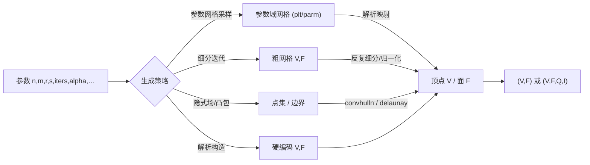

# 10.08 网格基元与形状生成 / Mesh primitives & shape generation

> 本文件逐一逆向记录 `mesh/` 目录下 30 个「基元构造 / 形状生成」类函数：它们从解析参数、
> 参数网格采样、细分迭代或隐式/凸包构造出发，直接产出顶点–面数据 `(V,F)`（部分含 `Q`/`I`/`T`）。
> This document reverse-engineers 30 primitive / shape-generation functions under `mesh/`, which
> build `(V,F)` (sometimes `Q`/`I`/`T`) directly from analytic parameters, parametric sampling,
> subdivision, or hull/implicit construction.
>
> 覆盖清单 / Coverage (30 functions):
> `annulus`, `beach_ball`, `buckliball`, `capsule_mesh`, `circle`, `conic`, `cube`, `cylinder_mesh`,
> `equilateral_tiling`, `hcp_lattice`, `lloyd_sphere`, `moebius_strip`, `octahedron`, `oloid`,
> `orbifold`, `regular_tetrahedral_mesh`, `reuleaux_triangle`, `rhombicosidodecahedron`,
> `rounded_rectangle`, `schwarz_lantern`, `sphericon`, `spiral_mesh`, `stadium`, `subdivided_sphere`,
> `super_fibonacci`, `torus`, `tube`, `wedding_cake`, `alpha_complex`, `catmull_clark`
>
> 条目格式严格遵循 [appendices/03-doc-template.md](../appendices/03-doc-template.md)。

---

## 本章概览 / Chapter overview

### 分类总表 / Category tables

#### (a) 规则多面体 / 球面采样 / Regular polyhedra & sphere sampling

| 函数 / Function | 生成策略 / Strategy | 主要参数 (默认) / Params (default) | 输出 / Outputs |
|---|---|---|---|
| `subdivided_sphere` | 基础多面体 + 迭代细分 + 球面归一化 | `iters`; `Base{''}`, `Radius{1}`, `SubdivisionMethod{'upsample'}` | `V,F,Q` |
| `octahedron` | 硬编码 6 顶点 / 8 面 | — | `V,F` |
| `cube` | 6 面规则网格拼接 + 旋转 | `x{2}`, `y{x}`, `z{y}` | `V,F,Q` |
| `rhombicosidodecahedron` | 硬编码 60 顶点 + 凸包 | — | `V,F,I,C` |
| `super_fibonacci` | 解析（Alexa 2021 超斐波那契） | `n`; `phi{sqrt(2)}`, `psi{1.5337…}` | `q` (#n×4) |
| `lloyd_sphere` | 细分球 + Lloyd 松弛迭代 | `n`; `InitialGuess{[]}`, `MaxIters{100000}`, `SubdivisionMethod{'upsample'}`, `Fixed{[]}` | `N,F` |

#### (b) 解析曲面 / Analytic surfaces

| 函数 / Function | 生成策略 / Strategy | 主要参数 (默认) / Params (default) | 输出 / Outputs |
|---|---|---|---|
| `torus` | 参数网格 `create_regular_grid` + 环形映射 | `n{40}`, `m{round(r*n)}`, `r{0.4}`; `R{1}` | `V,F,Q` |
| `tube` | `annulus` + `extrude` 拉伸 | `s`, `r`; `Flags{''}`, `R{1}`, `Levels{1}` | `V,F` |
| `cylinder_mesh` | MATLAB `cylinder` + `surf2patch` | `R{1}`, `N{20}`; `Quads{false}`, `Caps{false}`, `Stacks{1}` | `CV,CF` |
| `capsule_mesh` | 圆柱 + 两半球拼接 | `n`, `a`; `R{1}`, `Stacks{∝ a}` | `V,F,I` |
| `circle` | 解析（多边形 + 扇形三角） | `n` | `V,E,F` |
| `annulus` | 双同心环边界 + Triangle 三角化 | `s`, `r`; `Flags{auto}`, `R{1}` | `V,F,bi,bo` |

#### (c) 平面图形基元 / Planar shape primitives

| 函数 / Function | 生成策略 / Strategy | 主要参数 (默认) / Params (default) | 输出 / Outputs |
|---|---|---|---|
| `conic` ⚠ | **非几何生成器**：MOSEK 二次锥优化封装 | `F,c,Aeq,…`; `Quiet{'echo(0)'}`, `Param{...}`, `OptType{'conic'}` | `Z,f` |
| `rounded_rectangle` | 四角圆弧 + 可选锐角 | `r{0.1}`, `n{16}`, `w{1}`, `h{1}`, `mask{ones(2)}` | `V,E` |
| `reuleaux_triangle` | 三段 60° 圆弧旋转拼接 | `sam{20}` | `P,E` |
| `stadium` | 两半圆 + 两条直边 + 三角化 | `n`, `a{4}`, `r{1}` | `V,E,F` |
| `equilateral_tiling` | 规则网格剪切 + 六边形裁剪 | `x` | `V,F` |
| `hcp_lattice` | 解析（六方最密堆积中心） | `I,J,K` | `C` |

#### (d) 装饰 / 趣味网格 / Decorative & fun meshes

| 函数 / Function | 生成策略 / Strategy | 主要参数 (默认) / Params (default) | 输出 / Outputs |
|---|---|---|---|
| `buckliball` | 菱方六面十二面体 + 圆孔 + Lloyd 迭代 | `h{0.1}`, `theta{pi*0.09}`, `Vis{false}`, `MaxIter{100}`, `Tol{0.1*h}` | `V,F` |
| `beach_ball` | MATLAB `sphere` + 条纹着色 | `long_div_6` | `V,F,C` |
| `moebius_strip` | 参数网格 + 半扭转映射 | `u`, `v` | `V,F,UV` |
| `oloid` | 双圆凸包 | `n`; `Spacing{1}` | `V,F` |
| `orbifold` | 共形 / Orbifold Tutte 参数化求解 | `Ubar,Fbar`; `Cbar{自动}`, `orbi_type{'i'}` | `phi,F,I,C,fold_fun` |
| `schwarz_lantern` | 交替旋转的圆柱切片 | `m`, `n` | `V,F` |
| `sphericon` | Delaunay 参数网格 + 镜像旋转 | `r`, `n` | `V,FV,U,FU,N,FN` |
| `spiral_mesh` | 螺旋掩码 + 网格四边形 | `r` | `V,F,Q,I` |
| `wedding_cake` | 逐层 `extrude` + 层间三角化 | `P,E,h`（cell） | `V,F` |

#### (e) 细分与重建 / Subdivision & reconstruction

| 函数 / Function | 生成策略 / Strategy | 主要参数 (默认) / Params (default) | 输出 / Outputs |
|---|---|---|---|
| `alpha_complex` | Delaunay + 外接圆半径阈值筛选 | `V,alpha`; `OnlyShrinkBoundary{false}`, `Holes{[]}` | `AF,DF` |
| `catmull_clark` | 四边形/Catmull–Clark 细分 | `V,Q` 或 `V,PI,PC`; `Iterations{1}` | `VV,QQ,SS,J` |

#### (f) 实体 / 晶格 / Volumetric & lattice（任务清单未分类，单独列出）

| 函数 / Function | 生成策略 / Strategy | 主要参数 (默认) / Params (default) | 输出 / Outputs |
|---|---|---|---|
| `regular_tetrahedral_mesh` | 规则网格 → 每立方体切 5/6 四面体 | `nx,ny,nz`; `Method{'rotationally-symmetric'}` | `V,T,F` |

> ⚠ **命名/内容不一致**：`mesh/conic.m` 并非平面二次曲线生成器，而是对 MOSEK 的二次锥优化封装
> （最小化 `‖Fx‖²+c'x`）。此处按源码实际内容记录，仅因任务清单将其归入平面基元而列于 (c)。
> `mesh/coinc.m` is **not** a conic-section generator but a MOSEK second-order-cone optimization
> wrapper; it is documented below as-is.

### 生成策略总览 / Generation strategies

本模块四类生成策略：

1. **参数网格采样 (parametric grid sampling)**：先由 `create_regular_grid` 或 MATLAB `cylinder`/`sphere`
   得到参数域网格 `(plt / parm)`，再用解析映射改写坐标。代表：`torus`、`moebius_strip`、`schwarz_lantern`、
   `cylinder_mesh`、`equilateral_tiling`。
2. **细分迭代 (subdivision iteration)**：从粗多面体出发，迭代细分并归一化 / 重定位。代表：`subdivided_sphere`
   （`iters` 级）、`lloyd_sphere`（`MaxIters` 次 Lloyd 松弛）、`catmull_clark`（`Iterations` 级）、`buckliball`。
3. **隐式场 / 凸包 (implicit field / convex hull)**：由点集或边界圆求 `convhulln` / `delaunay` 得到面。代表：
   `oloid`、`rhombicosidodecahedron`、`alpha_complex`、`sphericon`、`regular_tetrahedral_mesh`。
4. **解析构造 (analytic construction)**：直接写出顶点/面公式。代表：`octahedron`、`cube`、`circle`、`annulus`、
   `super_fibonacci`、`hcp_lattice`、`reuleaux_triangle`、`rounded_rectangle`。

### 通用流水线 / Common pipeline



---

## (a) 规则多面体 / 球面采样 / Regular polyhedra & sphere sampling

### `subdivided_sphere` — 迭代细分生成球面
- **文件 / File**: [mesh/subdivided_sphere.m](file:///c:/VSWork/gptoolbox-1/mesh/subdivided_sphere.m#L1-L120)
- **签名 / Signature**: `[V,F,Q] = subdivided_sphere(iters,'Name',Value,...)`
- **功能 / Purpose**: `EN: Generate a sphere by iteratively subdividing a base polyhedron and normalizing vertices onto the unit sphere.` / 中文：从基础多面体出发，迭代细分并把顶点归一化到单位球面上生成球网格。
- **输入 / Inputs**:

  | 参数 | 尺寸/类型 | 含义 (中 / EN) |
  |---|---|---|
  | `iters` | `scalar` | 细分迭代次数（`0` → 12 顶点二十面体）/ number of subdivision iterations |

- **输出 / Outputs**:

  | 参数 | 尺寸/类型 | 含义 |
  |---|---|---|
  | `V` | `#V by 3` | 顶点坐标 / vertex positions |
  | `F` | `#F by 3` | 三角面索引 / triangle indices |
  | `Q` | `#Q by 4` | 四边形（仅 `Base='cube'` 且 `SubdivisionMethod='catmull_clark'` 时返回） |

- **可选参数 / Optional**:

  | 名称 | 取值 | 默认 | 含义 |
  |---|---|---|---|
  | `'Base'` | `''`/`'icosahedron'`/`'octahedron'`/`'cube'` | `''` | 初始多面体（空=手写二十面体） |
  | `'Radius'` | `scalar` | `1` | 最终顶点整体缩放半径 |
  | `'SubdivisionMethod'` | `'catmull_clark'`/`'loop'`/`'sqrt3'`/`'upsample'` | `'upsample'` | 每次迭代采用的细分方案 |

- **变量流动 / Variable flow**: `iters,base → (1 生成基础 V,F,Q) → (2 normalizerow) → (3 循环 iters 次细分 + normalizerow) → (4 *radius) → V,F,Q`
- **算法步骤 / Algorithm**:
  1. 按 `base` 取初始多面体：`'icosahedron'`→`icosahedron()`，`'octahedron'`→`octahedron()`，`'cube'`→`cube()` 并 `(V-0.5)*2`，`''`→手写 12 顶点 / 20 面二十面体（V 除以 `sqrt(1+phi^2)`）。
  2. `V = normalizerow(V)`，投影到单位球。
  3. `for iter = 1:iters`，按 `subdivision_method` 调用 `upsample` / `loop` / `catmull_clark`（由 `Q` 转三角）/ `sqrt3`，随后再次 `normalizerow`。
  4. `V = V*radius` 输出。
- **流程图 / Flowchart**:

  ```mermaid
  flowchart TD
    A["输入 iters, base"] --> B{"base?"}
    B -- "填icosahedron/octahedron/cube" --> C["基础 V,F"]
    B -- "''" --> D["手写二十面体 12V/20F"]
    C --> E["normalizerow 到单位球"]
    D --> E
    E --> F{"iter <= iters?"}
    F -- 是 --> G["upsample/loop/catmull_clark/sqrt3"]
    G --> H["normalizerow"]
    H --> F
    F -- 否 --> Z["V*radius → 输出 V,F,Q"]
  ```

- **依赖 / Dependencies**: `icosahedron`（**external**）、`octahedron`、`cube`、`upsample`、`loop`、`catmull_clark`、`sqrt3`、`normalizerow`
- **See also**: `lloyd_sphere`, `super_fibonacci`, `loop`, `upsample`

### `octahedron` — 单位正八面体
- **文件 / File**: [mesh/octahedron.m](file:///c:/VSWork/gptoolbox-1/mesh/octahedron.m#L1-L17)
- **签名 / Signature**: `[V,F] = octahedron()`
- **功能 / Purpose**: `EN: Return the 6-vertex / 8-face unit octahedron.` / 中文：返回 6 顶点、8 面的单位正八面体。
- **输入 / Inputs**: 无 / none。
- **输出 / Outputs**:

  | 参数 | 尺寸/类型 | 含义 |
  |---|---|---|
  | `V` | `6 by 3` | 顶点坐标 `[eye(3);-eye(3)]` |
  | `F` | `8 by 3` | 三角面索引（硬编码） |

- **可选参数 / Optional**: 无 / none。
- **变量流动 / Variable flow**: `(硬编码) → V,F`
- **算法步骤 / Algorithm**:
  1. `V = [eye(3);-eye(3)]`（±x/±y/±z 共 6 点）。
  2. 硬编码 8 个三角面 `F`。
- **流程图 / Flowchart**:

  ```mermaid
  flowchart TD
    A["无输入"] --> B["V = [eye(3);-eye(3)]"]
    B --> C["硬编码 F (8×3)"]
    C --> Z["输出 V,F"]
  ```

- **依赖 / Dependencies**: 无 / none
- **See also**: `cube`, `icosahedron`, `subdivided_sphere`

### `cube` — 单位立方体
- **文件 / File**: [mesh/cube.m](file:///c:/VSWork/gptoolbox-1/mesh/cube.m#L1-L49)
- **签名 / Signature**: `[V,F,Q] = cube(x,y,z)`
- **功能 / Purpose**: `EN: Construct a mesh of the unit cube by gridding each of the 6 faces and rotating it into place.` / 中文：对立方体 6 个面分别生成规则网格并旋到位，拼接成单位立方体网格。
- **输入 / Inputs**:

  | 参数 | 尺寸/类型 | 含义 (中 / EN) |
  |---|---|---|
  | `x` | `scalar` | x 轴方向顶点数 / vertices along x |
  | `y` | `scalar` | y 轴方向顶点数 / vertices along y |
  | `z` | `scalar` | z 轴方向顶点数 / vertices along z |

- **输出 / Outputs**:

  | 参数 | 尺寸/类型 | 含义 |
  |---|---|---|
  | `V` | `x*y*z by 3` | 顶点坐标 |
  | `F` | `#F by 3` | 三角面索引 |
  | `Q` | `#Q by 4` | 四边形索引 |

- **可选参数 / Optional**（均为位置参数默认值）:

  | 名称 | 取值 | 默认 | 含义 |
  |---|---|---|---|
  | `x` | `scalar` | `2` | x 方向顶点数 |
  | `y` | `scalar` | `x` | y 方向顶点数 |
  | `z` | `scalar` | `y` | z 方向顶点数 |

- **变量流动 / Variable flow**: `x,y,z → 6 面采样 (sam) + 轴/角 (axes,angles) → 循环 6 面 create_regular_grid + 旋转 → 拼接 V,F → 由 F 重组 Q → remove_duplicate_vertices → 反转缠绕 → V,F,Q`
- **算法步骤 / Algorithm**:
  1. 缺省 `x=2`、`y=x`、`z=y`。
  2. 定义 6 个面的采样 `sam`、旋转轴 `axes`、旋转角 `angles`。
  3. `for s=1:6`：`create_regular_grid` 生成平面网格，`(CV-0.5)*R+0.5` 旋到位，累加顶点与面。
  4. `Q = [F(1:2:end-1,[1 2]) F(2:2:end,[2 3])]` 由三角面重组四边形。
  5. `remove_duplicate_vertices(V,1e-12)` 缝合公共棱；`fliplr` 反转 `F,Q` 修正朝向（源码注释 `oops inside out`）。
- **流程图 / Flowchart**:

  ```mermaid
  flowchart TD
    A["输入 x,y,z"] --> B{"s <= 6 (六面)?"}
    B -- 是 --> C["create_regular_grid(sam)"]
    C --> D["(CV-0.5)*R+0.5 旋转到位"]
    D --> E["累加 V,F"]
    E --> B
    B -- 否 --> F["Q = 由 F 重组"]
    F --> G["remove_duplicate_vertices"]
    G --> H["fliplr 修正朝向"]
    H --> Z["输出 V,F,Q"]
  ```

- **依赖 / Dependencies**: `create_regular_grid`, `axisangle2matrix`, `remove_duplicate_vertices`
- **See also**: `octahedron`, `subdivided_sphere`

### `rhombicosidodecahedron` — 菱方六面十二面体
- **文件 / File**: [mesh/rhombicosidodecahedron.m](file:///c:/VSWork/gptoolbox-1/mesh/rhombicosidodecahedron.m#L1-L20)
- **签名 / Signature**: `[V,F,I,C] = rhombicosidodecahedron()`
- **功能 / Purpose**: `EN: Return a 60-vertex rhombicosidodecahedron, its triangulated hull, per-face normal cluster labels and averaged normals.` / 中文：返回 60 顶点的菱方六面十二面体，其三角凸包、面法向聚类标签与聚类平均法向。
- **输入 / Inputs**: 无 / none。
- **输出 / Outputs**:

  | 参数 | 尺寸/类型 | 含义 |
  |---|---|---|
  | `V` | `60 by 3` | 顶点坐标（硬编码，含 `sqrt(5)` 项） |
  | `F` | `#F by 3` | `convhull(V)` 三角面索引 |
  | `I` | `#F by 1` | 每面法向所属聚类标签 / normal-cluster label |
  | `C` | `#cluster by 3` | 每聚类平均法向 / averaged normal per cluster |

- **可选参数 / Optional**: 无 / none。
- **变量流动 / Variable flow**: `(硬编码 V) → convhull → F → normals → N → normalizerow → N → unique(round(N*2)) → I → 平均 → C`
- **算法步骤 / Algorithm**:
  1. 写入 60 个硬编码顶点 `V`（菱方六面十二面体标准坐标）。
  2. `F = convhull(V)` 求凸包三角面。
  3. `N = normalizerow(normals(V,F))` 计算并归一化面法向。
  4. `[U,~,I] = unique(round(N*2),'rows')` 把相近法向归类。
  5. `C = full_sparse(...)/accumarray(I,1)` 求每聚类平均法向。
- **流程图 / Flowchart**:

  ```mermaid
  flowchart TD
    A["无输入"] --> B["硬编码 V (60×3)"]
    B --> C["F = convhull(V)"]
    C --> D["N = normalizerow(normals(V,F))"]
    D --> E["[~,~,I] = unique(round(N*2),'rows')"]
    E --> F["C = 每聚类平均法向"]
    F --> Z["输出 V,F,I,C"]
  ```

- **依赖 / Dependencies**: `convhull`（内置）、`normals`、`normalizerow`、`full_sparse`
- **See also**: `buckliball`

### `super_fibonacci` — 超斐波那契 SO(3) 采样
- **文件 / File**: [mesh/super_fibonacci.m](file:///c:/VSWork/gptoolbox-1/mesh/super_fibonacci.m#L1-L28)
- **签名 / Signature**: `q = super_fibonacci(n,phi,psi)`
- **功能 / Purpose**: `EN: Generate n unit quaternions by the "Super-Fibonacci Spirals" low-discrepancy SO(3) sampling (Alexa 2021).` / 中文：按「Super-Fibonacci Spirals」低差异 SO(3) 采样生成 n 个单位四元数。
- **输入 / Inputs**:

  | 参数 | 尺寸/类型 | 含义 (中 / EN) |
  |---|---|---|
  | `n` | `scalar` | 生成旋转数量 / number of rotations |
  | `phi` | `scalar` | 分布参数（可选，默认 `sqrt(2)`） |
  | `psi` | `scalar` | 分布参数（可选，默认 `1.533751168755204288118041`） |

- **输出 / Outputs**:

  | 参数 | 尺寸/类型 | 含义 |
  |---|---|---|
  | `q` | `n by 4` | 单位四元数列表 / unit quaternions |

- **可选参数 / Optional**:

  | 名称 | 取值 | 默认 | 含义 |
  |---|---|---|---|
  | `phi`（第 2 位置参数） | `scalar` | `sqrt(2)` | 第一螺旋参数 |
  | `psi`（第 3 位置参数） | `scalar` | `1.533751168755204288118041` | 第二螺旋参数 |

- **变量流动 / Variable flow**: `n,phi,psi → s=i+0.5 → r,R → alpha,beta → q=[r sinα, r cosα, R sinβ, R cosβ]`
- **算法步骤 / Algorithm**:
  1. `i = (0:n-1)'`，`s = i + 0.5`。
  2. `r = sqrt(s./n)`，`R = sqrt(1-s./n)`（保证 `r²+R²=1`）。
  3. `alpha = 2πs/phi`，`beta = 2πs/psi`。
  4. 组装四元数 `q = [r.*sin(alpha), r.*cos(alpha), R.*sin(beta), R.*cos(beta)]`。
- **流程图 / Flowchart**:

  ```mermaid
  flowchart TD
    A["输入 n,phi,psi"] --> B["s = (0:n-1)' + 0.5"]
    B --> C["r=sqrt(s/n), R=sqrt(1-s/n)"]
    C --> D["alpha=2πs/phi, beta=2πs/psi"]
    D --> Z["q = [r sinα, r cosα, R sinβ, R cosβ]"]
  ```

- **依赖 / Dependencies**: 无 / none
- **See also**: `lloyd_sphere`, `subdivided_sphere`

### `lloyd_sphere` — Lloyd 松弛球面点集
- **文件 / File**: [mesh/lloyd_sphere.m](file:///c:/VSWork/gptoolbox-1/mesh/lloyd_sphere.m#L1-L93)
- **签名 / Signature**: `[N,F] = lloyd_sphere(n,'Name',Value,...)`
- **功能 / Purpose**: `EN: Construct a triangle mesh of a sphere whose n vertices are reasonably evenly distributed via Lloyd relaxation.` / 中文：通过 Lloyd 松弛构造顶点分布较均匀的 n 顶点球面三角网格。
- **输入 / Inputs**:

  | 参数 | 尺寸/类型 | 含义 (中 / EN) |
  |---|---|---|
  | `n` | `scalar` | 目标顶点数 / number of points |

- **输出 / Outputs**:

  | 参数 | 尺寸/类型 | 含义 |
  |---|---|---|
  | `N` | `#N by 3` | 顶点坐标（`#N = n`） |
  | `F` | `#F by 3` | 面索引 / face indices |

- **可选参数 / Optional**:

  | 名称 | 取值 | 默认 | 含义 |
  |---|---|---|---|
  | `'InitialGuess'` | `#N by 3` | `[]` | 自定义初始顶点（空则用细分球） |
  | `'MaxIters'` | `scalar` | `100000` | 最大 Lloyd 迭代次数 |
  | `'SubdivisionMethod'` | `'sqrt3'`/`'upsample'`/`'loop'` | `'upsample'` | 初始细分球所用方法 |
  | `'Fixed'` | `#nf by 3` | `[]` | 固定不动的顶点 |

- **变量流动 / Variable flow**: `n,method → ssn → subdivided_sphere(ssn) → N → [Nfixed;N(1:n-nf,:)] → F=convhulln → M → (循环: A,M→N′=A·N→去质心→归一→重置Fixed→convhulln→M→误差) → N,F`
- **算法步骤 / Algorithm**:
  1. 由 `n` 与 `subdivision_method` 计算细分级别 `ssn`（`'sqrt3'` 用对数公式；`'upsample'`/`'loop'` 用 `log2` 公式）。
  2. `N = subdivided_sphere(ssn,'SubdivisionMethod',subdivision_method)`；`N = [Nfixed; N(1:n-nf,:)]`。
  3. `F = convhulln(N)`；若 `n <= 12` 直接返回。
  4. `M = massmatrix(N,F,'voronoi')`；`for iter=1:max_iters` 做加权邻接平均 `N = A*N`（`A` 由 `adjacency_matrix(F)*M` 行归一化），减去质心、`normalizerow`、重置固定点、重算 `convhulln` 与 `M`。
  5. 误差 `er = trace((N-N_prev)'*M*(N-N_prev))`，`er<1e-7` 时收敛退出。
- **流程图 / Flowchart**:

  ```mermaid
  flowchart TD
    A["输入 n, method"] --> B["计算 ssn"]
    B --> C["N = subdivided_sphere(ssn)"]
    C --> D["F = convhulln(N)"]
    D --> E{"n <= 12?"}
    E -- 是 --> Z["输出 N,F"]
    E -- 否 --> F["M = massmatrix voronoi"]
    F --> G["A = 行归一化(adjacency*M); N = A*N"]
    G --> H["去质心 + normalizerow + 重置Fixed"]
    H --> I["F=convhulln; M=massmatrix; er"]
    I --> J{"er < 1e-7?"}
    J -- 否 --> G
    J -- 是 --> Z
  ```

- **依赖 / Dependencies**: `subdivided_sphere`, `massmatrix`, `adjacency_matrix`, `normalizerow`, `convhulln`（内置）
- **See also**: `subdivided_sphere`, `hcp_lattice`, `randsphere`

---

## (b) 解析曲面 / Analytic surfaces

### `torus` — 单位圆环面
- **文件 / File**: [mesh/torus.m](file:///c:/VSWork/gptoolbox-1/mesh/torus.m#L1-L59)
- **签名 / Signature**: `[V,F,Q] = torus(n,m,r,'Name',Value,...)`
- **功能 / Purpose**: `EN: Construct a triangle mesh of a unit torus by mapping a regular parameter grid.` / 中文：把规则参数网格映射为圆环面三角网格。
- **输入 / Inputs**:

  | 参数 | 尺寸/类型 | 含义 (中 / EN) |
  |---|---|---|
  | `n` | `scalar` | 内环周向顶点数 / vertices around inner ring |
  | `m` | `scalar` | 外环周向顶点数 / vertices around outer ring |
  | `r` | `scalar` | 内环半径 / radius of inner ring |

- **输出 / Outputs**:

  | 参数 | 尺寸/类型 | 含义 |
  |---|---|---|
  | `V` | `#V by 3` | 顶点坐标 |
  | `F` | `#F by 3` | 三角面索引 |
  | `Q` | `#Q by 4` | 四边形索引（由 `F` 重组） |

- **可选参数 / Optional**:

  | 名称 | 取值 | 默认 | 含义 |
  |---|---|---|---|
  | `'R'` | `scalar` | `1` | 外环半径 |

- **变量流动 / Variable flow**: `n,m,r → create_regular_grid(n,m,true,true) → (V,F) → V*2π → (φ,θ) → 环形映射 → V, Q`
- **算法步骤 / Algorithm**:
  1. 位置默认：`r=0.4`（`nargin<3`）、`n=40`（`nargin<1`）、`m=round(r*n)`（`nargin<2`）。
  2. `[V,F] = create_regular_grid(n,m,true,true)` 生成周期参数网格。
  3. `V = V*2π`，取 `φ=V(:,1)`、`θ=V(:,2)`。
  4. 映射 `V = [cosφ(R+r cosθ), sinφ(R+r cosθ), r sinθ]`。
  5. 由 `F` 重组四边形 `Q`。
- **流程图 / Flowchart**:

  ```mermaid
  flowchart TD
    A["输入 n,m,r(,R)"] --> B["create_regular_grid(n,m,true,true)"]
    B --> C["V = V*2π; φ=V1, θ=V2"]
    C --> D["V = [cosφ(R+rcosθ), sinφ(R+rcosθ), r sinθ]"]
    D --> E["Q = 由 F 重组"]
    E --> Z["输出 V,F,Q"]
  ```

- **依赖 / Dependencies**: `create_regular_grid`
- **See also**: `cylinder_mesh`, `annulus`, `tube`

### `tube` — 圆管（环形拉伸）
- **文件 / File**: [mesh/tube.m](file:///c:/VSWork/gptoolbox-1/mesh/tube.m#L1-L45)
- **签名 / Signature**: `[V,F] = tube(s,r,'Name',Value,...)`
- **功能 / Purpose**: `EN: Construct a tube by triangulating an annulus and extruding it.` / 中文：对圆环（annulus）区域三角化后沿高度拉伸生成圆管。
- **输入 / Inputs**:

  | 参数 | 尺寸/类型 | 含义 (中 / EN) |
  |---|---|---|
  | `s` | `scalar` | 内环采样数 / samples on inner ring |
  | `r` | `scalar` | 内环半径 / inner radius |

- **输出 / Outputs**:

  | 参数 | 尺寸/类型 | 含义 |
  |---|---|---|
  | `V` | `#V by 3` | 顶点坐标 |
  | `F` | `#F by 3` | 三角面索引 |

- **可选参数 / Optional**:

  | 名称 | 取值 | 默认 | 含义 |
  |---|---|---|---|
  | `'Flags'` | `string` | `''` | 传给 Triangle 的网格化参数 |
  | `'R'` | `scalar` | `1` | 外环半径 |
  | `'Levels'` | `scalar` | `1` | 拉伸层数 / number of stacks |

- **变量流动 / Variable flow**: `s,r(,R) → annulus(s,r,'Flags',flags,'R',R) → AV,AF → extrude(... ,'Levels',levels) → V,F`
- **算法步骤 / Algorithm**:
  1. 解析可选参数，`flags` 默认 `''`，`R=1`，`levels=1`。
  2. `[AV,AF] = annulus(s,r,'Flags',flags,'R',R)` 得到带孔二维区域。
  3. `[V,F] = extrude(AV,AF,'Levels',levels)` 沿 z 拉伸成管。
- **流程图 / Flowchart**:

  ```mermaid
  flowchart TD
    A["输入 s,r(,Flags,R,Levels)"] --> B["annulus(s,r,...) → AV,AF"]
    B --> C["extrude(AV,AF,'Levels',levels)"]
    C --> Z["输出 V,F"]
  ```

- **依赖 / Dependencies**: `annulus`, `extrude`
- **See also**: `annulus`, `torus`, `capsule_mesh`

### `cylinder_mesh` — 圆柱面网格
- **文件 / File**: [mesh/cylinder_mesh.m](file:///c:/VSWork/gptoolbox-1/mesh/cylinder_mesh.m#L1-L78)
- **签名 / Signature**: `[CV,CF] = cylinder_mesh(R,N,'Name',Value,...)`
- **功能 / Purpose**: `EN: Construct a triangle (or quad) mesh of a unit-height cylinder, optionally with caps and multiple stacks.` / 中文：构造单位高圆柱网格（可输出四边形、可加顶底盖、可分层）。
- **输入 / Inputs**:

  | 参数 | 尺寸/类型 | 含义 (中 / EN) |
  |---|---|---|
  | `R` | `scalar` | 半径 / radius |
  | `N` | `scalar` | 周向顶点数 / vertices around axis |

- **输出 / Outputs**:

  | 参数 | 尺寸/类型 | 含义 |
  |---|---|---|
  | `CV` | `#CV by 3` | 顶点坐标 |
  | `CF` | `#CF by 3` | 三角（或四边形）面索引 |

- **可选参数 / Optional**:

  | 名称 | 取值 | 默认 | 含义 |
  |---|---|---|---|
  | `'Quads'` | `logical` | `false` | 输出四边形而非三角形 |
  | `'Caps'` | `logical` | `false` | 是否封闭顶底（仅三角可用） |
  | `'Stacks'` | `scalar` | `1` | 侧面分层数 |

- **变量流动 / Variable flow**: `R,N,(caps,quads,stacks) → 循环 stack: cylinder(R,N)+surf2patch → CV,CF → (可选 caps 补顶点) → remove_duplicate_vertices → CV/[1 1 stacks] → CF`
- **算法步骤 / Algorithm**:
  1. 默认 `R=1`（`nargin<1`）、`N=20`（`nargin<2`）；`quads/caps=false`、`stacks=1`。
  2. `for stack=1:stacks`：`[X,Y,Z]=cylinder(R,N)`，`surf2patch`(三角或四边形)，累加顶点（z 偏移 `stack-1`）与面。
  3. `caps`：添加底/顶中心顶点并补扇形面（断言非 `quads`）。
  4. `remove_duplicate_vertices(CV,eps)`，z 除以 `stacks`，重映射 `CF`。
- **流程图 / Flowchart**:

  ```mermaid
  flowchart TD
    A["输入 R,N,(Quads,Caps,Stacks)"] --> B{"stack <= stacks?"}
    B -- 是 --> C["cylinder(R,N) + surf2patch"]
    C --> D["累加 CV,CF (z 偏移)"]
    D --> B
    B -- 否 --> E{"Caps?"}
    E -- 是 --> F["加顶底中心顶点 + 扇形面"]
    E -- 否 --> G["remove_duplicate_vertices"]
    F --> G
    G --> H["CV = CV/[1 1 stacks]"]
    H --> Z["输出 CV,CF"]
  ```

- **依赖 / Dependencies**: `cylinder`（内置）、`surf2patch`（内置）、`remove_duplicate_vertices`
- **See also**: `cylinder`, `capsule_mesh`, `torus`, `tube`

### `capsule_mesh` — 胶囊体（圆柱+两半球）
- **文件 / File**: [mesh/capsule_mesh.m](file:///c:/VSWork/gptoolbox-1/mesh/capsule_mesh.m#L1-L63)
- **签名 / Signature**: `[V,F,I] = capsule_mesh(n,a,'Name',Value,...)`
- **功能 / Purpose**: `EN: Construct a capsule mesh by joining a cylinder with two hemispheres.` / 中文：由圆柱与两半球拼接生成胶囊体网格，并返回各面所属部位标签。
- **输入 / Inputs**:

  | 参数 | 尺寸/类型 | 含义 (中 / EN) |
  |---|---|---|
  | `n` | `scalar` | 每半球纬向面数 / faces along latitude per hemisphere |
  | `a` | `scalar` | 圆柱段长度 / length of cylindrical portion |

- **输出 / Outputs**:

  | 参数 | 尺寸/类型 | 含义 |
  |---|---|---|
  | `V` | `#V by 3` | 顶点坐标 |
  | `F` | `#F by 3` | 三角面索引 |
  | `I` | `#F by 1` | 每面部位标签：`1`底面半球 / `2`圆柱 / `3`顶面半球 |

- **可选参数 / Optional**:

  | 名称 | 取值 | 默认 | 含义 |
  |---|---|---|---|
  | `'R'` | `scalar` | `1` | 胶囊半径 |
  | `'Stacks'` | `scalar` | `ceil((2n)/(2πR)*a)` | 圆柱分层数（源码公式，见下） |

  > 注：源码为 `s = ceil( (2*n)/(2*pi*R)* a )`（文档注释写作 `ceil(2*n/(2*pi*R*a))`，与实际不符）。

- **变量流动 / Variable flow**: `n,a,(R,s) → cylinder_mesh(R,2n,'Stacks',s) → CV,CF → CV.*[1 1 a]；sphere(2n)→SF/SV 按 z 分为上/下 → 拼接 [BV;CV;TV] → remove_duplicate_vertices + remove_unreferenced → V,F,I`
- **算法步骤 / Algorithm**:
  1. 默认 `R=1`；`s` 未给时按上式估算。
  2. `[CV,CF]=cylinder_mesh(R,2*n,'Stacks',s)`；`CV = CV.*[1 1 a]`。
  3. `[X,Y,Z]=sphere(2*n)`；`surf2patch` 得 `SF,SV`；`SV=SV*R`；去重、剔除退化三角。
  4. 用 `barycenter` 的 z 符号把球面分成上（`T`）/下（`~T`）两部分，上部分平移 `+a`。
  5. `V=[BV;CV;TV]`，`F=[BF; size(BV,1)+[CF; size(CV,1)+TF]]`；去重、删除未引用顶点。
  6. `I` 依次为 `1`(BF)/`2`(CF)/`3`(TF)。
- **流程图 / Flowchart**:

  ```mermaid
  flowchart TD
    A["输入 n,a,(R,Stacks)"] --> B["cylinder_mesh(R,2n,Stacks) → CV,CF"]
    B --> C["CV = CV.*[1 1 a]"]
    A --> D["sphere(2n) → SF,SV; SV=SV*R"]
    D --> E["按 z 符号分上/下 (T)"]
    E --> F["上部分平移 +a"]
    C --> G["V=[BV;CV;TV]; F 拼接"]
    F --> G
    G --> H["去重 + 删除未引用"]
    H --> Z["输出 V,F,I(1/2/3)"]
  ```

- **依赖 / Dependencies**: `cylinder_mesh`, `sphere`（内置）、`surf2patch`（内置）、`barycenter`, `remove_duplicate_vertices`, `remove_unreferenced`
- **See also**: `stadium`, `cylinder_mesh`

### `circle` — 单位圆（多边形/扇面）
- **文件 / File**: [mesh/circle.m](file:///c:/VSWork/gptoolbox-1/mesh/circle.m#L1-L7)
- **签名 / Signature**: `[V,E,F] = circle(n)`
- **功能 / Purpose**: `EN: Return an n-gon on the unit circle with its edges and a triangle fan.` / 中文：返回单位圆上 n 边形顶点、边与扇形三角面。
- **输入 / Inputs**:

  | 参数 | 尺寸/类型 | 含义 (中 / EN) |
  |---|---|---|
  | `n` | `scalar` | 圆周采样点数 / number of samples |

- **输出 / Outputs**:

  | 参数 | 尺寸/类型 | 含义 |
  |---|---|---|
  | `V` | `n by 2` | 圆周顶点 |
  | `E` | `n by 2` | 边索引（闭环） |
  | `F` | `(n-2) by 3` | 以顶点 1 为扇心的三角面 |

- **可选参数 / Optional**: 无 / none。
- **变量流动 / Variable flow**: `n → th=linspace(0,2π,n+1)去掉末点 → V=[cosθ sinθ] → E 环形 → F 扇面`
- **算法步骤 / Algorithm**:
  1. `th = linspace(0,2π,n+1)`，去末点避免重复。
  2. `V = [cos(th), sin(th)]`。
  3. `E` 首尾相连成环；`F = [2:n-1; 3:n; ones(1,n-2)]'` 生成以顶点 1 为扇心的三角面（要求 `n>=3`）。
- **流程图 / Flowchart**:

  ```mermaid
  flowchart TD
    A["输入 n"] --> B["th = linspace(0,2π,n+1) 去末点"]
    B --> C["V = [cos th, sin th]"]
    C --> D["E = 环形边"]
    D --> Z["F = 扇面三角 → 输出 V,E,F"]
  ```

- **依赖 / Dependencies**: 无 / none
- **See also**: `annulus`, `rounded_rectangle`

### `annulus` — 平面圆环（带孔）
- **文件 / File**: [mesh/annulus.m](file:///c:/VSWork/gptoolbox-1/mesh/annulus.m#L1-L56)
- **签名 / Signature**: `[V,F,bi,bo] = annulus(s,r,'Name',Value,...)`
- **功能 / Purpose**: `EN: Construct a triangle mesh of a planar annulus (disk with a circular hole) using Triangle.` / 中文：用 Triangle 对同心双环边界三角化，生成平面圆环（带圆孔）网格。
- **输入 / Inputs**:

  | 参数 | 尺寸/类型 | 含义 (中 / EN) |
  |---|---|---|
  | `s` | `scalar` | 内环采样点数 / samples on inner ring |
  | `r` | `scalar` | 内环半径 / inner radius |

- **输出 / Outputs**:

  | 参数 | 尺寸/类型 | 含义 |
  |---|---|---|
  | `V` | `#V by 2` | 顶点坐标 |
  | `F` | `#F by 3` | 三角面索引 |
  | `bi` | `#bi by 1` | 内边界顶点索引 |
  | `bo` | `#bo by 1` | 外边界顶点索引 |

- **可选参数 / Optional**:

  | 名称 | 取值 | 默认 | 含义 |
  |---|---|---|---|
  | `'Flags'` | `string` | `sprintf('-q30 -a%0.17f',(2πr/s)^2)` | 传给 Triangle 的网格化参数 |
  | `'R'` | `scalar` | `1` | 外环半径 |

- **变量流动 / Variable flow**: `s,r(,flags,R) → 内环 Vr/Er 与外环 VR/ER → triangulate(带 Hole) → V,F → outline → b → 半径阈值分 bi/bo`
- **算法步骤 / Algorithm**:
  1. 解析可选参数；断言 `r<R`；`flags` 未给则由内环边长平方 `(2πr/s)^2` 自动生成。
  2. 内环 `Vr`（s 点，半径 r）与其边 `Er`；外环 `VR`（`ceil(R/r)*s` 点，半径 R）与 `ER`。
  3. `triangulate([Vr;VR],[Er;size(Vr,1)+ER],'Holes',[0 0],'Flags',flags)` 三角化（原点为孔）。
  4. `b = unique(outline(F))`；按到原点距离 `< 0.5(R+r)` 与 `>` 分成内边界 `bi`、外边界 `bo`。
- **流程图 / Flowchart**:

  ```mermaid
  flowchart TD
    A["输入 s,r,(Flags,R)"] --> B["内环 Vr/Er, 外环 VR/ER"]
    B --> C["triangulate(...,'Holes',[0 0])"]
    C --> D["b = unique(outline(F))"]
    D --> E["按半径 0.5(R+r) 分内外"]
    E --> Z["输出 V,F,bi,bo"]
  ```

- **依赖 / Dependencies**: `triangulate`, `outline`, `normrow`
- **See also**: `tube`, `circle`, `torus`

---

## (c) 平面图形基元 / Planar shape primitives

### `conic` — 二次锥优化封装（非几何生成器）⚠
- **文件 / File**: [mesh/conic.m](file:///c:/VSWork/gptoolbox-1/mesh/conic.m#L1-L168)
- **签名 / Signature**: `[Z,f] = conic(F,c,Aeq,beq,Aleq,bleq,lx,ux,b,bc,'Name',Value,...)`
- **功能 / Purpose**: `EN: Optimization wrapper for MOSEK solving min ‖Fx‖² + c'x subject to linear equality/inequality/bound/fixed constraints.` / 中文：MOSEK 优化封装，求解 `min ‖Fx‖² + c'x` 且满足线性等式/不等式/上下界/固定值约束。

  > ⚠ 该函数**并非**平面二次曲线网格生成器，与本章多数基元不同，属于优化工具（被参数化等调用）。仅因任务清单将其列入平面基元而记录于此处。
- **输入 / Inputs**:

  | 参数 | 尺寸/类型 | 含义 (中 / EN) |
  |---|---|---|
  | `F` | `#F by #x` | 最小二乘二次项矩阵 / quadratic matrix |
  | `c` | `#x by 1` | 线性项 / linear term |
  | `Aeq,beq` | `neq by #x`, `neq by 1` | 线性等式约束 / equality constraints |
  | `Aleq,bleq` | `nleq by #x`, `nleq by 1` | 线性不等式约束 / inequality constraints |
  | `lx,ux` | `#x by 1` | 下界 / 上界 / lower & upper bounds |
  | `b,bc` | `#b`, `#b` | 固定变量索引与值 / fixed indices & values |

- **输出 / Outputs**:

  | 参数 | 尺寸/类型 | 含义 |
  |---|---|---|
  | `Z` | `#x by 1` | 解向量 / solution |
  | `f` | `scalar` | 目标函数值 `0.5*sum((F*Z).^2)+c'*Z` |

- **可选参数 / Optional**:

  | 名称 | 取值 | 默认 | 含义 |
  |---|---|---|---|
  | `'Quiet'` | `'echo(0)'` / `''` | `'echo(0)'` | MOSEK 输出开关 |
  | `'Param'` | struct | `default_quadprog_param()` | MOSEK 参数结构 |
  | `'OptType'` | `'conic'`/`'conic-debug'`/`'quad'` | `'conic'` | 问题形式 |

- **变量流动 / Variable flow**: `F,c,...,b,bc → 组装 prob(c,a,blc,buc,blx,bux,cones) → mosekopt('minimize') → res → Z=x(1:n) → f`
- **算法步骤 / Algorithm**:
  1. 读取前 10 个位置参数；解析 `Quiet`/`Param`/`OptType`；移除 `Diagnostics`/`Display` 字段。
  2. 计算 `n=size(F,2)`、`nt=size(F,1)`、`neq`、`nleq`，空约束补 0 行稀疏矩阵。
  3. 按 `opt_type` 组装 MOSEK 问题：`'conic'` 用旋转二次锥 `MSK_CT_RQUAD`（对 `‖Fx‖²` 建模）；`'conic-debug'` 用目标二次项；`'quad'` 用 `tril(F'F)`。
  4. 用固定值覆盖对应 `blx/bux`。
  5. `mosekopt(['minimize ' quiet],prob,param)`；`report_mosek_error` 检错；`Z=x(1:n)`，计算 `f`。
- **流程图 / Flowchart**:

  ```mermaid
  flowchart TD
    A["输入 F,c,Aeq,…,b,bc"] --> B{"OptType?"}
    B -- conic --> C["锥约束 prob (RQUAD)"]
    B -- conic-debug --> D["目标二次项 prob"]
    B -- quad --> E["tril(F'F) prob"]
    C --> F["固定值 → blx/bux"]
    D --> F
    E --> F
    F --> G["mosekopt('minimize')"]
    G --> H["report_mosek_error"]
    H --> Z["Z=x(1:n); f=0.5‖FZ‖²+c'Z"]
  ```

- **依赖 / Dependencies**: `default_quadprog_param`, `repdiag`, `mosekopt`（MOSEK 外部）、`report_mosek_error`
- **See also**: `min_quad_with_fixed`, `active_set`

### `rounded_rectangle` — 圆角矩形
- **文件 / File**: [mesh/rounded_rectangle.m](file:///c:/VSWork/gptoolbox-1/mesh/rounded_rectangle.m#L1-L59)
- **签名 / Signature**: `[V,E] = rounded_rectangle(r,n,w,h,mask)`
- **功能 / Purpose**: `EN: Construct a rounded rectangle outline, optionally leaving selected corners sharp via a 2×2 mask.` / 中文：构造圆角矩形轮廓，可用 2×2 mask 选择保留哪些角为直角。
- **输入 / Inputs**:

  | 参数 | 尺寸/类型 | 含义 (中 / EN) |
  |---|---|---|
  | `r` | `scalar` | 圆角半径 / corner radius |
  | `n` | `scalar` | 每个角采样点数 / samples per corner |
  | `w` | `scalar` | 宽 / width |
  | `h` | `scalar` | 高 / height |
  | `mask` | `2 by 2` | 各角是否圆角 / corner mask |

- **输出 / Outputs**:

  | 参数 | 尺寸/类型 | 含义 |
  |---|---|---|
  | `V` | `#V by 2` | 顶点坐标（闭合轮廓） |
  | `E` | `#E by 2` | 边索引 |

- **可选参数 / Optional**（均为位置参数默认值）:

  | 名称 | 取值 | 默认 | 含义 |
  |---|---|---|---|
  | `r` | `scalar` | `0.1` | 圆角半径 |
  | `n` | `scalar` | `16` | 每角采样数 |
  | `w` | `scalar` | `1` | 宽 |
  | `h` | `scalar` | `1` | 高 |
  | `mask` | `2 by 2` | `ones(2)` | 角 mask |

- **变量流动 / Variable flow**: `r,n,w,h,mask → 断言(w,h>2r) → th=linspace(0,π/2,n) → 4 角 (按 mask 圆角或直角) → 拼接 V → E 闭环`
- **算法步骤 / Algorithm**:
  1. 缺省赋值 `r=0.1,n=16,w=1,h=1,mask=ones(2)`；断言 `n>1`、`w>2r`、`h>2r`。
  2. `th = linspace(0,π/2,n)`，`p2c = @(th)[cos th, sin th]*r`。
  3. 按 `[[2;2][1;2][1;1][2;1]]` 遍历四角：`mask` 为真则角点为「角心 + 圆弧」，否则为直角点；每角后 `th += π/2`。
  4. 拼接 `V=[V{2,2};V{1,2};V{1,1};V{2,1}]`，`E` 成闭环。
- **流程图 / Flowchart**:

  ```mermaid
  flowchart TD
    A["输入 r,n,w,h,mask"] --> B["断言 w,h > 2r"]
    B --> C{"下一角 ij"}
    C --> D{"mask 圆角?"}
    D -- 是 --> E["角心 + p2c(th)"]
    D -- 否 --> F["直角点"]
    E --> G["th += π/2; 收集"]
    F --> G
    G --> C
    C -- 四角完毕 --> Z["V 拼接 + E 闭环"]
  ```

- **依赖 / Dependencies**: 无 / none
- **See also**: `circle`, `stadium`, `reuleaux_triangle`

### `reuleaux_triangle` — 勒洛三角形（等宽曲线）
- **文件 / File**: [mesh/reuleaux_triangle.m](file:///c:/VSWork/gptoolbox-1/mesh/reuleaux_triangle.m#L1-L26)
- **签名 / Signature**: `[P,E] = reuleaux_triangle(sam)`
- **功能 / Purpose**: `EN: Construct a Reuleaux triangle (curve of constant width) as a closed polyline.` / 中文：构造勒洛三角形（等宽曲线）的闭合折线表示。
- **输入 / Inputs**:

  | 参数 | 尺寸/类型 | 含义 (中 / EN) |
  |---|---|---|
  | `sam` | `scalar` | 每条边的采样点数 / samples per side |

- **输出 / Outputs**:

  | 参数 | 尺寸/类型 | 含义 |
  |---|---|---|
  | `P` | `#sam*3 by 2` | 顶点坐标 |
  | `E` | `#E by 2` | 边索引 |

- **可选参数 / Optional**:

  | 名称 | 取值 | 默认 | 含义 |
  |---|---|---|---|
  | `sam` | `scalar` | `20` | 每边采样数 |

- **变量流动 / Variable flow**: `sam → th=linspace(0,π/3,sam+1) → 首段弧 → 中心 c → 三段弧旋转 (-120°,-240°) → 归一化 → P,E`
- **算法步骤 / Algorithm**:
  1. `sam` 缺省 `20`；`th_max=π/3`（`th_max` 在源码中**未暴露为参数**）。
  2. `th = linspace(0,th_max,sam+1)`；`P=[cos th, sin th]`；`E` 首段边。
  3. 计算第三个顶点方向作为旋转中心 `c`，用旋转矩阵 `R=rot(-2π/3)`，把首段弧旋转两次拼接成 3 段。
  4. `P = P/sqrt(sum(P(1,:).^2))` 归一化；`E` 重设为整条闭合曲线。
- **流程图 / Flowchart**:

  ```mermaid
  flowchart TD
    A["输入 sam"] --> B["th = linspace(0,π/3,sam+1)"]
    B --> C["首段弧 P=[cos,sin]"]
    C --> D["求中心 c"]
    D --> E["P = [P; P*R; P*R²]  (R=rot(-120°))"]
    E --> F["归一化 P"]
    F --> Z["输出 P,E(闭环)"]
  ```

- **依赖 / Dependencies**: 无 / none
- **See also**: `rounded_rectangle`, `circle`

### `stadium` — 体育场形（胶囊/药丸 2D）
- **文件 / File**: [mesh/stadium.m](file:///c:/VSWork/gptoolbox-1/mesh/stadium.m#L1-L46)
- **签名 / Signature**: `[V,E,F] = stadium(n,a,r)`
- **功能 / Purpose**: `EN: Polygon approximation of a 2D stadium (cigar/pill/capsule) shape, optionally triangulated.` / 中文：体育场形（雪茄/药丸/胶囊）二维多边形逼近，可选输出三角面。
- **输入 / Inputs**:

  | 参数 | 尺寸/类型 | 含义 (中 / EN) |
  |---|---|---|
  | `n` | `scalar` | 每半圆顶点数 / vertices per semicircle |
  | `a` | `scalar` | 直边长度 / straight side length |
  | `r` | `scalar` | 半径 / radius |

- **输出 / Outputs**:

  | 参数 | 尺寸/类型 | 含义 |
  |---|---|---|
  | `V` | `#V by 2` | 顶点坐标 |
  | `E` | `#E by 2` | 边索引 |
  | `F` | `#F by 3` | 三角面索引（仅 `nargout>2`，经 `triangulate`） |

- **可选参数 / Optional**:

  | 名称 | 取值 | 默认 | 含义 |
  |---|---|---|---|
  | `a` | `scalar` | `4` | 直边长度 |
  | `r` | `scalar` | `1` | 半径（⚠ 见下注） |

  > ⚠ **源码缺陷**：默认判断写作 `if ~exist('1','var')`，而 `'1'` 恒非变量名，故该条件恒为真，`r` 会被**无条件重置为 1**，用户传入的 `r` 被忽略。

- **变量流动 / Variable flow**: `n,a,r → th 半圆(去两端) + 直边 s → V 拼接(两半圆+两直边) → E 闭环 → (nargout>2) triangulate → V,F`
- **算法步骤 / Algorithm**:
  1. `a` 缺省 `4`；`r` 因上述缺陷恒置 `1`；断言 `a>=0,r>=0`。
  2. `th = linspace(0,π,n)`，步长 `h=r*π/(n-1)`，去掉端点；`a==0` 时 `min_s=1` 否则 `2`。
  3. 沿直边采样 `s=linspace(0.5a,-0.5a,max(ceil(a/h),min_s))`。
  4. 拼接：上半圆 `[r sinθ+0.5a, -r cosθ]`、上直边、下半圆 `[-r sinθ-0.5a, r cosθ]`、下直边（`flipud`）。
  5. `E` 成闭环；若请求 `F`，`triangulate(V,E,'Flags','-cq32a<h²>')`。
- **流程图 / Flowchart**:

  ```mermaid
  flowchart TD
    A["输入 n,a,r"] --> B["th=linspace(0,π,n); h=rπ/(n-1)"]
    B --> C["直边采样 s"]
    C --> D["V = 上半圆+上直边+下半圆+下直边"]
    D --> E["E = 闭环"]
    E --> F{"nargout > 2?"}
    F -- 是 --> G["triangulate(V,E) → V,F"]
    F -- 否 --> Z["输出 V,E"]
    G --> Z
  ```

- **依赖 / Dependencies**: `triangulate`
- **See also**: `capsule_mesh`, `rounded_rectangle`

### `equilateral_tiling` — 等边三角形六边形铺砌
- **文件 / File**: [mesh/equilateral_tiling.m](file:///c:/VSWork/gptoolbox-1/mesh/equilateral_tiling.m#L1-L19)
- **签名 / Signature**: `[V,F] = equilateral_tiling(x)`
- **功能 / Purpose**: `EN: Create a tiling of a unit regular hexagon by equilateral triangles.` / 中文：用等边三角形铺砌单位正六边形。
- **输入 / Inputs**:

  | 参数 | 尺寸/类型 | 含义 (中 / EN) |
  |---|---|---|
  | `x` | `scalar` | 六边形每边三角形数 / edges per hexagon side |

- **输出 / Outputs**:

  | 参数 | 尺寸/类型 | 含义 |
  |---|---|---|
  | `V` | `#V by 2` | 顶点坐标 |
  | `F` | `#F by 3` | 三角面索引 |

- **可选参数 / Optional**: 无 / none。
- **变量流动 / Variable flow**: `x → create_regular_grid(2x+1) → V → 剪切/缩放映射 → 删除六边形外顶点/面 → remove_unreferenced → V,F`
- **算法步骤 / Algorithm**:
  1. `[V,F] = create_regular_grid(2*x+1,2*x+1)`。
  2. 用 `sqrt(8)*bsxfun(@minus,V,[0.5 0.5])*...` 做剪切与尺度变换，使网格变为等边三角。
  3. 找出六边形外的顶点 `out`（`V(:,2)` 超上下界），删除含 `out` 的面。
  4. `remove_unreferenced` 清理并重映射 `F`。
- **流程图 / Flowchart**:

  ```mermaid
  flowchart TD
    A["输入 x"] --> B["create_regular_grid(2x+1,2x+1)"]
    B --> C["剪切/缩放为等边三角"]
    C --> D["标记六边形外顶点 out"]
    D --> E["删除含 out 的面"]
    E --> F["remove_unreferenced"]
    F --> Z["输出 V,F"]
  ```

- **依赖 / Dependencies**: `create_regular_grid`, `remove_unreferenced`
- **See also**: `regular_tetrahedral_mesh`, `create_regular_grid`

### `hcp_lattice` — 六方最密堆积晶格中心
- **文件 / File**: [mesh/hcp_lattice.m](file:///c:/VSWork/gptoolbox-1/mesh/hcp_lattice.m#L1-L22)
- **签名 / Signature**: `C = hcp_lattice(I,J,K)`
- **功能 / Purpose**: `EN: Generate the center locations of a hexagonal close-packed lattice of unit-radius spheres.` / 中文：生成单位半径球的六方最密堆积晶格中心坐标。
- **输入 / Inputs**:

  | 参数 | 尺寸/类型 | 含义 (中 / EN) |
  |---|---|---|
  | `I,J,K` | `#I by 1` | 三轴整数索引列表 / integer index lists |

- **输出 / Outputs**:

  | 参数 | 尺寸/类型 | 含义 |
  |---|---|---|
  | `C` | `#I by 3` | 球心坐标 / center locations |

- **可选参数 / Optional**: 无 / none。
- **变量流动 / Variable flow**: `I,J,K → 展开 i,j,k → C=[2i+mod(j+k,2), sqrt(3)(j+mod(k,2)/3), 2sqrt(6)/3·k]`
- **算法步骤 / Algorithm**:
  1. 展开为列向量 `i,j,k`。
  2. 按 Wikipedia「Simple hcp lattice」公式直接计算 `C`（含 `mod` 平移，得到错层排列）。
- **流程图 / Flowchart**:

  ```mermaid
  flowchart TD
    A["输入 I,J,K"] --> B["i=I(:), j=J(:), k=K(:)"]
    B --> Z["C = [2i+mod(j+k,2), √3(j+mod(k,2)/3), 2√6/3·k]"]
  ```

- **依赖 / Dependencies**: 无 / none
- **See also**: `lloyd_sphere`, `repmesh`

---

## (d) 装饰 / 趣味网格 / Decorative & fun meshes

### `buckliball` — 巴克球（可折叠球）
- **文件 / File**: [mesh/buckliball.m](file:///c:/VSWork/gptoolbox-1/mesh/buckliball.m#L1-L167)
- **签名 / Signature**: `[V,F] = buckliball('Name',Value,...)`
- **功能 / Purpose**: `EN: Construct a buckliball: a rhombicosidodecahedron with circular holes along its 2-coloured vertices, meshed by sphere Lloyd relaxation.` / 中文：构造巴克球——在菱方六面十二面体的双色顶点处开圆孔，并用球面 Lloyd 松弛生成三角网格。
- **输入 / Inputs**: 无可选（全部为可选参数）/ no positional inputs。
- **输出 / Outputs**:

  | 参数 | 尺寸/类型 | 含义 |
  |---|---|---|
  | `V` | `#V by 3` | 顶点坐标 |
  | `F` | `#F by 3` | 三角面索引 |

- **可选参数 / Optional**:

  | 名称 | 取值 | 默认 | 含义 |
  |---|---|---|---|
  | `'h'` | `scalar` | `0.1` | 目标边长 |
  | `'theta'` | `(0,π/10)` | `pi*0.09` | 孔角（文档注释写 `{pi*0.9}`，与源码不符） |
  | `'Vis'` | `logical` | `false` | 是否可视化（可视化分支末尾 `error`） |
  | `'MaxIter'` | `scalar` | `100` | 最大迭代数 |
  | `'Tol'` | `scalar` | `0.1*h` | Lloyd 收敛阈值 |

- **变量流动 / Variable flow**: `h,theta,… → rhombicosidodecahedron → I,C → 双色顶点 N → circle_of_latitude(N,theta,h) → CV,CE(孔边界) → subdivided_sphere(ssn,'sqrt3') → V → V=[CV;V] → (迭代: convhulln→面积加权平均→归一→固定 b→翻边→去孔内面) → V,F`
- **算法步骤 / Algorithm**:
  1. 解析参数；`theta>π/10` 时告警（孔会重叠）。
  2. `[V,F,I,C]=rhombicosidodecahedron()`；`Q=find(accumarray(I,1)==2)` 取双色（两色）顶点；`N=C(Q,:)`。
  3. 对每个 `N(i,:)` 用局部函数 `circle_of_latitude` 生成纬圆边界 `CV,CE`（半径 `sinθ`、周向 `n=ceil(2πr/h)`，再经 `R_from_N` 旋到法向）。
  4. 由 `h` 估算点数 `rn`，用 `subdivided_sphere(ssn,'SubdivisionMethod','sqrt3')` 生成初始点，拼接 `V=[CV;V]`，记录固定点 `b`。
  5. `for iter=1:max_iter`：`F=convhulln(V)`；`BC=barycenter`、`A=doublearea` 构造面积加权算子 `B`，`V=normalizerow((B*BC)./(B*ones))`（Lloyd），复位 `V(b,:)`。
  6. 用 `winding_number` 找跨孔边，`flip_edges` 翻边；再用 `winding_number` 删除孔内三角面；`remove_unreferenced`。
  7. `small_change`（`norm(V-V0,inf)<tol`）时收敛退出。
- **流程图 / Flowchart**:

  ```mermaid
  flowchart TD
    A["输入 h,theta,MaxIter,Tol,Vis"] --> B["rhombicosidodecahedron → I,C"]
    B --> C["双色顶点 N=C(Q,:)"]
    C --> D["circle_of_latitude → 孔边界 CV,CE"]
    D --> E["subdivided_sphere(sqrt3) 初始点"]
    E --> F["V=[CV;V]; b=固定点"]
    F --> G["F=convhulln(V)"]
    G --> H["面积加权 Lloyd: V=normalizerow(B*BC/(B*1))"]
    H --> I["复位 V(b,:); 翻边; 去孔内面"]
    I --> J{"收敛 small_change?"}
    J -- 否 --> G
    J -- 是 --> Z["输出 V,F"]
  ```

- **依赖 / Dependencies**: `rhombicosidodecahedron`, `subdivided_sphere`, `convhulln`（内置）、`barycenter`, `doublearea`, `normalizerow`, `winding_number`, `edges`, `flip_edges`, `remove_unreferenced`, `axisanglebetween`；局部函数 `circle_of_latitude`, `R_from_N`
- **See also**: `rhombicosidodecahedron`, `lloyd_sphere`

### `beach_ball` — 沙滩球（带条纹着色）
- **文件 / File**: [mesh/beach_ball.m](file:///c:/VSWork/gptoolbox-1/mesh/beach_ball.m#L1-L28)
- **签名 / Signature**: `[V,F,C] = beach_ball(long_div_6)`
- **功能 / Purpose**: `EN: Generate a beach-ball sphere mesh with 6-stripe coloring.` / 中文：生成带 6 条纹配色的沙滩球球面网格。
- **输入 / Inputs**:

  | 参数 | 尺寸/类型 | 含义 (中 / EN) |
  |---|---|---|
  | `long_div_6` | `scalar` | 经线边数除以 6 / longitude edges divided by 6 |

- **输出 / Outputs**:

  | 参数 | 尺寸/类型 | 含义 |
  |---|---|---|
  | `V` | `#V by 3` | 顶点坐标 |
  | `F` | `#F by 3` | 三角面索引 |
  | `C` | `#F by 3` | 每面 RGB 颜色 |

- **可选参数 / Optional**: 无 / none。
- **变量流动 / Variable flow**: `long_div_6 → long=6× → sphere(long) → X,Y,Z → surf2patch → F,V → BC=barycenter → stripes/top → cbrewer('Set1',6) → C → 去重+删退化 → V,F,C`
- **算法步骤 / Algorithm**:
  1. `long=long_div_6*6`；`[X,Y,Z]=sphere(long)`；`[F,V]=surf2patch(X,Y,Z,'triangles')`。
  2. `BC=barycenter(V,F)`；按 `atan2(BC2,BC1)` 计算 6 条纹标签 `stripes`；`|BC3|>0.9772` 的顶/底面 `top`。
  3. `CM=cbrewer('Set1',6)`；`C=CM(stripes,:)`；`C(top,:)=1`（顶部白色）。
  4. `remove_duplicate_vertices(V,eps)` 重映射，剔除退化三角形，同步裁剪 `C`。
- **流程图 / Flowchart**:

  ```mermaid
  flowchart TD
    A["输入 long_div_6"] --> B["sphere(6·long) → surf2patch → F,V"]
    B --> C["BC = barycenter(V,F)"]
    C --> D["stripes = ceil(6(atan2/2π+0.5))"]
    D --> E["C = cbrewer('Set1',6)(stripes,:)"]
    E --> F["顶部 top → C=1"]
    F --> G["去重 + 删退化三角"]
    G --> Z["输出 V,F,C"]
  ```

- **依赖 / Dependencies**: `sphere`（内置）、`surf2patch`（内置）、`barycenter`, `cbrewer`（**external**）、`remove_duplicate_vertices`
- **See also**: `subdivided_sphere`

### `moebius_strip` — 莫比乌斯环
- **文件 / File**: [mesh/moebius_strip.m](file:///c:/VSWork/gptoolbox-1/mesh/moebius_strip.m#L1-L29)
- **签名 / Signature**: `[V,F,UV] = moebius_strip(u,v)`
- **功能 / Purpose**: `EN: Generate a Moebius strip by parameterizing a regular grid with a single half-twist.` / 中文：对规则网格施加半扭转与缠绕映射生成莫比乌斯带。
- **输入 / Inputs**:

  | 参数 | 尺寸/类型 | 含义 (中 / EN) |
  |---|---|---|
  | `u` | `scalar` | u 方向顶点数 / vertices in u direction |
  | `v` | `scalar` | v 方向顶点数 / vertices in v direction |

- **输出 / Outputs**:

  | 参数 | 尺寸/类型 | 含义 |
  |---|---|---|
  | `V` | `u*v by 3` | 顶点坐标 |
  | `F` | `#F by 3` | 三角面索引 |
  | `UV` | `u*v by 2` | 原始 UV 参数坐标 |

- **可选参数 / Optional**: 无 / none。
- **变量流动 / Variable flow**: `u,v → create_regular_grid(u+1,v,0,0) → UV,F → 重参数化 → 半扭转+高度 → 缠绕(cos/sin) → 末列反序重索引 → 裁剪多余行 → V,F,UV`
- **算法步骤 / Algorithm**:
  1. `[UV,F]=create_regular_grid(u+1,v,0,0)`。
  2. 沿 x 重参数化 `V=[(1-cos(UV1·π))/2, UV2]`。
  3. 施加一次扭转与高度平滑：`V=[1-acos(2V1-1)/π, V2V1+(1-V2)(1-V1), (1-cos(2πV1))/2·(0.5-V2)]`。
  4. 缠绕成带状 `V=[cos(2πV1)(2+V2), sin(2πV1)(2+V2), V3]`。
  5. `I(u*v+(1:v))=v:-1:1` 使末列反序（半扭转接缝），`F=I(F)`；裁掉多余一行，输出 `V,UV`。
- **流程图 / Flowchart**:

  ```mermaid
  flowchart TD
    A["输入 u,v"] --> B["create_regular_grid(u+1,v,0,0)"]
    B --> C["重参数化 + 半扭转 + 高度平滑"]
    C --> D["缠绕: cos/sin(2πV1)(2+V2)"]
    D --> E["末列反序重索引 I"]
    E --> F["裁剪多余行"]
    F --> Z["输出 V,F,UV"]
  ```

- **依赖 / Dependencies**: `create_regular_grid`
- **See also**: `torus`, `spiral_mesh`

### `oloid` — 奥罗伊德（双圆凸包）
- **文件 / File**: [mesh/oloid.m](file:///c:/VSWork/gptoolbox-1/mesh/oloid.m#L1-L48)
- **签名 / Signature**: `[V,F] = oloid(n,'Name',Value,...)`
- **功能 / Purpose**: `EN: Minimal mesh of an oloid built as the convex hull of two unit-radius circles.` / 中文：由两个单位半径圆求凸包得到奥罗伊德的最小网格。
- **输入 / Inputs**:

  | 参数 | 尺寸/类型 | 含义 (中 / EN) |
  |---|---|---|
  | `n` | `scalar` | 每个圆采样点数 / vertices per circle |

- **输出 / Outputs**:

  | 参数 | 尺寸/类型 | 含义 |
  |---|---|---|
  | `V` | `#V by 3` | 顶点坐标（`#V ≈ 1⅓n`） |
  | `F` | `#F by 3` | 三角面索引（`#F ≈ 2⅔n`） |

- **可选参数 / Optional**:

  | 名称 | 取值 | 默认 | 含义 |
  |---|---|---|---|
  | `'Spacing'` | `scalar` | `1` | 圆间距（`0`→sphericon；`1`→oloid；`√2`→等质心滚轮） |

  > 注：文档注释写默认 `{0.5}`，而源码 `h = 1`，实际默认 `1`。

- **变量流动 / Variable flow**: `n,h → th 采样 → VL(xz 平面,偏移 -h/2), VR(xy 平面,偏移 +h/2) → 取 VL(x≤0),VR(x≥0) → convhulln → 去未引用 → V,F`
- **算法步骤 / Algorithm**:
  1. `h=1`；解析 `'Spacing'`。
  2. `th=linspace(0,2π,n+1)` 去末点。
  3. `VL=[cosθ-h*0.5, sinθ, 0]`（xz 圆）；`VR=[cosθ+h*0.5, 0, sinθ]`（xy 圆）。
  4. 保留 `VL(VL1<=0)` 与 `VR(VR1>=0)` 外侧弧，拼接 `V=[VL;VR]`。
  5. `F=convhulln(V)`；`remove_unreferenced`。
- **流程图 / Flowchart**:

  ```mermaid
  flowchart TD
    A["输入 n, Spacing h"] --> B["th = linspace(0,2π,n+1)"]
    B --> C["VL(xz,-h/2); VR(xy,+h/2)"]
    C --> D["保留 VL(x≤0), VR(x≥0)"]
    D --> E["V=[VL;VR]"]
    E --> F["F=convhulln(V)"]
    F --> Z["remove_unreferenced → V,F"]
  ```

- **依赖 / Dependencies**: `convhulln`（内置）、`remove_unreferenced`
- **See also**: `sphericon`

### `orbifold` — 球面拓扑共形注入参数化
- **文件 / File**: [mesh/orbifold.m](file:///c:/VSWork/gptoolbox-1/mesh/orbifold.m#L1-L149)
- **签名 / Signature**: `[phi,F,I,C,fold_fun] = orbifold(Ubar,Fbar,Cbar,orbi_type)`
- **功能 / Purpose**: `EN: Compute a conformal, globally injective parameterization of a sphere-topology surface given cone singularities ("Orbifold Tutte Embedding", Aigerman & Lipman).` / 中文：给定锥奇点，计算球拓扑曲面的共形、全局单射参数化（Orbifold Tutte 嵌入）。
- **输入 / Inputs**:

  | 参数 | 尺寸/类型 | 含义 (中 / EN) |
  |---|---|---|
  | `Ubar` | `#Ubar by 3` | 球拓扑输入顶点 / input sphere-topology vertices |
  | `Fbar` | `#Fbar by 3` | 三角面索引 / triangle indices |
  | `Cbar` | `3 by 1` | 锥奇点顶点索引（可选；默认 `farthest_points` 取 3 点并重排） |
  | `orbi_type` | `string` | 轨形类型（仅支持 `'i'`） |

- **输出 / Outputs**:

  | 参数 | 尺寸/类型 | 含义 |
  |---|---|---|
  | `phi` | `#phi by 2` | 2D UV 坐标 |
  | `F` | `#F by 3` | 面索引（指向 `phi`） |
  | `I` | `#phi by 1` | 使 `U=Ubar(I,:)` 的索引 |
  | `C` | `4 by 1` | 锥奇点在切割后网格中的索引（含重复） |
  | `fold_fun` | `function` | 把 `[0,1]²` 外的点折叠回平铺模位置的函数 |

- **可选参数 / Optional**:

  | 名称 | 取值 | 默认 | 含义 |
  |---|---|---|---|
  | `Cbar`（第 3 位置参数） | `3 by 1` | `farthest_points(Ubar,3)` 重排为 `[1 3 2]` | 锥奇点 |
  | `orbi_type`（第 4 位置参数） | `'i'` | `'i'` | 类型（断言仅支持 `'i'`） |

- **变量流动 / Variable flow**: `Ubar,Fbar,Cbar → 最短路决定切割边 Ebar → cut_edges → F,I,U,C → 重追边界路径 IJ → cotmatrix → 组装 A,b(锥旋转约束) → phi=A\b → fold_fun`
- **算法步骤 / Algorithm**:
  1. 缺省 `Cbar=farthest_points(Ubar,3)` 并重排；`orbi_type='i'`（断言）。
  2. 用 `adjacency_matrix`+`graph`+`shortestpath` 在锥点间取最短路作为切割边 `Ebar`（先 P12 阻断再 P23）；标记每个顶点所属切割边 `J`。
  3. `[F,I]=cut_edges(Fbar,Ebar)`；`U=Ubar(I,:)`；`C` 为锥点在切割后网格的位置。
  4. 沿新边界重追左右侧最短路，构造 `IJ` 对；`L=cotmatrix(U,F)`。
  5. 组装线性系统 `A`：内部顶点离散调和方程 `AVmdV`、锥点旋转匹配 `AdVmC`（旋转矩阵 `R`、角度 `r=[π/2 π π π/2]`、角点 `XC`）、锥点值 `AC`；右端 `b`。
  6. `phi=reshape(A\b,size(U,1),2)`；`fold_fun=@(phi0) fold(phi0,r,phi(C,:))`（局部 `fold` 按区域旋转折叠）。
- **流程图 / Flowchart**:

  ```mermaid
  flowchart TD
    A["输入 Ubar,Fbar,Cbar,orbi_type"] --> B["最短路求切割边 Ebar"]
    B --> C["cut_edges → F,I,U,C"]
    C --> D["重追边界路径 IJ"]
    D --> E["L = cotmatrix(U,F)"]
    E --> F["组装 A,b (内部调和 + 锥旋转约束)"]
    F --> G["phi = reshape(A\\b,·,2)"]
    G --> H["fold_fun = @fold"]
    H --> Z["输出 phi,F,I,C,fold_fun"]
  ```

- **依赖 / Dependencies**: `farthest_points`, `adjacency_matrix`, `cut_edges`, `cotmatrix`, `repdiag`, `graph`（内置）、`shortestpath`（内置）
- **See also**: `cut_edges`, `lscm`

### `schwarz_lantern` — 施瓦茨灯笼（交错扭转棱柱）
- **文件 / File**: [mesh/schwarz_lantern.m](file:///c:/VSWork/gptoolbox-1/mesh/schwarz_lantern.m#L1-L28)
- **签名 / Signature**: `[V,F] = schwarz_lantern(m,n)`
- **功能 / Purpose**: `EN: Construct a Schwarz lantern: a cylinder whose axial slices are alternately twisted by half a step.` / 中文：构造施瓦茨灯笼——相邻轴向切片交替扭转半步的圆柱面。
- **输入 / Inputs**:

  | 参数 | 尺寸/类型 | 含义 (中 / EN) |
  |---|---|---|
  | `m` | `scalar` | 轴向切片数 / number of axial slices |
  | `n` | `scalar` | 每切片周向顶点数 / vertices around each slice |

- **输出 / Outputs**:

  | 参数 | 尺寸/类型 | 含义 |
  |---|---|---|
  | `V` | `m*n by 3` | 顶点坐标 |
  | `F` | `#F by 3` | 三角面索引 |

- **可选参数 / Optional**: 无 / none。
- **变量流动 / Variable flow**: `m,n → cylinder(ones(m,1),n) → X,Y,Z → surf2patch(quad) → Q,V → 交错切片旋转 -π/n → 交替对角线三角化 → remove_duplicate_vertices → V,F`
- **算法步骤 / Algorithm**:
  1. `[X,Y,Z]=cylinder(ones(m,1),n)`；`[Q,V]=surf2patch(X,Y,Z)`。
  2. `R=axisangle2matrix([0 0 1],-π/n*0.5)`；对交替切片（`other`）的顶点右乘 `R` 扭转半格。
  3. 按切片奇偶选择不同对角线把四边形 `Q` 切成三角形（`Q(~other,...)` 用一套、`Q(other,...)` 用另一套）。
  4. `remove_duplicate_vertices(V,eps)` 去重并重映射 `F`。
- **流程图 / Flowchart**:

  ```mermaid
  flowchart TD
    A["输入 m,n"] --> B["cylinder(ones(m,1),n) → surf2patch → Q,V"]
    B --> C["交错切片绕 z 旋转 -π/n/2"]
    C --> D["交替对角线三角化 Q → F"]
    D --> E["remove_duplicate_vertices"]
    E --> Z["输出 V,F"]
  ```

- **依赖 / Dependencies**: `cylinder`（内置）、`surf2patch`（内置）、`axisangle2matrix`, `remove_duplicate_vertices`
- **See also**: `cylinder_mesh`, `subdivided_sphere`

### `sphericon` — 球锥体
- **文件 / File**: [mesh/sphericon.m](file:///c:/VSWork/gptoolbox-1/mesh/sphericon.m#L1-L101)
- **签名 / Signature**: `[V,FV,U,FU,N,FN] = sphericon(r,n)`
- **功能 / Purpose**: `EN: Construct a mesh of a sphericon (two quarter-disk-swept halves joined with a twist).` / 中文：构造球锥体网格（两半由四分之一圆扫掠后扭转拼合）。
- **输入 / Inputs**:

  | 参数 | 尺寸/类型 | 含义 (中 / EN) |
  |---|---|---|
  | `r` | `scalar` | 半径 / radius |
  | `n` | `scalar` | 沿边采样点数 / vertices along side |

- **输出 / Outputs**:

  | 参数 | 尺寸/类型 | 含义 |
  |---|---|---|
  | `V` | `#V by 3` | 顶点坐标 |
  | `FV,FU,FN` | `#F by 3` | 分别指向 `V`/`U`/`N` 的面索引 |
  | `U` | `#U by 2` | 参数坐标 |
  | `N` | `#N by 3` | 法向 |

- **可选参数 / Optional**: 无 / none。
- **变量流动 / Variable flow**: `r,n → 参数采样 U(三角化 delaunay) → 交缠参数 A,R → V=[R cosA, R sinA, U2] → 法向 N → 镜像 + 旋转 R → 去重 → V,FV,…`
- **算法步骤 / Algorithm**:
  1. `warning('alternative')`；`k=min(3,n)`，双层循环按行采样参数点 `U`。
  2. `F=delaunay(U.*[1 2])`，按 `U(F,2)<1` 筛选得到有效三角面。
  3. `A=U(:,1)*π`，`R=1-U(:,2)`，顶点 `V=[R cosA, R sinA, U2]`；法向 `N=[√2/2 cosA, √2/2 sinA, √2/2]`。
  4. 镜像翻转 `V`/`N`，复制 `U`；再整体旋转 `R=rotZ(π)·rotY(π/2)` 并乘 `r`。
  5. `remove_duplicate_vertices(V,(π/n²)/10)` 去重。
  6. `return` 之后还有一段「half a bicone」备选实现（**不可达**，仅在 `return` 前返回数组时执行前段）。
- **流程图 / Flowchart**:

  ```mermaid
  flowchart TD
    A["输入 r,n"] --> B["参数采样 U (delaunay 三角化)"]
    B --> C["A=U1·π, R=1-U2 → V, N"]
    C --> D["镜像 V,N; 复制 U"]
    D --> E["旋转 R=rotZ(π)rotY(π/2); V*=r"]
    E --> F["remove_duplicate_vertices"]
    F --> Z["输出 V,FV,U,FU,N,FN (return 前)"]
    F -.->|不可达| G["备选 bicone 实现"]
  ```

- **依赖 / Dependencies**: `delaunay`（内置）、`remove_duplicate_vertices`, `axisangle2matrix`
- **See also**: `oloid`

### `spiral_mesh` — 螺旋状四边形网格
- **文件 / File**: [mesh/spiral_mesh.m](file:///c:/VSWork/gptoolbox-1/mesh/spiral_mesh.m#L1-L48)
- **签名 / Signature**: `[V,F,Q,I] = spiral_mesh(r)`
- **功能 / Purpose**: `EN: Construct a flat spiral-shaped quad/triangle mesh within a square.` / 中文：在正方形内构造平面螺旋形的四边形/三角形网格。
- **输入 / Inputs**:

  | 参数 | 尺寸/类型 | 含义 (中 / EN) |
  |---|---|---|
  | `r` | `scalar` | 离散「半径」（边长 `2r+1`）/ discrete radius |

- **输出 / Outputs**:

  | 参数 | 尺寸/类型 | 含义 |
  |---|---|---|
  | `V` | `#V by 2` | 顶点坐标 |
  | `F` | `#F by 3` | 三角面索引 |
  | `Q` | `#Q by 4` | 四边形索引 |
  | `I` | — | 声明但**未赋值**（调用 4 输出会出错） |

- **可选参数 / Optional**: 无 / none。
- **变量流动 / Variable flow**: `r → 逻辑掩码 I(螺旋) → 网格 X,Y → surf2patch → Q,V → 取掩码内四边形 → remove_unreferenced → F 三角化`
- **算法步骤 / Algorithm**:
  1. 初始化 `I=false(2r+1,2r+1)`，从中心出发按 4 个方向依次铺设螺旋臂（`dir` 轮转，臂长递增），置 `I` 为真。
  2. `[X,Y]=meshgrid(linspace(-1,1,size(I,2)+1),...)`；`[Q,V]=surf2patch(X,Y,X*0)`。
  3. `remove_unreferenced(V(:,1:2),Q(I,:))` 保留掩码内四边形。
  4. `F=[Q(:,[1 2 3]); Q(:,[1 3 4])]` 把四边形三角化。
- **流程图 / Flowchart**:

  ```mermaid
  flowchart TD
    A["输入 r"] --> B["螺旋掩码 I (4 方向臂)"]
    B --> C["meshgrid → surf2patch → Q,V"]
    C --> D["保留 Q(I,:) 并 remove_unreferenced"]
    D --> E["F = 四边形三角化"]
    E --> Z["输出 V,F,Q,I"]
  ```

- **依赖 / Dependencies**: `surf2patch`（内置）、`remove_unreferenced`
- **See also**: `catmull_clark`

### `wedding_cake` — 婚礼蛋糕（多层拉伸）
- **文件 / File**: [mesh/wedding_cake.m](file:///c:/VSWork/gptoolbox-1/mesh/wedding_cake.m#L1-L96)
- **签名 / Signature**: `[V,F] = wedding_cake(P,E,h)`
- **功能 / Purpose**: `EN: Generate a "wedding cake" solid by stacking/extruding a list of planar curves at given heights and capping each level.` / 中文：将一组平面曲线按给定高度逐层拉伸并封盖，生成「婚礼蛋糕」实体。
- **输入 / Inputs**:

  | 参数 | 尺寸/类型 | 含义 (中 / EN) |
  |---|---|---|
  | `P` | `#h` cell，`#P{i} by 2` | 每层曲线顶点 / curve positions per level |
  | `E` | `#h` cell，`#E{i} by 2` | 每层边索引 / edge indices |
  | `h` | `#h by 1` | 每层高度 / level heights |

- **输出 / Outputs**:

  | 参数 | 尺寸/类型 | 含义 |
  |---|---|---|
  | `V` | `#V by 3` | 顶点坐标 |
  | `F` | `#F by 3` | 三角面索引 |

- **可选参数 / Optional**: 无 / none（输入均为位置参数）。
- **变量流动 / Variable flow**: `P,E,h → 逐层 extrude 侧壁 + triangle 封盖(层间) → winding_number 过滤内部 → 拼接 → remove_duplicate_vertices → V,F`
- **算法步骤 / Algorithm**:
  1. 断言三层 cell 数量一致；初始化 `V,F,tot_h`。
  2. `for v=1:numel(P)+1`（末次 `vP,vE` 为空以封闭）：非首层取上一层顶点作为 `prevP,prevI`。
  3. 若 `v<=numel(P)`：`extrude(vP,vE,'Cap',false)` 生成侧壁，按 `h(v)` 缩放、`tot_h` 平移，累加高度，追加。
  4. 用 `triangle([prevP;vP],[prevE;size(prevP,1)+vE],'Flags','-YY','Quiet')` 生成层间盖面，`winding_number` 过滤（`w>0.5 & w<1.5`），首层 `fliplr` 翻转，按 `I` 重映射追加。
  5. `remove_duplicate_vertices(V,1e-9)` 清理。
- **流程图 / Flowchart**:

  ```mermaid
  flowchart TD
    A["输入 P,E,h"] --> B{"v <= numel(P)+1?"}
    B -- 是, v<=numel(P) --> C["extrude 侧壁, 缩放/平移, 累加 h"]
    C --> D["triangle 封盖层间"]
    D --> E["winding_number 过滤; 首层 fliplr"]
    E --> F["拼接 V,F"]
    F --> B
    B -- 否 --> G["remove_duplicate_vertices"]
    G --> Z["输出 V,F"]
  ```

- **依赖 / Dependencies**: `extrude`, `triangle`（wrapper）、`winding_number`, `barycenter`, `remove_duplicate_vertices`
- **See also**: `tube`, `extrude`

---

## (e) 细分与重建 / Subdivision & reconstruction

### `alpha_complex` — α-复形
- **文件 / File**: [mesh/alpha_complex.m](file:///c:/VSWork/gptoolbox-1/mesh/alpha_complex.m#L1-L104)
- **签名 / Signature**: `[AF,DF] = alpha_complex(V,alpha,'Name',Value,...)`
- **功能 / Purpose**: `EN: Compute the alpha complex for a point set and alpha: the Delaunay elements whose circumsphere radius is at most 1/alpha.` / 中文：对点集与 `alpha` 计算 α-复形——外接球半径不超过 `1/alpha` 的 Delaunay 单元集合。
- **输入 / Inputs**:

  | 参数 | 尺寸/类型 | 含义 (中 / EN) |
  |---|---|---|
  | `V` | `#V by dim` | 点坐标 / point positions |
  | `alpha` | `scalar` | 即 `1/最大半径` / 1/max circumradius |

- **输出 / Outputs**:

  | 参数 | 尺寸/类型 | 含义 |
  |---|---|---|
  | `AF` | `#AF by dim+1` | α-复形单元索引 |
  | `DF` | `#DF by dim+1` | Delaunay 复形单元索引 |

- **可选参数 / Optional**:

  | 名称 | 取值 | 默认 | 含义 |
  |---|---|---|---|
  | `'OnlyShrinkBoundary'` | `logical` | `false` | 仅移除边界上的过大单元 |
  | `'Holes'` | `#H by dim` | `[]` | 内部孔洞位置（须在凸包内） |

- **变量流动 / Variable flow**: `V,alpha → (2D: delaunay; 3D:nD) DF → 边长 l → doublearea_intrinsic → 外接半径 r → AF=DF → 去孔面 → (循环: 删 r<1/alpha 及其代价 → 更新 AF,r) → AF,DF`
- **算法步骤 / Algorithm**:
  1. 读入 `V,alpha`；解析 `OnlyShrinkBoundary`/`Holes`。
  2. 若 `V` 为 3D 但 z 全零，告警并退化为 2D。
  3. `dim=size(V,2)`：2D 用 `delaunay(V1,V2)`，并由三边长 `l` 与 `doublearea_intrinsic` 求外接半径 `r=prod(l,2)./dblA`；3D/nD 分支存在但直接 `error`（未实现）。
  4. `AF=DF`；若有 `Holes`，用 `in_face` 删除含孔位置的单元及对应 `r`。
  5. `while` 循环：`keep = r < 1/alpha`；`OnlyShrinkBoundary` 为真时用 `on_boundary` 仅对边界单元筛除（`keep = keep | ~B`）；更新 `AF,r` 直至稳定。
- **流程图 / Flowchart**:

  ```mermaid
  flowchart TD
    A["输入 V,alpha,(OnlyShrinkBoundary,Holes)"] --> B{"dim?"}
    B -- 2D --> C["DF=delaunay; 求外接半径 r"]
    B -- 3D/nD --> X["error (未实现)"]
    C --> D["AF=DF; 去 Hole 面"]
    D --> E{"AF 尺寸变化?"}
    E -- 是 --> F["keep = r < 1/alpha"]
    F --> G{"OnlyShrinkBoundary?"}
    G -- 是 --> H["keep = keep | ~on_boundary"]
    G -- 否 --> I["更新 AF,r"]
    H --> I
    I --> E
    E -- 否 --> Z["输出 AF,DF"]
  ```

- **依赖 / Dependencies**: `delaunay`（内置）、`doublearea_intrinsic`, `in_face`, `on_boundary`
- **See also**: `delaunay`, `on_boundary`

### `catmull_clark` — Catmull–Clark 细分
- **文件 / File**: [mesh/catmull_clark.m](file:///c:/VSWork/gptoolbox-1/mesh/catmull_clark.m#L1-L253)
- **签名 / Signature**: `[VV,QQ,SS,J] = catmull_clark(V,Q,'Name',Value,...)` 或 `catmull_clark(V,PI,PC,'Name',Value,...)`
- **功能 / Purpose**: `EN: Perform iterations of Catmull-Clark subdivision on a regular, manifold quad mesh, returning refined vertices/quads and the linear subdivision operator.` / 中文：对规则流形四边形网格执行多轮 Catmull–Clark 细分，返回细分后的顶点/四边形以及线性细分算子。
- **输入 / Inputs**:

  | 参数 | 尺寸/类型 | 含义 (中 / EN) |
  |---|---|---|
  | `V` | `#V by dim` | 顶点坐标 / vertex positions |
  | `Q` | `#Q by 4` | 四边形索引（或） |
  | `PI` | `#P by 1` | 多边形顶点索引（替代 `Q`） |
  | `PC` | `#P+1 by 1` | 多边形累计计数 / cumulative counts |

- **输出 / Outputs**:

  | 参数 | 尺寸/类型 | 含义 |
  |---|---|---|
  | `VV` | `#VV by dim` | 细分后顶点 |
  | `QQ` | `#QQ by 4` | 细分后四边形索引 |
  | `SS` | `#VV by #V` | 线性细分算子，使 `VV = SS*V` |
  | `J` | `#QQ by 1` | 每个输出面的「出生父面」索引 |

- **可选参数 / Optional**:

  | 名称 | 取值 | 默认 | 含义 |
  |---|---|---|---|
  | `'Iterations'` | `scalar` | `1` | 细分迭代次数 |

- **变量流动 / Variable flow**:
  - 四边形路径：`V,Q → 面点 SF、边点 SE、顶点更新 SV(权重 (val-3)/val,1/val,2/val) → S=[SV;SF;SE] → VV=S*V → 重建 QQ(每输入面 4 个) → SS=S*SS, J`
  - 多边形路径：`V,PI,PC → deg,rI → SF,SE,SV → S → VV,QQ,SS,J`
- **算法步骤 / Algorithm**:
  1. 依第 3 参数是否为字符判定输入为 `(V,Q)` 还是 `(V,PI,PC)`；解析 `Iterations`。
  2. 初始化 `VV=V`、`SS=speye`、`QQ`/`J`。
  3. 每轮 `i=1:iters`：
     - **多边形路径**：由 `deg=diff(PC)`、`rI=repelem` 构造面重心算子 `SF`、边点算子 `SE`、顶点更新 `SV`（含 `(vdeg-3)/vdeg` 权重），`S=[SV;SF;SE]`，`VV=S*VV`；按 `PI`,`EMAP`,`D` 重建 `QQ`，更新 `SS,J`。
     - **四边形路径**：分离纯四边形 `QQ` 与三角形 `TT`；计算 `SF`（面点）、`SE`（边点，含边界/内部加权）、顶点更新 `SV`（权重 `[(val-3) 1 2]/val`，含 `1/8,3/4,1/8` 掩码）；`S=[SV;SF;SE]`，`VV=S*VV`；由 `QE2E/TE2E` 重建 `QQ`（每面 4 个）并更新 `SS,J`。
  4. 迭代结束后 `poly_input=false`，下一轮统一走四边形路径。
- **流程图 / Flowchart**:

  ```mermaid
  flowchart TD
    A["输入 V,Q 或 V,PI,PC; Iterations"] --> B{"iter <= iters?"}
    B -- 是 --> C{"poly_input?"}
    C -- 是 --> D["SF,SE,SV → S → VV=S*VV; 重建 QQ"]
    C -- 否 --> E["分离 QQ/TT; SF,SE,SV → S → VV=S*VV"]
    E --> F["由 QE2E/TE2E 重建 QQ; SS=S*SS; J"]
    D --> F
    F --> B
    B -- 否 --> Z["输出 VV,QQ,SS,J"]
  ```

- **依赖 / Dependencies**: 无同库依赖（仅 MATLAB 内置 `sparse`/`speye`/`repelem`/`accumarray`）
- **See also**: `subdivided_sphere`, `upsample`, `loop`, `sqrt3`, `spiral_mesh`

---

## (f) 实体 / 晶格 / Volumetric & lattice

### `regular_tetrahedral_mesh` — 规则四面体网格
- **文件 / File**: [mesh/regular_tetrahedral_mesh.m](file:///c:/VSWork/gptoolbox-1/mesh/regular_tetrahedral_mesh.m#L1-L193)
- **签名 / Signature**: `[V,T,F] = regular_tetrahedral_mesh(nx,ny,nz,'Name',Value,...)`（亦支持 `(nx)` 或 `([nx,ny,nz])`）
- **功能 / Purpose**: `EN: Generate a regular tetrahedral mesh over the unit cube with dimensions (nx,ny,nz).` / 中文：在单位立方体上按维度 `(nx,ny,nz)` 生成规则四面体网格。
- **输入 / Inputs**:

  | 参数 | 尺寸/类型 | 含义 (中 / EN) |
  |---|---|---|
  | `nx,ny,nz` | `scalar` | 三方向网格点数（或 `(nx)` / `([nx,ny,nz])`）/ grid points per axis |

- **输出 / Outputs**:

  | 参数 | 尺寸/类型 | 含义 |
  |---|---|---|
  | `V` | `nx*ny*nz by 3` | 顶点坐标 |
  | `T` | `#T by 4` | 四面体索引 |
  | `F` | `#F by 3` | 边界三角面索引 |

- **可选参数 / Optional**:

  | 名称 | 取值 | 默认 | 含义 |
  |---|---|---|---|
  | `'Method'` | `'five'`/`'reflectionally-symmetric'`/`'rotationally-symmetric'` | `'rotationally-symmetric'` | 立方体剖分方式 |

- **变量流动 / Variable flow**: `nx,ny,nz → meshgrid → V → idx 重塑 → v1..v8(每立方体 8 角) → 按 Method 切 T → (five/reflection) boundary_faces(T) 或 (rotation) 直接构造 F → V,T,F`
- **算法步骤 / Algorithm**:
  1. 解析维度：单参数标量→三向相等；单参数向量→逐一取；否则取前三参数。解析 `Method`（起始位置参数为 4）。
  2. `meshgrid(linspace(0,1,nx),...)` 得 `V`；`idx=reshape(1:prod([ny,nx,nz]),[ny,nx,nz])`，取 8 个角 `v1..v8` 展平。
  3. 按 `method`：
     - `'five'`：每立方体切 5 个四面体；用 3D 棋盘（`odd`）镜像以保持跨面一致与正定向；`F=boundary_faces(T)`。
     - `'reflectionally-symmetric'`：硬编码 6 个四面体；`F=boundary_faces(T)`。
     - `'rotationally-symmetric'`（默认）：硬编码 6 个四面体；`nargout>2` 时用规则索引快速构造边界面 `F1,F2,F3` 并拼接，避免调用 `boundary_faces`。
- **流程图 / Flowchart**:

  ```mermaid
  flowchart TD
    A["输入 nx,ny,nz,(Method)"] --> B["meshgrid → V; idx 重塑"]
    B --> C["取每立方体 8 角 v1..v8"]
    C --> D{"Method?"}
    D -- five --> E["5 四面体 + 棋盘镜像; F=boundary_faces(T)"]
    D -- reflectionally --> F["6 四面体; F=boundary_faces(T)"]
    D -- rotationally --> G["6 四面体; 快速构造 F1,F2,F3"]
    E --> Z["输出 V,T,F"]
    F --> Z
    G --> Z
  ```

- **依赖 / Dependencies**: `boundary_faces`（`'five'`/`'reflectionally-symmetric'` 分支用到）
- **See also**: `boundary_faces`, `tetramesh`（内置）

---

## 附注 / Notes

- **MEX / 外部依赖**：本模块中 `subdivided_sphere` 依赖 **external** 的 `icosahedron`；`beach_ball` 依赖 **external** 的 `cbrewer`；`conic` 依赖外部 MOSEK（`mosekopt`）。`geodome`（**external/geodome.m**）虽为同类多面体生成器，但**不被上述 30 个函数调用**，故未单列条目。
- 所有签名、参数默认值均以源码 `varargin`/`containers.Map` 为准；与源码注释不一致处已在相应条目中以 ⚠ 标注（`buckliball` 的 `theta`、`oloid` 的 `Spacing`、`capsule_mesh` 的 `Stacks`、`stadium` 的 `r`）。
