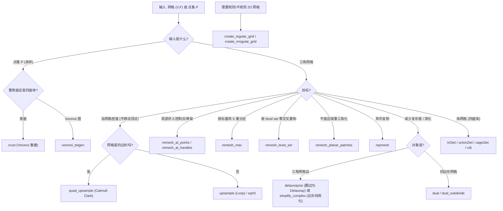

# 10.9 重网格与简化 / Remeshing & Simplification

> 本章覆盖 `mesh/` 下与**重网格 (remeshing)**、**细分 (subdivision)**、**三角化/四面体化 (triangulation / tetrahedralization)**、
> **规则/不规则网格生成 (grid generation)** 与 **简化 (simplification)** 相关的 28 个函数。
>
> This chapter documents 28 functions in `mesh/` related to remeshing, subdivision,
> triangulation/tetrahedralization, grid generation, and simplification.
>
> 约定：`V` 顶点 / vertices，`F` 三角面 / triangles，`Q` 四边形 / quads，`T` 四面体 / tets，
> `E` 边 / edges，`P` 点集 / points，`#V` 顶点数。锚点行号取自源码实际范围。

---

## 本章概览 / Chapter overview

> ⚠️ **重要发现 / Important finding**：本章源码中**不存在** `'TargetEdgeLength'` 参数，
> 也没有 `upsample` 的 `'SubdivideStrictly'` 参数（已用 Grep 全库搜索确认，无命中）。
> 目标尺寸/复杂度通过**传递 `triangle`/`tetgen` 的命令行 flags**（如 `'Quality'`, `'MaxArea'`）
> 或启发式 `MaxArea` 控制；迭代次数由**各自的名字参数**给出。下表以真实源码为准。
>
> ⚠️ There is **no** `'TargetEdgeLength'` parameter anywhere in this chapter, and `upsample`
> has **no** `'SubdivideStrictly'` option (verified by Grep). Target size is controlled by
> CLI flags forwarded to the `triangle`/`tetgen` wrappers, or by heuristic `MaxArea`.

### (a) 重网格 / Remeshing

| 函数 | 文件锚点 | 目标尺寸/精度参数 | 迭代 / 收敛条件 |
|---|---|---|---|
| `remesh_at_handles` | [L1-L117](file:///c:/VSWork/gptoolbox-1/mesh/remesh_at_handles.m#L1-L117) | 非参数化；`triangle(...,'Quality',30,'MaxArea',max_area)`，`max_area=8·(√3/4)·min_edge²`（启发式） | `while` 循环反复 `collapse_close_points`/`snap_points_to_close_edges` 直到顶点/边数不再变化 |
| `remesh_at_points` | [L1-L61](file:///c:/VSWork/gptoolbox-1/mesh/remesh_at_points.m#L1-L61) | 无（把点 `P` 精确并入顶点集） | `while true` 直到待并入点集 `PP` 为空 |
| `remesh_level_set` | [L1-L539](file:///c:/VSWork/gptoolbox-1/mesh/remesh_level_set.m#L1-L539) | 无；以 `D`（level set）零交叉为界 | 3D 下对 tet 递归调用自身；2D 下对每三角形做一次 crossing 切分 |
| `remesh_max` | [L1-L88](file:///c:/VSWork/gptoolbox-1/mesh/remesh_max.m#L1-L88) | 无；目标：使 `S` 的最大元索引在新三角形上**分片常值** | 对 "非易 (not_easy)" 三角形逐个 `selfintersect` + `outer_hull` |
| `remesh_planar_patches` | [L1-L175](file:///c:/VSWork/gptoolbox-1/mesh/remesh_planar_patches.m#L1-L175) | `'MinDeltaAngle'{pi-1e-5}` 判定共面；`triangle` flags 由 `'TriangleFlags'` 指定 | 单遍遍历每个平面 patch |
| `repmesh` | [L1-L52](file:///c:/VSWork/gptoolbox-1/mesh/repmesh.m#L1-L52) | 无边长概念；按 `C`（平移向量）、`S`（缩放）、`R`（旋转）**阵列复制** | 无迭代（一次性向量化复制） |

### (b) 细分 / Subdivision

| 函数 | 类型 | 主要参数 | 输出 |
|---|---|---|---|
| `upsample` | Loop 细分（**顶点不移动**），支持选择性细分 | `'Iterations'{1}`, `'OnlySelected'`, `'KeepDuplicates'{false}` | 三角/线段网格 |
| `quad_upsample` | Catmull-Clark（**顶点保持在中点/面重心**） | `iter{1}`（第 3 位置参数） | 四边形网格 |
| `sqrt3` | √3 细分 + `flip_edges` | `'Iterations'{1}` | 三角网格 |
| `spherical_subdivision` | 球面曲线细分（`slerp` 保持单位球） | `'MinLength'{0}`, `'MaxIter'{1}` | 球面边网络 |
| `dual` | 对偶多边形网格 | — | 多边形（外接圆心为顶点） |
| `dual_subdivide` | 一次 Catmull-Clark（不移动） | — | 四边形网格 |
| `subdivided_sphere` | 迭代细分基元（icosa/octa/cube） | `'Base'`, `'Radius'{1}`, `'SubdivisionMethod'{'upsample'}` | 球面三角网格 |

### (c) 三角化与四面体化 / Triangulation & Tetrahedralization

| 函数 | 依赖（wrapper / mex / MATLAB） | 说明 |
|---|---|---|
| `delaunayize` | 纯 MATLAB：`is_intrinsic_delaunay`, `is_extrinsic_delaunay`, `flip_edges`, `split_edges` | **不依赖任何 mex/wrapper**，把边翻转为 Delaunay |
| `cdt` | **wrapper**：2D 用 `triangle`，3D 用 `tetgen`（外部 CLI 二进制） | 约束 Delaunay 三角化/四面体化 |
| `crust` | 纯 MATLAB：`delaunayTriangulation`（Amenta et al. 1998） | Voronoi 基表面重建 |
| `tri2tet` | **wrapper**：`tetgen` | 脚本：曲面(+骨架采样) → 四面体网格 |
| `union2tet` | **wrapper**：`tetgen` | 脚本：曲面∪cage 并集 → 四面体网格 |
| `cage2tet` | **wrapper**：`tetgen` | 脚本：cage 与内曲面之间填充四面体 |
| `voronoi_tetgen` | **wrapper**：`tetgen`（flags `-vNEF`） | 用 tetgen 计算 Voronoi 图 |

> **MEX 关系说明**：MEX `tetrahedralize`（[mex/tetrahedralize.cpp](file:///c:/VSWork/gptoolbox-1/mex/tetrahedralize.cpp)）
> 是 libigl/tetgen 的 C++ 实现，属 60-mex 章节；**本章函数不直接调用它**——`cdt`/`tri2tet`/`union2tet`/`cage2tet`/`voronoi_tetgen`
> 均通过 `wrappers/tetgen.m` 调外部 `tetgen` 可执行文件；2D 走 `wrappers/triangle.m`。
> **`densify` 在本仓库不存在**（Grep 无命中）。
>
> MEX note: `tetrahedralize` (mex) is a libigl/tetgen C++ build documented in 60-mex and is **not**
> called here; these functions shell out to the external `tetgen`/`triangle` binaries via wrappers.

### (d) 规则 / 不规则网格生成 / Grid generation

| 函数 | 类型 | 依赖 |
|---|---|---|
| `create_regular_grid` | 规则三角网格（矩形域，可选环绕/收腰） | 纯 MATLAB（`meshgrid`） |
| `create_irregular_grid` | 不规则三角网格（随机 dart + 边界，min-angle 约束） | **wrapper**：`triangle`（经 `triangulate`） |
| `create_irregular_grid_with_min_angle` | **已弃用包装**，转发到 `create_irregular_grid` | `create_irregular_grid` |
| `bad_quad_mesh_from_quadtree` | 由 quadtree 叶节点构造（退化）四边形网格 | `remove_duplicate_vertices` |
| `lloyd_sphere` | Lloyd 松弛后的球面网格 | `subdivided_sphere`, `convhulln`, `massmatrix`, `adjacency_matrix` |

### (e) 简化 / Simplification

| 函数 | 算法 | 目标 |
|---|---|---|
| `simplify_complex` | Douglas-Peucker (`dpsimplify`) 逐连通分量简化；以 `manifold_patches` 分段 | 减少边数，**保留非流形顶点** |

### 决策图：选择重网格 / 简化策略 / Decision diagram



---

## 函数详解 / Per-function reference

### `remesh_at_handles` — 沿轮廓与内部句柄重网格
- **文件 / File**: [mesh/remesh_at_handles.m](file:///c:/VSWork/gptoolbox-1/mesh/remesh_at_handles.m#L1-L117)
- **签名 / Signature**: `[NV,NF,OV,OE,OV1,OE1,epsilon] = remesh_at_handles(V,F,C,P,BE,CE)`
- **功能 / Purpose**: `EN: Remesh a 2-D mesh using its outline plus interior control handles (exact points and sampled bones), via the Triangle program.` / 中文：利用轮廓和内部控制句柄（点精确、骨骼按率采样）对 2D 网格重网格，交给 Triangle 三角化。**仅适用于拓扑圆盘**（有洞会被闭合）。
- **输入 / Inputs**:

  | 参数 | 尺寸/类型 | 含义 (中 / EN) |
  |---|---|---|
  | `V` | `#V by 2` | 顶点坐标（**必须 2D**）/ vertex positions (2D only) |
  | `F` | `#F by 3` | 三角面索引 / triangle indices |
  | `C` | `#C by 2` | 控制顶点位置 / control vertex positions |
  | `P` | `#P` | 点控制索引（指向 `C` 的行）/ indices into `C` for point controls |
  | `BE` | `#BE by 2` | 骨骼对（`C` 的索引）/ bone pairs (indices into `C`) |
  | `CE` | `#CE by 2` | cage 边（指向 `P` 的索引）/ cage edges (indices into `P`) |

- **输出 / Outputs**:

  | 参数 | 尺寸/类型 | 含义 |
  |---|---|---|
  | `NV` | `#NV by 2` | 新顶点位置 / new vertices |
  | `NF` | `#NF by 3` | 新面索引 / new faces |
  | `OV` | `#OV by 2` | 送去 Triangle 的顶点（塌陷+裂边后）/ vertices sent to Triangle |
  | `OE` | `#OE by 2` | 送去 Triangle 的边 / edges sent to Triangle |
  | `OV1` | `#OV1 by 2` | 塌陷/裂边**前**的顶点 / vertices before collapse/split |
  | `OE1` | `#OE1 by 2` | 塌陷/裂边**前**的边 / edges before collapse/split |
  | `epsilon` | `1 by 1` | 用于塌陷点与裂边的容差 / collapse & split tolerance |

- **可选参数 / Optional**: 无（全部为位置参数）。
- **变量流动 / Variable flow**: `V,F → (提取唯一外边界边 O) → OV,OE → (追加采样 C(P),BES,CES) → OV,OE → (循环 collapse_close_points + snap_points_to_close_edges) → NV,NF`
- **算法步骤 / Algorithm**:
  1. 断言 `V` 与 `C` 为 2D；由 `F` 收集边并 `sort`，统计每条唯一边出现次数，`counts==1` 者为外轮廓 `O`。
  2. 由 `O` 去重得到轮廓顶点 `OV`、边 `OE`（`IM` 重映射）。
  3. 用 `sample_edges` 以 `samples_per_edge=10` 采样骨骼 `BE` 与 cage 边 `CE`，连同精确点 `C(P,:)` 追加到 `OV`。
  4. 计算 `epsilon = mean(edge length)/8`；`while` 循环反复调用 `collapse_close_points` 与 `snap_points_to_close_edges` 直到顶点/边数不再变化。
  5. 以 `max_area = 8·(√3/4)·min(edge²)` 作为启发式面积上界，调用 `triangle(OV,OE,[],'Quality',30,'MaxArea',max_area)` 得到 `NV,NF`。
- **流程图 / Flowchart**:

  ```mermaid
  flowchart TD
    A["输入 V,F,C,P,BE,CE"] --> B["提取唯一外边界边 O"]
    B --> C["OV,OE = 轮廓顶点/边"]
    C --> D["sample_edges 采样 BE,CE 并追加 C(P)"]
    D --> E["epsilon = 平均边长/8"]
    E --> F{"顶点/边数还在变?"}
    F -- 是 --> G["collapse_close_points + snap_points_to_close_edges"]
    G --> F
    F -- 否 --> H["triangle(...,'Quality',30,'MaxArea',max_area)"]
    H --> Z["输出 NV,NF"]
  ```

- **依赖 / Dependencies**: `sample_edges`, `collapse_close_points`, `snap_points_to_close_edges`, `triangle`（wrapper）
- **See also**: `remesh_at_points`, `remesh_planar_patches`, `triangle`

### `remesh_at_points` — 把点并入网格顶点集
- **文件 / File**: [mesh/remesh_at_points.m](file:///c:/VSWork/gptoolbox-1/mesh/remesh_at_points.m#L1-L61)
- **签名 / Signature**: `[FF,II] = remesh_at_points(V,F,P)`
- **功能 / Purpose**: `EN: Subdivide triangles of (V,F) so that given points P become vertices of the mesh.` / 中文：细分三角网格 `(V,F)`，使给定点 `P` 成为网格顶点（每个面至多吸收一个最近点，循环处理剩余点）。
- **输入 / Inputs**:

  | 参数 | 尺寸/类型 | 含义 (中 / EN) |
  |---|---|---|
  | `V` | `#V by 3` | 顶点坐标 / vertex positions |
  | `F` | `#F by 3` | 面索引 / face indices |
  | `P` | `#P by 3` | 待并入的点 / points to insert |

- **输出 / Outputs**:

  | 参数 | 尺寸/类型 | 含义 |
  |---|---|---|
  | `FF` | `#FF by 3` | 新的面索引（指向 `[V;P]`）/ faces into `[V;P]` |
  | `II` | `#FF` | 每个新面的"出生面"索引（指向原始 `F`）/ birth face into `F` |

- **可选参数 / Optional**: 无。
- **变量流动 / Variable flow**: `P → (point_mesh_squared_distance) → IC(最近面) → (unique 去重, 每面一点) → 追加顶点 VV=[V;C] 并 1→3 裂面 → 剩余点 L,PP → (循环) → FF → (重排 I) → FF,II`
- **算法步骤 / Algorithm**:
  1. 初始化 `VV=V, FF=F, II=1:#F, JJ=0, L=1:#P, PP=P`。
  2. `while true`：对 `PP` 求最近面 `IC` 与最近点 `C`（`point_mesh_squared_distance`）。
  3. 用 `unique(IC)` 保证**每个面只保留一个**最近点（`I`,`J`）。
  4. 追加这些最近点：`VV=[VV;C(J,:)]`，并把受影响面 `I` 一分为三（插入新顶点 `nCI`），未受影响面保留。
  5. 更新 `L, PP`（去掉已并入的点）；若 `PP` 空则退出。
  6. 用 `JJ` 重排索引，使输出顶点顺序恰为 `[V;C]`。
- **流程图 / Flowchart**:

  ```mermaid
  flowchart TD
    A["输入 V,F,P"] --> B["初始化 VV,F,PP"]
    B --> C{"PP 为空?"}
    C -- 否 --> D["point_mesh_squared_distance → IC,C"]
    D --> E["unique(IC): 每面保留一个最近点"]
    E --> F["VV=[VV;C]; 受影响面 1→3 裂分"]
    F --> G["去掉已并入点 → L,PP"]
    G --> C
    C -- 是 --> H["用 JJ 重排索引"]
    H --> Z["输出 FF,II"]
  ```

- **依赖 / Dependencies**: `point_mesh_squared_distance`
- **See also**: `random_points_on_mesh`, `remesh_at_handles`, `upsample`

### `remesh_level_set` — 按 level set 重网格
- **文件 / File**: [mesh/remesh_level_set.m](file:///c:/VSWork/gptoolbox-1/mesh/remesh_level_set.m#L1-L539)
- **签名 / Signature**: `[U,G,I,S,LE,H] = remesh_level_set(V,F,D,varargin)`
- **功能 / Purpose**: `EN: Remesh a triangle (or tet) mesh along a level set of the scalar field D, inserting crossing vertices.` / 中文：沿标量场 `D` 的 level set 重构网格：在每个与零值交叉的边上插入交点，并把该三角形/四面体切开（3D 时对 tet 递归到其 4 个三角面）。
- **输入 / Inputs**:

  | 参数 | 尺寸/类型 | 含义 (中 / EN) |
  |---|---|---|
  | `V` | `#V by dim` | 顶点坐标 / vertex positions |
  | `F` | `#F by 3` 或 `#F by 4` | 三角面或四面体索引 / triangle or tet indices |
  | `D` | `#V by 1` | level set 值（每顶点）/ level set values |

- **输出 / Outputs**:

  | 参数 | 尺寸/类型 | 含义 |
  |---|---|---|
  | `U` | `#U by dim` | 新顶点位置（含交点）/ new vertices incl. crossings |
  | `G` | `#G by 3` | 新三角面索引（指向 `U`）/ new triangle indices |
  | `I` | `#G` | 每个新面源自的原面索引（指向 `F`）/ birth face into `F` |
  | `S` | `#U by #V` | 稀疏矩阵，`U = S*V` / so that `U = S*V` |
  | `LE` | `#LE by 2` | 追踪 level set 的边（绕负区 CCW）/ level-set edges |
  | `H` | `#G` | 每面在 `I` 内的分片 ID（0/1/2/3）/ per-face split id |

- **可选参数 / Optional**:

  | 名称 | 取值 | 默认 | 含义 |
  |---|---|---|---|
  | `'AllowDegeneracies'` | `logical` | `false` | 允许 level set 恰好过顶点或交点落在端点 / allow crossings at vertices/endpoints |

- **变量流动 / Variable flow**: `V,F,D → (3D: tet→4 三角面, 递归) → (2D: 逐边求交点 T=-D1/(D2-D1)) → U,S,LE → (每三角形 1→2/3/4 裂分) → G,I,H → (3D: 重组 TG0/TG3/TG4) → U,G,I,S,LE,H`
- **算法步骤 / Algorithm**:
  1. 解析 `'AllowDegeneracies'` 参数。
  2. **若 `F` 为四面体**（`size(F,2)==4`）：取 4 个面朝向构成 `allF`，去重得 `F` 与 `FMAP`，递归调用本函数处理三角面；再根据哪些面被切分把 tet 分为 `T0`（未切，直接保留）、`T3`（切 3 面）、`T4`（切 4 面）三组，分别用 `TG0`、`TG3`（含三角化四边形 `TQ3`）、`TG4`（含四边形 `FQ` 与顶点 `An/Ap`）重组。
  3. **若 `F` 为三角形**：在 `D` 变号（`sign` 不等）的边上以线性插值 `T = -D(E1)/(D(E2)-D(E1))` 求交点 `U`；每个三角形至多一个 crossing，按 crossing 位置把面 1→2、1→3（选连到较小索引的对角以保证 tet 可再四面体化）。
  4. 构造 `S = speye` 加交点插值行；由负区顶点定向得到 `LE`。
- **流程图 / Flowchart**:

  ```mermaid
  flowchart TD
    A["输入 V,F,D"] --> B{"size(F,2)==4 ?"}
    B -- 是 (tet) --> C["拆 4 面 → 递归 remesh_level_set"]
    C --> D["按 T0/T3/T4 重组 TG"]
    D --> Z["输出 U,G,I,S,LE,H"]
    B -- 否 (tri) --> E["逐边 sign 变化 K"]
    E --> F["插值求交点 T=-D1/(D2-D1)"]
    F --> G["每三角形按 crossing 1→2/3 裂分"]
    G --> H["构造 S, LE"]
    H --> Z
  ```

- **依赖 / Dependencies**: `full_sparse`（自我递归调用）
- **See also**: `barycentric_coordinates`, `slice_tets`, `upsample`

### `remesh_max` — 使最大元索引分片常值
- **文件 / File**: [mesh/remesh_max.m](file:///c:/VSWork/gptoolbox-1/mesh/remesh_max.m#L1-L88)
- **签名 / Signature**: `[VV,FF,J,FJ] = remesh_max(V,F,S)`
- **功能 / Purpose**: `EN: Remesh a triangle mesh so that the index set of the maximum elements of S is piecewise constant over the new triangles.` / 中文：重网格三角网格，使标量矩阵 `S` 的逐顶点"最大元索引"在新三角形上分片常值（即按 argmax 分区重划）。
- **输入 / Inputs**:

  | 参数 | 尺寸/类型 | 含义 (中 / EN) |
  |---|---|---|
  | `V` | `#V by dim` | 顶点坐标 / vertex positions |
  | `F` | `#F by 3` | 三角面索引 / triangle indices |
  | `S` | `#V by #S` | 标量场矩阵 / scalar values (per vertex per field) |

- **输出 / Outputs**:

  | 参数 | 尺寸/类型 | 含义 |
  |---|---|---|
  | `VV` | `#VV by dim` | 输出顶点位置 / output vertices |
  | `FF` | `#FF by 3` | 输出面索引 / output faces |
  | `J` | `#FF` | 每面所属的 `S` 列索引（argmax 标签）/ index into columns of `S` |
  | `FJ` | `#FF` | 每面源自的原始面索引（指向 `F`）/ birth face into `F` |

- **可选参数 / Optional**: **无**。⚠️ 任务书中提到的 `'TargetEdgeLength'`/`'MaxIterations'`/`'FeatureAngleThreshold'` 在本函数源码中**并不存在**（Grep 全库无命中）；真实接口仅 `(V,F,S)`。
- **变量流动 / Variable flow**: `S(F) → (max 逐列 argmax MI) → easy(三顶点 argmax 一致) → FF,J,FJ; not_easy → (remesh_max_single: selfintersect+outer_hull) → 追加 VV,FF,J,FJ`
- **算法步骤 / Algorithm**:
  1. 计算每个面上三顶点的 `argmax` 标签 `MI`，三顶点一致者为 "easy"，直接沿用原面。
  2. 对 "not_easy" 面：调用内部 `remesh_max_single`——以 2D 参考三角形 + 顶点的 `S` 值为高度，用 `selfintersect(...,'StitchAll',true)` 与 `outer_hull` 求出上包。
  3. 用重心坐标 `BC` 把 2D 结果映射回原面（`VVf = BC * V(F(f,:),:)`），追加到输出，并记录 `J`（标签）与 `FJ`（出生面）。
- **流程图 / Flowchart**:

  ```mermaid
  flowchart TD
    A["输入 V,F,S"] --> B["逐面三顶点 argmax → MI"]
    B --> C{"三顶点标签一致 (easy)?"}
    C -- 是 --> D["FF=F(easy,:); J=MI; VV=V"]
    C -- 否 --> E["remesh_max_single: selfintersect + outer_hull"]
    E --> F["重心坐标映射回原面并追加"]
    D --> Z["输出 VV,FF,J,FJ"]
    F --> Z
  ```

- **依赖 / Dependencies**: `selfintersect`, `outer_hull`, `progressbar`
- **See also**: `remesh_level_set`, `mesh_boolean_winding_number`

### `remesh_planar_patches` — 近平面区域重三角化
- **文件 / File**: [mesh/remesh_planar_patches.m](file:///c:/VSWork/gptoolbox-1/mesh/remesh_planar_patches.m#L1-L175)
- **签名 / Signature**: `[W,G,IM,C] = remesh_planar_patches(V,F,varargin)`
- **功能 / Purpose**: `EN: Find nearly planar patches and retriangulate them (project patch to its fitted plane, retriangulate outline, lift back).` / 中文：识别近似共面的 patch，投影到拟合平面后用约束三角化重划该 patch，再抬回原曲面；尽量保留非流形边。
- **输入 / Inputs**:

  | 参数 | 尺寸/类型 | 含义 (中 / EN) |
  |---|---|---|
  | `V` | `#V by 3` | 顶点 / vertices |
  | `F` | `#F by 3` | 三角面 / triangle indices |

- **输出 / Outputs**:

  | 参数 | 尺寸/类型 | 含义 |
  |---|---|---|
  | `W` | `#W by 3` | 输出顶点位置 / output positions |
  | `G` | `#G by 3` | 输出三角面索引 / output indices |
  | `IM` | `#W_pre` | 最终 `remove_unreferenced` 的索引映射 / index map |
  | `C` | `#F` | 每面的 patch 标签 / patch index per original face |

- **可选参数 / Optional**:

  | 名称 | 取值 | 默认 | 含义 |
  |---|---|---|---|
  | `'Force'` | `logical` | `false` | 即使不减少顶点也强制重网格 / force remesh |
  | `'MinSize'` | 整数 | `4` | 参与重网格的组最少面数 / min facets in group |
  | `'MinDeltaAngle'` | 弧度 | `pi-1e-5` | 相邻面视为共面的最大法向夹角变化 / coplanarity threshold |
  | `'Except'` | `#E by 2` | `[]` | 不重网格的面列表 / faces not to remesh |
  | `'TriangleFlags'` | 字符串 | `''` | 传给 triangle 的额外 flags / Triangle flags |

- **变量流动 / Variable flow**: `V,F → planar_patches → C → (每 patch: affine_fit 平面 A, outline 边界 O) → V*A 投影 → triangulate(Vuo,E) → 抬回 (in_element + barycentric_coordinates) → W,G`
- **算法步骤 / Algorithm**:
  1. 由 `nonmanifold_edges` 得到非流形边；由 `planar_patches` 得到面标签 `C`（同 `MinDeltaAngle`）。
  2. 统计各 patch 面数；`counts<=min_size` 的面直接保留。
  3. 对每个大 patch：`affine_fit` 拟合平面 `A`；`outline` 取边界 `O`；并入该 patch 的非流形边 `NMEc`。
  4. 若交点集不减少且非 `Force`，跳过；否则把参与点投影到平面 `Vuo=V(uo,:)*A`，重映射边界边 `E`。
  5. `triangulate(Vuo,E,'Flags',triangle_flags)` 重三角化；若出现多个连通分量，用 `winding_number` 剔除洞（`|w|<0.1`）。
  6. 把新内点用 `in_element` 定位到原 patch 的 `Fc` 中，`barycentric_coordinates` 抬回 3D；用面法向一致性决定是否 `fliplr` 翻转朝向。
  7. 拼接所有 patch 结果后 `remove_unreferenced` 得 `W,G,IM`。
- **流程图 / Flowchart**:

  ```mermaid
  flowchart TD
    A["输入 V,F,选项"] --> B["nonmanifold_edges + planar_patches → C"]
    B --> C2{"每 patch 面数 > min_size?"}
    C2 -- 否 --> D["保留原面"]
    C2 -- 是 --> E["affine_fit 平面 + outline 边界"]
    E --> F{"顶点集有减少 or Force?"}
    F -- 否 --> D
    F -- 是 --> G["投影到平面 → triangulate"]
    G --> H["winding_number 去洞"]
    H --> I["in_element + barycentric 抬回 3D"]
    I --> J["法向一致性决定翻转"]
    D --> K["remove_unreferenced"]
    J --> K
    K --> Z["输出 W,G,IM,C"]
  ```

- **依赖 / Dependencies**: `nonmanifold_edges`, `planar_patches`, `affine_fit`, `outline`, `triangulate`, `adjacency_matrix`, `conncomp`, `winding_number`, `in_element`, `barycentric_coordinates`, `normals`, `normalizerow`, `remove_unreferenced`, `barycenter`
- **See also**: `planar_patches`, `remesh_at_handles`, `delaunayize`

### `repmesh` — 网格阵列复制
- **文件 / File**: [mesh/repmesh.m](file:///c:/VSWork/gptoolbox-1/mesh/repmesh.m#L1-L52)
- **签名 / Signature**: `[VV,FF,IV,IF] = repmesh(V,F,C,S,R)`
- **功能 / Purpose**: `EN: Repeat a mesh by translating it by each vector in C (optionally scaled/rotated).` / 中文：把网格按 `C` 中每个向量平移复制一份（可选按 `S` 缩放、`R` 旋转），得到阵列网格。
- **输入 / Inputs**:

  | 参数 | 尺寸/类型 | 含义 (中 / EN) |
  |---|---|---|
  | `V` | `#V by dim` | 基础网格顶点 / base vertices |
  | `F` | `#F by ss` | 单纯形索引 / simplex indices |
  | `C` | `#C by dim` | 平移向量（每份一个）/ translation vectors |
  | `S` | `#C by dim` | 每份的缩放（默认 `1`）/ per-copy scales |
  | `R` | `#C by dim by dim` | 每份的旋转（默认 `[]`）/ per-copy rotations |

- **输出 / Outputs**:

  | 参数 | 尺寸/类型 | 含义 |
  |---|---|---|
  | `VV` | `#V·#C by dim` | 拼接后的顶点 / stacked vertices |
  | `FF` | `#F·#C by ss` | 拼接后的面 / stacked faces |
  | `IV` | `#VV` | 每顶点源自 `C` 的行号 / vector id per vertex |
  | `IF` | `#FF` | 每面源自 `C` 的行号 / vector id per face |

- **可选参数 / Optional**:

  | 名称 | 取值 | 默认 | 含义 |
  |---|---|---|---|
  | 第 4 参数 `S` | `#C by dim` | `1` | 缩放 / scales |
  | 第 5 参数 `R` | `#C by dim by dim` | `[]` | 旋转 / rotations |

- **变量流动 / Variable flow**: `V,C,S,R → (逐份缩放 VS) → (可选旋转 pagemtimes) → (加平移 C) → VV；F → (按偏移平铺) → FF`
- **算法步骤 / Algorithm**:
  1. 缺省 `S=1`、`R=[]`。
  2. 用 `reshape(F'+offset)` 一次性把 `F` 复制 `#C` 份并加顶点偏移，得 `FF`。
  3. 缩放 `VS = V'.*permute(S,...)`；若 `R` 非空，用 `pagemtimes` 逐份旋转；再加平移 `C` 得 `VV`。
  4. 生成 `IV`/`IF`（`repmat`）。
- **流程图 / Flowchart**:

  ```mermaid
  flowchart TD
    A["输入 V,F,C,S,R"] --> B["F 平铺 #C 份并偏移 → FF"]
    A --> C["VS = V 逐份缩放"]
    C --> D{"R 为空?"}
    D -- 否 --> E["pagemtimes 逐份旋转"]
    D -- 是 --> F["VS 不变"]
    E --> G["加平移 C → VV"]
    F --> G
    B --> Z["输出 VV,FF,IV,IF"]
    G --> Z
  ```

- **依赖 / Dependencies**: 无同库函数（纯数组操作）。
- **See also**: `combine`, `cat_meshes`, `subdivided_sphere`

### `upsample` — Loop 式加密（不移动顶点）
- **文件 / File**: [mesh/upsample.m](file:///c:/VSWork/gptoolbox-1/mesh/upsample.m#L1-L324)
- **签名 / Signature**: `[VV,FF,FO] = upsample(V,F,varargin)`
- **功能 / Purpose**: `EN: Upsample a mesh by adding midpoints on edges/faces; i.e., Loop subdivision without moving vertices.` / 中文：在边/面中点插入新顶点进行加密（即"不移动顶点的 Loop 细分"）；支持按面选择性地 1→2/1→3/1→4 裂分，可递归 `Iterations` 次。
- **输入 / Inputs**:

  | 参数 | 尺寸/类型 | 含义 (中 / EN) |
  |---|---|---|
  | `V` | `#V by dim` | 顶点坐标 / vertex positions |
  | `F` | `#F by ss` | 单纯形索引（3=三角，2=线段）/ simplex indices |

- **输出 / Outputs**:

  | 参数 | 尺寸/类型 | 含义 |
  |---|---|---|
  | `VV` | `#VV by dim` | 新顶点（原 `V` 在前）/ new vertices, original first |
  | `FF` | `#FF by ss` | 新面索引 / new face indices |
  | `FO` | `#FF` | 每个新面源自的原始面索引 / parent simplex in `F` |

- **可选参数 / Optional**:

  | 名称 | 取值 | 默认 | 含义 |
  |---|---|---|---|
  | `'KeepDuplicates'` | `logical` | `false` | 保留重复中点（不合并）/ keep duplicate midpoints |
  | `'OnlySelected'` | 索引向量 / `#F by 3` 逻辑 / 函数句柄 | `[]`(全选) | 只细分选中面；函数句柄会在每轮递归调用 / only selected simplices |
  | `'Iterations'` | 整数 | `1` | 递归轮数 / number of recursive calls |

  > 注：**无 `'SubdivideStrictly'` 参数**（Grep 确认不存在）。
- **变量流动 / Variable flow**: `V,F,sel → (M 半边选择) → C=sum(M,2) → S14/S13/S12/S11 → one_four/one_three/one_two → U,FF → (unique 合并中点) → VV,FF → (iters-1 递归) → VV,FF,FO`
- **算法步骤 / Algorithm**:
  1. 解析参数；`sel` 缺省为全部面；若 `sel` 与 `F` 同尺寸则视为半边掩码 `M`（此时 `iters<=1`）；`iters<1` 时直接返回。
  2. 支持 `sel` 为函数句柄（先对 `(V,F)` 求值）。
  3. `case 3`（三角）：由 `sel` 经 `EMAP` 得到半边掩码 `M`；按每面被选半边数 `C` 分成 `S14`(全切)、`S13`(切 2 边)、`S12`(切 1 边)、`S11`(保持)。
  4. 用内部函数 `one_four`/`one_three`/`one_two` 生成新顶点 `U` 与面 `F14/F13/F12`，保留 `F11`；`KeepDuplicates=false` 时用 `unique` 合并重复中点。
  5. `case 2`（线段）：对选中边插入中点，未选边保留。
  6. 若 `iters>1` 则对结果递归调用（`OnlySelected` 传递 `ismember(FO,sel)` 或原函数句柄），并沿 `FO` 回溯父面。
- **流程图 / Flowchart**:

  ```mermaid
  flowchart TD
    A["输入 V,F,选项"] --> B{"iters<1 或 无选中面?"}
    B -- 是 --> Z["直接返回 V,F,FO=1:#F"]
    B -- 否 --> C{"size(F,2)"}
    C -- "3 (三角)" --> D["由 sel 建半边掩码 M"]
    D --> E["按 C=sum(M,2) 分 S14/S13/S12/S11"]
    E --> F["one_four / one_three / one_two + F11"]
    F --> G["unique 合并重复中点"]
    C -- "2 (线段)" --> H["每条选中边插中点"]
    G --> I{"iters>1?"}
    H --> I
    I -- 是 --> J["递归 upsample(Iterations=iters-1)"]
    I -- 否 --> Z2["输出 VV,FF,FO"]
    J --> Z2
  ```

- **依赖 / Dependencies**: 仅自我递归（无其他同库函数）。
- **See also**: `quad_upsample`, `sqrt3`, `loop`, `subdivided_sphere`, `dual_subdivide`

### `quad_upsample` — Catmull-Clark 加密（位置不动）
- **文件 / File**: [mesh/quad_upsample.m](file:///c:/VSWork/gptoolbox-1/mesh/quad_upsample.m#L1-L109)
- **签名 / Signature**: `[VV,QQ,SS,J] = quad_upsample(V,Q,iter)`
- **功能 / Purpose**: `EN: iter iterations of Catmull-Clark subdivision on a pure-quad or pure-triangle mesh, keeping vertices at edge/face midpoints (no smoothing).` / 中文：对纯四边形或纯三角网格做 `iter` 次 Catmull-Clark 细分，但把所有顶点保持在中点/面重心（不移动，保持平面）。
- **输入 / Inputs**:

  | 参数 | 尺寸/类型 | 含义 (中 / EN) |
  |---|---|---|
  | `V` | `#V by dim` | 顶点坐标 / vertex positions |
  | `Q` | `#Q by 4` 或 `#Q by 3` | 四边形或三角索引 / quad or triangle indices |
  | `iter` | `1 by 1` | 迭代次数（缺省 `1`）/ iterations |

- **输出 / Outputs**:

  | 参数 | 尺寸/类型 | 含义 |
  |---|---|---|
  | `VV` | `#VV by dim` | 输出顶点 / output vertices |
  | `QQ` | `#QQ by 4` | 输出四边形索引 / quad indices |
  | `SS` | `#VV by #V` | 线性细分算子，`VV = SS*V` / subdivision operator |
  | `J` | `#QQ` | 每个输出四边形源自的原始面索引 / birth parent into `Q` |

- **可选参数 / Optional**: `iter`（位置参数，缺省 `1`）。
- **变量流动 / Variable flow**: `V,Q → (循环 iter 次: SF 面重心, SE 边均值, ME 顶点邻域均值) → S=[I;SF;SE] → VV=S*VV, SS=S*SS → 重建 QQ → J`
- **算法步骤 / Algorithm**:
  1. 初始化 `VV=V, SS=speye, QQ=Q, J=1:#Q`。
  2. 每轮：把当前面分成纯四边形 `QQ` 与三角 `TT`（若有三角形）。
  3. 构造：面重心算子 `SF`（四边形取 1/4，三角取 1/3）、边点算子 `SE`（边两端点与边翼面重心的平均）、顶点平均算子 `ME`（经 `pou_rows` 归一化为邻域平均）。
  4. 拼接细分算子 `S=[speye(n); SF; SE]`，更新 `VV=S*VV`、`SS=S*SS`。
  5. 依 `QE2E/TE2E` 索引重建四边形 `QQ`（每个四边面→4 个四边形，每个三角面→3 个四边形），并扩展 `J`。
- **流程图 / Flowchart**:

  ```mermaid
  flowchart TD
    A["输入 V,Q,iter"] --> B["初始化 VV=V,SS=I,QQ=Q"]
    B --> C{"i <= iter ?"}
    C -- 是 --> D["分离纯四边形 QQ / 三角 TT"]
    D --> E["构造 SF(面重心), SE(边点), ME(顶点平均)"]
    E --> F["S=[I;SF;SE]; VV=S*VV; SS=S*SS"]
    F --> G["重建 QQ (四→4, 三→3); 扩展 J"]
    G --> C
    C -- 否 --> Z["输出 VV,QQ,SS,J"]
  ```

- **依赖 / Dependencies**: 无同库函数（纯稀疏矩阵构造）。
- **See also**: `dual_subdivide`, `upsample`, `catmull_clark`, `subdivided_sphere`

### `sqrt3` — √3 细分
- **文件 / File**: [mesh/sqrt3.m](file:///c:/VSWork/gptoolbox-1/mesh/sqrt3.m#L1-L70)
- **签名 / Signature**: `[VV,FF,SS] = sqrt3(V,F,varargin)`
- **功能 / Purpose**: `EN: Perform sqrt(3) subdivision: insert a centroid per triangle, connect to corners, then flip old edges.` / 中文：√3 细分——每三角形中心插一点并连到三顶点（1→3），随后翻掉所有原边；用稀疏算子累积顶点位置。
- **输入 / Inputs**:

  | 参数 | 尺寸/类型 | 含义 (中 / EN) |
  |---|---|---|
  | `V` | `#V by dim` | 顶点坐标 / vertex positions |
  | `F` | `#F by ss` | 单纯形索引 / simplex indices |

- **输出 / Outputs**:

  | 参数 | 尺寸/类型 | 含义 |
  |---|---|---|
  | `VV` | `#VV by dim` | 输出顶点 / output vertices |
  | `FF` | `#FF by 3` | 输出三角面 / triangle indices |
  | `SS` | `#VV by #V` | 稀疏算子，`VV = SS*V` / subdivision operator |

- **可选参数 / Optional**:

  | 名称 | 取值 | 默认 | 含义 |
  |---|---|---|---|
  | `'Iterations'` | 整数 | `1` | 递归轮数 / number of recursive calls |

- **变量流动 / Variable flow**: `V,F → (每轮: C=n+(1:#F) 面重心, E 内部边) → 邻接加权 A → S=[A; 重心 1/3 行] → SS=S*SS → FF=1→3 后 flip_edges(FF,E) → VV=SS*V`
- **算法步骤 / Algorithm**:
  1. 解析 `'Iterations'`；初始化 `SS=speye, VV=V, FF=F`。
  2. 每轮：`C` 为新重心顶点；`E` 为去掉轮廓后的内部边（`edges`/`outline`）。
  3. 由邻接矩阵 `A` 计算权重 `An=(4-2cos(2π/val))/9`，构造顶点更新算子（旧顶点按邻接加权、重心按 1/3）。
  4. `SS=S*SS`；面 1→3（`[F(:,2) F(:,3) C]` 等三块）；再用 `flip_edges(FF,E,'NonConflicting',true)` 翻掉原边（`'NonConflicting'` 批量无冲突翻转）。
  5. `VV = SS*V`。
- **流程图 / Flowchart**:

  ```mermaid
  flowchart TD
    A["输入 V,F,Iterations"] --> B["SS=I, VV=V, FF=F"]
    B --> C{"iter <= iters ?"}
    C -- 是 --> D["C = 面重心; E = 内部边"]
    D --> E["邻接加权构造 S=[A; 重心]"]
    E --> F["SS=S*SS; FF 1→3"]
    F --> G["flip_edges(FF,E,'NonConflicting',true)"]
    G --> C
    C -- 否 --> H["VV = SS*V"]
    H --> Z["输出 VV,FF,SS"]
  ```

- **依赖 / Dependencies**: `edges`, `outline`, `adjacency_matrix`, `flip_edges`
- **See also**: `upsample`, `quad_upsample`, `subdivided_sphere`

### `spherical_subdivision` — 球面曲线细分
- **文件 / File**: [mesh/spherical_subdivision.m](file:///c:/VSWork/gptoolbox-1/mesh/spherical_subdivision.m#L1-L61)
- **签名 / Signature**: `[NN,EE,A,I] = spherical_subdivision(N,E,varargin)`
- **功能 / Purpose**: `EN: Given a spherical edge network on the unit sphere, subdivide its curves while keeping all points on the sphere (via slerp).` / 中文：给定单位球面上的边网络，细分其曲线；用 `slerp` 保证新点仍落在单位球上。
- **输入 / Inputs**:

  | 参数 | 尺寸/类型 | 含义 (中 / EN) |
  |---|---|---|
  | `N` | `#N by 3` | 单位球面顶点 / vertices on unit sphere |
  | `E` | `#E by 2` | 边索引 / edge indices into `N` |

- **输出 / Outputs**:

  | 参数 | 尺寸/类型 | 含义 |
  |---|---|---|
  | `NN` | `#NN by 3` | 细分后球面顶点 / subdivided vertices |
  | `EE` | `#EE by 2` | 细分后边 / subdivided edges |
  | `A` | `#NN by #N` | 细分矩阵 / subdivision matrix |
  | `I` | `#EE` | 每条新边源自的原始边索引 / birth edge |

- **可选参数 / Optional**:

  | 名称 | 取值 | 默认 | 含义 |
  |---|---|---|---|
  | `'MinLength'` | 标量 | `0` | 只细分长度大于此值的边 / min edge length to subdivide |
  | `'MaxIter'` | 整数 | `1` | 最大迭代数 / maximum iterations |

- **变量流动 / Variable flow**: `N,E → (每轮: l=边长, long=l>min_length) → slerp 中点新顶点 + A 行 → 边一分为二 → (iter<MaxIter 继续) → NN,EE,A,I`
- **算法步骤 / Algorithm**:
  1. 解析 `'MinLength'`/`'MaxIter'`；初始化 `NN=N,EE=E,I=1:#E,A=speye`。
  2. 循环：计算各边长度 `l`，`long = l>min_length`。
  3. 对长边用 `slerp(端点,端点,0.5)` 生成球面中点，追加到 `NN`；对应 `A` 的新行为两端点子行之和的 0.5 倍（保证 `NN=A*N`）。
  4. 长边一分为二，`I` 对应复制；`iter>=max_iter` 则退出。
- **流程图 / Flowchart**:

  ```mermaid
  flowchart TD
    A["输入 N,E,MinLength,MaxIter"] --> B["NN=N, EE=E, A=I"]
    B --> C["计算边长 l; long = l>MinLength"]
    C --> D["slerp 生成球面中点并追加 NN"]
    D --> E["追加 A 行 (0.5 端点之和)"]
    E --> F["长边一分为二, 复制 I"]
    F --> G{"iter >= MaxIter ?"}
    G -- 否 --> C
    G -- 是 --> Z["输出 NN,EE,A,I"]
  ```

- **依赖 / Dependencies**: `slerp`
- **See also**: `spline_upsample`, `subdivided_sphere`, `lloyd_sphere`

### `dual` — 对偶多边形网格
- **文件 / File**: [mesh/dual.m](file:///c:/VSWork/gptoolbox-1/mesh/dual.m#L1-L82)
- **签名 / Signature**: `[C,PI,PC] = dual(V,F)`
- **功能 / Purpose**: `EN: Construct the dual polygonal mesh of a closed triangle mesh (dual vertices at circumcenters).` / 中文：构造闭合三角网格的对偶多边形网格——对偶顶点取各三角形的外接圆心（`circumradius`），绕每个原顶点按面邻接顺序串成多边形。
- **输入 / Inputs**:

  | 参数 | 尺寸/类型 | 含义 (中 / EN) |
  |---|---|---|
  | `V` | `#V by dim` | 顶点坐标 / vertex positions |
  | `F` | `#F by 3` | 三角面索引 / triangle indices |

- **输出 / Outputs**:

  | 参数 | 尺寸/类型 | 含义 |
  |---|---|---|
  | `C` | `#C by dim` | 对偶顶点（外接圆心）/ dual vertices (circumcenters) |
  | `PI` | `#PI` | 多边形索引流（指向 `C`）/ polygon indices into `C` |
  | `PC` | `#V+1` | 每个对偶面顶点数的累加和 / cumulative dual-face valences |

- **可选参数 / Optional**: 无（要求网格无边界，`assert(~any(on_boundary(F),'all'))`）。
- **变量流动 / Variable flow**: `V,F → circumradius → C; F → triangle_triangle_adjacency → (环绕遍历顶点-面对 LP) → L → sort/accumarray → PI,PC`
- **算法步骤 / Algorithm**:
  1. 断言无边界；`[~,C]=circumradius(V,F)` 得对偶顶点。
  2. `unique(F(:))` 得唯一顶点 `I` 与其所在面/角 `IF/IC`。
  3. 由 `triangle_triangle_adjacency` 得到面-面邻接；`while` 循环沿对偶边环绕（`IF←NF, IC←NC`），把 `(顶点, 面对偶) ` 记录进 `L`，直到回到起点。
  4. 对 `L` 按顶点稳定排序，`PC=cumsum(accumarray(L(:,1),1))`、`PI=L(:,2)`。
- **流程图 / Flowchart**:

  ```mermaid
  flowchart TD
    A["输入 V,F (无边界)"] --> B["circumradius → 对偶顶点 C"]
    B --> C["unique(F(:)) → I,IF,IC"]
    C --> D["triangle_triangle_adjacency"]
    D --> E{"环绕遍历未完成?"}
    E -- 是 --> F["记录 (顶点, 面对偶) 入 L; IF←NF,IC←NC"]
    F --> E
    E -- 否 --> G["按顶点排序; PC=cumsum, PI=L(:,2)"]
    G --> Z["输出 C,PI,PC"]
  ```

- **依赖 / Dependencies**: `circumradius`, `on_boundary`, `triangle_triangle_adjacency`
- **See also**: `dual_subdivide`, `polygons_to_triangles`, `catmull_clark`

### `dual_subdivide` — 一次 Catmull-Clark（不移动）
- **文件 / File**: [mesh/dual_subdivide.m](file:///c:/VSWork/gptoolbox-1/mesh/dual_subdivide.m#L1-L36)
- **签名 / Signature**: `[VV,QQ,SS,J] = dual_subdivide(V,F)`
- **功能 / Purpose**: `EN: One iteration of Catmull-Clark subdivision without moving vertices; converts a triangle mesh to a quad mesh.` / 中文：一次不移动顶点的 Catmull-Clark 细分——三角网格转为四边形网格（原顶点 + 边中点 + 面重心）。
- **输入 / Inputs**:

  | 参数 | 尺寸/类型 | 含义 (中 / EN) |
  |---|---|---|
  | `V` | `#V by 3` | 顶点坐标 / vertex positions |
  | `F` | `#F by 3` | 三角面索引 / triangle indices |

- **输出 / Outputs**:

  | 参数 | 尺寸/类型 | 含义 |
  |---|---|---|
  | `VV` | `#VV by 3` | 输出顶点（原顶点 + 边中点 + 面重心）/ output vertices |
  | `QQ` | `#QQ by 4` | 四边形索引，`QQ(:,1)` 为原网格顶点 / quad indices |
  | `SS` | `#VV by #V` | 稀疏算子，`VV = SS*V` / subdivision operator |
  | `J` | `#QQ` | 每个四边形源自的原面索引 / birth parents |

- **可选参数 / Optional**: 无。
- **变量流动 / Variable flow**: `V,F → (allE 去重 uE/EMAP) → SS=[I; 边中点 0.5; 面重心 1/3] → VV=SS*V → (按面构造 3 个四边形) → QQ,J`
- **算法步骤 / Algorithm**:
  1. 由 `F` 的三条半边去重得唯一边 `uE` 与 `EMAP`。
  2. 构造 `SS`（`speye` 原顶点 + 边中点 0.5 行 + 面重心 1/3 行）；`VV=SS*V`。
  3. 每个三角面生成 3 个四边形：`[角顶点, 边中点(逆序), 面重心 I, 边中点]`，`J=repmat(1:#F,1,3)'`。
- **流程图 / Flowchart**:

  ```mermaid
  flowchart TD
    A["输入 V,F"] --> B["半边去重 → uE, EMAP"]
    B --> C["SS=[I; 边中点; 面重心]"]
    C --> D["VV = SS*V"]
    D --> E["每面构造 3 个四边形 QQ; J=repmat"]
    E --> Z["输出 VV,QQ,SS,J"]
  ```

- **依赖 / Dependencies**: 无同库函数（纯稀疏构造）。
- **See also**: `quad_upsample`, `dual`, `catmull_clark`

### `simplify_complex` — 边复杂简化（Douglas-Peucker）
- **文件 / File**: [mesh/simplify_complex.m](file:///c:/VSWork/gptoolbox-1/mesh/simplify_complex.m#L1-L53)
- **签名 / Signature**: `[dE] = simplify_complex(V,E,tol)`
- **功能 / Purpose**: `EN: Simplify a piecewise-linear complex of edges by simplifying each connected component between non-manifold edges (Douglas-Peucker); non-manifold vertices are preserved.` / 中文：把边复杂按非流形边分段，对各连通分量用 Douglas-Peucker（`dpsimplify`，容差 `tol`）折线简化；保证非流形顶点保留。
- **输入 / Inputs**:

  | 参数 | 尺寸/类型 | 含义 (中 / EN) |
  |---|---|---|
  | `V` | `#V by dim` | 顶点坐标 / vertex positions |
  | `E` | `#E by 2` | 边索引 / edge indices |
  | `tol` | 标量 | `dpsimplify` 容差 / dpsimplify tolerance |

- **输出 / Outputs**:

  | 参数 | 尺寸/类型 | 含义 |
  |---|---|---|
  | `dE` | `#dE by 2` | 简化后的边索引（指向 `V`）/ simplified edges into `V` |

- **可选参数 / Optional**: 无（`tol` 为位置参数）。
- **变量流动 / Variable flow**: `E → manifold_patches → C → (每分量: remove_unreferenced, edges_to_path → path) → (若 loop 则以最大 valence 顶点为起点重组) → dpsimplify(Vc(path),tol) → dI → dEc → 映射 J 回 V → dE`
- **算法步骤 / Algorithm**:
  1. 统计每顶点 valence `val`；`manifold_patches(E)` 把边分成流形片 `C`。
  2. 对每个分量 `Ec`：`remove_unreferenced` 得局部 `Vc,J,Ec`；`edges_to_path` 得有序路径 `path`（必要时翻转方向使首边匹配）。
  3. 若为首尾相接的 loop，则以 valence 最大（非流形）顶点为起点旋转路径，并闭合。
  4. 对折线 `Vc(path,:)` 调 `dpsimplify` 得保留点索引 `dI`，构成简化边 `dEc`，再用 `J` 映射回全局顶点。
- **流程图 / Flowchart**:

  ```mermaid
  flowchart TD
    A["输入 V,E,tol"] --> B["manifold_patches(E) → C"]
    B --> C{"遍历每个连通分量 c"}
    C --> D["remove_unreferenced → Vc,J,Ec"]
    D --> E["edges_to_path → path"]
    E --> F{"是 loop?"}
    F -- 是 --> G["以最大 valence 顶点为起点旋转并闭合"]
    F -- 否 --> H["保持 path"]
    G --> I["dpsimplify(Vc(path),tol) → dI"]
    H --> I
    I --> J["dEc = path 相邻对, 映射 J 回 V"]
    J --> C
    C --> Z["输出 dE"]
  ```

- **依赖 / Dependencies**: `manifold_patches`, `remove_unreferenced`, `edges_to_path`, `dpsimplify`
- **See also**: `collapse_close_points`, `manifold_patches`, `clean_mesh`

### `delaunayize` — 翻边使所有边 Delaunay
- **文件 / File**: [mesh/delaunayize.m](file:///c:/VSWork/gptoolbox-1/mesh/delaunayize.m#L1-L112)
- **签名 / Signature**: `[V,F] = delaunayize(V,F,varargin)`
- **功能 / Purpose**: `EN: Make all edges Delaunay (if possible) by repeatedly flipping non-Delaunay edges, with optional edge splitting.` / 中文：反复翻转非 Delaunay 边（可选额外裂边），使网格所有边尽可能满足 Delaunay 条件；3D 用 intrinsic、2D 用 extrinsic 判定。
- **输入 / Inputs**:

  | 参数 | 尺寸/类型 | 含义 (中 / EN) |
  |---|---|---|
  | `V` | `#V by dim` | 顶点坐标 / vertex positions |
  | `F` | `#F by 3` | 三角面索引 / triangle indices |

- **输出 / Outputs**:

  | 参数 | 尺寸/类型 | 含义 |
  |---|---|---|
  | `V` | `#V by dim` | 顶点（`SplitEdges` 时会增多）/ vertices |
  | `F` | `#F by 3` | 边翻/裂后的三角面 / triangles |

- **可选参数 / Optional**:

  | 名称 | 取值 | 默认 | 含义 |
  |---|---|---|---|
  | `'Tol'` | 标量 | `1e-7` | `is_delaunay` 容差 / tolerance |
  | `'Visualize'` | `logical` | `false` | 可视化每轮 / visualize |
  | `'Keep'` | `#E by 2` | `[]` | 不允许翻转的边 / edges not to flip |
  | `'SplitEdges'` | `logical` | `false` | 是否允许裂边 / allow edge splitting |
  | `'MaxDihedralAngle'` | 标量 | `inf` | 二面角超过此值的边视为不翻 / curvature cutoff |

- **变量流动 / Variable flow**: `V,F → (3D: is_intrinsic_delaunay / 2D: is_extrinsic_delaunay) → D → 并上 keep/边界/弯曲边 → NDE=allE(~D) → (可选 split_edges) → flip_edges → 直到不变`
- **算法步骤 / Algorithm**:
  1. 解析参数。`while true`：
  2. 按维度判定 Delaunay：3D 用 `is_intrinsic_delaunay`（`'BoundaryDefault',false`），2D 用 `is_extrinsic_delaunay`；收集所有半边 `allE`。
  3. `Keep`/边界 `B`/`MaxDihedralAngle` 超限的弯曲边 `C` 均视为"Delaunay"（不翻）。
  4. `NDE=allE(~D)` 为待翻边，去重 `NDuE`。若 `SplitEdges`，先对非 Delaunay 的 keep/边界边 `split_edges`。
  5. `flip_edges(Fprev,NDuE,'AllowNonManifold',false)`；若产生退化面则回退；若 `F` 不再变化则退出。
- **流程图 / Flowchart**:

  ```mermaid
  flowchart TD
    A["输入 V,F,选项"] --> B{"size(V,2)"}
    B -- 3 --> C["is_intrinsic_delaunay → D"]
    B -- 2 --> D["is_extrinsic_delaunay → D"]
    C --> E["D |= Keep|边界|弯曲边"]
    D --> E
    E --> F{"SplitEdges ?"}
    F -- 是 --> G["split_edges(非Delaunay 的 keep/边界边)"]
    F -- 否 --> H["跳过"]
    G --> I["NDuE = 待翻唯一边"]
    H --> I
    I --> J{"NDuE 非空?"}
    J -- 是 --> K["flip_edges(...,'AllowNonManifold',false)"]
    K --> L{"F 有变化?"}
    L -- 是 --> B
    L -- 否 --> Z["输出 V,F"]
    J -- 否 --> Z
  ```

- **依赖 / Dependencies**: `is_intrinsic_delaunay`, `is_extrinsic_delaunay`, `on_boundary`, `flip_edges`, `split_edges`, `adjacency_dihedral_angle_matrix`, `plot_edges`
- **See also**: `is_delaunay`, `flip_edges`, `cdt`, `intrinsic_delaunay_cotmatrix`

### `cdt` — 约束 Delaunay 三角化 / 四面体化
- **文件 / File**: [mesh/cdt.m](file:///c:/VSWork/gptoolbox-1/mesh/cdt.m#L1-L453)
- **签名 / Signature**: `[VV,TT,FF,TN,IFF] = cdt(V,F,'ParameterName',ParameterValue, ...)`
- **功能 / Purpose**: `EN: Compute the constrained Delaunay triangulation (2D, via Triangle) or tetrahedralization (3D, via TetGen) of a mesh.` / 中文：对网格求约束 Delaunay 三角化（2D 用 Triangle）或四面体化（3D 用 TetGen）；带 md5 结果缓存。
- **输入 / Inputs**:

  | 参数 | 尺寸/类型 | 含义 (中 / EN) |
  |---|---|---|
  | `V` | `#V by dim` | 顶点坐标 / vertex positions |
  | `F` | `#F by dim` | 面/边（2D 为约束边 `E`）/ faces or constraint edges |

- **输出 / Outputs**:

  | 参数 | 尺寸/类型 | 含义 |
  |---|---|---|
  | `VV` | `#VV by dim` | 输出顶点（`V` 为前缀）/ vertices |
  | `TT` | `#TT by dim+1` | 四面体（3D）或三角（2D `TT`）/ tets or triangles |
  | `FF` | `#FF by dim` | 可能被细分的面 / (subdivided) faces |
  | `TN` | `#TT by dim+1` | 单元邻居 / element neighbors |
  | `IFF` | `#FF` | 每个输出面对应的原始面索引 / original facet per output facet |

- **可选参数 / Optional**:

  | 名称 | 取值 | 默认 | 含义 |
  |---|---|---|---|
  | `'TriangleFlags'` | 字符串 | `''` | 传给 triangle 的 flags / Triangle flags |
  | `'TetgenFlags'` | 字符串 | `''` | 传给 tetgen 的 flags / Tetgen flags |
  | `'UseBoundingBox'` | `logical` | `0` | 用显式包围盒而非凸包 / use explicit bounding box |
  | `'BoundingBoxPush'` | 标量 | `1.01` | 包围盒外扩系数 / bounding box push |
  | `'BoundingBoxUpsample'` | 标量 | `inf` | 细分包围盒至 min area < f·max area / bb upsample factor |
  | `'Quiet'` | `logical` | `0` | 静默 / quiet |

- **变量流动 / Variable flow**: `V,F → (md5 缓存) → 2D: outline/delaunay 约束 → triangle(VV,TT) → IFF 追踪; 3D: version 检查 → writePOLY_tetgen → system(tetgen) → readNODE/readELE/readNEIGH/readFACE → VV,TT,FF,TN`
- **算法步骤 / Algorithm**:
  1. 解析位置参数与可选 flags；建立 md5 缓存（`system('/sbin/md5 ...')`），命中则 `load` 直接返回。
  2. `dim==2`：可选构造包围盒 `bounding_box`；否则用 `delaunay` + `outline` 得凸包边界 `BE`。调 `triangle([V;BV],[BE;EmBE;...],...)` 得 `VV,TT`；用 `ismember`+`dijk` 追踪被细分的约束边构造 `FF/IFF`（>=3 输出时），`triangle_triangle_adjacency` 得 `TN`。
  3. `dim==3`：检查 `path_to_tetgen` 版本 ≥1.5；`writePOLY_tetgen` 写 `.poly`；`delaunay_flags='-pCn'`（非包围盒时追加 `c`）；`system(tetgen ...)`；`readNODE/readELE/readNEIGH/readFACE` 得 `VV,TT,TN,FF`。
  4. 用 `in_elements` 校验 `FF⊂TT`；保存缓存。
- **流程图 / Flowchart**:

  ```mermaid
  flowchart TD
    A["输入 V,F,flags"] --> B["md5 缓存命中?"]
    B -- 是 --> Z["load 缓存并返回"]
    B -- 否 --> C{"dim"}
    C -- 2 --> D["bounding_box 或 delaunay+outline"]
    D --> E["triangle(...) → VV,TT"]
    E --> F["ismember+dijk 追踪被细分边 → FF,IFF"]
    C -- 3 --> G["检查 tetgen 版本 ≥1.5"]
    G --> H["writePOLY_tetgen; system(tetgen -pCn)"]
    H --> I["readNODE/readELE/readNEIGH/readFACE"]
    F --> J["in_elements 校验; 保存缓存"]
    I --> J
    J --> Z2["输出 VV,TT,FF,TN,IFF"]
  ```

- **依赖 / Dependencies**: `bounding_box`, `delaunay`, `outline`, `triangle`（wrapper）, `tetgen`（wrapper，经 `path_to_tetgen`）, `writePOLY_tetgen`, `readNODE`, `readELE`, `readNEIGH`, `readFACE`, `ismember`, `dijk`, `adjacency_edge_cost_matrix`, `avgedge`, `triangle_triangle_adjacency`, `in_elements`, `upsample`, `doublearea`
- **See also**: `tetgen`, `triangle`, `crust`, `delaunayize`

### `crust` — Voronoi 基表面重建（Amenta 1998）
- **文件 / File**: [mesh/crust.m](file:///c:/VSWork/gptoolbox-1/mesh/crust.m#L1-L79)
- **签名 / Signature**: `[CE,PC] = crust(P)`
- **功能 / Purpose**: `EN: Given a set of sample points P, compute the "crust" facets (A New Voronoi-Based Surface Reconstruction Algorithm, Amenta et al. 1998).` / 中文：给定采样点集 `P`，计算构成"crust"的表面/曲线面片——对偶（Voronoi）基的经典表面重建算法。
- **输入 / Inputs**:

  | 参数 | 尺寸/类型 | 含义 (中 / EN) |
  |---|---|---|
  | `P` | `#P by dim` | 采样点（dim=2 曲线 / dim=3 曲面）/ input points |

- **输出 / Outputs**:

  | 参数 | 尺寸/类型 | 含义 |
  |---|---|---|
  | `CE` | `#CE by dim` | crust 面片索引（指向 `P`）/ crust facets into `P` |
  | `PC` | `(#P+#C) by dim` | 采样点 + Voronoi 极点的合并点集 / P plus poles |

- **可选参数 / Optional**: 无。
- **变量流动 / Variable flow**: `P → (3D: delaunayTriangulation→voronoiDiagram) → 每样本两个 Voronoi 极点 I → C=极点, PC=[P;C] → (再 delaunay of PC) → 四面体 4 面 E → 保留 E≤#P 的面 → CE；2D 类似用 circumcenter`
- **算法步骤 / Algorithm**:
  1. **3D**：`delaunayTriangulation(P)` 取 `voronoiDiagram`（`VV`,`VR`）。对每个样本，在其 Voronoi cell 顶点中取**最远/最近**（内/外极点）两点，收集为 `I`（向量化实现：`sparse` 累积距离 + `max`/`minnz`）。
  2. `C=VV(I,:)` 去 NaN/Inf；`PC=[P;C]`。
  3. 对 `PC` 重做 Delaunay，取每个四面体的 4 个面 `E`（`unique`），仅保留四顶点都 ≤ `#P`（即不被极点参与）的面 → `CE`。
  4. **2D**：`delaunayTriangulation(P)` 的外接圆心 `C`；`PC=[P;C]`；对 `PC` 重做 Delaunay，取边，保留两端都 ≤ `#P` 的边 → `CE`。
- **流程图 / Flowchart**:

  ```mermaid
  flowchart TD
    A["输入点集 P"] --> B{"size(P,2)"}
    B -- 3 --> C["delaunayTriangulation(P).voronoiDiagram"]
    C --> D["每样本取最近/最远 Voronoi 极点 → I"]
    D --> E["C=VV(I); PC=[P;C]"]
    E --> F["Delaunay(PC) 的 tet 4 面; 保留 E≤#P"]
    B -- 2 --> G["delaunayTriangulation(P).circumcenter → C"]
    G --> H["PC=[P;C]; Delaunay(PC) 边; 保留 E≤#P"]
    F --> Z["输出 CE,PC"]
    H --> Z
  ```

- **依赖 / Dependencies**: `delaunayTriangulation`（MATLAB 内建）, `normrow`, `minnz`, `edges`
- **See also**: `cdt`, `tetgen`, `alpha_complex`

### `tri2tet` — 曲面 (+骨架) → 四面体网格（脚本）
- **文件 / File**: [mesh/tri2tet.m](file:///c:/VSWork/gptoolbox-1/mesh/tri2tet.m#L1-L38)
- **签名 / Signature**: `tri2tet(input_name,output_name,skeleton_name,samples_per_edge)`
- **功能 / Purpose**: `EN: Script that builds a 3D tet mesh from a 2D surface triangle mesh, optionally sampling skeleton bones as internal constraint vertices.` / 中文：脚本——由曲面三角网格生成 3D 四面体网格；可选地把骨架顶点与沿骨采样的内部约束点交给 tetgen。
- **输入 / Inputs**:

  | 参数 | 尺寸/类型 | 含义 (中 / EN) |
  |---|---|---|
  | `input_name` | 文件名 | 输入曲面（`.off`/`.obj`）/ input surface file |
  | `output_name` | 文件名 | 输出 tet 网格（`.mesh`）/ output file |
  | `skeleton_name` | 文件名 | 可选 `.tgf` 骨架 / optional skeleton |
  | `samples_per_edge` | 整数 | 可选每骨采样数 / samples per bone |

- **输出 / Outputs**: 无返回值（写文件 `output_name`）/ no return (writes file).
- **可选参数 / Optional**: `skeleton_name`、`samples_per_edge` 为可选位置参数（存在性由 `exist(...,'var')` 判定）。
- **变量流动 / Variable flow**: `input_name → load_mesh → V,F；skeleton_name → readTGF → IV,E → sample_edges → IV → tetgen([V;IV],F) → V,T,F → writeMESH`
- **算法步骤 / Algorithm**:
  1. `load_mesh(input_name)` 读曲面 `(V,F)`。
  2. 若给定 `skeleton_name`：`readTGF` 读骨骼；若给出 `samples_per_edge` 则 `sample_edges` 采样得内部约束点 `IV`。
  3. `tetgen([V;IV],F)` 生成四面体网格 `(V,T,F)`。
  4. `writeMESH(output_name,V,T,F)`。
- **流程图 / Flowchart**:

  ```mermaid
  flowchart TD
    A["input_name"] --> B["load_mesh → V,F"]
    A2["skeleton_name ?"] --> C{"给了骨架?"}
    C -- 是 --> D["readTGF → IV,E; sample_edges → IV"]
    C -- 否 --> E["IV 为空"]
    B --> F["tetgen([V;IV],F) → V,T,F"]
    D --> F
    E --> F
    F --> G["writeMESH(output_name,V,T,F)"]
    G --> Z["输出 .mesh 文件"]
  ```

- **依赖 / Dependencies**: `load_mesh`, `readTGF`, `sample_edges`, `tetgen`（wrapper）, `writeMESH`
- **See also**: `union2tet`, `cage2tet`, `tetgen`, `writeMESH`

### `union2tet` — 曲面∪cage → 四面体网格（脚本）
- **文件 / File**: [mesh/union2tet.m](file:///c:/VSWork/gptoolbox-1/mesh/union2tet.m#L1-L36)
- **签名 / Signature**: `union2tet(surface_name,cage_name,union_name,tet_name)`
- **功能 / Purpose**: `EN: Given a surface, a partial cage intersecting it and the surface of their volume-union, build a tet mesh whose faces include the original surface.` / 中文：给定曲面、与之相交的部分 cage、以及它们体积并集的表面，生成四面体网格，使网格面包含原始曲面面片。
- **输入 / Inputs**:

  | 参数 | 尺寸/类型 | 含义 (中 / EN) |
  |---|---|---|
  | `surface_name` | 文件名 | 原始曲面 / original surface |
  | `cage_name` | 文件名 | 部分 cage / partial cage |
  | `union_name` | 文件名 | 并集表面 / union surface |
  | `tet_name` | 文件名 | 输出 `.mesh` / output tet file |

- **输出 / Outputs**: 无返回值（写 `tet_name` 与 `<tet_name>.tgf`）/ writes tet mesh + cage skeleton `.tgf`.
- **可选参数 / Optional**: 无（全为位置参数）。
- **变量流动 / Variable flow**: `surface_name,cage_name,union_name → load_mesh ×3 → combine(SV,SF,UV,UF) → V,F → tetgen(V,F,setdiff(CV,V),true) → T,V → writeMESH(tet_name,V,T,SF) + writeTGF(cage 骨架)`
- **算法步骤 / Algorithm**:
  1. `load_mesh` 读三份：曲面 `SV,SF`、cage `CV,CF`、并集 `UV,UF`。
  2. `combine(SV,SF,UV,UF)` 把并集面与曲面面统一到同一顶点表 `V` 与面 `F`。
  3. `tetgen(V,F,setdiff(CV,V,'rows'),true)`——以**cage 独有的顶点**作为内部约束点生成 tet 网格 `T,V`。
  4. `writeMESH(tet_name,V,T,SF)`（面用原曲面 `SF`）；再由 `CF` 去重得 cage 边 `CE`，`writeTGF('<...>.tgf',CV,CE)` 写骨架。
- **流程图 / Flowchart**:

  ```mermaid
  flowchart TD
    A["surface,cage,union 文件"] --> B["load_mesh ×3"]
    B --> C["combine(SV,SF,UV,UF) → V,F"]
    C --> D["tetgen(V,F,setdiff(CV,V),true) → T,V"]
    D --> E["writeMESH(tet_name,V,T,SF)"]
    D --> F["CF 去重 → CE; writeTGF(tgf,CV,CE)"]
    E --> Z["输出 tet 网格文件"]
    F --> Z
  ```

- **依赖 / Dependencies**: `load_mesh`, `combine`, `tetgen`（wrapper）, `writeMESH`, `writeTGF`
- **See also**: `tri2tet`, `cage2tet`, `combine`

### `cage2tet` — cage 与内曲面之间填充四面体（脚本）
- **文件 / File**: [mesh/cage2tet.m](file:///c:/VSWork/gptoolbox-1/mesh/cage2tet.m#L1-L69)
- **签名 / Signature**: `cage2tet(cage_name,surface_name,skeleton_name,samples_per_edge,output_name,allow_resampling)`
- **功能 / Purpose**: `EN: Build a tet mesh filling the volume between an outer cage and an interior surface (with optional skeleton samples); output faces are those of the interior surface.` / 中文：在外部 cage 与内部曲面之间填充四面体；可选地把骨架采样的内部约束点交给 tetgen。输出网格的面来自内部曲面（可能不与 tet 面对应）。常用于为形变/蒙皮构造体 cage。
- **输入 / Inputs**:

  | 参数 | 尺寸/类型 | 含义 (中 / EN) |
  |---|---|---|
  | `cage_name` | 文件名 | 外 cage（`.off`/`.obj`）/ cage file |
  | `surface_name` | 文件名 | 内曲面 / interior surface |
  | `skeleton_name` | 文件名 | 可选 `.tgf` 骨架 / skeleton |
  | `samples_per_edge` | 整数 | 每骨采样数 / samples per edge |
  | `output_name` | 文件名 | 输出 `.mesh` / output file |
  | `allow_resampling` | `logical` | 是否允许在 cage 表面重采样 / allow resampling |

- **输出 / Outputs**: 无返回值（写 `output_name`）/ writes file.
- **可选参数 / Optional**: `allow_resampling` 缺省 `false`（由 `exist(...,'var')` 判定）。
- **变量流动 / Variable flow**: `cage_name,surface_name → load_mesh → cageV,cageF / surfV,surfF；skeleton_name → readTGF+sample_edges → skelV → tetgen([cageV;surfV],cageF,[skelV],allow_resampling) → V,T,F → 重排索引 mV,mT → writeMESH(output_name,mV,mT,surfF)`
- **算法步骤 / Algorithm**:
  1. 缺省 `allow_resampling=false`；`load_mesh` 读 cage 与曲面。
  2. 若 `skeleton_name` 非空：`readTGF` + `sample_edges` 得骨架采样 `skelV`。
  3. 断言 cage 顶点与曲面顶点不重叠、各自无重复。
  4. `tetgen([cageV;surfV],cageF,[skelV],allow_resampling)` 生成 `(V,T,F)`。
  5. 重新排列索引，使输出的顶点顺序为"内曲面顶点在前、cage 顶点在后"（`indices` 置换，构造 `mV,mT`）。
  6. `writeMESH(output_name,mV,mT,surfF)`（面用内曲面 `surfF`）。
- **流程图 / Flowchart**:

  ```mermaid
  flowchart TD
    A["cage,surface,skeleton 文件"] --> B["load_mesh → cageV/F, surfV/F"]
    B --> C{"skeleton_name 非空?"}
    C -- 是 --> D["readTGF + sample_edges → skelV"]
    C -- 否 --> E["skelV = []"]
    D --> F["断言无重叠/无重复"]
    E --> F
    F --> G["tetgen([cageV;surfV],cageF,[skelV],allow_resampling)"]
    G --> H["索引重排 → mV,mT"]
    H --> I["writeMESH(output_name,mV,mT,surfF)"]
    I --> Z["输出 .mesh 文件"]
  ```

- **依赖 / Dependencies**: `load_mesh`, `readTGF`, `sample_edges`, `tetgen`（wrapper）, `writeMESH`
- **See also**: `tri2tet`, `union2tet`, `encage`, `lazy_cage`

### `voronoi_tetgen` — 用 tetgen 计算 Voronoi 图
- **文件 / File**: [mesh/voronoi_tetgen.m](file:///c:/VSWork/gptoolbox-1/mesh/voronoi_tetgen.m#L1-L64)
- **签名 / Signature**: `[V,E,F,C] = voronoi_tetgen(P,varargin)`
- **功能 / Purpose**: `EN: Compute a Voronoi diagram using TetGen (flags -vNEF), reading the .v.node/.v.edge/.v.face outputs.` / 中文：用 TetGen 计算 Voronoi 图——写 `.node` 点文件，调用 `tetgen -vNEF`，读回 Voronoi 顶点/边/面。
- **输入 / Inputs**:

  | 参数 | 尺寸/类型 | 含义 (中 / EN) |
  |---|---|---|
  | `P` | `#P by 3` | 输入点 / input points |

- **输出 / Outputs**:

  | 参数 | 尺寸/类型 | 含义 |
  |---|---|---|
  | `V` | `#V by 3` | Voronoi 顶点（正交中心）/ Voronoi vertices |
  | `E` | `#E by 2` | Voronoi 边索引 / edge indices |
  | `F` | `#F by 3` | Voronoi 面索引 / face indices |
  | `C` | — | cell（**未支持**，`nargout>3` 报错）/ cells (not supported) |

- **可选参数 / Optional**:

  | 名称 | 取值 | 默认 | 含义 |
  |---|---|---|---|
  | `'Flags'` | 字符串 | `''` | 追加给 tetgen 的 flags / extra tetgen flags |

- **变量流动 / Variable flow**: `P → writeNODE(.node) → system(tetgen -vNEF) → readFACE/readEDGE/readNODE → F,E,V`
- **算法步骤 / Algorithm**:
  1. 解析 `'Flags'`；生成临时前缀，`writeNODE` 写 `P`。
  2. 拼接命令 `path_to_tetgen -vNEF <flags> <node>` 并 `system` 调用；非零状态报错。
  3. 读回 `${prefix}.1.v.face/.1.v.edge/.1.v.node`（`readFACE(...,'ForceNoBoundary',true)`/`readEDGE`/`readNODE`）。
  4. `C=[]`；若请求第 4 输出则报错"Cell output not handled yet"。
- **流程图 / Flowchart**:

  ```mermaid
  flowchart TD
    A["输入点 P,Flags"] --> B["writeNODE(.node)"]
    B --> C["system(tetgen -vNEF flags .node)"]
    C --> D{"status == 0 ?"}
    D -- 否 --> E["error(result)"]
    D -- 是 --> F["readFACE/readEDGE/readNODE"]
    F --> G{"nargout>3 (cell)?"}
    G -- 是 --> H["error('Cell output not handled yet')"]
    G -- 否 --> Z["输出 V,E,F,C=[]"]
  ```

- **依赖 / Dependencies**: `writeNODE`, `readFACE`, `readEDGE`, `readNODE`, `path_to_tetgen`
- **See also**: `tetgen`, `cdt`, `crust`

### `create_irregular_grid` — 不规则三角网格生成
- **文件 / File**: [mesh/create_irregular_grid.m](file:///c:/VSWork/gptoolbox-1/mesh/create_irregular_grid.m#L1-L242)
- **签名 / Signature**: `[UV,F, res, edge_norms] = create_irregular_grid(xRes, yRes, varargin)`
- **功能 / Purpose**: `EN: Create random (stratified/dart) UV points with mesh connectivity guaranteeing a minimum angle, by wrapping Triangle.` / 中文：用"分层投镖"生成随机 UV 点并（经 Triangle）三角化，保证最小角约束；支持 X/Y 环绕以构造周期域。
- **输入 / Inputs**:

  | 参数 | 尺寸/类型 | 含义 (中 / EN) |
  |---|---|---|
  | `xRes` | 整数 | x 方向分辨率 / resolution along x |
  | `yRes` | 整数 | y 方向分辨率 / resolution along y |

- **输出 / Outputs**:

  | 参数 | 尺寸/类型 | 含义 |
  |---|---|---|
  | `UV` | `#UV by 2` | 顶点 UV / vertex positions |
  | `F` | `#F by 3` | 三角面索引 / triangle indices |
  | `res` | `[yRes,xRes]` | 有效分辨率 / effective resolution |
  | `edge_norms` | `#F*3` | 每条对边长度 / edge lengths |

- **可选参数 / Optional**:

  | 名称 | 取值 | 默认 | 含义 |
  |---|---|---|---|
  | `'NumDarts'` | 整数 | `1` | 每块投镖数 / points per block |
  | `'xWrap'` | `logical` | `false` | x 方向环绕 / wrap in x |
  | `'yWrap'` | `logical` | `false` | y 方向环绕 / wrap in y |
  | `'MinAngle'` | 数值 | `30` | 最小角（度）/ min angle |
  | `'NoInterior'` | `logical` | `false` | 不生成内部点 / no interior |
  | `'DartThreshold'` | 标量 | `1` | 不规则度 0→规则, 1→不规则 / irregularity |
  | `'TriangleFlags'` | 字符串 | `''`（默认内部用 `'-Q'`） | 传给 triangle / Triangle flags |

- **变量流动 / Variable flow**: `xRes,yRes → (dart 随机 + 规则边界) → uv,boundary → writePOLY_triangle → triangulate(UV,boundary_segments) → UV,F → index_map 环绕重映射 → edge_norms,res`
- **算法步骤 / Algorithm**:
  1. 解析参数；`xRes,yRes` 各减 1；计算 `res`。
  2. `dart_threshold` 控制在每格内随机投点（0→规则网格）；连同规则边界点构成 `uv`。
  3. 生成边界折线 `boundary`（含内部点与否由 `no_interior` 决定），组成 `UV` 与约束段 `boundary_segments`。
  4. `writePOLY_triangle` 写 `.poly`；`triangle_flags` 追加 `MinAngle` 与环绕 `Y`；`triangulate(UV(:,1:2),boundary_segments,'Flags',...)`。
  5. 计算 `edge_norms`（对边长度）；用 `index_map` 把边界与角点按 `xWrap`/`yWrap` 折叠，重映射 `F` 的索引以实现周期环绕。
- **流程图 / Flowchart**:

  ```mermaid
  flowchart TD
    A["xRes,yRes,选项"] --> B["dart 随机内部点 + 规则边界"]
    B --> C{"no_interior ?"}
    C -- 是 --> D["UV = boundary"]
    C -- 否 --> E["UV = [uv; boundary]"]
    D --> F["writePOLY_triangle + triangulate(...,MinAngle)"]
    E --> F
    F --> G["计算 edge_norms"]
    G --> H["index_map 按 xWrap/yWrap 折叠并重映射 F"]
    H --> Z["输出 UV,F,res,edge_norms"]
  ```

- **依赖 / Dependencies**: `writePOLY_triangle`, `triangulate`（→ `triangle` wrapper）
- **See also**: `create_regular_grid`, `create_irregular_grid_with_min_angle`, `triangulate`

### `create_irregular_grid_with_min_angle` — 弃用包装
- **文件 / File**: [mesh/create_irregular_grid_with_min_angle.m](file:///c:/VSWork/gptoolbox-1/mesh/create_irregular_grid_with_min_angle.m#L1-L15)
- **签名 / Signature**: `[UV,F, res, edge_norms] = create_irregular_grid_with_min_angle(xRes, yRes, n, xWrap, yWrap, min_angle, no_interior, dart_threshold)`
- **功能 / Purpose**: `EN: Deprecated. Forwards all inputs as name-value pairs to create_irregular_grid.` / 中文：**已弃用**——发警告并把全部位置参数转发为名值对给 `create_irregular_grid`。
- **输入 / Inputs**:

  | 参数 | 尺寸/类型 | 含义 (中 / EN) |
  |---|---|---|
  | `xRes` | 整数 | x 分辨率 / x resolution |
  | `yRes` | 整数 | y 分辨率 / y resolution |
  | `n` | 整数 | 投镖数 → `'NumDarts'` / darts |
  | `xWrap` | `logical` | x 环绕 / wrap x |
  | `yWrap` | `logical` | y 环绕 / wrap y |
  | `min_angle` | 数值 | 最小角 → `'MinAngle'` |
  | `no_interior` | `logical` | 无内部点 → `'NoInterior'` |
  | `dart_threshold` | 标量 | 不规则度 → `'DartThreshold'` |

- **输出 / Outputs**: 同 `create_irregular_grid`（`UV,F,res,edge_norms`）。
- **可选参数 / Optional**: 无（全部为位置参数）。
- **变量流动 / Variable flow**: `(xRes,yRes,n,xWrap,yWrap,min_angle,no_interior,dart_threshold) → create_irregular_grid(...,'NumDarts',n,...) → UV,F,res,edge_norms`
- **算法步骤 / Algorithm**:
  1. `warning('Deprecated. Call create_irregular_grid directly')`。
  2. 调用 `create_irregular_grid`，把位置参数映射为 `'NumDarts'/'xWrap'/'yWrap'/'MinAngle'/'NoInterior'/'DartThreshold'`。
- **流程图 / Flowchart**:

  ```mermaid
  flowchart TD
    A["8 个位置参数"] --> B["warning: Deprecated"]
    B --> C["转发为名值对调用 create_irregular_grid"]
    C --> Z["输出 UV,F,res,edge_norms"]
  ```

- **依赖 / Dependencies**: `create_irregular_grid`
- **See also**: `create_irregular_grid`, `create_regular_grid`

### `create_regular_grid` — 规则三角网格
- **文件 / File**: [mesh/create_regular_grid.m](file:///c:/VSWork/gptoolbox-1/mesh/create_regular_grid.m#L1-L103)
- **签名 / Signature**: `[UV,F, res, edge_norms] = create_regular_grid(xRes, yRes, xWrap, yWrap, near, far)`
- **功能 / Purpose**: `EN: Create a regular triangulation of a rectangular domain, optionally wrapping in X/Y and pinching toward the center/sides.` / 中文：生成矩形域的规则三角网格；可在 X/Y 方向环绕（周期），并可对中心/两侧做收腰（pinch）。
- **输入 / Inputs**:

  | 参数 | 尺寸/类型 | 含义 (中 / EN) |
  |---|---|---|
  | `xRes` | 整数 | x 方向点数 / points in x |
  | `yRes` | 整数 | y 方向点数（缺省 `=xRes`）/ points in y |
  | `xWrap` | `logical` | x 环绕（缺省 `0`）/ wrap x |
  | `yWrap` | `logical` | y 环绕（缺省 `0`）/ wrap y |
  | `near`,`far` | 标量∈(0,1) | 中心/两侧收腰系数 / pinch fractions |

- **输出 / Outputs**:

  | 参数 | 尺寸/类型 | 含义 |
  |---|---|---|
  | `UV` | `xRes·yRes by 2` | UV 坐标（[0,1]²）/ UV coordinates |
  | `F` | `#F by 3` | 三角面索引 / triangle indices |
  | `res` | `[yRes,xRes]` | 分辨率 / resolution |
  | `edge_norms` | `#F*3` | 对边长度 / edge lengths |

- **可选参数 / Optional**: `yRes`,`xWrap`,`yWrap`,`near`,`far`（均为位置参数，用 `nargin` 缺省）。

  | 名称 | 取值 | 默认 | 含义 |
  |---|---|---|---|
  | `yRes` | 整数 | `xRes` | y 分辨率 |
  | `xWrap`/`yWrap` | `logical` | `0` | 环绕 |
  | `near`,`far` | 标量 | 无 | 收腰（两者都 >0 才生效）|

- **变量流动 / Variable flow**: `xRes,yRes,xWrap,yWrap → meshgrid(xSpace,ySpace) → UV_wrap → (near/far pinch 改 UV_wrap(:,2)) → F_wrap → (idx/index_map 折叠环绕) → UV,F,edge_norms,res`
- **算法步骤 / Algorithm**:
  1. 缺省 `yRes=xRes`、`xWrap=yWrap=0`；
  2. `linspace` 生成 `xSpace,ySpace`（含环绕的额外一行/列），`meshgrid` 得 `UV_wrap`。
  3. 若 `near,far` 都 >0，按到中线的距离 `t` 用 `1-sin(tπ/2+π/2)` 做收腰，修改 `UV_wrap(:,2)`。
  4. 由 `idx_wrap` 生成规则的 4 角索引与两个三角形 `F_wrap`；计算 `edge_norms`（对边长度）。
  5. 用 `idx`（按 `xWrap/yWrap` 复制首列/首行）折叠环绕，得 `UV`（截掉环绕行列）与重映射后的 `F`。
- **流程图 / Flowchart**:

  ```mermaid
  flowchart TD
    A["xRes,yRes,xWrap,yWrap,near,far"] --> B["meshgrid → UV_wrap"]
    B --> C{"near>0 且 far>0 ?"}
    C -- 是 --> D["按 t 收腰修改 UV_wrap(:,2)"]
    C -- 否 --> E["保持"]
    D --> F["生成 F_wrap 与 edge_norms"]
    E --> F
    F --> G["按 xWrap/yWrap 折叠索引"]
    G --> Z["输出 UV,F,res,edge_norms"]
  ```

- **依赖 / Dependencies**: 无同库函数（纯 MATLAB）。
- **See also**: `create_irregular_grid`, `equilateral_tiling`, `regular_tetrahedral_mesh`

### `bad_quad_mesh_from_quadtree` — 由 quadtree 叶节点构造四边形网格
- **文件 / File**: [mesh/bad_quad_mesh_from_quadtree.m](file:///c:/VSWork/gptoolbox-1/mesh/bad_quad_mesh_from_quadtree.m#L1-L48)
- **签名 / Signature**: `[V,Q] = bad_quad_mesh_from_quadtree(C,W,CH)`
- **功能 / Purpose**: `EN: From a quadtree, build a connected but degenerate quad mesh containing only the leaf nodes, mainly for visualization.` / 中文：由 quadtree 构造一个"连接但退化"的四边形网格（只含叶节点），主要用于可视化。
- **输入 / Inputs**:

  | 参数 | 尺寸/类型 | 含义 (中 / EN) |
  |---|---|---|
  | `C` | `#nodes by 3` | 单元格中心 / cell centers |
  | `W` | `#nodes by 1` | 单元格**宽度**（非半宽）/ cell widths |
  | `CH` | `#nodes by 4` | 子节点索引（`-1` 表叶节点）/ child indices |

- **输出 / Outputs**:

  | 参数 | 尺寸/类型 | 含义 |
  |---|---|---|
  | `V` | `#V by 3` | 顶点位置 / vertices |
  | `Q` | `#Q by 4` | 四边形索引 / quad indices |

- **可选参数 / Optional**: 无。
- **变量流动 / Variable flow**: `CH → (叶节点掩码 is_child) → C,W → 每叶生成 4 角 V → Q=[1:4·#leaf] → remove_duplicate_vertices → V,Q`
- **算法步骤 / Algorithm**:
  1. `is_child = CH(:,1)==-1` 取叶节点，筛选 `C,W`。
  2. 每个叶单元用中心 `C` 与半宽 `0.5*W` 生成 4 个角点（左上/左下/右下/右上），堆叠为 `V`。
  3. `Q` 按 4 角偏移构造（`[1:#leaf] + k·#leaf`）。
  4. `remove_duplicate_vertices(V,min(W)/100)` 合并重合角点，并用 `SVJ` 重映射 `Q`。
- **流程图 / Flowchart**:

  ```mermaid
  flowchart TD
    A["输入 C,W,CH"] --> B["叶节点掩码 is_child"]
    B --> C["筛选 C,W"]
    C --> D["每叶生成 4 角点 → V"]
    D --> E["Q = 按偏移构造四边形"]
    E --> F["remove_duplicate_vertices(V,min(W)/100)"]
    F --> G["Q = SVJ(Q) 重映射"]
    G --> Z["输出 V,Q"]
  ```

- **依赖 / Dependencies**: `remove_duplicate_vertices`
- **See also**: `initialize_quadtree`, `in_quadtree`, `quadtree_laplacian`

### `lloyd_sphere` — Lloyd 松弛球面网格
- **文件 / File**: [mesh/lloyd_sphere.m](file:///c:/VSWork/gptoolbox-1/mesh/lloyd_sphere.m#L1-L93)
- **签名 / Signature**: `[N,F] = lloyd_sphere(n,varargin)`
- **功能 / Purpose**: `EN: Construct a triangle mesh of the sphere with n reasonably well distributed vertices via Lloyd relaxation.` / 中文：构造含 `n` 个分布较均匀顶点的球面三角网格——从细分球出发，用面积加权（Voronoi 质量）邻域平均做 Lloyd 松弛并归一化到球面。
- **输入 / Inputs**:

  | 参数 | 尺寸/类型 | 含义 (中 / EN) |
  |---|---|---|
  | `n` | 整数 | 目标顶点数 / number of points |

- **输出 / Outputs**:

  | 参数 | 尺寸/类型 | 含义 |
  |---|---|---|
  | `N` | `#N by 3` | 顶点位置（球面）/ vertex positions |
  | `F` | `#F by 3` | 面索引 / face indices |

- **可选参数 / Optional**:

  | 名称 | 取值 | 默认 | 含义 |
  |---|---|---|---|
  | `'InitialGuess'` | `#N by 3` | `[]` | 初始点（否则用细分球）/ initial guess |
  | `'MaxIters'` | 整数 | `100000` | 最大迭代 / max iterations |
  | `'SubdivisionMethod'` | `'upsample'`/`'loop'`/`'sqrt3'`/`'catmull_clark'` | `'upsample'` | 初始球细分法 |
  | `'Fixed'` | `#f by 3` | `[]` | 固定顶点（不松弛）/ fixed vertices |

- **变量流动 / Variable flow**: `n → ssn(估计细分层数) → subdivided_sphere(ssn) → N → F=convhulln → (Lloyd: A=A*M 归一化 → N=A*N → 去质心 → normalizerow → F=convhulln → M=massmatrix) → 收敛 → N,F`
- **算法步骤 / Algorithm**:
  1. 依 `SubdivisionMethod` 用公式估计细分层数 `ssn`；`subdivided_sphere(ssn)` 得初始 `N`。
  2. `N=[Nfixed;N(1:n-nf,:)]`；`F=convhulln(N)`；`n<=12` 直接返回。
  3. `M=massmatrix(N,F,'voronoi')`。循环：`A=A*M` 按行归一化，`N=A*N`（面积加权邻域平均），减去质心（小 `n` 需要），`normalizerow` 回到球面，`F=fliplr(convhulln(N))`，更新 `M`，误差 `er=trace((N-N_prev)'M(N-N_prev))`；`er<1e-7` 停。
- **流程图 / Flowchart**:

  ```mermaid
  flowchart TD
    A["输入 n,选项"] --> B["估计 ssn; subdivided_sphere(ssn)"]
    B --> C{"n <= 12 ?"}
    C -- 是 --> Z["输出 N,F"]
    C -- 否 --> D["M=massmatrix(N,F,'voronoi')"]
    D --> E["A=A*M 归一化; N=A*N"]
    E --> F["减质心; normalizerow; F=fliplr(convhulln(N))"]
    F --> G["更新 M; 计算 er"]
    G --> H{"er < 1e-7 ?"}
    H -- 否 --> E
    H -- 是 --> Z
  ```

- **依赖 / Dependencies**: `subdivided_sphere`, `convhulln`（MATLAB）, `massmatrix`, `adjacency_matrix`, `normalizerow`
- **See also**: `subdivided_sphere`, `spherical_subdivision`, `randsphere`, `fibonacci_sphere_sampling`

### `expand_axis` — 按比例扩放坐标轴
- **文件 / File**: [mesh/expand_axis.m](file:///c:/VSWork/gptoolbox-1/mesh/expand_axis.m#L1-L17)
- **签名 / Signature**: `expand_axis(f,ah)`
- **功能 / Purpose**: `EN: Expand the current axis limits by a scale factor f.` / 中文：把当前坐标轴的显示范围按比例因子 `f` 围绕其中心扩放（绘图辅助）。
- **输入 / Inputs**:

  | 参数 | 尺寸/类型 | 含义 (中 / EN) |
  |---|---|---|
  | `f` | 标量 | 缩放因子 / scale factor |
  | `ah` | 句柄 | （可选）坐标轴句柄，缺省 `gca` / axis handle |

- **输出 / Outputs**: 无返回值（就地修改坐标轴）/ no return (mutates axes).
- **可选参数 / Optional**:

  | 名称 | 取值 | 默认 | 含义 |
  |---|---|---|---|
  | `ah` | 轴句柄 | `gca` | 目标坐标轴 / target axis |

- **变量流动 / Variable flow**: `ah → axis(ah) → a(2×N) → (a - mean(a))*f + mean(a) → axis(ah, ...)`
- **算法步骤 / Algorithm**:
  1. 缺省 `ah=gca`；`a=reshape(axis(ah),2,[])` 得各维 [min;max]。
  2. 围绕均值缩放：`bsxfun(@minus,a,mean(a))*f + mean(a)`，回写到 `axis(ah, ...)`。
- **流程图 / Flowchart**:

  ```mermaid
  flowchart TD
    A["输入 f, ah(默认 gca)"] --> B["a = reshape(axis(ah),2,[])"]
    B --> C["a = (a-mean(a))*f + mean(a)"]
    C --> Z["axis(ah, ...) 就地扩放"]
  ```

- **依赖 / Dependencies**: 无同库函数（MATLAB 绘图）。
- **See also**: `bounding_box`, `aabb`, `tsurf`

### `clean_tetgen_mesh` — 清理 TetGen 输出的 .mesh
- **文件 / File**: [mesh/clean_tetgen_mesh.m](file:///c:/VSWork/gptoolbox-1/mesh/clean_tetgen_mesh.m#L1-L23)
- **签名 / Signature**: `clean_tetgen_mesh(input_file,output_file)`
- **功能 / Purpose**: `EN: Read vertices & tets from input_file (ignoring its triangles), compute the true surface triangles, and write a cleaned .mesh.` / 中文：TetGen 会把所有四面体面都写进 `.mesh`；本函数只读顶点与四面体，重算**表面三角形**，并输出干净的 `.mesh`（顶点重排为表面点在前）。
- **输入 / Inputs**:

  | 参数 | 尺寸/类型 | 含义 (中 / EN) |
  |---|---|---|
  | `input_file` | 文件名 | 含顶点与四面体的 `.mesh` / input .mesh |
  | `output_file` | 文件名 | 输出 `.mesh` / output .mesh |

- **输出 / Outputs**: 无返回值（写 `output_file`）/ no return (writes file).
- **可选参数 / Optional**: 无。
- **变量流动 / Variable flow**: `input_file → readMESH → V,T,F(丢弃) → boundary_faces(T) → F → 反向朝向 [3 2 1] → faces_first(V,T,F) → writeMESH(output_file,V,T,F)`
- **算法步骤 / Algorithm**:
  1. `readMESH(input_file)` 读 `V,T,F`（`F` 忽略）。
  2. `F = boundary_faces(T)` 重算真实的表面三角形。
  3. 反转朝向 `F=[F(:,3) F(:,2) F(:,1)]`（TetGen 朝向相反）。
  4. `faces_first(V,T,F)` 让表面顶点排在内部顶点之前。
  5. `writeMESH(output_file,V,T,F)`。
- **流程图 / Flowchart**:

  ```mermaid
  flowchart TD
    A["input_file"] --> B["readMESH → V,T,F(忽略 F)"]
    B --> C["F = boundary_faces(T)"]
    C --> D["F = [F(:,3) F(:,2) F(:,1)]"]
    D --> E["faces_first(V,T,F)"]
    E --> F["writeMESH(output_file,V,T,F)"]
    F --> Z["输出干净 .mesh"]
  ```

- **依赖 / Dependencies**: `readMESH`, `boundary_faces`, `faces_first`, `writeMESH`
- **See also**: `tetgen`, `writeMESH`, `readMESH`, `cdt`

### `subdivided_sphere` — 细分生成球面（补足第 28 项）
- **文件 / File**: [mesh/subdivided_sphere.m](file:///c:/VSWork/gptoolbox-1/mesh/subdivided_sphere.m#L1-L120)
- **签名 / Signature**: `[V,F,Q] = subdivided_sphere(iters,varargin)`
- **功能 / Purpose**: `EN: Generate a sphere by iteratively subdividing a base shape (icosahedron/octahedron/cube) in-plane and normalizing vertices onto the sphere.` / 中文：把基元（二十面体/八面体/立方体）在平面内迭代细分，再把顶点归一化到球面，生成球面网格。是 `lloyd_sphere` 的初始网格来源。
- **输入 / Inputs**:

  | 参数 | 尺寸/类型 | 含义 (中 / EN) |
  |---|---|---|
  | `iters` | 整数 | 细分层数（0 → 12 顶点二十面体）/ number of subdivision iterations |

- **输出 / Outputs**:

  | 参数 | 尺寸/类型 | 含义 |
  |---|---|---|
  | `V` | `#V by 3` | 顶点 / vertices |
  | `F` | `#F by 3` | 三角面索引 / face indices |
  | `Q` | `#Q by 4` | 四边形（仅 `base='cube'` 且 `catmull_clark` 时返回）/ quads |

- **可选参数 / Optional**:

  | 名称 | 取值 | 默认 | 含义 |
  |---|---|---|---|
  | `'Base'` | `''`/`'icosahedron'`/`'octahedron'`/`'cube'` | `''`（内建二十面体） | 基形状 / base shape |
  | `'Radius'` | 标量 | `1` | 最终半径（乘到 `V`）/ radius |
  | `'SubdivisionMethod'` | `'catmull_clark'`/`'loop'`/`'sqrt3'`/`'upsample'` | `'upsample'` | 细分方法 |

- **变量流动 / Variable flow**: `base → 基元 V,F(,Q) → normalizerow → (iters 次: upsample/loop/catmull_clark/sqrt3 + normalizerow) → V*radius → V,F,Q`
- **算法步骤 / Algorithm**:
  1. 依 `'Base'` 取基形状：`icosahedron()`/`octahedron()`/`cube()`，或内建 12 顶点二十面体；`V=normalizerow(V)`。
  2. `for iter=1:iters`：按 `'SubdivisionMethod'` 调 `upsample`/`loop`/`catmull_clark`（产出 `Q` 再三角化）/`sqrt3`，随后 `normalizerow(V)` 回到球面。
  3. `V=V*radius`。
- **流程图 / Flowchart**:

  ```mermaid
  flowchart TD
    A["iters, Base, Radius, Method"] --> B["取基形状 V,F(,Q); normalizerow"]
    B --> C{"iter <= iters ?"}
    C -- 是 --> D{"SubdivisionMethod"}
    D -- upsample --> E["upsample(V,F)"]
    D -- loop --> E2["loop(V,F)"]
    D -- catmull_clark --> E3["catmull_clark → 三角化"]
    D -- sqrt3 --> E4["sqrt3(V,F)"]
    E --> F["normalizerow(V)"]
    E2 --> F
    E3 --> F
    E4 --> F
    F --> C
    C -- 否 --> G["V = V*radius"]
    G --> Z["输出 V,F,Q"]
  ```

- **依赖 / Dependencies**: `icosahedron`, `octahedron`, `cube`, `upsample`, `loop`, `catmull_clark`, `sqrt3`, `normalizerow`
- **See also**: `lloyd_sphere`, `upsample`, `spherical_subdivision`, `cube`, `octahedron`

---

## 本章小结 / Chapter summary

- **重网格函数**（`remesh_*`, `repmesh`）均**不含** `'TargetEdgeLength'` 参数；目标尺寸由 `triangle`/`tetgen` 的 CLI flags（`'Quality'`, `'MaxArea'`, `'Flags'`）或启发式 `MaxArea` 决定，迭代由 `while` 收敛或名字参数（`'Iterations'`, `'MaxIter'`）控制。
- **细分函数**：`upsample`（Loop 型、不移动点，`'Iterations'`/`'OnlySelected'`/`'KeepDuplicates'`）、`quad_upsample`（Catmull-Clark 型、位置在中点）、`sqrt3`、`spherical_subdivision`、`dual`/`dual_subdivide`、`subdivided_sphere`。**`'SubdivideStrictly'` 参数不存在**。
- **三角化/四面体化**：`delaunayize` 与 `crust` 为**纯 MATLAB**；`cdt`/`tri2tet`/`union2tet`/`cage2tet`/`voronoi_tetgen`/`create_irregular_grid` 依赖 **wrappers**（`triangle`/`tetgen` 外部二进制），**不直接调用** MEX `tetrahedralize`（后者属 60-mex）。`densify` 在本仓库不存在。
- **tri2tet vs union2tet**：前者从曲面(+骨架采样)生成 tet；后者用"曲面 ∪ cage = 并集表面"并以 cage 独有顶点作内部约束；`cage2tet` 则在 cage 与内曲面**之间**填充 tet。
- **网格生成**：`create_regular_grid`（纯 MATLAB）、`create_irregular_grid`（经 Triangle，min-angle 约束）、`create_irregular_grid_with_min_angle`（弃用包装）、`bad_quad_mesh_from_quadtree`（quadtree 叶→退化四边形）。
- **简化**：`simplify_complex` 用 Douglas-Peucker 逐分量简化，保留非流形顶点。
- **辅助**：`expand_axis`（坐标轴扩放）、`clean_tetgen_mesh`（清理 TetGen `.mesh`）。

