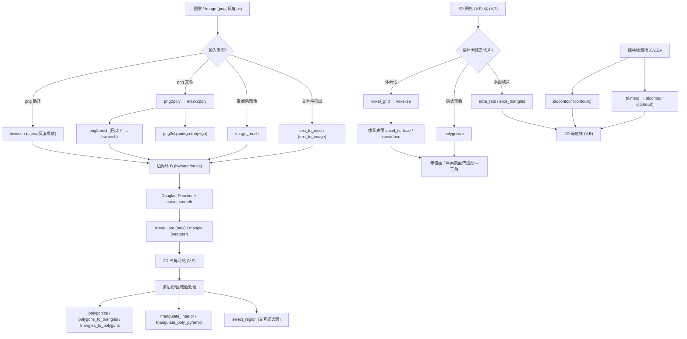

# 10.10 图像 → 网格与轮廓提取 / Image-to-Mesh & Contours

> 本章覆盖 `mesh/` 下与**图像/位图转网格**、**体素化与等值面提取**、**切片与轮廓提取**、
> **多边形/区域处理**相关的 24 个函数。
>
> This chapter documents 24 functions in `mesh/` related to image/bitmap-to-mesh conversion,
> voxelization and iso-surface extraction, slicing and contour extraction, and polygon/region
> processing.
>
> 约定 / Notation：`V` 顶点 / vertices，`F` 三角面 / triangles，`Q` 四边形 / quads，
> `T` 四面体 / tets，`E` 边 / edges，`W` 体素/二值图 / voxel grid or binary image，
> `A` 二值图像 / black-and-white image，`#V` 顶点数。锚点行号取自源码实际范围。

---

## 本章概览 / Chapter overview

> ⚠️ **重要发现 / Important findings**（均以真实源码为准，已用 Grep/Read 核验）：
> 1. **`bwmesh` 并没有** `'GridStep'`、`'PolygonStep'`、`'TriangleSize'`、`'TriangleQuality'`、
>    `'Inflation'` 这些参数（全库 Grep 无命中）。其真实可选参数只有
>    `'Tol'`、`'TriangleFlags'`、`'SmoothingIters'`（见 [bwmesh.m#L14-L46](file:///c:/VSWork/gptoolbox-1/mesh/bwmesh.m#L14-L46)）。
> 2. **`voxelize` 没有** `'SideLength'`/`'GridSize'` 参数；网格分辨率由**位置参数 `side`**（标量或三元组）给出，
>    可选参数为 `'Boundary'`、`'Interior'`、`'Pad'`、`'Centers'`、`'Closed'`、`'Filter'`（见 [voxelize.m#L58-L81](file:///c:/VSWork/gptoolbox-1/mesh/voxelize.m#L58-L81)）。
> 3. **`voxel_grid` 是普通函数**（文件首行为 `function ...`，全库无 `classdef`），**不是** `classdef`。
> 4. **`slice_tets` / `slice_triangles` / `tricontour` 均不依赖 mex `isolines`/`marching_tets`**：
>    `slice_tets` 为纯 MATLAB 实现（[slice_tets.m#L1-L157](file:///c:/VSWork/gptoolbox-1/mesh/slice_tets.m#L1-L157)），
>    `slice_triangles` 包装 `slice_tets`（[slice_triangles.m#L15](file:///c:/VSWork/gptoolbox-1/mesh/slice_triangles.m#L15)），
>    `tricontour` 走 MATLAB `contourf`/`griddata`。mex `isolines`（[mex/isolines.m](file:///c:/VSWork/gptoolbox-1/mex/isolines.m)）
>    与 mex `marching_tets`（[mex/marching_tets.m](file:///c:/VSWork/gptoolbox-1/mex/marching_tets.m)）是本库中**另外的**等值线/等值面入口，
>    不属于本章这 3 个函数。
> 5. **`truth about triangulate_interior`**：其调用的 `triangulate` 与 `refine_triangulation`
>    是 **libigl/triangle 的 mex**（[mex/triangulate.m](file:///c:/VSWork/gptoolbox-1/mex/triangulate.m)、
>    [mex/refine_triangulation.m](file:///c:/VSWork/gptoolbox-1/mex/refine_triangulation.m)），
>    而非 `wrappers/triangle.m` 外部二进制封装。
> 6. **`select_region` 是交互式函数**：调用 `impoly` 让用户在当前视图窗口中画选择多边形
>    （[select_region.m#L51-L73](file:///c:/VSWork/gptoolbox-1/mesh/select_region.m#L51-L73)）。
>
> ⚠️ Verified against source: `bwmesh` has **no** `GridStep/PolygonStep/TriangleSize/TriangleQuality/Inflation`
> options; `voxelize` takes resolution via the positional `side` argument (no `SideLength/GridSize`);
> `voxel_grid` is a plain `function` (not a `classdef`); `slice_tets/slice_triangles/tricontour` do **not**
> use mex `isolines`/`marching_tets`; `triangulate_interior` calls the libigl **mex** `triangulate` and
> `refine_triangulation`; `select_region` is interactive (`impoly`).

### (a) 图像 → 网格 / Image → Mesh

| 函数 | 文件锚点 | 说明 |
|---|---|---|
| `bwmesh` | [L1-L122](file:///c:/VSWork/gptoolbox-1/mesh/bwmesh.m#L1-L122) | **主力函数**：由黑白/灰度图（或 png 路径）的 α/阈值区域提取边界环 → Douglas-Peucker + 平滑 → `triangulate`（mex）三角化。真实参数 `'Tol'{0}`,`'TriangleFlags'`,`'SmoothingIters'{0}` |
| `png2mesh` | [L1-L63](file:///c:/VSWork/gptoolbox-1/mesh/png2mesh.m#L1-L63) | **已废弃 / obsolete**：L34 发出 `warning('obsolete: use bwmesh')`，随后委托 `png2poly` + `triangle`（外部封装） |
| `png2poly` | [L1-L138](file:///c:/VSWork/gptoolbox-1/mesh/png2poly.m#L1-L138) | 读 png 的 α 掩膜（α>128）→ `mask2poly` 取多边形，可做 Laplacian 平滑与顶点降采样 |
| `png2objandtga` | [L1-L54](file:///c:/VSWork/gptoolbox-1/mesh/png2objandtga.m#L1-L54) | 由 png α 掩膜生成 `.obj` 网格与 `.tga` 贴图（用 ImageMagick `convert` 转换） |
| `image_mesh` | [L1-L48](file:///c:/VSWork/gptoolbox-1/mesh/image_mesh.m#L1-L48) | 在 α>½ 区域内建**带每顶点颜色**的稀疏三角网格（`bwmesh` + `decimate_libigl`） |
| `text_to_mesh` | [L1-L64](file:///c:/VSWork/gptoolbox-1/mesh/text_to_mesh.m#L1-L64) | 文本 → 图像（`text_to_image`）→ 膨胀 → `bwmesh` → `extrude` 成 3D 文字网格 |

### (b) 体素与等值面 / Voxelization & Iso-surface

| 函数 | 类型 | 主要参数 / 依赖 | 说明 |
|---|---|---|---|
| `voxelize` | 函数 | 位置 `side`；选项 `'Boundary'{true}`,`'Interior'{true}`,`'Pad'{0}`,`'Centers'`,`'Closed'`,`'Filter'` | 把网格体素化到包围盒规则网格；2D/3D 分支；内部/边界判定用 `winding_number`（或闭合时 `imfill`） |
| `voxel_grid` | **函数（非 classdef）** | `'Pad'{0}` | 在包围盒上准备规则体素网格，返回单元中心 `BC`、各向步数 `side`、步长 `r` |
| `voxel_surface` | 函数 | `'Centers'` | 由 3D 二值图 `W` 计算体素表面四边形网格（顶/前/左面 `QT`/`QF`/`QL`） |
| `isocontour` | 函数（包装 `contourc`） | — | 包装 MATLAB `contourc`，把等值线转为 `(V,E)` 顶点/边表示 |

### (c) 切片与轮廓提取 / Slicing & Contours

| 函数 | 文件锚点 | MEX / 外部依赖 | 说明 |
|---|---|---|---|
| `slice_tets` | [L1-L157](file:///c:/VSWork/gptoolbox-1/mesh/slice_tets.m#L1-L157) | **纯 MATLAB**（`flipped_tet_orders`）；**不调用** mex `marching_tets` | 用隐式平面（或逐顶点标量）切四面体网格，输出切片三角面 `(U,G)` 与重心坐标 `BC` |
| `slice_triangles` | [L1-L39](file:///c:/VSWork/gptoolbox-1/mesh/slice_triangles.m#L1-L39) | 包装 `slice_tets`；`normals`,`quatmultiply` | 切三角网格得到**定向曲线** `(U,E)`；核心 HACK：`slice_tets(V,F(:,[1 2 3 3]),plane)` |
| `tricontour` | [L1-L30](file:///c:/VSWork/gptoolbox-1/mesh/tricontour.m#L1-L30) | MATLAB `contourf`/`griddata`（经 `triinterp`）；**不调用** mex `isolines` | 在三角网格上画**填充等值线**，并把网格边界用粗黑线叠画 |

> **MEX 关系说明 / MEX note**：本库的 mex `isolines`（[mex/isolines.m](file:///c:/VSWork/gptoolbox-1/mex/isolines.m)）
> 与 mex `marching_tets`（[mex/marching_tets.m](file:///c:/VSWork/gptoolbox-1/mex/marching_tets.m)）分别计算三角网格等值线、
> 四面体网格等值面，属 60-mex 章节；**本章 (c) 组 3 个函数不直接调用它们**。
> 唯一在本章出现的 **mex** 调用是 `triangulate_interior` → mex `triangulate` / mex `refine_triangulation`；
> 唯一出现的 **wrapper** 调用是 `png2mesh`/`cookie_cutter` → `wrappers/triangle.m`（外部 `triangle` 可执行文件）。

### (d) 多边形 / 区域处理 / Polygon & Region Processing

| 函数 | 文件锚点 | 依赖 | 说明 |
|---|---|---|---|
| `select_region` | [L1-L81](file:///c:/VSWork/gptoolbox-1/mesh/select_region.m#L1-L81) | `impoly`,`inpolygon` | **交互式**：把网格旋转到当前视图的屏幕空间，`impoly` 让用户画选择多边形，返回每顶点逻辑选择 `S` |
| `polygonize` | [L1-L241](file:///c:/VSWork/gptoolbox-1/mesh/polygonize.m#L1-L241) | `flipped_tet_orders`,`avgedge`,`internalangles`,`normalizerow` | 隐式函数多边形化（Bloomenthal 1994）：二分法在边/元素上定位零交叉，支持三角/四面元素 |
| `polygons_to_triangles` | [L1-L56](file:///c:/VSWork/gptoolbox-1/mesh/polygons_to_triangles.m#L1-L56) | — | 把多边形扇（fan）展开为三角形，输入为扁平索引流 `PI` 与累积和 `PC` |
| `triangles_to_polygons` | [L1-L5](file:///c:/VSWork/gptoolbox-1/mesh/triangles_to_polygons.m#L1-L5) | — | 把三角面列表 `F` 串接成多边形索引流 `PI` 与累积和 `PC`（`polygons_to_triangles` 的逆） |
| `triangulate_interior` | [L1-L64](file:///c:/VSWork/gptoolbox-1/mesh/triangulate_interior.m#L1-L64) | **mex** `triangulate`、**mex** `refine_triangulation`；`remove_duplicate_vertices`,`winding_number`,`barycenter`,`remove_unreferenced` | 三角化多边形（集）的内部：先 `triangulate` 求约束 Delaunay，用绕数过滤外部面，再 `refine_triangulation` 细化 |

### (e) 其他：曲线/文本驱动的模型与插值 / Curves, Text-driven Models & Interpolation

| 函数 | 文件锚点 | 依赖 | 说明 |
|---|---|---|---|
| `cookie_cutter` | [L1-L96](file:///c:/VSWork/gptoolbox-1/mesh/cookie_cutter.m#L1-L96) | `offset_curve`,`cdt`,`triangle`(wrapper),`wedding_cake`,`winding_number`,`outline`,`barycenter`,`remove_duplicate_vertices`,`remove_unreferenced` | 由 2D 曲线生成饼干模具（薄壁/厚壁/唇/柄），含局部 `robust_overlap` 子函数 |
| `emboss` | [L1-L87](file:///c:/VSWork/gptoolbox-1/mesh/emboss.m#L1-L87) | `random_points_on_mesh`,`normals`,`normalizerow`,`knnsearch`,`ambient_occlusion`,`axisanglebetween`,`axisangle2matrix`,`text_to_mesh`,`mesh_boolean` | 在网格上找“适合盖章”的位置，把文本网格布尔并入/减去（`'Engrave'`） |
| `engraving` | [L1-L33](file:///c:/VSWork/gptoolbox-1/mesh/engraving.m#L1-L33) | `create_regular_grid`,`extrude` | 把灰度图像量化为若干层高度并挤出，形成“木刻/雕刻”模型 |
| `triinterp` | [L1-L35](file:///c:/VSWork/gptoolbox-1/mesh/triinterp.m#L1-L35) | `griddata`（**线性插值**）、`inpolygon`,`unique`,`accumarray` | 在规则栅格上对三角网格上的标量场做**线性插值**（`griddata` 默认 `'linear'`），可选删除网格外点（置 `NaN`） |
| `triangulate_curves` | [L1-L269](file:///c:/VSWork/gptoolbox-1/mesh/triangulate_curves.m#L1-L269) | `writePOLY_triangle`,`readNODE`,`readELE`,`readPOLY_triangle`（外部 `triangle`）、`remove_duplicate_vertices`,`bounding_box`,`adjacency_matrix`,`graphshortestpath`,`facet_adjacency_matrix`,`conncomp`,`remove_unreferenced` | 为一组曲线构造**带缝(slitted)网格**并生成扩散曲线的边界条件 |
| `triangulate_poly_pyramid` | [L1-L81](file:///c:/VSWork/gptoolbox-1/mesh/triangulate_poly_pyramid.m#L1-L81) | `delaunay`,`barycenter`,`winding_number`,`princomp` | 三角化 SVR/Pyramid 输出的 PLC，逐 facet 展平到 2D 后 Delaunay 并用绕数裁剪 |

### 总流程图：图像/体数据 → 轮廓/等值面 → 三角网格 / Pipeline overview



---

## 函数详解 / Per-function reference

### `bwmesh` — 由黑白/灰度图像构造网格
- **文件 / File**: [mesh/bwmesh.m](file:///c:/VSWork/gptoolbox-1/mesh/bwmesh.m#L1-L122)
- **签名 / Signature**: `[W,F,V,E,H,im] = bwmesh(A,varargin)`
- **功能 / Purpose**: `EN: Construct a mesh from a black and white image (or png path).` / 中文：由黑白/灰度图像（或 png 文件路径）提取 α/阈值区域边界环并三角化，得到网格 `(W,F)` 及边界多边形与洞信息。
- **输入 / Inputs**:

  | 参数 | 尺寸/类型 | 含义 (中 / EN) |
  |---|---|---|
  | `A` | `h by w` 图 或 `char` 路径 | 黑白图（灰度会 clamp），或 png 文件路径 / binary image or png filename |

- **输出 / Outputs**:

  | 参数 | 尺寸/类型 | 含义 |
  |---|---|---|
  | `W` | `#W by 2` | 网格顶点位置 / mesh vertices |
  | `F` | `#F by 3` | 三角形索引 / triangle indices into W |
  | `V` | `#V by 2` | 边界多边形顶点 / boundary polygon vertices |
  | `E` | `#E by 2` | 边界边索引 / boundary edges into V |
  | `H` | `#H by 2` | 洞指示点 / hole indicator points |
  | `im` | 图像 | 若是路径输入，返回读入图像 / loaded image |

- **可选参数 / Optional**:

  | 名称 | 取值 | 默认 | 含义 |
  |---|---|---|---|
  | `'Tol'` | `double` | `0` | Douglas-Peucker 简化容差（>0 才生效）/ DP simplification tolerance |
  | `'TriangleFlags'` | `char` | `''`（自动生成 `-q30a<median_sqr_edge_length>`） | 传给 `triangulate` 的 flags / flags passed to triangulate |
  | `'SmoothingIters'` | `int` | `0` | 边界曲线 Laplacian 平滑迭代数 / boundary smoothing iterations |

  > ⚠️ 源码中**不存在** `'GridStep'`/`'PolygonStep'`/`'TriangleSize'`/`'TriangleQuality'`/`'Inflation'`。

- **变量流动 / Variable flow**: `A/路径 →(读图/二值化 α>0.5)→ B = bwboundaries →(每环: 坐标变换 + curve_smooth + dpsimplify)→ Vb,Eb →(洞环加 point_inside_polygon)→ V,E,H →(remove_duplicate_vertices 重映射)→ V,E →(triangulate Flags,Holes)→ W,F`
- **算法步骤 / Algorithm**:
  1. 若是字符路径 → `imread` 读图；空 α 通道则全 1；`im2double`（[L33-L41](file:///c:/VSWork/gptoolbox-1/mesh/bwmesh.m#L33-L41)）。
  2. 解析 `'Tol'`/`'TriangleFlags'`/`'SmoothingIters'`（`containers.Map` + `assignin`）（[L43-L63](file:///c:/VSWork/gptoolbox-1/mesh/bwmesh.m#L43-L63)）。
  3. 若图为空 → 用 `meshgrid`+`surf2patch` 生成整幅矩形网格返回（[L65-L68](file:///c:/VSWork/gptoolbox-1/mesh/bwmesh.m#L65-L68)）。
  4. 否则 `bwboundaries(A>0.5)` 得边界环 `B` 与外边界数 `N`（[L72-L75](file:///c:/VSWork/gptoolbox-1/mesh/bwmesh.m#L72-L75)）。
  5. 每个环：坐标翻转/平移；平滑（`curve_smooth`）；简化（`dpsimplify`）；用鞋带公式算面积，剔除退化环；洞环（`b>N`）用 `point_inside_polygon` 记录洞点 `H`（[L80-L104](file:///c:/VSWork/gptoolbox-1/mesh/bwmesh.m#L80-L104)）。
  6. 未给 flags 时按中位边长平方 `median_sqr_edge_length/2` 生成 `-q30a...`（[L106-L113](file:///c:/VSWork/gptoolbox-1/mesh/bwmesh.m#L106-L113)）。
  7. `remove_duplicate_vertices(V,0)` 去重并重映射边；`triangulate(V,E,'Holes',H,'Flags',flags)` 得 `W,F`（[L116-L120](file:///c:/VSWork/gptoolbox-1/mesh/bwmesh.m#L116-L120)）。
- **流程图 / Flowchart**:

  ```mermaid
  flowchart TD
    A["输入 A (图/路径)"] --> B{"ischar(A)?"}
    B -- 是 --> B1["imread 读入 (im,~,A)"] --> C["im2double(A)"]
    B -- 否 --> C
    C --> D["解析 Tol/TriangleFlags/SmoothingIters"]
    D --> E{"A 为空?"}
    E -- 是 --> E1["meshgrid+surf2patch 整幅网格"] --> Z["输出 W,F,V,E,H,im"]
    E -- 否 --> F["bwboundaries(A>0.5) → B,N"]
    F --> G["遍历每个边界环 b"]
    G --> G1["坐标变换 → 可选 curve_smooth → 可选 dpsimplify"]
    G1 --> G2{"唯一顶点>2 且 面积>1e-10?"}
    G2 -- 是 --> G3["累积 V,E; 洞环加 H=point_inside_polygon"]
    G2 -- 否 --> G
    G3 --> G
    G --> H{"flags 为空?"}
    H -- 是 --> H1["按中位边长生成 -q30a..."]
    H -- 否 --> I["remove_duplicate_vertices(V,0)"]
    H1 --> I
    I --> J["triangulate(V,E,'Holes',H,'Flags')"] --> Z
  ```

- **依赖 / Dependencies**: `bwboundaries`（图像处理工具箱，或注释提到的 `gp_bwboundaries`）、`curve_smooth`、`dpsimplify`、`point_inside_polygon`、`remove_duplicate_vertices`、**mex** `triangulate`
- **See also**: `png2mesh`, `png2poly`, `image_mesh`, `text_to_mesh`, `triangulate`, `gp_bwboundaries`

---

### `png2mesh` — （已废弃）由 png 生成网格
- **文件 / File**: [mesh/png2mesh.m](file:///c:/VSWork/gptoolbox-1/mesh/png2mesh.m#L1-L63)
- **签名 / Signature**: `[V,F] = png2mesh(filename, laplacian_smoothness_iterations, max_points_on_boundary)`
- **功能 / Purpose**: `EN: Obsolete: mesh the non-transparent part of an image. Now redirects to bwmesh.` / 中文：**已废弃**——对图像非透明区域建网格；现仅发出警告并保留旧流程（`png2poly`+`triangle`）。
- **输入 / Inputs**:

  | 参数 | 尺寸/类型 | 含义 (中 / EN) |
  |---|---|---|
  | `filename` | `char` | `.png` 路径 / path to .png |
  | `laplacian_smoothness_iterations` | `int` | 交给 Triangle 前对边界点的 Laplacian 平滑迭代数 |
  | `max_points_on_boundary` | `int` | 交给 Triangle 前边界曲线最大点数 |

- **输出 / Outputs**:

  | 参数 | 尺寸/类型 | 含义 |
  |---|---|---|
  | `V` | `#V by 2` | 多边形顶点（y 相对图像翻转）/ polygon vertices |
  | `F` | `#F by 3` | 三角形索引 / face indices |

- **可选参数 / Optional**: 无（均为位置参数；源码仅发 `warning`）。
- **变量流动 / Variable flow**: `filename,smooth,max_points →(warning obsolete)→ png2poly → V,E,H →(平均边长²/2 → MaxArea, Quality 30)→ triangle → V,F →(去未引用顶点 faces_first)→ V,F`
- **算法步骤 / Algorithm**:
  1. **L34**：`warning('obsolete: use bwmesh')`（[png2mesh.m#L34](file:///c:/VSWork/gptoolbox-1/mesh/png2mesh.m#L34)）。
  2. `basename = regexprep(filename,'\.png$','')`。
  3. `[V,E,H] = png2poly(filename, laplacian_smoothness_iterations, max_points_on_boundary)`；若洞非空发出警告（[L38-L44](file:///c:/VSWork/gptoolbox-1/mesh/png2mesh.m#L38-L44)）。
  4. 检查轮廓中未引用顶点并警告（[L46-L49](file:///c:/VSWork/gptoolbox-1/mesh/png2mesh.m#L46-L49)）。
  5. 由平均边长平方 `/2` 作为 `MaxArea`，`triangle(V,E,H,'MaxArea',...,'Quality',30)` 三角化（[L50-L54](file:///c:/VSWork/gptoolbox-1/mesh/png2mesh.m#L50-L54)）。
  6. 用 `faces_first` 去除网格中未引用顶点（[L56-L61](file:///c:/VSWork/gptoolbox-1/mesh/png2mesh.m#L56-L61)）。
- **流程图 / Flowchart**:

  ```mermaid
  flowchart TD
    A["输入 filename, smooth, max_points"] --> B["warning('obsolete: use bwmesh') @L34"]
    B --> C["png2poly → V,E,H"]
    C --> D{"H 非空?"}
    D -- 是 --> D1["warning: holes broken"]
    D -- 否 --> E["检查未引用顶点"]
    D1 --> E
    E --> F["avg_sqr_edge_length = mean(edge²)"]
    F --> G["triangle(V,E,H,'MaxArea',avg/2,'Quality',30)"]
    G --> H["faces_first 去除未引用顶点"]
    H --> Z["输出 V,F"]
  ```

- **依赖 / Dependencies**: `png2poly`、**wrapper** `triangle`、`faces_first`
- **See also**: `bwmesh`, `png2poly`, `png2objandtga`, `triangle`

---

### `png2poly` — 由 png 的 α 掩膜提取多边形
- **文件 / File**: [mesh/png2poly.m](file:///c:/VSWork/gptoolbox-1/mesh/png2poly.m#L1-L138)
- **签名 / Signature**: `[V,E,H] = png2poly(filename,smooth_iters,max_points)`
- **功能 / Purpose**: `EN: Read a png and use its alpha mask to define a polygon (vertices, edges, holes).` / 中文：读取 png 并用 α 掩膜（α>128）定义多边形，可选 Laplacian 平滑与边界点数降采样。
- **输入 / Inputs**:

  | 参数 | 尺寸/类型 | 含义 (中 / EN) |
  |---|---|---|
  | `filename` | `char` | `.png` 路径 / path |
  | `smooth_iters` | `int` | 可选：输出多边形的平滑迭代数 `{0}` |
  | `max_points` | `int` | 可选：边界最大点数 `{inf}` |

- **输出 / Outputs**:

  | 参数 | 尺寸/类型 | 含义 |
  |---|---|---|
  | `V` | `#V by 2` | 多边形顶点（y 相对图像翻转） |
  | `E` | `#E by 2` | 多边形边索引 / edge indices |
  | `H` | `#H by 2` | 洞位置 / hole positions |

- **可选参数 / Optional**:

  | 名称 | 取值 | 默认 | 含义 |
  |---|---|---|---|
  | `smooth_iters` | `int` | `0` | 逐连通分量 Laplacian 平滑（`0.5*L*x + x` 归一化拉普拉斯） |
  | `max_points` | `int` | `inf` | 总点数上限，超限时对各分量按 `1:2:end` 折半降采样 |

- **变量流动 / Variable flow**: `filename →(imread 取 alpha)→ alpha>128 → mask2poly → poly(struct) →(可选: 逐分量 y 翻转/去重/Laplacian 平滑/去退化)→ smooth_poly →(可选: 按 max_points 降采样)→ poly → poly2VEH → V,E,H`
- **算法步骤 / Algorithm**:
  1. `imread` 取 `alpha`，`alpha = 255*(alpha>128)`，`mask2poly(alpha)` 得多边形（[L27-L31](file:///c:/VSWork/gptoolbox-1/mesh/png2poly.m#L27-L31)）。
  2. 若给了 `smooth_iters`：逐分量把 y 翻转（`size(alpha,1)-y`）、去除重复顶点、构建归一化拉普拉斯 `L` 并迭代 `0.5*L*x + x`，丢弃收敛为单点的分量（面积>1e-15）（[L33-L79](file:///c:/VSWork/gptoolbox-1/mesh/png2poly.m#L33-L79)）。
  3. 若 `more_exact_max_points`（源码默认 `false`）→ 用二分 `dpsimplify` 容差逼近每分量目标点数；否则当 `n>max_points` 时对各分量按 `1:2:end` 折半降采样（[L84-L134](file:///c:/VSWork/gptoolbox-1/mesh/png2poly.m#L84-L134)）。
  4. `poly2VEH(poly)` 把 struct 转成 `V,E,H`（[L137](file:///c:/VSWork/gptoolbox-1/mesh/png2poly.m#L137)）。
- **流程图 / Flowchart**:

  ```mermaid
  flowchart TD
    A["filename"] --> B["imread → alpha"]
    B --> C["alpha = 255*(alpha>128)"]
    C --> D["mask2poly → poly(struct)"]
    D --> E{"smooth_iters 存在?"}
    E -- 是 --> E1["逐分量: y 翻转 / unique / Laplacian 平滑"]
    E1 --> E2{"polyarea > 1e-15?"}
    E2 -- 否 --> E3["丢弃该分量"]
    E2 -- 是 --> E1
    E1 --> F{"n > max_points?"}
    E -- 否 --> F
    F -- 是 --> F1["逐分量 1:2:end 折半降采样"]
    F1 --> F
    F -- 否 --> G["poly2VEH(poly)"] --> Z["输出 V,E,H"]
  ```

- **依赖 / Dependencies**: `mask2poly`（external）、`poly2VEH`、`dpsimplify`（精确分支）
- **See also**: `mask2poly`, `png2mesh`, `png2objandtga`, `poly2VEH`

---

### `png2objandtga` — 由 png α 掩膜导出 obj + tga
- **文件 / File**: [mesh/png2objandtga.m](file:///c:/VSWork/gptoolbox-1/mesh/png2objandtga.m#L1-L54)
- **签名 / Signature**: `[V,F,img] = png2objandtga(filename, laplacian_smoothness_iterations, max_points_on_boundary)`
- **功能 / Purpose**: `EN: Triangulate a png based on its alpha mask and export a .obj mesh plus a .tga texture.` / 中文：基于 png 的 α 掩膜三角化，输出 `.obj` 网格与 `.tga` 贴图（借助 ImageMagick `convert`）。
- **输入 / Inputs**:

  | 参数 | 尺寸/类型 | 含义 (中 / EN) |
  |---|---|---|
  | `filename` | `char` | `.png` 路径 |
  | `laplacian_smoothness_iterations` | `int` | 可选 `{0}`：边界 Laplacian 平滑迭代 |
  | `max_points_on_boundary` | `int` | 可选 `{0.5*(宽+高)}`：边界最大点数 |

- **输出 / Outputs**:

  | 参数 | 尺寸/类型 | 含义 |
  |---|---|---|
  | `V` | `#V by 3` | 网格顶点（z=0 平面） |
  | `F` | `#F by 3` | 三角形索引 |
  | `img` | 图像 | 读入图像 / input image |

- **可选参数 / Optional**:

  | 名称 | 取值 | 默认 | 含义 |
  |---|---|---|---|
  | `laplacian_smoothness_iterations` | `int` | `0` | 边界平滑迭代数 |
  | `max_points_on_boundary` | `int` | `0.5*sum(size(img))` | 边界最大点数 |

- **变量流动 / Variable flow**: `filename → imread → img →(维度非 4 倍数则 warning)→ 默认参数补齐 → png2mesh(V,F) → tsurf 显示 → z 置 0 → writeOBJ → system(convert png→tga 两次)`
- **算法步骤 / Algorithm**:
  1. `basename=regexprep(...)`；`img=imread(filename)`；若尺寸非 4 的倍数发警告（openGL tga 兼容性）（[L24-L29](file:///c:/VSWork/gptoolbox-1/mesh/png2objandtga.m#L24-L29)）。
  2. 缺省 `laplacian_smoothness_iterations=0`、`max_points_on_boundary=0.5*sum(size(img))`（[L33-L39](file:///c:/VSWork/gptoolbox-1/mesh/png2objandtga.m#L33-L39)）。
  3. `[V,F]=png2mesh(...)`；`tsurf` 显示；`V=[V(:,1) V(:,2) 0*V(:,1)]`；`writeOBJ([basename '.obj'],V,F)`（[L41-L47](file:///c:/VSWork/gptoolbox-1/mesh/png2objandtga.m#L41-L47)）。
  4. 通过 `system` 调 `/opt/local/bin/convert` 把 png 转 tga（-flatten 再 +matte）（[L49-L53](file:///c:/VSWork/gptoolbox-1/mesh/png2objandtga.m#L49-L53)）。
- **流程图 / Flowchart**:

  ```mermaid
  flowchart TD
    A["filename, smooth, max_points"] --> B["img = imread(filename)"]
    B --> C{"尺寸非 4 倍数?"}
    C -- 是 --> C1["warning tga 可能异常"]
    C -- 否 --> D["默认参数补齐"]
    C1 --> D
    D --> E["png2mesh → V,F"]
    E --> F["tsurf 显示; V 加 z=0 列"]
    F --> G["writeOBJ(basename.obj)"]
    G --> H["system: convert png→tga (flatten/matte)"]
    H --> Z["输出 V,F,img"]
  ```

- **依赖 / Dependencies**: `png2mesh`、`tsurf`、`writeOBJ`、外部 `convert`（ImageMagick）
- **See also**: `png2mesh`, `png2poly`, `bwmesh`

---

### `image_mesh` — 带每顶点颜色的图像网格
- **文件 / File**: [mesh/image_mesh.m](file:///c:/VSWork/gptoolbox-1/mesh/image_mesh.m#L1-L48)
- **签名 / Signature**: `[V,F,VC,FC] = image_mesh(filename,m)`
- **功能 / Purpose**: `EN: Create a mesh within the α>½ region with triangles placed economically so per-vertex colors look reasonable.` / 中文：在 png 的 α>½ 区域内建立经济化的三角网格，并采样每顶点/每面颜色。
- **输入 / Inputs**:

  | 参数 | 尺寸/类型 | 含义 (中 / EN) |
  |---|---|---|
  | `filename` | `char` | `.png` 路径 / path |
  | `m` | `int` | 目标三角形数 / number of output triangles |

- **输出 / Outputs**:

  | 参数 | 尺寸/类型 | 含义 |
  |---|---|---|
  | `V` | `#V by 2` | 2D 顶点位置 |
  | `F` | `#F by 3` | 三角形索引 |
  | `VC` | `#V by 3` | 每顶点颜色 / per-vertex colors |
  | `FC` | `#F by 3` | 每面颜色（`nargout>3` 时计算） |

- **可选参数 / Optional**: 无。
- **变量流动 / Variable flow**: `filename →(imread, ind2rgb, 补 α=1)→ [V,F]=bwmesh(A,'SmoothingIters',2,'Tol',0.2) →(meshgrid+interp2 采样 RGB 到 V(:,3:5))→ V(含颜色) → decimate_libigl(qslim,m) → VC=V(:,3:5), V=V(:,1:2) →(可选: barycenter+interp2)→ FC`
- **算法步骤 / Algorithm**:
  1. `imread`；若有调色板 `M` → `ind2rgb`；α 空则全 1（[L18-L24](file:///c:/VSWork/gptoolbox-1/mesh/image_mesh.m#L18-L24)）。
  2. `[V,F]=bwmesh(A,'SmoothingIters',2,'Tol',0.2)`（[L25](file:///c:/VSWork/gptoolbox-1/mesh/image_mesh.m#L25)）。
  3. `meshgrid` 构造像素坐标 `X,Y`，对 RGB 三通道 `interp2` 采样写入 `V(:,2+c)`（[L27-L31](file:///c:/VSWork/gptoolbox-1/mesh/image_mesh.m#L27-L31)）。
  4. `decimate_libigl(V,F,m,'Method','qslim')` 简化到约 `m` 个三角形（[L36](file:///c:/VSWork/gptoolbox-1/mesh/image_mesh.m#L36)）。
  5. 拆出 `VC=V(:,3:5)`、`V=V(:,1:2)`；`nargout>3` 时对每面重心再次 `interp2` 得 `FC`（[L38-L47](file:///c:/VSWork/gptoolbox-1/mesh/image_mesh.m#L38-L47)）。
- **流程图 / Flowchart**:

  ```mermaid
  flowchart TD
    A["filename, m"] --> B["imread → (ind2rgb) → 补 α"]
    B --> C["bwmesh(SmoothingIters=2, Tol=0.2) → V,F"]
    C --> D["interp2 采样 RGB → V(:,3:5)"]
    D --> E["decimate_libigl(V,F,m,'qslim')"]
    E --> F["VC=V(:,3:5); V=V(:,1:2)"]
    F --> G{"nargout>3?"}
    G -- 是 --> G1["barycenter + interp2 → FC"]
    G -- 否 --> Z["输出 V,F,VC,(FC)"]
    G1 --> Z
  ```

- **依赖 / Dependencies**: `bwmesh`、`decimate_libigl`、`barycenter`、`interp2`
- **See also**: `bwmesh`, `decimate_libigl`

---

### `text_to_mesh` — 文本转 3D 网格
- **文件 / File**: [mesh/text_to_mesh.m](file:///c:/VSWork/gptoolbox-1/mesh/text_to_mesh.m#L1-L64)
- **签名 / Signature**: `[V,F,V0,F0] = text_to_mesh(str,varargin)`
- **功能 / Purpose**: `EN: Create a 3D mesh from the given text string (render → dilate → bwmesh → extrude).` / 中文：把文本串渲染成图像、膨胀后经 `bwmesh` 三角化，再挤出为 3D 文字网格。
- **输入 / Inputs**:

  | 参数 | 尺寸/类型 | 含义 (中 / EN) |
  |---|---|---|
  | `str` | `char` | 文本串 / text string |

- **输出 / Outputs**:

  | 参数 | 尺寸/类型 | 含义 |
  |---|---|---|
  | `V` | `#V by 3` | 3D 顶点（挤出后或平面）/ mesh vertices |
  | `F` | `#F by 3` | 面索引 / face indices |
  | `V0` | `#V0 by 2` | 挤出前的平面顶点 / pre-extrusion vertices |
  | `F0` | `#F0 by 3` | 挤出前的平面面索引 |

- **可选参数 / Optional**:

  | 名称 | 取值 | 默认 | 含义 |
  |---|---|---|---|
  | `'Dilation'` | `int` | `1` | 文本图像膨胀半径（`strel('disk',r)`） |
  | `'Extrude'` | `logical` | `true` | 是否挤出成 3D / extrude or not |
  | `'FontName'` | `char` | `[]` | 字体名 / font name |
  | `'PointSize'` | `int` | `200` | 字号（像素）/ font height in pixels |
  | `'SmoothingIters'` | `int` | `10` | 传给 `bwmesh` 的平滑迭代 / smoothing iters |
  | `'Tol'` | `double` | `0.2` | 传给 `bwmesh` 的 DP 容差 / DP tolerance |
  | `'TriangleFlags'` | `char` | `''` | 传给 `bwmesh` 的 triangle flags |

- **变量流动 / Variable flow**: `str,参数 → text_to_image → im → imdilate(padarray(~im,[r,r]),strel('disk',r)) → bmesh(bwmesh) → V0,F0 →(do_extrude? extrude(Levels=1) : identity)→ V,F`
- **算法步骤 / Algorithm**:
  1. 定义默认值并解析参数（`containers.Map`+`assignin`）（[L23-L49](file:///c:/VSWork/gptoolbox-1/mesh/text_to_mesh.m#L23-L49)）。
  2. `im = text_to_image(str,'FontName',fontname,'PointSize',pointsize)`（[L51](file:///c:/VSWork/gptoolbox-1/mesh/text_to_mesh.m#L51)）。
  3. `bwmesh(imdilate(padarray(~im,[r,r]),strel('disk',r)),'Tol',tol,'SmoothingIters',siters,'TriangleFlags',...)` → `V0,F0`（[L52-L56](file:///c:/VSWork/gptoolbox-1/mesh/text_to_mesh.m#L52-L56)）。
  4. `do_extrude` 则 `extrude(V0,F0,'Levels',1)`，否则直接返回 `V0,F0`（[L57-L62](file:///c:/VSWork/gptoolbox-1/mesh/text_to_mesh.m#L57-L62)）。
- **流程图 / Flowchart**:

  ```mermaid
  flowchart TD
    A["str + 参数"] --> B["解析 Dilation/Extrude/FontName/PointSize/..." ]
    B --> C["text_to_image(str,FontName,PointSize) → im"]
    C --> D["imdilate(padarray(~im,[r,r]), strel('disk',r))"]
    D --> E["bwmesh(...,'Tol','SmoothingIters','TriangleFlags') → V0,F0"]
    E --> F{"do_extrude?"}
    F -- 是 --> F1["extrude(V0,F0,'Levels',1) → V,F"]
    F -- 否 --> F2["V=V0; F=F0"]
    F1 --> Z["输出 V,F,V0,F0"]
    F2 --> Z
  ```

- **依赖 / Dependencies**: `text_to_image`、`bwmesh`、`imdilate`、`padarray`、`strel`、`extrude`
- **See also**: `text_to_image`, `bwmesh`, `extrude`, `emboss`

---

### `cookie_cutter` — 由曲线生成饼干模具
- **文件 / File**: [mesh/cookie_cutter.m](file:///c:/VSWork/gptoolbox-1/mesh/cookie_cutter.m#L1-L96)
- **签名 / Signature**: `[V,F] = cookie_cutter(P,E)`
- **功能 / Purpose**: `EN: Generate a cookie cutter model from a 2D curve.` / 中文：由一条 2D 曲线生成饼干模具（薄壁/厚壁/唇/柄三部分拼接）。
- **输入 / Inputs**:

  | 参数 | 尺寸/类型 | 含义 (中 / EN) |
  |---|---|---|
  | `P` | `#P by 2` | 曲线点位置（包围盒~40）/ curve positions |
  | `E` | `#E by 2` | 曲线边索引（注释写 `by 3`，实际按 2 列使用） |

- **输出 / Outputs**:

  | 参数 | 尺寸/类型 | 含义 |
  |---|---|---|
  | `V` | `#V by 3` | 模具顶点 / cutter vertices |
  | `F` | `#F by 3` | 模具三角面 / cutter triangles |

- **可选参数 / Optional**: 无（内部常数：`offset=0.5`,`k_offset=2`,`h=15`,`th=3`,`sth=5`,`tol=0.8`）。
- **变量流动 / Variable flow**: `P,E → offset_curve(0.5) → SI,SO → S,E → robust_overlap → S,E（薄壁）; offset_curve(2) → K,KE → robust_overlap（厚壁）→ wedding_cake({K,S},{KE,E},[th,h]) → CV,CF; offset_curve(offset+tol) → sP,sE → robust_overlap → c=mean(sP), r=min(pdist2(K,c))*0.9 → 圆 hP,hE → wedding_cake({sP,hP},{sE,hE},[sth,2h]) → SV,SF → 拼接 F,V（模具需翻转）`
- **算法步骤 / Algorithm**:
  1. 内部子函数 `robust_overlap(S,E)`：`cdt` 三角化 → 用 `winding_number` 保留 w>0.5 的面 → `outline` 取外轮廓 → `remove_duplicate_vertices`/去退化边/去重边 → 再用 `triangle`（wrapper，`-YY`）重三角化并再按绕数过滤（[L22-L49](file:///c:/VSWork/gptoolbox-1/mesh/cookie_cutter.m#L22-L49)）。
  2. **薄壁**：`offset_curve(P,0.5)`，拼接内/外轮廓 → `robust_overlap`（[L51-L56](file:///c:/VSWork/gptoolbox-1/mesh/cookie_cutter.m#L51-L56)）。
  3. **厚壁**：`offset_curve(P,2)` → `robust_overlap`（[L58-L63](file:///c:/VSWork/gptoolbox-1/mesh/cookie_cutter.m#L58-L63)）。
  4. 模具主体 `wedding_cake({K,S},{KE,E},[th,h])`（高 `h=15`，唇高 `th=3`）（[L65-L71](file:///c:/VSWork/gptoolbox-1/mesh/cookie_cutter.m#L65-L71)）。
  5. **柄（post）**：`offset_curve(P,offset+tol)` 翻转边 → `robust_overlap`；取中心 `c`（要求绕数>0.5，否则断言失败）；半径 `r=min(pdist2(K,c))*0.9` 且 `min(r,4)`；生成圆 `hP,hE`；`wedding_cake({sP,hP},{sE,hE},[sth,2h])`（[L73-L89](file:///c:/VSWork/gptoolbox-1/mesh/cookie_cutter.m#L73-L89)）。
  6. 拼接 `F=[CF; size(CV,1)+SF]`；顶点 `V` 把主体翻转（`[-1 1 1]*CV`）后与柄平移拼接（[L91-L95](file:///c:/VSWork/gptoolbox-1/mesh/cookie_cutter.m#L91-L95)）。
- **流程图 / Flowchart**:

  ```mermaid
  flowchart TD
    A["P,E"] --> B["offset_curve(P,0.5) → SI,SO → robust_overlap (薄壁)"]
    A --> C["offset_curve(P,2) → KI,KO → robust_overlap (厚壁)"]
    B --> D["wedding_cake({K,S},{KE,E},[th,h]) → CV,CF"]
    C --> D
    A --> E["offset_curve(P,0.5+tol),fliplr → robust_overlap → sP,sE"]
    E --> F["c=mean(sP); r=min(pdist2(K,c))*0.9,min(r,4)"]
    F --> G["圆 hP,hE; wedding_cake({sP,hP},{sE,hE},[sth,2h]) → SV,SF"]
    D --> H["F=[CF;CV+SF]"]
    G --> H
    H --> I["V=[flip(CV); translate(SV)]"]
    I --> Z["输出 V,F"]
    subgraph robust_overlap
      R1["cdt → winding_number 过滤 → outline → 去重/去退化 → triangle(-YY) → 再过滤"]
    end
  ```

- **依赖 / Dependencies**: `offset_curve`、`cdt`、`winding_number`、`barycenter`、`remove_unreferenced`、`outline`、`remove_duplicate_vertices`、**wrapper** `triangle`、`wedding_cake`、`pdist2`
- **See also**: `wedding_cake`, `offset_curve`, `cdt`, `triangle`, `get_pencil_curve`

---

### `emboss` — 在网格上寻找位置并盖印文本
- **文件 / File**: [mesh/emboss.m](file:///c:/VSWork/gptoolbox-1/mesh/emboss.m#L1-L87)
- **签名 / Signature**: `[VV,FF,J,P,M,AO,TV,TF,r,i,ni,R] = emboss(V,F,str,varargin)`
- **功能 / Purpose**: `EN: Find a good spot on a mesh to emboss with given text, then boolean it in (or engrave it out).` / 中文：在网格上寻找合适的“盖章”位置，把文本网格布尔并入（`union`）或雕刻去除（`minus`）。
- **输入 / Inputs**:

  | 参数 | 尺寸/类型 | 含义 (中 / EN) |
  |---|---|---|
  | `V` | `#V by 3` | 网格顶点 / mesh vertices |
  | `F` | `#F by 3` | 三角形索引 / triangles |
  | `str` | `char` | 要盖印的文本 / text to emboss |

- **输出 / Outputs**:

  | 参数 | 尺寸/类型 | 含义 |
  |---|---|---|
  | `VV` | `#VV by 3` | 结果网格顶点 |
  | `FF` | `#FF by 3` | 结果三角面 |
  | `J` | `#FF` | 面出生来源（≤size(F,1) 表示原面，否则为文本面） |
  | `P` | `10000 by 3` | 网格上的采样点 |
  | `M` | `#P by 1` | 每个采样点的“适合度”度量 |
  | `AO` | `#P by 1` | 每个采样点的环境光遮蔽 |
  | `TV,TF` | `#TV by 3 / #TF by 3` | 文本网格顶点/面 |
  | `r,i` | 标量 | 选中点处的尺度/采样索引 |
  | `ni` | `1 by 3` | 选中点法向 |
  | `R` | `3 by 3` | 把 `[0 0 1]` 旋到 `ni` 的旋转矩阵 |

- **可选参数 / Optional**:

  | 名称 | 取值 | 默认 | 含义 |
  |---|---|---|---|
  | `'BlackList'` | `logical`/索引 | `[]` | 排除面（不参与采样） |
  | `'Engrave'` | `logical` | `false` | 雕刻（`minus`）而非浮雕（`union`） |
  | `'Height'` | `double` | `normrow(max(V)-min(V))/(100/3)` | 文本挤出高度 |
  | `'FontName'` | `char` | `[]` | 字体 |
  | `'MaxRadius'` | `double` | `inf` | 文本缩放半径上限 |

- **变量流动 / Variable flow**: `V,F,str,参数 → FW=去黑名单面 → random_points_on_mesh(V,FW,10000) → P,I → NW=normals(V,FW) → knnsearch(P,P,'K',160) → K,D → 权重 W=exp(-(4D/maxD)²) → AO=ambient_occlusion → M=ΣW·angle²+AO → [r,i]=max(D_end·(M==minM)),r=min(r,max_r) → ni=NW(I(i)) → R=axisangle2matrix(axisanglebetween(ni,[0 0 1])) → TV,TF=text_to_mesh → 归一化/缩放/旋转/平移 → mesh_boolean(Engrave? 'minus':'union') → VV,FF,J`
- **算法步骤 / Algorithm**:
  1. 默认 `th`、解析参数（[L18-L40](file:///c:/VSWork/gptoolbox-1/mesh/emboss.m#L18-L40)）。
  2. 黑名单转索引，`FW=F(setdiff(...))`（[L42-L45](file:///c:/VSWork/gptoolbox-1/mesh/emboss.m#L42-L45)）。
  3. `random_points_on_mesh(V,FW,10000,'Color','blue')` 得采样 `P` 与出生面 `I`；`NW=normalizerow(normals(V,FW))`（[L47-L50](file:///c:/VSWork/gptoolbox-1/mesh/emboss.m#L47-L50)）。
  4. `knnsearch(P,P,'K',160)` 得近邻 `K,D`；权重 `W=exp(-(4*D./max(D,[],2)).^2)`；`AO=ambient_occlusion(V,F,P,NW(I,:),1000)`；度量 `M=Σ W·acos(法向夹角)² + AO`（[L51-L59](file:///c:/VSWork/gptoolbox-1/mesh/emboss.m#L51-L59)）。
  5. 选点：`[r,i]=max(D(:,end).*(M==min(M)))`，`r=min(r,max_r)`；`ni=NW(I(i),:)`；由 `axisanglebetween`+`axisangle2matrix` 得旋转 `R`（[L60-L65](file:///c:/VSWork/gptoolbox-1/mesh/emboss.m#L60-L65)）。
  6. `text_to_mesh(str,...)` 得 `TV,TF`，居中、归一化、按 `diag([r r th])*R + P(i,:)` 摆放（[L66-L70](file:///c:/VSWork/gptoolbox-1/mesh/emboss.m#L66-L70)）。
  7. `mesh_boolean(V,F,TV,TF,'minus'/'union')` 得 `VV,FF,J`（[L81-L85](file:///c:/VSWork/gptoolbox-1/mesh/emboss.m#L81-L85)）。
- **流程图 / Flowchart**:

  ```mermaid
  flowchart TD
    A["V,F,str,参数"] --> B["FW = F 去掉 BlackList"]
    B --> C["random_points_on_mesh(V,FW,10000) → P,I"]
    C --> D["NW=normals(V,FW); knnsearch(P,P,K=160) → K,D"]
    D --> E["W=exp(-(4D/maxD)^2); AO=ambient_occlusion"]
    E --> F["M = Σ W·acos(法向夹角)^2 + AO"]
    F --> G["[r,i]=max(D_end·(M==minM)); r=min(r,max_r)"]
    G --> H["ni=NW(I(i)); R=axisangle2matrix(...)"]
    H --> I["TV,TF=text_to_mesh; 归一化+缩放(r,r,th)+R+P(i,:)"]
    I --> J{"Engrave?"}
    J -- 是 --> J1["mesh_boolean(...,'minus')"]
    J -- 否 --> J2["mesh_boolean(...,'union')"]
    J1 --> Z["输出 VV,FF,J,..."]
    J2 --> Z
  ```

- **依赖 / Dependencies**: `random_points_on_mesh`、`normalizerow`、`normals`、`knnsearch`、`ambient_occlusion`、`axisanglebetween`、`axisangle2matrix`、`text_to_mesh`、`mesh_boolean`
- **See also**: `engraving`, `text_to_mesh`, `mesh_boolean`, `ambient_occlusion`

---

### `engraving` — 由灰度图生成雕刻模型
- **文件 / File**: [mesh/engraving.m](file:///c:/VSWork/gptoolbox-1/mesh/engraving.m#L1-L33)
- **签名 / Signature**: `[V,F] = engraving(im,w,t,s,l)`
- **功能 / Purpose**: `EN: Create an engraving (relief) model from a grayscale image by quantizing it into l levels.` / 中文：把灰度图量化为 `l` 个高度层并挤出成指定尺寸的雕刻/浮雕模型。
- **输入 / Inputs**:

  | 参数 | 尺寸/类型 | 含义 (中 / EN) |
  |---|---|---|
  | `im` | `h by w` 灰度 | 灰度图（须为 float）/ grayscale float image |
  | `w` | 标量 | 模型目标宽度（mm）/ desired width |
  | `t` | 标量 | 模型目标厚度（mm）/ thickness |
  | `s` | 标量 | 用于层次的厚度跨度（mm）/ span devoted to levels |
  | `l` | `int` | 层数 / number of levels |

- **输出 / Outputs**:

  | 参数 | 尺寸/类型 | 含义 |
  |---|---|---|
  | `V` | `#V by 3` | 顶点 |
  | `F` | `#F by 3` | 三角面 |

- **可选参数 / Optional**: 无（均为位置参数）。
- **变量流动 / Variable flow**: `im,w,t,s,l → assert(isfloat(im)) → create_regular_grid(cols,rows,0,0) →(x*w, (1-y)*rows/cols*w)→ V → extrude → V(:,3)*t → 顶层顶点 z -= s*round(im*l-1)/(l-1)`
- **算法步骤 / Algorithm**:
  1. `assert(isfloat(im))`（[L25](file:///c:/VSWork/gptoolbox-1/mesh/engraving.m#L25)）。
  2. `create_regular_grid(size(im,2),size(im,1),0,0)` 得规则网格（[L26](file:///c:/VSWork/gptoolbox-1/mesh/engraving.m#L26)）。
  3. 缩放 `V(:,1)=V(:,1)*w`，`V(:,2)=(1-V(:,2))*size(im,1)/size(im,2)*w`（[L27-L28](file:///c:/VSWork/gptoolbox-1/mesh/engraving.m#L27-L28)）。
  4. `extrude(V,F)` 挤出，`V(:,3)=V(:,3)*t`；对顶面 `1:numel(im)` 顶点按量化灰度下移：`V(:,3) -= s*round(im(:)*(l-1))/(l-1)`（[L29-L31](file:///c:/VSWork/gptoolbox-1/mesh/engraving.m#L29-L31)）。
- **流程图 / Flowchart**:

  ```mermaid
  flowchart TD
    A["im,w,t,s,l"] --> B["assert(isfloat(im))"]
    B --> C["create_regular_grid(cols,rows,0,0)"]
    C --> D["按 w 缩放 x,y"]
    D --> E["extrude(V,F); V(:,3) *= t"]
    E --> F["顶层顶点 z -= s*round(im*(l-1))/(l-1)"]
    F --> Z["输出 V,F"]
  ```

- **依赖 / Dependencies**: `create_regular_grid`、`extrude`
- **See also**: `emboss`, `create_regular_grid`, `extrude`, `inflate`

---

### `voxelize` — 网格体素化
- **文件 / File**: [mesh/voxelize.m](file:///c:/VSWork/gptoolbox-1/mesh/voxelize.m#L1-L267)
- **签名 / Signature**: `[W,BC,DV,Q,r,B] = voxelize(V,F,side,varargin)`
- **功能 / Purpose**: `EN: Given a mesh, compute a voxelization on a regular grid fit to the bounding box.` / 中文：把网格体素化到贴合包围盒的规则网格上，输出二值体素场与可选表面四边形。
- **输入 / Inputs**:

  | 参数 | 尺寸/类型 | 含义 (中 / EN) |
  |---|---|---|
  | `V` | `#V by dim` | 顶点位置（2D 或 3D）/ vertex positions |
  | `F` | `#F by 3` | 三角形索引（逆时针=外法向）/ triangles (CCW→outward) |
  | `side` | 标量 或 三元组 | x 方向单元数，或各维单元数 / cells count |

- **输出 / Outputs**:

  | 参数 | 尺寸/类型 | 含义 |
  |---|---|---|
  | `W` | `side(1) by side(2) [by side(3)]` | 二值体素场（1=与网格相交或在内部） |
  | `BC` | `prod(side) by dim` | 单元重心 / cell barycenters |
  | `DV` | `(side+1)` 格点 | 单元角点位置 / cell corners |
  | `Q` | `#Q by 4` | 表面四边形索引（索引 `DV`）/ surface quads |
  | `r` | `dim` 长 | 各方向体素宽度 / voxel widths |
  | `B` | 3D 网格 | 边界相交标记（3D 分支） |

- **可选参数 / Optional**:

  | 名称 | 取值 | 默认 | 含义 |
  |---|---|---|---|
  | `'Boundary'` | `logical` | `true` | 与网格相交的单元算作内部 |
  | `'Interior'` | `logical` | `true` | 完全在内部的单元算作内部 |
  | `'Pad'` | `int` | `0` | 六个方向各加 `pad_count` 层 |
  | `'Centers'` | `prod(side) by dim` | `[]` | 复用调用方给定的单元中心（如来自 `voxel_grid`） |
  | `'Closed'` | `logical` | `[](自动)` | 是否假设网格闭合（闭合则用 `imfill` 洪水填充代替绕数）|
  | `'Filter'` | 函数句柄 | `@(W) W` | 对 `W` 的后处理 |

  > ⚠️ 源码中**不存在** `'SideLength'`/`'GridSize'`。

- **变量流动 / Variable flow**: `V,F,side,参数 →(Closed 空则 boundary_faces 判定)→ BC=voxel_grid(V,side,'Pad') 或复用 → 按 dim 分支 → 3D: DV,QT,QF,QL=voxel_surface → 内部 W=绕数>=0.5(或 imfill) → 边界 W=intersect_other → filter(W) → diff(padarray(W)) → Q=[QF;QL;QT;flip...]`
- **算法步骤 / Algorithm**:
  1. 默认与参数解析；`closed` 默认由 `isempty(boundary_faces(F))` 推断（[L58-L84](file:///c:/VSWork/gptoolbox-1/mesh/voxelize.m#L58-L84)）。
  2. 规范化 `side` 为行向量，`dim=size(V,2)`；若无 `BC` 则 `[BC,side,r]=voxel_grid(V,side,'Pad',pad_count)`（[L87-L98](file:///c:/VSWork/gptoolbox-1/mesh/voxelize.m#L87-L98)）。
  3. **2D 分支**：`voxel_surface` 取 `QT/QL`；`with_interior && ~closed` 用 `winding_number(V,F,DV)` 的 4 角或运算定内部；`with_boundary` 用 `segment_segment_squared_distance` 标记相交单元；闭合则 `imfill('holes')`（[L102-L165](file:///c:/VSWork/gptoolbox-1/mesh/voxelize.m#L102-L165)）。
  4. **3D 分支**：`voxel_surface` 取 `QT/QF/QL`；内部同样用绕数 8 角或运算；边界用 `intersect_other(V,F,DV,DF)` 标记，`W=W|B`；闭合则 `imfill`；随后 `filter(W)`（[L166-L251](file:///c:/VSWork/gptoolbox-1/mesh/voxelize.m#L166-L251)）。
  5. 对 `W` 补零后在 6 个方向 `diff`，按正/负号选面并 `fliplr` 定向，得到表面四边形 `Q`（[L253-L265](file:///c:/VSWork/gptoolbox-1/mesh/voxelize.m#L253-L265)）。
- **流程图 / Flowchart**:

  ```mermaid
  flowchart TD
    A["V,F,side,参数"] --> B["closed = isempty(boundary_faces(F))"]
    B --> C{"BC 给定?"}
    C -- 否 --> C1["voxel_grid(V,side,'Pad') → BC,side,r"]
    C -- 是 --> C2["r=(max BC - min BC)./(side-1)"]
    C1 --> D{"dim?"}
    C2 --> D
    D -- 2 --> E["voxel_surface → DV,QT,QL"]
    E --> E1{"Interior && ~closed?"} 
    E1 -- 是 --> E2["绕数>=0.5 → W(4 角或)"]
    E1 -- 否 --> E3["Boundary: segment_segment_squared_distance 标记"]
    E2 --> E3
    E3 --> E4{"Interior && closed?"} 
    E4 -- 是 --> E5["imfill(W,'holes')"]
    E4 -- 否 --> F["Q=[QF;QL;QT;flip...] 由 diff(W) 选面"]
    E5 --> F
    D -- 3 --> G["voxel_surface → DV,QT,QF,QL"]
    G --> G1["绕数>=0.5(8 角或) / intersect_other 边界 / imfill"]
    G1 --> G2["W=filter(W); diff 6 向 → Q"]
    G2 --> Z["输出 W,BC,DV,Q,r,B"]
    F --> Z
  ```

- **依赖 / Dependencies**: `voxel_grid`、`voxel_surface`、`boundary_faces`、`winding_number`、`segment_segment_squared_distance`、`intersect_other`、`imfill`、`padarray`
- **See also**: `voxel_grid`, `voxel_surface`, `isosurface`, `signed_distance_isosurface`, `bwboundaries`

---

### `voxel_grid` — 准备规则体素网格
- **文件 / File**: [mesh/voxel_grid.m](file:///c:/VSWork/gptoolbox-1/mesh/voxel_grid.m#L1-L109)
- **签名 / Signature**: `[BC,side,r] = voxel_grid(V,side,varargin)`
- **功能 / Purpose**: `EN: Prepare a regular voxel grid around a set of points V.` / 中文：围绕点集 `V` 的包围盒准备规则体素网格，返回单元中心 `BC`、各维步数 `side` 与步长 `r`。
- **输入 / Inputs**:

  | 参数 | 尺寸/类型 | 含义 (中 / EN) |
  |---|---|---|
  | `V` | `#V by dim` | 输入点位置 / input points |
  | `side` | 标量 或 3 长 | x 方向步数，或 x/y/z 各步数 / steps per axis |

- **输出 / Outputs**:

  | 参数 | 尺寸/类型 | 含义 |
  |---|---|---|
  | `BC` | `prod(side+2*pad) by dim` | 单元中心 / cell centers |
  | `side` | `1 by dim` | 各维单元数（已含 pad）/ cells per side |
  | `r` | `1 by dim` | 各维步长 / step size |

- **可选参数 / Optional**:

  | 名称 | 取值 | 默认 | 含义 |
  |---|---|---|---|
  | `'Pad'` | `int` | `0` | 六个方向各加 `pad_count` 层 / extra cells on all six sides |

- **变量流动 / Variable flow**: `V,side,pad →(去 pad: side-=2*pad；按 numel(side) 1/2/3 计算 NV,XV,r)→(标量时按包围盒比例补全并最近化重定心)→(加回 pad, 重定心)→ r=(XV-NV)./(side-1) → meshgrid → BC`
- **算法步骤 / Algorithm**:
  1. 解析 `'Pad'`；`dim=size(V,2)`；断言 `side>2*pad+1` 后 `side=side-2*pad`（[L25-L48](file:///c:/VSWork/gptoolbox-1/mesh/voxel_grid.m#L25-L48)）。
  2. 按 `numel(side)`：3→各向步长 `(XV-NV)./(side-1)`；2→同理；1→按 x 方向步长把其他维度按包围盒比例取 `ceil`，取统一 `r=max(...)` 重定心（[L49-L81](file:///c:/VSWork/gptoolbox-1/mesh/voxel_grid.m#L49-L81)）。
  3. 断言 `side` 为整数；加回 `pad`，重定心使 (NV+XV)/2 不变，重算 `r`（[L82-L91](file:///c:/VSWork/gptoolbox-1/mesh/voxel_grid.m#L82-L91)）。
  4. 按 `dim` 用 `meshgrid` + `linspace` 生成 `BC`（[L93-L107](file:///c:/VSWork/gptoolbox-1/mesh/voxel_grid.m#L93-L107)）。
- **流程图 / Flowchart**:

  ```mermaid
  flowchart TD
    A["V,side,'Pad'"] --> B["side -= 2*pad"]
    B --> C{"numel(side)"}
    C -- 3 --> C1["r=(XV-NV)./(side-1)"]
    C -- 2 --> C2["r=(XV-NV)./(side-1)"]
    C -- 1 --> C3["按包围盒比例补全各维; r=max(...); 重定心"]
    C1 --> D["加回 pad; 重定心; r=(XV-NV)./(side-1)"]
    C2 --> D
    C3 --> D
    D --> E["meshgrid + linspace → BC"]
    E --> Z["输出 BC,side,r"]
  ```

  > **类型说明 / Type note**：本文件是**普通函数**（首行 `function`），不是 `classdef`。

- **依赖 / Dependencies**: 无（仅用 `meshgrid`/`linspace`/`containers.Map`）
- **See also**: `voxelize`, `voxel_surface`

---

### `voxel_surface` — 二值体素图的表面四边形网格
- **文件 / File**: [mesh/voxel_surface.m](file:///c:/VSWork/gptoolbox-1/mesh/voxel_surface.m#L1-L136)
- **签名 / Signature**: `[V,Q,QT,QF,QL] = voxel_surface(W,varargin)`
- **功能 / Purpose**: `EN: Compute the surface quad mesh of a 3D logical image.` / 中文：计算 3D 逻辑体素图 `W` 的表面四边形网格（并输出顶/前/左三组候选面）。
- **输入 / Inputs**:

  | 参数 | 尺寸/类型 | 含义 (中 / EN) |
  |---|---|---|
  | `W` | `n by m (by k)` | 二值体素图 / binary voxel image |

- **输出 / Outputs**:

  | 参数 | 尺寸/类型 | 含义 |
  |---|---|---|
  | `V` | `(n+1)(m+1)(k+1) by dim` | 角点位置 / cell corner positions |
  | `Q` | `#Q by 4` | 表面四边形（索引 `V`）/ surface quads |
  | `QT` | `n*m*k by 4` | “顶”向四边形（候选） |
  | `QF` | `n*m*k by 4` | “前”向四边形（候选，3D 分支） |
  | `QL` | `n*m*k by 4` | “左”向四边形（候选） |

- **可选参数 / Optional**:

  | 名称 | 取值 | 默认 | 含义 |
  |---|---|---|---|
  | `'Centers'` | `n*m*k by dim` | `[]`（则用 `[0,1]` 网格） | 单元中心 |

- **变量流动 / Variable flow**: `W,Centers → dim=ndims(W) → 2D: surf2patch → Q,V,QT,QF；3D: meshgrid 角点 → V →(ind2sub/sub2ind 构造 QF,QL,QT)→(W 非空: padarray+diff 选面)→ Q`
- **算法步骤 / Algorithm**:
  1. 解析 `'Centers'`；`dim=ndims(W)`（[L26-L46](file:///c:/VSWork/gptoolbox-1/mesh/voxel_surface.m#L26-L46)）。
  2. **2D 分支**：由 `meshgrid`/`surf2patch` 得 `Q,V`（取前 2 列）；`QT/QF` 为面的两组方向；若 `W` 非空则 `assert(false,'non trivial W not supported')`（[L49-L73](file:///c:/VSWork/gptoolbox-1/mesh/voxel_surface.m#L49-L73)）。
  3. **3D 分支**：`meshgrid` 生成角点 `V`；用 `ind2sub`/`sub2ind` 构造 `QF/QL/QT` 三组候选四边形；若 `W` 非空则 `padarray(W,[1 1 1],0)` 后 `diff` 按正/负号选面并定向得 `Q`（[L75-L134](file:///c:/VSWork/gptoolbox-1/mesh/voxel_surface.m#L75-L134)）。
- **流程图 / Flowchart**:

  ```mermaid
  flowchart TD
    A["W,'Centers'"] --> B["dim = ndims(W)"]
    B --> C{"dim"}
    C -- 2 --> C1["meshgrid + surf2patch → Q,V; QT,QF"]
    C1 --> C2{"any(W(:))?"}
    C2 -- 是 --> C3["assert false: non trivial W"]
    C2 -- 否 --> Z["输出 V,Q,QT,QF,QL"]
    C -- 3 --> D["meshgrid 角点 → V; 构造 QT,QF,QL"]
    D --> E{"any(W(:))?"}
    E -- 否 --> Z
    E -- 是 --> F["padarray+diff → 选面定向 → Q"]
    F --> Z
  ```

- **依赖 / Dependencies**: `surf2patch`、`ind2sub`、`sub2ind`、`padarray`
- **See also**: `voxelize`, `voxel_grid`, `remove_unreferenced`, `isosurface`

---

### `isocontour` — 等值线（包装 contourc）
- **文件 / File**: [mesh/isocontour.m](file:///c:/VSWork/gptoolbox-1/mesh/isocontour.m#L1-L41)
- **签名 / Signature**: `[V,E] = isocontour(X,Y,Z,v)`
- **功能 / Purpose**: `EN: Wrap contourc to return the isocontour as vertices and edges.` / 中文：包装 MATLAB `contourc`，把等值线返回为顶点 `V` 与边 `E`。
- **输入 / Inputs**:

  | 参数 | 尺寸/类型 | 含义 (中 / EN) |
  |---|---|---|
  | `X` | `ny by nx` | x 坐标矩阵 / x-coordinates |
  | `Y` | `ny by nx` | y 坐标矩阵 / y-coordinates |
  | `Z` | `ny by nx` | 函数值矩阵 / function values |
  | `v` | 标量 | 等值线取值 / iso value |

- **输出 / Outputs**:

  | 参数 | 尺寸/类型 | 含义 |
  |---|---|---|
  | `V` | `#V by 2` | 等值线顶点 |
  | `E` | `#E by 2` | 边索引（索引 `V`） |

- **可选参数 / Optional**: 无。
- **变量流动 / Variable flow**: `X,Y,Z,v → v=[min(Z);v;max(Z)] → c=contourc(X(1,:),Y(:,1),Z,v) →(逐段解析: 闭合段/开放段)→ E,V,I,L → V',E'`
- **算法步骤 / Algorithm**:
  1. `v = [min(Z(:)); v(:); max(Z(:))]`（保证含极值以稳定 contourc）（[L15](file:///c:/VSWork/gptoolbox-1/mesh/isocontour.m#L15)）。
  2. `c = contourc(X(1,:),Y(:,1),Z,v)`（[L17](file:///c:/VSWork/gptoolbox-1/mesh/isocontour.m#L17)）。
  3. 逐段扫描 `c`：若首尾重合（闭合）且点数>1 → 生成闭合边；否则生成开放折线边；记录等级 `L`（[L24-L38](file:///c:/VSWork/gptoolbox-1/mesh/isocontour.m#L24-L38)）。
  4. 转置输出 `V,E`（[L39-L40](file:///c:/VSWork/gptoolbox-1/mesh/isocontour.m#L39-L40)）。
- **流程图 / Flowchart**:

  ```mermaid
  flowchart TD
    A["X,Y,Z,v"] --> B["v=[min(Z);v;max(Z)]"]
    B --> C["c = contourc(X(1,:),Y(:,1),Z,v)"]
    C --> D{"遍历段 i<=size(c,2)"}
    D -- "首尾重合(闭合)" --> D1["生成闭合边 E,V"]
    D -- "否则(开放)" --> D2["生成开放折线边 E,V"]
    D1 --> D
    D2 --> D
    D --> E["V=V'; E=E'"] --> Z["输出 V,E"]
  ```

- **依赖 / Dependencies**: `contourc`（MATLAB）
- **See also**: `isolines`（mex）, `tricontour`, `isosurface`, `contourc`

---

### `slice_tets` — 用平面切四面体网格
- **文件 / File**: [mesh/slice_tets.m](file:///c:/VSWork/gptoolbox-1/mesh/slice_tets.m#L1-L157)
- **签名 / Signature**: `[U,G,J,BC] = slice_tets(V,T,plane,varargin)`
- **功能 / Purpose**: `EN: Slice a tet mesh (V,T) along a plane given by its implicit equation (or per-vertex values).` / 中文：用隐式平面方程（或逐顶点标量）切四面体网格，得到切片三角面。
- **输入 / Inputs**:

  | 参数 | 尺寸/类型 | 含义 (中 / EN) |
  |---|---|---|
  | `V` | `#V by 3` | 四面体网格顶点 / tet vertices |
  | `T` | `#T by 4` | 四面体索引 / tet indices |
  | `plane` | `1 by 4` 或 `#V by 1` | 平面方程系数（`[x y z 1]*plane=0`）或逐顶点值 / plane or per-vertex values |

- **输出 / Outputs**:

  | 参数 | 尺寸/类型 | 含义 |
  |---|---|---|
  | `U` | `#U by 3` | 切片三角网格顶点 / slice vertices |
  | `G` | `#G by 3` | 三角形索引（索引 `U`）/ slice triangles |
  | `J` | `#G` | 每个面来自的四面体索引 / birth tet |
  | `BC` | `#U by #V` | 重心/线性插值坐标，使 `U=BC*V`（`nargout>=4` 才算） |

- **可选参数 / Optional**:

  | 名称 | 取值 | 默认 | 含义 |
  |---|---|---|---|
  | `'Manifold'` | `logical` | `true` | 遗留参数，现已恒为 manifold（保留以兼容） |

- **变量流动 / Variable flow**: `V,T,plane → IV=(plane(4 系数)? sum([V 1]*plane) : plane) → IT=IV(T) → 分类: 恰 1 个<0 / 恰 1 个>0 / 恰 2 个<0 → one_below/two_below → U13,G13,U31,G31,U22,G22 → U=[...] →(unique 排序边 + 按值排序端点 + lambda 插值)→ U, sE, uJ → G=uJ(G) → J=[I13;I31;repmat(I22,2,1)] →(可选 BC sparse)`
- **算法步骤 / Algorithm**:
  1. `flipped_order = flipped_tet_orders()`；定义内部 `one_below`/`two_below`（沿排序顶点构造切片三角形及翻转判定）（[L65-L87](file:///c:/VSWork/gptoolbox-1/mesh/slice_tets.m#L65-L87)）。
  2. 解析 `'Manifold'`；`construct_BC = nargout>=4`（[L89-L112](file:///c:/VSWork/gptoolbox-1/mesh/slice_tets.m#L89-L112)）。
  3. 计算顶点值 `IV`（4 系数平面用齐次坐标点乘，否则直接取 `plane`）；`IT=IV(T)`（[L114-L121](file:///c:/VSWork/gptoolbox-1/mesh/slice_tets.m#L114-L121)）。
  4. 按符号分类：`I13`（下方 1 个）、`I31`（上方 1 个）、`I22`（下方 2 个），分别调 `one_below`/`two_below`（[L123-L130](file:///c:/VSWork/gptoolbox-1/mesh/slice_tets.m#L123-L130)）。
  5. 合并 `U`；对每条唯一边按端点值排序求 `lambda`，线性插值得切点 `U`；`G=uJ(G)` 重映射（[L132-L146](file:///c:/VSWork/gptoolbox-1/mesh/slice_tets.m#L132-L146)）。
  6. 可选构造稀疏 `BC`；`J` 记录出生四面体（[L148-L155](file:///c:/VSWork/gptoolbox-1/mesh/slice_tets.m#L148-L155)）。
- **流程图 / Flowchart**:

  ```mermaid
  flowchart TD
    A["V,T,plane"] --> B["IV = plane(4 系数)? [V 1]*plane : plane"]
    B --> C["IT = IV(T)"]
    C --> D{"四面体符号分类"}
    D -- "下方1个 (I13)" --> D1["one_below → U13,G13"]
    D -- "上方1个 (I31)" --> D2["one_below(-IT) → U31,G31"]
    D -- "下方2个 (I22)" --> D3["two_below → U22,G22"]
    D1 --> E["U=[U13;U31;U22]"]
    D2 --> E
    D3 --> E
    E --> F["unique 排序边 + 按值排序端点 → lambda 插值"]
    F --> G["G=uJ(G); J=[I13;I31;repmat(I22,2,1)]"]
    G --> H{"nargout>=4?"}
    H -- 是 --> H1["构造稀疏 BC (U=BC*V)"]
    H -- 否 --> Z["输出 U,G,J,(BC)"]
    H1 --> Z
  ```

  > **MEX 说明**：`slice_tets` 为**纯 MATLAB** 实现（仅依赖 `flipped_tet_orders`），**不调用** mex `marching_tets`。

- **依赖 / Dependencies**: `flipped_tet_orders`
- **See also**: `slice_triangles`, `marching_tets`（mex）, `slice_isolines`, `cotmatrix`, `massmatrix`

---

### `slice_triangles` — 用平面切三角网格（得定向曲线）
- **文件 / File**: [mesh/slice_triangles.m](file:///c:/VSWork/gptoolbox-1/mesh/slice_triangles.m#L1-L39)
- **签名 / Signature**: `[U,E,J] = slice_triangles(V,F,plane,varargin)`
- **功能 / Purpose**: `EN: Slice a triangle mesh along a plane, producing an oriented curve.` / 中文：用平面切三角网格，输出定向的切片曲线 `(U,E)`。
- **输入 / Inputs**:

  | 参数 | 尺寸/类型 | 含义 (中 / EN) |
  |---|---|---|
  | `V` | `#V by 3` | 顶点位置 / vertices |
  | `F` | `#F by 3` | 三角形索引 / triangles |
  | `plane` | `1 by 4` | 平面方程 `[nx ny nz -d]` / plane equation |

- **输出 / Outputs**:

  | 参数 | 尺寸/类型 | 含义 |
  |---|---|---|
  | `U` | `#U by 3` | 顶点位置 / vertex positions |
  | `E` | `#E by 2` | 边索引（索引 `U`）/ edge indices |
  | `J` | `#E by 1` | 出生三角形索引 / birth triangle |

- **可选参数 / Optional**: 无（`varargin` 未使用）。
- **变量流动 / Variable flow**: `V,F,plane → slice_tets(V,F(:,[1 2 3 3]),plane)（HACK：把三角形当退化四面体）→ U,E,J →(E 单列修正/空返回)→ remove_duplicate_vertices(U,eps) →(把退化边 E(:,3) 补到 E(:,2))→ E(:,1:2) → N=切平面内法向, M=边方向 → quatmultiply 求旋转后符号 → 定向 fliplr → unique(E)`
- **算法步骤 / Algorithm**:
  1. `[U,E,J]=slice_tets(V,F(:,[1 2 3 3]),plane)`：**HACK**，把每三角形补成退化四面体复用 `slice_tets`（[L15](file:///c:/VSWork/gptoolbox-1/mesh/slice_triangles.m#L15)）。
  2. 修正 MATLAB 单面返回为行/列向量的边界情况；空 `E` 直接返回（[L17-L24](file:///c:/VSWork/gptoolbox-1/mesh/slice_triangles.m#L17-L24)）。
  3. `remove_duplicate_vertices(U,eps)`；把退化边补到第三列再取前两列（[L25-L28](file:///c:/VSWork/gptoolbox-1/mesh/slice_triangles.m#L25-L28)）。
  4. 用出生面法向在切平面内的投影 `N` 与边方向 `M` 做四元数旋转，取符号 `R` 对 `E` 定向（`fliplr`），最后 `unique(E,'rows')`（[L29-L37](file:///c:/VSWork/gptoolbox-1/mesh/slice_triangles.m#L29-L37)）。
- **流程图 / Flowchart**:

  ```mermaid
  flowchart TD
    A["V,F,plane"] --> B["slice_tets(V,F(:,[1 2 3 3]),plane) → U,E,J"]
    B --> C{"E 空?"}
    C -- 是 --> C1["U=[]; J=[]; return"]
    C -- 否 --> D["remove_duplicate_vertices(U,eps)"]
    D --> E["E(E(:,2)==E(:,1),2)=E(:,3); E=E(:,1:2)"]
    E --> F["N=切平面内法向; M=边方向; quatmultiply → 符号 R"]
    F --> G["E(R,:)=fliplr(E(R,:)); E=unique(E,'rows')"]
    G --> Z["输出 U,E,J"]
  ```

- **依赖 / Dependencies**: `slice_tets`、`remove_duplicate_vertices`、`normals`、`quatmultiply`
- **See also**: `slice_tets`, `slice_isolines`

---

### `tricontour` — 三角网格上的填充等值线
- **文件 / File**: [mesh/tricontour.m](file:///c:/VSWork/gptoolbox-1/mesh/tricontour.m#L1-L30)
- **签名 / Signature**: `tricontour(V,F,w,speedup)`
- **功能 / Purpose**: `EN: Plot a filled contour defined on top of a triangle mesh.` / 中文：在三角网格上画填充等值线，并用粗黑线叠画网格外边界。
- **输入 / Inputs**:

  | 参数 | 尺寸/类型 | 含义 (中 / EN) |
  |---|---|---|
  | `V` | `#V by 2/3` | 顶点位置 / vertices |
  | `F` | `#F by 3` | 面索引 / faces |
  | `w` | `#V by 1` | 顶点标量场 / scalar values on V |
  | `speedup` | `logical` | 可选：不在形状外的顶点置 NaN 以加速 `{false}` |

- **输出 / Outputs**: 无（绘图函数 / plotting function）。
- **可选参数 / Optional**:

  | 名称 | 取值 | 默认 | 含义 |
  |---|---|---|---|
  | `speedup` | `logical` | `false` | 跳过“去除形状外顶点”的慢步骤 |

- **变量流动 / Variable flow**: `V,F,w,speedup → triinterp → Xr,Yr,Wr → contourf(Xr,Yr,Wr) →(由 F 求唯一边→只出现一次的边 O=边界)→ line(边界,粗黑线)`
- **算法步骤 / Algorithm**:
  1. `speedup` 默认 `false`（[L14-L16](file:///c:/VSWork/gptoolbox-1/mesh/tricontour.m#L14-L16)）。
  2. `[Xr,Yr,Wr]=triinterp(V,F,w,speedup)`；`contourf(Xr,Yr,Wr)`（[L17-L18](file:///c:/VSWork/gptoolbox-1/mesh/tricontour.m#L17-L18)）。
  3. 由 `F` 求所有边 → `unique` → `accumarray` 计数 → 只出现一次的边 `O` 即边界；`line(...)` 用粗黑线绘制（[L20-L29](file:///c:/VSWork/gptoolbox-1/mesh/tricontour.m#L20-L29)）。
- **流程图 / Flowchart**:

  ```mermaid
  flowchart TD
    A["V,F,w,speedup"] --> B["triinterp(V,F,w,speedup) → Xr,Yr,Wr"]
    B --> C["contourf(Xr,Yr,Wr)"]
    C --> D["E = 所有边; unique + accumarray 计数"]
    D --> E["O = 只出现一次的边(边界)"]
    E --> F["line(V(O,:),'Color','k','LineWidth',6)"]
    F --> Z["绘制完成"]
  ```

  > **MEX 说明**：`tricontour` 用 MATLAB `contourf`/`griddata`，**不调用** mex `isolines`。

- **依赖 / Dependencies**: `triinterp`、`contourf`、`unique`、`accumarray`、`line`
- **See also**: `triinterp`, `contourf`, `isolines`（mex）, `isocontour`

---

### `triinterp` — 三角网格标量场的栅格线性插值
- **文件 / File**: [mesh/triinterp.m](file:///c:/VSWork/gptoolbox-1/mesh/triinterp.m#L1-L35)
- **签名 / Signature**: `[Xr,Yr,Wr] = triinterp(V,F,w,speedup)`
- **功能 / Purpose**: `EN: Linearly interpolate a scalar field on a triangle mesh onto a regular grid (griddata 'linear'); outside points become NaN.` / 中文：把三角网格上的标量场 `w` 线性插值到由 `V` 的 x/y 坐标构成的规则栅格；网格外点返回 `NaN`。
- **输入 / Inputs**:

  | 参数 | 尺寸/类型 | 含义 (中 / EN) |
  |---|---|---|
  | `V` | `#V by 2/3` | 顶点位置 / vertices |
  | `F` | `#F by 3` | 面索引 / faces |
  | `w` | `#V by 1` | 顶点标量场 / scalar field |
  | `speedup` | `logical` | 可选 `{false}`：跳过删除外界点 |

- **输出 / Outputs**:

  | 参数 | 尺寸/类型 | 含义 |
  |---|---|---|
  | `Xr` | `#ux by #uy`（meshgrid 结果） | x 采样 / x values for griddata |
  | `Yr` | 同上 | y 采样 / y values |
  | `Wr` | 同上 | 插值标量值（界外为 `NaN`） |

- **可选参数 / Optional**:

  | 名称 | 取值 | 默认 | 含义 |
  |---|---|---|---|
  | `speedup` | `logical` | `false` | `false` 时用 `inpolygon` 删除网格外点（置 NaN，很慢） |

- **变量流动 / Variable flow**: `V,F,w,speedup → griddata(V(:,1),V(:,2),w,unique(V(:,1)),unique(V(:,2))') → Xr,Yr,Wr →(非 speedup: 由 F 求边界 O → inpolygon(Xr,Yr,V(O,:)) → Wr(~IN)=NaN)`
- **算法步骤 / Algorithm**:
  1. `griddata(...,unique(V(:,1)),unique(V(:,2))','linear')`（默认 `griddata` 方法为**线性插值**）生成栅格插值（[L20](file:///c:/VSWork/gptoolbox-1/mesh/triinterp.m#L20)）。
  2. 若未 `speedup`：由 `F` 求只出现一次的边 `O` 作为边界，`inpolygon(Xr,Yr,V(O,1),V(O,2))` 判定内点，把 `Wr(~IN)=NaN`（[L21-L34](file:///c:/VSWork/gptoolbox-1/mesh/triinterp.m#L21-L34)）。
- **流程图 / Flowchart**:

  ```mermaid
  flowchart TD
    A["V,F,w,speedup"] --> B["griddata(x,y,w,unique(x),unique(y)') → Xr,Yr,Wr"]
    B --> C{"speedup?"}
    C -- true --> Z["输出 Xr,Yr,Wr"]
    C -- false --> D["由 F 求边界 O (只出现一次的边)"]
    D --> E["IN = inpolygon(Xr,Yr,V(O,:))"]
    E --> F["Wr(~IN) = NaN"]
    F --> Z
  ```

  > **插值方法 / Interpolation**：使用 MATLAB `griddata` 的**默认（`'linear'` 线性）插值**，未显式传入方法参数。

- **依赖 / Dependencies**: `griddata`、`inpolygon`、`unique`、`accumarray`
- **See also**: `tricontour`, `griddata`, `inpolygon`

---

### `polygonize` — 隐式函数多边形化
- **文件 / File**: [mesh/polygonize.m](file:///c:/VSWork/gptoolbox-1/mesh/polygonize.m#L1-L241)
- **签名 / Signature**: `[CV,CE,I,CN,GD,D] = polygonize(V,F,fun,varargin)`
- **功能 / Purpose**: `EN: Polygonize (contour) an implicit function in the spirit of "An Implicit Surface Polygonizer" [Bloomenthal 1994].` / 中文：按 Bloomenthal 1994 思路对隐式函数做多边形化/等值面提取（支持三角与四面元素）。
- **输入 / Inputs**:

  | 参数 | 尺寸/类型 | 含义 (中 / EN) |
  |---|---|---|
  | `V` | `#V by dim` | 原网格顶点 / original vertices |
  | `F` | `#F by dim+1` | 元素索引（三角或四面）/ element indices |
  | `fun` | 函数句柄 | 隐式函数，零为期望等值面 / implicit fun, zero = level set |

- **输出 / Outputs**:

  | 参数 | 尺寸/类型 | 含义 |
  |---|---|---|
  | `CV` | `#CV by dim` | 等值面网格顶点 / contour vertices |
  | `CE` | `#CE by dim` | 等值面 facet 索引（索引 `CV`）/ contour facets |
  | `I` | `#CE` | 每个 facet 来自的元素索引 / birth element |
  | `CN` | `#CN by dim` | 顶点单位法向（`nargout>=4`）/ vertex normals |
  | `GD` | — | 有限差分采样值（内部量） |
  | `D` | `#V by 1` | `fun(V)` 求值（内部量） |

- **可选参数 / Optional**:

  | 名称 | 取值 | 默认 | 含义 |
  |---|---|---|---|
  | `'Delta'` | `double` | `[]`（则 `avgedge(V,F)/max_iters²*1e-4`） | 计算梯度用的有限差分步长 / FD step |

- **变量流动 / Variable flow**: `V,F,fun,Delta → D=fun(V) →(interval/crosses 判定跨越元素)→ FF → ss=size(F,2) → allE/sE/unique → E,EMAP → cross_dir → EE,J → ss=3: CE=边重排；ss=4: 由 3/4 条跨边用 flippedT/flippedQ 表定向 → CV（二分 max_iters 次定位零交叉）→ ss=4 时按非 Delaunay 对角翻转四边形 → 可选: fun(CV±delta) 求 G → CN=-normalizerow(G)`
- **算法步骤 / Algorithm**:
  1. `flipped_order=flipped_tet_orders()`；`max_iters=10`；`D=fun(V)`；定义 `interval`/`crosses` 谓词（[L38-L46](file:///c:/VSWork/gptoolbox-1/mesh/polygonize.m#L38-L46)）。
  2. 找跨越元素 `crossing_F`，按 `ss` 生成全部边并求唯一边 `E` 与映射 `EMAP`，`cross_dir=crosses(D(E))`（[L47-L69](file:///c:/VSWork/gptoolbox-1/mesh/polygonize.m#L47-L69)）。
  3. **ss=3**：三边合并成三角；**ss=4**：`CE` 为每元素 6 边，跨 3 边用 `flippedT` 表生成 1 三角、跨 4 边用 `flippedQ` 表生成 2 三角；`I=crossing_F(I)`（[L70-L131](file:///c:/VSWork/gptoolbox-1/mesh/polygonize.m#L70-L131)）。
  4. 二分 `max_iters` 次在每条跨边上定位 `fun=0` 的 `CV`（更新上下界 `Dl/Du`）（[L132-L152](file:///c:/VSWork/gptoolbox-1/mesh/polygonize.m#L132-L152)）。
  5. **ss=4** 后处理：按非 Delaunay 对角翻转四边形，合并为 `CQT` 三角形（[L154-L190](file:///c:/VSWork/gptoolbox-1/mesh/polygonize.m#L154-L190)）。
  6. `nargout>=4` 时用有限差分求梯度，`CN=-normalizerow(G)`（[L192-L239](file:///c:/VSWork/gptoolbox-1/mesh/polygonize.m#L192-L239)）。
- **流程图 / Flowchart**:

  ```mermaid
  flowchart TD
    A["V,F,fun,'Delta'"] --> B["D=fun(V); crossing_F=interval(D(F))"]
    B --> C["ss=size(F,2); 生成 allE → unique → E,EMAP"]
    C --> D["cross_dir=crosses(D(E)); EE,J"]
    D --> E{"ss?"}
    E -- 3 --> E1["CE=跨边重排成三角"]
    E -- 4 --> E2["跨 3 边: flippedT 表; 跨 4 边: flippedQ 表"]
    E1 --> F["二分 max_iters 次定位零交叉 → CV"]
    E2 --> F
    F --> G{"ss==4?"}
    G -- 是 --> G1["非 Delaunay 对角翻转 → CQT"]
    G -- 否 --> H{"nargout>=4?"}
    G1 --> H
    H -- 是 --> H1["FD 求 G → CN=-normalizerow(G)"]
    H -- 否 --> Z["输出 CV,CE,I,(CN)"]
    H1 --> Z
  ```

- **依赖 / Dependencies**: `flipped_tet_orders`、`avgedge`、`internalangles`、`normalizerow`
- **See also**: `marching_tets`（mex）, `isolines`（mex）, `isosurface`, `contourc`

---

### `polygons_to_triangles` — 多边形扇展开为三角形
- **文件 / File**: [mesh/polygons_to_triangles.m](file:///c:/VSWork/gptoolbox-1/mesh/polygons_to_triangles.m#L1-L56)
- **签名 / Signature**: `[T,TI,E] = polygons_to_triangles(PI,PC)`
- **功能 / Purpose**: `EN: Given a polygonal mesh, replace each polygon with a fan of triangles.` / 中文：给定多边形网格（扁平索引流 + 累积和），把每个多边形以扇形展开为三角形。
- **输入 / Inputs**:

  | 参数 | 尺寸/类型 | 含义 (中 / EN) |
  |---|---|---|
  | `PI` | `#PI by 1` | 多边形索引流（索引某 `V` 的行）/ polygon index stream |
  | `PC` | `#polys+1 by 1` | 各多边形度数的累积和 / cumulative sum of valences |

- **输出 / Outputs**:

  | 参数 | 尺寸/类型 | 含义 |
  |---|---|---|
  | `T` | `#T by 3` | 三角形索引 / triangle indices |
  | `TI` | `#T by 1` | 每三角形来源多边形索引 / birth polygon |
  | `E` | `#E by 2` | 边索引（`nargout>2`）/ edge indices |

- **可选参数 / Optional**: 无。
- **变量流动 / Variable flow**: `PI,PC → diffPC=diff(PC) →(全>0? 直接扇形展开 : 递归剔除空多边形)→ I1=各多边形首顶点重复(diffPC-2),I2=去掉每段首项,I3=去掉每段前两项 → T=[I1 I2 I3], TI=repelem(1:#polys,diffPC-2) →(nargout>2: 逐多边形环形移位生成 E)`
- **算法步骤 / Algorithm**:
  1. `diffPC=diff(PC)`；若存在空多边形（`diffPC==0`）→ 递归剔除后用 `IA` 重映射 `TI`（[L17-L35](file:///c:/VSWork/gptoolbox-1/mesh/polygons_to_triangles.m#L17-L35)）。
  2. `I1`=每多边形首顶点重复 `diffPC-2` 次；`I2`=去掉每段首项；`I3`=去掉每段前两项；`T=[I1 I2 I3]`（[L38-L45](file:///c:/VSWork/gptoolbox-1/mesh/polygons_to_triangles.m#L38-L45)）。
  3. `TI=repelem(1:numel(PC)-1,diffPC-2)`；`nargout>2` 时用环形移位 `mod(Pj,diffPC)+1` 生成边 `E`（[L46-L55](file:///c:/VSWork/gptoolbox-1/mesh/polygons_to_triangles.m#L46-L55)）。
- **流程图 / Flowchart**:

  ```mermaid
  flowchart TD
    A["PI,PC"] --> B["diffPC = diff(PC)"]
    B --> C{"any(diffPC==0)?"}
    C -- 是 --> C1["剔除空多边形 → 递归调用 → TI 重映射"]
    C -- 否 --> D["I1=首顶点重复; I2=去首项; I3=去前两项"]
    C1 --> D
    D --> E["T=[I1 I2 I3]; TI=repelem(...)"]
    E --> F{"nargout>2?"}
    F -- 是 --> F1["环形移位生成 E"]
    F -- 否 --> Z["输出 T,TI,(E)"]
    F1 --> Z
  ```

- **依赖 / Dependencies**: 无（仅 `diff`/`repelem`/`mod`）
- **See also**: `dual`, `triangles_to_polygons`

---

### `triangles_to_polygons` — 三角形列表转多边形流
- **文件 / File**: [mesh/triangles_to_polygons.m](file:///c:/VSWork/gptoolbox-1/mesh/triangles_to_polygons.m#L1-L5)
- **签名 / Signature**: `[PI,PC] = triangles_to_polygons(F)`
- **功能 / Purpose**: `EN: Convert a triangle list into a flat polygon index stream with cumulative counts.` / 中文：把三角面列表 `F` 串接为多边形索引流 `PI` 与度数累积和 `PC`（`polygons_to_triangles` 的逆操作）。
- **输入 / Inputs**:

  | 参数 | 尺寸/类型 | 含义 (中 / EN) |
  |---|---|---|
  | `F` | `#F by k` | 面索引矩阵 / face indices |

- **输出 / Outputs**:

  | 参数 | 尺寸/类型 | 含义 |
  |---|---|---|
  | `PI` | `#F*k by 1` | 扁平多边形索引流 / flat polygon stream |
  | `PC` | `#F+1 by 1` | 每多边形度数累积和 / cumulative counts |

- **可选参数 / Optional**: 无。
- **变量流动 / Variable flow**: `F → PI=reshape(F',[],1) → PC=cumsum([0;repmat(size(F,2),size(F,1),1)]) → PI,PC`
- **算法步骤 / Algorithm**:
  1. `PI = reshape(F',[],1)`：转置后按列展平（[L3](file:///c:/VSWork/gptoolbox-1/mesh/triangles_to_polygons.m#L3)）。
  2. `PC = cumsum([0;repmat(size(F,2),size(F,1),1)])`：每个多边形的度数累积和（[L4](file:///c:/VSWork/gptoolbox-1/mesh/triangles_to_polygons.m#L4)）。
- **流程图 / Flowchart**:

  ```mermaid
  flowchart TD
    A["F"] --> B["PI = reshape(F',[],1)"]
    B --> C["PC = cumsum([0; repmat(size(F,2),size(F,1),1)])"]
    C --> Z["输出 PI,PC"]
  ```

- **依赖 / Dependencies**: 无
- **See also**: `polygons_to_triangles`, `dual`

---

### `triangulate_interior` — 三角化多边形内部（mex 驱动）
- **文件 / File**: [mesh/triangulate_interior.m](file:///c:/VSWork/gptoolbox-1/mesh/triangulate_interior.m#L1-L64)
- **签名 / Signature**: `[TV,TF] = triangulate_interior(V,E,varargin)`
- **功能 / Purpose**: `EN: Triangulate the interior of a polygon or set of polygons using the libigl triangulate/refine_triangulation mex.` / 中文：三角化一个或多个多边形的内部：先用 mex `triangulate` 求约束 Delaunay，再按绕数过滤外部面，最后 mex `refine_triangulation` 细化。
- **输入 / Inputs**:

  | 参数 | 尺寸/类型 | 含义 (中 / EN) |
  |---|---|---|
  | `V` | `#V by 2` | 顶点位置 / vertices |
  | `E` | `#E by 2` | 约束边索引 / constraint edges |

- **输出 / Outputs**:

  | 参数 | 尺寸/类型 | 含义 |
  |---|---|---|
  | `TV` | `#TV by 2` | 输出顶点 / output vertices |
  | `TF` | `#TF by 3` | 输出三角形索引 / output triangles |

- **可选参数 / Optional**:

  | 名称 | 取值 | 默认 | 含义 |
  |---|---|---|---|
  | `'Flags'` | `char` | `''` | 传给 `refine_triangulation` 的 flags |
  | `'Filter'` | 函数句柄 | `@(W) abs(W)>0.5` | 按绕数过滤初始面 / winding-number filter |
  | `'BoundaryEdges'` | `#E by 1` | `(1:size(E,1))'` | 用于绕数计算的边界边索引子集 |

- **变量流动 / Variable flow**: `V,E,参数 → remove_duplicate_vertices(V,0,'F',E) → 去自环边 → triangulate(V,E,'Flags','') →(面为空或覆盖不全则 'Flags','c')→ Vc,Fc → BC=barycenter → W=winding_number(V,E(BI,:),BC) → Fc=Fc(filter(W),:) → remove_unreferenced → refine_triangulation(Vc,E,Fc,'Flags',flags) → TV,TF`
- **算法步骤 / Algorithm**:
  1. 解析 `'Flags'`/`'Filter'`/`'BoundaryEdges'`（[L23-L42](file:///c:/VSWork/gptoolbox-1/mesh/triangulate_interior.m#L23-L42)）。
  2. `remove_duplicate_vertices(V,0,'F',E)` 去重；删自环边 `E(E(:,1)~=E(:,2),:)`（[L44-L45](file:///c:/VSWork/gptoolbox-1/mesh/triangulate_interior.m#L44-L45)）。
  3. `triangulate(V,E,'Flags','')`；若结果为空或顶点覆盖不足，改用 `'Flags','c'`（约束凸包）（[L50-L53](file:///c:/VSWork/gptoolbox-1/mesh/triangulate_interior.m#L50-L53)）。
  4. `BC=barycenter(Vc,Fc)`；`W=winding_number(V,E(BI,:),BC)`；`Fc=Fc(filter(W),:)` 剔除外部面（[L54-L56](file:///c:/VSWork/gptoolbox-1/mesh/triangulate_interior.m#L54-L56)）。
  5. `remove_unreferenced(Vc,Fc,true)`；`refine_triangulation(Vc,E,Fc,'Flags',flags)` 输出 `TV,TF`（[L58-L62](file:///c:/VSWork/gptoolbox-1/mesh/triangulate_interior.m#L58-L62)）。
- **流程图 / Flowchart**:

  ```mermaid
  flowchart TD
    A["V,E,'Flags'/'Filter'/'BoundaryEdges'"] --> B["remove_duplicate_vertices(V,0,'F',E); 去自环边"]
    B --> C["triangulate(V,E,'Flags','') → Vc,Fc"]
    C --> D{"Fc 空或覆盖不全?"}
    D -- 是 --> D1["triangulate(V,E,'Flags','c')"]
    D -- 否 --> E["BC=barycenter(Vc,Fc)"]
    D1 --> E
    E --> F["W=winding_number(V,E(BI,:),BC); Fc=Fc(filter(W),:)"]
    F --> G["remove_unreferenced(Vc,Fc,true)"]
    G --> H["refine_triangulation(Vc,E,Fc,'Flags',flags)"]
    H --> Z["输出 TV,TF"]
  ```

  > **MEX 说明**：`triangulate`（[mex/triangulate.m](file:///c:/VSWork/gptoolbox-1/mex/triangulate.m)）与
  > `refine_triangulation`（[mex/refine_triangulation.m](file:///c:/VSWork/gptoolbox-1/mex/refine_triangulation.m)）
  > 均为 **libigl + Triangle 的 C++ MEX**（非 `wrappers/triangle.m` 外部二进制）。

- **依赖 / Dependencies**: **mex** `triangulate`、**mex** `refine_triangulation`、`remove_duplicate_vertices`、`barycenter`、`winding_number`、`remove_unreferenced`
- **See also**: `triangulate`, `refine_triangulation`, `cdt`, `triangle`

---

### `triangulate_curves` — 为一组曲线构造带缝网格与边界条件
- **文件 / File**: [mesh/triangulate_curves.m](file:///c:/VSWork/gptoolbox-1/mesh/triangulate_curves.m#L1-L269)
- **签名 / Signature**: `[V,F,b,bc] = triangulate_curves(P,varargin)`
- **功能 / Purpose**: `EN: Construct a (properly slitted) mesh for a set of curves and determine boundary conditions for solving diffusion curves.` / 中文：为一组曲线构造带缝网格，并生成扩散曲线求解所需的边界条件。
- **输入 / Inputs**:

  | 参数 | 尺寸/类型 | 含义 (中 / EN) |
  |---|---|---|
  | `P` | `#curve by 1` 元胞 | 每条曲线的点列表（点阵或含 `.P`/`.E` 的 struct）/ list of curve point lists |

- **输出 / Outputs**:

  | 参数 | 尺寸/类型 | 含义 |
  |---|---|---|
  | `V` | `#V by 2` | 网格顶点 / mesh vertices |
  | `F` | `#F by 3` | 三角面 / triangle indices |
  | `b` | `#b by 1` | 受约束顶点索引 / constrained vertex indices |
  | `bc` | `#b by #curves*4` | 边界条件（左右 × 双向）/ boundary conditions |

- **可选参数 / Optional**:

  | 名称 | 取值 | 默认 | 含义 |
  |---|---|---|---|
  | `'BoundingBox'` | `logical` | `true` | 是否加入外包围盒（否则必须有外环）/ include bounding box |

- **变量流动 / Variable flow**: `P,use_bounding_box → 合并各曲线点 PP 与边 E，记录 curve_pos_ind → remove_duplicate_vertices → Facets(边界标记) → 两遍: writePOLY_triangle + system(path_to_triangle -q30pa...c) + readNODE/readELE → V,F → readPOLY_triangle 取边界 BE,BM → 按原曲线定向 BE → 构造稀疏 bc（弧长参数化）→ 去交点 → 分裂顶点 W=V(F(:),:),G → 由 facet_adjacency/conncomp 合并同侧顶点 → remove_unreferenced → 归一化 bc、计算 b`
- **算法步骤 / Algorithm**:
  1. 解析 `'BoundingBox'`（[L39-L57](file:///c:/VSWork/gptoolbox-1/mesh/triangulate_curves.m#L39-L57)）。
  2. 合并所有曲线点 `PP` 与边 `E`，`remove_duplicate_vertices`，构造 `Facets`（含 `boundary_marker`）（[L59-L87](file:///c:/VSWork/gptoolbox-1/mesh/triangulate_curves.m#L59-L87)）。
  3. 两遍调用外部 `triangle`：`writePOLY_triangle` → `system([path_to_triangle flags prefix])` → `readNODE`/`readELE`；`max_area` 由上一遍平均面积给出（[L89-L113](file:///c:/VSWork/gptoolbox-1/mesh/triangulate_curves.m#L89-L113)）。
  4. `readPOLY_triangle` 取边界 `BE/BM`，按原曲线方向重排；对每条曲线用 `graphshortestpath` 求路径并做弧长参数化填充 `bc`（[L114-L154](file:///c:/VSWork/gptoolbox-1/mesh/triangulate_curves.m#L114-L154)）。
  5. 去除交点的多重路径（`histc`）（[L156-L159](file:///c:/VSWork/gptoolbox-1/mesh/triangulate_curves.m#L156-L159)）。
  6. 断开网格 `W=V(F(:),:)`、`G`（每角独立顶点），把 `bc` 重映射到断开网格；用 `facet_adjacency_matrix`+`conncomp` 把同侧相交顶点合并到首次出现（[L161-L236](file:///c:/VSWork/gptoolbox-1/mesh/triangulate_curves.m#L161-L236)）。
  7. `remove_unreferenced` 重映射 `W/G/bc/b_left/b_right`；处理共享端点（左右/共享清零）；仅保留 `any(bc,2)` 的行得 `b,bc`；重命名 `V=W,F=G`（[L238-L268](file:///c:/VSWork/gptoolbox-1/mesh/triangulate_curves.m#L238-L268)）。
- **流程图 / Flowchart**:

  ```mermaid
  flowchart TD
    A["P,'BoundingBox'"] --> B["合并点 PP 与边 E; remove_duplicate_vertices; Facets"]
    B --> C["两遍: writePOLY_triangle + system(triangle) + readNODE/readELE"]
    C --> D["V,F; readPOLY_triangle → BE,BM"]
    D --> E["按原曲线定向; graphshortestpath + 弧长参数化 → bc"]
    E --> F["去交点多重路径 (histc)"]
    F --> G["断开网格 W=V(F(:),:),G; bc 重映射"]
    G --> H["facet_adjacency + conncomp 合并同侧顶点"]
    H --> I["remove_unreferenced; 处理共享端点; 保留 any(bc,2)"]
    I --> Z["输出 V,F,b,bc"]
  ```

  > **外部依赖**：本函数通过 `writePOLY_triangle`/`path_to_triangle`/`readNODE`/`readELE`/`readPOLY_triangle`
  > 调用外部 `triangle` 可执行文件（wrapper 生态），**不是** mex。

- **依赖 / Dependencies**: `remove_duplicate_vertices`、`bounding_box`、`writePOLY_triangle`、`readNODE`、`readELE`、`readPOLY_triangle`、`adjacency_matrix`、`graphshortestpath`、`facet_adjacency_matrix`、`conncomp`、`remove_unreferenced`、`tempprefix`、`path_to_triangle`
- **See also**: `triangulate`, `readPOLY_triangle`, `kharmonic`, `dpsimplify`, `get_pencil_curve`

---

### `triangulate_poly_pyramid` — 三角化 SVR/Pyramid 输出的 PLC
- **文件 / File**: [mesh/triangulate_poly_pyramid.m](file:///c:/VSWork/gptoolbox-1/mesh/triangulate_poly_pyramid.m#L1-L81)
- **签名 / Signature**: `[FF] = triangulate_poly_pyramid(V,E,F)`
- **功能 / Purpose**: `EN: Triangulate a PLC described by (E,F) as output by the SVR or Pyramid program.` / 中文：把 SVR/Pyramid 程序输出的 PLC（用 `(E,F)` 描述）三角化，逐 facet 展平到 2D 后 Delaunay 并用绕数裁剪。
- **输入 / Inputs**:

  | 参数 | 尺寸/类型 | 含义 (中 / EN) |
  |---|---|---|
  | `V` | `#V by dim` | 顶点位置 / vertices |
  | `E` | `#E by 2` | 边索引（索引 `V`）/ segment indices |
  | `F` | `struct`（`.facets`） | 每个 facet 是一个多边形；**注意：facet 索引 `E` 而非 `V`** / facets index E, not V |

- **输出 / Outputs**:

  | 参数 | 尺寸/类型 | 含义 |
  |---|---|---|
  | `FF` | `#FF by 3` | 三角化 facet 索引（索引 `V`）/ triangulated facets |

- **可选参数 / Optional**: 无（`F` 若为非 struct 则 `error`）。
- **变量流动 / Variable flow**: `V,E,F → 遍历 F.facets →(由 E 恢复顺序环 FV)→ unique → VF=V(I,:) → princomp 展平到 2D → delaunay → BC=barycenter → O=环边 → w=abs(winding_number(...)/2π) → TS=TS(w>0.5,:) → FF=[FF; I(TS)]`
- **算法步骤 / Algorithm**:
  1. `FF=[]`；若 `F` 为 struct，遍历每个 `facet`（[L21-L23](file:///c:/VSWork/gptoolbox-1/mesh/triangulate_poly_pyramid.m#L21-L23)）。
  2. 由 `E(F.facets{f},:)` 逐步恢复有序环 `FV`（处理首边方向不确定时 `fliplr`；否则 `assert(false)`）（[L28-L51](file:///c:/VSWork/gptoolbox-1/mesh/triangulate_poly_pyramid.m#L28-L51)）。
  3. `unique(FV)` 得 `I,IA,FVF`；`VF=V(I,:)`；`princomp` 展平到 2D，断言共面（`|S(:,3)|<1e-6`）；`delaunay(S(:,1),S(:,2))`（[L53-L60](file:///c:/VSWork/gptoolbox-1/mesh/triangulate_poly_pyramid.m#L53-L60)）。
  4. `BC=barycenter`；`O` 为环边；`w=abs(winding_number(S(:,1:2),O,BC)/(2π))`；`TS=TS(w>0.5,:)` 裁剪到多边形内部；`FF=[FF;I(TS)]`（[L61-L75](file:///c:/VSWork/gptoolbox-1/mesh/triangulate_poly_pyramid.m#L61-L75)）。
- **流程图 / Flowchart**:

  ```mermaid
  flowchart TD
    A["V,E,F(struct .facets)"] --> B{"每个 facet f"}
    B --> C["由 E(facets{f}) 恢复有序环 FV (必要时 fliplr)"]
    C --> D["unique → VF=V(I,:); princomp 展平 2D (断言共面)"]
    D --> E["delaunay(S(:,1:2)) → TS"]
    E --> F["BC=barycenter; w=abs(winding_number/(2π))"]
    F --> G["TS=TS(w>0.5,:); FF=[FF; I(TS)]"]
    G --> B
    B --> Z["输出 FF"]
  ```

- **依赖 / Dependencies**: `delaunay`、`barycenter`、`winding_number`、`princomp`
- **See also**: `triangulate`, `cdt`, `readPOLY_tetgen`, `delaunay`

---

### `select_region` — 交互式选择网格区域
- **文件 / File**: [mesh/select_region.m](file:///c:/VSWork/gptoolbox-1/mesh/select_region.m#L1-L81)
- **签名 / Signature**: `[S,P] = select_region(t,P)`
- **功能 / Purpose**: `EN: Interactively select a region of a mesh viewed in a matlab trisurf plot (via impoly).` / 中文：**交互式**地在一个 `trisurf` 视图里选择网格区域——把网格旋转到屏幕空间，让用户用 `impoly` 画选择多边形，返回每顶点的逻辑选择。
- **输入 / Inputs**:

  | 参数 | 尺寸/类型 | 含义 (中 / EN) |
  |---|---|---|
  | `t` | 句柄 | `trisurf` patch 句柄 / trisurf handle |
  | `P` | `#P by 2` | 可选：上次调用得到的选择多边形（复用则不再提示用户）/ previous polygon |

- **输出 / Outputs**:

  | 参数 | 尺寸/类型 | 含义 |
  |---|---|---|
  | `S` | `#V by 1` | 逻辑选择（1=选中）/ per-vertex logical selection |
  | `P` | `#P by 2` | 选择多边形（可复用）/ selection polygon |

- **可选参数 / Optional**:

  | 名称 | 取值 | 默认 | 含义 |
  |---|---|---|---|
  | `P` | `#P by 2` | `[]`（则弹窗交互） | 复用已有选择多边形 |

- **变量流动 / Variable flow**: `t,P → view 取 az,el；取 patch 的 V,F → 构造 Rx90*Rx*Rz 旋转 → view_V=V*R'（z=0 投影）→(P 为空: figure+trisurf+impoly → P=getPosition)→ S=inpolygon(view_V(:,1),view_V(:,2),P(:,1),P(:,2)) → S=1.0*S`
- **算法步骤 / Algorithm**:
  1. 取视图 `az,el`、图窗句柄与 patch 的 `Vertices`/`Faces`（[L27-L34](file:///c:/VSWork/gptoolbox-1/mesh/select_region.m#L27-L34)）。
  2. 由 `Rx90`、`Rx(el)`、`Rz(az)` 构造旋转矩阵，把网格旋转到屏幕空间（取前两行），`view_V=V*R'` 且 `z=0`（[L36-L48](file:///c:/VSWork/gptoolbox-1/mesh/select_region.m#L36-L48)）。
  3. 若 `P` 为空：新建 figure、`trisurf` 显示、`axis equal`、放大视野 100%、`title` 提示，`h=impoly` 交互取多边形 `P=getPosition(h)`，关闭该窗口（[L51-L73](file:///c:/VSWork/gptoolbox-1/mesh/select_region.m#L51-L73)）。
  4. `S=inpolygon(view_V(:,1),view_V(:,2),P(:,1),P(:,2))`；`S=1.0*S`（转 double）（[L75-L79](file:///c:/VSWork/gptoolbox-1/mesh/select_region.m#L75-L79)）。
- **流程图 / Flowchart**:

  ```mermaid
  flowchart TD
    A["t, P"] --> B["取 view(az,el) 与 patch 的 V,F"]
    B --> C["构造 R=Rx90*Rx*Rz → view_V=V*R' (z=0)"]
    C --> D{"P 为空?"}
    D -- 是 --> D1["figure + trisurf; impoly → P=getPosition"]
    D -- 否 --> E["S=inpolygon(view_V,P)"]
    D1 --> E
    E --> F["S = 1.0*S"]
    F --> Z["输出 S,P"]
  ```

  > **交互性 / Interactivity**：**是**交互式函数（无头/批处理环境不可用，依赖 `impoly`）。

- **依赖 / Dependencies**: `inpolygon`、`impoly`、`view`、`trisurf`、`axis`
- **See also**: `trisurf`, `impoly`, `inpolygon`, `tsurf`
