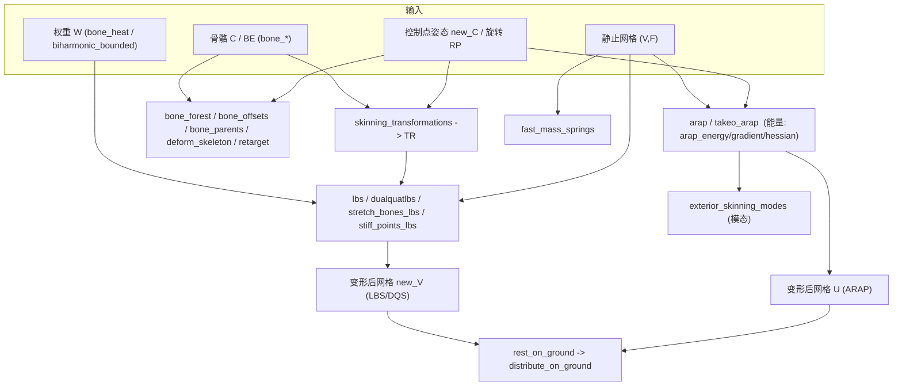

# 10-mesh / 11 变形与蒙皮 (Deformation & Skinning)

> 本章覆盖 `mesh/` 下 **30 个变形/蒙皮相关函数**，包括：
> ARAP 家族（`arap` 及其能量/梯度/Hessian/线性块/右端项子程序、`takeo_arap`/`takeo_asap` 历史实现）、
> 蒙皮与骨骼（`lbs`/`lbs_matrix`/`dualquatlbs`/`skinning_transformations`、`bone_*` 家族、
> `exterior_skinning_modes`、`stretch_bones_lbs`、`stiff_points_lbs`）、
> 权重计算（`bone_heat`、`biharmonic_bounded`）与其他变形（`deform`、`fast_mass_springs`、
> `inflate`、`retarget`、`deform_skeleton`、`joints`、`distribute_on_ground`、`rest_on_ground`）。
>
> This chapter documents **30 deformation / skinning functions** under `mesh/`.
>
> 所有签名、行号、可选参数均**逐字取自源码**（行号已用 `Read` 核对），不作超出源码的演绎。
> All signatures, line numbers and options are taken verbatim from the source.

---

## 本章概览 / Chapter overview

### (a) ARAP 家族 / The ARAP family

| 函数 (Function) | 角色 (Role) | 关键依赖 (Key deps) | 锚点 |
|---|---|---|---|
| `arap` | 顶层求解器：局部-全局 (local-global) 迭代 | `covariance_scatter_matrix`, `arap_rhs`, `fit_rotations`, `min_quad_with_fixed` | [mesh/arap.m](file:///c:/VSWork/gptoolbox-1/mesh/arap.m#L1-L442) |
| `arap_dof` | 在 **LBS 控制点线性变换 L** 上做 ARAP（自由度=每控制点 dim×(dim+1) 变换） | `lbs_matrix`, `cotmatrix`, `covariance_scatter_matrix`, `arap_rhs`, `min_quad_with_fixed` | [mesh/arap_dof.m](file:///c:/VSWork/gptoolbox-1/mesh/arap_dof.m#L1-L728) |
| `arap_energy` | 人类可读的 ARAP 能量"基准真值"实现（慢） | `cotangent`, `fit_rotation` | [mesh/arap_energy.m](file:///c:/VSWork/gptoolbox-1/mesh/arap_energy.m#L1-L139) |
| `arap_gradient` | ARAP 能量梯度 `G`、能量 `E`、最佳拟合旋转 `R` | `cotmatrix`, `covariance_scatter_matrix`, `arap_rhs`, `fit_rotations` | [mesh/arap_gradient.m](file:///c:/VSWork/gptoolbox-1/mesh/arap_gradient.m#L1-L110) |
| `arap_hessian` | ARAP 能量 Hessian `H = repdiag(L,dim) - BCBT`（[Huang et al. 2009]） | `cotmatrix`, `cotangent`, `covariance_scatter_matrix`, `arap_linear_block`, `fit_rotations` | [mesh/arap_hessian.m](file:///c:/VSWork/gptoolbox-1/mesh/arap_hessian.m#L1-L178) |
| `arap_linear_block` | 线性块 `Kd`（把旋转与位置**线性**联系） | `edges`, `cotmatrix`, `cotangent` | [mesh/arap_linear_block.m](file:///c:/VSWork/gptoolbox-1/mesh/arap_linear_block.m#L1-L223) |
| `arap_rhs` | 全局 Poisson 求解的右端项 `b = K * Rcol`（并返回 `K`） | `arap_linear_block` | [mesh/arap_rhs.m](file:///c:/VSWork/gptoolbox-1/mesh/arap_rhs.m#L1-L137) |
| `takeo_arap` | [Igarashi et al. 2004] 原始 ARAP（ASAP 初值 + 1 次拟合/Poisson） | `takeo_asap`, `relative_coordinates`, `cotmatrix`, `min_quad_with_fixed`, `avgedge` | [mesh/takeo_arap.m](file:///c:/VSWork/gptoolbox-1/mesh/takeo_arap.m#L1-L477) |
| `takeo_asap` | [Igarashi et al. 2004] "First Step" ASAP（等价于 LSCM 的 2.5 倍） | `relative_coordinates`, `min_quad_with_fixed` | [mesh/takeo_asap.m](file:///c:/VSWork/gptoolbox-1/mesh/takeo_asap.m#L1-L382) |

**关系 / Relations**（均据源码调用关系）：

- `arap_rhs` 内部对 `d=1..3` 调用 `arap_linear_block`，把各列块拼成 `K`（[arap_rhs.m L83-L101](file:///c:/VSWork/gptoolbox-1/mesh/arap_rhs.m#L83-L101)）。
- `arap_gradient` / `arap_hessian` 复用 `covariance_scatter_matrix`（CSM）与 `arap_rhs` 的 `K`，是同一能量的**一阶/二阶**形式（[arap_gradient.m L85-L89](file:///c:/VSWork/gptoolbox-1/mesh/arap_gradient.m#L85-L89)、[arap_hessian.m L111-L134](file:///c:/VSWork/gptoolbox-1/mesh/arap_hessian.m#L111-L134)）。
- `arap` 是完整的局部-全局求解器：局部步 `CSM*U → fit_rotations`，全局步 `K*Rcol → min_quad_with_fixed`（[arap.m L366-L424](file:///c:/VSWork/gptoolbox-1/mesh/arap.m#L366-L424)）。
- `arap_energy` 是同一能量的**逐旋转**可读实现；头注明确指出与 `arap_gradient` 的能量存在常数倍关系（见该条目"已知问题"）。
- **历史来源**：`takeo_arap` / `takeo_asap` 是 Takeo Igarashi 推动的"形状操作"原始实现（头注见 [takeo_arap.m L2-L9](file:///c:/VSWork/gptoolbox-1/mesh/takeo_arap.m#L2-L9)）；`arap` 则综合了 Sorkine-Alexa 2007、Liu 2010、Chao 2010 三套表述。

### (b) 蒙皮与骨骼 / Skinning & bones

| 函数 | 角色 | 备注 |
|---|---|---|
| `lbs` | 线性混合蒙皮：`U = Σ_i W(:,i) · (T_i · [V;1])` | [mesh/lbs.m](file:///c:/VSWork/gptoolbox-1/mesh/lbs.m#L1-L39) |
| `lbs_matrix` | 构造 `MLBS`，使 `new_V(:) = MLBS * A`（A 为变换列） | [mesh/lbs_matrix.m](file:///c:/VSWork/gptoolbox-1/mesh/lbs_matrix.m#L1-L76) |
| `dualquatlbs` | 对偶四元数蒙皮（DQS），避免"糖纸"现象 | [mesh/dualquatlbs.m](file:///c:/VSWork/gptoolbox-1/mesh/dualquatlbs.m#L1-L78) |
| `skinning_transformations` | 由控制点姿态 `new_C`+旋转 `RP` 生成每 handle 的变换 `TR`/`T,R,S`/`T,AX,AN,S,O` | 蒙皮总入口 |
| `bone_forest` | 由 `C,E,P,BE` 构建"骨骼森林"扁平表 `offsets/WI/parents` | 供 `writeBF` |
| `bone_offsets` | 由关节位置+父索引算每关节相对父的偏移 | |
| `bone_parents` | 由有向骨边 `BE` 求父索引 `P`（0=root） | |
| `bone_visible` | 判定顶点相对"骨"（线段）的可见性（Baran-Popovic 定义） | 探测 `bone_visible_embree` MEX |
| `exterior_skinning_modes` | 在"蒙皮 handle 仿射变形"子空间内做模态分析 | 用 `lbs_matrix` 构造零空间 |
| `stretch_bones_lbs` | 可拉伸/可扭转骨骼的 LBS 变体 | |
| `stiff_points_lbs` | "刚性点"（stiff points）LBS 变体 | |

### (c) 权重计算 / Weight computation

| 函数 | 方法 | 求解器 |
|---|---|---|
| `bone_heat` | [Baran & Popovic 2007] "bone heat"：`W = (-K + M·H)⁻¹ (M·H·PP)` | 后向代入（`\`，非迭代） |
| `biharmonic_bounded` | 有界双调和坐标，`OptType∈{quad,least-squares,conic,active-set}`，可 `POU` | `quadprog` / `min_quad_with_fixed_active_set` |

### (d) 其他变形 / Other deformation

| 函数 | 形态 | 说明 |
|---|---|---|
| `deform` | **classdef（`handle` 类，非函数）** | 交互式 2D 网格变形工具类；内置多种方法分派 |
| `deform_skeleton` | 函数 | 由相对旋转 `dQ` 变形骨架 |
| `fast_mass_springs` | 函数 | [Liu et al. 2013] 快速质点弹簧（局部-全局） |
| `inflate` | 函数 | 把平面 2D 网格"充气"成 3D 枕头（含多种 Method） |
| `retarget` | 函数 | 把相对骨变换 `dQ` 从一个骨架重定向到另一个骨架 |
| `joints` | 函数 | 围绕线框图构造"接头"几何（木工榫卯风格） |
| `distribute_on_ground` | 函数 | 逐一把多个网格"落地"且互不相交 |
| `rest_on_ground` | 函数 | 单个实体网格静置于地面 `z=0`（模拟粘性海洋中落底） |

### 数据流总览 / Overall dataflow



### MEX 与 `matrix/` 依赖 / MEX and `matrix/` dependencies

- **MEX（编译型，`mex/` 下仅有 `.cpp`，无 `.m` 桩）**：
  - `bone_visible_embree` — 由 [mex/CMakeLists.txt L306](file:///c:/VSWork/gptoolbox-1/mex/CMakeLists.txt#L306) 的 `bone_visible_embree.cpp` 编译（仅 `LIBIGL_EMBREE=ON` 时生成）。`bone_heat`/`bone_visible`/`point_visible` 均以 `exist('bone_visible_embree','file')` **运行时探测**。
  - `bone_visible`（加速版）— 由 [mex/CMakeLists.txt L213](file:///c:/VSWork/gptoolbox-1/mex/CMakeLists.txt#L213) 的 `bone_visible.cpp` 编译（同名 `mesh/bone_visible.m` 是纯 MATLAB 兜底实现）。
  - `psd_project_rows` — [mex/psd_project_rows.m](file:///c:/VSWork/gptoolbox-1/mex/psd_project_rows.m#L1-L1) 为注释桩，实现指向 `psd_project_rows.cpp`（本清单函数**不直接**调用它）。
- **`matrix/` 模块**：
  - `min_quad_with_fixed` — [matrix/min_quad_with_fixed.m L1](file:///c:/VSWork/gptoolbox-1/matrix/min_quad_with_fixed.m#L1)。被 `arap`、`arap_dof`、`takeo_arap`、`takeo_asap`、`fast_mass_springs`、`biharmonic_bounded`、`inflate` 调用。
  - `min_quad_with_fixed_active_set` — [matrix/min_quad_with_fixed_active_set.m L1](file:///c:/VSWork/gptoolbox-1/matrix/min_quad_with_fixed_active_set.m#L1)。仅被 `biharmonic_bounded` 的 `'active-set'` 路径调用。
  - `default_quadprog_param` — [matrix/default_quadprog_param.m L1](file:///c:/VSWork/gptoolbox-1/matrix/default_quadprog_param.m#L1)。被 `biharmonic_bounded` 调用以取得 mosek 默认参数。
  - `quadprog` — **MATLAB Optimization Toolbox 内置函数**（仓库内**无** `matrix/quadprog.m`）；`biharmonic_bounded` 的 `'quad'`/`'least-squares'` 路径直接调用它。

---

## 逐函数条目 / Per-function entries

### `arap` — 按需刚性变形求解器（局部-全局迭代）
- **文件 / File**: [mesh/arap.m](file:///c:/VSWork/gptoolbox-1/mesh/arap.m#L1-L442)
- **签名 / Signature**: `[U,data,SS,R] = arap(V,F,b,bc,varargin)`
- **功能 / Purpose**: `EN: Solves as-rigid-as-possible deformation via local-global (rotation fit / Poisson) iterations.` / 中文：通过"局部拟合旋转 + 全局求解 Poisson"迭代求解按需刚性变形（支持 `spokes`/`elements`/`spokes-and-rims` 三种能量）。
- **输入 / Inputs**:

  | 参数 | 尺寸/类型 | 含义 (中 / EN) |
  |---|---|---|
  | `V` | `#V by dim` | 静止域顶点坐标 / rest domain positions |
  | `F` | `#F by {3\|4}` | 三角形/四面体索引 / triangle or tet indices |
  | `b` | `#b` | 约束（边界）顶点索引 / constraint vertex indices |
  | `bc` | `#b by dim` | 约束位置 / constraint positions |

- **输出 / Outputs**:

  | 参数 | 尺寸/类型 | 含义 |
  |---|---|---|
  | `U` | `#V by dim` | 变形后位置 / new positions |
  | `data` | struct | 可复用数据（`.CSM`、`.K`、`.L`、`.ae`、`.preF`、`.energy`、`.rr`…）/ reusable data |
  | `SS` | `dim by dim by #R` | 逐旋转协方差矩阵 / covariance matrices |
  | `R` | `dim by dim by #R` | 拟合旋转 / fitted rotations |

- **可选参数 / Optional**（取自 `params_to_variables`，[arap.m L118-L123](file:///c:/VSWork/gptoolbox-1/mesh/arap.m#L118-L123)；默认值见 [L91-L115](file:///c:/VSWork/gptoolbox-1/mesh/arap.m#L91-L115)）:

  | 名称 | 取值 | 默认 | 含义 |
  |---|---|---|---|
  | `'Energy'` | `'spokes'`/`'elements'`/`'spokes-and-rims'` | 按 `size(F,2)`：4→`elements`，3→`spokes-and-rims` | ARAP 能量定义 / energy flavor |
  | `'V0'` | `#V by dim` | `V`（2D 时用 `laplacian_mesh_editing` 初值） | 初值位置 / initial guess |
  | `'Data'` | struct | `[]` | 上次调用返回的复用数据 / reusable data |
  | `'Tikhonov'` | 标量 | `0` | Tikhonov 正则系数 / regularization α |
  | `'Groups'` | `#V` 或 `#F` 组号 | `[]`（即 `k=n`） | 每顶点/每面分组 / group ids |
  | `'Tol'` | 标量 | `0.001`（头注写 0.75，**实际默认 0.001**） | 停止容差 / stopping tolerance |
  | `'MaxIter'` | 整数 | `100` | 最大局部-全局迭代数 / max iterations |
  | `'Dynamic'` | `#V by dim` | `[]`（无外力） | 外力 / external forces |
  | `'TimeStep'` | 标量 | `1` | 时间步 / time step `h` |
  | `'Vm1'` | `#V by dim` | `V0` | 上一时刻位置 / positions at t-1 |
  | `'RemoveRigid'` | `logical` | `false` | 是否移除刚性不变性 / remove rigid |
  | `'Debug'` | `logical` | `false` | 调试打印 / debug |
  | `'Aeq'`/`'Beq'` | `#Aeq by dim*#V` / `#Aeq by dim` | `[]`/`[]` | 线性等式约束 / linear equality constraints |
  | `'Flat'` | `logical` | `false` | 是否强制 `Z=0`（仅限 `elements`） | flatten constraint |
  | `'Ref'` | cell `{ref_V,ref_F,ref_map}` | `[]` | 参考配置 / reference configuration |
  | `'Weight'` | `#F` | `[]` | 逐面权重 / per-face weights |
  | `'Youngs'` | 标量 | `1.2e9` | 杨氏模量（仅动力学）/ Young's modulus |

- **变量流动 / Variable flow**:
  `V,F,b,bc →(解析选项/默认)→ (flat? plane_project) → ref_V,ref_F → U(初值, 2D: laplacian_mesh_editing) → data.L=cotmatrix → data.CSM=covariance_scatter_matrix → data.K=arap_rhs →(循环)→ S=data.CSM*repmat(U,dim,1) → SS → R=fit_rotations(SS) → Rcol → Bcol=data.K*Rcol → B → zQ=-0.5*dyn_alpha*data.L+DQ+alpha_tik*I, zL=-dyn_alpha*B+Dl → min_quad_with_fixed(zQ,zL,b,bc,Aeq,Beq,data.preF) → U`
- **算法步骤 / Algorithm**:
  1. 解析参数（`b` 边界断言、默认值、`params_to_variables` 映射，[L83-L136](file:///c:/VSWork/gptoolbox-1/mesh/arap.m#L83-L136)）。
  2. 若 `Energy` 为空按单纯形大小自动选择（[L138-L145](file:///c:/VSWork/gptoolbox-1/mesh/arap.m#L138-L145)）；`fext` 为空则 `dynamic=false`。
  3. 处理 `Groups`（`elements` 时按面取 mode，[L154-L167](file:///c:/VSWork/gptoolbox-1/mesh/arap.m#L154-L167)）；`Flat` 时 `plane_project`（[L170-L183](file:///c:/VSWork/gptoolbox-1/mesh/arap.m#L170-L183)）。
  4. 初值 `U`：2D 用 `laplacian_mesh_editing`，否则 `V`（[L193-L202](file:///c:/VSWork/gptoolbox-1/mesh/arap.m#L193-L202)）。
  5. 动力学项（`DQ`/`Dl`/`M`，[L204-L224](file:///c:/VSWork/gptoolbox-1/mesh/arap.m#L204-L224)）；`data.L`（有 `Weight` 时用 `-0.5*wG'*(wA.*weight .* wG)`，[L226-L238](file:///c:/VSWork/gptoolbox-1/mesh/arap.m#L226-L238)）。
  6. `RemoveRigid`：`farthest_points` + 逐轴旋转对齐（[L251-L287](file:///c:/VSWork/gptoolbox-1/mesh/arap.m#L251-L287)）；`data.ae=avgedge`（[L298-L300](file:///c:/VSWork/gptoolbox-1/mesh/arap.m#L298-L300)）。
  7. 预计算 `CSM`（+分组稠密化）与 `K`（[L304-L327](file:///c:/VSWork/gptoolbox-1/mesh/arap.m#L304-L327)）。
  8. 迭代（[L335-L440](file:///c:/VSWork/gptoolbox-1/mesh/arap.m#L335-L440)）：**局部步** `S=data.CSM*repmat(U,dim,1)`→`SS`→`R=fit_rotations`；**全局步** `Bcol=data.K*Rcol`→`zQ`/`zL`→`min_quad_with_fixed`；能量上升则提前退出（[L426-L433](file:///c:/VSWork/gptoolbox-1/mesh/arap.m#L426-L433)）。
- **流程图 / Flowchart**:

  ```mermaid
  flowchart TD
    A["输入 V,F,b,bc + 选项"] --> B["解析选项/默认值"]
    B --> C{"Energy 为空?"}
    C -- 是 --> C1["按 size(F,2) 自动选择"]
    C -- 否 --> D{"Flat?"}
    C1 --> D
    D -- 是 --> D1["plane_project -> ref_V,ref_F"]
    D -- 否 --> D2["ref_V=V, ref_F=F"]
    D1 --> E["初值 U"]
    D2 --> E
    E --> F["data.L=cotmatrix; data.CSM; data.K=arap_rhs"]
    F --> G["局部步: S=CSM*repmat(U) -> SS -> R=fit_rotations"]
    G --> H["全局步: Bcol=K*Rcol -> zQ,zL"]
    H --> I{"RemoveRigid?"}
    I -- 是 --> I1["逐坐标 min_quad_with_fixed"]
    I -- 否 --> I2{"有 Aeq?"}
    I2 -- 是 --> I3["repdiag 整体求解"]
    I2 -- 否 --> I4["min_quad_with_fixed(zQ,zL,b,bc)"]
    I1 --> J{"能量上升或超过 MaxIter?"}
    I3 --> J
    I4 --> J
    J -- 否 --> G
    J -- 是 --> Z["输出 U,data,SS,R"]
  ```

- **依赖 / Dependencies**: `cotmatrix`, `massmatrix`, `grad`, `doublearea`, `covariance_scatter_matrix`, `arap_rhs`, `fit_rotations`, `group_sum_matrix`, `repdiag`, `avgedge`, `farthest_points`, `laplacian_mesh_editing`, `plane_project`, `axisangle2matrix`；`matrix/min_quad_with_fixed`
- **See also**: `takeo_arap`, `arap_dof`, `arap_energy`, `arap_gradient`, `arap_hessian`, `lbs`

### `arap_dof` — 在 LBS 控制点自由度上求 ARAP
- **文件 / File**: [mesh/arap_dof.m](file:///c:/VSWork/gptoolbox-1/mesh/arap_dof.m#L1-L728)
- **签名 / Signature**: `[L,new_C] = arap_dof(V,F,W,C,P,BE,new_C,varargin)`（源码用 `varargin` 手工解析，前 7 个为位置参数，[L68-L74](file:///c:/VSWork/gptoolbox-1/mesh/arap_dof.m#L68-L74)）
- **功能 / Purpose**: `EN: Computes automatic degrees of freedom (per-control-point linear transformations) for point handles in an LBS deformation, given only control-point translations.` / 中文：已知控制点平移，自动求每个手柄的线性变换 `L`，使 LBS 变形尽量刚性（`new_V = MLBS*L`）。
- **输入 / Inputs**:

  | 参数 | 尺寸/类型 | 含义 (中 / EN) |
  |---|---|---|
  | `V` | `#V by dim` | 顶点坐标 / vertex positions |
  | `F` | `#F by 3` | 面索引 / face indices |
  | `W` | `#V by #C` | 蒙皮权重 / skinning weights |
  | `C` | `#C by dim` | 控制点位置 / control positions |
  | `P` | `#P` | 点控制索引（进 `C`）/ point controls |
  | `BE` | `#BE by 2` | 骨边（进 `C`）/ bone edges |
  | `new_C` | `#C by dim` | 控制点姿态位置 / posed control positions |

- **输出 / Outputs**:

  | 参数 | 尺寸/类型 | 含义 |
  |---|---|---|
  | `L` | `dim*dim*(dim+1)*(#P+#BE) by 1` 列 | 各控制点线性变换（列向量）/ stacked transformations |
  | `new_C` | `#C by dim` | 更新后的控制点位置（free 手柄回填）/ updated controls |

- **可选参数 / Optional**（[L121-L185](file:///c:/VSWork/gptoolbox-1/mesh/arap_dof.m#L121-L185)）:

  | 名称 | 取值 | 默认 | 含义 |
  |---|---|---|---|
  | `'L0'` | 变换栈 | 单位变换 | 变换初值 / initial transformations |
  | `'Groups'` | `#V` 组号 | `[]`（`k=n`） | 分组 / group ids |
  | `'Tol'` | 标量 | `0.75` | 停止容差 | |
  | `'MaxIter'` | 整数 | `10` | 最大迭代 | |
  | `'Free'` | 索引（进 `C`） | `[]` | "自由"控制点（释放插值约束）/ free handles |
  | `'Fixed'` | 索引 + `dim by dim by #fixed` 变换 | `[]`/`zeros(dim,dim,0)` | 完全固定手柄及其变换 / fixed handles |
  | `'RecenterTranslations'` | `logical` | `false` | 优化前居中平移（不支持骨） | |
  | `'Dynamic'` | `#V by dim` | `[]`（关） | 外力 / external forces |
  | `'TimeStep'` | 标量 | `1` | 时间步 | |
  | `'Lm1'` | 变换栈 | `L0` | t-1 变换 | |
  | `'Energy'` | 字符串 | `'spokes'` | 能量（[L82](file:///c:/VSWork/gptoolbox-1/mesh/arap_dof.m#L82)） | |

- **变量流动 / Variable flow**:
  `V,F,W,C,P,BE,new_C → snap_D → b(最近顶点) → L(初值,单位变换) → MLBS=lbs_matrix(V,W) → Lcot=cotmatrix, Lapl=2*Lcot → G_sum(按 energy) → CSM → CSM_MLBS{d} → [~,K]=arap_rhs, MLBS_KG=-4*MLBS'*K*repdiag(G_sum',dim*dim) → A=repdiag(-Lapl,dim), AA=MLBS'*A*MLBS →(循环)局部: S{d}=CSM_MLBS{d}*L → R=fit_rotations → BB=MLBS_KG*Rcol →(约束 Aeq/Beq) → min_quad_with_fixed(AA,BB,fixed_dim,fixed_L,Aeq,Beq,preF) → L`
- **算法步骤 / Algorithm**:
  1. 关闭 `min_quad_with_fixed` 的两个告警（[L62-L65](file:///c:/VSWork/gptoolbox-1/mesh/arap_dof.m#L62-L65)），解析位置/可选参数。
  2. 用顶点-控制点距离把每个 `C` 吸附到最近网格顶点得 `b`（[L85-L90](file:///c:/VSWork/gptoolbox-1/mesh/arap_dof.m#L85-L90)）。
  3. 自由度定义：每个手柄 `dim by dim+1` 变换共 `dim*(dim+1)` 个自由度，`fixed_dim` 逐维展开（[L207-L212](file:///c:/VSWork/gptoolbox-1/mesh/arap_dof.m#L207-L212)）；初值 `L`（[L219-L226](file:///c:/VSWork/gptoolbox-1/mesh/arap_dof.m#L219-L226)）。
  4. 预计算 `MLBS`、`Lapl`、`G_sum`、`CSM`、`CSM_MLBS{d}`、`MLBS_KG`、`AA`（[L341-L402](file:///c:/VSWork/gptoolbox-1/mesh/arap_dof.m#L341-L402)）。
  5. 动力学项 `DQ`/`Dl`（[L404-L414](file:///c:/VSWork/gptoolbox-1/mesh/arap_dof.m#L404-L414)）。
  6. 迭代（[L419-L605](file:///c:/VSWork/gptoolbox-1/mesh/arap_dof.m#L419-L605)）：**局部步** `S{d}=CSM_MLBS{d}*L` → `R=fit_rotations(S)`；**全局步** 组装插值约束 `Aeq/Beq`（[L497-L571](file:///c:/VSWork/gptoolbox-1/mesh/arap_dof.m#L497-L571)）→ `BB=MLBS_KG*Rcol` → `min_quad_with_fixed(AA,BB,fixed_dim,fixed_L,Aeq,Beq,preF)`。
  7. 回填 free 手柄的 `new_C`（[L710-L723](file:///c:/VSWork/gptoolbox-1/mesh/arap_dof.m#L710-L723)），恢复告警。
- **流程图 / Flowchart**:

  ```mermaid
  flowchart TD
    A["输入 V,F,W,C,P,BE,new_C"] --> B["snap: 最近顶点 b"]
    B --> C["L 初值(单位变换); MLBS=lbs_matrix"]
    C --> D["Lcot/Lapl; G_sum; CSM; CSM_MLBS{d}"]
    D --> E["K=arap_rhs; MLBS_KG; AA=MLBS'*A*MLBS"]
    E --> F["局部步: S{d}=CSM_MLBS{d}*L -> R=fit_rotations"]
    F --> G["组装 Aeq/Beq (插值约束, 跳过 Free)"]
    G --> H["BB=MLBS_KG*Rcol"]
    H --> I{"Dynamic?"}
    I -- 是 --> I1["AA+=DQ; BB+=Dl"]
    I1 --> J["min_quad_with_fixed(AA,BB,fixed_dim,fixed_L,Aeq,Beq)"]
    I -- 否 --> J
    J --> K{"迭代<MaxIter 且 变化>Tol?"}
    K -- 是 --> F
    K -- 否 --> L["回填 Free 的 new_C"]
    L --> Z["输出 L,new_C"]
  ```

- **依赖 / Dependencies**: `lbs_matrix`, `cotmatrix`, `massmatrix`, `covariance_scatter_matrix`, `group_sum_matrix`, `arap_rhs`, `fit_rotations`, `repdiag`；`matrix/min_quad_with_fixed`
- **See also**: `arap`, `lbs_matrix`, `lbs`, `deform`

### `arap_energy` — ARAP 能量的可读基准实现
- **文件 / File**: [mesh/arap_energy.m](file:///c:/VSWork/gptoolbox-1/mesh/arap_energy.m#L1-L139)
- **签名 / Signature**: `[E,ER] = arap_energy(V,F,U,varargin)`
- **功能 / Purpose**: `EN: Human-readable ground-truth ARAP energy evaluator (slow); per-rotation contributions.` / 中文：人类可读的 ARAP 能量"基准真值"，返回总量 `E` 与逐旋转贡献 `ER`。
- **输入 / Inputs**:

  | 参数 | 尺寸/类型 | 含义 |
  |---|---|---|
  | `V` | `#V by dim` | 静止顶点 / rest positions |
  | `F` | `#F by simplex` | 单纯形索引 / element indices |
  | `U` | `#V by dim` | 变形后顶点 / deformed positions |

- **输出 / Outputs**:

  | 参数 | 尺寸/类型 | 含义 |
  |---|---|---|
  | `E` | 标量 | 总能量 / scalar energy |
  | `ER` | `#R by 1` | 逐旋转能量贡献 / per-rotation energy |

- **可选参数 / Optional**:

  | 名称 | 取值 | 默认 | 含义 |
  |---|---|---|---|
  | `'Energy'` | `'spokes'`/`'spokes-and-rims'`/`'elements'` | `size(F,2)==4→elements`，`==3→spokes-and-rims`（[L26-L31](file:///c:/VSWork/gptoolbox-1/mesh/arap_energy.m#L26-L31)） | 能量定义 |

- **变量流动 / Variable flow**: `V,F,U → C=cotangent → edge_set(按 energy 构造每旋转的边集) → ER(r)=Σ_e 0.5*C_e*(eu*eu' - 2*ev*R*eu' + ev*ev') → E=sum(ER)`
- **算法步骤 / Algorithm**:
  1. 按 `size(F,2)` 定默认能量并解析 `'Energy'`（[L26-L48](file:///c:/VSWork/gptoolbox-1/mesh/arap_energy.m#L26-L48)）。
  2. `C=cotangent(V,F)`（[L51](file:///c:/VSWork/gptoolbox-1/mesh/arap_energy.m#L51)）；构造每旋转 `r` 的边集 `edge_set{r}.E/.C`（`spokes` 循环顶点、`elements` 循环面、`spokes-and-rims` 循环顶点并聚合相邻面边集，[L55-L109](file:///c:/VSWork/gptoolbox-1/mesh/arap_energy.m#L55-L109)）。
  3. 逐旋转：累加协方差 `S=S+Cr*eu'*ev` → `R=fit_rotation(S)` → 累加 `ER(r)`（[L113-L137](file:///c:/VSWork/gptoolbox-1/mesh/arap_energy.m#L113-L137)）。
  4. `E=sum(ER)`（[L138](file:///c:/VSWork/gptoolbox-1/mesh/arap_energy.m#L138)）。
- **已知问题 / Known issues**: 头注给出与 `arap_gradient` 能量的关系——`spokes-and-rims: E=3·E_G`、`spokes: E=2·E_G`、`elements: E=E_G`（[L18-L22](file:///c:/VSWork/gptoolbox-1/mesh/arap_energy.m#L18-L22)）。
- **流程图 / Flowchart**:

  ```mermaid
  flowchart TD
    A["输入 V,F,U"] --> B["C=cotangent(V,F)"]
    B --> C{"Energy?"}
    C -- spokes --> D1["edge_set[r]=顶点 r 的关联边"]
    C -- elements/spokes-and-rims --> D2["edge_set[r]=面/顶点边集"]
    D1 --> E["逐旋转: S=Σ Cr*eu'ev -> R=fit_rotation -> ER(r)"]
    D2 --> E
    E --> Z["输出 E=sum(ER), ER"]
  ```

- **依赖 / Dependencies**: `cotangent`, `fit_rotation`
- **See also**: `arap_gradient`, `arap`, `arap_hessian`

### `arap_gradient` — ARAP 能量梯度与旋转
- **文件 / File**: [mesh/arap_gradient.m](file:///c:/VSWork/gptoolbox-1/mesh/arap_gradient.m#L1-L110)
- **签名 / Signature**: `[G,E,R,data] = arap_gradient(V,F,U,varargin)`
- **功能 / Purpose**: `EN: Gradient of the ARAP energy w.r.t. U, plus energy and best-fit rotations.` / 中文：计算 ARAP 能量关于 `U` 的梯度 `G`，并返回能量 `E`、最佳拟合旋转 `R`（[Chao et al. 2010]）。
- **输入 / Inputs**:

  | 参数 | 尺寸/类型 | 含义 |
  |---|---|---|
  | `V` | `#V by dim` | 静止顶点 |
  | `F` | `#F by simplex` | 单纯形索引 |
  | `U` | `#V by dim` | 变形后顶点 |

- **输出 / Outputs**:

  | 参数 | 尺寸/类型 | 含义 |
  |---|---|---|
  | `G` | `#V by dim` | 逐顶点梯度 / gradient |
  | `E` | 标量 | ARAP 能量 / energy |
  | `R` | `dim by dim by #R` | 最佳拟合旋转 |
  | `data` | struct | 复用数据（`.L`/`.CSM`/`.K`） |

- **可选参数 / Optional**（[L59-L61](file:///c:/VSWork/gptoolbox-1/mesh/arap_gradient.m#L59-L61)）:

  | 名称 | 取值 | 默认 | 含义 |
  |---|---|---|---|
  | `'Energy'` | `spokes/spokes-and-rims/elements` | `size(F,2)==4→elements`，`==3→spokes-and-rims` | 能量 |
  | `'Rotations'` | `dim by dim by #R` | `[]`（内部拟合） | 给定旋转 |
  | `'Data'` | struct | `[]` | 复用数据 |
  | `'SinglePrecision'` | `logical` | `true` | 拟合旋转是否用单精度 |

- **变量流动 / Variable flow**: `V,F,U → data.L=cotmatrix → data.CSM=covariance_scatter_matrix → data.K=arap_rhs → S=data.CSM*repmat(U) → SS → R=fit_rotations → dV=data.K*Rcol → G=-(data.L*U+dV) → E=trace(-U'*0.5*data.L*U - U'*dV - V'*0.5*data.L*V)`
- **算法步骤 / Algorithm**:
  1. 默认能量按 `size(F,2)` 决定，解析选项（[L49-L74](file:///c:/VSWork/gptoolbox-1/mesh/arap_gradient.m#L49-L74)）。
  2. 首次调用构建 `data.L`/`data.CSM`/`data.K`（[L83-L90](file:///c:/VSWork/gptoolbox-1/mesh/arap_gradient.m#L83-L90)）。
  3. `S=data.CSM*repmat(U,dim,1)`→`SS`→`R=fit_rotations(SS,'SinglePrecision',single_precision)`（[L92-L98](file:///c:/VSWork/gptoolbox-1/mesh/arap_gradient.m#L92-L98)）。
  4. `dV=data.K*Rcol`→`G=-(data.L*U+dV)`；`nargout>1` 时算 `E`（[L100-L108](file:///c:/VSWork/gptoolbox-1/mesh/arap_gradient.m#L100-L108)）。
- **流程图 / Flowchart**:

  ```mermaid
  flowchart TD
    A["输入 V,F,U"] --> B["data.L=cotmatrix; data.CSM; data.K=arap_rhs"]
    B --> C["S=CSM*repmat(U) -> SS"]
    C --> D["R=fit_rotations(SS)"]
    D --> E["Rcol; dV=K*Rcol"]
    E --> F["G=-(L*U+dV)"]
    F --> G{"nargout>1?"}
    G -- 是 --> G1["E=trace(-U'*0.5L*U - U'dV - V'*0.5L*V)"]
    G -- 否 --> Z
    G1 --> Z["输出 G,E,R,data"]
  ```

- **依赖 / Dependencies**: `cotmatrix`, `covariance_scatter_matrix`, `arap_rhs`, `fit_rotations`
- **See also**: `arap_hessian`, `arap`, `arap_energy`

### `arap_hessian` — ARAP 能量 Hessian（模态分析用）
- **文件 / File**: [mesh/arap_hessian.m](file:///c:/VSWork/gptoolbox-1/mesh/arap_hessian.m#L1-L178)
- **签名 / Signature**: `[H,L,BT,CC,R] = arap_hessian(V,F,varargin)`
- **功能 / Purpose**: `EN: Hessian of the ARAP energy at a given evaluation point (or the rest configuration), following "Shape Decomposition using Modal Analysis" [Huang et al. 2009].` / 中文：计算 ARAP 能量 Hessian `H`（[Huang et al. 2009] 的模态分析表述）。
- **输入 / Inputs**:

  | 参数 | 尺寸/类型 | 含义 |
  |---|---|---|
  | `V` | `#V by dim` | 顶点位置 |
  | `F` | `#F by simplex` | 单纯形索引 |

- **输出 / Outputs**:

  | 参数 | 尺寸/类型 | 含义 |
  |---|---|---|
  | `H` | `#V*dim by #V*dim` | 稀疏 Hessian / sparse Hessian |
  | `L` | `#V by #V` | `-3*cotmatrix`（内部） |
  | `BT` | `#V*dim by #R*dim` | 交叉块 / cross block |
  | `CC` | `#R*dim by #R*dim` | 旋转块 / rotation block |
  | `R` | `dim by dim by #R` | 拟合旋转 |

- **可选参数 / Optional**（[L48-L49](file:///c:/VSWork/gptoolbox-1/mesh/arap_hessian.m#L48-L49)）:

  | 名称 | 取值 | 默认 | 含义 |
  |---|---|---|---|
  | `'Energy'` | `spokes/spokes-and-rims/elements` | `'spokes-and-rims'`（[L43](file:///c:/VSWork/gptoolbox-1/mesh/arap_hessian.m#L43)） | 能量 |
  | `'EvaluationPoint'` | `#V by dim` | `[]`（用 `V`） | 求值点 `U` |
  | `'Rotations'` | `dim by dim by #R` | `[]`（内部 `fit_rotations`） | 旋转 |

- **变量流动 / Variable flow**: `V,F(,U,R) → L=-3*cotmatrix → LC=cotangent → CSM=covariance_scatter_matrix → S=CSM*repmat(U or V) → (若 U 非空: SS → R=fit_rotations → S=R*SS) → X{d}=arap_linear_block(V,F,d)' → BT=-3*[cross 排列] → CC=-3*sparse(CI,CJ,S) 去对角 → BCBT=BT'*(P*chol_solve(P'*CC*P,P'*BT)) → H=repdiag(L,dim)-BCBT`
- **算法步骤 / Algorithm**:
  1. 解析选项（[L48-L62](file:///c:/VSWork/gptoolbox-1/mesh/arap_hessian.m#L48-L62)）。
  2. **2D 处理**：`dim==2` 时补 `V(:,3)=0`、递归调用再把 `H` 取 `1:end*2/3` 子块（[L81-L91](file:///c:/VSWork/gptoolbox-1/mesh/arap_hessian.m#L81-L91)）。
  3. `L=-3*cotmatrix(V,F)`（[L100](file:///c:/VSWork/gptoolbox-1/mesh/arap_hessian.m#L100)）、`LC=cotangent`（[L104](file:///c:/VSWork/gptoolbox-1/mesh/arap_hessian.m#L104)）、`CSM`（[L111](file:///c:/VSWork/gptoolbox-1/mesh/arap_hessian.m#L111)）。
  4. 若无 `U` 用 `V` 构造 `S`；否则用 `U` 拟合 `R` 再 `S=R*SS`（[L114-L129](file:///c:/VSWork/gptoolbox-1/mesh/arap_hessian.m#L114-L129)）。
  5. `X{d}` 来自 `arap_linear_block`，组装 `BT`（3D 形式，[L132-L144](file:///c:/VSWork/gptoolbox-1/mesh/arap_hessian.m#L132-L144)）；`CC`（[L146-L149](file:///c:/VSWork/gptoolbox-1/mesh/arap_hessian.m#L146-L149)）。
  6. `P` 重排 + 嵌套 `chol_solve`（Cholesky 失败时回退 `\`，[L162-L171](file:///c:/VSWork/gptoolbox-1/mesh/arap_hessian.m#L162-L171)）；`BCBT`、`H`（[L175-L177](file:///c:/VSWork/gptoolbox-1/mesh/arap_hessian.m#L175-L177)）。
- **流程图 / Flowchart**:

  ```mermaid
  flowchart TD
    A["输入 V,F + 选项"] --> B{"dim==2?"}
    B -- 是 --> B1["补 V(:,3)=0; 递归; 取子块"]
    B1 --> Z
    B -- 否 --> C["L=-3*cotmatrix; LC=cotangent; CSM"]
    C --> D{"U 非空?"}
    D -- 是 --> D1["S=CSM*repmat(U); R=fit_rotations; S=R*SS"]
    D -- 否 --> D2["S=CSM*repmat(V)"]
    D1 --> E["X{d}=arap_linear_block(V,F,d)'"]
    D2 --> E
    E --> F["BT; CC (去对角)"]
    F --> G["P 重排 + chol_solve"]
    G --> H["BCBT=BT'*(P*chol_solve(P'CC*P,P'*BT))"]
    H --> Z["输出 H=repdiag(L,dim)-BCBT"]
  ```

- **依赖 / Dependencies**: `cotmatrix`, `cotangent`, `covariance_scatter_matrix`, `arap_linear_block`, `fit_rotations`
- **See also**: `arap`, `arap_gradient`, `exterior_skinning_modes`

### `arap_linear_block` — ARAP 线性块 K_d
- **文件 / File**: [mesh/arap_linear_block.m](file:///c:/VSWork/gptoolbox-1/mesh/arap_linear_block.m#L1-L223)
- **签名 / Signature**: `[Kd] = arap_linear_block(V,F,d,varargin)`
- **功能 / Purpose**: `EN: Constructs the block Kd relating rotations (knowns) to positions (unknowns) linearly; used for ARAP RHS and covariance scatter matrices.` / 中文：构造把旋转与位置线性联系起来的块矩阵 `Kd`（用于 ARAP 右端项与协方差散射矩阵）。
- **输入 / Inputs**:

  | 参数 | 尺寸/类型 | 含义 |
  |---|---|---|
  | `V` | `#V by dim` | 顶点坐标 |
  | `F` | `#F by simplex` | 单纯形索引 |
  | `d` | 整数 | 要构造的坐标分量（`d<=dim`）/ coordinate |

- **输出 / Outputs**:

  | 参数 | 尺寸/类型 | 含义 |
  |---|---|---|
  | `Kd` | `#V by #V`（spokes）或 `#V by #F`（其它） | 对应分量 `d` 的线性构造块 |

- **可选参数 / Optional**:

  | 名称 | 取值 | 默认 | 含义 |
  |---|---|---|---|
  | `'Energy'` | `'spokes'`/`'elements'`/`'spokes-and-rims'` | `'spokes'`（[L47](file:///c:/VSWork/gptoolbox-1/mesh/arap_linear_block.m#L47)） | 能量定义 |

- **变量流动 / Variable flow**: `V,F,d,energy →(分派)→ spokes_linear_block / spokes_and_rims_linear_block / elements_linear_block → Kd`
- **算法步骤 / Algorithm**:
  1. 取 `V,F,d`，断言 `simplex_size∈{3,4}`、`d<=dim`，解析 `'Energy'`（[L48-L73](file:///c:/VSWork/gptoolbox-1/mesh/arap_linear_block.m#L48-L73)）。
  2. 分派（[L75-L84](file:///c:/VSWork/gptoolbox-1/mesh/arap_linear_block.m#L75-L84)）：
     - `spokes_linear_block`：`E=edges(F)`，`A=sparse(E1,E2,V(E1,d)-V(E2,d))`，`A=A-A'`，`L=cotmatrix`，`K=L.*A`，修对角，`K=0.5*K`（[L86-L111](file:///c:/VSWork/gptoolbox-1/mesh/arap_linear_block.m#L86-L111)）。
     - `spokes_and_rims_linear_block`：`C=cotangent`，按 9 元组 `I/J/v` 组装再 `/3`（三角形；四面体 `assert(false)`）（[L113-L163](file:///c:/VSWork/gptoolbox-1/mesh/arap_linear_block.m#L113-L163)）。
     - `elements_linear_block`：`C=cotangent`，`J=repmat((1:m)',6,1)`，`sparse(I,J,v,n,m)`（三角形 6 元组 / 四面体 12 元组）（[L165-L221](file:///c:/VSWork/gptoolbox-1/mesh/arap_linear_block.m#L165-L221)）。
- **流程图 / Flowchart**:

  ```mermaid
  flowchart TD
    A["输入 V,F,d + Energy"] --> B{"energy?"}
    B -- spokes --> C1["E=edges; A=A-A'; K=L.*A; K=0.5*K"]
    B -- spokes-and-rims --> C2["C=cotangent; 9 元组 /3 -> n by n"]
    B -- elements --> C3["C=cotangent; sparse(I,J,v,n,m)"]
    C1 --> Z["输出 Kd"]
    C2 --> Z
    C3 --> Z
  ```

- **依赖 / Dependencies**: `edges`, `cotmatrix`, `cotangent`
- **See also**: `arap_rhs`, `arap`, `covariance_scatter_matrix`

### `arap_rhs` — ARAP 全局 Poisson 右端项
- **文件 / File**: [mesh/arap_rhs.m](file:///c:/VSWork/gptoolbox-1/mesh/arap_rhs.m#L1-L137)
- **签名 / Signature**: `[b,K] = arap_rhs(V,F,R,varargin)`
- **功能 / Purpose**: `EN: Builds the right-hand side b = K * vec(R) of the global Poisson solve for various ARAP energies.` / 中文：构造 ARAP 全局 Poisson 求解的右端项 `b`（并可选返回构造矩阵 `K`）。
- **输入 / Inputs**:

  | 参数 | 尺寸/类型 | 含义 |
  |---|---|---|
  | `V` | `#V by dim` | 静止顶点 |
  | `F` | `#F by 3` | 三角形索引 |
  | `R` | `dim by dim by #R` | 旋转（空则 `b=[]`，仅算 `K`） |

- **输出 / Outputs**:

  | 参数 | 尺寸/类型 | 含义 |
  |---|---|---|
  | `b` | `#V by dim` | 右端项（`R` 空时为 `[]`） |
  | `K` | `#V*dim by #(F\|V)*dim*dim` | 线性构造矩阵，`b = K*reshape(permute(R,[3 1 2]),...)` |

- **可选参数 / Optional**（[L56-L58](file:///c:/VSWork/gptoolbox-1/mesh/arap_rhs.m#L56-L58)）:

  | 名称 | 取值 | 默认 | 含义 |
  |---|---|---|---|
  | `'Energy'` | `spokes/spokes-and-rims/elements` | `'spokes'`（[L39](file:///c:/VSWork/gptoolbox-1/mesh/arap_rhs.m#L39)） | 能量 |
  | `'Dim'` | 整数 | `size(V,2)` | 求解维度 |
  | `'Weight'` | `#F` 或 `#R` | `[]` | 权重（对 `K` 逐旋转缩放，[L103-L105](file:///c:/VSWork/gptoolbox-1/mesh/arap_rhs.m#L103-L105)） |

- **变量流动 / Variable flow**: `V,F,energy → KX=arap_linear_block(V,F,1) → KY=..2 → (3D: KZ=..3) → K=[KX Z KY Z ...; Z KX Z KY ...] → (Weight: K=K.*repmat(...)) → Rcol=reshape(permute(R,[3 1 2]),...) → b=reshape(K*Rcol,[#V dim])`
- **算法步骤 / Algorithm**:
  1. 取 `V,F,R`，断言 `simplex_size∈{3,4}`；按 `energy` 定旋转数 `nr`（`spokes`/`spokes-and-rims`→`#V`，`elements`→`#F`，[L73-L81](file:///c:/VSWork/gptoolbox-1/mesh/arap_rhs.m#L73-L81)）。
  2. `KX`,`KY`（必要时 `KZ`）来自 `arap_linear_block`，拼成 `K`（2D/3D 两种布局，[L83-L101](file:///c:/VSWork/gptoolbox-1/mesh/arap_rhs.m#L83-L101)）。
  3. 有 `weight` 则缩放（[L103-L105](file:///c:/VSWork/gptoolbox-1/mesh/arap_rhs.m#L103-L105)）。
  4. `R` 非空则 `Rcol` 展开并 `b=K*Rcol`（[L107-L117](file:///c:/VSWork/gptoolbox-1/mesh/arap_rhs.m#L107-L117)）。
- **流程图 / Flowchart**:

  ```mermaid
  flowchart TD
    A["输入 V,F,R + Energy"] --> B["KX=arap_linear_block(..,1); KY=..2"]
    B --> C{"Vdim==3?"}
    C -- 是 --> C1["KZ=..3; K=[KX Z Z KY ...]"]
    C -- 否 --> C2["K=[KX Z KY Z; Z KX Z KY]"]
    C1 --> D{"有 Weight?"}
    C2 --> D
    D -- 是 --> D1["K=K.*repmat(reshape(weight,1,nr),1,dim*dim)"]
    D -- 否 --> E{"R 非空?"}
    D1 --> E
    E -- 是 --> E1["Rcol; b=reshape(K*Rcol,[#V dim])"]
    E -- 否 --> E2["b=[]"]
    E1 --> Z["输出 b,K"]
    E2 --> Z
  ```

- **依赖 / Dependencies**: `arap_linear_block`
- **See also**: `arap`, `arap_linear_block`, `covariance_scatter_matrix`

### `takeo_arap` — Igarashi 原始 ARAP（ASAP 初值 + 单次拟合/Poisson）
- **文件 / File**: [mesh/takeo_arap.m](file:///c:/VSWork/gptoolbox-1/mesh/takeo_arap.m#L1-L477)
- **签名 / Signature**: `[U,U1,UF] = takeo_arap(V,F,b,bc,varargin)`
- **功能 / Purpose**: `EN: Original Igarashi-style ARAP (2D only): ASAP init followed by MaxIter(=1) rounds of local triangle fit + Poisson solve.` / 中文：[Igarashi et al. 2004] 原始 ARAP（仅 2D）：先解 ASAP，再做（默认 1 次）逐三角形拟合与 Poisson 求解。
- **输入 / Inputs**:

  | 参数 | 尺寸/类型 | 含义 |
  |---|---|---|
  | `V` | `#V by 2` | 静止顶点（仅 2D，[L59](file:///c:/VSWork/gptoolbox-1/mesh/takeo_arap.m#L59)） |
  | `F` | `#F by 3` | 三角形索引 |
  | `b` | `#b` | 约束顶点 |
  | `bc` | `#b by 2` | 约束位置 |

- **输出 / Outputs**:

  | 参数 | 尺寸/类型 | 含义 |
  |---|---|---|
  | `U` | `#V by 2` | 变形后位置 |
  | `U1` | `#V by 2` | 最终拟合/Poisson 前位置 |
  | `UF` | `#F*3 by 2` | 最终拟合后、Poisson 前三顶点位置 |

- **可选参数 / Optional**（[L63-L79](file:///c:/VSWork/gptoolbox-1/mesh/takeo_arap.m#L63-L79)）:

  | 名称 | 取值 | 默认 | 含义 |
  |---|---|---|---|
  | `'V0'` | `#V by 2` | 无（用 `takeo_asap` 初值） | 初始位置 |
  | `'Tol'` | 标量 | `0.001` | 停止容差（相对 `h=avgedge`） |
  | `'MaxIter'` | 整数 | `1` | 最大迭代（=1 即 Takeo 原版） |

- **变量流动 / Variable flow**: `V,F,b,bc → h=avgedge → (无 V0? takeo_asap : relative_coordinates) → 组装 Qfit/Qpoi →(循环) U1F → Lfit → min_quad_with_fixed(Qfit,Lfit) → UF → 三角形缩放 → min_quad_with_fixed(Qpoi,Lpoi,b,bc) → U`
- **算法步骤 / Algorithm**:
  1. 解析输入、默认值；`h=avgedge(V,F)` 使容差域无关（[L52](file:///c:/VSWork/gptoolbox-1/mesh/takeo_arap.m#L52)）。
  2. 初值：无 `V0` 时 `[U,XI,YI]=takeo_asap(V,F,b,bc)`，否则用 `relative_coordinates`（[L81-L89](file:///c:/VSWork/gptoolbox-1/mesh/takeo_arap.m#L81-L89)）。
  3. 组装拟合系统 `Qfit`（[L117-L127](file:///c:/VSWork/gptoolbox-1/mesh/takeo_arap.m#L117-L127)）与 Poisson 系统 `Qpoi`（`cotmatrix` 元素，[L136-L146](file:///c:/VSWork/gptoolbox-1/mesh/takeo_arap.m#L136-L146)）。
  4. 迭代（[L150-L202](file:///c:/VSWork/gptoolbox-1/mesh/takeo_arap.m#L150-L202)）：拟合 `UF(:)=min_quad_with_fixed(Qfit,Lfit)`；按面积比 `ratioF` 缩放各三角形到原尺寸（[L169-L180](file:///c:/VSWork/gptoolbox-1/mesh/takeo_arap.m#L169-L180)）；组装 `Lpoi` 并逐坐标 `min_quad_with_fixed(Qpoi,Lpoi(:,c),b,bc(:,c))`。
- **流程图 / Flowchart**:

  ```mermaid
  flowchart TD
    A["输入 V,F,b,bc + 选项"] --> B{"有 V0?"}
    B -- 否 --> B1["takeo_asap -> U; relative_coordinates -> XI,YI"]
    B -- 是 --> B2["relative_coordinates -> XI,YI"]
    B1 --> C["组装 Qfit / Qpoi"]
    B2 --> C
    C --> D["拟合: UF=min_quad_with_fixed(Qfit,Lfit)"]
    D --> E["按 ratioF 缩放三角形到原尺寸"]
    E --> F["Poisson: U(:,c)=min_quad_with_fixed(Qpoi,Lpoi(:,c),b,bc(:,c))"]
    F --> G{"迭代<MaxIter 且 变化>Tol*h?"}
    G -- 是 --> D
    G -- 否 --> Z["输出 U,U1,UF"]
  ```

- **依赖 / Dependencies**: `takeo_asap`, `relative_coordinates`, `cotmatrix`, `avgedge`, `min_quad_with_fixed`
- **See also**: `arap`, `takeo_asap`, `lscm`

### `takeo_asap` — Igarashi 原始 ASAP（"First Step"）
- **文件 / File**: [mesh/takeo_asap.m](file:///c:/VSWork/gptoolbox-1/mesh/takeo_asap.m#L1-L382)
- **签名 / Signature**: `[U,XI,YI] = takeo_asap(V,F,b,bc)`
- **功能 / Purpose**: `EN: As-similar-as-possible (Igarashi's first step); equivalent up to a factor of 2.5 to lscm.` / 中文：[Igarashi et al. 2004] 的 ASAP 第一步（与 `lscm` 相差约 2.5 倍）。
- **输入 / Inputs**:

  | 参数 | 尺寸/类型 | 含义 |
  |---|---|---|
  | `V` | `#V by 2` | 静止顶点（仅 2D，[L40](file:///c:/VSWork/gptoolbox-1/mesh/takeo_asap.m#L40)） |
  | `F` | `#F by 3` | 三角形索引 |
  | `b` | `#b` | 约束顶点 |
  | `bc` | `#b by 2` | 约束位置 |

- **输出 / Outputs**:

  | 参数 | 尺寸/类型 | 含义 |
  |---|---|---|
  | `U` | `#V by 2` | 变形后位置 |
  | `XI`/`YI` | `#F*3 by 1` | 相对坐标系数（`V(I,:)=V(J,:)+[XI XI].*(V(K,:)-V(J,:))+[YI -YI].*fliplr(V(K,:)-V(J,:))`） |

- **可选参数 / Optional**: 无 / none。
- **变量流动 / Variable flow**: `V,F → [XI,YI]=relative_coordinates → reshape 成列 → I,J,K / I1,I2,... → II,JJ,VV(30 项稀疏三元组) → A=sparse(II,JJ,VV,2n,2n) → U=min_quad_with_fixed(A,zeros,[b b+n],bc(:)) → reshape(U,n,2)`
- **算法步骤 / Algorithm**:
  1. `[XI,YI]=relative_coordinates(V,F)` 并展平（[L32-L35](file:///c:/VSWork/gptoolbox-1/mesh/takeo_asap.m#L32-L35)）。
  2. 断言 2D；构造每个三角形的 `I` 及其两邻居 `J,K`，并用 `n` 偏移得到 `I1/I2/J1/J2/K1/K2`（[L40-L57](file:///c:/VSWork/gptoolbox-1/mesh/takeo_asap.m#L40-L57)）。
  3. 用 `II/JJ/VV`（30 项，系数由 `XI,YI` 组合）组装整体二次系统 `A`（[L61-L158](file:///c:/VSWork/gptoolbox-1/mesh/takeo_asap.m#L61-L158)）。
  4. `U=min_quad_with_fixed(A,zeros(2n,1),[b b+n],bc(:))`，再 `reshape`（[L161-L163](file:///c:/VSWork/gptoolbox-1/mesh/takeo_asap.m#L161-L163)）。
- **流程图 / Flowchart**:

  ```mermaid
  flowchart TD
    A["输入 V,F,b,bc"] --> B["[XI,YI]=relative_coordinates(V,F)"]
    B --> C["构造 I,J,K 及上下标 I1,I2,..."]
    C --> D["组装 II,JJ,VV (30 项) -> A=sparse(...,2n,2n)"]
    D --> E["U=min_quad_with_fixed(A,0,[b b+n],bc(:))"]
    E --> Z["输出 U=reshape(U,n,2), XI,YI"]
  ```

- **依赖 / Dependencies**: `relative_coordinates`, `min_quad_with_fixed`
- **See also**: `arap`, `takeo_arap`, `lscm`

### `deform` — 交互式变形 GUI 类（classdef，非函数）
- **文件 / File**: [mesh/deform.m](file:///c:/VSWork/gptoolbox-1/mesh/deform.m#L1-L1749)
- **签名 / Signature**: `this = deform(V,F,C,'ParameterName',ParameterValue,...)`；**注意：这是一个 `classdef deform < handle` 句柄类**（[L1](file:///c:/VSWork/gptoolbox-1/mesh/deform.m#L1)），**不是普通函数**。必须继承 `handle` 才能被其创建的绘图窗口回调更新（[L2-L4](file:///c:/VSWork/gptoolbox-1/mesh/deform.m#L2-L4)）。
- **功能 / Purpose**: `EN: Interactive 2D mesh deformation in a matlab plot window, dispatching to skinning / mls / arap / takeo-asap / lscm / laplacian-editing etc.` / 中文：在绘图窗口中交互拖动控制点，按 `'DeformMethod'` 分派到蒙皮/MLS/ARAP/ASAP/LSCM/拉普拉斯编辑等多种变形方法。
- **输入 / Inputs**:

  | 参数 | 尺寸/类型 | 含义 |
  |---|---|---|
  | `V` | `#V by 2` | 静止顶点 |
  | `F` | `#F by 3` | 三角形索引 |
  | `C` | `#C by 2` | 控制点位置 |

- **输出 / Output**: `this`——`deform` 对象（公开/受保护的绘图句柄与输入变量）。
- **可选参数 / Optional**（节选，完整列表见 [L12-L112](file:///c:/VSWork/gptoolbox-1/mesh/deform.m#L12-L112)）：

  | 名称 | 取值 | 默认 | 含义 |
  |---|---|---|---|
  | `'DeformMethod'` | `'skinning'`/`'mls'`/`'arap'`/`'takeo-asap'`/`'lscm'`/`'takeo-arap'`/`'takeo-arap-iterative'`/`'iterative-laplacian-mesh-editing'`/`'laplacian-mesh-editing'`/`'custom'` | `'skinning'` 相关 | 分派变形后端 |
  | `'PointHandles'` | 索引列表 | `1:size(C,1)` | 点控制柄 |
  | `'BoneEdges'` | `#BE by 2` | `[]` | 骨骼控制柄 |
  | `'CageEdges'` | `#CE by 2` | — | 点控制柄的笼边（仅显示） |
  | `'InterpMode'` | `'LBS'`/`'DQLBS'`/`'GBC'` | `'LBS'` | 蒙皮插值模式 |
  | `'StretchBones'` | `#V by #BE` 权重 | — | 用可拉伸骨骼蒙皮公式 |
  | `'StiffPoints'` | `#V by #BE` 权重 | — | 刚性点蒙皮公式（`BE` 索引进 `P`） |
  | `'AutoDOF'` | `'none'`/`'arap'`/`'pseudoedges'` | `'none'` | 自动自由度方法 |
  | `'AutoDOFMaxIter'` | 整数 | `10` | `arap_dof` 迭代上限（[L84](file:///c:/VSWork/gptoolbox-1/mesh/deform.m#L84)） |
  | `'Free'`/`'Fixed'` | 句柄列表 | — | 自由/固定句柄（非互补） |
  | `'UseLastFrame'` | 逻辑 | `true` | 以上一帧作初值 |
  | `'ArapEnergy'` | `'spokes'`/`'elements'`/`'spokes-and-rims'` | — | ARAP 能量定义 |
  | `'Tol'`/`'MaxIter'` | 标量/整数 | 见 `arap.m` | ARAP 停止容差与迭代上限 |
  | `'VisualizeWeights'`/`'ShowContour'`/`'ShowPixelDiff'` | 逻辑 | `false` | 权重/等值线/像素差可视化 |
  | `'ColorByGroups'`/`'ColorByRotations'` | 逻辑 | `false` | 着色方式 |
  | `'DepthOrdering'` | 索引列表 | `1:nh` | 句柄深度顺序 |
  | `'Image'` | `im,X,Y` | — | 变形图像而非网格 |
  | `'ColorScheme'` | `'BBW'`/`'MLS'` | — | 配色 |
  | `'Tets'` | `#T by 4` | — | 四面体索引 |
  | `'Stripes'` | 条数与维度 | — | 条纹 |
  | `'ControlGroups'` | `#C by 1` | — | 分组控制柄 |

- **变量流动 / Variable flow**: `varargin → parse_mandatory_inputs → parse_optional_inputs → init_plots → set_axes`；交互时 `new_C → update_positions → (skinning_update | arap | custom) → new_V → update_display_positions`。
- **算法步骤 / Algorithm**:
  1. 构造函数（[L327-L347](file:///c:/VSWork/gptoolbox-1/mesh/deform.m#L327-L347)）依次：解析必需输入 `parse_mandatory_inputs`（[L547](file:///c:/VSWork/gptoolbox-1/mesh/deform.m#L547)）、可选输入 `parse_optional_inputs`（[L576](file:///c:/VSWork/gptoolbox-1/mesh/deform.m#L576)）、建图 `init_plots`（[L872](file:///c:/VSWork/gptoolbox-1/mesh/deform.m#L872)）、设坐标轴 `set_axes`（[L365](file:///c:/VSWork/gptoolbox-1/mesh/deform.m#L365)）。
  2. `update_positions`（[L442-L546](file:///c:/VSWork/gptoolbox-1/mesh/deform.m#L442-L546)）在拖动时被调用：以 `new_C` 为边界条件，可选 `guess=this.new_V` 热启动。
  3. 蒙皮分支 `skinning_update`（[L1351-L1409](file:///c:/VSWork/gptoolbox-1/mesh/deform.m#L1351-L1409)）按 `interp_mode` 分派：`'GBC'` 直接 `W*new_C`；`'LBS'` 走 `lbs_update`（[L1410-L1458](file:///c:/VSWork/gptoolbox-1/mesh/deform.m#L1410-L1458)）；`'DQLBS'` 用对偶四元数。
  4. `auto_dof_update`（[L1459-L1510](file:///c:/VSWork/gptoolbox-1/mesh/deform.m#L1459-L1510)）按 `auto_dof` 计算点控制柄的自动旋转。
  5. `update_display_positions`（[L1511](file:///c:/VSWork/gptoolbox-1/mesh/deform.m#L1511)）/`update_slaves`（[L1605](file:///c:/VSWork/gptoolbox-1/mesh/deform.m#L1605)）刷新绘图。文件底部另有局部函数 `lbs`（[L1651](file:///c:/VSWork/gptoolbox-1/mesh/deform.m#L1651)）与 `dcm2quat`（[L1658](file:///c:/VSWork/gptoolbox-1/mesh/deform.m#L1658)）。
- **流程图 / Flowchart**:

  ```mermaid
  flowchart TD
    A["varargin"] --> B["parse_mandatory_inputs"]
    B --> C["parse_optional_inputs"]
    C --> D["init_plots / set_axes"]
    D --> E["用户 DRAG 控制点 -> new_C"]
    E --> F["update_positions"]
    F --> G{"DeformMethod"}
    G -- skinning --> H["skinning_update: GBC/LBS/DQLBS"]
    G -- arap --> I["arap / arap_dof"]
    G -- takeo/lscm/custom --> J["对应后端"]
    H --> K["new_V"]
    I --> K
    J --> K
    K --> L["update_display_positions / update_slaves"]
  ```

- **依赖 / Dependencies**: `arap`, `arap_dof`, `takeo_arap`, `takeo_asap`, `lscm`, `bone_heat`, `skinning_transformations`, `lbs`, `dualquatlbs`, `stretch_bones_lbs`, `stiff_points_lbs`（视方法而定）；局部 `lbs`/`dcm2quat`
- **See also**: `arap`, `lbs`, `dualquatlbs`, `skinning_transformations`

### `deform_skeleton` — 按相对旋转变形骨架
- **文件 / File**: [mesh/deform_skeleton.m](file:///c:/VSWork/gptoolbox-1/mesh/deform_skeleton.m#L1-L25)
- **签名 / Signature**: `[CT,BET] = deform_skeleton(C,BE,P,dQ)`
- **功能 / Purpose**: `EN: Deform a skeleton (C,BE,P) by relative rotations dQ into deformed bone endpoints.` / 中文：用相对旋转 `dQ` 前向运动学地把骨架 `(C,BE,P)` 变形成新的骨骼端点。
- **输入 / Inputs**:

  | 参数 | 尺寸/类型 | 含义 |
  |---|---|---|
  | `C` | `#C by dim` | 关节位置 |
  | `BE` | `#BE by 2` | 骨骼边 |
  | `P` | `#BE` | 骨骼父索引 |
  | `dQ` | `#BE by 4` | 四元数相对旋转 |

- **输出 / Outputs**:

  | 参数 | 尺寸/类型 | 含义 |
  |---|---|---|
  | `CT` | `#BE*2 by dim` | 变形后骨骼端点 |
  | `BET` | `#BE by 2` | 指向 `CT` 的边索引 |

- **可选参数 / Optional**: 无 / none。
- **变量流动 / Variable flow**: `C,BE,P,dQ → forward_kinematics(Q,T) → CT=C(BE,:),BET=[1:m;m+(1:m)]' → 对每条骨两端 quatrotate(Q(b,:),·)+T(b,:) → CT,BET`
- **算法步骤 / Algorithm**:
  1. `m=size(BE,1)`；`[Q,T]=forward_kinematics(C,BE,P,dQ)` 得每骨绝对旋转与平移（[L15-L16](file:///c:/VSWork/gptoolbox-1/mesh/deform_skeleton.m#L15-L16)）。
  2. 初始化变形端点 `CT=C(BE,:)`，边索引 `BET=[1:m;m+(1:m)]'`（[L18-L19](file:///c:/VSWork/gptoolbox-1/mesh/deform_skeleton.m#L18-L19)）。
  3. 双重循环 `b=1:m`、`s=0:1`，`CT(b+s*m,:)=quatrotate(Q(b,:),CT(b+s*m,:))+T(b,:)`（[L20-L24](file:///c:/VSWork/gptoolbox-1/mesh/deform_skeleton.m#L20-L24)）。
- **流程图 / Flowchart**:

  ```mermaid
  flowchart TD
    A["C,BE,P,dQ"] --> B["[Q,T]=forward_kinematics"]
    B --> C["CT=C(BE,:); BET=[1:m;m+1:2m]'"]
    C --> D["循环 b=1:m, s=0:1: CT=quatrotate(Q(b),CT)+T(b)"]
    D --> Z["CT,BET"]
  ```

- **依赖 / Dependencies**: `forward_kinematics`, `quatrotate`
- **See also**: `skinning_transformations`, `retarget`, `forward_kinematics`

### `fast_mass_springs` — 快速质点弹簧（局部-全局）
- **文件 / File**: [mesh/fast_mass_springs.m](file:///c:/VSWork/gptoolbox-1/mesh/fast_mass_springs.m#L1-L121)
- **签名 / Signature**: `[U,data] = fast_mass_springs(V,E,b,bc,varargin)`
- **功能 / Purpose**: `EN: Solve mass-springs deformation subject to hard constraints following "Fast Simulation of Mass-Spring Systems" [Liu et al. 2013]` / 中文：按 [Liu et al. 2013] 的局部-全局格式求解带硬约束的质点弹簧变形。
- **输入 / Inputs**:

  | 参数 | 尺寸/类型 | 含义 |
  |---|---|---|
  | `V` | `#V by dim` | 曲线顶点 |
  | `E` | `#E by 2` | 边索引（`size(E,2)>2` 时经 `edges` 派生，[L28-L30](file:///c:/VSWork/gptoolbox-1/mesh/fast_mass_springs.m#L28-L30)） |
  | `b` | `#b` | 固定顶点 |
  | `bc` | `#b by dim` | 固定位置 |

- **输出 / Outputs**:

  | 参数 | 尺寸/类型 | 含义 |
  |---|---|---|
  | `U` | `#V by dim` | 变形后顶点 |
  | `data` | struct | `min_quad_with_fixed` 输出（含 `L,J,R,mqwf`） |

- **可选参数 / Optional**（[L47-L49](file:///c:/VSWork/gptoolbox-1/mesh/fast_mass_springs.m#L47-L49)）:

  | 名称 | 取值 | 默认 | 含义 |
  |---|---|---|---|
  | `'EdgeLengths'` | `#E` | 由 `V` 计算 | 静止边长 |
  | `'Stiffness'` | 标量或 `#E` | `1` | 弹簧刚度 `k` |
  | `'Data'` | struct | `[]` | 预计算数据（跳过装配） |
  | `'Q'`/`'l'` | 稀疏矩阵 | `sparse(0)` | 额外二次/线性项 |
  | `'MaxIter'` | 整数 | `100` | 迭代上限 |
  | `'U0'` | `#V by dim` | `V` | 初值 |
  | `'Aeq'`/`'Beq'` | 矩阵或 `#dim` 元胞 | `[]` | 额外等式约束 |

- **变量流动 / Variable flow**: `V,E,b,bc → (E>2? edges) → R=边长 → K=sqrt(k)*R^-0.5 → A=稀疏关联 → L=A*A',J=A*diag(K) → 循环(D=归一化边向量 → U=min_quad_with_fixed(0.5L+Q,-J*D+l,b,bc)) → U,data`
- **算法步骤 / Algorithm**:
  1. 解析可选参数；`edges` 派生（[L28-L62](file:///c:/VSWork/gptoolbox-1/mesh/fast_mass_springs.m#L28-L62)）。
  2. 装配：静止边长 `data.R`、`K=sqrt(k).*data.R.^-0.5`（[L81](file:///c:/VSWork/gptoolbox-1/mesh/fast_mass_springs.m#L81)）、符号关联 `A`（[L85](file:///c:/VSWork/gptoolbox-1/mesh/fast_mass_springs.m#L85)）、`data.L=A*A'`、`data.J=A*S`（[L87-L90](file:///c:/VSWork/gptoolbox-1/mesh/fast_mass_springs.m#L87-L90)）。
  3. 局部步：`D=U(E1,:)-U(E2,:)` 归一化到 `R`（[L102-L104](file:///c:/VSWork/gptoolbox-1/mesh/fast_mass_springs.m#L102-L104)）。
  4. 全局步：`min_quad_with_fixed(0.5*data.L+Q,-data.J*D+l,b,bc,Aeq,Beq,data.mqwf)`（[L106-L114](file:///c:/VSWork/gptoolbox-1/mesh/fast_mass_springs.m#L106-L114)）；`iter==max_iter` 退出（[L116-L119](file:///c:/VSWork/gptoolbox-1/mesh/fast_mass_springs.m#L116-L119)）。
- **流程图 / Flowchart**:

  ```mermaid
  flowchart TD
    A["V,E,b,bc + 选项"] --> B{"size(E,2)>2?"}
    B -- 是 --> B1["E=edges(E)"]
    B -- 否 --> C
    B1 --> C["装配 R,K,A,L=A*A',J=A*diag(K)"]
    C --> D["局部: D=normalize(U(E1)-U(E2)) 到 R"]
    D --> E["全局: U=min_quad_with_fixed(0.5L+Q,-J*D+l,b,bc)"]
    E --> F{"iter==MaxIter?"}
    F -- 否 --> D
    F -- 是 --> Z["输出 U,data"]
  ```

- **依赖 / Dependencies**: `edges`, `min_quad_with_fixed`（依赖 `matrix/`）
- **See also**: `arap`, `min_quad_with_fixed`, `massmatrix`

### `lbs` — 线性混合蒙皮（LBS）
- **文件 / File**: [mesh/lbs.m](file:///c:/VSWork/gptoolbox-1/mesh/lbs.m#L1-L39)
- **签名 / Signature**: `[U] = lbs(V,T,W)`
- **功能 / Purpose**: `EN: Compute linear blend skinning deformation of V using per-control-point transformations T weighted by W.` / 中文：用控制点变换 `T` 与权重 `W` 对顶点做线性混合蒙皮。
- **输入 / Inputs**:

  | 参数 | 尺寸/类型 | 含义 |
  |---|---|---|
  | `V` | `#V by dim` | 顶点位置 |
  | `T` | 2D `2 by 3 by #ctrl`；3D `3 by 4 by #ctrl` | 每个控制点变换 |
  | `W` | `#V by #handles` | 权重矩阵 |

- **输出 / Output**: `U`——`#V by dim` 新顶点位置。
- **可选参数 / Optional**: 无 / none（**源码中不存在 `'DQS'` 选项**；对偶四元数蒙皮请用 `dualquatlbs`，见 [L18](file:///c:/VSWork/gptoolbox-1/mesh/lbs.m#L18) 的 See also）。
- **变量流动 / Variable flow**: `V,T,W → dim=size(V,2),m=size(T,3) → TT=reshape(permute(T,[2,1,3]),[dim+1,dim*m])' → VV=[V';ones(1,#V)] → VVV=reshape((TT*VV)',[#V,dim,m]) → WW=permute(repmat(W,[1,1,dim]),[1,3,2]) → U=sum(WW.*VVV,3)`
- **算法步骤 / Algorithm**:
  1. `dim=size(V,2)`；`m=size(T,3)`（[L23-L26](file:///c:/VSWork/gptoolbox-1/mesh/lbs.m#L23-L26)）。
  2. 把所有变换堆叠为 `TT`（`dim+1 by dim*m`）（[L28](file:///c:/VSWork/gptoolbox-1/mesh/lbs.m#L28)）。
  3. 顶点齐次化 `VV`，逐控制点变换 `VVV`（[L30-L33](file:///c:/VSWork/gptoolbox-1/mesh/lbs.m#L30-L33)）。
  4. 权重广播为 `WW` 后加权求和得 `U`（[L35-L37](file:///c:/VSWork/gptoolbox-1/mesh/lbs.m#L35-L37)）。
- **流程图 / Flowchart**:

  ```mermaid
  flowchart TD
    A["V,T,W"] --> B["TT = stack(T)"]
    B --> C["VV = [V'; 1] 齐次"]
    C --> D["VVV = 每控制点变形"]
    D --> E["WW = broadcast(W)"]
    E --> Z["U = sum(WW.*VVV,3)"]
  ```

- **依赖 / Dependencies**: 无第三方；纯向量化
- **See also**: `dualquatlbs`, `lbs_matrix`, `skinning_transformations`

### `lbs_matrix` — LBS 线性矩阵
- **文件 / File**: [mesh/lbs_matrix.m](file:///c:/VSWork/gptoolbox-1/mesh/lbs_matrix.m#L1-L76)
- **签名 / Signature**: `M = lbs_matrix(V,W)`
- **功能 / Purpose**: `EN: Build a matrix M such that new_V(:) = M*A, where A stacks each handle's affine transformation entries.` / 中文：构造矩阵 `M`，使 `new_V(:)=M*A`（`A` 为各控制柄仿射变换条目按列堆叠）。
- **输入 / Inputs**:

  | 参数 | 尺寸/类型 | 含义 |
  |---|---|---|
  | `V` | `#V by dim` | 静止顶点 |
  | `W` | `#W by #handles` | 对应权重 |

- **输出 / Output**: `M`——`#V*dim by #handles*dim*(dim+1)` 蒙皮矩阵（`new_V(:) = M*A`）。
- **可选参数 / Optional**: 无 / none（**无 `'DQS'` 选项**）。
- **变量流动 / Variable flow**: `V,W → n=#V,dim,m → VV=permute(repmat(V,[1 1 m]),[1 3 2]) → VVW=VV.*repmat(W,[1 1 dim]) → Z=zeros(n,m) → switch dim: 2/3 分块拼装 M → M`
- **算法步骤 / Algorithm**:
  1. 断言 `n==size(W,1)`；`dim=size(V,2)`；`m=size(W,2)`（[L44-L50](file:///c:/VSWork/gptoolbox-1/mesh/lbs_matrix.m#L44-L50)）。
  2. `VV` 复制顶点、`VVW` 乘权重（[L56-L58](file:///c:/VSWork/gptoolbox-1/mesh/lbs_matrix.m#L56-L58)）。
  3. `switch dim`：`case 2` 拼 `2x2` 分块（[L62-L65](file:///c:/VSWork/gptoolbox-1/mesh/lbs_matrix.m#L62-L65)）；`case 3` 拼 `3x3` 分块（[L66-L70](file:///c:/VSWork/gptoolbox-1/mesh/lbs_matrix.m#L66-L70)）；否则报错（[L71-L72](file:///c:/VSWork/gptoolbox-1/mesh/lbs_matrix.m#L71-L72)）。
- **流程图 / Flowchart**:

  ```mermaid
  flowchart TD
    A["V,W"] --> B["n,dim,m"]
    B --> C["VVW = repmat(V) .* W"]
    C --> D{"dim"}
    D -- 2 --> E["拼 2 行分块 (VVW/Z/W)"]
    D -- 3 --> F["拼 3 行分块"]
    D -- 其他 --> G["error"]
    E --> Z["M"]
    F --> Z
  ```

- **依赖 / Dependencies**: 无第三方
- **See also**: `lbs`, `dualquatlbs`, `exterior_skinning_modes`

### `dualquatlbs` — 对偶四元数混合蒙皮（DQLBS）
- **文件 / File**: [mesh/dualquatlbs.m](file:///c:/VSWork/gptoolbox-1/mesh/dualquatlbs.m#L1-L78)
- **签名 / Signature**: `[U] = dualquatlbs(V,DQ,W)`
- **功能 / Purpose**: `EN: Dual-quaternion linear blend skinning of V using per-control-point rigid transforms stored as dual quaternions DQ weighted by W.` / 中文：用存储为对偶四元数 `DQ` 的刚性变换做对偶四元数混合蒙皮（Kavan et al. 算法 1）。
- **输入 / Inputs**:

  | 参数 | 尺寸/类型 | 含义 |
  |---|---|---|
  | `V` | `#V by dim` | 顶点位置（非 3D 会补零，[L23-L28](file:///c:/VSWork/gptoolbox-1/mesh/dualquatlbs.m#L23-L28)） |
  | `DQ` | `2 by 4 by #controls` | 每控制点对偶四元数 |
  | `W` | `#V by #handles` | 权重 |

- **输出 / Output**: `U`——`#V by dim` 新顶点位置（2D 输入会还原为 2 列，[L75-L77](file:///c:/VSWork/gptoolbox-1/mesh/dualquatlbs.m#L75-L77)）。
- **可选参数 / Optional**: 无 / none。
- **变量流动 / Variable flow**: `V,DQ,W → (非3D补零) → WDQ=加权四元数(2x4xmxn) → VDQ=sum → VDQ1(实部)/VDQ2(对偶部) → len 归一化 → 用刚体变换公式求 U → (2D 则截断)`
- **算法步骤 / Algorithm**:
  1. 若 `size(V,2)~=3` 补零并记 `was_2d`；断言 `m==size(W,2)`（[L22-L36](file:///c:/VSWork/gptoolbox-1/mesh/dualquatlbs.m#L22-L36)）。
  2. 加权组合对偶四元数 `WDQ` 并求和 `VDQ`（[L43-L45](file:///c:/VSWork/gptoolbox-1/mesh/dualquatlbs.m#L43-L45)）。
  3. 拆分实部 `VDQ1`、对偶部 `VDQ2` 并按 `len` 归一化（[L47-L53](file:///c:/VSWork/gptoolbox-1/mesh/dualquatlbs.m#L47-L53)）。
  4. 用 Kavan 算法 1 的闭式公式得到 `U`（[L55-L63](file:///c:/VSWork/gptoolbox-1/mesh/dualquatlbs.m#L55-L63)）。
- **流程图 / Flowchart**:

  ```mermaid
  flowchart TD
    A["V,DQ,W"] --> B{"size(V,2)==3?"}
    B -- 否 --> B1["V=[V 0]; was_2d=true"]
    B -- 是 --> C
    B1 --> C["WDQ = W.*DQ 广播; VDQ=sum"]
    C --> D["VDQ1/VDQ2 拆分并按 len 归一化"]
    D --> E["按 Kavan 算法1 闭式公式 -> U"]
    E --> F{"was_2d?"}
    F -- 是 --> F1["U=U(:,1:2)"]
    F -- 否 --> Z
    F1 --> Z["U"]
  ```

- **依赖 / Dependencies**: 无第三方
- **See also**: `lbs`, `lbs_matrix`, `skinning_transformations`

### `bone_forest` — 由骨骼构造层级（forest）数据结构
- **文件 / File**: [mesh/bone_forest.m](file:///c:/VSWork/gptoolbox-1/mesh/bone_forest.m#L1-L35)
- **签名 / Signature**: `[offsets,WI,parents,I] = bone_forest(C,E,P,BE)`
- **功能 / Purpose**: `EN: Build the "bone forest" handle hierarchy (offsets, weight-indices, parents) mixing point handles and bone handles.` / 中文：把点控制柄与骨骼控制柄合并为统一的层级结构 `(offsets,WI,parents)`。
- **输入 / Inputs**:

  | 参数 | 尺寸/类型 | 含义 |
  |---|---|---|
  | `C` | `#C by dim` | 关节位置 |
  | `E` | `#E by 2` | 边（当 `nargin==2` 时视为 `BE`，[L6-L9](file:///c:/VSWork/gptoolbox-1/mesh/bone_forest.m#L6-L9)） |
  | `P` | `#P` | 点控制柄索引 |
  | `BE` | `#BE by 2` | 骨骼边 |

- **输出 / Outputs**:

  | 参数 | 尺寸/类型 | 含义 |
  |---|---|---|
  | `offsets` | `(#P+#BE) by dim` | 各句柄相对偏移 |
  | `WI` | `(#P+#BE)` | 权重索引 |
  | `parents` | `(#P+#BE)` | 父索引 |
  | `I` | `#BE` | `sortrows(BE)` 的置换 |

- **可选参数 / Optional**: 无 / none。
- **变量流动 / Variable flow**: `C,E,P,BE → [BE,I]=sortrows(BE) → index_map(BE(:,2))=1:#BE；roots=setdiff(BE1,BE2) → BE_parents=index_map(BE(:,1)) 拼 roots=0 → BE_offsets=bone_offsets(C([BE(:,2);roots],:),BE_parents) → parents/WI/offsets`
- **算法步骤 / Algorithm**:
  1. 参数归一化：`nargin==2|isempty(BE)` 时 `BE=E,P=[]`；`[BE,I]=sortrows(BE)`（[L6-L10](file:///c:/VSWork/gptoolbox-1/mesh/bone_forest.m#L6-L10)）。
  2. 建立 `index_map`（终点→骨索引），`roots=setdiff(BE(:,1),BE(:,2))` 并补入 map（[L19-L23](file:///c:/VSWork/gptoolbox-1/mesh/bone_forest.m#L19-L23)）。
  3. 组装 `BE_parents`（根为 0）、`BE_WI`，调用 `bone_offsets` 求 `BE_offsets`（[L24-L34](file:///c:/VSWork/gptoolbox-1/mesh/bone_forest.m#L24-L34)）。
- **流程图 / Flowchart**:

  ```mermaid
  flowchart TD
    A["C,E,P,BE"] --> B{"nargin==2 or isempty(BE)?"}
    B -- 是 --> B1["BE=E; P=[]"]
    B -- 否 --> C
    B1 --> C["[BE,I]=sortrows(BE)"]
    C --> D["index_map; roots=setdiff"]
    D --> E["BE_parents, BE_WI"]
    E --> F["bone_offsets(C([BE2;roots],:),BE_parents)"]
    F --> Z["offsets, WI, parents, I"]
  ```

- **依赖 / Dependencies**: `bone_offsets`
- **See also**: `bone_offsets`, `bone_parents`, `readTGF`, `writeBF`

### `bone_heat` — Baran & Popovic 骨热权重
- **文件 / File**: [mesh/bone_heat.m](file:///c:/VSWork/gptoolbox-1/mesh/bone_heat.m#L1-L198)
- **签名 / Signature**: `[W,PP] = bone_heat(V,F,C,P,BE,CE)`
- **功能 / Purpose**: `EN: Compute "bone heat" weights following "Automatic Rigging and Animation of 3D Characters" [Baran and Popovic 2007].` / 中文：按 [Baran & Popovic 2007] 计算"骨热"蒙皮权重。
- **输入 / Inputs**:

  | 参数 | 尺寸/类型 | 含义 |
  |---|---|---|
  | `V` | `#V by dim` | 顶点位置 |
  | `F` | 3D `#F by 4`；2D `#F by 3` | 面索引 |
  | `C` | `#C by dim` | 控制顶点 |
  | `P` | `#P` | 点控制柄索引 |
  | `BE` | `#BE by 2` | 骨骼（`C` 索引对） |
  | `CE` | `#CE by 2` | 笼边（**`P`** 索引对） |

- **输出 / Outputs**: `W`——`#V by #handles` 权重；`PP`——最近句柄指示矩阵。
- **可选参数 / Optional**: 无 / none。
- **变量流动 / Variable flow**: `V,F,C,P,BE,CE → 计算 D(距离)、vis_mask(可见性)、PP(最近句柄) → H=diag(minD^-2 .* visible) → L=cotmatrix,M=massmatrix → W=(-K+M*H)\(M*H*full(PP))，K=0.5*L`
- **算法步骤 / Algorithm**:
  1. **加速可见性探测**：`if 3==exist('bone_visible_embree','file') && size(V,2)==3` 则 `bone_visible_func=@bone_visible_embree`，否则退回 `@bone_visible` 并告警（**[L39-L44](file:///c:/VSWork/gptoolbox-1/mesh/bone_heat.m#L39-L44)**）。**注**：`exist(...,'file')==3` 表示存在编译好的 MEX（`mex/bone_visible_embree.cpp`，见 [mex/CMakeLists.txt L306](file:///c:/VSWork/gptoolbox-1/mex/CMakeLists.txt#L306)）；仓库中无 `bone_visible_embree.m` 桩文件。
  2. 对点控制柄求距离与可见性（`point_visible`，[L64-L69](file:///c:/VSWork/gptoolbox-1/mesh/bone_heat.m#L64-L69)）；对笼边与骨骼用 `bone_visible_func`（[L74-L91](file:///c:/VSWork/gptoolbox-1/mesh/bone_heat.m#L74-L91)、[L94-L110](file:///c:/VSWork/gptoolbox-1/mesh/bone_heat.m#L94-L110)）。
  3. 求最近句柄 `PP`（含笼边插值 `1-t,t`，[L112-L150](file:///c:/VSWork/gptoolbox-1/mesh/bone_heat.m#L112-L150)）。
  4. 构造 `H=sparse(1:n,1:n,(minD.^-2).*closest_visible)` 并限幅（[L169-L174](file:///c:/VSWork/gptoolbox-1/mesh/bone_heat.m#L169-L174)）。
  5. `L=cotmatrix(V,F)`、`M=massmatrix(V,F,'voronoi')`、`K=0.5*L`，最终 `W=(-K+M*H)\(M*H*full(PP))`（[L177-L196](file:///c:/VSWork/gptoolbox-1/mesh/bone_heat.m#L177-L196)）。
- **流程图 / Flowchart**:

  ```mermaid
  flowchart TD
    A["V,F,C,P,BE,CE"] --> B{"exist('bone_visible_embree')==3 且 3D?"}
    B -- 是 --> B1["bone_visible_func = @bone_visible_embree"]
    B -- 否 --> B2["bone_visible_func = @bone_visible + warning"]
    B1 --> C
    B2 --> C["算 D, vis_mask, PP"]
    C --> D["H = diag(minD^-2 .* visible)"]
    D --> E["L=cotmatrix, M=massmatrix, K=0.5L"]
    E --> Z["W = (-K+M*H) \ (M*H*PP)"]
  ```

- **依赖 / Dependencies**: `point_visible`, `bone_visible`, **MEX `bone_visible_embree`**（可选加速）, `project_to_lines`, `cotmatrix`, `massmatrix`
- **See also**: `bone_visible`, `point_visible`, `biharmonic_bounded`

### `bone_offsets` — 骨骼相对偏移
- **文件 / File**: [mesh/bone_offsets.m](file:///c:/VSWork/gptoolbox-1/mesh/bone_offsets.m#L1-L46)
- **签名 / Signature**: `O = bone_offsets(C,P)`
- **功能 / Purpose**: `EN: For each joint compute offset relative to its parent's position (roots offset by origin).` / 中文：为每个关节计算相对父关节的偏移（根相对原点）。
- **输入 / Inputs**:

  | 参数 | 尺寸/类型 | 含义 |
  |---|---|---|
  | `C` | `#C by dim` | 关节位置 |
  | `P` | `#C`（父索引，-1 表示根）**或** `#B by 2`（骨列表） | 父索引或骨表 |

- **输出 / Output**: `O`——`#C by dim` 关节偏移。
- **可选参数 / Optional**: 无 / none。
- **变量流动 / Variable flow**: `C,P → (size(P,2)==2? 由 BE 转父列表 P(BE(:,2))=BE(:,1)) → non_roots=find(P~=0) → O=C; O(non_roots,:)=C(non_roots)-C(P(non_roots)) → O`
- **算法步骤 / Algorithm**:
  1. `m=size(C,1)`；若 `size(P,2)==2` 则视为骨表并转父列表（[L25-L33](file:///c:/VSWork/gptoolbox-1/mesh/bone_offsets.m#L25-L33)）。
  2. 断言 `min(P)==0`、长度匹配（[L35-L38](file:///c:/VSWork/gptoolbox-1/mesh/bone_offsets.m#L35-L38)）。
  3. 非根关节做差值：`O(non_roots,:)=C(non_roots,:)-C(P(non_roots),:)`（[L40-L44](file:///c:/VSWork/gptoolbox-1/mesh/bone_offsets.m#L40-L44)）。
- **流程图 / Flowchart**:

  ```mermaid
  flowchart TD
    A["C,P"] --> B{"size(P,2)==2?"}
    B -- 是 --> B1["BE=P; P=zeros; P(BE2)=BE1"]
    B -- 否 --> C
    B1 --> C["non_roots = find(P~=0)"]
    C --> D["O=C; O(non_roots)=C(non_roots)-C(P(non_roots))"]
    D --> Z["O"]
  ```

- **依赖 / Dependencies**: 无第三方
- **See also**: `bone_forest`, `bone_parents`, `readTGF`

### `bone_parents` — 骨骼父索引
- **文件 / File**: [mesh/bone_parents.m](file:///c:/VSWork/gptoolbox-1/mesh/bone_parents.m#L1-L22)
- **签名 / Signature**: `P = bone_parents(BE)`
- **功能 / Purpose**: `EN: Find parent index of each bone in a directed bone edge list (0 means root).` / 中文：在有向骨边表中找出每条骨的父索引（0 表示根）。
- **输入 / Inputs**: `BE`——`#BE by 2` 有向骨边索引。
- **输出 / Output**: `P`——`#BE` 父索引（0 表示根）。
- **可选参数 / Optional**: 无 / none。
- **变量流动 / Variable flow**: `BE → index_map=zeros(max(BE(:)),1) → index_map(BE(:,2))=1:#BE → roots=setdiff(BE1,BE2); index_map(roots)=0 → P=index_map(BE(:,1))`
- **算法步骤 / Algorithm**:
  1. 建 `index_map`，把所有终点映射到骨索引（[L15-L16](file:///c:/VSWork/gptoolbox-1/mesh/bone_parents.m#L15-L16)）。
  2. `roots=setdiff(BE(:,1),BE(:,2))` 并显式置 0（[L17-L19](file:///c:/VSWork/gptoolbox-1/mesh/bone_parents.m#L17-L19)）。
  3. `P=index_map(BE(:,1))`（[L21](file:///c:/VSWork/gptoolbox-1/mesh/bone_parents.m#L21)）。
- **流程图 / Flowchart**:

  ```mermaid
  flowchart TD
    A["BE"] --> B["index_map(BE(:,2)) = 1:#BE"]
    B --> C["roots = setdiff(BE1,BE2); index_map(roots)=0"]
    C --> D["P = index_map(BE(:,1))"]
  ```

- **依赖 / Dependencies**: 无第三方
- **See also**: `bone_forest`, `bone_offsets`, `forward_kinematics`

### `bone_visible` — 骨骼可见性测试
- **文件 / File**: [mesh/bone_visible.m](file:///c:/VSWork/gptoolbox-1/mesh/bone_visible.m#L1-L79)
- **签名 / Signature**: `[flag] = bone_visible(V,F,s,d)`
- **功能 / Purpose**: `EN: Test whether mesh vertices are visible to a bone segment [s,d] as defined by [Baran and Popovic 2007].` / 中文：按 [Baran & Popovic 2007] 定义测试网格顶点对骨段 `[s,d]` 的可见性。
- **输入 / Inputs**: `V` (`#V by 3`)、`F` (`#F by 3`)、`s`/`d`（骨段两端行向量）。
- **输出 / Output**: `flag`——`#V by 1` 逻辑（true 可见）。
- **可选参数 / Optional**: 无 / none。
- **变量流动 / Variable flow**: `V,F,s,d → dim=size(V,2) → 3D 且存在 embree → bone_visible_embree；elseif ... → bone_visible_mex；else 纯 MATLAB：project_to_lines → ray_mesh_intersect/ray_polygon_intersect → flag`
- **算法步骤 / Algorithm**:
  1. 断言 `size(s,2)==dim`、`size(d,2)==dim`（[L19-L21](file:///c:/VSWork/gptoolbox-1/mesh/bone_visible.m#L19-L21)）。
  2. **加速分支**：`if dim == 3 && 3==exist('bone_visible_embree','file')` → 调用 `bone_visible_embree`（[L22-L25](file:///c:/VSWork/gptoolbox-1/mesh/bone_visible.m#L22-L25)）。
  3. **疑似 bug**：`elseif dim == 3 && 3==exist('bone_visible_embree','file')`（[L26](file:///c:/VSWork/gptoolbox-1/mesh/bone_visible.m#L26)）**重复了 L22 的同一条件**，恒为 false，导致其后 `bone_visible_mex(V,F,s,d)`（[L28](file:///c:/VSWork/gptoolbox-1/mesh/bone_visible.m#L28)）**永不可达**；按意图此处应探测 `bone_visible`（MEX）。对照 `point_visible.m` [L20](file:///c:/VSWork/gptoolbox-1/mesh/point_visible.m#L20) 写作 `exist('bone_visible','file')`，佐证此处为笔误。
  4. **纯 MATLAB 回退**（[L31-L76](file:///c:/VSWork/gptoolbox-1/mesh/bone_visible.m#L31-L76)）：对每个顶点投影到骨段 `project_to_lines`，取方向 `dir=vjj-o`，`ray_mesh_intersect`（3D）或 `ray_polygon_intersect`（2D），`flag(jj)=~any(t(hit)<dir_mag)`。
- **流程图 / Flowchart**:

  ```mermaid
  flowchart TD
    A["V,F,s,d"] --> B{"dim==3 且 exist embree==3?"}
    B -- 是 --> B1["bone_visible_embree ... return"]
    B -- 否 --> C{"dim==3 且 exist embree==3? (重复,恒假)"}
    C -- 是 --> C1["bone_visible_mex (不可达,疑似 bug)"]
    C -- 否 --> D["纯 MATLAB: 逐顶点 project_to_lines"]
    D --> E["ray_mesh/polygon_intersect"]
    E --> Z["flag = ~any(t(hit) < dir_mag)"]
  ```

- **依赖 / Dependencies**: **MEX `bone_visible_embree`**（加速）, **MEX `bone_visible_mex`**（本意为回退，实际不可达）, `project_to_lines`, `ray_mesh_intersect`, `ray_polygon_intersect`, `outline`
- **See also**: `point_visible`, `bone_heat`

### `biharmonic_bounded` — 有界双调和坐标（QP）
- **文件 / File**: [mesh/biharmonic_bounded.m](file:///c:/VSWork/gptoolbox-1/mesh/biharmonic_bounded.m#L1-L364)
- **签名 / Signature**: `W = biharmonic_bounded(V,F,b,bc,varargin)`
- **功能 / Purpose**: `EN: Compute biharmonic bounded coordinates using a quadratic optimizer (bounds in [low,up], optional partition of unity).` / 中文：用二次优化器求解有界双调和坐标（可强制界 `[Low,Up]` 与单位分割）。
- **输入 / Inputs**:

  | 参数 | 尺寸/类型 | 含义 |
  |---|---|---|
  | `V` | `#V by dim` | 顶点 |
  | `F` | 3D `#F by 4`；2D `#F by 3` | 面 |
  | `b` | `#b` | 边界顶点 |
  | `bc` | `#b by #handles` | 各手柄边界条件 |

- **输出 / Output**: `W`——`#V by #handles` 权重。
- **可选参数 / Optional**（映射表见 [L72-L74](file:///c:/VSWork/gptoolbox-1/mesh/biharmonic_bounded.m#L72-L74)）:

  | 名称 | 取值 | 默认 | 含义 |
  |---|---|---|---|
  | `'k'` | 整数 | `2` | k-调和阶数 |
  | `'QuadProgParam'` | mosek/optimset 参数结构 | `default_quadprog_param()` | 优化器参数 |
  | `'OptType'` | `'quad'`/`'least-squares'`/`'conic'`/`'active-set'` | 有 mosek → `'conic'`，否则 `'quad'` | 求解路径 |
  | `'POU'` | 逻辑 | `false` | 显式强制单位分割 |
  | `'Low'`/`'Up'` | 标量 | `0`/`1` | 下/上界 |
  | `'ShapePreserving'` | `#V` 或 `#F` 刚度掩码 | `sparse(n,1)` | 形状保持 |
  | `'W0'`/`'Verbose'` | 初值/逻辑 | —/`false` | 初值、输出开关 |

  注意：源码参数名为 `'ShapePreserving'`（映射到 `R`），**不存在 `'Data'`/`'Groups'`/`'Weights'` 参数**（`'Groups'`/`'Weights'` 见 `deform` 类；`'Groups'` 也不是本函数参数）。
- **变量流动 / Variable flow**: `V,F,b,bc → L=cotmatrix,M=massmatrix(归一化) → Q(:)=-L 迭代 k 次 (M\·) 得双调和 → +Lsp → POU? 全局 QP(quadprog) : 逐手柄 (active-set/quad/least-squares/conic) → W`
- **算法步骤 / Algorithm**:
  1. 参数解析，`[param,mosek_exists]=default_quadprog_param()`；有 mosek 默认 `opt_type='conic'`，否则 `'quad'`（[L55-L61](file:///c:/VSWork/gptoolbox-1/mesh/biharmonic_bounded.m#L55-L61)）。
  2. 组装 `L=cotmatrix`、归一化 `M=massmatrix`（[L93-L96](file:///c:/VSWork/gptoolbox-1/mesh/biharmonic_bounded.m#L93-L96)）；可选形状保持 `Lsp`（[L115-L134](file:///c:/VSWork/gptoolbox-1/mesh/biharmonic_bounded.m#L115-L134)）。
  3. **POU 路径**（[L140-L195](file:///c:/VSWork/gptoolbox-1/mesh/biharmonic_bounded.m#L140-L195)）：块对角 `Q`，等式约束 `PA=repmat(speye(n,n),1,m)`、`Pb=ones(n,1)` 与边界 `BCA`，调用 `quadprog(Q,0,[],[],[PA;BCA],[Pb;BCb],lx,ux,[],param)`（[L187](file:///c:/VSWork/gptoolbox-1/mesh/biharmonic_bounded.m#L187)）。
  4. **非 POU 路径**（[L196-L362](file:///c:/VSWork/gptoolbox-1/mesh/biharmonic_bounded.m#L196-L362)）：逐手柄分派——
     - `'active-set'`：`min_quad_with_fixed_active_set(Q,[],b,bc(:,i),[],[],[],[],lx,ux,AS)`（[L274](file:///c:/VSWork/gptoolbox-1/mesh/biharmonic_bounded.m#L274)），初值可由 `min_quad_with_fixed(Q,[],b,bc)` 预热（[L257](file:///c:/VSWork/gptoolbox-1/mesh/biharmonic_bounded.m#L257)）。
     - `'quad'`：`quadprog(Q,zeros(n,1),[],[],Aeq,bc(:,i),lx,ux,[],param)`（[L292](file:///c:/VSWork/gptoolbox-1/mesh/biharmonic_bounded.m#L292)），`Aeq=speye(b,:)`。
     - `'least-squares'`/`'conic'`：改写为 mosek 问题（[L213-L224](file:///c:/VSWork/gptoolbox-1/mesh/biharmonic_bounded.m#L213-L224)、[L225-L247](file:///c:/VSWork/gptoolbox-1/mesh/biharmonic_bounded.m#L225-L247)）。
- **流程图 / Flowchart**:

  ```mermaid
  flowchart TD
    A["V,F,b,bc + 选项"] --> B["[param,mosek_exists]=default_quadprog_param()"]
    B --> C["L=cotmatrix; M=massmatrix 归一化"]
    C --> D{"POU?"}
    D -- 是 --> E["全局 Q: 块对角双调和 + 单位分割约束"]
    E --> E1["quadprog(Q,0,[],[],[PA;BCA],[Pb;BCb],lx,ux,param)"]
    D -- 否 --> F["逐手柄: Q=-L 迭代 k 次 (M\\cdot)"]
    F --> G{"OptType"}
    G -- active-set --> G1["min_quad_with_fixed_active_set(...)"]
    G -- quad --> G2["quadprog(Q,0,[],[],Aeq,bc,lx,ux,param)"]
    G -- least-squares/conic --> G3["mosek 改写"]
    E1 --> Z["W=reshape(...,n,m)"]
    G1 --> Z
    G2 --> Z
    G3 --> Z
  ```

- **依赖 / Dependencies**: `cotmatrix`, `massmatrix`, `edges`, `grad`, `doublearea`, `default_quadprog_param`（`matrix/`）, `min_quad_with_fixed_active_set`（`matrix/`）, **`quadprog`（MATLAB Optimization Toolbox 内置，仓库内无 `matrix/quadprog.m`）**, mosek（可选）
- **See also**: `boundary_conditions`, `bone_heat`, `min_quad_with_fixed_active_set`

### `skinning_transformations` — 计算每个句柄的蒙皮变换
- **文件 / File**: [mesh/skinning_transformations.m](file:///c:/VSWork/gptoolbox-1/mesh/skinning_transformations.m#L1-L228)
- **签名 / Signature**: `[varargout] = skinning_transformations(C,P,BE,new_C,RP)`；输出形态随 `nargout` 变化：`[TR]`、`[T,R,S]` 或 `[T,AX,AN,S,O]`。
- **功能 / Purpose**: `EN: Compute per-handle affine transformations (translation/rotation/scale) for a skinning deformation setup from rest C to new_C.` / 中文：由静止 `C` 到 `new_C` 计算每个控制柄的仿射变换（平移/旋转/缩放）。
- **输入 / Inputs**:

  | 参数 | 尺寸/类型 | 含义 |
  |---|---|---|
  | `C` | `#C by dim` | 控制顶点静止位置 |
  | `P` | `#P` | 点控制柄索引（默认 `1:size(C,1)`，[L51-L57](file:///c:/VSWork/gptoolbox-1/mesh/skinning_transformations.m#L51-L57)） |
  | `BE` | `#BE by 2` | 骨骼（`C` 索引对） |
  | `new_C` | `#C by dim` | 新控制点位置 |
  | `RP` | `#dim by #dim by #P` 旋转矩阵，或 2D 时的 `#P` 角度 | 每控制点旋转 |

- **输出 / Outputs**: `TR`（`#dim by #dim+1 by #P+#BE` 变换）；或分离的 `T,R,S`；或 `T,AX,AN,S,O`（见头部说明 [L23-L42](file:///c:/VSWork/gptoolbox-1/mesh/skinning_transformations.m#L23-L42)）。
- **可选参数 / Optional**: 无 / none（`RP` 为位置参数）。
- **变量流动 / Variable flow**: `C,P,BE,new_C,RP → dim,np,nb → RP 处理(单位/角度转矩阵) → 点旋转填入 R → 骨骼: rest/pose 边向量 → 沿骨各向异性缩放 S 与旋转 R → RS=R*S, origins O, 平移 T → 按 nargout 组装`
- **算法步骤 / Algorithm**:
  1. `P` 归一化为列；断言行数/索引合法（[L51-L70](file:///c:/VSWork/gptoolbox-1/mesh/skinning_transformations.m#L51-L70)）。
  2. `RP` 缺省用单位旋转；`numel(RP)==np` 时按 2D 角度转矩阵（[L75-L101](file:///c:/VSWork/gptoolbox-1/mesh/skinning_transformations.m#L75-L101)）。
  3. 点旋转写入 `R(1:dim,1:dim,1:np)`（[L104-L108](file:///c:/VSWork/gptoolbox-1/mesh/skinning_transformations.m#L104-L108)）。
  4. 骨骼：`rest/pose` 边向量，构造沿骨各向异性缩放 `S`（[L113-L151](file:///c:/VSWork/gptoolbox-1/mesh/skinning_transformations.m#L113-L151)）与旋转 `R`（[L154-L174](file:///c:/VSWork/gptoolbox-1/mesh/skinning_transformations.m#L154-L174)）。
  5. 组装 `RS=R*S`，原点 `O`、平移 `T`；按 `nargout` 输出 `TR`/`T,R,S`/`T,AX,AN,S,O`（[L183-L226](file:///c:/VSWork/gptoolbox-1/mesh/skinning_transformations.m#L183-L226)）。
- **流程图 / Flowchart**:

  ```mermaid
  flowchart TD
    A["C,P,BE,new_C,RP"] --> B["P 归一化; dim,np,nb"]
    B --> C{"RP 形态"}
    C -- 空 --> C1["单位旋转"]
    C -- #np 角度 --> C2["角度->矩阵 (2D)"]
    C -- 矩阵 --> C3["直接用"]
    C1 --> D["R(1:np)=RP"]
    C2 --> D
    C3 --> D
    D --> E["骨骼: rest/pose -> S 缩放, R 旋转"]
    E --> F["RS=R*S, O 原点, T 平移"]
    F --> Z["按 nargout 输出 TR / T,R,S / T,AX,AN,S,O"]
  ```

- **依赖 / Dependencies**: `normrow`, `stacktimes`, `axisanglebetween`, `axisangle2matrix`/`axisangle2quat`
- **See also**: `lbs`, `dualquatlbs`, `deform_skeleton`

### `stretch_bones_lbs` — 可拉伸骨骼蒙皮
- **文件 / File**: [mesh/stretch_bones_lbs.m](file:///c:/VSWork/gptoolbox-1/mesh/stretch_bones_lbs.m#L1-L73)
- **签名 / Signature**: `[U] = stretch_bones_lbs(V,C,BE,new_C,WB,WE)`
- **功能 / Purpose**: `EN: Linear blend skinning with stretchable bones (extra rotation + stretch offset along bone).` / 中文：可拉伸骨骼的线性混合蒙皮（骨骼旋转 + 沿骨的拉伸偏移）。
- **输入 / Inputs**:

  | 参数 | 尺寸/类型 | 含义 |
  |---|---|---|
  | `V` | `#V by dim` | 顶点 |
  | `C` | `#C by dim` | 控制顶点静止位置 |
  | `BE` | `#B by 2` | 骨骼索引（`C`） |
  | `new_C` | `#C by dim` | 新控制点位置 |
  | `WB` | `#V by #B` | 骨骼权重 |
  | `WE` | `#V by #B` | 骨端点权重（对应 `BE(:,2)`） |

- **输出 / Output**: `U`——`#V by dim` 新顶点位置。
- **可选参数 / Optional**: 无 / none。
- **变量流动 / Variable flow**: `V,C,BE,new_C,WB,WE → rest/pose 边向量 → [w,a]=axisanglebetween → R=axisangle2matrix → stretch=norm(pose)/norm(rest)-1 → RR 堆叠 → RV=R*V → stretch_offset=R*(stretch.*rest) → WE_stretch_offset → T → U=sum(WB.*(T+RV),3)`
- **算法步骤 / Algorithm**:
  1. 断言尺寸一致（[L18-L32](file:///c:/VSWork/gptoolbox-1/mesh/stretch_bones_lbs.m#L18-L32)）。
  2. `rest=C(BE2)-C(BE1)`、`pose=new_C(BE2)-new_C(BE1)`（[L35-L36](file:///c:/VSWork/gptoolbox-1/mesh/stretch_bones_lbs.m#L35-L36)）。
  3. 计算旋转 `R`（[L39-L43](file:///c:/VSWork/gptoolbox-1/mesh/stretch_bones_lbs.m#L39-L43)）与拉伸因子 `stretch`（[L45](file:///c:/VSWork/gptoolbox-1/mesh/stretch_bones_lbs.m#L45)）。
  4. 各骨变形 `RV` 与拉伸偏移（[L48-L59](file:///c:/VSWork/gptoolbox-1/mesh/stretch_bones_lbs.m#L48-L59)），平移 `T`（[L61-L63](file:///c:/VSWork/gptoolbox-1/mesh/stretch_bones_lbs.m#L61-L63)）。
  5. `U=sum(WBdim.*(T+RV),3)`（[L65-L66](file:///c:/VSWork/gptoolbox-1/mesh/stretch_bones_lbs.m#L65-L66)）。
- **流程图 / Flowchart**:

  ```mermaid
  flowchart TD
    A["V,C,BE,new_C,WB,WE"] --> B["rest/pose 边向量"]
    B --> C["R=axisangle2matrix(axisanglebetween(pose,rest))"]
    C --> D["stretch = norm(pose)/norm(rest) - 1"]
    D --> E["RV=R*V; stretch_offset=R*(stretch.*rest)"]
    E --> F["WE_stretch_offset; T"]
    F --> Z["U = sum(WB.*(T+RV),3)"]
  ```

- **依赖 / Dependencies**: `axisanglebetween`, `axisangle2matrix`, `normrow`, `stacktimes`
- **See also**: `lbs`, `stiff_points_lbs`, `deform`

### `stiff_points_lbs` — 刚性点蒙皮
- **文件 / File**: [mesh/stiff_points_lbs.m](file:///c:/VSWork/gptoolbox-1/mesh/stiff_points_lbs.m#L1-L120)
- **签名 / Signature**: `[U] = stiff_points_lbs(V,C,P,SE,new_C,WP,WS)`
- **功能 / Purpose**: `EN: Linear blend skinning with stiff points (each point handle gets a rotation blended from incident stiffening bones).` / 中文：刚性点线性混合蒙皮（每个点句柄的旋转由其关联的加强骨旋转混合得到）。
- **输入 / Inputs**:

  | 参数 | 尺寸/类型 | 含义 |
  |---|---|---|
  | `V` | `#V by dim` | 顶点 |
  | `C` | `#C by dim` | 控制顶点 |
  | `P` | `#P` | 点控制柄索引（`C`） |
  | `SE` | `#B by 2` | 加强骨索引（**`P`**） |
  | `new_C` | `#C by dim` | 新控制点位置 |
  | `WP` | `#V by #P` | 点权重 |
  | `WS` | `#V by #S` | 骨端点权重（对应 `BE(:,2)`） |

- **输出 / Output**: `U`——`#V by dim` 新顶点位置。
- **可选参数 / Optional**: 无 / none。
- **变量流动 / Variable flow**: `V,C,P,SE,new_C,WP,WS → M=关联掩码 → WSP=归一化掩码权重 → rest/pose 边 → [w,a]=axisanglebetween → dim==2: a=a.*w3, A=加权平均 → R 2D 旋转矩阵 (3D 未实现 assert(false)) → 逐点 U(:,:,ii)=WP.*(new_C(P(ii))+R*(V-C(P(ii)))) → sum`
- **算法步骤 / Algorithm**:
  1. 断言尺寸（[L19-L37](file:///c:/VSWork/gptoolbox-1/mesh/stiff_points_lbs.m#L19-L37)）。
  2. 掩码 `M`（句柄-骨关联）+ 归一化加权 `WSP`（[L47-L54](file:///c:/VSWork/gptoolbox-1/mesh/stiff_points_lbs.m#L47-L54)）。
  3. `rest/pose` 与 `[w,a]=axisanglebetween(pose,rest,[0 0 1])`（[L56-L60](file:///c:/VSWork/gptoolbox-1/mesh/stiff_points_lbs.m#L56-L60)）。
  4. **2D**：`a=a.*w(:,3)`，构造骨旋转 `A`，按 `WSP` 加权平均，转 2×2 旋转矩阵 `R`（[L62-L80](file:///c:/VSWork/gptoolbox-1/mesh/stiff_points_lbs.m#L62-L80)）。
  5. **3D 分支显式 `assert(false)`（未实现）**（[L81-L85](file:///c:/VSWork/gptoolbox-1/mesh/stiff_points_lbs.m#L81-L85)）。
  6. 逐点加权求和 `U`（[L88-L97](file:///c:/VSWork/gptoolbox-1/mesh/stiff_points_lbs.m#L88-L97)）。
- **流程图 / Flowchart**:

  ```mermaid
  flowchart TD
    A["V,C,P,SE,new_C,WP,WS"] --> B["M 掩码; WSP 归一化"]
    B --> C["rest/pose; [w,a]=axisanglebetween"]
    C --> D{"dim"}
    D -- 2 --> E["a=a.*w3; A=加权平均; R=2x2 旋转"]
    D -- 3 --> F["assert(false) 未实现"]
    E --> G["U(:,:,ii)=WP.*(new_C(P)+R*(V-C(P)))"]
    G --> Z["U=sum(U,3)"]
  ```

- **依赖 / Dependencies**: `axisanglebetween`, `axisangle2quat`, `stacktimes`
- **See also**: `stretch_bones_lbs`, `lbs`, `deform`

### `exterior_skinning_modes` — 外部蒙皮子空间模态分析
- **文件 / File**: [mesh/exterior_skinning_modes.m](file:///c:/VSWork/gptoolbox-1/mesh/exterior_skinning_modes.m#L1-L68)
- **签名 / Signature**: `[U,N,Y] = exterior_skinning_modes(V,D,H,M,k)`
- **功能 / Purpose**: `EN: Modal analysis on H,M restricted to the subspace where "linear blend skinning handle" selected by D deform affinely.` / 中文：在由 `D` 选中的蒙皮句柄做仿射变形的子空间内对 `H,M` 做模态分析。
- **输入 / Inputs**:

  | 参数 | 尺寸/类型 | 含义 |
  |---|---|---|
  | `V` | `#V by dim` | 顶点 |
  | `D` | `#V by #H` | 骨-句柄关联矩阵（∈{0,1}） |
  | `H` | `#V*dim by #V*dim` | 刚度矩阵 |
  | `M` | `#V*dim by #V*dim` | 质量矩阵 |
  | `k` | 整数 | 需求解的模态数 |

- **输出 / Outputs**:

  | 参数 | 尺寸/类型 | 含义 |
  |---|---|---|
  | `U` | `#V*3 by k` | "最大"空间中的模态 |
  | `N` | `#V*3 by #N` | 子空间约简矩阵 |
  | `Y` | `#N by k` | 子空间模态（`U=N*Y`） |

- **可选参数 / Optional**: 无 / none。
- **变量流程 / Variable flow**: `V,D,H,M,k → int=find(~any(D,2)),b=find(any(D,2)) → S=lbs_matrix(V(b,:),D(b,:)) → 组装 N（内部顶点单位 + b 处 S） → smash(H,N),smash(M,N) → eigs(-0.5*smash(H,N),0.5*smash(M,N),k,'sm') → Y → U=N*Y`
- **算法步骤 / Algorithm**:
  1. 断言 `D` 每行和 ≤1、每列非空、尺寸匹配、`k<=n`（[L26-L32](file:///c:/VSWork/gptoolbox-1/mesh/exterior_skinning_modes.m#L26-L32)）。
  2. 分出内部顶点 `int` 与句柄顶点 `b`，`S=sparse(lbs_matrix(V(b,:),D(b,:)))`（[L37-L41](file:///c:/VSWork/gptoolbox-1/mesh/exterior_skinning_modes.m#L37-L41)）。
  3. 组装子空间矩阵 `N`：内部顶点为单位、`b` 处用 `S`（[L42-L47](file:///c:/VSWork/gptoolbox-1/mesh/exterior_skinning_modes.m#L42-L47)）。
  4. 对称化 `smash` 后做广义特征分解 `eigs(-0.5*smash(H,N),0.5*smash(M,N),k,'sm')`（[L64-L65](file:///c:/VSWork/gptoolbox-1/mesh/exterior_skinning_modes.m#L64-L65)）。
  5. `U=N*Y`（[L67](file:///c:/VSWork/gptoolbox-1/mesh/exterior_skinning_modes.m#L67)）。
- **流程图 / Flowchart**:

  ```mermaid
  flowchart TD
    A["V,D,H,M,k"] --> B["int=~any(D,2); b=any(D,2)"]
    B --> C["S=lbs_matrix(V(b),D(b))"]
    C --> D["组装子空间 N (内部单位 + b 用 S)"]
    D --> E["smash(H,N), smash(M,N)"]
    E --> F["eigs(-0.5*smash(H,N), 0.5*smash(M,N), k, 'sm') -> Y"]
    F --> Z["U = N*Y"]
  ```

- **依赖 / Dependencies**: `lbs_matrix`, `eigs`（MATLAB 内置）
- **See also**: `arap_hessian`, `lbs_matrix`, `massmatrix`

### `joints` — 线框网格的榫接关节几何
- **文件 / File**: [mesh/joints.m](file:///c:/VSWork/gptoolbox-1/mesh/joints.m#L1-L255)
- **签名 / Signature**: `[VV,FF,WrV,WrF,JJ,WV,PE,mbV,mbF,WrJ,HJ] = joints(V,E,varargin)`
- **功能 / Purpose**: `EN: Construct (3D-printable) joints around a wire mesh given as a graph (dowel rods + tolerance).` / 中文：为由图表示的线框网格构造（可 3D 打印的）榫接关节几何（木榫 + 公差）。
- **输入 / Inputs**: `V`——`#V by 3` 线框顶点（mm）；`E`——`#E by 2` 边索引。
- **输出 / Outputs**: `VV,FF`（关节网格）；`WrV,WrF`（杆网格）；`JJ`（每面所属顶点）；`WV`（`#E*2 by 2` 杆端点）；`PE`（`#E by 2` 杆边索引）；`mbV,mbF`；`WrJ,HJ`。
- **可选参数 / Optional**（[L43-L45](file:///c:/VSWork/gptoolbox-1/mesh/joints.m#L43-L45)）:

  | 名称 | 取值 | 默认 | 含义 |
  |---|---|---|---|
  | `'PolySize'` | 整数或二维多边形 | `5` | 横截面边数 |
  | `'Radius'` | 标量 | `0.05` | 木榫半径 `r` |
  | `'Tol'` | 标量 | `0.01` | 工程公差 |
  | `'JointThickness'` | 标量 | `0.25*r` | 关节厚度 `th` |
  | `'EmbossHeight'` | 标量 | `0.5*th` | 浮雕字高 |
  | `'Overhang'` | 标量 | `2*r` | 关节越界量 |
  | `'LabelSockets'` | 逻辑 | `false` | 在榫孔雕刻编号 |
  | `'SaveAll'` | 文件名 | `[]` | 保存全部中间量 |

- **变量流动 / Variable flow**: `V,E → U=单位边方向,A=adjacency,E2V 关联 → 逐边逐向算 cos_theta → theta,J=R*sqrt((1+cos)/(1-cos)) → offset 得 HV/WV/JV/ZV → edge_cylinders 生成杆与孔 → 顶点处 convhull 生成关节球 → mesh_boolean('minus') 得 VV,FF`
- **算法步骤 / Algorithm**:
  1. 参数解析与默认值；`R=(r+tol)`（[L33-L86](file:///c:/VSWork/gptoolbox-1/mesh/joints.m#L33-L86)）。
  2. 逐边逐向求共线夹角 `cos_theta`→`theta`→关节半长 `J`（[L88-L123](file:///c:/VSWork/gptoolbox-1/mesh/joints.m#L88-L123)）。
  3. `offset` 生成 `HV`（含 `hang`）、`WV`、`JV`、`ZV`（考虑 `th*sqrt(2)` 与壁厚）（[L125-L149](file:///c:/VSWork/gptoolbox-1/mesh/joints.m#L125-L149)）。
  4. `edge_cylinders` 生成杆/孔圆柱，顶点处 `convhull` 生成关节球（[L153-L186](file:///c:/VSWork/gptoolbox-1/mesh/joints.m#L153-L186)）。
  5. 可选在插座末端生成编号标签（`text_to_mesh`，[L207-L228](file:///c:/VSWork/gptoolbox-1/mesh/joints.m#L207-L228)）。
  6. `mesh_boolean(...,'minus')` 做差集得 `VV,FF`，重映射 `JJ`/`HJ`，正公差时做相交自检（[L230-L254](file:///c:/VSWork/gptoolbox-1/mesh/joints.m#L230-L254)）。
- **流程图 / Flowchart**:

  ```mermaid
  flowchart TD
    A["V,E + 选项"] --> B["默认值; R=r+tol"]
    B --> C["逐边算 cos_theta -> theta -> J"]
    C --> D["offset -> HV/WV/JV/ZV"]
    D --> E["edge_cylinders 生成杆与孔"]
    E --> F["顶点 convhull 生成关节球"]
    F --> G{"LabelSockets?"}
    G -- 是 --> G1["text_to_mesh 雕刻编号"]
    G1 --> H
    G -- 否 --> H["mesh_boolean(mb,[JRV;LV],'minus')"]
    H --> Z["VV,FF,..."]
  ```

- **依赖 / Dependencies**: `normalizerow`, `adjacency_matrix`, `edge_cylinders`, `stacktimes`, `text_to_mesh`, `mesh_boolean`, `connected_components`, `doublearea`, `intersect_other`
- **See also**: `edge_cylinders`, `mesh_boolean`, `text_to_mesh`

### `retarget` — 骨骼相对变换重定向
- **文件 / File**: [mesh/retarget.m](file:///c:/VSWork/gptoolbox-1/mesh/retarget.m#L1-L54)
- **签式 / Signature**: `[dS,Q] = retarget(C,E,P,dQ,SC)`
- **功能 / Purpose**: `EN: Retarget relative bone transformations dQ from one skeleton (C,E,P) to another (SC,E,P).` / 中文：把相对骨骼变换 `dQ` 从一个骨架 `(C,E,P)` 重定向到另一个 `(SC,E,P)`。
- **输入 / Inputs**: `C` (`#C by 3`)、`E` (`#E by 2`)、`P` (`#E`，0 表示根)、`dQ` (`#E by 4` 四元数)、`SC` (`#C by 3`)。
- **输出 / Outputs**: `dS`——`#E by 4` 相对变换；`Q`——`#E by 4` 基变换（`dS=quatmultiply(quatconj(Q),quatmultiply(dQ,Q))`）。
- **可选参数 / Optional**: 无 / none。
- **变量流动 / Variable flow**: `C,E,P,dQ,SC → EV/SEV=单位边向量 → 递归 change(q) 沿 FK 链传播基变换 Q → dS=Q'*dQ*Q`
- **算法步骤 / Algorithm**:
  1. `EV=normalizerow(C(E2)-C(E1))`、`SEV=normalizerow(SC(E2)-SC(E1))`；初算 `[W,A]=axisanglebetween(SEV,EV,[0 1 0])`（[L19-L22](file:///c:/VSWork/gptoolbox-1/mesh/retarget.m#L19-L22)）。
  2. 用递归 `change(q)`（沿 FK 父链）重算 `Q`，使基变换沿链平行传输（[L27-L51](file:///c:/VSWork/gptoolbox-1/mesh/retarget.m#L27-L51)）。
  3. `dS=quatmultiply(quatconj(Q),quatmultiply(dQ,Q))`（[L53](file:///c:/VSWork/gptoolbox-1/mesh/retarget.m#L53)）。
- **流程图 / Flowchart**:

  ```mermaid
  flowchart TD
    A["C,E,P,dQ,SC"] --> B["EV, SEV = 单位边向量"]
    B --> C["递归 change(q) 沿 FK 链算 Q"]
    C --> D["dS = quatconj(Q) * dQ * Q"]
    D --> Z["dS, Q"]
  ```

- **依赖 / Dependencies**: `normalizerow`, `axisanglebetween`, `axisangle2quat`, `quatmultiply`, `quatconj`, `quatrotate`
- **See also**: `deform_skeleton`, `forward_kinematics`

### `distribute_on_ground` — 多网格依次落地摆放
- **文件 / File**: [mesh/distribute_on_ground.m](file:///c:/VSWork/gptoolbox-1/mesh/distribute_on_ground.m#L1-L95)
- **签名 / Signature**: `[UU,rU,rF] = distribute_on_ground(VV,FF,varargin)`
- **功能 / Purpose**: `EN: Given a list of meshes, iteratively rest each on the ground while avoiding intersection with already-placed meshes.` / 中文：给定一组网格，迭代地把每个网格放到地面上且不与已放好的网格相交。
- **输入 / Inputs**: `VV`——网格顶点数组的列表；`FF`——对应三角索引列表。
- **输出 / Outputs**: `UU`——新顶点位置列表（按原序还原）；`rU`——所有新网格的拼接；`rF`——指向 `rU` 的三角索引。
- **可选参数 / Optional**（[L24-L26](file:///c:/VSWork/gptoolbox-1/mesh/distribute_on_ground.m#L24-L26)）:

  | 名称 | 取值 | 默认 | 含义 |
  |---|---|---|---|
  | `'Fast'` | 逻辑 | `false` | 用快速且保守的包围盒相交测试替代基于网格的测试 |

- **变量流动 / Variable flow**: `VV,FF → 按体积降序排序 → 对每个网格: UU{i}=rest_on_ground → 尝试随机平移+绕z旋转，测是否与 rU/rF 相交 → 取位移最小且不相交者 best_Ui → 累入 rU,rF → UU(sI)=UU`
- **算法步骤 / Algorithm**:
  1. 用 `centroid` 求体积并降序排序（[L41-L47](file:///c:/VSWork/gptoolbox-1/mesh/distribute_on_ground.m#L41-L47)）。
  2. 逐个网格 `rest_on_ground`（[L52-L53](file:///c:/VSWork/gptoolbox-1/mesh/distribute_on_ground.m#L52-L53)）。
  3. `i>1` 时在随机平移 + 绕 z 旋转（`fast` 加包围盒预筛）中搜索不相交摆放（[L56-L86](file:///c:/VSWork/gptoolbox-1/mesh/distribute_on_ground.m#L56-L86)）。**注意**：L68 `R=eye(3,3)` 会覆盖前面构造的 `R`，实际只做平移（源码可疑）。
  4. 拼接 `rU,rF`（[L87-L91](file:///c:/VSWork/gptoolbox-1/mesh/distribute_on_ground.m#L87-L91)）；最后 `UU(sI)=UU` 还原顺序（[L94](file:///c:/VSWork/gptoolbox-1/mesh/distribute_on_ground.m#L94)）。
- **流程图 / Flowchart**:

  ```mermaid
  flowchart TD
    A["VV,FF + Fast"] --> B["按体积降序排序"]
    B --> C["逐个: rest_on_ground"]
    C --> D{"i>1?"}
    D -- 是 --> E["随机平移/旋转搜索不相交摆放"]
    E --> F["取最小位移 best_Ui"]
    D -- 否 --> F
    F --> G["拼入 rU,rF"]
    G --> H{"还有网格?"}
    H -- 是 --> C
    H -- 否 --> Z["UU(sI)=UU; 输出 UU,rU,rF"]
  ```

- **依赖 / Dependencies**: `centroid`, `rest_on_ground`, `rand_rotation`, `box_intersect`, `intersect_other`
- **See also**: `rest_on_ground`

### `rest_on_ground` — 让实体网格自然落地
- **文件 / File**: [mesh/rest_on_ground.m](file:///c:/VSWork/gptoolbox-1/mesh/rest_on_ground.m#L1-L239)
- **签名 / Signature**: `[U,t,t1] = rest_on_ground(V,F,varargin)`
- **功能 / Purpose**: `EN: Given a solid mesh with meaningful centroid, rest it on the ground (z=0) — simulating dropping the object with no momentum.` / 中文：给定有质心的实体网格，令其自然落到地面（z=0），模拟无动量的"缓慢落地"。
- **输入 / Inputs**: `V`——`#V by 3` 顶点；`F`——`#F by 3` 三角索引。
- **输出 / Outputs**: `U`——`#U by 3` 新顶点位置；`t`——3 个接触点；`t1`——最终接触点三元（排序后）。
- **可选参数 / Optional**（[L22-L24](file:///c:/VSWork/gptoolbox-1/mesh/rest_on_ground.m#L22-L24)）:

  | 名称 | 取值 | 默认 | 含义 |
  |---|---|---|---|
  | `'Centroid'` | `3` 长向量 | `centroid(V,F)` | 质心 |

- **变量流动 / Variable flow**: `V,F → cen=centroid → U=[V;cen] → 循环: 按接触点数 0/1/2/3 分支分别下移/绕轴旋转/检查稳定 → 直到 stable → U=U(1:end-1,:)`
- **算法步骤 / Algorithm**:
  1. 求质心 `cen`，构成 `U=[V;cen]`（[L42-L45](file:///c:/VSWork/gptoolbox-1/mesh/rest_on_ground.m#L42-L45)）。
  2. 迭代表（`switch numel(t)`）：
     - `case 0`：整体下移到最低点触地（[L63-L66](file:///c:/VSWork/gptoolbox-1/mesh/rest_on_ground.m#L63-L66)）。
     - `case 1`：绕单点接触轴旋转至下一接触（[L67-L109](file:///c:/VSWork/gptoolbox-1/mesh/rest_on_ground.m#L67-L109)）。
     - `case 2`：绕接触边旋转至第三个接触点（[L111-L151](file:///c:/VSWork/gptoolbox-1/mesh/rest_on_ground.m#L111-L151)）。
     - `case 3`：用 `convhull`+`inpolygon` 判断质心是否在支撑三角形内（稳定则停；否则移除最远边，[L152-L205](file:///c:/VSWork/gptoolbox-1/mesh/rest_on_ground.m#L152-L205)）。
  3. 结束后 `U=U(1:end-1,:)` 去掉质心行（[L236-L237](file:///c:/VSWork/gptoolbox-1/mesh/rest_on_ground.m#L236-L237)）。
- **流程图 / Flowchart**:

  ```mermaid
  flowchart TD
    A["V,F + Centroid"] --> B["cen=centroid; U=[V;cen]"]
    B --> C{"接触点数 numel(t)"}
    C -- 0 --> C0["整体下移触地"]
    C -- 1 --> C1["绕单点轴旋转至下一接触"]
    C -- 2 --> C2["绕接触边旋转至第三接触"]
    C -- 3 --> C3{"质心在支撑三角形内?"}
    C3 -- 是 --> S["stable=true"]
    C3 -- 否 --> C3b["移除最远支撑边"]
    C0 --> C
    C1 --> C
    C2 --> C
    C3b --> C
    S --> D{"stable?"}
    D -- 否 --> C
    D -- 是 --> Z["U=U(1:end-1,:); 输出 U,t,t1"]
  ```

- **依赖 / Dependencies**: `centroid`, `normalizerow`, `axisangle2matrix`, `convhull`, `inpolygon`（MATLAB 内置）, `point_mesh_squared_distance`
- **See also**: `distribute_on_ground`

### `inflate` — 把平面 2D 网格膨胀成 3D "枕头"
- **文件 / File**: [mesh/inflate.m](file:///c:/VSWork/gptoolbox-1/mesh/inflate.m#L1-L131)
- **签名 / Signature**: `[VH] = inflate(V,F,'ParameterName',ParameterValue,...)`
- **功能 / Purpose**: `EN: Inflate a planar 2D mesh into a 3D "pillow" keeping the original silhouette.` / 中文：把平面 2D 网格膨胀成 3D"枕头"，保留原始轮廓。
- **输入 / Inputs**: `V`——`#V by 2`；`F`——`#F by 3`。
- **输出 / Output**: `VH`——`#V by 3` 高度场顶点（视方法，XY 也可能改变）。
- **可选参数 / Optional**（[L38-L56](file:///c:/VSWork/gptoolbox-1/mesh/inflate.m#L38-L56)）:

  | 名称 | 取值 | 默认 | 含义 |
  |---|---|---|---|
  | `'Method'` | `'Baran'`/`'BiXYHarmonic'`/`'BiXYThenBaran'`/`'MixedFEM'`/`'Repousse'` | `'BiXYThenBaran'` | 膨胀算法 |
  | `'PuffFactor'` | 标量 `f` | `-8` | 膨松度 |

- **变量流动 / Variable flow**: `V,F → out=outline; scale=2/max(extent) → L=cotmatrix,M=massmatrix → switch method → VH`
- **算法步骤 / Algorithm**:
  1. 取轮廓 `out`；默认 `method='BiXYThenBaran'`、`f=-8`；`scale` 使网格无关（[L31-L59](file:///c:/VSWork/gptoolbox-1/mesh/inflate.m#L31-L59)）。
  2. 各方法：
     - `'Baran'`：`Z2=min_quad_with_fixed(-L,f*sqrt(scale)*M*ones,out,zeros)`（[L66-L68](file:///c:/VSWork/gptoolbox-1/mesh/inflate.m#L66-L68)）。
     - `'BiXYHarmonic'`：分别解 `-L`（Z）与 `L*(M\L)`（XY）（[L69-L74](file:///c:/VSWork/gptoolbox-1/mesh/inflate.m#L69-L74)）。
     - `'BiXYThenBaran'`：先解 XY 双调和，重算 `L,M`，再按 Baran 解 Z（[L75-L84](file:///c:/VSWork/gptoolbox-1/mesh/inflate.m#L75-L84)）。
     - `'MixedFEM'`：混合有限元（[L85-L116](file:///c:/VSWork/gptoolbox-1/mesh/inflate.m#L85-L116)）。
     - `'Repousse'`：Joshi & Carr 2008（[L117-L125](file:///c:/VSWork/gptoolbox-1/mesh/inflate.m#L117-L125)）。
- **流程图 / Flowchart**:

  ```mermaid
  flowchart TD
    A["V,F + Method/PuffFactor"] --> B["out=outline; scale; L,M"]
    B --> C{"Method"}
    C -- Baran --> C1["min_quad_with_fixed(-L, f*sqrt(scale)*M, out, 0) -> Z"]
    C -- BiXYHarmonic --> C2["解 -L (Z) 与 L*(M\\L) (XY)"]
    C -- BiXYThenBaran --> C3["先解 XY 双调和; 重算 L,M; 再解 Z"]
    C -- MixedFEM --> C4["混合有限元 A\\rhs"]
    C -- Repousse --> C5["min_quad_with_fixed([Z -L;-L M],...)"]
    C1 --> Z
    C2 --> Z
    C3 --> Z
    C4 --> Z
    C5 --> Z["VH"]
  ```

- **依赖 / Dependencies**: `outline`, `cotmatrix`, `massmatrix`, `min_quad_with_fixed`（`matrix/`）
- **See also**: `triangle`, `outline`, `get_pencil_curve`, `glue_reverse`
