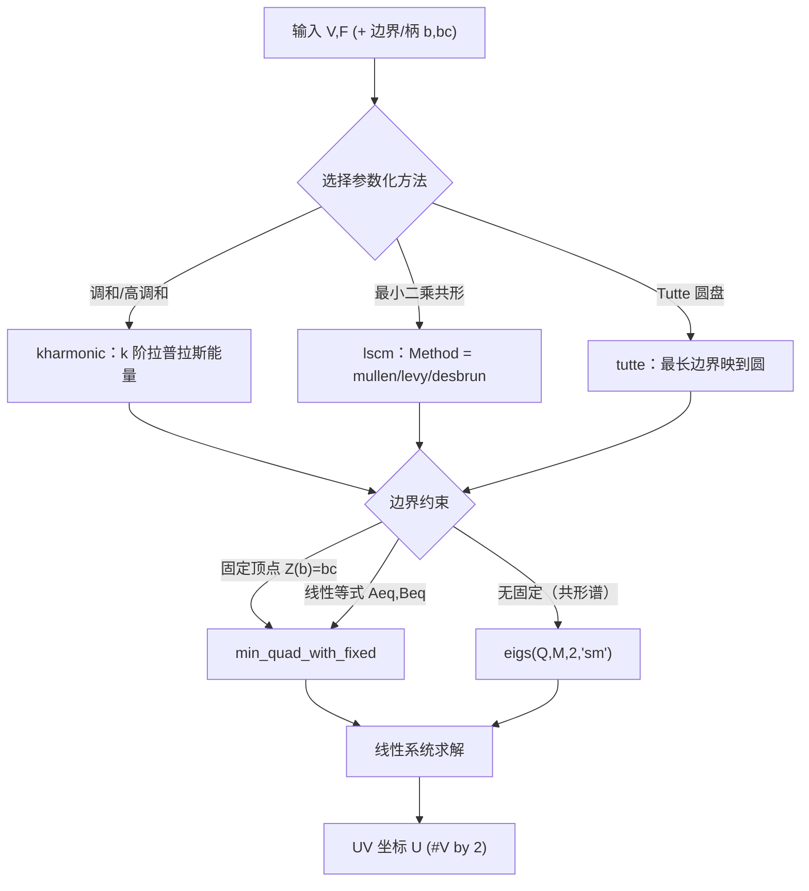

# 10-mesh / 12 参数化与映射 (Parameterization and Mapping)

> 本章覆盖 `mesh/` 下 **30 个与参数化、坐标插值、笼式变形、接缝处理相关的函数**，包括：
> 调和/高调和坐标（`harmonic`/`kharmonic`）、最小二乘共形映射（`lscm`）、Tutte 圆盘映射（`tutte`）、
> 广义重心坐标与权重拉普拉斯（`mvc`/`mean_value_laplacian`/`wachspress_laplacian`/`green_coordinates`/
> `natural_neighbor`/`shepard`/`uninterp`）、复合坐标形变（`composite_mvc`/`composite_harmonic_mapping`）、
> 笼式变形与拉普拉斯编辑（`encage`/`lazy_cage`/`laplacian_mesh_editing`/`laplacian_editing_system`/
> `iterative_laplacian_mesh_editing`）、双调和坐标与嵌入（`biharmonic_coordinates`/`biharmonic_embedding`）、
> 保角曲率流（`conformalized_mean_curvature_flow`/`isometric_curve_flow`）、以及接缝/角展开
> （`greedy_seams`/`straighten_seams`/`unzip_corners`）/`shor_van_wyk`。
>
> This chapter documents **30 functions** under `mesh/` related to parameterization, coordinate
> interpolation, cage deformation and seam processing.

---

## 本章概览 / Chapter overview

### 1. 函数分类表 / Taxonomy

#### (a) 参数化方法 / Parameterization methods

| 函数 (Function) | 能量/构造 (Energy/Construction) | 边界约束 (Boundary) | 求解器 (Solver) | 备注 (Note) |
|---|---|---|---|---|
| `harmonic` | — | — | — | **仅 4 行注释桩，无函数体，指向 `kharmonic`（已核实）** |
| `kharmonic` | k 阶拉普拉斯能量 `W'*Q*W`；`Q=-L`(k=1)、`L*(M\L)`(k=2)、`L*((M\L)^2)`(k=3) | `W(b,:)=bc`（`min_quad_with_fixed`，或 KKT/`ldl` 回退） | `min_quad_with_fixed` / `ldl` | k=1 即调和坐标 |
| `lscm` | 共形能量：`mullen` 用 `Q=-L-2*A`（`L=cotmatrix`，`A=vector_area_matrix`）；`levy` 用梯度块 `Q=[Gx -Gy; Gy Gx]'*TA*[Gx -Gy; Gy Gx]` | `b,bc` 或 `Aeq,Beq` | `min_quad_with_fixed`；无约束时广义特征 `eigs(Q,M,2,'sm')` | 方法由 `'Method'` 选择，默认 `'mullen'` |
| `tutte` | 固定最长边界到圆盘 + 调和映射 | 最长边界顶点映到单位圆（按参数弧长） | `kharmonic(...,1)`，级联回退 | 保证三角形正面积 |

#### (b) 坐标插值 / 广义重心坐标 / Coordinate interpolation & generalized barycentric coordinates

| 函数 (Function) | 概念 (Concept) | 输出 (Output) | 备注 (Note) |
|---|---|---|---|
| `mvc` | 均值坐标（切半角公式）Mean value coordinates | `W` `#V by #P` | 二维；`'EnforceBoundaryConditions'` |
| `composite_mvc` | 复合均值坐标形变 Composite MVC morph | `U` `#V by 2` | 线性多边形插值 + `mvc` 迭代 |
| `mean_value_laplacian` | 均值权重拉普拉斯 Mean value Laplacian | `L` `#V by #V` | 非对称、非半正定 |
| `wachspress_laplacian` | Wachspress 权重拉普拉斯 | `L` `#V by #V` | 行和为 1 |
| `green_coordinates` | Green 坐标 [Lipman et al. 2008] | `phi,psi,N,UN` | `phi*C+psi*N` 复现内部点 |
| `natural_neighbor` | Sibson 自然邻域坐标 | `W` `#V by #C` | 依赖旧式 `DelaunayTri`/`TriScatteredInterp` |
| `shepard` | Shepard 反距离权重（点/骨骼/笼边） | `W` `#V by #handles` | 支持骨骼与 cage edges |
| `uninterp` | 规则网格上的反插值矩阵（双/三线性） | `A` `#V by prod(side)` | 与 `interp2/interp3` 对偶（**非**重心坐标） |

#### (c) 笼式变形与编辑 / Cage deformation & editing

| 函数 (Function) | 作用 (Role) | 关键参数 (Key args) | 备注 (Note) |
|---|---|---|---|
| `encage` | 为笼内点生成四面体网格与边界条件 | `'TetgenFlags'`、`'Quiet'` | 调用 tetgen 二进制（`path_to_tetgen`） |
| `lazy_cage` | 二分偏移生成严格外包笼 | `'GridSize'`、`'MaxIter'`、`'Solid'`、`'DecimationMethod'`、`'MaxOffset'`、`'CMCF'` | 归约为 1D 搜索 |
| `laplacian_mesh_editing` | 拉普拉斯网格编辑（求解位移） | — | 依赖 `laplacian_editing_system` |
| `laplacian_editing_system` | 构造编辑系统 `A`/`rhs`/`pre_rhs` | — | 曲线(2D)与曲面(3D)两分支 |
| `iterative_laplacian_mesh_editing` | 局部-全局迭代编辑 | `'V0'`、`'Tol'`、`'MaxIter'`、`'PreF'` | `min_quad_with_fixed` 预分解复用 |

#### (d) 其他映射 / Other mappings

| 函数 (Function) | 作用 (Role) | 备注 (Note) |
|---|---|---|
| `heat_map` | 生成 blue→white→red→yellow 热力图**色图** | **不是**测地线热方法；热方法见 `heat_geodesic` |
| `biharmonic_coordinates` | 线性精确广义坐标 [Wang et al. 2015] | 基于 Crouzeix–Raviart |
| `biharmonic_embedding` | 双调和谱嵌入 / 双调和距离 | `eigs(L,M,dim+1,'sm')` |
| `texture_coords` | 归一化 (x,y) 到 [0,1] 作 UV | 可翻转 y |
| `relative_coordinates` | 三角形相对坐标 `X,Y` | 用对边及其 90° 旋转为基 |
| `composite_harmonic_mapping` | 复合调和映射（平面双射） | `'OuterIters'`/`'InnerIters'` |
| `conformalized_mean_curvature_flow` | 保角化平均曲率流 (CMCF) | `'MaxIter'`、`'delta'` 等 |
| `isometric_curve_flow` | 平面曲线的等距流 | `'Tao'` 时间步 |

#### (e) 接缝处理 / Seam processing

| 函数 (Function) | 作用 (Role) | 备注 (Note) |
|---|---|---|
| `greedy_seams` | 贪心在不同排列下求最短接缝集合 | 基于 `farthest_points` + `graphshortestpath` |
| `straighten_seams` | 拉直 UV 域中的接缝/边界 | `'Tol'`（RDP 容差） |
| `unzip_corners` | 把每面角属性展开为唯一顶点 | 常用于 OBJ 的 `(F,FTC,FN)` |
| `sct` | `scatter`/`scatter3` 的简写包装 | **与接缝无关**（绘图工具，归类沿原清单） |
| `shor_van_wyk` | Shor–van Wyk 自重叠多边形三角化 | 动态规划表 `Q` |

### 2. 方法选择流程 / Method selection flow



### 3. 依赖的 `matrix/` 函数与 MEX / Dependencies on `matrix/` and MEX

本清单函数通过以下 `matrix/` 求解器与（间接）MEX 实现求解：

| 依赖 (Dependency) | 锚点 (Anchor) | 被本清单哪些函数调用 |
|---|---|---|
| `min_quad_with_fixed` | [matrix/min_quad_with_fixed.m](file:///c:/VSWork/gptoolbox-1/matrix/min_quad_with_fixed.m#L1-L456) | `lscm`, `kharmonic`, `biharmonic_coordinates`, `iterative_laplacian_mesh_editing` |
| `quadprog_box` | [matrix/quadprog_box.m](file:///c:/VSWork/gptoolbox-1/matrix/quadprog_box.m#L1-L90) | 本清单内**无**直接调用（供 box-constrained 求解；见下方说明） |
| `sparse_eigs` | [matrix/sparse_eigs.m](file:///c:/VSWork/gptoolbox-1/matrix/sparse_eigs.m#L1-L407) | 本清单内**无**直接调用（稀疏特征模态；`biharmonic_embedding` 改用 MATLAB `eigs`） |

- **`min_quad_with_fixed`**：签名 `[Z,F,Lambda,Lambda_known] = min_quad_with_fixed(A,B,known,Y,Aeq,Beq,F)`，
  最小化 `Z'*A*Z + Z'*B + C`，约束 `Z(known)=Y`（可选 `Aeq*Z=Beq`）。返回的 `F` 是可复用预分解结构。
- **MEX 依赖**：本清单 30 个函数**均非 MEX stub**（均含 `function` 定义或为注释桩）；
  `encage`/`lazy_cage` 通过外部二进制与库函数间接依赖编译型工具：
  `encage` → tetgen 二进制（`path_to_tetgen`）、`lazy_cage` → `signed_distance_isosurface`（内部可能调用
  `mesh/` 实现；`decimate_libigl` 为 MEX 包装）、`mesh_boolean`、`intersect_other`、`remesh`。
  上述锚点见各条目「依赖」一节。

### 4. 源码与清单的差异（已核实）/ Deviations verified against source

> 以下为阅读源码后确认的、与本任务提示不一致之处，**按源码为准**记录：
>
> 1. `harmonic.m` 确为 **4 行注释桩**（`mesh/harmonic.m#L1-L4`），无函数体，注释指向 `kharmonic`。
> 2. `mvc.m` 的**唯一**可选参数是 `'EnforceBoundaryConditions'`；源码中**不存在** `'Robust'`/`'Solver'` 选项。
> 3. `kharmonic.m` 的可选参数是 `'Condensed'`/`'IntrinsicDelaunay'`；源码中**不存在** `'Data'` 选项
>    （约束通过入参 `b,bc` 传入）。
> 4. `lscm.m` 的可选参数是 `'Method'`；源码中**不存在** `'Pinned'` 选项（固定点由入参 `b,bc` 或 `Aeq,Beq` 指定）。
> 5. `heat_map.m` 是**热力图色图生成器**，与热方法测地线**无关**；热方法测地线实现见
>    [mesh/heat_geodesic.m](file:///c:/VSWork/gptoolbox-1/mesh/heat_geodesic.m#L1-L281)。
> 6. `sct.m` 是 `scatter`/`scatter3` 简写（绘图），与接缝处理无功能关联。
> 7. `iterative_laplacian_mesh_editing.m` 代码默认值为 `max_iterations=100`、`tol=0.001`，
>    与文件头注释所述 `10`/`0.75` **不一致**（以代码为准）。
> 8. `encage.m` 文件头注释称 `'Quiet'` 默认 `false`，但代码中 `quiet = true`（以代码为准）。

---

## 逐函数条目 / Per-function entries

### `lscm` — 最小二乘共形映射 / Least Squares Conformal Mapping
- **文件 / File**: [mesh/lscm.m](file:///c:/VSWork/gptoolbox-1/mesh/lscm.m#L1-L156)
- **签名 / Signature**: `[U,Q] = lscm(V,F,b,bc,Aeq,Beq,varargin)`
- **功能 / Purpose**: `EN: Compute a least-squares conformal (or spectral conformal) planar mapping of a mesh, with optional pinned vertices and linear equality constraints.` / 中文：计算网格的最小二乘共形（或谱共形）平面参数化，支持固定顶点与线性等式约束。
- **输入 / Inputs**:

  | 参数 | 尺寸/类型 | 含义 (中 / EN) |
  |---|---|---|
  | `V` | `#V by dim` | 静态域顶点坐标 / rest-domain positions |
  | `F` | `#F by 3` | 三角形索引 / triangle indices |
  | `b` | `#b` 索引 | 约束（固定）顶点 / pinned/boundary vertex indices |
  | `bc` | `#b by 2` | `b` 的约束位置 / constraint positions |
  | `Aeq` | `#Aeq by 2*#V` | 线性等式约束矩阵（可选，默认 `[]`）/ linear equality constraints |
  | `Beq` | `#Aeq` 向量 | 线性等式约束右端（可选，默认 `[]`）/ equality RHS |

- **输出 / Outputs**:

  | 参数 | 尺寸/类型 | 含义 |
  |---|---|---|
  | `U` | `#V by 2` | 新的平面坐标 / new 2D positions |
  | `Q` | `2*#V by 2*#V` | 二次系数矩阵 / quadratic coefficients matrix |

- **可选参数 / Optional**:

  | 名称 | 取值 | 默认 | 含义 |
  |---|---|---|---|
  | `'Method'` | `'mullen'` \| `'levy'` \| `'desbrun'` | `'mullen'` | 方法：谱共形 / Lévy 最小二乘共形 / Desbrun（**未实现，报错**）|

- **变量流动 / Variable flow**:
  - mullen：`V,F,b,bc → A=vector_area_matrix(F) → L=repdiag(cotmatrix(V,F),2) → Q=-L-2*A → (有 b) min_quad_with_fixed → U`；无 `b` 时 `M=repdiag(massmatrix(V,F),2) → [EV,ED]=eigs(Q,M,2,'sm') → U=EV(:,2)`。
  - levy：`V,F → G=grad(V,F) → Gx,Gy → TA=repdiag(diag(doublearea(V,F))/2,2) → Q=[Gx -Gy;Gy Gx]'*TA*[Gx -Gy;Gy Gx] → min_quad_with_fixed → U`。
- **算法步骤 / Algorithm**:
  1. 解析 `'Method'`，默认 `'mullen'`（L31-L49）；若 `nargin<=4` 置 `Aeq=Beq=[]`（L51-L54）。
  2. 计算 `n,nt,dim`（L57-L61）。
  3. `levy`（L64-L120）：要求 `dim==2`，用 `grad` 构造块梯度，`Q=[Gx -Gy;Gy Gx]'*TA*[Gx -Gy;Gy Gx]`，`min_quad_with_fixed(Q,zeros(2n,1),[b;b+n],bc)`。
  4. `mullen`（L121-L133）：`A=vector_area_matrix(F)`（L122）、`L=repdiag(cotmatrix(V,F),2)`（L123）、`Q=-L-2*A`（L124）；有 `b` 用 `min_quad_with_fixed(Q,zeros(2n,1),[b(:);b(:)+n],bc(:),Aeq,Beq)`（L130），否则求 `eigs(Q,M,2,'sm')` 取第二模态（L127-L128）。
  5. `desbrun`（L134-L152）：**立即 `error('not implemented.')`**（L135）；其余代码为注释/未启用分支。
  6. 结果 `reshape(U,n,2)`（L133）。
- **流程图 / Flowchart**:

  ```mermaid
  flowchart TD
    A["输入 V,F,b,bc,Aeq,Beq"] --> P{"Method"}
    P -- mullen --> M1["A=vector_area_matrix(F)"]
    M1 --> M2["L=repdiag(cotmatrix(V,F),2)"]
    M2 --> M3["Q=-L-2*A"]
    M3 --> Q1{"有 b ?"}
    Q1 -- 是 --> Q2["min_quad_with_fixed(Q,0,[b;b+n],bc,Aeq,Beq)"]
    Q1 -- 否 --> Q3["M=repdiag(massmatrix,2); eigs(Q,M,2,'sm'); U=EV(:,2)"]
    P -- levy --> L1["G=grad(V,F); TA"]
    L1 --> L2["Q=[Gx -Gy;Gy Gx]'*TA*[Gx -Gy;Gy Gx]"]
    L2 --> Q2
    P -- desbrun --> D1["error('not implemented.')"]
    Q2 --> Z["U = reshape(U,n,2)"]
    Q3 --> Z
  ```
- **依赖 / Dependencies**: `vector_area_matrix`, `cotmatrix`, `massmatrix`, `grad`, `doublearea`, `repdiag`, `min_quad_with_fixed`（`matrix/`）
- **See also**: `arap`, `takeo_arap`, `takeo_asap`, `kharmonic`, `tutte`

### `harmonic` — 调和坐标（注释桩，指向 kharmonic）
- **文件 / File**: [mesh/harmonic.m](file:///c:/VSWork/gptoolbox-1/mesh/harmonic.m#L1-L4)
- **签名 / Signature**: （无）— 该文件**不含 `function` 定义**，仅 4 行注释：`% See kharmonic.m`（L1）、`%`（L2）、`% \`harmonic\` was stolen from gptoolbox by matlab's builtin double.harmonic in`（L3）、`% R2014a.`（L4）
- **功能 / Purpose**: `EN: Placeholder comment stub that redirects callers to kharmonic (k=1 harmonic coordinates); no executable code.` / 中文：注释桩，指引调用者改用 `kharmonic`（k=1 即调和坐标）；无任何可执行代码。
- **输入 / Inputs**: 无（文件无函数体）
- **输出 / Outputs**: 无
- **可选参数 / Optional**: 无
- **变量流动 / Variable flow**: `（无）` → 见 `kharmonic` 的变量流动
- **算法步骤 / Algorithm**:
  1. 无可执行算法。**已核实**：文件仅含注释，说明 `harmonic` 已被 MATLAB R2014a 内置的同名机制取代，实际实现迁移至 `kharmonic`。
  2. 需要调和坐标时调用 `kharmonic(V,F,b,bc,1)`。
- **流程图 / Flowchart**:

  ```mermaid
  flowchart TD
    A["harmonic.m (注释桩)"] --> B["提示：See kharmonic.m"]
    B --> C["调用 kharmonic(V,F,b,bc,1)"]
  ```
- **依赖 / Dependencies**: 无（注释桩）
- **See also**: `kharmonic`, `biharmonic_coordinates`, `lscm`

### `kharmonic` — k 阶调和坐标 / k-harmonic coordinates
- **文件 / File**: [mesh/kharmonic.m](file:///c:/VSWork/gptoolbox-1/mesh/kharmonic.m#L1-L152)
- **签名 / Signature**: `[W,L] = kharmonic(V,F,b,bc,k,varargin)`
- **功能 / Purpose**: `EN: Compute k-harmonic coordinates (k-th power of the Laplace operator) with k>2 implemented via mixed finite elements; boundary/handle values are enforced exactly.` / 中文：计算 k 阶调和坐标（拉普拉斯算子的 k 次幂），k>2 用混合有限元实现；边界/柄值精确施加。
- **输入 / Inputs**:

  | 参数 | 尺寸/类型 | 含义 (中 / EN) |
  |---|---|---|
  | `V` | `#V by dim` | 顶点位置（`n==0` 时用于构造组合图拉普拉斯）/ vertex positions |
  | `F` | `#F by 3\|4` | 面/四面体索引 / triangle or tet indices |
  | `b` | `#b` 索引 | 边界（约束）顶点 / boundary vertices |
  | `bc` | `#b by #handles` | 各柄的边界条件 / boundary conditions per handle |
  | `k` | 标量 | 拉普拉斯阶数（`k=1` 即调和），默认 `1` / power of Laplacian |

- **输出 / Outputs**:

  | 参数 | 尺寸/类型 | 含义 |
  |---|---|---|
  | `W` | `#V by #handles` | 权重矩阵 / weight matrix |
  | `L` | `sparse #V by #V` | 所使用的拉普拉斯矩阵 / Laplacian used |

- **可选参数 / Optional**:

  | 名称 | 取值 | 默认 | 含义 |
  |---|---|---|---|
  | `'Condensed'` | `logical` | `true` | 使用静态凝聚（正定、更快）系统，否则用 KKT（对称、更稳）|
  | `'IntrinsicDelaunay'` | `logical` | `false` | 使用内蕴 Delaunay 余切拉普拉斯 |

- **变量流动 / Variable flow**: `V,F → (use_id? intrinsic_delaunay_cotmatrix/massmatrix_intrinsic : cotmatrix/massmatrix) → L,M →(M 按 max|diag| 归一化)→ (condensed: 按 k 构造 Q) → min_quad_with_fixed(Q,0,b,bc) → W`；非凝聚分支：`a=[b;u] → 块矩阵 Q(反块对角 L、M) → ldl 分解 → Wsol → W`。
- **算法步骤 / Algorithm**:
  1. 未给 `k` 则 `k=1`（L35-L38）；解析 `'Condensed'`/`'IntrinsicDelaunay'`（L44-L58）。
  2. 取 `n=size(V,1)`、`m=size(bc,2)`（L61-L63）。
  3. 构造 `L,M`：`n==0` 用 `adjacency_matrix` 组合拉普拉斯（L66-L70）；否则 `cotmatrix`/`massmatrix`（L76-L77）或内蕴 Delaunay 版（L72-L75）；`M` 除以 `max(abs(diag(M)))` 归一化（L80）。
  4. **condensed**（L83-L101）：按 k 构造 `Q`：`k=1 → Q=-L`；`k=2 → Q=L*(M\L)`；`k=3 → Q=L*((M\L)*(M\L))` 后对称化；一般 `Q = Q*(M\-L)` 循环 k-1 次；再 `min_quad_with_fixed(Q,zeros(n,1),b,bc)`。
  5. **非 condensed（KKT）**（L102-L145）：构造反块对角 `L` 与次对角 `M` 的大矩阵，消去 `b` 行列，得 `Q,B`；用 `ldl` 分解后回代得 `Wsol`；写回 `W(b,:)=bc`、`W(u,:)=Wsol(1:|u|,:)`。
  6. 末尾注释给出基于 `quadprog` 的等价形式（L148-L151，未启用）。
- **流程图 / Flowchart**:

  ```mermaid
  flowchart TD
    A["输入 V,F,b,bc,k"] --> B{"n==0 ?"}
    B -- 是 --> B1["L=组合拉普拉斯; M=I"]
    B -- 否 --> B2{"IntrinsicDelaunay ?"}
    B2 -- 是 --> B3["intrinsic_delaunay_cotmatrix + massmatrix_intrinsic"]
    B2 -- 否 --> B4["L=cotmatrix; M=massmatrix"]
    B1 --> N["M 归一化"]
    B3 --> N
    B4 --> N
    N --> C{"Condensed ?"}
    C -- 是 --> C1["按 k 构造 Q (k=1:-L; 2:L*(M\\L); 3:对称化)"]
    C1 --> C2["min_quad_with_fixed(Q,0,b,bc)"]
    C -- 否 --> C3["KKT 块矩阵 Q,B -> ldl -> 回代"]
    C2 --> Z["W (#V by #handles)"]
    C3 --> Z
  ```
- **依赖 / Dependencies**: `cotmatrix`, `massmatrix`, `intrinsic_delaunay_cotmatrix`, `massmatrix_intrinsic`, `adjacency_matrix`, `min_quad_with_fixed`（`matrix/`）；MATLAB `ldl`
- **See also**: `harmonic`, `biharmonic_bounded`, `boundary_conditions`, `tutte`, `composite_harmonic_mapping`

### `tutte` — Tutte 圆盘映射（保证正面积）
- **文件 / File**: [mesh/tutte.m](file:///c:/VSWork/gptoolbox-1/mesh/tutte.m#L1-L65)
- **签名 / Signature**: `U = tutte(V,F)`
- **功能 / Purpose**: `EN: Find the longest boundary, fill all other boundaries, and compute a planar mapping so that all triangles have positive signed area (Tutte embedding to a disk).` / 中文：找出最长边界、填补其余边界，并计算一个使所有三角形带符号面积为正的平面映射（Tutte 圆盘嵌入）。
- **输入 / Inputs**:

  | 参数 | 尺寸/类型 | 含义 (中 / EN) |
  |---|---|---|
  | `V` | `#V by dim` | 输入顶点位置 / input vertex positions |
  | `F` | `#F by 3` | 三角形索引 / triangle indices |

- **输出 / Outputs**:

  | 参数 | 尺寸/类型 | 含义 |
  |---|---|---|
  | `U` | `#V by 2` | 二维输出坐标 / 2D output positions |

- **可选参数 / Optional**: 无（无 `varargin`）
- **变量流动 / Variable flow**: `V,F → [O,J]=boundary_faces(F) → l=edge_lengths(V,O) → conncomp(第 C 个连通分量) → 最长边界 longest → fill_holes 补洞 FHF → b=graphtraverse(...) → D=归一化弧长 → bc=圆上点×sqrt(total_area/pi) → kharmonic(V,FHF,b,bc,1) → U`。
- **算法步骤 / Algorithm**:
  1. `[O,J]=boundary_faces(F)` 取边界半边，`l=edge_lengths(V,O)`（L15-L16）。
  2. `conncomp(facet_adjacency_matrix(O))` 求边界连通分量 `C`，按 `accumarray(C',l)` 求各分量总长，取最长 `longest`（L18-L20）。
  3. `fill_holes(V,F,'Skip',<最长边界起点>)` 填补其它洞，得 `FHF=[F;HF]`（L22-L23）；仅保留最长边界 `O=O(C==longest,:)`（L25）。
  4. `b=graphtraverse(adjacency_matrix(O),O(1))` 得到沿边界有序顶点（L27）。
  5. 沿边界累计弦长得到归一化参数距离 `D`（L28-L30）；圆上点 `bc=[cos(2πD) sin(2πD)]`（L32）。
  6. 按面积匹配缩放：`total_area=sum(doublearea(V,F))*0.5`；`bc=bc*sqrt(total_area/pi)`（L52-L53）。
  7. **级联回退**：先 `U=kharmonic(V,FHF,b,bc,1)`（L56）；若仍有负面积，改用 `'IntrinsicDelaunay',true`（L59）；仍失败则 `kharmonic([],FHF,b,bc,1)`（组合拉普拉斯，L62）；最后 `assert(min(doublearea(U,F))>0)`（L64）。
- **流程图 / Flowchart**:

  ```mermaid
  flowchart TD
    A["输入 V,F"] --> B["O=boundary_faces(F); l=edge_lengths"]
    B --> C["conncomp 边界分量 -> 最长边界 longest"]
    C --> D["fill_holes 补其他洞 -> FHF"]
    D --> E["b=graphtraverse(边界)"]
    E --> F["D=归一化弧长; bc=圆上点*sqrt(area/pi)"]
    F --> G["U=kharmonic(V,FHF,b,bc,1)"]
    G --> H{"min(doublearea(U,F))<0 ?"}
    H -- 是 --> I["kharmonic(...,'IntrinsicDelaunay',true)"]
    I --> J{"仍 <0 ?"}
    J -- 是 --> K["kharmonic([],FHF,b,bc,1)"]
    H -- 否 --> Z["U 输出"]
    I --> Z
    K --> Z
  ```
- **依赖 / Dependencies**: `boundary_faces`, `edge_lengths`, `facet_adjacency_matrix`, `fill_holes`, `adjacency_matrix`, `graphtraverse`, `doublearea`, `kharmonic`
- **See also**: `kharmonic`, `harmonic`, `lscm`, `map_points_to_circle`

### `mvc` — 均值坐标 / Mean value coordinates
- **文件 / File**: [mesh/mvc.m](file:///c:/VSWork/gptoolbox-1/mesh/mvc.m#L1-L74)
- **签名 / Signature**: `[W,TA] = mvc(V,P,E,varargin)`
- **功能 / Purpose**: `EN: Compute mean value coordinates for 2D query points V with respect to a polygon given by corner positions P and oriented edges E.` / 中文：对二维查询点 `V` 计算关于多边形（角点 `P`、有向边 `E`）的均值坐标。
- **输入 / Inputs**:

  | 参数 | 尺寸/类型 | 含义 (中 / EN) |
  |---|---|---|
  | `V` | `#V by 2` | 查询点 / query points |
  | `P` | `#P by 2` | 角点位置 / corner positions |
  | `E` | `#E by 2` | 指向 `P` 的有向边索引 / oriented edge indices into P |

- **输出 / Outputs**:

  | 参数 | 尺寸/类型 | 含义 |
  |---|---|---|
  | `W` | `#V by #P` | 均值坐标权重 / mean value weights |
  | `TA` | `#V by #E` | 各边切半角 `tan(α/2)` / tangent half-angle per edge |

- **可选参数 / Optional**:

  | 名称 | 取值 | 默认 | 含义 |
  |---|---|---|---|
  | `'EnforceBoundaryConditions'` | `logical` | `true` | 对落在控制段上/附近的查询点做特殊处理（较慢）|

- **变量流动 / Variable flow**: `V,P,E → VP1,VP2=bsxfun(@minus,...) → R=sqrt(VP1^2+VP2^2) → TA=tan(atan2(叉积,点积)/2) → W 累加到 E(:,1)、E(:,2) → W=W./R → W=W./sum(W,2) → (可选) W(b,:)=bc`。
- **算法步骤 / Algorithm**:
  1. 解析 `'EnforceBoundaryConditions'`，默认 `true`（L21-L38）。
  2. 断言 `V` 与 `P` 同维且为 2D（L40-L41）。
  3. 避免 3D 大数组，分别求 `VP1=P(:,1)'-V(:,1)`、`VP2=P(:,2)'-V(:,2)`、`R=sqrt(VP1.^2+VP2.^2)`（L46-L48）。
  4. 用 `atan2(叉积, 点积)/2` 取半角再 `tan`，得每条边相对每个查询点的 `TA`（更精确的切半角公式，L59-L62）。
  5. 将 `TA` 累加到各边两个端点列 `W(:,E(:,1))`、`W(:,E(:,2))`（L64-L65）。
  6. `W=W./R` 后按行归一化 `W=W./sum(W,2)`（L66-L67）。
  7. 若启用边界条件：`[b,bc]=boundary_conditions(V,[],P,1:size(P,1),[],E)`，令 `W(b,:)=bc`（L68-L71）。
- **流程图 / Flowchart**:

  ```mermaid
  flowchart TD
    A["输入 V,P,E"] --> B["VP1,VP2; R=sqrt(VP1^2+VP2^2)"]
    B --> C["TA=tan(atan2(叉积,点积)/2)"]
    C --> D["W 累加至 E(:,1),E(:,2)"]
    D --> E["W=W./R; W 按行归一化"]
    E --> F{"EnforceBoundaryConditions ?"}
    F -- 是 --> G["boundary_conditions -> W(b,:)=bc"]
    F -- 否 --> Z["输出 W,TA"]
    G --> Z
  ```
- **依赖 / Dependencies**: `boundary_conditions`
- **See also**: `composite_mvc`, `mean_value_laplacian`, `barycentric_coordinates`, `green_coordinates`

### `composite_mvc` — 复合均值坐标形变 / Composite mean value mapping
- **文件 / File**: [mesh/composite_mvc.m](file:///c:/VSWork/gptoolbox-1/mesh/composite_mvc.m#L1-L62)
- **签名 / Signature**: `U = composite_mvc(V,P0,E,P1,varargin)`
- **功能 / Purpose**: `EN: Simplified implementation of "Bijective Composite Mean Value Mappings", where the polygon morph is a uniform linear interpolation from P0 to P1.` / 中文：简化实现「双射复合均值坐标映射」：多边形的形变为从 `P0` 到 `P1` 的均匀线性插值。
- **输入 / Inputs**:

  | 参数 | 尺寸/类型 | 含义 (中 / EN) |
  |---|---|---|
  | `V` | `#V by 2` | 待跟踪的点 / points to be tracked |
  | `P0` | `#P by 2` | `t=0` 时角点位置 / corners at t=0 |
  | `E` | `#E by 2` | 指向 `P0/P1` 的有向边索引 / oriented edge indices |
  | `P1` | `#P by 2` | `t=1` 时角点位置 / corners at t=1 |

- **输出 / Outputs**:

  | 参数 | 尺寸/类型 | 含义 |
  |---|---|---|
  | `U` | `#V by 2` | 输出点位置 / output positions |

- **可选参数 / Optional**:

  | 名称 | 取值 | 默认 | 含义 |
  |---|---|---|---|
  | `'OuterIters'` | 正整数 | `20` | 形变迭代次数 / number of morph iterations |

- **变量流动 / Variable flow**: `V,P0,E,P1 → lerp_bc=@(t)P0+t.*(P1-P0) → U=V → 循环: W=mvc(U,bc_t,E,'EnforceBoundaryConditions',false) → bc_t=lerp_bc(t) → U=W*bc_t`。
- **算法步骤 / Algorithm**:
  1. 解析 `'OuterIters'`，默认 `20`（L28-L45）。
  2. 定义线性插值角点 `lerp_bc(t)=P0+t.*(P1-P0)`（L49-L50）。
  3. 初始化 `U=V`、`bc_t=lerp_bc(0)`（L52-L53）。
  4. 对 `outer_iter=1..outer_iters`：`t=outer_iter/outer_iters`（L55）；`W=mvc(U,bc_t,E,'EnforceBoundaryConditions',false)`（L56，**关闭**边界条件以加速）；`bc_t=lerp_bc(t)`（L58）；`U=W*bc_t`（L60）。
- **流程图 / Flowchart**:

  ```mermaid
  flowchart TD
    A["输入 V,P0,E,P1"] --> B["lerp_bc(t)=P0+t(P1-P0); U=V; bc_t=lerp_bc(0)"]
    B --> C{"outer_iter <= OuterIters ?"}
    C -- 是 --> D["t=outer_iter/OuterIters"]
    D --> E["W=mvc(U,bc_t,E,'EnforceBoundaryConditions',false)"]
    E --> F["bc_t=lerp_bc(t); U=W*bc_t"]
    F -->|"下一轮"| C
    C -- 否 --> Z["输出 U"]
  ```
- **依赖 / Dependencies**: `mvc`
- **See also**: `mvc`, `composite_harmonic_mapping`, `straighten_seams`

### `mean_value_laplacian` — 均值权重拉普拉斯 / Mean value Laplacian
- **文件 / File**: [mesh/mean_value_laplacian.m](file:///c:/VSWork/gptoolbox-1/mesh/mean_value_laplacian.m#L1-L86)
- **签名 / Signature**: `L = mean_value_laplacian(V,F)`
- **功能 / Purpose**: `EN: Discrete Laplacian built from mean value weights (non-symmetric, not positive semi-definite).` / 中文：以均值权重构造的离散拉普拉斯（非对称、非半正定）。
- **输入 / Inputs**:

  | 参数 | 尺寸/类型 | 含义 (中 / EN) |
  |---|---|---|
  | `V` | `#V by dim` | 顶点坐标 / vertex coordinates |
  | `F` | `#F by 3` | 三角形角索引 / triangle corner indices |

- **输出 / Outputs**:

  | 参数 | 尺寸/类型 | 含义 |
  |---|---|---|
  | `L` | `sparse #V by #V` | 均值权重拉普拉斯 / mean value weight Laplacian |

- **可选参数 / Optional**: 无
- **变量流动 / Variable flow**: `V,F → l(按对角顶点编号的边长) → s(半周长) → dblA(Heron) → halftan12/23/31 → Li,Lj,Lv → L=sparse → L=L-diag(sum(L,2))`。
- **算法步骤 / Algorithm**:
  1. `n=size(V,1)`（L16）。
  2. 计算按对角顶点编号的边长 `l(:,1)=|v2-v3|`、`l(:,2)=|v3-v1|`、`l(:,3)=|v1-v2|`（L19-L23）。
  3. 若 `F` 为 `3 by #F` 给警告（L26-L28）。
  4. 半周长 `s=(l1+l2+l3)*0.5`，Heron 面积 `dblA=2*sqrt(s(s-l1)(s-l2)(s-l3))`（L52-L54）。
  5. 由 `tan(θ/2)=sinθ/(1+cosθ)` 推得 `halftan12/23/31`（L55-L57）。
  6. 将每个角摊到对应边：`Li,Lj` 组合六项，`Lv = halftan/(边长)`（L60-L75）。
  7. 组装 `L=sparse(Li,Lj,Lv,n,n)`；置对角 `L=L-diag(sum(L,2))`（L81-L85）。
- **流程图 / Flowchart**:

  ```mermaid
  flowchart TD
    A["输入 V,F"] --> B["l=按对角顶点编号的边长"]
    B --> C["s=半周长; dblA=Heron 面积"]
    C --> D["halftan12/23/31"]
    D --> E["Li,Lj,Lv -> L=sparse(Li,Lj,Lv,n,n)"]
    E --> F["L=L-diag(sum(L,2))"]
    F --> Z["输出 L"]
  ```
- **依赖 / Dependencies**: 无（纯 `.m`，自行组装 `sparse`）
- **See also**: `cotmatrix`, `wachspress_laplacian`, `mvc`

### `wachspress_laplacian` — Wachspress 权重拉普拉斯 / Wachspress Laplacian
- **文件 / File**: [mesh/wachspress_laplacian.m](file:///c:/VSWork/gptoolbox-1/mesh/wachspress_laplacian.m#L1-L54)
- **签名 / Signature**: `L = wachspress_laplacian(V,F)`
- **功能 / Purpose**: `EN: Discrete Laplacian using Wachspress weights (element matrix E_ij = (v_i·v_j)/(4A)).` / 中文：使用 Wachspress 权重的离散拉普拉斯（单元矩阵 `E_ij=(v_i·v_j)/(4A)`）。
- **输入 / Inputs**:

  | 参数 | 尺寸/类型 | 含义 (中 / EN) |
  |---|---|---|
  | `V` | `#V by dim` | 顶点坐标 / vertex coordinates |
  | `F` | `#F by 3` | 三角形角索引 / triangle corner indices |

- **输出 / Outputs**:

  | 参数 | 尺寸/类型 | 含义 |
  |---|---|---|
  | `L` | `sparse #V by #V` | Wachspress 权重矩阵 / Wachspress weight matrix |

- **可选参数 / Optional**: 无
- **变量流动 / Variable flow**: `V,F → l(按对角顶点编号的边长) → s,dblA(Heron) → cot12/cot23/cot31(除以边长平方) → diag1/2/3 → i,j,v → L=sparse(i,j,v,n,n)`。
- **算法步骤 / Algorithm**:
  1. `n=size(V,1)`；边长 `l` 同 `mean_value_laplacian`（L18-L25）。
  2. 半周长 `s`、Heron 面积 `dblA`（L31-L33）。
  3. 余切后再除以对边长平方：`cot12=((l1^2+l2^2-l3^2)/dblA/4)/(l3^2)`，`cot23`、`cot31` 同（L37-L39）。
  4. 由「行和为 1」条件计算对角项：`diag1=-cot12-cot31`、`diag2=-cot12-cot23`、`diag3=-cot31-cot23`（L42-L44）。
  5. 组装索引 `i,j` 与值 `v`，`L=sparse(i,j,v,n,n)`（重复项自动求和，L46-L51）。
- **流程图 / Flowchart**:

  ```mermaid
  flowchart TD
    A["输入 V,F"] --> B["l=按对角顶点编号的边长"]
    B --> C["s,dblA(Heron)"]
    C --> D["cot12/cot23/cot31 = cot/边长^2"]
    D --> E["diag1/2/3 由行和为 1 得"]
    E --> F["L=sparse(i,j,v,n,n)"]
    F --> Z["输出 L"]
  ```
- **依赖 / Dependencies**: 无（纯 `.m`）
- **See also**: `cotmatrix`, `cotmatrix_intrinsic`, `mean_value_laplacian`

### `green_coordinates` — Green 坐标 / Green coordinates
- **文件 / File**: [mesh/green_coordinates.m](file:///c:/VSWork/gptoolbox-1/mesh/green_coordinates.m#L1-L98)
- **签名 / Signature**: `[phi,psi,N,UN] = green_coordinates(C,E,eta)`
- **功能 / Purpose**: `EN: Compute Green coordinates at evaluation points eta with respect to a cage (C,E); phi*C+psi*N reproduces interior points exactly.` / 中文：计算评估点 `eta` 关于笼 `(C,E)` 的 Green 坐标；`phi*C+psi*N` 可精确复现笼内点。
- **输入 / Inputs**:

  | 参数 | 尺寸/类型 | 含义 (中 / EN) |
  |---|---|---|
  | `C` | `#C by dim` | 笼顶点 / cage vertices |
  | `E` | `#E by dim` | 笼面/边索引（指向 `C`）/ cage facet indices |
  | `eta` | `#eta by dim` | 评估点 / evaluation points |

- **输出 / Outputs**:

  | 参数 | 尺寸/类型 | 含义 |
  |---|---|---|
  | `phi` | `#eta by #C` | phi 坐标 / phi coordinates |
  | `psi` | `#eta by #E` | psi 坐标 / psi coordinates |
  | `N` | `#E by dim` | 单位面法向 / unit facet normals |
  | `UN` | `#E by dim` | 未归一化面法向 / unnormalized facet normals |

- **可选参数 / Optional**: 无
- **变量流动 / Variable flow**: `C,E,eta → A,B,Q,S,R → UN,N(法向) → BA,X,SRT,L0,L1,A0,A1 → PHI1,PHI2(边/线/顶点修正) → phi=sparse(...)`；`→ psi=...(A10,L10,...) → 边/端点修正 → psi`。
- **算法步骤 / Algorithm**:
  1. 依 [Lipman et al. 2008] 算法 1：定义 `A=C(E2)-C(E1)`、`B=C(E1)-eta`、`Q=sum(A.^2)`、`S=sum(B.^2)`、`R=2*sum(A.*B)`（L24-L30）。
  2. 面法向 `UN=A*[0 -1;1 0]`，`N=normalizerow(UN)`，`Anorm=normrow(A)`，`BA=sum(B.*(Anorm.*N))`（L32-L35）。
  3. 计算 `X=max(4*S.*Q - R^2,0)`、`SRT=sqrt(X)`、对数与 `atan2` 项 `L0,L1,A0,A1`（L36-L43）。
  4. 得 `PHI2`、`PHI1`（含 `BA/(2π)` 因子，L45-L52）。
  5. 逐边修正：`project_to_lines` 判点是否落在线段/延长线上，线段上取 `-0.5(1-t)`/`-0.5t`，延长线取 0（L54-L62）。
  6. 组装 `phi=-sparse(phiI,phiJ,phiV,...)`；对落在顶点上的点用转角 α 修正 `(pi-alpha)/(2π)+0.5`（L63-L75）。
  7. 计算 `psi`（L79-L83），再逐边修正边内点的 `psi`（含 `log` 解析式），端点情形单独处理（L85-L96）。
- **流程图 / Flowchart**:

  ```mermaid
  flowchart TD
    A["输入 C,E,eta"] --> B["A,B,Q,S,R"]
    B --> C["UN,N,Anorm,BA"]
    C --> D["X,SRT,L0,L1,A0,A1 -> PHI1,PHI2"]
    D --> E["逐边: project_to_lines 修正 PHI(on_edge/on_line)"]
    E --> F["phi=sparse(...); 顶点处 α 修正"]
    F --> G["psi 计算 + 边/端点修正"]
    G --> Z["输出 phi,psi,N,UN"]
  ```
- **依赖 / Dependencies**: `normalizerow`, `normrow`, `project_to_lines`, `pdist2`, MATLAB `sparse`
- **See also**: `mvc`, `mean_value_laplacian`, `bounds_from_cage`

### `biharmonic_coordinates` — 线性精确广义坐标（Wang 2015）/ Biharmonic coordinates
- **文件 / File**: [mesh/biharmonic_coordinates.m](file:///c:/VSWork/gptoolbox-1/mesh/biharmonic_coordinates.m#L1-L84)
- **签名 / Signature**: `[W,A,K,M,L,N] = biharmonic_coordinates(V,Ele,b,varargin)`
- **功能 / Purpose**: `EN: Compute the linearly precise generalized coordinates of "Linear Subspace Design for Real-Time Shape Deformation" [Wang et al. 2015] (biharmonic energy via Crouzeix–Raviart, not the bounded-biharmonic weights).` / 中文：计算 [Wang et al. 2015] 的线性精确广义坐标（基于 Crouzeix–Raviart 的双调和能量，**非** bounded biharmonic weights）。
- **输入 / Inputs**:

  | 参数 | 尺寸/类型 | 含义 (中 / EN) |
  |---|---|---|
  | `V` | `#V by dim` | 顶点位置 / vertex positions |
  | `Ele` | `#Ele by dim+1` | 单纯形（三角形/四面体）索引 / simplicial element indices |
  | `b` | `#b` 索引 | 控制点 / control point indices |

- **输出 / Outputs**:

  | 参数 | 尺寸/类型 | 含义 |
  |---|---|---|
  | `W` | `#V by #b` | 坐标 / coordinates |
  | `A` | `#V by #V` | 二次系数矩阵 / quadratic coefficients |
  | `K` | `#V by #V` | `K=L+N`（Laplacian + 边界法向导数）/ combined operator |
  | `M` | `mass` | 质量矩阵 / mass matrix |
  | `L` | `#V by #V` | 余切拉普拉斯 / cotangent Laplacian |
  | `N` | `#V by #V` | 法向导数项 / normal-derivative term |

- **可选参数 / Optional**:

  | 名称 | 取值 | 默认 | 含义 |
  |---|---|---|---|
  | `'PaperVersion'` | `logical` | `false` | 使用论文原版构造（`K'*(M\K)`），否则用 Crouzeix–Raviart |

- **变量流动 / Variable flow**: `V,Ele → (三角形时) find_ears 检查 → (PaperVersion?) L=cotmatrix; [DD,TE]=normal_derivative; N=0.5*AT*DD; K=L+N; M=massmatrix; A=K'*(M\K)`；否则 `[Mcr,E,EMAP]=crouzeix_raviart_massmatrix; Lcr=crouzeix_raviart_cotmatrix; ... Le=Lcr*(De\Ad); A=Le'*(iMcr*Le)`；最后 `bc=eye(numel(b)); W=min_quad_with_fixed(A,[],b,bc)`。
- **算法步骤 / Algorithm**:
  1. 若 `Ele` 为三角形，断言 `isempty(find_ears(Ele))`（无耳，否则需先 `flip_ears`）（L23-L26）。
  2. 解析 `'PaperVersion'`，默认 `false`（L29-L47）。
  3. **论文版**（L50-L62）：`L=cotmatrix`；`[DD,TE]=normal_derivative`；构造 `AT`；`on_boundary` 取边界，`DD(~C,:)=0`；`N=0.5*AT*DD`；`K=L+N`；`M=massmatrix`；`A=K'*(M\K)`。
  4. **默认版（Crouzeix–Raviart）**（L63-L76）：`[Mcr,E,EMAP]=crouzeix_raviart_massmatrix`、`Lcr=crouzeix_raviart_cotmatrix`；边-顶点关联 `Ad`；`De=diag(sum(Ad,2))`；`iMcr=diag(1./diag(Mcr))` 并置零边界边 `iMcr(EMAP(C),EMAP(C))=0`；`Le=Lcr*(De\Ad)`；`A=Le'*(iMcr*Le)`。
  5. 若给了 `b`：`bc=eye(numel(b))`，`W=min_quad_with_fixed(A,[],b,bc)`（每个控制点为指示函数）；否则 `W=[]`（L78-L83）。
- **流程图 / Flowchart**:

  ```mermaid
  flowchart TD
    A["输入 V,Ele,b"] --> B{"Ele 为三角形?"}
    B -- 是 --> B1["断言 find_ears 为空"]
    B -- 否 --> C{"PaperVersion ?"}
    B1 --> C
    C -- 是 --> D1["L=cotmatrix; [DD,TE]=normal_derivative; N=0.5*AT*DD; K=L+N; M=massmatrix; A=K'*(M\\K)"]
    C -- 否 --> D2["Mcr,Lcr=Crouzeix-Raviart; Le=Lcr*(De\\Ad); A=Le'*(iMcr*Le)"]
    D1 --> E{"有 b ?"}
    D2 --> E
    E -- 是 --> F["W=min_quad_with_fixed(A,[],b,eye(#b))"]
    E -- 否 --> G["W=[]"]
    F --> Z["输出 W,A,K,M,L,N"]
    G --> Z
  ```
- **依赖 / Dependencies**: `cotmatrix`, `massmatrix`, `normal_derivative`, `on_boundary`, `crouzeix_raviart_cotmatrix`, `crouzeix_raviart_massmatrix`, `find_ears`, `min_quad_with_fixed`（`matrix/`）
- **See also**: `biharmonic_bounded`, `monotonic_biharmonic`, `kharmonic`, `biharmonic_embedding`

### `biharmonic_embedding` — 双调和谱嵌入 / Biharmonic embedding
- **文件 / File**: [mesh/biharmonic_embedding.m](file:///c:/VSWork/gptoolbox-1/mesh/biharmonic_embedding.m#L1-L58)
- **签名 / Signature**: `[B,EV,ED] = biharmonic_embedding(V,F,dim,p)`
- **功能 / Purpose**: `EN: Build an embedding from the spectrum of the biharmonic operator so that biharmonic distance between vertices equals Euclidean distance between rows of B.` / 中文：用双调和算子的谱构造嵌入，使顶点间的双调和距离等于 `B` 各行间的欧氏距离。
- **输入 / Inputs**:

  | 参数 | 尺寸/类型 | 含义 (中 / EN) |
  |---|---|---|
  | `V` | `#V by dim` | 顶点列表 / vertex list |
  | `F` | `#F by 3` | 面列表 / face list |
  | `dim` | 标量 | 嵌入维度（可选，默认 `4`）/ requested embedding dimension |
  | `p` | 标量 | 特征值上的指数（可选，默认 `2`）/ exponent |

- **输出 / Outputs**:

  | 参数 | 尺寸/类型 | 含义 |
  |---|---|---|
  | `B` | `#V by dim` | 双调和嵌入坐标 / biharmonic embedding |
  | `EV` | `#V by dim` | 使用的特征向量 / eigenvectors |
  | `ED` | `dim by dim` | 使用的特征值 / eigenvalues |

- **可选参数 / Optional**（以位置参数给出，非 `Name,Value`）:

  | 名称 | 取值 | 默认 | 含义 |
  |---|---|---|---|
  | `dim` | 正整数 | `4` | 嵌入维度 |
  | `p` | 标量 | `2` | 指数：`0.5` 半调和、`1` 通勤时间/调和、`2` 双调和、`3` 三调和 |

- **变量流动 / Variable flow**: `V,F → L=cotmatrix(V,F) → M=massmatrix(V,F,'barycentric') → [EV,ED]=eigs(L,M,dim+1,'sm') → 去掉第一列/行 → B=EV*(inv(abs(ED))^(p/2))`。
- **算法步骤 / Algorithm**:
  1. 未给 `dim` 则 `dim=4`（L27-L29）；未给 `p` 则 `p=2`（L31-L33）。
  2. `L=cotmatrix(V,F)`（L36）；`M=massmatrix(V,F,'barycentric')`（L39，注释说明 Yaron 用重心质量）。
  3. 取 `dim+1` 个最小幅值特征对：`[EV,ED]=eigs(L,M,dim+1,'sm')`（L42）；丢弃第一列/行（对应零特征值）：`EV=EV(:,2:end)`、`ED=ED(2:end,2:end)`（L43-L44）。
  4. 除以特征值幂（`p/2`，因距离公式中平方在外）：`B=EV*(inv(abs(ED))^(p/2))`（L57）。
- **流程图 / Flowchart**:

  ```mermaid
  flowchart TD
    A["输入 V,F,dim,p"] --> B["dim 默认 4; p 默认 2"]
    B --> C["L=cotmatrix; M=massmatrix(...,'barycentric')"]
    C --> D["[EV,ED]=eigs(L,M,dim+1,'sm')"]
    D --> E["丢弃第 1 列/行 (零特征值)"]
    E --> F["B=EV*(inv(abs(ED))^(p/2))"]
    F --> Z["输出 B,EV,ED"]
  ```
- **依赖 / Dependencies**: `cotmatrix`, `massmatrix`；MATLAB `eigs`
- **See also**: `biharmonic_coordinates`, `heat_geodesic`, `shepard`, `embedding`

### `encage` — 笼内网格生成与边界条件 / Embed mesh in a cage
- **文件 / File**: [mesh/encage.m](file:///c:/VSWork/gptoolbox-1/mesh/encage.m#L1-L135)
- **签名 / Signature**: `[DV,DT,DF,b,bc] = encage(V,CV,CF,varargin)`
- **功能 / Purpose**: `EN: Create a tetrahedral mesh inside a polyhedron cage (CV,CF) via tetgen and compute boundary conditions for computing weights on points V embedded in it.` / 中文：用 tetgen 在多面体笼 `(CV,CF)` 内生成四面体网格，并为嵌入其中的点 `V` 计算权重所需的边界条件。
- **输入 / Inputs**:

  | 参数 | 尺寸/类型 | 含义 (中 / EN) |
  |---|---|---|
  | `V` | `#V by dim` | 待嵌入点位置 / vertex positions |
  | `CV` | `#CV by dim` | 笼顶点位置 / cage vertex positions |
  | `CF` | `#CF by dim` | 笼面索引（指向 `CV`）/ cage face indices |

- **输出 / Outputs**:

  | 参数 | 尺寸/类型 | 含义 |
  |---|---|---|
  | `DV` | `#DV by dim` | 四面体网格顶点位置 / tet-mesh positions |
  | `DT` | `#DT by dim+1` | 四面体索引（指向 `DV`）/ tet indices |
  | `DF` | `#DF by dim` | 四面体网格边界面索引 / boundary facets |
  | `b` | `#b` 索引 | `V` 中边界顶点索引 / boundary vertex indices |
  | `bc` | `#b by #CV` | 边界条件（重心坐标）/ boundary conditions |

- **可选参数 / Optional**:

  | 名称 | 取值 | 默认 | 含义 |
  |---|---|---|---|
  | `'TetgenFlags'` | 字符串 | `'-q100'` | tetgen 质量标志 / tetgen flags |
  | `'Quiet'` | `logical` | `false`（注释）/**代码为 `true`** | 是否让 tetgen 静默 / quiet |

- **变量流动 / Variable flow**: `V,CV,CF → writePOLY_tetgen([CV;V],CF,...,'BoundaryMarkers',1:#CF) → system(tetgen '-p' flags poly) → readNODE/readELE/readFACE → DV,DT,DF,BF → B2CF → b=唯一顶点 → bc=barycentric_coordinates(...) (三角形笼) → DF=fliplr(DF)`。
- **算法步骤 / Algorithm**:
  1. `tetgen_flags='-q100'`、`quiet=true`（**代码默认值**；文件头注释写 `false`，L23-L24）；解析选项（L26-L41）。
  2. `quiet` 时把日志写 `/dev/null`（非 Windows 时返回），否则 `fid=1`（L43-L47）。
  3. `writePOLY_tetgen(poly_filename,[CV;V],CF,[],'BoundaryMarkers',(1:size(CF,1))')`（L49-L51）。
  4. 组装命令 `[path_to_tetgen ' -p ' tetgen_flags ' ' poly_filename]` 并 `system(...)` 执行；按返回码给出针对性错误（3 自交、4 小特征、5/6 需 `-Y`、134 非平面）（L53-L88）。
  5. 删除 `.poly`；读 `readNODE/readELE/readFACE` 得 `DV,DT,DF,BF`（L91-L101）。
  6. 构造 `B2CF=[DF(:) repmat(BF,...)]` 并 `unique` 每顶点保留一个匹配，`b=B2CF(:,1)`（L103-L110）。
  7. 三角形笼：`K=CF(B2CF(:,2),:)`，用 `barycentric_coordinates` 计算重心坐标，稀疏组装 `bc`（L111-L116）；非三角形笼且 `nargout>4` 报错（L117-L121）。
  8. `DF=fliplr(DF)`（面朝向翻转，L123）。文件末尾含本地 `fprintf_`（处理 Windows 无 `/dev/null`，L128-L135）。
- **流程图 / Flowchart**:

  ```mermaid
  flowchart TD
    A["输入 V,CV,CF"] --> B["解析 TetgenFlags/Quiet"]
    B --> C["writePOLY_tetgen([CV;V],CF,...,BoundaryMarkers)"]
    C --> D["system(path_to_tetgen -p flags poly)"]
    D --> E{"status"}
    E -- 0 --> F["readNODE/readELE/readFACE"]
    E -- 3/4/5/6/134 --> E1["针对性 error"]
    E -- 其他 --> E2["error 其他状态"]
    F --> G["B2CF -> unique -> b"]
    G --> H{"CF 为三角形?"}
    H -- 是 --> I["barycentric_coordinates -> bc"]
    H -- 否 --> J{"nargout>4 ?"}
    J -- 是 --> J1["error (不支持非三角笼)"]
    I --> K["DF=fliplr(DF)"]
    K --> Z["输出 DV,DT,DF,b,bc"]
    J1 --> Z
  ```
- **依赖 / Dependencies**: `writePOLY_tetgen`, `readNODE`, `readELE`, `readFACE`, `barycentric_coordinates`；外部二进制 `path_to_tetgen`（tetgen）
- **See also**: `lazy_cage`, `biharmonic_bounded`, `kharmonic`, `boundary_conditions`

### `lazy_cage` — 惰性外包笼构造 / Lazy cage
- **文件 / File**: [mesh/lazy_cage.m](file:///c:/VSWork/gptoolbox-1/mesh/lazy_cage.m#L1-L102)
- **签名 / Signature**: `[dV,dF,b] = lazy_cage(V,F,m,varargin)`
- **功能 / Purpose**: `EN: Build a cage that strictly encloses an input triangle soup by reducing the problem to a 1D binary search on an outward offset (with optional decimation).` / 中文：通过把问题归约为对向外偏移量的 1D 二分搜索（可选简化），构造严格包围输入三角汤的笼。
- **输入 / Inputs**:

  | 参数 | 尺寸/类型 | 含义 (中 / EN) |
  |---|---|---|
  | `V` | `#V by 3` | 输入网格顶点位置 / input vertex positions |
  | `F` | `#F by 3` | 输入三角形索引 / triangle indices |
  | `m` | 标量 | 目标笼面数 / target number of cage faces |

- **输出 / Outputs**:

  | 参数 | 尺寸/类型 | 含义 |
  |---|---|---|
  | `dV` | `#dV by 3` | 笼顶点位置 / output cage positions |
  | `dF` | `#dF by 3` | 笼三角形索引 / output cage faces |
  | `b` | 标量 | 找到的最小可行偏移量 / smallest feasible offset |

- **可选参数 / Optional**:

  | 名称 | 取值 | 默认 | 含义 |
  |---|---|---|---|
  | `'GridSize'` | 正整数 | `ceil(sqrt(m)*3.17)` | marching cubes 网格尺寸 |
  | `'DecimationMethod'` | `'Method'` of `decimate_libigl`，如 `'qslim'`/`'remesh'` | `'qslim'` | 简化方法 |
  | `'MaxIter'` | 正整数 | `10` | 二分最大迭代次数 |
  | `'MaxOffset'` | 标量 | `norm(max(V)-min(V))/2` | 最大偏移（很保守） |
  | `'Solid'` | `logical` | `true` | 是否只保留外表面（丢弃内部空腔） |
  | `'CMCF'` | `logical` | `false` | 简化前是否先做保角平均曲率流（**未在文件头注释列出**） |

- **变量流动 / Variable flow**: `V,F → F_nd=F(doublearea>0,:) → bounds=[0,init_max_b] → 循环: b=mean(bounds) → [IV,IF]=signed_distance_isosurface(V,F,'Level',b,...) → (Solid? 保留外表面) → 检查 intersect_other → (未相交) 简化 decimate_libigl/remesh → (可选 CMCF) → 自并集 mesh_boolean(cV,cF,'union') → dV,dF`。
- **算法步骤 / Algorithm**:
  1. 默认 `gs=ceil(sqrt(m)*3.17)`、`cmcf=false`、`init_max_b=norm(max(V)-min(V))/2`、`decimation_method='qslim'`、`max_iter=10`、`solid=true`；解析选项（含 `'CMCF'`，L33-L56）。
  2. `F_nd=F(doublearea(V,F)>0,:)`（只保留正面积面，L57）。
  3. 二分搜索偏移：`bounds=[0 init_max_b]`；每轮 `b=mean(bounds)`（L61-L64）。
  4. `[IV,IF]=signed_distance_isosurface(V,F,'SignedDistanceType','unsigned','Level',b,'GridSize',gs)`（L66）。
  5. 若 `solid`：`connected_components(IF)` 取各分量质心，`remove_unreferenced` 只保留外部壳（L68-L72）。
  6. 若 `[IV,IF]` 与 `V,F_nd` 相交：`bounds(1)=b` 继续二分（L73-L77）。
  7. 简化：`remesh`（按面积目标边长）或 `decimate_libigl(IV,IF,m,'Method',...)`；`cmcf` 时先并入 `conformalized_mean_curvature_flow`（L79-L90）。
  8. 若简化结果仍与输入相交：`bounds(1)=b` 继续（L92-L96）。
  9. `mesh_boolean(cV,cF,[],[],'union')` 自并集处理新自交，`bounds(2)=b`（成功）（L98-L100）。
- **流程图 / Flowchart**:

  ```mermaid
  flowchart TD
    A["输入 V,F,m"] --> B["解析选项 (GridSize/MaxIter/Solid/CMCF/...)"]
    B --> C["F_nd=正面积面; bounds=[0 MaxOffset]"]
    C --> D{"iter <= MaxIter ?"}
    D -- 是 --> E["b=mean(bounds)"]
    E --> F["[IV,IF]=signed_distance_isosurface(Level=b)"]
    F --> G{"Solid ?"}
    G -- 是 --> G1["保留外部壳 (connected_components/remove_unreferenced)"]
    G -- 否 --> H
    G1 --> H{"IV,IF 与 V,F 相交 ?"}
    H -- 是 --> H1["bounds(1)=b"]
    H -- 否 --> I["decimate_libigl / remesh (可选 CMCF)"]
    I --> J{"cV,cF 与 V,F 相交 ?"}
    J -- 是 --> H1
    J -- 否 --> K["mesh_boolean(cV,cF,'union'); bounds(2)=b"]
    H1 --> D
    K --> D
    D -- 否 --> Z["输出 dV,dF,b"]
  ```
- **依赖 / Dependencies**: `signed_distance_isosurface`, `connected_components`, `centroid`, `remove_unreferenced`, `intersect_other`, `decimate_libigl`（MEX 包装）, `remesh`, `mesh_boolean`, `doublearea`, `conformalized_mean_curvature_flow`, `progressbar`
- **See also**: `encage`, `conformalized_mean_curvature_flow`, `signed_distance_isosurface`, `mesh_boolean`

### `laplacian_mesh_editing` — 拉普拉斯网格编辑 / Laplacian mesh editing
- **文件 / File**: [mesh/laplacian_mesh_editing.m](file:///c:/VSWork/gptoolbox-1/mesh/laplacian_mesh_editing.m#L1-L36)
- **签名 / Signature**: `U = laplacian_mesh_editing(V,F,b,bc)`
- **功能 / Purpose**: `EN: Deform a mesh using the "Laplacian Surface Editing" scheme by solving the reduced linear system from laplacian_editing_system.` / 中文：用「Laplacian Surface Editing」方案变形网格：求解由 `laplacian_editing_system` 给出的约简线性系统。
- **输入 / Inputs**:

  | 参数 | 尺寸/类型 | 含义 (中 / EN) |
  |---|---|---|
  | `V` | `#V by dim` | 静态域坐标 / rest-domain positions |
  | `F` | `#F by 3` | 三角形索引 / triangle indices |
  | `b` | `#b` 索引 | 约束（边界）顶点 / constraint vertex indices |
  | `bc` | `#b by dim` | `b` 的约束位置 / constraint positions |

- **输出 / Outputs**:

  | 参数 | 尺寸/类型 | 含义 |
  |---|---|---|
  | `U` | `#V by dim` | 新位置 / new positions |

- **可选参数 / Optional**: 无
- **变量流动 / Variable flow**: `V,F,b,bc → [A,rhs]=laplacian_editing_system → interior=~(b) → 逐维索引 interior_dim/b_dim → U(interior_dim)=A\rhs → U(b_dim)=bc(:) → reshape`。
- **算法步骤 / Algorithm**:
  1. `n=size(V,1)`，断言 `max(b)<=n`、`min(b)>=1`；`dim=size(V,2)`，断言 `dim==size(bc,2)`（L16-L21）。
  2. `[A,rhs]=laplacian_editing_system(V,F,b,bc)`（L23）。
  3. 构造 `interior=~ismember(indices,b)`，并将 `interior`/`b` 扩展到每维（`+ (k-1)*n`）得 `interior_dim`、`b_dim`（L24-L32）。
  4. 解内部未知：`U(interior_dim)=A\rhs`（L33）。
  5. 写入约束：`U(b_dim)=bc(:)`（L34）；`U=reshape(U,size(V))`（L35）。
- **流程图 / Flowchart**:

  ```mermaid
  flowchart TD
    A["输入 V,F,b,bc"] --> B["[A,rhs]=laplacian_editing_system"]
    B --> C["interior=~ismember(b); 逐维索引 interior_dim,b_dim"]
    C --> D["U(interior_dim)=A\\rhs"]
    D --> E["U(b_dim)=bc(:)"]
    E --> F["U=reshape(U,size(V))"]
    F --> Z["输出 U"]
  ```
- **依赖 / Dependencies**: `laplacian_editing_system`
- **See also**: `laplacian_editing_system`, `iterative_laplacian_mesh_editing`, `cotmatrix`

### `laplacian_editing_system` — 构造拉普拉斯编辑系统 / Build Laplacian editing system
- **文件 / File**: [mesh/laplacian_editing_system.m](file:///c:/VSWork/gptoolbox-1/mesh/laplacian_editing_system.m#L1-L195)
- **签名 / Signature**: `[A,rhs,pre_rhs,L_prime] = laplacian_editing_system(V,F,b,bc)`
- **功能 / Purpose**: `EN: Build the (non-symmetric) system matrix A and right-hand side for Laplacian mesh editing, so that sol = A\rhs (or A\(pre_rhs*bc(:))) gives the deformed interior. Handles 2D curve (E) and 2D surface (F) cases.` / 中文：为拉普拉斯网格编辑构造（非对称）系统矩阵 `A` 与右端 `rhs`，`sol=A\rhs`（或 `A\(pre_rhs*bc(:))`）给出变形后的内部顶点；覆盖 2D 曲线（`E`）与 2D 曲面（`F`）两种情形。
- **输入 / Inputs**:

  | 参数 | 尺寸/类型 | 含义 (中 / EN) |
  |---|---|---|
  | `V` | `#V by 2` | 顶点位置（要求 `dim==2`）/ vertex positions |
  | `F` | `#E by 2` 或 `#F by 3` 或 `[]` | 边（曲线）或三角形（曲面）索引 / edges or triangles |
  | `b` | `#b` 索引 | 约束顶点 / constraint vertices |
  | `bc` | `#b by dim` | 约束位置 / constraint positions |

- **输出 / Outputs**:

  | 参数 | 尺寸/类型 | 含义 |
  |---|---|---|
  | `A` | `#(V-b) by #(V-b)` | 系统矩阵（**非对称**）/ system matrix |
  | `rhs` | `#(V-b) by 1` | 右端 / right-hand side |
  | `pre_rhs` | `#(V-b) by #b` | 预乘矩阵，使 `rhs=pre_rhs*bc(:)` |
  | `L_prime` | `2#V by 2#V` | 扩展后的拉普拉斯系统 / augmented Laplacian system |

- **可选参数 / Optional**: 无
- **变量流动 / Variable flow**: `V,F,b,bc → interior,all → (曲线: A=adjacency_matrix; L=-0.5(diag(sum A)-A); delta=L*V; L_prime=[L 0;0 L]; 逐点构造局部相似 T via pinv(C); 更新 L_prime) → A=L_prime'*L_prime(子块); pre_rhs=-L_prime'*L_prime; rhs=pre_rhs*bc(:)`；曲面分支同理但 `L=cotmatrix`。
- **算法步骤 / Algorithm**:
  1. `dim=size(V,2)`，断言 `dim==2`；`n=size(V,1)`；`interior=~ismember(b)`，`all=[interior(:);b(:)]'`（L21-L26）。
  2. **曲线分支**（`isempty(F) || size(F,2)==2`，L28-L123）：`F` 空时按顺序环路 `[1:n;2:n 1]'`；`A=adjacency_matrix(F)`，`L=-0.5*(diag(sum(A,2))-A)`，`delta=L*V`；`L_prime=[L 0;0 L]`；对每个顶点用其环邻域构造系数矩阵 `C`，`pinv(C)` 取 `s,a`（隐式局部相似旋转/缩放），把 `Tdelta` 累加进 `L_prime`；断言 `numel(b)>=3`。
  3. **曲面分支**（L124-L193）：`L=cotmatrix(V,F)`，`delta=L*V`，`adj=adjacency_matrix(F)`，同样逐点构造 `L_prime`（`zeros(n)` 而非 `sparse`）。
  4. 两分支共同收尾：`A=L_prime([all,all+n],[interior,interior+n])'*L_prime([all,all+n],[interior,interior+n])`；`pre_rhs=-L_prime(...)'*L_prime([all,all+n],[b,b+n])`；`rhs=pre_rhs*bc(:)`（L110-L116 / L181-L187）。
  5. 末尾给出直接约束（`I`/`A([b...],:)`）的注释替代方案（未启用）。
- **流程图 / Flowchart**:

  ```mermaid
  flowchart TD
    A["输入 V,F,b,bc"] --> B{"曲线 or 曲面 ?"}
    B -- "曲线 (F 空或 #E by 2)" --> C1["A=adjacency_matrix; L=-0.5(diag-A)"]
    B -- "曲面 (F #F by 3)" --> C2["L=cotmatrix(V,F)"]
    C1 --> D["delta=L*V; L_prime=[L 0;0 L]"]
    C2 --> D
    D --> E{"对每个顶点 i"}
    E --> F["环邻域构造 C -> pinv(C) -> s,a -> Tdelta"]
    F --> G["L_prime(第 i 行/列) 累加 -Tdelta"]
    G -->|"下一个顶点"| E
    E --> H["A=L_prime'*L_prime(子块); pre_rhs=-L_prime'*L_prime(子块); rhs=pre_rhs*bc(:)"]
    H --> Z["输出 A,rhs,pre_rhs,L_prime"]
  ```
- **依赖 / Dependencies**: `adjacency_matrix`, `cotmatrix`；MATLAB `pinv`
- **See also**: `laplacian_mesh_editing`, `iterative_laplacian_mesh_editing`, `cotmatrix`

### `iterative_laplacian_mesh_editing` — 局部-全局迭代编辑 / Iterative Laplacian mesh editing
- **文件 / File**: [mesh/iterative_laplacian_mesh_editing.m](file:///c:/VSWork/gptoolbox-1/mesh/iterative_laplacian_mesh_editing.m#L1-L143)
- **签名 / Signature**: `[U,preF] = iterative_laplacian_mesh_editing(varargin)`（前四个位置参数依次为 `V,F,b,bc`）
- **功能 / Purpose**: `EN: Deform a mesh by alternatingly building the Laplacian of the deformed mesh and solving a least-squares problem with position constraints (local-global iteration).` / 中文：交替地「构造变形网格的拉普拉斯」与「求解带位置约束的最小二乘问题」来变形网格（局部-全局迭代）。
- **输入 / Inputs**（位置参数）:

  | 参数 | 尺寸/类型 | 含义 (中 / EN) |
  |---|---|---|
  | `V` | `#V by dim` | 静态域坐标 / rest-domain positions |
  | `F` | `#F by 3` | 三角形索引 / triangle indices |
  | `b` | `#b` 索引 | 约束（边界）顶点 / constraint vertices |
  | `bc` | `#b by dim` | `b` 的约束位置 / constraint positions |

- **输出 / Outputs**:

  | 参数 | 尺寸/类型 | 含义 |
  |---|---|---|
  | `U` | `#V by dim` | 新位置 / new positions |
  | `preF` | `struct` | 预分解/预计算结构（`LV`、`Q`、`mqwf`、`h`）|

- **可选参数 / Optional**:

  | 名称 | 取值 | 默认 | 含义 |
  |---|---|---|---|
  | `'V0'` | `#V by dim` | `V` | 初始猜测位置 |
  | `'Tol'` | 标量 | `0.001`（注释写 `0.75`）| 停止准则（相对平均边长 `preF.h`）|
  | `'MaxIter'` | 正整数 | `100`（注释写 `10`）| 最大局部-全局迭代次数 |
  | `'PreF'` | `struct` | `[]` | 复用上一次的预分解系统 |

- **变量流动 / Variable flow**: `V,F,b,bc → preF.LV=cotmatrix; preF.Q=LV'*LV; preF.h=avgedge → 循环: U(b,:)=bc → LU=cotmatrix(U,F) → B=LU*U → [U,preF.mqwf]=min_quad_with_fixed(preF.Q,-2*LV'*B,b,bc,[],[],preF.mqwf)`。
- **算法步骤 / Algorithm**:
  1. 读取 `V,F,b,bc`（L29-L32）；断言边界索引范围与 `dim==size(bc,2)`（L35-L40）。
  2. 默认 `max_iterations=100`、`tol=0.001`、`preF=[]`（**代码默认值**，L42-L44）；解析 `'V0'`/`'Tol'`/`'MaxIter'`/`'PreF'`（L46-L71）。
  3. 未给 `U` 则 `U=V`（L73-L75）。
  4. 预分解：若 `preF` 无 `mqwf`，`preF.LV=cotmatrix(V,F)`、`preF.Q=preF.LV'*preF.LV`、`preF.mqwf=[]`、`preF.h=avgedge(V,F)`（L111-L115）。
  5. 迭代（`iteration<max_iterations` 且（首次或 `max|U-U_prev|>tol*preF.h`））（L119-L121）：保存 `U_prev`，强制 `U(b,:)=bc`，`LU=cotmatrix(U,F)`，`B=LU*U`，调用 `min_quad_with_fixed(preF.Q,-2*preF.LV'*B,b,bc,[],[],preF.mqwf)`（L123-L137）。
  6. 返回 `U,preF`。
- **流程图 / Flowchart**:

  ```mermaid
  flowchart TD
    A["输入 V,F,b,bc (+选项)"] --> B["preF.LV=cotmatrix(V,F); preF.Q=LV'*LV; preF.h=avgedge"]
    B --> C{"iteration<MaxIter 且 未收敛 ?"}
    C -- 是 --> D["U_prev=U; U(b,:)=bc"]
    D --> E["LU=cotmatrix(U,F); B=LU*U"]
    E --> F["min_quad_with_fixed(preF.Q,-2*LV'*B,b,bc,[],[],preF.mqwf)"]
    F --> G["iteration++"]
    G -->|"下一轮"| C
    C -- 否 --> Z["输出 U,preF"]
  ```
- **依赖 / Dependencies**: `cotmatrix`, `avgedge`, `min_quad_with_fixed`（`matrix/`）
- **See also**: `laplacian_mesh_editing`, `laplacian_editing_system`, `arap`

### `heat_map` — 热力图色图 / Heat colormap
- **文件 / File**: [mesh/heat_map.m](file:///c:/VSWork/gptoolbox-1/mesh/heat_map.m#L1-L101)
- **签名 / Signature**: `[M,C] = heat_map(varargin)`（`s,neg,zero,pos,too_pos`）
- **功能 / Purpose**: `EN: Create a diverging colormap fading blue → white → red → yellow across negative, zero, positive and "too positive" values. NOT the heat-method geodesic; that is heat_geodesic.` / 中文：生成从蓝 → 白 → 红 → 黄的渐变**色图**（对应负/零/正/超正值）。**不是**热方法测地线（后者见 `heat_geodesic`）。
- **输入 / Inputs**（均为可选位置参数）:

  | 参数 | 尺寸/类型 | 含义 (中 / EN) |
  |---|---|---|
  | `s` | 正整数 | 采样数，默认 `128` / number of samples |
  | `neg` | 标量 | 负值锚点，默认 `-1` |
  | `zero` | 标量 | 零值锚点，默认 `0` |
  | `pos` | 标量 | 正值锚点，默认 `1` |
  | `too_pos` | 标量 | 超正值锚点，默认 `2` |

- **输出 / Outputs**:

  | 参数 | 尺寸/类型 | 含义 |
  |---|---|---|
  | `M` | `s by 3` | 0–1 的 RGB 色图 / RGB values |
  | `C` | `1 by 2` | 颜色轴范围 `[neg too_pos]` / color axis limits |

- **可选参数 / Optional**: 见上表（`s,neg,zero,pos,too_pos`）；超过 5 个入参报错（L53-L55）。
- **变量流动 / Variable flow**: `(s,neg,zero,pos,too_pos) → 断言单调 → r=too_pos-neg → I 区间步数 → NEG/ZERO/POS/TOO_POS 线性混合 → M → C=[neg too_pos]`。
- **算法步骤 / Algorithm**:
  1. 设默认 `s=128, neg=-1, zero=0, pos=1, too_pos=2`（L31-L35）；按 `nargin` 覆盖（L38-L52）。
  2. 断言 `neg<=zero<=pos<=too_pos` 且 `neg<too_pos`（L57-L60）。
  3. 按区间长度分配步数 `I(1)+I(2)+I(3)=s`（L63-L75）。
  4. 定义锚点色 `NEG=[0 0 1]`、`ZERO=[1 1 1]`、`POS=[1 0 0]`、`TOO_POS=[1 1 0]`（L77-L80）。
  5. 三段线性插值 `neg_zero`、`zero_pos`、`pos_too_pos`，拼接得 `M`（L82-L95）；断言 `size(M,1)==s`（L97）。
  6. `C=[neg too_pos]`（L99）。
- **流程图 / Flowchart**:

  ```mermaid
  flowchart TD
    A["输入 s,neg,zero,pos,too_pos"] --> B["默认值 + nargin 覆盖"]
    B --> C["断言单调"]
    C --> D["按区间长度分配步数 I(1)+I(2)+I(3)=s"]
    D --> E["三段线性插值 (NEG/ZERO/POS/TOO_POS)"]
    E --> F["M=[neg_zero; zero_pos; pos_too_pos]"]
    F --> Z["输出 M, C=[neg too_pos]"]
  ```
- **依赖 / Dependencies**: 无（纯 `.m`；MATLAB `linspace`/`repmat`）
- **See also**: `heat_geodesic`, `colormap`, `caxis`

### `conformalized_mean_curvature_flow` — 保角化平均曲率流 / Conformalized mean curvature flow
- **文件 / File**: [mesh/conformalized_mean_curvature_flow.m](file:///c:/VSWork/gptoolbox-1/mesh/conformalized_mean_curvature_flow.m#L1-L139)
- **签名 / Signature**: `[U,Usteps] = conformalized_mean_curvature_flow(V,F,varargin)`
- **功能 / Purpose**: `EN: Flow a surface according to "Can mean curvature flow be made non-singular?" [Kazhdan et al. 2012], iteratively applying an implicit (M - delta*L) step and renormalizing to unit area.` / 中文：按「Can mean curvature flow be made non-singular?」[Kazhdan et al. 2012] 对曲面流动，迭代施加隐式步 `(M-delta*L)` 并归一化到单位面积。
- **输入 / Inputs**:

  | 参数 | 尺寸/类型 | 含义 (中 / EN) |
  |---|---|---|
  | `V` | `#V by dim` | 顶点位置 / vertex positions |
  | `F` | `#F by 3\|4` | 三角形或四面体索引 / triangle or tet indices |

- **输出 / Outputs**:

  | 参数 | 尺寸/类型 | 含义 |
  |---|---|---|
  | `U` | `#V by dim` | 流动后顶点位置 / output positions |
  | `Usteps` | `#V by dim by iter` | 各次迭代位置 / per-iteration positions |

- **可选参数 / Optional**:

  | 名称 | 取值 | 默认 | 含义 |
  |---|---|---|---|
  | `'MaxIter'` | 正整数 | `100` | 最大迭代次数 |
  | `'MinDiff'` | 标量 | `1e-13` | 收敛阈值 |
  | `'Conformalize'` | `logical` | `true` | 每步只重建质量矩阵 |
  | `'delta'` | 标量 | `1` | 步长参数（约在 `[1e-13,1e13]`） |
  | `'LaplacianType'` | `'cotangent'`\|`'uniform'` | `'cotangent'` | 拉普拉斯类型 |
  | `'V0'` | `#V by 3` | `V` | 初始网格（构造拉普拉斯用） |
  | `'RescaleOutput'` | `logical` | `false` | 输出是否缩放回原面积 |
  | `'UntilSelfIntersectionFree'` | `logical` | `false` | 直到无自交才停止 |

- **变量流动 / Variable flow**: `V,F → L=laplacian(V,F) → SF=F 或 boundary_faces(F) → 循环: (until_self_intersection_free? selfintersect) → M=massmatrix(U,F,'barycentric') → U=(M-delta*L)\(M*U) → 面积归一化/平移 → d=trace(((U-U_prev)'*M*(U-U_prev))^2) → 判收敛`。
- **算法步骤 / Algorithm**:
  1. 定义嵌套函数 `laplacian(V,F)`（`'cotangent'`→`cotmatrix`，`'uniform'`→组合拉普拉斯）（L25-L33）；默认值 `delta=1,max_iter=100,laplacian_type='cotangent',V0=V,rescale_output=false,min_diff=1e-13,conformalize=true`（L36-L43）；解析选项（L45-L62）。
  2. `L=laplacian(V,F)`（L64）；`SF = F`（三角）或 `boundary_faces(F)`（四面体）（L66-L71）。
  3. 若 `nargout>1` 预分配 `Usteps`（L73-L75）；`U=V; iter=1`（L76-L77）。
  4. 主循环（L78-L120）：记录当前步；若 `until_self_intersection_free` 且 `selfintersect(...,'DetectOnly',true,'FirstOnly',true)` 无交则 `break`；`M=massmatrix(U,F,'barycentric')`；若 `~conformalize` 重建 `L`；`U=(M-delta(min(iter,end))*L)\(M*U)`；按面积设中心 `c` 并平移、`U=U/sqrt(area)` 归一化；`d=trace(((U-U_prev)'*M*(U-U_prev)).^2)`，`d<min_diff` 时告警并 `break`；超 `max_iter` 告警并 `break`。
  5. 若 `nargout>1` 截断 `Usteps`（L122-L124）；`RescaleOutput` 时把 `U`（及各步）缩放回原面积并平移回原质心（L126-L137）。
- **流程图 / Flowchart**:

  ```mermaid
  flowchart TD
    A["输入 V,F (+选项)"] --> B["L=laplacian(V,F); SF=F 或 boundary_faces(F)"]
    B --> C["U=V; iter=1"]
    C --> D{"until_self_intersection_free && 无自交 ?"}
    D -- 是 --> Z
    D -- 否 --> E["M=massmatrix(U,F,'barycentric')"]
    E --> F["U=(M-delta*L)\\(M*U)"]
    F --> G["平移质心; U=U/sqrt(area)"]
    G --> H{"d=trace(...) < MinDiff ?"}
    H -- 是 --> H1["warning 收敛"] --> Z
    H -- 否 --> I{"iter >= MaxIter ?"}
    I -- 是 --> I1["warning 超迭代"] --> Z
    I -- 否 --> J["iter++"]
    J -->|"下一轮"| D
    Z["RescaleOutput? 缩放回原面积"] --> O["输出 U,Usteps"]
  ```
- **依赖 / Dependencies**: `cotmatrix`, `adjacency_matrix`, `massmatrix`, `doublearea`, `barycenter`, `boundary_faces`, `selfintersect`（可能为 MEX）
- **See also**: `isometric_curve_flow`, `heat_geodesic`, `lazy_cage`

### `isometric_curve_flow` — 平面曲线等距流 / Isometric curve flow
- **文件 / File**: [mesh/isometric_curve_flow.m](file:///c:/VSWork/gptoolbox-1/mesh/isometric_curve_flow.m#L1-L104)
- **签名 / Signature**: `[U,UT] = isometric_curve_flow(V,varargin)`
- **功能 / Purpose**: `EN: Isometric curve flow for planar curves as described by "Robust Fairing via Conformal Curvature Flow" [Crane et al. 2013].` / 中文：按「Robust Fairing via Conformal Curvature Flow」[Crane et al. 2013] 对平面曲线做等距流。
- **输入 / Inputs**:

  | 参数 | 尺寸/类型 | 含义 (中 / EN) |
  |---|---|---|
  | `V` | `#V by 2` | 顶点位置 / vertex positions |

- **输出 / Outputs**:

  | 参数 | 尺寸/类型 | 含义 |
  |---|---|---|
  | `U` | `#V by 2` | 新顶点位置 / output positions |
  | `UT` | `#V by 2` | 由切向恢复的位置 / positions recovered from tangents |

- **可选参数 / Optional**:

  | 名称 | 取值 | 默认 | 含义 |
  |---|---|---|---|
  | `'Tao'` | 标量 | `1e-2` | 时间步 / timestep |

- **变量流动 / Variable flow**: `V → tao → [kappa,alpha,ev,l]=curvature(V) → kappa_dot=-2*kappa → edge_vector,M → 正交基 C → 去投影 → kappa=kappa+tao*kappa_dot → theta → T → UT → L(带权) → b → U(固定 U(1,:))`。
- **算法步骤 / Algorithm**:
  1. 默认 `tao=1e-2`（L17）；解析 `'Tao'`（L19-L30）。
  2. `n=size(V,1)`；`[kappa,alpha,ev,l]=curvature(V)`（L33-L36）。
  3. 目标流向 `kappa_dot=-2*kappa`（L39）；构造每个点的边长 `edge_vector`（L42-L47）；质量矩阵 `M=diag(sparse(0.5*(l([end 1:end-1])+l)))`（L49）。
  4. 用 Gram-Schmidt（以 `M` 为内积）构造正交基 `C(:,1..3)`（L51-L58）；将 `kappa_dot` 投影掉基分量（L64）。
  5. 显式 Euler 步：`kappa=kappa+tao*kappa_dot`（L67）。
  6. 令 `theta_0` 由末段方向确定（L70-L77），`theta=theta_0+cumsum(kappa.*(0.5*(l([end 1:end-1])+l)))`（L78）。
  7. 恢复切向 `T=bsxfun(@times,l,[cos(theta) sin(theta)])`，`UT=[V(1,:); V(1,:)+cumsum(-T)]`（L81-L82）。
  8. 构造带权拉普拉斯 `L`（`-1./l` 的对称化 + 对角），右端 `b=bsxfun(@rdivide,T,l)-b([end 1:end-1],:)`（L86-L93）；固定 `U(1,:)` 求解 `U(2:end,:)=L(2:end,2:end)\(-L(2:end,1)*U(1,:)+b(2:end,:))`（L97-L98）。
- **流程图 / Flowchart**:

  ```mermaid
  flowchart TD
    A["输入 V (+ Tao)"] --> B["[kappa,alpha,ev,l]=curvature(V)"]
    B --> C["kappa_dot=-2*kappa; edge_vector; M"]
    C --> D["正交基 C (Gram-Schmidt)"]
    D --> E["kappa_dot 去投影"]
    E --> F["kappa=kappa+tao*kappa_dot"]
    F --> G["theta_0; theta=theta_0+cumsum(kappa*edge_len)"]
    G --> H["T=[cos sin]*l; UT 由 cumsum(-T) 恢复"]
    H --> I["带权 L; b=T./l-b(prev)"]
    I --> J["固定 U(1,:); 解 U(2:end,:)"]
    J --> Z["输出 U,UT"]
  ```
- **依赖 / Dependencies**: `curvature`；MATLAB `cumsum`/`bsxfun`
- **See also**: `conformalized_mean_curvature_flow`, `curvature`, `planar_curve_flow`

### `texture_coords` — UV 纹理坐标归一化 / Texture coordinates
- **文件 / File**: [mesh/texture_coords.m](file:///c:/VSWork/gptoolbox-1/mesh/texture_coords.m#L1-L27)
- **签名 / Signature**: `[TC] = texture_coords(V,flip_y)`
- **功能 / Purpose**: `EN: Normalize mesh x and y coordinates into [0,1] for use as texture (UV) coordinates, optionally flipping y.` / 中文：把网格的 (x,y) 归一化到 [0,1] 作为纹理（UV）坐标，可选翻转 y。
- **输入 / Inputs**:

  | 参数 | 尺寸/类型 | 含义 (中 / EN) |
  |---|---|---|
  | `V` | `#V by 2` | 网格顶点位置 / mesh vertex positions |
  | `flip_y` | `logical` | 是否翻转纹理 y 坐标，默认 `true` / whether to flip |

- **输出 / Outputs**:

  | 参数 | 尺寸/类型 | 含义 |
  |---|---|---|
  | `TC` | `#V by 2` | [0,1] 内的纹理坐标 / texture coordinates |

- **可选参数 / Optional**:

  | 名称 | 取值 | 默认 | 含义 |
  |---|---|---|---|
  | `flip_y` | `logical` | `true` | 若真则 `TC(:,2)=1-TC(:,2)` |

- **变量流动 / Variable flow**: `V → TC=[(x-min)/(max-min), (y-min)/(max-min)] → (flip_y? TC(:,2)=1-TC(:,2)) → TC`。
- **算法步骤 / Algorithm**:
  1. 逐列最小-最大归一化，得到 `TC`（L16-L18）。
  2. 未给 `flip_y` 则 `flip_y=true`（L20-L22）。
  3. 若 `flip_y`：`TC(:,2)=1-TC(:,2)`（L24-L26）。**用途**：为纹理映射/绘图提供 UV 坐标（常用于读 OBJ 后生成贴图坐标）。
- **流程图 / Flowchart**:

  ```mermaid
  flowchart TD
    A["输入 V,flip_y"] --> B["TC 逐列 min-max 归一化到 [0,1]"]
    B --> C{"flip_y ?"}
    C -- 是 --> D["TC(:,2)=1-TC(:,2)"]
    C -- 否 --> Z["输出 TC"]
    D --> Z
  ```
- **依赖 / Dependencies**: 无（纯 `.m`）
- **See also**: `unzip_corners`, `relative_coordinates`, `texture_map`

### `relative_coordinates` — 三角形相对坐标 / Relative coordinates
- **文件 / File**: [mesh/relative_coordinates.m](file:///c:/VSWork/gptoolbox-1/mesh/relative_coordinates.m#L1-L50)
- **签名 / Signature**: `[X,Y] = relative_coordinates(V,F)`
- **功能 / Purpose**: `EN: Compute relative coordinates of each triangle corner, i.e., express each corner in the basis of the opposite edge and that edge rotated 90 degrees.` / 中文：计算每个三角形角点的相对坐标，即以对边及其旋转 90° 的向量为基来表示该角点。
- **输入 / Inputs**:

  | 参数 | 尺寸/类型 | 含义 (中 / EN) |
  |---|---|---|
  | `V` | `#V by dim` | 静态域顶点坐标 / rest-domain positions |
  | `F` | `#F by 3` | 三角形索引 / triangle indices |

- **输出 / Outputs**:

  | 参数 | 尺寸/类型 | 含义 |
  |---|---|---|
  | `X` | `#F by 3` | 对应各角对边的坐标 / coordinate along opposite edge |
  | `Y` | `#F by 3` | 对应各角对边旋转 90° 的坐标 / coordinate along rotated edge |

- **可选参数 / Optional**: 无
- **变量流动 / Variable flow**: `V,F → I=[F1;F2;F3], J=[F2;F3;F1], K=[F3;F1;F2] → v0x..v2y → X=闭式(法向分量), Y=闭式(切向分量) → reshape 到 #F by 3`。
- **算法步骤 / Algorithm**:
  1. 构造 `I,J,K`（各角及其两个邻居）（L21-L23）。
  2. 取 `I,J,K` 的 x/y 坐标 `v0x,v1x,v2x,v0y,v1y,v2y`（L26-L32）。
  3. 依据 `V(I,:)=(V(J,:)+[X X].*(V(K,:)-V(J,:))+[Y -Y].*fliplr(V(K,:)-V(J,:)))` 的闭式，分别计算 `X`（沿对边分量）与 `Y`（旋转 90° 分量）（L39-L44）。
  4. `reshape` 使 `X,Y` 尺寸与 `F` 一致（`#F by 3`）（L47-L48）。
- **流程图 / Flowchart**:

  ```mermaid
  flowchart TD
    A["输入 V,F"] --> B["I,J,K = 各角及其邻居"]
    B --> C["v0x..v2y = 坐标"]
    C --> D["X = 沿对边分量 (闭式)"]
    C --> E["Y = 旋转 90° 分量 (闭式)"]
    D --> F["reshape(X,#F,3)"]
    E --> G["reshape(Y,#F,3)"]
    F --> Z["输出 X,Y"]
    G --> Z
  ```
- **依赖 / Dependencies**: 无（纯 `.m`）
- **See also**: `lscm`, `barycentric_coordinates`, `tutte`

### `composite_harmonic_mapping` — 复合调和映射 / Composite harmonic mapping
- **文件 / File**: [mesh/composite_harmonic_mapping.m](file:///c:/VSWork/gptoolbox-1/mesh/composite_harmonic_mapping.m#L1-L62)
- **签名 / Signature**: `U = composite_harmonic_mapping(V,F,b,bc,varargin)`
- **功能 / Purpose**: `EN: Compute a composite harmonic mapping in the plane, morphing boundary conditions from V(b,:) to bc in outer_iters steps, each solved by inner_iters harmonic solves (equivalent to [Xu et al. 2011] when outer_iters=1 and bc=V(b,:)).` / 中文：计算平面复合调和映射：边界条件从 `V(b,:)` 线性变到 `bc`，共 `outer_iters` 步、每步做 `inner_iters` 次调和求解（当 `outer_iters=1` 且 `bc=V(b,:)` 时等价于 [Xu et al. 2011]）。
- **输入 / Inputs**:

  | 参数 | 尺寸/类型 | 含义 (中 / EN) |
  |---|---|---|
  | `V` | `#V by 2` | 顶点 / vertices |
  | `F` | `#F by 3` | 三角形索引 / triangle indices |
  | `b` | `#b` 索引 | 约束顶点 / constrained vertices |
  | `bc` | `#bc by 2` | 边界条件 / boundary conditions |

- **输出 / Outputs**:

  | 参数 | 尺寸/类型 | 含义 |
  |---|---|---|
  | `U` | `#V by 2` | 输出顶点位置 / output positions |

- **可选参数 / Optional**:

  | 名称 | 取值 | 默认 | 含义 |
  |---|---|---|---|
  | `'OuterIters'` | 正整数 | `20` | 形变（外层）迭代次数 |
  | `'InnerIters'` | 正整数 | `2` | 每次形变的调和求解次数 |

- **变量流动 / Variable flow**: `V,F,b,bc → lerp_bc=@(t)V(b,:)+t.*(bc-V(b,:)) → U=V → 外层循环: t=outer/outer_iters; 内层循环: U=kharmonic(U,F,b,func_bc(t),1)`。
- **算法步骤 / Algorithm**:
  1. 默认 `outer_iters=20`、`inner_iters=2`；解析选项（L28-L46）。
  2. 定义边界插值 `lerp_bc(t)=V(b,:)+t.*(bc-V(b,:))`（L50-L51）。
  3. `U=V`（L52）；外层 `outer_iter=1..outer_iters`：`t=outer_iter/outer_iters`（L53-L54）；内层 `inner_iter=1..inner_iters`：`U=kharmonic(U,F,b,func_bc(t),1)`（L55-L59，用 **k=1** 调和坐标逐步形变）。
- **流程图 / Flowchart**:

  ```mermaid
  flowchart TD
    A["输入 V,F,b,bc"] --> B["lerp_bc(t)=V(b,:)+t(bc-V(b,:)); U=V"]
    B --> C{"outer_iter <= OuterIters ?"}
    C -- 是 --> D["t=outer_iter/OuterIters"]
    D --> E{"inner_iter <= InnerIters ?"}
    E -- 是 --> F["U=kharmonic(U,F,b,lerp_bc(t),1)"]
    F -->|"inner_iter++"| E
    E -- 否 -->|"outer_iter++"| C
    C -- 否 --> Z["输出 U"]
  ```
- **依赖 / Dependencies**: `kharmonic`
- **See also**: `kharmonic`, `composite_mvc`, `lscm`, `tutte`

### `greedy_seams` — 贪心接缝切割 / Greedy seams
- **文件 / File**: [mesh/greedy_seams.m](file:///c:/VSWork/gptoolbox-1/mesh/greedy_seams.m#L1-L108)
- **签名 / Signature**: `Ebest = greedy_seams(V,F)`
- **功能 / Purpose**: `EN: Attempt to cut a mesh into seams by trying permutations of a small set of farthest-point seeds and choosing the lowest-cost shortest-path seam set on a specially-built directed graph.` / 中文：尝试把网格切成接缝：对少量最远点种子的若干排列，在特制的有向图上求最短路径接缝集，取总代价最低者。
- **输入 / Inputs**:

  | 参数 | 尺寸/类型 | 含义 (中 / EN) |
  |---|---|---|
  | `V` | `#V by 3` | 顶点位置 / vertex positions |
  | `F` | `#F by 3\|4` | 三角形或四边形索引 / triangle or quad indices |

- **输出 / Outputs**:

  | 参数 | 尺寸/类型 | 含义 |
  |---|---|---|
  | `Ebest` | `#E by 2` | 找到的最优接缝边集合 / best seam edge set |

- **可选参数 / Optional**: 无
- **变量流动 / Variable flow**: `V,F → (四边形则拆三角形) allE → V 归一化 → [~,I]=farthest_points(V,5,'Distance','biharmonic','F',F) → E=unique(...) → [A,AE]=adjacency_incident_angle_matrix → AC=AL+2*mean(AL)*(-log(AH)+log(pi)) → 组装带超级汇的有向图 A → P=perms(1:|I|) 随机排列 → 各排列沿 graphshortestpath 累加代价，取最小 → Ebest → cut_edges`。
- **算法步骤 / Algorithm**:
  1. 四边形时拆成三角形并取四条半边；否则取三条半边，得 `allE`（L12-L18）。
  2. `V=(V-min(V))/max(max(V)-min(V))` 归一化；`rng(0)` 固定随机；`[~,I]=farthest_points(V,5,'Distance','biharmonic','F',F)` 取 5 个最远点（L20-L22）。
  3. `E=unique(sort(reshape(allE,[],2),2),'rows')`；`[A,AE]=adjacency_incident_angle_matrix(V,E)`（L24-L25）。
  4. 构造边长项与二面角项 `AC=AL+2*mean(AL)*(-log(AH)+log(pi))`（`AH` 为入射角矩阵取值，`AL` 为边长均值）（L26-L33）。
  5. 组装包含额外「超级源/汇」的有向图 `A`（`V2E` 关联 + 角代价 + 超级汇），`A(end+1,end+1)=0`（L34-L41）。
  6. 枚举 `I` 的排列 `P=perms(1:|I|)` 并 `randperm` 打乱（L62-L65）。
  7. 对每个排列：清空超级汇列，按顺序对每个种子 `i` 用 `graphshortestpath(A,i,size(A,1))` 求到超级汇最短路径，累加代价与边，把路径端点集并入超级汇（L68-L101）；记录最小代价 `Ebest`。
  8. `cut_edges(F,Ebest)` 得到切割结果（L106-L107，但返回值**未赋给出参** `Ebest`，仅内部消耗）。
- **流程图 / Flowchart**:

  ```mermaid
  flowchart TD
    A["输入 V,F"] --> B{"四边形 ?"}
    B -- 是 --> B1["拆三角形 + 四条半边"]
    B -- 否 --> B2["三条半边 allE"]
    B1 --> C["V 归一化; farthest_points 取 5 种子"]
    B2 --> C
    C --> D["E=unique(...); adjacency_incident_angle_matrix -> A,AE"}
    D --> E["角代价 AC=AL+2*mean(AL)*(-log(AH)+log(pi))"]
    E --> F["组装带超级汇的有向图 A"]
    F --> G{"遍历排列 P"}
    G -- "对每个排列" --> H{"遍历种子 i"}
    H --> I["graphshortestpath 到超级汇; 累加代价"]
    I --> J{"cost < min_cost ?"}
    J -- 是 --> K["Ebest=Erun"]
    J -- 否 --> H
    K --> H
    H -- "内层结束" --> G
    G -- "外层结束" --> Z["输出 Ebest"]
  ```
- **依赖 / Dependencies**: `farthest_points`, `edge_lengths`, `adjacency_incident_angle_matrix`, `cut_edges`, `sct`, `tsurf`, `progressbar`, `per_vertex_normals`；MATLAB `graphshortestpath`（Bioinformatics Toolbox）
- **See also**: `straighten_seams`, `cut_edges`, `unzip_corners`

### `straighten_seams` — 拉直 UV 接缝 / Straighten seams
- **文件 / File**: [mesh/straighten_seams.m](file:///c:/VSWork/gptoolbox-1/mesh/straighten_seams.m#L1-L251)
- **签名 / Signature**: `[UE,UT,OT,SV,OF,C] = straighten_seams(V,F,VT,FT,varargin)`
- **功能 / Purpose**: `EN: Given an OBJ-style mesh whose geometry is (V,F) and whose UV mapping is (VT,FT), find all seams/boundaries in the texture map and "straighten" them (remapping boundary and interior texture vertices), handling multiple seams that correspond to the same 3D edge chains consistently.` / 中文：给定几何 `(V,F)` 与纹理映射 `(VT,FT)`，找出纹理域中所有接缝/边界并「拉直」（重映射边界与内部纹理顶点），并一致地处理对应同一组 3D 边链的多条接缝。
- **输入 / Inputs**:

  | 参数 | 尺寸/类型 | 含义 (中 / EN) |
  |---|---|---|
  | `V` | `#V by 3` | 顶点 / vertices |
  | `F` | `#F by 3` | 三角形索引 / triangle indices |
  | `VT` | `#VT by 2` | 纹理坐标 / texture coordinates |
  | `FT` | `#F by 3` | 纹理三角形索引 / texture triangle indices |

- **输出 / Outputs**:

  | 参数 | 尺寸/类型 | 含义 |
  |---|---|---|
  | `UE` | `#UE by 2` | 粗输出多边形边的 `VT` 索引 / coarse output polygon edges |
  | `UT` | `#VT by 2` | 新纹理坐标（注意文件头写 `#VT by 3`，实际为 2 列）/ new texture coordinates |
  | `OT` | `#OT by 2` | 纹理边界有向边 / texture boundary edges |
  | `SV` | `#VT by 1` | 「尖」顶点标记 / sharp vertex flags |
  | `OF` | `#OF by 2` | 对应的 3D 半边 / corresponding 3D half-edges |
  | `C` | `#OT by 1` | 接缝连通分量标签 / seam component labels |

- **可选参数 / Optional**:

  | 名称 | 取值 | 默认 | 含义 |
  |---|---|---|---|
  | `'Tol'` | 标量 | `inf` | Ramer–Douglas–Peucker 容差（相对曲线包围盒对角线；见 `dpsimplify`） |

- **变量流动 / Variable flow**: `V,F,VT,FT,tol → on_boundary(FT/F) → ET/EF 半边 → uET/ETMAP → OT=ET(BT,:), OF=EF(BT,:) → EFMAP/OEQ/DV/DT → SV(尖顶点) → OTVT,conncomp → 逐分量 edges_to_path + simplify_curve → UT,UE`。
- **算法步骤 / Algorithm**:
  1. 解析 `'Tol'`，默认 `inf`（L26-L43）；`m=size(F,1)`，断言 `m==size(FT,1)`（L45-L46）。
  2. `on_boundary(FT)`、`on_boundary(F)` 得纹理与 3D 边界标志 `BT,BF`；断言 3D 边界必为纹理边界（L48-L51）。
  3. 构造纹理半边 `ET`，`unique(sort(...))` 得 `uET/ETMAP`（L52-L57）；`OT=ET(BT(:),:)`，3D 半边 `EF`，`OF=EF(BT(:),:)`（L62-L65）。
  4. 用 `sEF`/`EFMAP` 建立 `OFMAP` 与「等价边界边」矩阵 `OEQ`（3D 顶点索引相同的两条纹理边界边等价）（L66-L78）。
  5. 构建 3D-顶点↔纹理-顶点关联 `V2VT`，统计每个纹理顶点被映射的位置数 `DV→DT`（L83-L91）。
  6. 标记「尖」顶点：`SV(OT(~BTF,:))=true`；用 `cuts` 与 `DT==2 & cuts==2` 清除「干净切割」顶点（L93-L105）。
  7. 用 `find_ears(FT)` 找耳，`earT` 及其邻居也标为尖，再借 `V2VT` 传播到 3D 上其它副本（L110-L122）。
  8. 以尖顶点为界，`A=OTVT*diag(~SV)*OTVT'`，`conncomp` 得接缝分量 `C`（L124-L127）。
  9. 逐分量（`ncopies` 为 1 或 2，`assert` 非流形不支持）（L165-L246）：`ncopies==1` 用 `edges_to_path` + `simplify_curve`（闭合时保证 ≥4 点）更新 `UT` 并累积 `UE`；`ncopies==2` 找副本、处理翻转方向后同时简化两副本的并置路径。`Tol=inf` 时（`eff_tol=min(tol,2)`）保证闭合边界不塌缩。
  10. `nargout>1` 时给出 `b=unique(OT)`（注释中的 `kharmonic` 重建未启用，L247-L251）。
- **流程图 / Flowchart**:

  ```mermaid
  flowchart TD
    A["输入 V,F,VT,FT (+Tol)"] --> B["on_boundary(FT/F) -> BT,BF"]
    B --> C["ET/EF 半边; OT=ET(BT), OF=EF(BT)"]
    C --> D["EFMAP/OEQ: 等价边界边"]
    D --> E["V2VT,DV,DT: 顶点映射数"]
    E --> F["标记 SV 尖顶点 (含 ear 与传播)"]
    F --> G["OTVT; conncomp -> C 接缝分量"]
    G --> H{"遍历分量 c (ncopies=1/2)"}
    H -- "ncopies==1" --> I["edges_to_path + simplify_curve -> UT,UE"]
    H -- "ncopies==2" --> J["找副本; 处理翻转; 简化并置路径 -> UT,UE"]
    I --> H
    J --> H
    H -- "结束" --> Z["输出 UE,UT,OT,SV,OF,C"]
  ```
- **依赖 / Dependencies**: `on_boundary`, `find_ears`, `adjacency_matrix`, `edges_to_path`, `simplify_curve`, `barycenter`, `conncomp`, MATLAB `dpsimplify`（相关）
- **See also**: `greedy_seams`, `simplify_curve`, `unzip_corners`, `composite_mvc`

### `sct` — scatter/scatter3 简写 / Scatter shorthand
- **文件 / File**: [mesh/sct.m](file:///c:/VSWork/gptoolbox-1/mesh/sct.m#L1-L17)
- **签名 / Signature**: `s = sct(V,varargin)`
- **功能 / Purpose**: `EN: Shorthand for scatter (2D) / scatter3 (3D) depending on the number of columns of V; a plotting helper, not a seam-processing function.` / 中文：按 `V` 的列数分派到 `scatter`(2D)/`scatter3`(3D) 的绘图简写；**是绘图辅助函数，与接缝处理无关**（沿本任务清单归入 (e) 类）。
- **输入 / Inputs**:

  | 参数 | 尺寸/类型 | 含义 (中 / EN) |
  |---|---|---|
  | `V` | `#V by 2\|3` | 点坐标 / point positions |
  | `varargin` | 任意 | 透传给 `scatter`/`scatter3` / passthrough args |

- **输出 / Outputs**:

  | 参数 | 尺寸/类型 | 含义 |
  |---|---|---|
  | `s` | 图形对象（可选）| `scatter`/`scatter3` 返回句柄 / scatter handle |

- **可选参数 / Optional**: 任意 `scatter`/`scatter3` 名称-值对（直接透传）。
- **变量流动 / Variable flow**: `V,varargin → switch size(V,2): 3→scatter3(V(:,1:3),...); 2→scatter(V(:,1:2),...) → (nargout>0? s=ss)`。
- **算法步骤 / Algorithm**:
  1. 按 `size(V,2)` 分派：`3` 调 `scatter3(V(:,1),V(:,2),V(:,3),varargin{:})`；`2` 调 `scatter(V(:,1),V(:,2),varargin{:})`（L9-L14）。
  2. 若有输出参数则 `s=ss`（L16）。
- **流程图 / Flowchart**:

  ```mermaid
  flowchart TD
    A["输入 V,varargin"] --> B{"size(V,2) ?"}
    B -- 3 --> C["scatter3(V(:,1),V(:,2),V(:,3),varargin{:})"]
    B -- 2 --> D["scatter(V(:,1),V(:,2),varargin{:})"]
    C --> E{"nargout>0 ?"}
    D --> E
    E -- 是 --> Z["s=ss"]
    E -- 否 --> Z
  ```
- **依赖 / Dependencies**: 无（MATLAB `scatter`/`scatter3`）
- **See also**: `tsurf`, `plot_edges`, `greedy_seams`

### `shor_van_wyk` — 自重叠多边形三角化 / Shor–van Wyk triangulation
- **文件 / File**: [mesh/shor_van_wyk.m](file:///c:/VSWork/gptoolbox-1/mesh/shor_van_wyk.m#L1-L143)
- **签名 / Signature**: `[F,Q,was_flipped] = shor_van_wyk(U)`
- **功能 / Purpose**: `EN: By construction, decide whether a closed (possibly self-overlapping) polyline path can be triangulated using the Shor & van Wyk dynamic-programming algorithm, and return the triangulation.` / 中文：用 Shor & van Wyk 的动态规划算法判定闭合（可能自重叠）多边形能否被三角化，并返回三角剖分。
- **输入 / Inputs**:

  | 参数 | 尺寸/类型 | 含义 (中 / EN) |
  |---|---|---|
  | `U` | `#U by 2` | （可能自重叠的）闭合多边形顶点 / closed polygon vertices |

- **输出 / Outputs**:

  | 参数 | 尺寸/类型 | 含义 |
  |---|---|---|
  | `F` | `#U-2 by 3` 或 `0` | 三角剖分（不能三角化时为 `[]`）/ triangulation faces |
  | `Q` | `#U by #U` | 动态规划表 / DP table |
  | `was_flipped` | `logical` | 若多边形为负向（需翻转）为真 |

- **可选参数 / Optional**: 无
- **变量流动 / Variable flow**: `U → 若 sum(alpha)<0 则 U=flipud(U), was_flipped=true → Q 基例(对角 -1、对角+2 凸角) → 逐 i: helper(i,inc(i,-1)) → 若 Q(i,j)!=0: build_F 递归构造 F`。
- **算法步骤 / Algorithm**:
  1. 定义嵌套 `valid_dangle`（用 `orient2d` 判定合法「吊角」）与 `helper`（记忆化 DP）与 `build_F`（递归重建三角面）（L29-L92）。
  2. `n=size(U,1)`，`inc=@(I,a)mod(I+a-1,n)+1`；`[~,alpha]=curvature(U)`；若 `sum(alpha)<0` 则 `U=flipud(U)`、`was_flipped=true`（L96-L104）。
  3. 初始化 `Q=nan(n,n)`；对角基例 `Q(i,i+1)=-1`；`Q(i,i+2)` 依凸角 `orient2d` 置为 `i+1` 或 0（L106-L118）。
  4. 对 `i=1..n` 调 `helper(i,inc(i,-1))`，首次成功即 `break`（L119-L126）。
  5. 若 `Q(i,j)==0`：`F=[]`（不可三角化）；否则 `F=zeros(n-2,3)`、`build_F(i,j,inc,Q,F,0)`，断言 `size(F,1)==n-2`；若 `was_flipped` 则 `F=n-fliplr(F)+1`（L128-L141）。
- **流程图 / Flowchart**:

  ```mermaid
  flowchart TD
    A["输入 U"] --> B{"sum(curvature alpha) < 0 ?"}
    B -- 是 --> B1["U=flipud(U); was_flipped=true"]
    B -- 否 --> C
    B1 --> C["Q=nan; 对角基例; 对角+2 凸角基例"]
    C --> D{"遍历 i=1..n: helper(i,inc(i,-1))"}
    D -- "Q(i,j)!=0" --> E["break"]
    D -- "全部为 0" --> F["F=[] (不可三角化)"]
    E --> G["F=zeros(n-2,3); build_F 递归填充"]
    G --> H{"was_flipped ?"}
    H -- 是 --> H1["F=n-fliplr(F)+1"]
    H -- 否 --> Z
    H1 --> Z["输出 F,Q,was_flipped"]
    F --> Z
  ```
- **依赖 / Dependencies**: `orient2d`, `curvature`
- **See also**: `delaunayize`, `triangulate`, `selfintersect`

### `natural_neighbor` — Sibson 自然邻域坐标 / Natural neighbor coordinates
- **文件 / File**: [mesh/natural_neighbor.m](file:///c:/VSWork/gptoolbox-1/mesh/natural_neighbor.m#L1-L53)
- **签名 / Signature**: `[W] = natural_neighbor(V,C)`
- **功能 / Purpose**: `EN: Compute Sibson's (natural neighbor) coordinates at domain points V for control samples C, by enclosing samples with ghost points and evaluating natural-neighbor interpolation of each indicator function.` / 中文：对域点 `V` 计算关于控制样本 `C` 的 Sibson（自然邻域）坐标：用「幽灵点」包围样本，对每个指示函数做自然邻域插值。
- **输入 / Inputs**:

  | 参数 | 尺寸/类型 | 含义 (中 / EN) |
  |---|---|---|
  | `V` | `#V by 2` | 域点位置 / domain positions |
  | `C` | `#C by 2` | 控制点位置 / control positions |

- **输出 / Outputs**:

  | 参数 | 尺寸/类型 | 含义 |
  |---|---|---|
  | `W` | `#V by #C` | 自然邻域坐标 / natural neighbor coordinates |

- **可选参数 / Optional**: 无
- **变量流动 / Variable flow**: `V,C → E=1e10*max|V| → 环状幽灵点 G（ng=10m 个）→ C=[C;G] → DT=DelaunayTri(C) → 逐 ii: b=指示向量; Fnat=TriScatteredInterp(DT,b,'natural'); W(:,ii)=Fnat(V) → 仅保留前 m 列 → 按行归一化`。
- **算法步骤 / Algorithm**:
  1. `n=size(V,1)`、`m=size(C,1)`，断言 2D 且 `V,C` 同维（L16-L20）。
  2. `E=1e10*max(abs(V(:)))`；在半径 `E` 的圆上取 `ng=10*m` 个「幽灵点」`G`（L23-L29）。
  3. `C=[C;G]`；`DT=DelaunayTri(C)`（L32-L35）。
  4. `W=zeros(n,size(C,1))`；对每个控制点 `ii`：`b=zeros; b(ii)=1`；`Fnat=TriScatteredInterp(DT,b,'natural')`；`W(:,ii)=Fnat(V(:,1),V(:,2))`（L38-L48）。
  5. 仅保留真实样本列 `W=W(:,1:m)`，并按行归一化 `W=W./repmat(sum(W,2),1,m)`（L50-L52）。
- **流程图 / Flowchart**:

  ```mermaid
  flowchart TD
    A["输入 V,C"] --> B["E=1e10*max|V|; 生成环状幽灵点 G"]
    B --> C["C=[C;G]; DT=DelaunayTri(C)"]
    C --> D{"遍历控制点 ii"}
    D --> E["b=指示向量; Fnat=TriScatteredInterp(DT,b,'natural')"]
    E --> F["W(:,ii)=Fnat(V)"]
    F -->|"ii++"| D
    D -- "结束" --> G["W=W(:,1:m); 按行归一化"]
    G --> Z["输出 W"]
  ```
- **依赖 / Dependencies**: MATLAB `DelaunayTri`、`TriScatteredInterp`（**均为旧式类，新版 MATLAB 已弃用**）、`progressbar`
- **See also**: `shepard`, `mvc`, `barycentric_coordinates`

### `shepard` — Shepard 反距离权重 / Shepard weights
- **文件 / File**: [mesh/shepard.m](file:///c:/VSWork/gptoolbox-1/mesh/shepard.m#L1-L165)
- **签名 / Signature**: `[W,dist_H_V] = shepard(V,C,P,E,CE,p)`
- **功能 / Purpose**: `EN: Compute Shepard (inverse-distance) weights for vertices V given samples C, supporting point controls P, bone controls E and cage edges CE, with optional per-handle denominator powers.` / 中文：对顶点 `V` 计算关于样本 `C` 的 Shepard（反距离）权重，支持点控制 `P`、骨骼控制 `E` 与笼边 `CE`，并可为各柄设定不同幂次。
- **输入 / Inputs**:

  | 参数 | 尺寸/类型 | 含义 (中 / EN) |
  |---|---|---|
  | `V` | `#V by dim` | 顶点位置 / vertex positions |
  | `C` | `#C by dim` | 控制顶点 / control vertices |
  | `P` | 索引列表 | 点控制（指向 `C`），默认 `1:size(C,1)` / point controls |
  | `E` | `#E by 2` | 骨骼（指向 `C` 的顶点对），默认 `[]` / bones |
  | `CE` | `#CE by 2` | 笼边（指向 `P` 的点对），默认 `[]` / cage edges |
  | `p` | 标量或 `#C` 列表 | 分母幂，默认 `2` / denominator power |

- **输出 / Outputs**:

  | 参数 | 尺寸/类型 | 含义 |
  |---|---|---|
  | `W` | `#V by #handles` | 权重矩阵（`#handles=np+nb`）/ weights |
  | `dist_H_V` | `#handles by #V` | 各柄到各顶点的距离（未归一化前）/ distances |

- **可选参数 / Optional**（位置参数）: `P`（默认 `1:size(C,1)`）、`E`（默认 `[]`）、`CE`（默认 `[]`）、`p`（默认 `2`，可为标量或每柄列表）。
- **变量流动 / Variable flow**: `V,C,P,E,CE,p → (2D 化) → dist_P_V（点到点距离）, dist_B_V（点到骨骼线段距离）→ dist_H_V=[dist_P_V;dist_B_V] → W=1./(dist_H_V.^pp) → (CE 存在时) 笼边贡献 → 处理 on_sample → 按列归一化 → W=W'`。
- **算法步骤 / Algorithm**:
  1. 大小写检查：若 `V,C` 实质为 2D（z 全 0）则忽略 z（L33-L44）；断言同维（L43）。
  2. 默认值 `p=2`、`P=1:size(C,1)`、`E=[]`、`CE=[]`（L47-L61）；一系列 `assert` 校验索引范围与形状（L63-L72）。
  3. `np=numel(P)`、`nb=size(E,1)`、`n=size(V,1)`；`p` 为标量则扩展为 `np+nb` 长度（L74-L87）。
  4. 点控制距离 `dist_P_V`（L89-L101）；骨骼距离：对每条骨骼用 `project_to_lines` 投影，落在段外取到最近端点距离 `dist_B_V`（L103-L116）。
  5. `dist_H_V=[dist_P_V;dist_B_V]`；`W=1./(dist_H_V.^pp)`（L118-L121）。
  6. **笼边 `CE`**（L123-L151）：清空相关点条目；对每条笼边按骨骼求「bone weights」`WCE`，用投影参数 `T` 线性混合累加进 `W`；`on_sample`（距离为 0）处直接赋 0/1。
  7. 处理控制点恰好落在网格顶点上的退化情形（`on_sample` 置 0 与 1）（L153-L157）；按列归一化 `W=W./repmat(sum(W,1),np+nb,1)`（L160）；`W=W'` 返回（L163）。
- **流程图 / Flowchart**:

  ```mermaid
  flowchart TD
    A["输入 V,C,P,E,CE,p"] --> B["(2D 化) 默认 P/E/CE/p + assert"]
    B --> C["dist_P_V 点到点; dist_B_V 点到骨骼"]
    C --> D["dist_H_V=[dist_P_V;dist_B_V]; W=1./dist^p"]
    D --> E{"CE 非空 ?"}
    E -- 是 --> F["笼边按骨骼权重 WCE*T 累加; on_sample 赋值"]
    E -- 否 --> G
    F --> G["退化 on_sample 处理"]
    G --> H["按列归一化"]
    H --> I["W=W'"]
    I --> Z["输出 W,dist_H_V"]
  ```
- **依赖 / Dependencies**: `project_to_lines`
- **See also**: `mvc`, `natural_neighbor`, `biharmonic_embedding`, `boundary_conditions`

### `uninterp` — 网格散点反插值矩阵 / Un-interpolation matrix
- **文件 / File**: [mesh/uninterp.m](file:///c:/VSWork/gptoolbox-1/mesh/uninterp.m#L1-L83)
- **签名 / Signature**: `A = uninterp(V,BC,side)`
- **功能 / Purpose**: `EN: Construct an interpolation matrix A (dual to interp2/interp3/interpn) so that A(i,:)*BCZ(:)=Z(i) evaluates scattered data at V on a regular grid defined by (BC,side).` / 中文：构造插值矩阵 `A`（与 `interp2/interp3/interpn` 对偶），使 `A(i,:)*BCZ(:)=Z(i)` 在由 `(BC,side)` 定义的规则网格上求散点 `V` 处的值。
- **输入 / Inputs**:

  | 参数 | 尺寸/类型 | 含义 (中 / EN) |
  |---|---|---|
  | `V` | `#V by dim` | 查询点位置 / query point locations |
  | `BC` | `prod(side) by dim` | 网格节点位置 / grid node positions |
  | `side` | `dim` 长向量 | 各方向节点数 / nodes per direction |

- **输出 / Outputs**:

  | 参数 | 尺寸/类型 | 含义 |
  |---|---|---|
  | `A` | `#V by prod(side)` | 稀疏插值矩阵 / sparse interpolation matrix |

- **可选参数 / Optional**: 无（`dim` 支持 2 或 3，其它维报错）。
- **变量流动 / Variable flow**: `V,BC,side → 断言 numel(side)==dim 且 size(BC,1)==prod(side) → 重塑 X,Y(,Z) 网格 → histc 定位单元索引 x,y(,z) → 计算 tx,ty(,tz) → sparse(行, 角点线性索引, 双/三线性权重)`。
- **算法步骤 / Algorithm**:
  1. `dim=size(V,2)`；断言 `numel(side)==dim` 与 `size(BC,1)==prod(side)`（L23-L25）。
  2. `dim==2`（L28-L47）：`reshape` 得网格 `X,Y`；`histc` 定位 `x,y` 并把上界索引减 1；计算单元内参数 `tx,ty`；`sparse` 组装四个角点的双线性权重 `(1-tx)(1-ty), tx(1-ty), tx·ty, (1-tx)ty`。
  3. `dim==3`（L48-L78）：同理对 `X,Y,Z`，`histc` 得 `x,y,z` 与 `tx,ty,tz`；`sparse` 组装 8 个角点的三线性权重。
  4. 其它维报错 `error('Dimension not supported: %d',dim)`（L79-L81）。
- **流程图 / Flowchart**:

  ```mermaid
  flowchart TD
    A["输入 V,BC,side"] --> B["断言 dim 与 prod(side)"]
    B --> C{"dim"}
    C -- 2 --> D["重塑 X,Y; histc -> x,y; tx,ty"]
    D --> E["sparse(4 角点双线性权重)"]
    C -- 3 --> F["重塑 X,Y,Z; histc -> x,y,z; tx,ty,tz"]
    F --> G["sparse(8 角点三线性权重)"]
    C -- 其它 --> H["error 维不支持"]
    E --> Z["输出 A"]
    G --> Z
  ```
- **依赖 / Dependencies**: MATLAB `histc`、`sparse`、`reshape`；相关 `interp2`/`interp3`/`interpn`/`meshgrid`
- **See also**: `shepard`, `interp2`, `interp3`, `interpn`

### `unzip_corners` — 角属性展开为唯一顶点 / Un-zip corners
- **文件 / File**: [mesh/unzip_corners.m](file:///c:/VSWork/gptoolbox-1/mesh/unzip_corners.m#L1-L27)
- **签名 / Signature**: `[U,G] = unzip_corners(A)`
- **功能 / Purpose**: `EN: Given a triangle mesh whose triangle corners index different attribute matrices (e.g. OBJ), unzip the corners into unique vertices so attributes become properly vertex-valued.` / 中文：给定三角形的各角分别索引不同属性矩阵（如 OBJ），把角「展开」为唯一顶点，使属性成为顶点值（顶点数通常大于 `#V` 但小于 `#F*3`）。
- **输入 / Inputs**:

  | 参数 | 尺寸/类型 | 含义 (中 / EN) |
  |---|---|---|
  | `A` | `#F by 3 by #A` | 角属性，典型 `A=cat(3,F,FTC,FN)` / per-corner attributes |

- **输出 / Outputs**:

  | 参数 | 尺寸/类型 | 含义 |
  |---|---|---|
  | `U` | `#U by #A` | 每个唯一顶点在各属性中的索引 / attribute index per unique vertex |
  | `G` | `#F by 3` | 指向 `U` 的三角形索引 / triangle indices into U |

- **可选参数 / Optional**: 无
- **变量流动 / Variable flow**: `A → C=reshape(A,[],size(A,3)) → [U,~,J]=unique(C,'rows') → ss=size(A,2) → G=J(reshape(1:size(A,1)*ss,[],ss))`。
- **算法步骤 / Algorithm**:
  1. `C=reshape(A,[],size(A,3))`：把每面的 3 个角摊平成行，列对应各属性（`#F*3 by #A`）（L23）。
  2. `[U,~,J]=unique(C,'rows')`：唯一化角属性组合，`U` 为唯一行的属性索引、`J` 为映射（L24）。
  3. `ss=size(A,2)`；`G=J(reshape(1:size(A,1)*ss,[],ss))`：把 `J` 重塑回 `#F by 3`，得指向 `U` 的三角形（L25-L26）。
- **流程图 / Flowchart**:

  ```mermaid
  flowchart TD
    A["输入 A (#F by 3 by #A)"] --> B["C=reshape(A,[],#A)"]
    B --> C["[U,~,J]=unique(C,'rows')"]
    C --> D["ss=size(A,2)"]
    D --> E["G=J(reshape(1:#F*ss,[],ss))"]
    E --> Z["输出 U,G"]
  ```
- **依赖 / Dependencies**: 无（MATLAB `unique`/`reshape`）
- **See also**: `readOBJ`, `texture_coords`, `straighten_seams`
