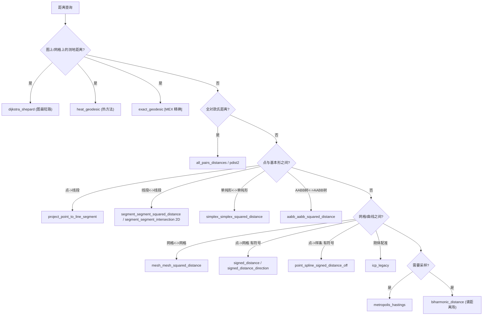

# 10.13 距离与测地线 / Distances & Geodesics

> 本章覆盖 `mesh/` 下与**距离计算、测地线、最近点/最近形、有符号距离与采样配准**相关的函数：
> 从图最短路（Dijkstra）与热方法（heat method）测地距离，到双调和距离嵌入，
> 全对欧氏距离与 Metropolis-Hastings 采样，点/线段/单纯形/AABB 树之间的精确平方距离，
> 网格-网格距离，以及有符号距离方向与 ICP 刚体配准。
>
> This chapter covers the **distance, geodesics, closest-point/closest-primitive, signed
> distance and sampling/registration** functions of `mesh/`: graph shortest-path (Dijkstra)
> and heat-method geodesic distances, biharmonic distance embedding, all-pairs Euclidean
> distance and Metropolis-Hastings sampling, exact squared distances between
> points/segments/simplices/AABB trees, mesh-to-mesh distance, signed-distance direction
> and ICP rigid registration.

- 语言 / Language：中英对照（中文为主）
- 相关章节 / See also：[10-mesh/README.md](README.md)、
  [appendices/03-doc-template.md](../appendices/03-doc-template.md)、
  [10.7 几何查询与定位](07-geometry-queries-and-location.md)、[60-mex](../60-mex/README.md)
- 命名约定 / Notation：`V` 顶点 `#V by dim`、`F` 三角面 `#F by 3`、
  `E` 边 `#E by 2`、`T` 四面体 `#T by 4`、`P/Q` 查询点集 `#P by dim`、
  `C` 角/控制点、`S/D` 线段端点、`L` 拉普拉斯、`M` 质量矩阵

---

## 本章概览 / Chapter Overview

### (a) 图上 / 网格上的测地 / Geodesics on graphs & meshes

| 函数 | 测地方法 / Method | 主要输出 | 说明 |
|---|---|---|---|
| `dijkstra_shepard` | Dijkstra 图最短路 + Shepard 插值 / Dijkstra shortest path + Shepard weights | `W,dist_H_V` | 用边权最短路作"测地距离"，再取 `1/d^p` 并逐行归一化 |
| `heat_geodesic` | 热方法 / heat method [Crane et al. 2013] | `D,u,X,div_X,phi,pre,B,t` | 热流→归一化梯度→Poisson；支持 `'Precomputation'` 预分解与 `'IntrinsicDelaunay'` |
| `biharmonic_distance` | 双调和嵌入谱距离 / biharmonic embedding spectral distance | `D` | 由 `biharmonic_embedding` 的特征嵌入算欧氏距离 |

### (b) 全对 / 近邻与全局距离 / All-pairs, nearest-neighbor & global

| 函数 | 目的 / Purpose | 主要输出 | 说明 |
|---|---|---|---|
| `all_pairs_distances` | 全对欧氏距离 / all-pairs Euclidean distance | `D` `#V by #U` | **已废弃**，建议改用 `pdist2` |
| `metropolis_hastings` | MCMC 采样（按未归一化分布）/ MCMC sampling | `S,F` | 依赖用户提供的 `unnorm_distr`/`next_sample` 句柄 |

### (c) 点与基本形之间的距离 / Distances between points & primitives

| 函数 | 基本形 / Primitives | 主要输出 | 维度 |
|---|---|---|---|
| `aabb_aabb_squared_distance` | AABB 树 ↔ AABB 树 / AABB tree vs AABB tree | `sqrd,I,C` | 任意 dim |
| `simplex_simplex_squared_distance` | 单纯形 ↔ 单纯形 / simplex vs simplex | `sqrd,ca,cb` | 任意 dim |
| `segment_segment_squared_distance` | 线段 ↔ 线段 / segment vs segment | `sqrD,V,C1,C2,T` | 任意 dim |
| `segment_segment_intersection` | 线段 ↔ 线段**相交** / segment intersection | `flag,T` | **仅 2D** |
| `project_point_to_line_segment` | 点 → 线段 / point → segment | `q` | 任意 dim（**已废弃**） |

### (d) 网格 / 曲线间距离 / Mesh & curve distances

| 函数 | 目的 / Purpose | 主要输出 | 说明 |
|---|---|---|---|
| `mesh_mesh_squared_distance` | 网格 ↔ 网格平方距离 / mesh vs mesh | `sqrd,I,C` | AABB 树 + 单纯形距离的 branch-and-bound |
| `signed_distance_direction` | 减小有符号距离的方向 / direction decreasing signed distance | `D,S,C` | 2D/3D 分支；3D 用伪法向有符号距离 |
| `point_spline_signed_distance_off` | 点到三次 Bézier 样条集合的有符号距离 / point→spline signed distance | `D,I,S,K` | 内部调用 MEX `point_spline_squared_distance` + `spline_winding_number` |
| `icp_legacy` | ICP 刚体配准 / ICP rigid registration | `R,t,BRt,e,KDTA,KDTB` | 迭代最近点 + `fit_rigid`；旧版实现 |

### 决策图 / Decision diagram — 距离查询类型 → 选择函数



---

## 逐函数详解 / Per-function reference

### `dijkstra_shepard` — 基于 Dijkstra 测地距离的 Shepard 权重
- **文件 / File**: [mesh/dijkstra_shepard.m](file:///c:/VSWork/gptoolbox-1/mesh/dijkstra_shepard.m#L1-L75)
- **签名 / Signature**: `[W,dist_H_V] = dijkstra_shepard(V,F,C,p)`
- **功能 / Purpose**: `EN: Compute Shepard weights for a list of vertices given control vertices, using Dijkstra shortest-path ("geodesic") distances.` / 中文：以 Dijkstra 最短路距离作为测地距离，为每个顶点对每个控制点计算 Shepard 权重。
- **输入 / Inputs**:

  | 参数 | 尺寸/类型 | 含义 (中 / EN) |
  |---|---|---|
  | `V` | `#V by dim`（dim 2 或 3） | 顶点位置 / vertex positions |
  | `F` | `#F by 3` | 三角面索引 / face indices |
  | `C` | `#C by dim` | 控制顶点 / control vertices |
  | `p` | scalar 或长度 `#C` 的向量 | 分母幂次 / denominator power |

- **输出 / Outputs**:

  | 参数 | 尺寸/类型 | 含义 |
  |---|---|---|
  | `W` | `#V by #C` | Shepard 权重矩阵（逐行和为 1）/ row-normalized weights |
  | `dist_H_V` | `#V by #C` | 顶点到控制点的测地距离 / geodesic distances |

- **可选参数 / Optional**:

  | 名称 | 取值 | 默认 | 含义 |
  |---|---|---|---|
  | `p` | 标量或 `#C` 向量 | `2` | 权重分母 `dist^p` 的幂次 / power in denominator |

- **变量流动 / Variable flow**: `V,C →(2D 判定 & 去 z)→ V',C' →(repmat/permute 欧氏平方距)→ D →(min → Cv,minD)→ C=adjacency_edge_cost_matrix(V,F) →(graphshortestpath 自 Cv)→ D →(minD+D)→ dist_H_V →(1/dist^p)→ W →(角点吸附 & 归一化)→ W`
- **算法步骤 / Algorithm**:
  1. 判定 `V`/`C` 是否"本质 2D"（第三维全约 0），若是则丢弃 z 坐标（L20–L27）。
  2. 记录 `n=#V`、`c=#C`，断言 `size(C,2)==size(V,2)`；`p` 缺省为 `2`（L30–L41）。
  3. 用 `repmat/permute` 计算每个顶点到每个控制点的欧氏平方距 `D`；取 `min` 得最近网格顶点 `Cv` 与最小距 `minD`（L47–L51）。
  4. 若多个控制点吸附到同一域顶点则告警（L54–L56）。
  5. 以 `adjacency_edge_cost_matrix(V,F)` 构造带边权邻接矩阵 `C`，对每个吸附源 `Cv` 调用 `graphshortestpath`（Dijkstra），得到测地距离；`dist_H_V = minD + D`（L59–L61）。
  6. `W = 1/dist_H_V.^p`（L64）。
  7. 退化处理：`dist_H_V < eps`（控制点几乎在网格顶点上）处 `W=0` 后置 `1`，即精确命中（L68–L70）。
  8. 逐行归一化 `W = W./sum(W,2)`（L73）。
- **流程图 / Flowchart**:

  ```mermaid
  flowchart TD
    A["输入 V,F,C,p"] --> B{"本质 2D?"}
    B -- 是 --> B1["丢弃 z 坐标"]
    B -- 否 --> C["计算欧氏平方距 D"]
    B1 --> C
    C --> D["min → Cv,minD"]
    D --> E["C = adjacency_edge_cost_matrix(V,F)"]
    E --> F["graphshortestpath 自每个 Cv"]
    F --> G["dist_H_V = minD + D"]
    G --> H["W = 1 / dist_H_V^p"]
    H --> I["角点吸附: W=1/0"]
    I --> Z["输出 W, dist_H_V"]
  ```

- **依赖 / Dependencies**: `adjacency_edge_cost_matrix` ([mesh/adjacency_edge_cost_matrix.m](file:///c:/VSWork/gptoolbox-1/mesh/adjacency_edge_cost_matrix.m#L1))；非本库依赖 `graphshortestpath`（MATLAB 图最短路函数）
- **See also**: `shepard`, `adjacency_edge_cost_matrix`, `heat_geodesic`

### `heat_geodesic` — 热方法测地距离（重点）
- **文件 / File**: [mesh/heat_geodesic.m](file:///c:/VSWork/gptoolbox-1/mesh/heat_geodesic.m#L1-L281)
- **签名 / Signature**: `[D,u,X,div_X,phi,pre,B,t] = heat_geodesic(varargin)`
  实际调用：`D = heat_geodesic(V,F,gamma,t)` 或 `[D,u,X,div_X,phi,pre] = heat_geodesic(V,F,gamma,t,'ParamName',ParamValue,...)`
- **功能 / Purpose**: `EN: Geodesic distance approximation following "Geodesics in Heat" [Crane et al. 2013]: integrate heat flow, evaluate the normalized gradient, then solve a Poisson equation.` / 中文：按"Geodesics in Heat"方法，从源点集 `gamma` 出发，用热扩散 + 归一化梯度 + Poisson 求解近似域内所有顶点的测地距离。
- **输入 / Inputs**:

  | 参数 | 尺寸/类型 | 含义 (中 / EN) |
  |---|---|---|
  | `V` | `#V by 3` | 顶点位置 / vertex positions |
  | `F` | `#F by 3` 或 `#T by 4` | 三角面或四面体索引 / triangle or tet indices |
  | `gamma` | `#gamma by 1` | 源点顶点索引 / source vertex indices |
  | `t` | 标量（可选） | 热流时间参数 / heat diffusion time |

- **输出 / Outputs**:

  | 参数 | 尺寸/类型 | 含义 |
  |---|---|---|
  | `D` | `#V by 1` | 顶点到 `gamma` 的测地距离 / geodesic distances |
  | `u` | `#V by 1` | 热扩散步的解 / heat diffusion solution |
  | `X` | `#F by dim` | 归一化反向梯度场 / reversed normalized gradients |
  | `div_X` | `#V by 1` | `X` 的散度 / divergence of X |
  | `phi` | `#V by 1` | 最终 Poisson 方程的解 / Poisson solution |
  | `pre` | struct | 预计算/预分解缓存 / precomputation struct |
  | `B` | `#V by 1` | 线性项（`u0`）/ RHS vector |
  | `t` | 标量 | 实际使用的时间参数 / resolved time step |

- **可选参数 / Optional**（`varargin` 解析见 L92–L122）:

  | 名称 | 取值 | 默认 | 含义 | 行号 |
  |---|---|---|---|---|
  | `'BoundaryConditions'` | `'dirichlet'`/`'neumann'`/`'average'`/`'robin'`/`'natural'` | `'average'` | 边界条件类型；`'robin'` 等价于 `'average'` | L81, L95–L98, L222–L236 |
  | `'Precomputation'` | `pre` struct（本函数返回） | `[]` | 复用预计算/预分解，避免重复 `L/Q/poisson` 分解 | L99–L105 |
  | `'Legacy'` | `bool` | `false` | 使用 Alec 的旧实现（边界处理的 `gamma`/out 差异） | L48, L106–L109 |
  | `'u'` | `#V by 1` | `[]` | 直接提供热扩散解，跳过热步求解 | L110–L113 |
  | `'IntrinsicDelaunay'` | `bool` | `false` | 用内在 Delaunay 拉普拉斯 / intrinsic Delaunay Laplacian | L49, L114–L117 |

  > 说明：源码中**不存在** `'FactorPrefactor'`/`'Prefactor'` 选项（全库搜索无匹配）。
  > 真实的"预分解"机制是 `'Precomputation'`（L99–L105）配合 `pre` 结构体字段
  > `pre.D / pre.N / pre.poisson`，它们正是 `min_quad_with_fixed` 第 7 个参数（预分解 `F`）的输出，
  > 在 L178/L187/L197/L199/L261/L265 处作为最后的 `F` 传回以实现系数矩阵分解复用。

- **变量流动 / Variable flow**:
  `V,F,gamma,t →(预计算 pre.L / pre.M / pre.Q / pre.G / pre.Div / pre.P / pre.out & u0)→`
  `(min_quad_with_fixed 解热步 uD/uN)→ u →(pre.G*u → 归一化反向)→ X →(pre.Div*X)→ div_X →(min_quad_with_fixed Poisson)→ phi →(减 mean(D(gamma)) & 符号翻转)→ D`
- **算法步骤 / Algorithm**:
  1. 解析必选输入 `V,F,gamma`，并确定 `t`：若未给，则按 simplex 尺寸启发式估计——三角网格 `t = 5*Σdoublearea/#F`（L65–L69），四面体 `t = 1e3*Σvolume/#F`（L71–L75）。
  2. **预计算**（`if isempty(pre.L)`，L143–L162）：`pre.L`（`IntrinsicDelaunay` 时 `intrinsic_delaunay_cotmatrix(V,F)`（L145），否则 `cotmatrix(V,F)`（L147））；`pre.M = massmatrix(V,F,'barycentric')`（L149）；`pre.Q = pre.M - t*pre.L`（L150）；`pre.G = grad(V,F)`（L151）；`pre.Div = div(V,F)`（L152）；`pre.Tik`（L153）；`pre.P = -0.5*pre.L + pre.Tik`（L154）；输出轮廓 `pre.out`（三角用 `outline(F)`（L158），四面体用 `boundary_faces(F)`（L160)）。
  3. 构造初始狄拉克条件 `u0(gamma)=1`（L137–L138），`B = u0`（L166）。
  4. 依 `bc_type` 求解热步（L168–L237）：Dirichlet（`uD`，L178/L187）、Neumann（`uN`，L197/L199）、`'average'/'robin'` 取 `u = 0.5*(uN+uD)`（L231）、`'natural'` 用 `keenan`（L204）。**注意 `keenan` 在本仓库中不存在**（见下"依赖"）。
  5. 计算向量场：`grad_u = reshape(pre.G*u,#F,dim)`；`X = -normalizerow(grad_u)`，`NaN` 处置 0（L245–L254）。（`robust_X` 分支调用 `robust_heat_gradients`（L241），该函数亦不存在，默认不走。）
  6. 散度 `div_X = pre.Div*X(:)`（L259）。
  7. 解 Poisson 方程：legacy 用 `-0.5*pre.L`、`gamma` 定值（L261–L262）；否则用 `pre.P`（L264–L265），得到 `phi`。
  8. `D = phi`；减去 `mean(D(gamma))` 使源点为 0（L276）；再用最远点符号翻转使距离为正（L278–L279）。
- **流程图 / Flowchart**:

  ```mermaid
  flowchart TD
    A["输入 V,F,gamma,(t)"] --> B{"给了 t ?"}
    B -- 否 --> B1["按面积/体积估计 t"]
    B -- 是 --> C
    B1 --> C{"pre.L 为空 ?"}
    C -- 是 --> D["预计算 L,M,Q,G,Div,P,out"]
    C -- 否 --> E
    D --> E["u0: Dirac at gamma"]
    E --> F{"bc_type"}
    F -- dirichlet --> F1["uD = mqwf(Q,B,out,bc)"]
    F -- neumann --> F2["uN = mqwf(Q,B)"]
    F -- average/robin --> F3["u = 0.5*(uN+uD)"]
    F -- natural --> F4["uT = mqwf(...,keenan)"]
    F1 --> G["grad_u = G*u"]
    F2 --> G
    F3 --> G
    F4 --> G
    G --> H["X = -normalizerow(grad_u)"]
    H --> I["div_X = Div*X"]
    I --> J["Poisson: mqwf → phi"]
    J --> K["D = phi - mean(D(gamma))"]
    K --> Z["输出 D,u,X,div_X,phi,pre"]
  ```

- **依赖 / Dependencies**:
  - `intrinsic_delaunay_cotmatrix` ([mesh/intrinsic_delaunay_cotmatrix.m](file:///c:/VSWork/gptoolbox-1/mesh/intrinsic_delaunay_cotmatrix.m#L1))
  - `cotmatrix` ([mesh/cotmatrix.m](file:///c:/VSWork/gptoolbox-1/mesh/cotmatrix.m#L1))
  - `massmatrix` ([mesh/massmatrix.m](file:///c:/VSWork/gptoolbox-1/mesh/massmatrix.m#L1))
  - `grad` ([mesh/grad.m](file:///c:/VSWork/gptoolbox-1/mesh/grad.m#L1))
  - `div` ([mesh/div.m](file:///c:/VSWork/gptoolbox-1/mesh/div.m#L1))
  - `min_quad_with_fixed` ([matrix/min_quad_with_fixed.m](file:///c:/VSWork/gptoolbox-1/matrix/min_quad_with_fixed.m#L1)) — 第 7 参数即预分解 `F`
  - `outline` ([mesh/outline.m](file:///c:/VSWork/gptoolbox-1/mesh/outline.m#L1))、`boundary_faces` ([mesh/boundary_faces.m](file:///c:/VSWork/gptoolbox-1/mesh/boundary_faces.m#L1))
  - `doublearea` ([mesh/doublearea.m](file:///c:/VSWork/gptoolbox-1/mesh/doublearea.m#L1))、`volume` ([mesh/volume.m](file:///c:/VSWork/gptoolbox-1/mesh/volume.m#L1))
  - `normalizerow` ([matrix/normalizerow.m](file:///c:/VSWork/gptoolbox-1/matrix/normalizerow.m#L1))
  - ⚠️ **缺失依赖**：`keenan`（L204，`'natural'` 分支）与 `robust_heat_gradients`（L241，`robust_X` 死分支）在仓库中**无对应 `.m` 文件**；仅当选择相应路径时才会失败。
- **See also**: `exact_geodesic`, `dijkstra_shepard`, `biharmonic_distance`, `intrinsic_delaunay_cotmatrix`

### `biharmonic_distance` — 双调和嵌入距离场
- **文件 / File**: [mesh/biharmonic_distance.m](file:///c:/VSWork/gptoolbox-1/mesh/biharmonic_distance.m#L1-L44)
- **签名 / Signature**: `[D] = biharmonic_distance(V,F,i,dim,p)`
- **功能 / Purpose**: `EN: Distance field D from all vertices to the i-th vertex, measured as Euclidean distance in the biharmonic embedding.` / 中文：在双调和嵌入空间中，以欧氏距离给出所有顶点到第 `i` 个顶点的距离场。
- **输入 / Inputs**:

  | 参数 | 尺寸/类型 | 含义 (中 / EN) |
  |---|---|---|
  | `V` | `#V by dim` | 顶点位置 / vertex positions |
  | `F` | `#F by 3` | 三角面索引 / triangle indices |
  | `i` | 整数（可选） | 参考顶点索引 / reference vertex index |
  | `dim` | 整数（可选） | 嵌入维度 / embedding dimension |
  | `p` | 标量（可选） | 特征值上幂次 / exponent above eigenvalues |

- **输出 / Outputs**:

  | 参数 | 尺寸/类型 | 含义 |
  |---|---|---|
  | `D` | `#V by 1` | 双调和距离场 / biharmonic distance field |

- **可选参数 / Optional**:

  | 名称 | 取值 | 默认 | 含义 |
  |---|---|---|---|
  | `i` | 整数 | `ceil(#V/2 + sqrt(#V)/2)` | 参考顶点（未给时取中点附近） |
  | `dim` | 整数 | `4` | 嵌入维度 |
  | `p` | `0.5`/`1`/`2`/`3` | `2` | 半调和 / 交换时间 / 双调和 / 三调和 |

- **变量流动 / Variable flow**: `V,F,i,dim,p →(biharmonic_embedding)→ B →(对 B(i,:) 求欧氏距)→ D`
- **算法步骤 / Algorithm**:
  1. 缺省值：`i = ceil(#V/2 + sqrt(#V)/2)`（L24–L26）、`dim = 4`（L29–L31）、`p = 2`（L34–L36）。
  2. 调用 `biharmonic_embedding(V,F,dim,p)` 得嵌入 `B`（L38）。
  3. `D = sqrt(sum((repmat(B(i,:),#V,1)-B).^2,2))`，即 `B` 中到 `B(i,:)` 的欧氏距离（L40）。
- **流程图 / Flowchart**:

  ```mermaid
  flowchart TD
    A["输入 V,F,i,dim,p"] --> B["biharmonic_embedding(V,F,dim,p)"]
    B --> C["B (#V by dim+1)"]
    C --> D["repmat(B(i,:)) - B"]
    D --> Z["D = sqrt(sum(diff.^2,2))"]
  ```

- **依赖 / Dependencies**: `biharmonic_embedding` ([mesh/biharmonic_embedding.m](file:///c:/VSWork/gptoolbox-1/mesh/biharmonic_embedding.m#L1-L58))；该函数内部再依赖 `cotmatrix`（L36）、`massmatrix`（L39）、`eigs`（L42）
- **See also**: `biharmonic_embedding`, `heat_geodesic`

### `all_pairs_distances` — 全对欧氏距离
- **文件 / File**: [mesh/all_pairs_distances.m](file:///c:/VSWork/gptoolbox-1/mesh/all_pairs_distances.m#L1-L61)
- **签名 / Signature**: `D = all_pairs_distances(V,U)`
- **功能 / Purpose**: `EN: Compute pairwise Euclidean distances between every point in V and every point in U. Obsolete: use pdist2 instead.` / 中文：计算 `V` 中每个点到 `U` 中每个点的欧氏距离矩阵（**已废弃**，建议改用 `pdist2`）。
- **输入 / Inputs**:

  | 参数 | 尺寸/类型 | 含义 (中 / EN) |
  |---|---|---|
  | `V` | `#V by dim` | 点集 V / points |
  | `U` | `#U by dim` | 点集 U / points |

- **输出 / Outputs**:

  | 参数 | 尺寸/类型 | 含义 |
  |---|---|---|
  | `D` | `#V by #U` | `D(i,j)=‖V(i,:)-U(j,:)‖` |

- **可选参数 / Optional**: 无 / None
- **变量流动 / Variable flow**: `V,U →(维度断言 & 规模分支)→ D`（规模 > 1000 走逐行 `bsxfun` 循环，否则走完全向量化 `bsxfun`+`permute`）
- **算法步骤 / Algorithm**:
  1. 发出废弃告警并断言 `size(V,2)==size(U,2)`（L17–L19）。
  2. 若 `#V>1000` 或 `#U>1000`：逐行循环 `D(i,:)=sqrt(sum(bsxfun(@minus,V(i,:),U).^2,2))`，缓解内存换页（L46–L55）。
  3. 否则：`D = permute(sqrt(sum(bsxfun(@minus,V,permute(U,[3 2 1])).^2,2)),[1 3 2])` 完全向量化（L56–L60）。
- **流程图 / Flowchart**:

  ```mermaid
  flowchart TD
    A["输入 V,U"] --> B{"#V>1000 或 #U>1000 ?"}
    B -- 是 --> C["逐行 bsxfun 循环 → D"]
    B -- 否 --> D["向量化 bsxfun + permute → D"]
    C --> Z["输出 D"]
    D --> Z
  ```

- **依赖 / Dependencies**: 无本库依赖（纯 MATLAB；替代品为 `pdist2`）
- **See also**: `pdist2`, `aabb_aabb_squared_distance`

### `aabb_aabb_squared_distance` — 两棵 AABB 树的平方距离
- **文件 / File**: [mesh/aabb_aabb_squared_distance.m](file:///c:/VSWork/gptoolbox-1/mesh/aabb_aabb_squared_distance.m#L1-L145)
- **签名 / Signature**: `[sqrd,I,C] = aabb_aabb_squared_distance(A1,A2,Aleaf,B1,B2,Bleaf,leaf_leaf_squared_distance,best_so_far_sqrd)`
- **功能 / Purpose**: `EN: Compute the squared distance between two AABB (Eytzinger) trees by branch-and-bound, using a user-provided leaf-leaf primitive distance.` / 中文：对两棵 AABB 树做分支限界搜索，用用户提供的叶子-叶子图元距离函数计算树间最小平方距离。
- **输入 / Inputs**:

  | 参数 | 尺寸/类型 | 含义 (中 / EN) |
  |---|---|---|
  | `A1`,`A2` | `#A by dim` | 树 A 的 min/max 角点 / min & max corners |
  | `Aleaf` | `#A by 1` | 树 A 的叶索引（0=内部节点）/ leaf ids |
  | `B1`,`B2`,`Bleaf` | `#B by dim`,`#B` | 树 B 的 min/max 角点与叶索引 |
  | `leaf_leaf_squared_distance` | function handle | `[sqrd,ca,cb]=f(a,b,best)` 图元-图元距离 / primitive distance |
  | `best_so_far_sqrd` | 标量（可选） | 剪枝上界 / pruning bound |

- **输出 / Outputs**:

  | 参数 | 尺寸/类型 | 含义 |
  |---|---|---|
  | `sqrd` | 标量或 `[]` | 两树间平方距离（若无改进则为空）/ squared distance |
  | `I` | `2 by 1` | 最近图元索引 (`[aleaf;bleaf]`) |
  | `C` | `2 by dim` | 两图元上的最近点 / closest points |

- **可选参数 / Optional**:

  | 名称 | 取值 | 默认 | 含义 |
  |---|---|---|---|
  | `best_so_far_sqrd` | 标量 | `inf` | 忽略无法改进该上界的距离 |

- **变量流动 / Variable flow**: `A1..Bleaf →(根盒下界)→ recursive_helper(1,1) →(下界<best 才下降)→ (叶-叶调用 leaf_leaf_squared_distance)→ sqrd,I,C`；`best` 为闭包共享状态，随命中更新以增强剪枝
- **算法步骤 / Algorithm**:
  1. 校验维度一致性；`best_so_far_sqrd` 缺省 `inf`（L33–L43）。
  2. 空树直接返回（L49–L51）。
  3. `box_box_squared_distance(ai,bi)` 计算两轴对齐盒的平方距离作为下界（L58–L66）。
  4. `recursive_helper(ai,bi,lower_bound)`：若 `lower_bound >= best` 剪枝（L71–L73）；未用槽位 `leaf<0` 跳过（L79–L81）。
  5. 叶-叶对：调用 `leaf_leaf_squared_distance`，若更优则更新 `best,sqrd,I,C`（L84–L93）。
  6. 否则按 descend 组合构造子对（四种/两种情形），先算各自下界并按升序访问以提高剪枝效率（L98–L137）。
  7. 命中精确相交（`best==0`）立即返回（L140–L142）。
- **流程图 / Flowchart**:

  ```mermaid
  flowchart TD
    A["输入两树 & 回调"] --> B{"Aleaf/Bleaf 为空?"}
    B -- 是 --> Z0["返回空"]
    B -- 否 --> C["根下界 root_sqrd"]
    C --> D["recursive_helper(1,1)"]
    D --> E{"下界 < best ?"}
    E -- 否 --> R["剪枝返回"]
    E -- 是 --> F{"叶-叶对?"}
    F -- 是 --> G["leaf_leaf_squared_distance"]
    G --> H{"更优?"}
    H -- 是 --> I["更新 best,sqrd,I,C"]
    F -- 否 --> J["构造子对 & 算下界"]
    J --> K["按升序访问子对"]
    K --> D
    I --> L{"best==0 ?"}
    L -- 是 --> Z["输出 sqrd,I,C"]
  ```

- **依赖 / Dependencies**: 内部嵌套函数 `box_box_squared_distance`（L58）、`recursive_helper`（L68）；调用方提供 `leaf_leaf_squared_distance`
- **See also**: `aabb`, `mesh_mesh_squared_distance`, `point_mesh_squared_distance`(MEX)

### `mesh_mesh_squared_distance` — 两网格间的平方距离
- **文件 / File**: [mesh/mesh_mesh_squared_distance.m](file:///c:/VSWork/gptoolbox-1/mesh/mesh_mesh_squared_distance.m#L1-L97)
- **签名 / Signature**: `[sqrd,I,C] = mesh_mesh_squared_distance(V1,F1,V2,F2,best_so_far_sqrd)`
- **功能 / Purpose**: `EN: Compute the squared distance between two triangle meshes by building per-mesh AABB trees and running branch-and-bound with triangle-triangle distance.` / 中文：为两个网格分别建 AABB 树，以三角-三角平方距离作叶子度量做分支限界，求网格间最小平方距离。
- **输入 / Inputs**:

  | 参数 | 尺寸/类型 | 含义 (中 / EN) |
  |---|---|---|
  | `V1`,`F1` | `#V1 by dim`,`#F1 by 3` | 网格 1 / mesh 1 |
  | `V2`,`F2` | `#V2 by dim`,`#F2 by 3` | 网格 2 / mesh 2 |
  | `best_so_far_sqrd` | 标量（可选） | 剪枝上界 / pruning bound |

- **输出 / Outputs**:

  | 参数 | 尺寸/类型 | 含义 |
  |---|---|---|
  | `sqrd` | 标量或 `[]` | 两网格平方距离 / squared distance |
  | `I` | `2 by 1` | 最近三角面索引 / closest triangle indices |
  | `C` | `2 by dim` | 两三角面上的最近点 / closest points |

- **可选参数 / Optional**:

  | 名称 | 取值 | 默认 | 含义 |
  |---|---|---|---|
  | `best_so_far_sqrd` | 标量 | `inf` | 忽略无法改进该上界的距离 |

- **变量流动 / Variable flow**: `V1,F1,V2,F2 →(box_each_element)→ 逐面盒 →(aabb)→ 两棵 AABB 树 →(aabb_aabb_squared_distance, 叶子回调 triangle_triangle_squared_distance → simplex_simplex_squared_distance)→ sqrd,I,C`
- **算法步骤 / Algorithm**:
  1. `best_so_far_sqrd` 缺省 `inf`（L22–L23）。
  2. 逐元素包围盒 `box_each_element(V1,F1)`、`box_each_element(V2,F2)`（L56–L57）。
  3. 建树 `aabb(...)` 得 `F1B1,F1B2,F1leaf` 与 `F2B1,F2B2,F2leaf`（L59–L60，含计时打印）。
  4. 调用 `aabb_aabb_squared_distance`，叶子回调为局部函数 `triangle_triangle_squared_distance`（L64–L68）。
  5. 局部回调把每个三角形对交给 `simplex_simplex_squared_distance` 求精确距离，超出上界则返回空（L76–L87）。
  6. 若 `aabb_sqrd` 更优则写出 `sqrd,I,C`（L70–L74）。
- **流程图 / Flowchart**:

  ```mermaid
  flowchart TD
    A["输入 V1,F1,V2,F2"] --> B["box_each_element(V1,F1)"]
    A --> C["box_each_element(V2,F2)"]
    B --> D["aabb → 树1"]
    C --> E["aabb → 树2"]
    D --> F["aabb_aabb_squared_distance"]
    E --> F
    F --> G["回调 triangle_triangle_squared_distance"]
    G --> H["simplex_simplex_squared_distance"]
    H --> F
    F --> I{"更优?"}
    I -- 是 --> Z["输出 sqrd,I,C"]
    I -- 否 --> Z0["返回空"]
  ```

- **依赖 / Dependencies**: `box_each_element` ([mesh/box_each_element.m](file:///c:/VSWork/gptoolbox-1/mesh/box_each_element.m#L1))、`aabb` ([mesh/aabb.m](file:///c:/VSWork/gptoolbox-1/mesh/aabb.m#L1))、`aabb_aabb_squared_distance`、`simplex_simplex_squared_distance`；可选 MEX `point_mesh_squared_distance`（注释中讨论，L31/L40）
- **See also**: `aabb_aabb_squared_distance`, `simplex_simplex_squared_distance`, `point_mesh_squared_distance`(MEX)

### `simplex_simplex_squared_distance` — 两单纯形间的平方距离
- **文件 / File**: [mesh/simplex_simplex_squared_distance.m](file:///c:/VSWork/gptoolbox-1/mesh/simplex_simplex_squared_distance.m#L1-L109)
- **签名 / Signature**: `[sqrd,ca,cb] = simplex_simplex_squared_distance(A,B)`
- **功能 / Purpose**: `EN: Squared distance between two simplices of (possibly) different dimensions, handling degenerate simplices.` / 中文：计算两个（维度可不同的）单纯形之间的平方距离，并处理退化情形。
- **输入 / Inputs**:

  | 参数 | 尺寸/类型 | 含义 (中 / EN) |
  |---|---|---|
  | `A` | `#A by dim` | 第一个 `(#A-1)`-单纯形的顶点 / simplex A vertices |
  | `B` | `#B by dim` | 第二个 `(#B-1)`-单纯形的顶点 / simplex B vertices |

- **输出 / Outputs**:

  | 参数 | 尺寸/类型 | 含义 |
  |---|---|---|
  | `sqrd` | 标量 | 两单纯形间平方距离 / squared distance |
  | `ca` | `1 by dim` | A 上的最近点 / closest point on A |
  | `cb` | `1 by dim` | B 上的最近点 / closest point on B |

- **可选参数 / Optional**: 无 / None
- **变量流动 / Variable flow**: `A,B →(递归 recursive_helper)→ 仿射包最小二乘最近对 →(权重均在单纯形内? 则定稿 : 遍历余维 1 面递归)→ sqrd,ca,cb`
- **算法步骤 / Algorithm**:
  1. 断言维度一致、非空；`sqrd=inf`，`ca/cb=[]`（L18–L24）。
  2. `recursive_helper(A,B)`：若 `sqrd==0` 直接返回（L31–L33）。
  3. 点-点情形直接算平方距并更新（L39–L47）。
  4. 参数化两仿射包 `a=A(1)+u'EA`、`b=B(1)+v'EB`，用 `pinv(M)*(B(1)-A(1))` 解最近对（L55–L69）。
  5. 若仿射包下界已不小于当前 `sqrd` 则剪枝（L73–L75）。
  6. 若最近对权重 `wa,wb` 均在单纯形内（`>=-tol`），即单纯形最近对，定稿（L79–L85）。
  7. 否则最近对落在某一单纯形边界上，遍历 `A`、`B` 的所有余维 1 面递归（L89–L107）。
- **流程图 / Flowchart**:

  ```mermaid
  flowchart TD
    A["输入 A,B"] --> B{"sqrd==0 ?"}
    B -- 是 --> R["返回"]
    B -- 否 --> C{"点-点?"}
    C -- 是 --> C1["平方距并更新"]
    C -- 否 --> D["仿射包最小二乘求最近对"]
    D --> E{"下界 >= sqrd ?"}
    E -- 是 --> R
    E -- 否 --> F{"权重都在单纯形内?"}
    F -- 是 --> G["定稿最近对"]
    F -- 否 --> H["遍历 A 的余维1面递归"]
    H --> I["遍历 B 的余维1面递归"]
    I --> D
    G --> Z["输出 sqrd,ca,cb"]
  ```

- **依赖 / Dependencies**: `pinv`（MATLAB 内置）；内部嵌套函数 `recursive_helper`（L28）
- **See also**: `aabb_aabb_squared_distance`, `mesh_mesh_squared_distance`, `simplex_simplex_squared_distance`(MEX), `point_simplex_squared_distance`

### `segment_segment_squared_distance` — 两线段间的平方距离
- **文件 / File**: [mesh/segment_segment_squared_distance.m](file:///c:/VSWork/gptoolbox-1/mesh/segment_segment_squared_distance.m#L1-L220)
- **签名 / Signature**: `[sqrD,V,C1,C2,T] = segment_segment_squared_distance(S1,D1,S2,D2)`
- **功能 / Purpose**: `EN: Compute the squared distances between each pair of line segments (vectorized over many segment pairs).` / 中文：逐对计算两条线段之间最近点连线的平方距离（对多组线段向量化）。
- **输入 / Inputs**:

  | 参数 | 尺寸/类型 | 含义 (中 / EN) |
  |---|---|---|
  | `S1` | `#segments by dim` | 第一组线段起点 / first-segment sources |
  | `D1` | `#segments by dim` | 第一组线段终点 / first-segment dests |
  | `S2` | `#segments by dim` | 第二组线段起点 / second-segment sources |
  | `D2` | `#segments by dim` | 第二组线段终点 / second-segment dests |

- **输出 / Outputs**:

  | 参数 | 尺寸/类型 | 含义 |
  |---|---|---|
  | `sqrD` | `#segments by 1` | 平方距离 / squared distances |
  | `V` | `#segments by dim` | 最近点连线向量 / connecting vector |
  | `C1` | `#segments by dim` | 线段 1 上的最近点 / closest point on object 1 |
  | `C2` | `#segments by dim` | 线段 2 上的最近点 / closest point on object 2 |
  | `T` | `#segments by 2` | 参数 `[sc tc]` / parametrizations |

- **可选参数 / Optional**: 无 / None
- **变量流动 / Variable flow**: `S1,D1,S2,D2 →(单线段广播)→ p1..p4 →(u,v,w,a,b,c,d,e)→(D=a c - b b; sN,tN,sD,tD 分支裁剪)→ sc,tc →(dP = w + sc*u - tc*v)→ sqrD,V,C1,C2,T`
- **算法步骤 / Algorithm**:
  1. 断言两组端点长度一致（L24–L25）。
  2. 若第一组只有 1 条线段，则复制到 `size(S2,1)` 长度以对齐（L139–L142）。
  3. 令 `p1=S1,p2=D1,p3=S2,p4=D2`，计算 `u=p1-p2`、`v=p3-p4`、`w=p2-p4`（L144–L150）。
  4. 计算 `a=u·u,b=u·v,c=v·v,d=u·w,e=v·w`，`D=a c - b b`，`sD=tD=D`（L152–L159）。
  5. 处理近平行（`D<SMALL_NUM`）并对 s∈[0,1]、t∈[0,1] 边界的可见性分支逐类裁剪 `sN,tN,sD,tD`（L161–L198）。
  6. 除法得 `sc=sN/sD`、`tc=tN/tD`，对小量归零（L200–L207）。
  7. 计算差值 `dP = w + sc*u - tc*v`；`sqrD=sum(dP.^2,2)`；`C1=p2+sc*u`、`C2=p4+tc*v`、`T=[sc tc]`（L209–L218）。
- **流程图 / Flowchart**:

  ```mermaid
  flowchart TD
    A["输入 S1,D1,S2,D2"] --> B["单线段? → 广播复制"]
    B --> C["p1..p4, u,v,w"]
    C --> D["a,b,c,d,e, D=a*c-b*b"]
    D --> E{"D < SMALL_NUM ?"}
    E -- 是 --> E1["近平行分支"]
    E -- 否 --> E2["s/t 边界可见性裁剪"]
    E1 --> F["得 sc,tc"]
    E2 --> F
    F --> G["dP = w + sc*u - tc*v"]
    G --> Z["sqrD,V,C1,C2,T"]
  ```

- **依赖 / Dependencies**: `dot`（MATLAB 内置）；算法参考 geomalgorithms.com 与 MathWorks FEX 32487（注释 L41–L42, L137）
- **See also**: `segment_segment_intersection`, `simplex_simplex_squared_distance`

### `segment_segment_intersection` — 2D 线段相交
- **文件 / File**: [mesh/segment_segment_intersection.m](file:///c:/VSWork/gptoolbox-1/mesh/segment_segment_intersection.m#L1-L91)
- **签名 / Signature**: `[flag,T] = segment_segment_intersection(A,B,C,D)`
- **功能 / Purpose**: `EN: Test whether each pair of 2D line segments intersects, returning intersection parameters.` / 中文：逐对判定两条 **2D** 线段是否相交，并返回交点参数。
- **输入 / Inputs**:

  | 参数 | 尺寸/类型 | 含义 (中 / EN) |
  |---|---|---|
  | `A` | `#A by 2` | 第一组线段起点 / first-segment startpoints |
  | `B` | `#A by 2` | 第一组线段终点 / first-segment endpoints |
  | `C` | `#C by 2` | 第二组线段起点 / second-segment startpoints |
  | `D` | `#C by 2` | 第二组线段终点 / second-segment endpoints |

- **输出 / Outputs**:

  | 参数 | 尺寸/类型 | 含义 |
  |---|---|---|
  | `flag` | `max(#A,#C) by 1` | 是否相交 / intersection flags |
  | `T` | `#flag by 2` | 交点在两侧的参数：`A+T(:,1).*(B-A)` 与 `C+T(:,2).*(D-C)` |

- **可选参数 / Optional**: 无 / None
- **变量流动 / Variable flow**: `A,B,C,D →(orient2d ×4)→ o1..o4 →(proper = 符号异号)→(check_colinear ×4)→ flag →(T: proper_params / colinear_param)→ T`
- **算法步骤 / Algorithm**:
  1. 求四次方向测试 `o1..o4`（`orient2d`，L62–L65）。
  2. `proper` 判定真交叉：每组两侧方向符号相反（L66）。
  3. `check_colinear` 判定共线且落入包围盒（L14–L23, L68–L71）。
  4. `flag = proper | colinear_1..4`（L73）。
  5. 若有输出：`proper` 对用 `proper_params`（叉积比值）求 `t,u`；共线情形用 `colinear_param` 求投影参数并分别固定另一参数为 0/1（L74–L89）。
- **流程图 / Flowchart**:

  ```mermaid
  flowchart TD
    A["输入 A,B,C,D"] --> B["orient2d → o1..o4"]
    B --> C{"proper: 两侧异号?"}
    B --> D["check_colinear ×4"]
    C --> E["flag = proper | colinear"]
    D --> E
    E --> F{"nargout>0 ?"}
    F -- 是 --> G["proper → proper_params"]
    F -- 是 --> H["colinear → colinear_param"]
    G --> Z["输出 flag,T"]
    H --> Z
  ```

- **依赖 / Dependencies**: `orient2d` (MEX, [mex/orient2d.m](file:///c:/VSWork/gptoolbox-1/mex/orient2d.m#L1-L10))；内部嵌套函数 `check_colinear`(L14)、`cross2`(L24)、`proper_params`(L27)、`colinear_param`(L47)
- **See also**: `segment_segment_squared_distance`, `orient2d`

### `signed_distance_direction` — 减小有符号距离的方向
- **文件 / File**: [mesh/signed_distance_direction.m](file:///c:/VSWork/gptoolbox-1/mesh/signed_distance_direction.m#L1-L89)
- **签名 / Signature**: `[D,S,C] = signed_distance_direction(P,V,F)`
- **功能 / Purpose**: `EN: Compute a direction that decreases the signed distance with respect to a mesh (V,F) at query points P, together with signed distances and closest points.` / 中文：为查询点 `P` 计算可使到网格 `(V,F)` 的有符号距离减小的方向，以及有符号距离与最近点。
- **输入 / Inputs**:

  | 参数 | 尺寸/类型 | 含义 (中 / EN) |
  |---|---|---|
  | `P` | `#P by dim` | 查询点 / query points |
  | `V` | `#V by dim` | 网格顶点 / mesh vertices |
  | `F` | `#F by (dim+1)` | 网格索引（2D 时为边）/ face/edge indices |

- **输出 / Outputs**:

  | 参数 | 尺寸/类型 | 含义 |
  |---|---|---|
  | `D` | `#P by dim` | 归一化方向 / normalized directions |
  | `S` | `#P by 1` | 有符号距离 / signed distances |
  | `C` | `#P by dim` | 最近点 / closest points |

- **可选参数 / Optional**: 无 / None（内部依赖 `signed_distance`(MEX) 的 `'SignedDistanceType','pseudonormal'`，L35）
- **变量流动 / Variable flow**: 分支由 `dim = size(F,2)` 决定（L17–L18）：
  `2D: P,V,E=F →(project_to_lines 'Segments',true)→ T,sqrD →(argmin J)→ C →(winding_number → s=-2w+1)→ D=s*normalizerow(C-P); S=s*normrow(D)`
  `3D: →(signed_distance 'pseudonormal')→ S,I,C,N → D=normalizerow(C-P).*sign(S) →(过于接近时用 -N 修正)→ D,S,C`
- **算法步骤 / Algorithm**:
  1. `dim=size(F,2)`；`dim=2` 时把面视作边（L18–L22）。
  2. 2D：`project_to_lines(P,V(E(:,1),:),V(E(:,2),:),'Segments',true)` 得 `T,sqrD`，取每点最近边 `J` 并重建最近点 `C`（L23–L27）。
  3. 2D：`s = -2*winding_number(V,E,P)+1` 作为内外符号；`D = s*normalizerow(C-P)`；`S = s*normrow(D)`（L28–L33）。
  4. 3D：`[S,I,C,N] = signed_distance(P,V,F,'SignedDistanceType','pseudonormal')`（L35）。
  5. 3D：`D = normalizerow(C-P).*sign(S)`；对 `abs(S)<1e-5` 的过近点改用 `-N`（L36–L41）。
- **流程图 / Flowchart**:

  ```mermaid
  flowchart TD
    A["输入 P,V,F"] --> B{"dim = size(F,2)"}
    B -- 2D --> C["project_to_lines 'Segments'"]
    C --> C1["argmin → C"]
    C1 --> C2["winding_number → s=-2w+1"]
    C2 --> C3["D=s*normalizerow(C-P); S=s*normrow(D)"]
    B -- 3D --> D["signed_distance 'pseudonormal'"]
    D --> D1["D=normalizerow(C-P).*sign(S)"]
    D1 --> D2["too_close → D=-N"]
    C3 --> Z["输出 D,S,C"]
    D2 --> Z
  ```

- **依赖 / Dependencies**: `project_to_lines` ([mesh/project_to_lines.m](file:///c:/VSWork/gptoolbox-1/mesh/project_to_lines.m#L1))、`winding_number` (MEX, [mex/winding_number.m](file:///c:/VSWork/gptoolbox-1/mex/winding_number.m#L1-L34))、`signed_distance` (MEX, [mex/signed_distance.m](file:///c:/VSWork/gptoolbox-1/mex/signed_distance.m#L1-L24))、`normalizerow` ([matrix/normalizerow.m](file:///c:/VSWork/gptoolbox-1/matrix/normalizerow.m#L1))、`normrow` ([matrix/normrow.m](file:///c:/VSWork/gptoolbox-1/matrix/normrow.m#L1))
- **See also**: `signed_distance`(MEX), `winding_number`(MEX), `point_mesh_squared_distance`(MEX), `project_to_lines`

### `point_spline_signed_distance_off` — 点到样条集合的有符号距离（.m 回退实现）
- **文件 / File**: [mesh/point_spline_signed_distance_off.m](file:///c:/VSWork/gptoolbox-1/mesh/point_spline_signed_distance_off.m#L1-L5)
- **签名 / Signature**: `[D,I,S,K] = point_spline_signed_distance(Q,P,C,tol)`（定义于文件中的函数名）
- **功能 / Purpose**: `EN: Signed distance from query points Q to a set of cubic Bezier splines (P,C), computed as the squared distance scaled by the spline winding number.` / 中文：由平方距离与样条卷绕数组合，给出查询点到三次 Bézier 样条集合的有符号距离（纯 MATLAB 回退实现）。
- **输入 / Inputs**:

  | 参数 | 尺寸/类型 | 含义 (中 / EN) |
  |---|---|---|
  | `Q` | `#Q by dim` | 查询点 / query points |
  | `P` | `#P by dim` | 控制点 / control points |
  | `C` | `#C by 4` | 指向 `P` 的三次样条索引 / cubic spline indices |
  | `tol` | 标量 | 容差（透传）/ tolerance |

- **输出 / Outputs**:

  | 参数 | 尺寸/类型 | 含义 |
  |---|---|---|
  | `D` | `#Q by 1` | 有符号距离 / signed distances |
  | `I` | `#Q by 1` | 最近样条索引 / closest spline index |
  | `S` | `#Q by 1` | 样条参数值 / parameter on spline |
  | `K` | `#Q by dim` | 最近点 / closest points |

- **可选参数 / Optional**: 无 / None
- **变量流动 / Variable flow**: `Q,P,C,tol →(point_spline_squared_distance)→ sqrD,I,S,K →(spline_winding_number(P,C,Q))→ W → D=(1-abs(W)*2).*sqrt(sqrD)`
- **算法步骤 / Algorithm**:
  1. 调 `point_spline_squared_distance(Q,P,C,tol)` 得 `sqrD,I,S,K`（L2）。
  2. `W = spline_winding_number(P,C,Q)`（L3）。
  3. `D = (1-abs(W)*2).*sqrt(sqrD)`，用卷绕数符号缩放距离（L4）。
- **流程图 / Flowchart**:

  ```mermaid
  flowchart TD
    A["输入 Q,P,C,tol"] --> B["point_spline_squared_distance"]
    A --> C["spline_winding_number(P,C,Q)"]
    B --> D["sqrD,I,S,K"]
    C --> E["W"]
    D --> F["D = (1-abs(W)*2).*sqrt(sqrD)"]
    E --> F
    F --> Z["输出 D,I,S,K"]
  ```

- **依赖 / Dependencies**: `point_spline_squared_distance` (MEX, [mex/point_spline_squared_distance.m](file:///c:/VSWork/gptoolbox-1/mex/point_spline_squared_distance.m#L1-L19))、`spline_winding_number` (MEX, [mex/spline_winding_number.m](file:///c:/VSWork/gptoolbox-1/mex/spline_winding_number.m#L1-L18))
- **See also**: `point_spline_signed_distance`(MEX), `cubic_winding_number`(MEX), `point_cubic_squared_distance`(MEX)
- **备注 / Note**: 文件名 `point_spline_signed_distance_off.m` 与其内部函数名 `point_spline_signed_distance` **不一致**（`_off` 后缀用于与 MEX 同名函数共存）。

### `icp_legacy` — ICP 刚体配准（旧版实现）
- **文件 / File**: [mesh/icp_legacy.m](file:///c:/VSWork/gptoolbox-1/mesh/icp_legacy.m#L1-L134)
- **签名 / Signature**: `[R,t,BRt,e,KDTA,KDTB] = icp(A,B,varargin)`（定义于文件中的函数名）
- **功能 / Purpose**: `EN: Find a rigid transformation (R,t) registering point set B to point set A using iterative closest point.` / 中文：用迭代最近点（ICP）求把点集 `B` 配准到点集 `A` 的刚体变换 `(R,t)`。
- **输入 / Inputs**:

  | 参数 | 尺寸/类型 | 含义 (中 / EN) |
  |---|---|---|
  | `A` | `#A by dim` | 目标点集 / target points |
  | `B` | `#B by dim` | 源点集 / source points |

- **输出 / Outputs**:

  | 参数 | 尺寸/类型 | 含义 |
  |---|---|---|
  | `R` | `dim by dim` | 旋转矩阵 / rotation matrix |
  | `t` | `1 by dim` | 平移向量 / translation |
  | `BRt` | `#B by dim` | 形变后的 B：`BRt = B*R + t` |
  | `e` | 标量 | ICP 能量 / ICP energy |
  | `KDTA` | kdtree | A 上的 kdtree / kdtree around A |
  | `KDTB` | kdtree | B 上的 kdtree / kdtree around B |

- **可选参数 / Optional**（`containers.Map` 参数表 L43–L49）:

  | 名称 | 取值 | 默认 | 含义 | 行号 |
  |---|---|---|---|---|
  | `'MaxIter'` | 整数 | `100`（代码）/ 头注释写 `inf` | 最大迭代次数 | L32, L120–L124 |
  | `'MinRNorm'` | 标量 | `1e-5` | 旋转增量收敛阈值 | L33, L109 |
  | `'MinTNorm'` | 标量 | `1e-5` | 平移增量收敛阈值（乘以 bbox 对角长） | L34, L109 |
  | `'MaxSamples'` | 整数 | `inf` | 每点集随机采样的点数 | L35, L92–L97 |
  | `'KDTreeA'` | kdtree | `[]` | 复用 A 的 kdtree | L36, L77–L82 |
  | `'KDTreeB'` | kdtree | `[]` | 复用 B 的 kdtree | L37, L80–L82 |
  | `'R0'` | `dim by dim` | `eye(dim)` | 初始旋转 | L39, L69–L71 |
  | `'t0'` | `1 by dim` | `zeros(1,dim)` | 初始平移 | L40, L72–L74 |
  | `'Quiet'` | logical | `false` | 是否静默 | L41, L121–L123 |
  | `'tsurfHandle'` | 句柄 | `[]` | 可视化用句柄 | L38, L44, L112–L118 |

- **变量流动 / Variable flow**: `A,B,(R0,t0)→(createns 建 KDTA/KDTB)→ 迭代: (可选随机采样 IA/IB) →(knnsearch 双向最近邻 KAB/KBA)→(fit_rigid)→ R,t → BRt=B*R+t →(收敛判定)→ 直至收敛/超迭代 →(能量 e)→ R,t,BRt,e,KDTA,KDTB`
- **算法步骤 / Algorithm**:
  1. 解析选项（默认值 L32–L41，参数表 L43–L49），夹取 `max_samples`（L64）。
  2. `dim=size(A,2)`、`bbd=norm(max([A;B])-min([A;B]))`（L66–L67）；初始化 `R=eye(dim)`、`t=zeros(1,dim)`（L69–L74）。
  3. 预建 KD 树：`createns(A/B,'nsmethod','kdtree')`（L77–L82）。
  4. 迭代：可选随机采样 `IA/IB`（L92–L97）；双向最近邻 `knnsearch` 得 `KAB,KBA`（L99–L100）。
  5. `[R,t] = fit_rigid([A(KAB,:);A(IA,:)],[B(IB,:);B(KBA,:)])` 更新刚体变换（L102）；`BRt = B*R+t`（L108）。
  6. 收敛判定 `norm(R-prev_R)<min_R_norm && norm(t-prev_t)<min_t_norm*bbd`（L109–L110）；否则继续，超 `max_iter` 告警退出（L120–L124）。
  7. 若请求 `e`，用最后最近邻算残差平方和（L128–L132）。
- **流程图 / Flowchart**:

  ```mermaid
  flowchart TD
    A["输入 A,B,(R0,t0)"] --> B["createns → KDTA,KDTB"]
    B --> C["iter=1"]
    C --> D{"max_samples 有限?"}
    D -- 是 --> D1["随机采样 IA,IB"]
    D -- 否 --> E
    D1 --> E["knnsearch 双向 → KAB,KBA"]
    E --> F["fit_rigid → R,t"]
    F --> G["BRt = B*R + t"]
    G --> H{"收敛?"}
    H -- 是 --> Z["输出 R,t,BRt,e"]
    H -- 否 --> I{"iter > MaxIter ?"}
    I -- 否 --> C
    I -- 是 --> W["告警"] --> Z
  ```

- **依赖 / Dependencies**: `fit_rigid` ([mesh/fit_rigid.m](file:///c:/VSWork/gptoolbox-1/mesh/fit_rigid.m#L1))；非本库依赖 `createns`、`knnsearch`（MATLAB 统计与机器学习工具箱）、`randperm`、`figgif`
- **See also**: `fit_rigid`, `icp`(MEX), `warp_points`
- **备注 / Note**: 文件名 `icp_legacy.m` 内部函数名却是 `icp`（历史遗留）；`'MaxIter'` 的真实默认值是 `100`（L32），与头注释 `{inf}` 不符（疑为文档陈旧）。

### `metropolis_hastings` — Metropolis-Hastings 采样
- **文件 / File**: [mesh/metropolis_hastings.m](file:///c:/VSWork/gptoolbox-1/mesh/metropolis_hastings.m#L1-L90)
- **签名 / Signature**: `[S,F] = metropolis_hastings(unnorm_distr,next_sample,num_samples,x0)`
- **功能 / Purpose**: `EN: Generate a sequence of random samples from an unknown distribution proportional to f using the Metropolis-Hastings algorithm.` / 中文：用 Metropolis-Hastings 算法，从一个仅知其与目标分布成正比的函数 `f` 中生成随机样本序列。
- **输入 / Inputs**:

  | 参数 | 尺寸/类型 | 含义 (中 / EN) |
  |---|---|---|
  | `unnorm_distr` | function handle | 返回与目标分布成正比的 `f`：`[f,data_ud]=unnorm_distr(x,data_ud)` |
  | `next_sample` | function handle | 从当前样本生成候选：`[x1,data_ns]=next_sample(x,data_ns)` |
  | `num_samples` | 整数 | 输出样本数（大于被考察的样本总数）/ number of output samples |
  | `x0` | `#dim 向量` | 序列首个样本 / initial sample |

- **输出 / Outputs**:

  | 参数 | 尺寸/类型 | 含义 |
  |---|---|---|
  | `S` | `#num_samples by #dim` | 样本序列 / sequence of samples |
  | `F` | `#num_samples by 1` | 每个样本处的 `f` 值 / f evaluated at each sample |

- **可选参数 / Optional**: 无 / None（回调函数通过 `data_ud`/`data_ns` 保持持久状态）
- **变量流动 / Variable flow**: `unnorm_distr,next_sample,num_samples,x0 →(初始化 S,F,data_ud,data_ns)→(循环: next_sample → unnorm_distr → 接受判定 r<f1/f0)→ S,F`
- **算法步骤 / Algorithm**:
  1. 初始化 `data_ud=[]`、`data_ns=[]`、`S`、`F` 为零（L59–L65）。
  2. `S(1,:)=x0`；`[f0,data_ud]=unnorm_distr(x0,data_ud)`（L67–L69）。
  3. `sample_num=2` 起循环（L71–L88）：`next_sample` 得候选 `x1`；`unnorm_distr` 得 `f1`；取 `r=rand(1,1)`。
  4. 若 `r < f1/f0`：接受，更新 `x0=x1,f0=f1`，写入 `S(sample_num,:)`、`F(sample_num,:)`，计数自增；否则拒绝（不写入）。
  5. 直到 `sample_num >= num_samples`。
- **流程图 / Flowchart**:

  ```mermaid
  flowchart TD
    A["输入 回调,num_samples,x0"] --> B["初始化 S,F,data"]
    B --> C["S(1,:)=x0; f0=unnorm_distr(x0)"]
    C --> D["sample_num=2"]
    D --> E{"sample_num < num_samples ?"}
    E -- 否 --> Z["输出 S,F"]
    E -- 是 --> F["x1=next_sample(x0); f1=unnorm_distr(x1)"]
    F --> G{"rand < f1/f0 ?"}
    G -- 是 --> H["接受: x0=x1,f0=f1, 写入 S,F"]
    G -- 否 --> I["拒绝"]
    H --> J["sample_num++"]
    I --> E
    J --> E
  ```

- **依赖 / Dependencies**: `rand`（MATLAB 内置）；无本库依赖
- **See also**: `random_points_on_mesh`, `random_points`

### `project_point_to_line_segment` — 点到线段的投影
- **文件 / File**: [mesh/project_point_to_line_segment.m](file:///c:/VSWork/gptoolbox-1/mesh/project_point_to_line_segment.m#L1-L39)
- **签名 / Signature**: `[q] = project_point_to_line_segment(A,B,p)`
- **功能 / Purpose**: `EN: Project a point p onto the line segment AB (deprecated: use project_to_lines).` / 中文：把点 `p` 投影到线段 `AB` 上（**已废弃**，建议改用 `project_to_lines`）。
- **输入 / Inputs**:

  | 参数 | 尺寸/类型 | 含义 (中 / EN) |
  |---|---|---|
  | `A` | `#A by dim` | 线段起点 / source points |
  | `B` | `#A by dim` | 线段终点 / dest points |
  | `p` | `1 by dim` | 待投影点 / point in dim-space |

- **输出 / Outputs**:

  | 参数 | 尺寸/类型 | 含义 |
  |---|---|---|
  | `q` | `1 by dim` | 线段上距 `p` 最近的点 / closest point on segment |

- **可选参数 / Optional**: 无 / None
- **变量流动 / Variable flow**: `A,B,p → AB=B-A → AB_squared=A·B →(退化? q=A : t=Ap·AB/AB_squared →(t<0→A; t>1→B; else A+t*AB))→ q`
- **算法步骤 / Algorithm**:
  1. 发出废弃告警（L11）。
  2. `AB=B-A`、`AB_squared=dot(AB,AB)`（L14–L16）。
  3. 若 `AB_squared==0`（A、B 重合）：`q=A`（L17–L19）。
  4. 否则 `Ap=p-A`、`t=dot(Ap,AB)/AB_squared`（L21–L27）。
  5. 裁剪：`t<0→q=A`；`t>1→q=B`；否则 `q=A+t*AB`（L28–L37）。
- **流程图 / Flowchart**:

  ```mermaid
  flowchart TD
    A["输入 A,B,p"] --> B["AB=B-A; AB_squared=dot(AB,AB)"]
    B --> C{"AB_squared==0 ?"}
    C -- 是 --> D["q=A"]
    C -- 否 --> E["t=dot(p-A,AB)/AB_squared"]
    E --> F{"t<0 ?"}
    F -- 是 --> G["q=A"]
    F -- 否 --> H{"t>1 ?"}
    H -- 是 --> I["q=B"]
    H -- 否 --> J["q=A+t*AB"]
    D --> Z["输出 q"]
    G --> Z
    I --> Z
    J --> Z
  ```

- **依赖 / Dependencies**: `dot`（MATLAB 内置）
- **See also**: `project_to_lines`, `segment_segment_squared_distance`, `point_mesh_squared_distance`(MEX)

---

## MEX 距离 / 测地后端（索引）/ MEX distance & geodesic backends (index)

> 下列函数的**实现为编译型 C++ MEX**，仓库中仅保留 `.m` 注释桩（stub）。
> 本节仅作索引，逐函数详解见 [60-mex](../60-mex/README.md) 章节。
>
> The following are **compiled C++ MEX** functions; only `.m` comment stubs exist in the repo.
> This section is an index only — see the [60-mex](../60-mex/README.md) chapter for details.

| MEX 函数 | .m 桩锚点 (anchor) | 分类 / Category | 与本章关系 |
|---|---|---|---|
| `point_mesh_squared_distance` | [mex/point_mesh_squared_distance.m](file:///c:/VSWork/gptoolbox-1/mex/point_mesh_squared_distance.m#L1-L26) | 点到网格平方距离 / point→mesh sqrd | 被 `mesh_mesh_squared_distance` 注释引用 |
| `simplex_simplex_squared_distance` | [mex/simplex_simplex_squared_distance.m](file:///c:/VSWork/gptoolbox-1/mex/simplex_simplex_squared_distance.m#L1-L25) | 单纯形平方距离 / simplex sqrd | 纯 MATLAB 版 `simplex_simplex_squared_distance` 的 MEX 对应 |
| `signed_distance` | [mex/signed_distance.m](file:///c:/VSWork/gptoolbox-1/mex/signed_distance.m#L1-L24) | 有符号距离 / signed distance | 被 3D `signed_distance_direction` 调用 |
| `signed_distance_isosurface` | [mex/signed_distance_isosurface.m](file:///c:/VSWork/gptoolbox-1/mex/signed_distance_isosurface.m#L1-L34) | 有符号距离等值面 / SDF isosurface | 距离场轮廓提取 |
| `exact_geodesic` | [mex/exact_geodesic.m](file:///c:/VSWork/gptoolbox-1/mex/exact_geodesic.m#L1-L13) | 精确测地距离 / exact geodesic | 与 `heat_geodesic`/`dijkstra_shepard` 互补 |
| `point_cubic_squared_distance` | [mex/point_cubic_squared_distance.m](file:///c:/VSWork/gptoolbox-1/mex/point_cubic_squared_distance.m#L1-L9) | 点到三次样条平方距离 / point→cubic sqrd | 曲线距离基元 |
| `point_spline_squared_distance` | [mex/point_spline_squared_distance.m](file:///c:/VSWork/gptoolbox-1/mex/point_spline_squared_distance.m#L1-L19) | 点到样条集合平方距离 / point→spline sqrd | 被 `point_spline_signed_distance_off` 调用 |
| `point_spline_signed_distance` | [mex/point_spline_signed_distance.m](file:///c:/VSWork/gptoolbox-1/mex/point_spline_signed_distance.m#L1-L19) | 点到样条集合有符号距离 / point→spline signed | `..._off` 的 MEX 同名对应 |
| `cubic_winding_number` | [mex/cubic_winding_number.m](file:///c:/VSWork/gptoolbox-1/mex/cubic_winding_number.m#L1-L11) | 三次 Bézier 卷绕数 / cubic winding number | 曲线内外判定 |
| `winding_number` | [mex/winding_number.m](file:///c:/VSWork/gptoolbox-1/mex/winding_number.m#L1-L34) | 网格卷绕数 / winding number | 被 2D `signed_distance_direction` 调用 |
| `in_element_aabb` | [mex/in_element_aabb.m](file:///c:/VSWork/gptoolbox-1/mex/in_element_aabb.m#L1-L46) | AABB 点包含 / point-in-element | 空间查询后端 |
| `ray_mesh_intersect` | [mex/ray_mesh_intersect.m](file:///c:/VSWork/gptoolbox-1/mex/ray_mesh_intersect.m#L1-L14) | 射线-网格相交 / ray-mesh intersect | 最近距离/可见性后端 |

> 这些桩文件均以 `%` 注释形式给出签名与可选参数；其 C++ 实现位于同名 `mex/<name>.cpp`。
> All stubs document signatures via `%` comments; the C++ implementations are `mex/<name>.cpp`.

---

## 交叉引用 / Cross references

- 空间加速结构（`aabb`、`in_element_aabb`、八叉树/四叉树等）：见 [10.7 几何查询与定位](07-geometry-queries-and-location.md)
- MEX 编译与依赖（libigl/Eigen/CGAL/Embree）：见 [60-mex](../60-mex/README.md)
- 全局函数索引：见 [appendices/01-global-function-index.md](../appendices/01-global-function-index.md)
- 文档写作规范：见 [appendices/03-doc-template.md](../appendices/03-doc-template.md)
