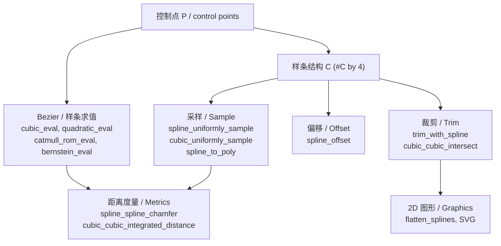

# 10.14 曲线与样条 / Curves & Splines

> 本章覆盖 `mesh/` 下与 **三次/二次 Bezier 曲线 (cubic / quadratic Bézier curves)**、
> **样条 (spline)**、**曲线距离/相交/偏移/裁剪 (distance / intersection / offset / trim)**、
> **弧与椭圆 (arc / ellipse)** 以及 **SVG 路径解析 (SVG path parsing)** 相关的函数。
>
> This chapter documents the functions in `mesh/` related to Bézier curves and splines:
> evaluation, derivative/tangent/curvature, splitting/subdivision, arc length, bounding boxes,
> root finding, simplification/vertex removal, curve-curve distance and intersection, curve
> offsetting and trimming, arcs/ellipses, sampling/smoothing, and SVG path parsing.
>
> 约定 / Notation：`P`/`C` 分别是**控制点位置集**与**三次 Bezier 索引**；
> 对单个曲线通常记控制点为 `C`（`4 by dim`）或 `Q`（二次，`3 by dim`）。
> 锚点行号取自源码实际范围（先 Read 校验）。
>
> > ⚠️ **覆盖数量说明 / Count note**：任务清单实际列出 **52** 个函数名（题目写作 51）。
> > 本文件逐一为全部 52 个函数建立 `###` 条目；此外，为呼应要求 (e) 的 SVG 管线，
> > 另附 `SVG`、`readSVG_cubics` 两个额外 `###` 条目，合计 **54** 个 `###` 函数条目。

---

## 本章概览 / Chapter overview

### (a) 三次 Bezier 曲线基本操作 / Cubic Bézier primitives

| 函数 | 文件锚点 | 作用 | 关键依赖 |
|---|---|---|---|
| `cubic_eval` | [L1-L22](file:///c:/VSWork/gptoolbox-1/mesh/cubic_eval.m#L1-L22) | 求值（显式 Bernstein 展开，de Casteljau 代码被注释改为直接展开） | — |
| `cubic_derivative_eval` | [L1-L15](file:///c:/VSWork/gptoolbox-1/mesh/cubic_derivative_eval.m#L1-L15) | 第 k 阶导数（k=0..3） | `cubic_eval` |
| `cubic_tangent` | [L1-L14](file:///c:/VSWork/gptoolbox-1/mesh/cubic_tangent.m#L1-L14) | 一阶导数（切向） | — |
| `cubic_curvature` | [L1-L74](file:///c:/VSWork/gptoolbox-1/mesh/cubic_curvature.m#L1-L74) | 曲率标量 + 曲率法向 | — |
| `cubic_split` | [L1-L24](file:///c:/VSWork/gptoolbox-1/mesh/cubic_split.m#L1-L24) | 在参数 t 处 de Casteljau 拆分 | — |
| `cubic_subdivide` | [L1-L35](file:///c:/VSWork/gptoolbox-1/mesh/cubic_subdivide.m#L1-L35) | 在多个参数处拆分为样条（共享控制点） | `cubic_split`, `remove_unreferenced` |
| `cubic_arc_length` | [L1-L152](file:///c:/VSWork/gptoolbox-1/mesh/cubic_arc_length.m#L1-L152) | Gauss-Legendre 积分弧长（含对 a,b,C 的导数） | `gauss_legendre_quadrature` |
| `cubic_aabb` | [L1-L26](file:///c:/VSWork/gptoolbox-1/mesh/cubic_aabb.m#L1-L26) | 轴对齐包围盒（对每个坐标求极值点） | `cubic_eval` |
| `cubic_roots` | [L1-L88](file:///c:/VSWork/gptoolbox-1/mesh/cubic_roots.m#L1-L88) | 三次方程解析求根（Cardano 公式） | — |
| `cubic_simplify` | [L1-L157](file:///c:/VSWork/gptoolbox-1/mesh/cubic_simplify.m#L1-L157) | 按 G1 子序列把折线/曲线段拟合为更少三次曲线 | `cubic_flat_eval`, `manifold_patches`, `edges_to_path`, `fit_cubic_bezier` |
| `cubic_vertex_removal` | [L1-L323](file:///c:/VSWork/gptoolbox-1/mesh/cubic_vertex_removal.m#L1-L323) | 合并 G1 连续两段为一段（符号/迭代两法） | `cubic_cubic_integrated_distance`, `cubic_split` |
| `cubic_is_flat` | [L1-L32](file:///c:/VSWork/gptoolbox-1/mesh/cubic_is_flat.m#L1-L32) | Fischer 2000 平坦判定 | — |
| `cubic_flat_eval` | [L1-L31](file:///c:/VSWork/gptoolbox-1/mesh/cubic_flat_eval.m#L1-L31) | 递归自适应细分直到局部平坦 | `cubic_is_flat`, `cubic_split` |
| `cubic_max_curvature` | [L1-L58](file:///c:/VSWork/gptoolbox-1/mesh/cubic_max_curvature.m#L1-L58) | 区间上最大曲率（按拐点分段） | `spline_inflection_points`, `cubic_split`, `cubic_max_curvature_single_interval` |
| `cubic_max_curvature_single_interval` | [L1-L52](file:///c:/VSWork/gptoolbox-1/mesh/cubic_max_curvature_single_interval.m#L1-L52) | 单区间最大曲率（幂基 + 临界多项式求根） | `fast_roots` |

### (b) 曲线间距离与相交 / Curve–curve distance & intersection

| 函数 | 文件锚点 | 作用 | 关键依赖 |
|---|---|---|---|
| `cubic_cubic_integrated_distance` | [L1-L122](file:///c:/VSWork/gptoolbox-1/mesh/cubic_cubic_integrated_distance.m#L1-L122) | 两参数化三次曲线间的积分平方距离（含二次型 H,F,c） | `cubic_eval` |
| `cubic_cubic_intersect` | [L1-L54](file:///c:/VSWork/gptoolbox-1/mesh/cubic_cubic_intersect.m#L1-L54) | 递归细分求交（平坦后做线段求交） | `cubic_is_flat`, `cubic_split`, `lineSegmentIntersect` |

### (c) 样条 / Splines (`spline_*`)

| 函数 | 文件锚点 | 作用 | 关键依赖 |
|---|---|---|---|
| `spline_arc_lengths` | [L1-L53](file:///c:/VSWork/gptoolbox-1/mesh/spline_arc_lengths.m#L1-L53) | 每条 Bezier 段的弧长（两种方法） | `cubic_arc_length`, `spline_to_poly`, `edge_lengths` |
| `spline_area` | [L1-L62](file:///c:/VSWork/gptoolbox-1/mesh/spline_area.m#L1-L62) | 闭合三次样条的**有向**面积（闭式） | — |
| `spline_cage` | [L1-L68](file:///c:/VSWork/gptoolbox-1/mesh/spline_cage.m#L1-L68) | 生成包围样条的三角形笼 mesh | `spline_to_poly`, `voxel_grid`, `point_mesh_squared_distance`, `bwmesh` |
| `spline_closing` | [L1-L164](file:///c:/VSWork/gptoolbox-1/mesh/spline_closing.m#L1-L164) | 对开放样条加圆角闭合并生成填充轮廓 | `spline_uniformly_sample`, `spline_split`, `arc_to_cubics`, `poly_to_spline`, `matchpairs`, `repmesh` |
| `spline_endpoint_curvature` | [L1-L7](file:///c:/VSWork/gptoolbox-1/mesh/spline_endpoint_curvature.m#L1-L7) | 两端点曲率（用 doublearea 闭式） | `doublearea`, `normrow` |
| `spline_extremal_curvature_points` | [L1-L124](file:///c:/VSWork/gptoolbox-1/mesh/spline_extremal_curvature_points.m#L1-L124) | 曲率极值点 + 拐点（含 min/max 标记） | `fast_roots` |
| `spline_G1_subspace` | [L1-L146](file:///c:/VSWork/gptoolbox-1/mesh/spline_G1_subspace.m#L1-L146) | 满足 C0+G1 约束的**线性子空间**（降维矩阵 A） | `manifold_patches`, `edges_to_path`, `normalizerow` |
| `spline_inflection_points` | [L1-L54](file:///c:/VSWork/gptoolbox-1/mesh/spline_inflection_points.m#L1-L54) | 拐点（曲率为零的 t） | `fast_roots` |
| `spline_offset` | [L1-L127](file:///c:/VSWork/gptoolbox-1/mesh/spline_offset.m#L1-L127) | 带符号距离偏移为另一三次样条（递归细分） | `spline_robust_endpoint_tangent_directions`, `cubic_tangent`, `spline_endpoint_curvature`, `point_cubic_squared_distance`, `cubic_split` |
| `spline_robust_endpoint_tangent_directions` | [L1-L24](file:///c:/VSWork/gptoolbox-1/mesh/spline_robust_endpoint_tangent_directions.m#L1-L24) | 退化鲁棒的端点切向（文件内函数名为 `spline_robust_endpoint_tangents`） | — |
| `spline_spline_chamfer` | [L1-L183](file:///c:/VSWork/gptoolbox-1/mesh/spline_spline_chamfer.m#L1-L183) | 两条样条间的 Chamfer 距离（三种采样法） | `spline_to_poly`, `cubic_arc_length`, `cubic_uniformly_sample`, `point_mesh_squared_distance`, `rand_samples`, `gauss_legendre_quadrature` |
| `spline_split` | [L1-L76](file:///c:/VSWork/gptoolbox-1/mesh/spline_split.m#L1-L76) | 在给定 (curve, t) 列表处拆分样条 | `cubic_split` |
| `spline_to_poly` | [L1-L63](file:///c:/VSWork/gptoolbox-1/mesh/spline_to_poly.m#L1-L63) | 样条 → 自适应折线 | `cubic_flat_eval`, `remove_unreferenced` |
| `spline_uniformly_sample` | [L1-L346](file:///c:/VSWork/gptoolbox-1/mesh/spline_uniformly_sample.m#L1-L346) | 全链等弧长采样（Gauss-Newton + 回溯线搜索） | `cubic_arc_length`, `spline_arc_lengths`, `connected_components`, `remove_unreferenced`, `backtracking_line_search` |
| `spline_upsample` | [L1-L94](file:///c:/VSWork/gptoolbox-1/mesh/spline_upsample.m#L1-L94) | 对样条做迭代中点细分（可选择性） | `cubic_subdivide`, `remove_duplicate_vertices` |

### (d) 二次曲线与转换 / Quadratic curves & conversions

| 函数 | 文件锚点 | 作用 | 关键依赖 |
|---|---|---|---|
| `quadratic_eval` | [L1-L19](file:///c:/VSWork/gptoolbox-1/mesh/quadratic_eval.m#L1-L19) | 二次 Bezier 求值 | — |
| `quadratic_to_cubic` | [L1-L15](file:///c:/VSWork/gptoolbox-1/mesh/quadratic_to_cubic.m#L1-L15) | 二次 → 三次升阶 | — |
| `cubic_to_quadratic_spline` | [L1-L51](file:///c:/VSWork/gptoolbox-1/mesh/cubic_to_quadratic_spline.m#L1-L51) | 三次 → 二次样条（`naive` / `minimal`） | `spline_inflection_points`, `cubic_eval`, `cubic_tangent`, `intersect_lines_2d` |
| `cubic_to_biarc` | [L1-L132](file:///c:/VSWork/gptoolbox-1/mesh/cubic_to_biarc.m#L1-L132) | 三次 → 双圆弧（biarc）拟合 | `spline_robust_endpoint_tangent_directions`, `biarc_solve_2d`, `biarc_cubic_mse`, `biarc_d1_intervals`, `incenter`, `intersect_lines_2d` |
| `bernstein_eval` | [L1-L17](file:///c:/VSWork/gptoolbox-1/mesh/bernstein_eval.m#L1-L17) | Bernstein 基函数 `B_{i,n}(u)` | — |
| `circular_arc_to_cubics` | [L1-L121](file:///c:/VSWork/gptoolbox-1/mesh/circular_arc_to_cubics.m#L1-L121) | 圆弧 → 三次 Bezier 段（携 large_arc/sweep） | `ellipse_to_spline`, `cubic_split`, `point_spline_squared_distance`, `edge_lengths` |
| `arc_to_cubics` | [L1-L33](file:///c:/VSWork/gptoolbox-1/mesh/arc_to_cubics.m#L1-L33) | SVG 椭圆弧 `A` → 三次 Bezier | `circular_arc_to_cubics` |
| `ellipse_to_spline` | [L1-L16](file:///c:/VSWork/gptoolbox-1/mesh/ellipse_to_spline.m#L1-L16) | 椭圆 → 4 段三次 Bezier（1193/2160 近似） | — |
| `poly_to_spline` | [L1-L16](file:///c:/VSWork/gptoolbox-1/mesh/poly_to_spline.m#L1-L16) | 折线 → 三次 Bezier（文件内函数名为 `spline_to_poly(V,E)`） | — |

### (e) 2D 矢量图形与路径 / 2D vector graphics & paths

| 函数 | 文件锚点 | 作用 | 关键依赖 |
|---|---|---|---|
| `parse_path` | [L1-L311](file:///c:/VSWork/gptoolbox-1/mesh/parse_path.m#L1-L311) | 解析 SVG `d` 属性为三次 Bezier | `arc_to_cubics`, `quadratic_to_cubic` |
| `parse_svg_transform` | [L1-L53](file:///c:/VSWork/gptoolbox-1/mesh/parse_svg_transform.m#L1-L53) | 解析 SVG `transform` 属性为 2×3 矩阵 | — |
| `flatten_splines` | [L1-L117](file:///c:/VSWork/gptoolbox-1/mesh/flatten_splines.m#L1-L117) | 合并多对象 SVG 曲线为单一形状（union/minus） | `spline_area`, `trim_with_spline` |
| `trim_with_spline` | [L1-L102](file:///c:/VSWork/gptoolbox-1/mesh/trim_with_spline.m#L1-L102) | 用"实心"样条裁剪另一条样条（内外判定） | `cubic_cubic_intersect`, `cubic_subdivide`, `cubic_eval`, `box_each_element`, `box_intersect`, `spline_winding_number` |
| `offset_curve` | [L1-L39](file:///c:/VSWork/gptoolbox-1/mesh/offset_curve.m#L1-L39) | 闭合折线的内/外等距偏移 | — |
| `SVG` (classdef) | [L1-L103](file:///c:/VSWork/gptoolbox-1/mesh/SVG.m#L1-L103) | **`classdef SVG < handle`**：SVG 文件绘制类 | `readSVG_cubics`, `spline_to_poly`, `triangulate_interior`, `outline`, `plot_taper` |
| `readSVG_cubics` | [L1](file:///c:/VSWork/gptoolbox-1/mesh/readSVG_cubics.m#L1) | SVG 文件 → 控制点/曲线/颜色（`SVG` 与 `cubic_eval` 的 See also） | `parse_path`, `parse_svg_transform` |

> **SVG.m 确认 / Confirmation**：`mesh/SVG.m` 第 1 行为 `classdef SVG < handle` —— **是 classdef**（非函数文件）。
> 公开属性含 `P,C,I,F,S,W,D,bbd,min_corner,max_corner,center,transform,viewBox,draw_tol`；构造 `SVG(filename)`
> 调用 `readSVG_cubics`；方法 `draw(draw_tol)` 经 `spline_to_poly` → `triangulate_interior`/`outline`/
> `plot_taper`/`tsurf` 渲染。详见本章末 `### SVG` 条目。

### (f) 采样与光顺 / Sampling & smoothing

| 函数 | 文件锚点 | 作用 | 关键依赖 |
|---|---|---|---|
| `curve_smooth` | [L1-L66](file:///c:/VSWork/gptoolbox-1/mesh/curve_smooth.m#L1-L66) | 曲线共形平均曲率流光顺 | `adjacency_matrix`, `adjacency_edge_cost_matrix` |
| `cubic_uniformly_sample` | [L1-L313](file:///c:/VSWork/gptoolbox-1/mesh/cubic_uniformly_sample.m#L1-L313) | 单条三次曲线等弧长采样（GN + 回溯线搜索） | `cubic_arc_length`, `cubic_eval`, `cubic_tangent`, `gauss_legendre_quadrature`, `backtracking_line_search` |
| `catmull_rom_eval` | [L1-L73](file:///c:/VSWork/gptoolbox-1/mesh/catmull_rom_eval.m#L1-L73) | Catmull-Rom 样条求值（可闭/开、张力参数） | — |

> **概览中提及但不在本清单 / Mentioned-but-not-listed**：任务概览 (f) 还点名
> `uniformly_sample` / `uniformly_sample_edges` / `sample_edges`。经 Glob 校验：
> `mesh/uniformly_sample.m`、`mesh/uniformly_sample_edges.m`、`mesh/sample_edges.m` **均存在**，
> 但它们不在本章要求的 52 个 `###` 条目清单内，故此处仅列出、不单独立条（属网格采样章节）。

### (g) 交互 / 参考 / Interactive & reference

| 函数 | 文件锚点 | 作用 | 关键依赖 |
|---|---|---|---|
| `get_control_points` | [L1-L40](file:///c:/VSWork/gptoolbox-1/mesh/get_control_points.m#L1-L40) | 鼠标拾取控制点（`getpts`/`ginput`） | `getpts` |
| `get_pencil_curve` | [L1-L102](file:///c:/VSWork/gptoolbox-1/mesh/get_pencil_curve.m#L1-L102) | 拖拽绘制一条曲线 | — |
| `get_pencil_curves` | [L1-L31](file:///c:/VSWork/gptoolbox-1/mesh/get_pencil_curves.m#L1-L31) | 连续绘制多条曲线并简化 | `get_pencil_curve`, `dpsimplify` |

### 总览数据流 / Overall data flow



---

## (a) 三次 Bezier 曲线基本操作 / Cubic Bézier primitives

### `cubic_eval` — 三次 Bezier 曲线求值
- **文件 / File**: [mesh/cubic_eval.m](file:///c:/VSWork/gptoolbox-1/mesh/cubic_eval.m#L1-L22)
- **签名 / Signature**: `P = cubic_eval(C,t)`
- **功能 / Purpose**: `EN: Evaluate a cubic Bézier curve at parameters t via the explicit Bernstein-form expansion.` / 中文：用**显式 Bernstein 展开式**求三次 Bezier 曲线在参数 `t` 处的点。
- **输入 / Inputs**:

  | 参数 | 尺寸/类型 | 含义 (中 / EN) |
  |---|---|---|
  | `C` | `4 by dim` | 四个控制点 / four cubic Bézier control points |
  | `t` | `#t`（数值数组） | 求值参数，通常 ∈[0,1] / evaluation parameters |

- **输出 / Outputs**:

  | 参数 | 尺寸/类型 | 含义 |
  |---|---|---|
  | `P` | `#t by dim` | 求值点 / evaluated points |

- **可选参数 / Optional**: 无 / none。
- **变量流动 / Variable flow**: `C,t →(reshape 为列)→ t →(4 个 Bernstein 基逐项加权求和)→ P`
- **算法步骤 / Algorithm**:
  1. 把 `t` reshape 成列向量（`numel(t) by 1`）。
  2. 直接写出 4 项基函数 `1·(1-t)³t⁰, 3·(1-t)²t¹, 3·(1-t)¹t², 1·(1-t)⁰t³`，与 `C(1,:)..C(4,:)` 逐项相乘再相加（源码第 17-21 行；第 15-16 行注释掉了等价但更慢的 `bernstein_eval([0 1 2 3],3,t)*C` 写法）。
  3. 返回 `P`。
- **流程图 / Flowchart**:

  ```mermaid
  flowchart TD
    A["输入 C (4×dim), t"] --> B["t = reshape(t,[],1)"]
    B --> C["P = 1(1-t)³t⁰C₁ + 3(1-t)²tC₂ + 3(1-t)t²C₃ + t³C₄"]
    C --> Z["输出 P (#t×dim)"]
  ```

- **依赖 / Dependencies**: 无 / none（源码注释显示可用 [bernstein_eval](file:///c:/VSWork/gptoolbox-1/mesh/bernstein_eval.m) 替代）。
- **See also**: `bernstein_eval`, `cubic_split`, `cubic_tangent`, `readSVG_cubics`

### `cubic_derivative_eval` — 三次 Bezier 第 k 阶导数
- **文件 / File**: [mesh/cubic_derivative_eval.m](file:///c:/VSWork/gptoolbox-1/mesh/cubic_derivative_eval.m#L1-L15)
- **签名 / Signature**: `D = cubic_derivative_eval(C,t,k)`
- **功能 / Purpose**: `EN: Evaluate the k-th derivative (k = 0,1,2,3) of a cubic Bézier curve.` / 中文：求三次 Bezier 的 k 阶导数（k=0 时即求值）。
- **输入 / Inputs**:

  | 参数 | 尺寸/类型 | 含义 |
  |---|---|---|
  | `C` | `4 by dim` | 控制点 |
  | `t` | `#t` | 参数 |
  | `k` | 标量 | 导数阶数 |

- **输出 / Outputs**:

  | 参数 | 尺寸/类型 | 含义 |
  |---|---|---|
  | `D` | `#t by dim` | 第 k 阶导数值 |

- **可选参数 / Optional**: 无 / none。
- **变量流动 / Variable flow**: `C,t,k →(switch k)→ 0|1|2|3 阶公式 → D`
- **算法步骤 / Algorithm**:
  1. `t` reshape 成列。
  2. `switch k`：`k=0` 调 `cubic_eval`；`k=1` 用差分控制点的一阶式；`k=2` 用二阶式；`k=3` 为常向量 `-6C₁+18C₂-18C₃+6C₄`。
  3. 其它 k 返回全零 `#t by dim`。
- **流程图 / Flowchart**:

  ```mermaid
  flowchart TD
    A["输入 C,t,k"] --> S{"k = ?"}
    S -- 0 --> D0["cubic_eval(C,t)"]
    S -- 1 --> D1["3(1-t)²ΔC₁ + 6(1-t)tΔC₂ + 3t²ΔC₃"]
    S -- 2 --> D2["6(1-t)(C₃-2C₂+C₁) + 6t(C₄-2C₃+C₂)"]
    S -- 3 --> D3["-6C₁+18C₂-18C₃+6C₄"]
    S -- 其它 --> DZ["zeros(#t,dim)"]
    D0 --> Z["输出 D"]
    D1 --> Z
    D2 --> Z
    D3 --> Z
    DZ --> Z
  ```

- **依赖 / Dependencies**: `cubic_eval`
- **See also**: `cubic_eval`, `cubic_tangent`, `cubic_curvature`

### `cubic_tangent` — 三次 Bezier 切向量
- **文件 / File**: [mesh/cubic_tangent.m](file:///c:/VSWork/gptoolbox-1/mesh/cubic_tangent.m#L1-L14)
- **签名 / Signature**: `T = cubic_tangent(C,t)`
- **功能 / Purpose**: `EN: Evaluate the first derivative (tangent) of a cubic Bézier curve.` / 中文：求三次 Bezier 的一阶导数（切向量）。
- **输入 / Inputs**:

  | 参数 | 尺寸/类型 | 含义 |
  |---|---|---|
  | `C` | `4 by dim` | 控制点 |
  | `t` | `#t` | 参数值 |

- **输出 / Outputs**:

  | 参数 | 尺寸/类型 | 含义 |
  |---|---|---|
  | `T` | `#t by dim` | 切向量（未归一化） |

- **可选参数 / Optional**: 无 / none。
- **变量流动 / Variable flow**: `C,t →(差分控制点 ΔC₁,ΔC₂,ΔC₃)→(二次 Bernstein 加权)→ T`
- **算法步骤 / Algorithm**:
  1. `t` reshape 成列。
  2. 按一阶导数公式（等价 `cubic_derivative_eval(C,t,1)`）对差分控制点加权求和。
- **流程图 / Flowchart**:

  ```mermaid
  flowchart TD
    A["输入 C,t"] --> B["t 列化"]
    B --> C["T = 3(1-t)²(C₂-C₁) + 6(1-t)t(C₃-C₂) + 3t²(C₄-C₃)"]
    C --> Z["输出 T"]
  ```

- **依赖 / Dependencies**: 无 / none。
- **See also**: `cubic_derivative_eval`, `cubic_curvature`

### `cubic_curvature` — 三次 Bezier 曲率与曲率法向
- **文件 / File**: [mesh/cubic_curvature.m](file:///c:/VSWork/gptoolbox-1/mesh/cubic_curvature.m#L1-L74)
- **签名 / Signature**: `[k,KN] = cubic_curvature(C,t)`
- **功能 / Purpose**: `EN: Compute curvature values and curvature normal vectors of a cubic Bézier curve in 2D/3D/general dim.` / 中文：计算三次 Bezier 在参数 t 处的**曲率**与**曲率法向**（支持 2D/3D/一般维）。
- **输入 / Inputs**:

  | 参数 | 尺寸/类型 | 含义 |
  |---|---|---|
  | `C` | `4 by dim` | 控制点 |
  | `t` | `#t by 1` | 参数值 |

- **输出 / Outputs**:

  | 参数 | 尺寸/类型 | 含义 |
  |---|---|---|
  | `k` | `#t by 1` | 曲率值 |
  | `KN` | `#t by dim` | 曲率法向 `N·|k|` |

- **可选参数 / Optional**: 无 / none。
- **变量流动 / Variable flow**: `C →(差分得 D1(3×dim),D2(2×dim))→ r',r'' →(speed=|r'|)→ 分支 dim=2/3/其它 算 k →(单位化 r''法向分量)→ KN`
- **算法步骤 / Algorithm**:
  1. 一阶/二阶导数控制多边形：`D1 = 3(C₂₋₄−C₁₋₃)`，`D2 = 6(C₃₋₄−2C₂₋₃+C₁₋₂)`。
  2. 用 `u=1−t` 的 Bernstein 基求 `r'(t)`、`r''(t)`；速度 `speed=√Σr'²`。
  3. 按 `dim` 分三种：2D 用标量叉积 `|x'y''−y'x''|/speed³`；3D 用 `‖r'×r''‖/speed³`；一般维用经切向投影后的 `r''⊥` 范数 / speed²。
  4. 计算单位切向 `T=r'/speed`，把 `r''` 投影到法平面得 `N`，输出 `KN=N·|k|`。（源码第 3 行 `switch` 起，第 41-57 行为三分支，第 59-72 行为 KN。）
- **流程图 / Flowchart**:

  ```mermaid
  flowchart TD
    A["输入 C,t"] --> B["D1,D2 差分控制多边形"]
    B --> C["r'(t), r''(t)"]
    C --> D["speed = |r'|"]
    D --> E{"dim ?"}
    E -- 2 --> E2["k = (x'y''-y'x'')/speed³"]
    E -- 3 --> E3["k = |r'×r''|/speed³"]
    E -- 其它 --> E4["k = |r''⊥|/speed²"]
    E2 --> F["T = r'/speed; N = normalize(r'' - (r''·T)T)"]
    E3 --> F
    E4 --> F
    F --> Z["输出 k, KN = N*abs(k)"]
  ```

- **依赖 / Dependencies**: 无 / none。
- **See also**: `cubic_tangent`, `cubic_derivative_eval`, `spline_endpoint_curvature`

### `cubic_split` — 三次 Bezier 参数拆分
- **文件 / File**: [mesh/cubic_split.m](file:///c:/VSWork/gptoolbox-1/mesh/cubic_split.m#L1-L24)
- **签名 / Signature**: `[C1,C2] = cubic_split(C,t)`
- **功能 / Purpose**: `EN: Split a cubic Bézier curve at parameter t into two halves (de Casteljau).` / 中文：在参数 t 处用 de Casteljau 把三次 Bezier 拆成左右两半。
- **输入 / Inputs**:

  | 参数 | 尺寸/类型 | 含义 |
  |---|---|---|
  | `C` | `4 by dim` | 控制点 |
  | `t` | 标量 ∈[0,1] | 拆分参数 |

- **输出 / Outputs**:

  | 参数 | 尺寸/类型 | 含义 |
  |---|---|---|
  | `C1` | `4 by dim` | 左半控制点 |
  | `C2` | `4 by dim` | 右半控制点 |

- **可选参数 / Optional**: 无 / none。
- **变量流动 / Variable flow**: `C →(一次 lerp: C12,C23,C34)→(二次: C123,C234)→(三次: C1234)→ C1=[C₁,C12,C123,C1234], C2=[C1234,C234,C34,C₄]`
- **算法步骤 / Algorithm**:
  1. 三条边线在 t 处线性插值得 `C12,C23,C34`。
  2. 组成 `C123,C234`，再得中心点 `C1234`（de Casteljau 三角形）。
  3. 左半取三角形左侧边、右半取右侧边。
- **流程图 / Flowchart**:

  ```mermaid
  flowchart TD
    A["输入 C (4×dim), t"] --> B["C12,C23,C34 = lerp(C, t)"]
    B --> C["C123 = lerp(C12,C23,t); C234 = lerp(C23,C34,t)"]
    C --> D["C1234 = lerp(C123,C234,t)"]
    D --> Z["输出 C1=[C₁,C12,C123,C1234], C2=[C1234,C234,C34,C₄]"]
  ```

- **依赖 / Dependencies**: 无 / none。
- **See also**: `cubic_eval`, `cubic_subdivide`, `cubic_flat_eval`

### `cubic_subdivide` — 多参数拆分为样条
- **文件 / File**: [mesh/cubic_subdivide.m](file:///c:/VSWork/gptoolbox-1/mesh/cubic_subdivide.m#L1-L35)
- **签名 / Signature**: `[P,C,I] = cubic_subdivide(B,T)`
- **功能 / Purpose**: `EN: Split one cubic Bézier at all parameters T, producing a spline with shared control points.` / 中文：在多个参数 `T` 处把一条三次 Bezier 拆成共享控制点的样条（`#T+1` 段）。
- **输入 / Inputs**:

  | 参数 | 尺寸/类型 | 含义 |
  |---|---|---|
  | `B` | `4 by dim` | 原曲线控制点 |
  | `T` | `#T` | ∈[0,1] 的拆分参数 |

- **输出 / Outputs**:

  | 参数 | 尺寸/类型 | 含义 |
  |---|---|---|
  | `P` | `#P by dim` | 控制点（`P(1:2,:)==B([1 4],:)`） |
  | `C` | `3(#T+1)+1 by 4` | 段控制点索引 |
  | `I` | `#P` | 指向 `[B; 新点]` 的索引 |

- **可选参数 / Optional**: 无 / none。
- **变量流动 / Variable flow**: `B,T →(排序 T)→ (逐个 cubic_split 并推进参数映射)→ P,C →(remove_unreferenced)→ 去重后的 P,C,I`
- **算法步骤 / Algorithm**:
  1. `P=B, C=[1 2 3 4]`，`T` 排序。
  2. 对每个 `T(ti)`：在当前末段调用 `cubic_split`，追加 `C1(2:4)`、`C2(2:3)` 到 `P`；更新索引与新段；并把后续参数重映射 `T(ti+1:end)=(T(ti+1:end)-T(ti))/(1-T(ti))`。
  3. 用 `remove_unreferenced` 清理并 `reshape(C,[],4)`。
- **流程图 / Flowchart**:

  ```mermaid
  flowchart TD
    A["输入 B,T"] --> B["P=B; C=[1 2 3 4]; T=sort(T)"]
    B --> C{"还有未处理参数?"}
    C -- 是 --> D["[C1,C2]=cubic_split(P(Ca,:),T(ti))"]
    D --> E["追加 C1(2:4),C2(2:3) 到 P; 更新索引进 C"]
    E --> F["后续参数重映射 T=(T-T(ti))/(1-T(ti))"]
    F --> C
    C -- 否 --> G["[P,~,I,C]=remove_unreferenced(P,C); C=reshape(C,[],4)"]
    G --> Z["输出 P,C,I"]
  ```

- **依赖 / Dependencies**: `cubic_split`, `remove_unreferenced`
- **See also**: `cubic_split`, `cubic_eval`, `spline_upsample`

### `cubic_arc_length` — 三次 Bezier 弧长（含导数）
- **文件 / File**: [mesh/cubic_arc_length.m](file:///c:/VSWork/gptoolbox-1/mesh/cubic_arc_length.m#L1-L152)
- **签名 / Signature**: `[l,dlda,dldb,dldC,d2lda2,d2ldb2,d2ldadb] = cubic_arc_length(C,nq,a,b)`
- **功能 / Purpose**: `EN: Gauss-Legendre quadrature arc length of cubic Bézier curves over [a,b], with first/second derivatives wrt interval endpoints and control points.` / 中文：用 Gauss-Legendre 求积计算三次 Bezier 在 `[a,b]` 上的弧长，并可解析给出对积分端点 `a,b`、控制点 `C` 的一/二阶导数。
- **输入 / Inputs**:

  | 参数 | 尺寸/类型 | 含义 |
  |---|---|---|
  | `C` | `4 by dim by 1\|#a` | 控制点（可批量化） |
  | `nq` | 标量 \| `nq by 2` | 求积点数，或 (点,权) / Legendre 零点与原始权 |
  | `a` | `#a` | 积分下限（默认 0） |
  | `b` | `#a` | 积分上限（默认 1） |

- **输出 / Outputs**:

  | 参数 | 尺寸/类型 | 含义 |
  |---|---|---|
  | `l` | `#a` | 弧长 |
  | `dlda`,`dldb` | `#a` | 对端点导数 |
  | `dldC` | 张量 | 对控制点导数（`nargout>3`） |
  | `d2lda2`,`d2ldb2`,`d2ldadb` | `#a` | 二阶导数（`nargout>4`） |

- **可选参数 / Optional**: 位置参数 `nq`(默认 10)、`a`(默认 0)、`b`(默认 1)；`nq` 可传 `[点 权]` 或 `[Legendre零点 原始权]` 两种形式（源码 36-58 行分支）。
- **变量流动 / Variable flow**: `nq,a,b →(gauss_legendre_quadrature → 映射到[x,y]区间)→ x,w →(Bernstein 求 r'(x))→ T →(s=|T|)→ l=Σw·s →(对 a,b,C 求导链)→ dlda,dldb,dldC,...`
- **算法步骤 / Algorithm**:
  1. 生成求积点/权（若未直接给定则调 `gauss_legendre_quadrature` 并映射到 `[a,b]`）。
  2. 以 Bernstein 基组合差分控制点得切向 `T`，`s=‖T‖`。
  3. `l=Σ w·s`（第 74-79 行）。
  4. 依次按需求输出对 `a,b` 的导数（第 81-96 行）、对 `C` 的导数（98-105 行）、二阶导数（107-147 行），用链式法则 `ds/da=(ds/dx)(dx/da)` 等。
- **流程图 / Flowchart**:

  ```mermaid
  flowchart TD
    A["输入 C,nq,a,b"] --> B["求积点/权 x,w (映射到[a,b])"]
    B --> C["T = b21*C21+b32*C32+b43*C43"]
    C --> D["s = |T|; l = sum(w.*s)"]
    D --> E{"nargout > 1?"}
    E -- 否 --> Z["输出 l"]
    E -- 是 --> F["dlda,dldb (链式)"]
    F --> G{"nargout > 3?"}
    G -- 是 --> H["dldC"]
    G -- 否 --> Z
    H --> I{"nargout > 4?"}
    I -- 是 --> J["d2lda2,d2ldb2,d2ldadb"]
    I -- 否 --> Z
    J --> Z
  ```

- **依赖 / Dependencies**: `gauss_legendre_quadrature`
- **See also**: `spline_arc_lengths`, `cubic_uniformly_sample`, `spline_uniformly_sample`

### `cubic_aabb` — 三次 Bezier 轴对齐包围盒
- **文件 / File**: [mesh/cubic_aabb.m](file:///c:/VSWork/gptoolbox-1/mesh/cubic_aabb.m#L1-L26)
- **签名 / Signature**: `[C1,C2] = cubic_aabb(C)`
- **功能 / Purpose**: `EN: Tight axis-aligned bounding box of a cubic Bézier curve.` / 中文：求三次 Bezier 的紧致轴对齐包围盒（逐坐标求极值）。
- **输入 / Inputs**:

  | 参数 | 尺寸/类型 | 含义 |
  |---|---|---|
  | `C` | `4 by dim` | 控制点 |

- **输出 / Outputs**:

  | 参数 | 尺寸/类型 | 含义 |
  |---|---|---|
  | `C1` | `1 by dim` | 最小值角点 |
  | `C2` | `1 by dim` | 最大值角点 |

- **可选参数 / Optional**: 无 / none。
- **变量流动 / Variable flow**: `C →(逐坐标解 3At²+2Bt+C=0 求极值参数 ts)→(cubic_eval ts + 端点)→ 取 min/max → C1,C2`
- **算法步骤 / Algorithm**:
  1. 内嵌函数 `extrema_ts` 解导数二次多项式，保留 `(0,1)` 内实根。
  2. 对每一维 `c`：在极值参数与两端点处求值，取 `min`/`max`。
- **流程图 / Flowchart**:

  ```mermaid
  flowchart TD
    A["输入 C"] --> B["初始化 C1=+inf, C2=-inf"]
    B --> C{"for c = 1..dim"}
    C --> D["ts = extrema_ts(C(:,c)) (解 3At²+2Bt+C=0, 取(0,1)实根)"]
    D --> E["Qc = cubic_eval(C(:,c),ts)"]
    E --> F["C1(c)=min(Qc,C(1,c),C(4,c)); C2(c)=max(...)"]
    F --> C
    C --> Z["输出 C1,C2"]
  ```

- **依赖 / Dependencies**: `cubic_eval`
- **See also**: `cubic_eval`, `cubic_roots`

### `cubic_roots` — 三次方程解析求根
- **文件 / File**: [mesh/cubic_roots.m](file:///c:/VSWork/gptoolbox-1/mesh/cubic_roots.m#L1-L88)
- **签名 / Signature**: `Z = cubic_roots(C)`
- **功能 / Purpose**: `EN: Closed-form roots of the cubic equation ax³+bx²+cx+d=0 (Cardano / general formula).` / 中文：三次方程 `ax³+bx²+cx+d=0` 的解析根（Cardano 一般公式）。
- **输入 / Inputs**:

  | 参数 | 尺寸/类型 | 含义 |
  |---|---|---|
  | `C` | `#C by 4` | 每行是 `[a b c d]` 系数 |

- **输出 / Outputs**:

  | 参数 | 尺寸/类型 | 含义 |
  |---|---|---|
  | `Z` | `#C by 3` | 三个复根（含重根/复共轭） |

- **可选参数 / Optional**: 无 / none。
- **变量流动 / Variable flow**: `C(a,b,c,d) →(判别式 D,D0,D1)→(立方根 H,HP)→(ξ=[1,ω,ω²])→ Z = -(b + Hξ + D0/(ξH))/(3a)`
- **算法步骤 / Algorithm**:
  1. 取系数 `a,b,c,d`。
  2. 算判别式 `D,D0,D1` 与 `K=√(D1²−4D0³)`，取 `H=((D1+K)/2)^(1/3)`，并对 `H≈0` 用 `HP` 兜底（源码第 22 行）。
  3. 代入一般公式得三根 `Z`（第 23 行，`ξ` 为三次单位根）。
  4. 文件后半（31-85 行）为注释保留的 Nickalls 方法备选实现。
- **流程图 / Flowchart**:

  ```mermaid
  flowchart TD
    A["输入 C = [a b c d]"] --> B["D,D0,D1"]
    B --> C["K=sqrt(D1²-4D0³); H=((D1+K)/2)^(1/3)"]
    C --> D{"|H| < eps?"}
    D -- 是 --> E["H = ((D1-K)/2)^(1/3)"]
    D -- 否 --> F["保持 H"]
    E --> G["Z = -(b + H*xi + D0./(xi*H))/(3a)"]
    F --> G
    G --> Z["输出 Z (#C×3)"]
  ```

- **依赖 / Dependencies**: 无 / none。
- **See also**: `cubic_aabb`, `fast_roots`

### `cubic_simplify` — 样条/折线拟合简化
- **文件 / File**: [mesh/cubic_simplify.m](file:///c:/VSWork/gptoolbox-1/mesh/cubic_simplify.m#L1-L157)
- **签名 / Signature**: `[Pf,Cf,total_num_fit_subsequences] = cubic_simplify(P,C,'FlatTol',flat_tol,'FitTol',fit_tol,'MaxLength',max_length,'G1Tol',G1_tol)`
- **功能 / Purpose**: `EN: Re-fit a set of cubic Bézier curves into fewer curves: split into G1-continuous subsequences, densely sample each, then fit new cubics.` / 中文：把一组三次 Bezier 曲线**重新拟合成更少的曲线**：先按 G1 连续性切分子序列，密集采样每条后再拟合。
- **输入 / Inputs**:

  | 参数 | 尺寸/类型 | 含义 |
  |---|---|---|
  | `P` | `#P by dim` | 控制点 |
  | `C` | `#C by 4` | 三次 Bezier 段索引 |

- **输出 / Outputs**:

  | 参数 | 尺寸/类型 | 含义 |
  |---|---|---|
  | `Pf` | `#Pf by dim` | 输出控制点 |
  | `Cf` | `#Cf by 4` | 输出段索引 |
  | `total_num_fit_subsequences` | 标量 | 参与拟合的 G1 子序列总数 |

- **可选参数 / Optional**:

  | 名称 | 取值 | 默认 | 含义 |
  |---|---|---|---|
  | `'FlatTol'` | 数值 | `0.1` | `cubic_flat_eval` 平坦容差 |
  | `'FitTol'` | 数值 | `1` | 拟合容差 |
  | `'MaxLength'` | 数值 | `1` | 采样点间最大边长 |
  | `'G1Tol'` | `[0,π]` | `0.0447` | 判定尖角的角度阈值 (rad) |

- **变量流动 / Variable flow**: `P,C →(去重,manifold_patches 分组)→ 每个连通分量 →(edges_to_path 定向)→ G1 切分成子序列 →(cubic_flat_eval+upsample 采样)→(fit_cubic_bezier)→ Cs,Ps →(回退/去重合并)→ Pf,Cf`
- **算法步骤 / Algorithm**:
  1. 解析参数；计算包围盒尺度 `bbd`；`remove_duplicate_vertices` 后按 `manifold_patches` 得连通分量 `K`。
  2. 对每个分量：`edges_to_path` 排序并按朝向翻转；由端点切向差 `acos(Tin·Tout)<G1_tol` 判定 G1；对环做旋转使断点落在末段。
  3. 对每个 G1 子序列：逐段 `cubic_flat_eval` 采样，`upsample(...'MaxLength')` 加密，再用 `fit_cubic_bezier` 拟合；拟合失败（段数未减）则回退为原始段。
  4. 合并分量并最终 `remove_duplicate_vertices`。
- **流程图 / Flowchart**:

  ```mermaid
  flowchart TD
    A["输入 P,C + 选项"] --> B["去重; [K,A]=manifold_patches(C(:,1),C(:,4))"]
    B --> C{"for k = 1..max(K)"}
    C --> D["edges_to_path 定向; 按 G1 (acos(Tin·Tout)<G1_tol) 切分"]
    D --> E{"for 每个 G1 子序列"}
    E --> F["cubic_flat_eval 采样 + upsample(MaxLength)"]
    F --> G["fit_cubic_bezier"]
    G --> H{"拟合后段数 >= 原段数?"}
    H -- 是 --> I["回退为原始段"]
    H -- 否 --> J["采用拟合结果"]
    I --> K2["合并进 Pf,Cf"]
    J --> K2
    K2 --> E
    K2 --> C
    C --> L["remove_duplicate_vertices"]
    L --> Z["输出 Pf,Cf,total_num_fit_subsequences"]
  ```

- **依赖 / Dependencies**: `remove_duplicate_vertices`, `manifold_patches`, `edges_to_path`, `cubic_flat_eval`, `upsample`, `cubic_eval`, `edges_to_path`, `fit_cubic_bezier`
- **See also**: `cubic_flat_eval`, `fit_cubic_bezier`, `spline_upsample`

### `cubic_vertex_removal` — 合并 G1 连续两段
- **文件 / File**: [mesh/cubic_vertex_removal.m](file:///c:/VSWork/gptoolbox-1/mesh/cubic_vertex_removal.m#L1-L323)
- **签名 / Signature**: `[C,t,err] = cubic_vertex_removal(C1,C2,'Method',method,'MaxIter',max_iter,'t0',t0,'AlreadyGenerated',flag,'Tol',E_tol,'GradientTol',grad_tol,'Weighted',weighted)`
- **功能 / Purpose**: `EN: Given two G¹-continuous cubics, find a single cubic minimizing the integrated squared distance (symbolic 'perfect'/'cubic' or 'iterative' method).` / 中文：给定两段 G1 连续的三次曲线，求**一段**三次曲线使其与两段的积分平方距离最小（`perfect`/`cubic` 解析法 or `iterative` 迭代法）。
- **输入 / Inputs**:

  | 参数 | 尺寸/类型 | 含义 |
  |---|---|---|
  | `C1` | `4 by dim` | 第一段控制点 |
  | `C2` | `4 by dim` | 第二段（满足 `C1(4,:)==C2(1,:)` 且切向共线） |

- **输出 / Outputs**:

  | 参数 | 尺寸/类型 | 含义 |
  |---|---|---|
  | `C` | `4 by dim` | 合并后控制点（保 C0 + G1） |
  | `t` | 标量 ∈[0,1] | 分段线性参数映射（C1→[0,t], C2→[t,1]） |
  | `err` | 标量 | 积分平方距离（见 `cubic_cubic_integrated_distance`） |

- **可选参数 / Optional**:

  | 名称 | 取值 | 默认 | 含义 |
  |---|---|---|---|
  | `'Method'` | `'perfect'\|'cubic'\|'iterative'\|'cubic-polish'` | `'perfect'` | 求解方法 |
  | `'MaxIter'` | 整数 | `100` | 迭代法最大迭代 |
  | `'t0'` | 标量 | `[]`（用弧长比） | 迭代初值 |
  | `'AlreadyGenerated'` | logical | `false` | 是否已生成符号辅助函数 |
  | `'Tol'` | 数值 | `1e-15` | 能量收敛容差 |
  | `'GradientTol'` | 数值 | `1e-8` | 梯度容差 |
  | `'Weighted'` | logical | `false` | 是否按端点加权 |

- **变量流动 / Variable flow**: `C1,C2 →('perfect': 符号推导 → polyfun/g → roots 求 t) 或 ('cubic': 解析 t) 或 ('iterative': B,S 子空间 + GN/复步梯度 + backtracking_line_search) → C=C_from_t(t) →(cubic_cubic_integrated_distance 加权)→ err`
- **算法步骤 / Algorithm**:
  1. `'cubic-polish'` 先解析再迭代精修（第 94-100 行）。
  2. `'perfect'`：用符号工具箱推导 `t` 满足的一元多项式 `polyfun` 与能量 `g`（生成 `cubic_vertex_removal_polyfun`/`_g` 文件），`roots` 后在 `[0,1]` 内取能量最小的实根（第 106-173 行）。
  3. `'cubic'`：由三阶导数闭式给出 `t=(1+r^(1/3))⁻¹`（第 174-182 行）。
  4. `'iterative'`：构造 C0+G1 约束零空间 (B,S)，用复步微分求梯度，`backtracking_line_search` 下降（第 184-226 行）。
  5. 由 `t` 生成 `C`；若 `nargout>2` 用 `cubic_cubic_integrated_distance` 计算 `err`。
- **流程图 / Flowchart**:

  ```mermaid
  flowchart TD
    A["输入 C1,C2 + 选项"] --> B{"Method?"}
    B -- cubic-polish --> B1["'cubic' 解一次后 'iterative' 精修"]
    B -- perfect --> C1["符号推导 polyfun/g; roots; 取 [0,1] 最小能量根"]
    B -- cubic --> C2["解析 t = (1+r^(1/3))^-1"]
    B -- iterative --> C3["构造 B,S 约束; 复步梯度 + 回溯线搜索"]
    C1 --> D["C = C_from_t(C1,C2,t)"]
    C2 --> D
    C3 --> D
    B1 --> D
    D --> E{"nargout > 2?"}
    E -- 是 --> F["cubic_cubic_integrated_distance 加权求 err"]
    E -- 否 --> Z["输出 C,t"]
    F --> Z
  ```

- **依赖 / Dependencies**: `cubic_split`, `cubic_cubic_integrated_distance`, `spline_arc_lengths`, `matrixnormalize`, `backtracking_line_search`
- **See also**: `cubic_cubic_integrated_distance`, `cubic_split`, `spline_split`

### `cubic_is_flat` — 三次 Bezier 平坦判定
- **文件 / File**: [mesh/cubic_is_flat.m](file:///c:/VSWork/gptoolbox-1/mesh/cubic_is_flat.m#L1-L32)
- **签名 / Signature**: `[flag,tao] = cubic_is_flat(C,tol)`
- **功能 / Purpose**: `EN: Piecewise-linear flatness test of a cubic Bézier (Fischer 2000).` / 中文：按 Fischer(2000)《Piecewise Linear Approximation of Bézier Curves》判定三次 Bezier 是否足够平坦。
- **输入 / Inputs**:

  | 参数 | 尺寸/类型 | 含义 |
  |---|---|---|
  | `C` | `4 by dim` | 控制点 |
  | `tol` | 标量 | 容差 |

- **输出 / Outputs**:

  | 参数 | 尺寸/类型 | 含义 |
  |---|---|---|
  | `flag` | logical | 是否平坦 |
  | `tao` | 标量 | 平坦度度量值 |

- **可选参数 / Optional**: 无 / none。
- **变量流动 / Variable flow**: `C,tol →(u=(3C₂−2C₁−C₄)², v=(3C₃−2C₄−C₁)², u=max(u,v))→ tao=Σu →(tolerance=16tol²)→ flag`
- **算法步骤 / Algorithm**:
  1. 计算控制多边形的二阶差分度量 `u,v`，逐维取较大者并求和得 `tao`。
  2. 与 `tolerance=16 tol²` 比较得 `flag`。
  3. 文件顶部（16-23 行）保留 2D 专用版本的注释实现。
- **流程图 / Flowchart**:

  ```mermaid
  flowchart TD
    A["输入 C,tol"] --> B["u=(3C₂-2C₁-C₄)²; v=(3C₃-2C₄-C₁)²; u=max(u,v)"]
    B --> C["tao = sum(u); tolerance = 16*tol²"]
    C --> Z["输出 flag = (tao <= tolerance), tao"]
  ```

- **依赖 / Dependencies**: 无 / none。
- **See also**: `cubic_flat_eval`, `cubic_cubic_intersect`, `spline_to_poly`

### `cubic_flat_eval` — 自适应平坦细分求值
- **文件 / File**: [mesh/cubic_flat_eval.m](file:///c:/VSWork/gptoolbox-1/mesh/cubic_flat_eval.m#L1-L31)
- **签名 / Signature**: `[P,T] = cubic_flat_eval(C,tol,cubic_is_flat_fun)`
- **功能 / Purpose**: `EN: Recursively subdivide a cubic Bézier until each segment is locally flat up to tol (adaptive refinement).` / 中文：递归细分三次 Bezier，直到每段在 tol 内局部平坦（自适应细分）。
- **输入 / Inputs**:

  | 参数 | 尺寸/类型 | 含义 |
  |---|---|---|
  | `C` | `4 by dim` | 控制点 |
  | `tol` | 标量 | 平坦容差 |
  | `cubic_is_flat_fun` | 函数句柄 | 平坦判定函数（默认 `@cubic_is_flat`） |

- **输出 / Outputs**:

  | 参数 | 尺寸/类型 | 含义 |
  |---|---|---|
  | `P` | `#P by dim` | 采样点 |
  | `T` | `#T` | 对应参数值 |

- **可选参数 / Optional**: 位置参数 `cubic_is_flat_fun`，默认 `@cubic_is_flat`（第 17-19 行）。
- **变量流动 / Variable flow**: `C,tol →(含 NaN 或 cubic_is_flat → 直接取两端点) 否则 (cubic_split(0.5) 递归左右)→ 合并 P1,P2 → P,T`
- **算法步骤 / Algorithm**:
  1. 若 `C` 含 NaN 或 `cubic_is_flat_fun(C,tol)` 为真，输出两端点 `P=C([1 4],:)`,`T=[0;1]`。
  2. 否则在 0.5 处 `cubic_split`，左右递归，参数镜像 `T1*0.5`、`0.5+0.5*T2` 后拼接。
- **流程图 / Flowchart**:

  ```mermaid
  flowchart TD
    A["输入 C,tol"] --> B{"含 NaN 或 flat(C,tol)?"}
    B -- 是 --> C["P=C([1 4],:); T=[0;1]"]
    B -- 否 --> D["[C1,C2]=cubic_split(C,0.5)"]
    D --> E["递归 flat_eval(C1) 与 (C2)"]
    E --> F["P=[P1;P2(2:end)]; T=[T1*0.5; 0.5+0.5*T2(2:end)]"]
    C --> Z["输出 P,T"]
    F --> Z
  ```

- **依赖 / Dependencies**: `cubic_is_flat`, `cubic_split`
- **See also**: `cubic_eval`, `cubic_is_flat`, `spline_to_poly`

### `cubic_max_curvature` — 区间上最大曲率
- **文件 / File**: [mesh/cubic_max_curvature.m](file:///c:/VSWork/gptoolbox-1/mesh/cubic_max_curvature.m#L1-L58)
- **签名 / Signature**: `max_k = cubic_max_curvature(C,t0,t1)`
- **功能 / Purpose**: `EN: Maximum |curvature| of a 2D cubic Bézier on [t0,t1], splitting at inflection points.` / 中文：求 2D 三次 Bezier 在 `[t0,t1]` 上的最大曲率绝对值（先按拐点分段）。
- **输入 / Inputs**:

  | 参数 | 尺寸/类型 | 含义 |
  |---|---|---|
  | `C` | `4 by 2` | 控制点（断言 2D） |
  | `t0`,`t1` | 标量 | 区间端点 |

- **输出 / Outputs**:

  | 参数 | 尺寸/类型 | 含义 |
  |---|---|---|
  | `max_k` | 标量 | 最大曲率 |

- **可选参数 / Optional**: 无 / none。
- **变量流动 / Variable flow**: `C,[t0,t1] →(spline_inflection_points 求拐点)→ Tbreak=[t0;Tinf;t1] →(逐子区间 cubic_split 映射到[0,1])→ Csub →(cubic_max_curvature_single_interval)→ max_k`
- **算法步骤 / Algorithm**:
  1. 断言 `C` 为 `4×2`。
  2. 用 `spline_inflection_points` 求 `(t0,t1)` 内拐点作为断点。
  3. 对每个子区间用 `cubic_split` 两次映射回 `[0,1]`，调 `cubic_max_curvature_single_interval` 取最大。
- **流程图 / Flowchart**:

  ```mermaid
  flowchart TD
    A["输入 C(4×2),t0,t1"] --> B["spline_inflection_points → Tinf 落在(t0,t1)"]
    B --> C["Tbreak=[t0;Tinf;t1]; max_k=0"]
    C --> D{"for 子区间 [ta,tb]"}
    D --> E["cubic_split 映射到 [0,1] 得 Csub"]
    E --> F["k = cubic_max_curvature_single_interval(Csub)"]
    F --> G["max_k = max(max_k,k)"]
    G --> D
    D --> Z["输出 max_k"]
  ```

- **依赖 / Dependencies**: `spline_inflection_points`, `cubic_split`, `cubic_max_curvature_single_interval`
- **See also**: `cubic_max_curvature_single_interval`, `spline_inflection_points`, `spline_extremal_curvature_points`

### `cubic_max_curvature_single_interval` — 单区间最大曲率
- **文件 / File**: [mesh/cubic_max_curvature_single_interval.m](file:///c:/VSWork/gptoolbox-1/mesh/cubic_max_curvature_single_interval.m#L1-L52)
- **签名 / Signature**: `max_k = cubic_max_curvature_single_interval(C)`
- **功能 / Purpose**: `EN: Max |curvature| of a 2D cubic on [0,1] via power-basis polynomials and a curvature-derivative critical polynomial.` / 中文：在整条 `[0,1]` 上用**幂基多项式**构造曲率导数临界多项式并求根，取最大曲率。
- **输入 / Inputs**:

  | 参数 | 尺寸/类型 | 含义 |
  |---|---|---|
  | `C` | `4 by 2` | 控制点 |

- **输出 / Outputs**:

  | 参数 | 尺寸/类型 | 含义 |
  |---|---|---|
  | `max_k` | 标量 | 最大曲率 |

- **可选参数 / Optional**: 无 / none。
- **变量流动 / Variable flow**: `C →(幂基 a,b,c,d)→(p=x',q=x'' 多项式)→ det_poly=conv(px,qy)-conv(py,qx), speed2=conv(px,px)+conv(py,py) → crit_poly=A-1.5*conv(det_poly,speed2p) →(fast_roots 于[0,1])→ 候选 t →(k=|num|/den) → max_k`
- **算法步骤 / Algorithm**:
  1. 转幂基系数 `a,b,c,d`，构造 `px,py`（一阶）与 `qx,qy`（二阶）。
  2. 构造分子 `det_poly = px*qy - py*qx` 与 `speed2 = px²+py²`。
  3. 曲率导数临界多项式 `crit_poly = conv(det_poly',speed2) - 1.5*conv(det_poly,speed2')`。
  4. 用 `fast_roots(crit_poly,0,1)` 求候选参数（含 0、1），计算 `k=|x'y''−y'x''|/(x'²+y'²)^{3/2}`，取最大。
- **流程图 / Flowchart**:

  ```mermaid
  flowchart TD
    A["输入 C"] --> B["幂基 a,b,c,d; px,py,qx,qy"]
    B --> C["det_poly=conv(px,qy)-conv(py,qx); speed2=conv(px,px)+conv(py,py)"]
    C --> D["crit_poly = conv(detp,speed2) - 1.5*conv(det_poly,speed2p)"]
    D --> E["R = fast_roots(crit_poly,0,1); candidates=[0;1;R]"]
    E --> F["k = |dx.*ddy - dy.*ddx|/(dx²+dy²)^1.5"]
    F --> Z["输出 max_k = max(k)"]
  ```

- **依赖 / Dependencies**: `fast_roots`
- **See also**: `cubic_max_curvature`, `spline_extremal_curvature_points`, `spline_inflection_points`

## (b) 曲线间距离与相交 / Curve–curve distance & intersection

### `cubic_cubic_integrated_distance` — 两三次曲线积分平方距离
- **文件 / File**: [mesh/cubic_cubic_integrated_distance.m](file:///c:/VSWork/gptoolbox-1/mesh/cubic_cubic_integrated_distance.m#L1-L122)
- **签名 / Signature**: `E = cubic_cubic_integrated_distance(x,y,g_C,h_C,P,g_D,h_D,Q)`；`[H,F,c,E] = cubic_cubic_integrated_distance(x,y,g_C,h_C,P,g_D,h_D,Q)`
- **功能 / Purpose**: `EN: E = ½∫ₓʸ ‖C(g_C·u+h_C) − D(g_D·u+h_D)‖² du, with the energy expressed as ½·trace(Q'HQ)+trace(Q'F)+c in the unknown control points Q.` / 中文：计算两条参数化三次 Beziers 在重参数化区间上的**积分平方距离**，并把它写成关于未知控制点 `Q` 的二次型 `½Q'HQ + Q'F + c`。
- **输入 / Inputs**:

  | 参数 | 尺寸/类型 | 含义 |
  |---|---|---|
  | `x`,`y` | 标量 | 积分区间 `0≤x<y≤1` |
  | `g_C`,`h_C` | 标量 | 固定曲线 C 的参数仿射映射 |
  | `P` | `4 by dim` | C 的控制点 |
  | `g_D`,`h_D` | 标量 | 未知曲线 D 的参数仿射映射 |
  | `Q` | `4 by dim`（可选） | 未知曲线控制点 |

- **输出 / Outputs**:

  | 参数 | 尺寸/类型 | 含义 |
  |---|---|---|
  | `E` | 标量 | 能量（`nargout<=1` 或 `nargout>3`） |
  | `H` | `4 by 4` | 二次型矩阵 |
  | `F` | `4 by dim` | 线性项 |
  | `c` | 标量 | 常数项 |

- **可选参数 / Optional**: 无（但输出随 `nargout` 变化：1 个 → 直接算能量；≥2 → `H,F,c`；>3 → 再加 `E`）。
- **变量流动 / Variable flow**: `x,y,g_C,h_C,g_D,h_D →(4 点 Gauss-Legendre 映射到[x,y])→ u,w → C=cubic_eval(P,g_C u+h_C), T=g_D u+h_D →(nargout<=1: E=½Σw‖C-D‖²) 否则 M=[Bernstein],W=diag(w) → H=M'WM, F=-M'WC, c=½trace(C'WC)`
- **算法步骤 / Algorithm**:
  1. 校验 `0≤x<y≤1`；取 4 点 Gauss-Legendre 并把点/权映射到 `[x,y]`。
  2. `C=cubic_eval(P,g_C u+h_C)`，`T=g_D u+h_D`。
  3. 若只要能量（`nargout<=1`）直接 `E=½Σw(C−cubic_eval(Q,T))²` 提前返回。
  4. 否则堆叠 Bernstein 基矩阵 `M`，构造 `H=M'WM`、`F=−M'WC`、`c=½trace(C'WC)`。
  5. `nargout>3` 时由 `E=½trace(Q'HQ)+trace(Q'F)+c` 给出能量。
- **流程图 / Flowchart**:

  ```mermaid
  flowchart TD
    A["输入 x,y,g_C,h_C,P,g_D,h_D,Q"] --> B["4 点 Gauss-Legendre 映射到 [x,y] → u,w"]
    B --> C["C = cubic_eval(P, g_C u + h_C); T = g_D u + h_D"]
    C --> D{"nargout <= 1?"}
    D -- 是 --> E["E = 0.5*sum(w.*(C-cubic_eval(Q,T))²)"]
    D -- 否 --> F["M=[(1-T)³ 3T(1-T)² 3T²(1-T) T³]; W=diag(w)"]
    F --> G["H=M'WM; F=-M'WC; c=0.5*trace(C'WC)"]
    G --> H{"nargout > 3?"}
    H -- 是 --> I["E = 0.5*trace(Q'HQ)+trace(Q'F)+c"]
    H -- 否 --> Z["输出 H,F,c"]
    E --> Z["输出 E"]
    I --> Z
  ```

- **依赖 / Dependencies**: `cubic_eval`
- **See also**: `cubic_vertex_removal`, `cubic_cubic_intersect`, `spline_spline_chamfer`

### `cubic_cubic_intersect` — 两三次曲线求交
- **文件 / File**: [mesh/cubic_cubic_intersect.m](file:///c:/VSWork/gptoolbox-1/mesh/cubic_cubic_intersect.m#L1-L54)
- **签名 / Signature**: `T = cubic_cubic_intersect(CA,CB,tol)`
- **功能 / Purpose**: `EN: Recursively subdivide two cubic Béziers until both are flat, then intersect the resulting line segments.` / 中文：递归细分两条三次 Bezier 直到都足够平坦，再用线段求交，返回交点参数对。
- **输入 / Inputs**:

  | 参数 | 尺寸/类型 | 含义 |
  |---|---|---|
  | `CA` | `4 by 2` | 曲线 A 控制点 |
  | `CB` | `4 by 2` | 曲线 B 控制点 |
  | `tol` | 标量（可选） | 平坦容差，默认 `1e-7` |

- **输出 / Outputs**:

  | 参数 | 尺寸/类型 | 含义 |
  |---|---|---|
  | `T` | `#T by 2` | 交点参数：`T(i,1)` 在 A、`T(i,2)` 在 B |

- **可选参数 / Optional**: 位置参数 `tol`，默认 `1e-7`（第 16-18 行）。
- **变量流动 / Variable flow**: `CA,CB,tol →(AABB 快速排除)→(两曲线都 flat? → lineSegmentIntersect → 交点参数) 否则(cubic_split 两曲线各两半 → 4 组递归合并)`
- **算法步骤 / Algorithm**:
  1. 若两 AABB 不相交，直接返回空。
  2. `cubic_is_flat` 判定两曲线：都平坦时用 `lineSegmentIntersect` 对首尾线段求交，命中则返回归一化参数。
  3. 否则两曲线各 `cubic_split(0.5)`，对 4 组子曲线递归，结果按 `*0.5+0.5*[偏移]` 映射回原参数后拼接。
- **流程图 / Flowchart**:

  ```mermaid
  flowchart TD
    A["输入 CA,CB,tol"] --> B{"AABB 不相交?"}
    B -- 是 --> C["T = 空"]
    B -- 否 --> D{"A_flat 且 B_flat?"}
    D -- 是 --> E["lineSegmentIntersect(CA 端点段, CB 端点段)"]
    E --> F{"命中?"}
    F -- 是 --> G["T = [dist1to2 dist2to1]"]
    F -- 否 --> C
    D -- 否 --> H["[CA1,CA2]=split(CA); [CB1,CB2]=split(CB)"]
    H --> I["递归 4 组: (A1,B1),(A1,B2),(A2,B1),(A2,B2)"]
    I --> J["各自 *0.5 + 0.5*[偏移] 映射回参数"]
    J --> Z["输出 T"]
    G --> Z
    C --> Z
  ```

- **依赖 / Dependencies**: `cubic_is_flat`, `cubic_split`, `lineSegmentIntersect`（在 [external/lineSegmentIntersect.m](file:///c:/VSWork/gptoolbox-1/external/lineSegmentIntersect.m)）
- **See also**: `cubic_eval`, `cubic_is_flat`, `cubic_split`, `trim_with_spline`

## (c) 样条 / Splines

> 样条在本工具箱中统一表示为 `P`（`#P by dim` 控制点）+ `C`（`#C by 4` 段索引），每行 4 个索引指向 `P` 的 4 个三次 Bezier 控制点。

### spline_arc_lengths

- **文件锚点 / Anchor**: [mesh/spline_arc_lengths.m](file:///c:/VSWork/gptoolbox-1/mesh/spline_arc_lengths.m#L1-L53)
- **签名 / Signature**: `l = spline_arc_lengths(P,C,varargin)`
- **功能 / Purpose**: 计算样条每段的弧长（中：逐段弧长向量；英：per-segment arc lengths of a cubic Bezier spline）。

- **输入 / Inputs**:

  | 参数 | 尺寸/类型 | 含义 |
  |---|---|---|
  | `P` | `#P by dim` | 控制点 |
  | `C` | `#C by 4` | 三次 Bezier 段索引 |

- **输出 / Outputs**:

  | 参数 | 尺寸/类型 | 含义 |
  |---|---|---|
  | `l` | `#C by 1` | 每段弧长 |

- **可选参数 / Optional**（第 20-42 行）:

  | 名称 | 默认 | 含义 |
  |---|---|---|
  | `'Method'` | `'cubic_arc_length'` | `'cubic_arc_length'`（快、准）或 `'spline_to_poly'`（折线近似） |
  | `'Tol'` | `0.005` | 传给 `spline_to_poly` 的平坦容差 |
  | `'NumQuadrature'` | `10` | 传给 `cubic_arc_length` 的求积点数 |

- **变量流动 / Variable flow**: `P,C,varargin →(switch method)→ 'spline_to_poly': (spline_to_poly → edge_lengths → accumarray(I)) / 'cubic_arc_length': (reshape P(C') → cubic_arc_length) → l`
- **算法步骤 / Algorithm**:
  1. 解析 `Method/Tol/NumQuadrature`（第 26-42 行）。
  2. `'spline_to_poly'`：`spline_to_poly` 得折线，`edge_lengths` 求边长，`accumarray(I,...)` 按段聚合（第 45-48 行）。
  3. `'cubic_arc_length'`（默认）：将 `P(C',:)` 重排为 `4 by #C by dim` 一次性向量化调用 `cubic_arc_length`（第 49-50 行）。
- **流程图 / Flowchart**:

  ```mermaid
  flowchart TD
    A["输入 P,C,Method"] --> B{"method"}
    B -- "spline_to_poly" --> C["[V,E,I]=spline_to_poly(P,C,tol)"]
    C --> D["El=edge_lengths(V,E)"]
    D --> E["l=accumarray(I,El,[#C 1])"]
    B -- "cubic_arc_length" --> F["reshape(P(C'),4,#C,dim)"]
    F --> G["l=cubic_arc_length(...,nq)"]
    E --> Z["输出 l"]
    G --> Z
  ```

- **依赖 / Dependencies**: `spline_to_poly`, `edge_lengths`（在 [mesh/edge_lengths.m](file:///c:/VSWork/gptoolbox-1/mesh/edge_lengths.m)），`cubic_arc_length`
- **See also**: `cubic_arc_length`, `spline_to_poly`, `spline_uniformly_sample`

### spline_area

- **文件锚点 / Anchor**: [mesh/spline_area.m](file:///c:/VSWork/gptoolbox-1/mesh/spline_area.m#L1-L62)
- **签名 / Signature**: `A = spline_area(P,C)`
- **功能 / Purpose**: 闭式求闭合三次样条包围的**有向**面积（中：有向面积；英：signed area enclosed by a closed cubic spline）。

- **输入 / Inputs**:

  | 参数 | 尺寸/类型 | 含义 |
  |---|---|---|
  | `P` | `#P by 2` | 控制点（断言 2D，第 50 行） |
  | `C` | `#C by 4` | 段索引 |

- **输出 / Outputs**:

  | 参数 | 尺寸/类型 | 含义 |
  |---|---|---|
  | `A` | 标量 | 有向面积（正=逆时针） |

- **可选参数 / Optional**: 无。
- **变量流动 / Variable flow**: `P,C →(断言 2D)→ 6 项闭式 (第 52-58 行)→ sum → A`
- **算法步骤 / Algorithm**:
  1. 由 `A = ½∮ x·n ds` 经 Green 定理与 Bernstein 展开化简为 `1/20·[Y₀ Y₁ Y₂ Y₃]·M₄·[X₀;…;X₃]` 的 6 项显式公式（注释第 7-48 行给出 Maple 推导）。
  2. 每段代入 4 个控制点计算并 `sum` 累加（第 52-58 行）。
- **流程图 / Flowchart**:

  ```mermaid
  flowchart TD
    A["输入 P,C"] --> B["assert size(P,2)==2"]
    B --> C["逐段计算 6 项 Bernstein 闭式"]
    C --> D["sum 累加"]
    D --> Z["输出有向面积 A"]
  ```

- **依赖 / Dependencies**: 无（纯闭式，不依赖其他函数）
- **See also**: `flatten_splines`, `spline_to_poly`, `cubic_arc_length`

### spline_cage

- **文件锚点 / Anchor**: [mesh/spline_cage.m](file:///c:/VSWork/gptoolbox-1/mesh/spline_cage.m#L1-L68)
- **签名 / Signature**: `[CV,CF] = spline_cage(P,C,varargin)`
- **功能 / Purpose**: 构建包围样条曲线的三角网格"笼"（中：包围曲线并尽量含控制点；英：build a triangle mesh cage surrounding a spline）。

- **输入 / Inputs**:

  | 参数 | 尺寸/类型 | 含义 |
  |---|---|---|
  | `P` | `#P by 2` | 控制点 |
  | `C` | `#C by 4` | 段索引 |

- **输出 / Outputs**:

  | 参数 | 尺寸/类型 | 含义 |
  |---|---|---|
  | `CV` | `#CV by 2` | 笼顶点 |
  | `CF` | `#CF by 3` | 笼三角面索引 |

- **可选参数 / Optional**（第 24-46 行）:

  | 名称 | 默认 | 含义 |
  |---|---|---|
  | `'GridSize'` | `1000` | 网格 x 方向格子数 |
  | `'Pad'` | `4` | 网格边界填充格数 |
  | `'PolyTol'` | `0.1` | `spline_to_poly` 容差 |
  | `'Tol'` | `1.0` | `bwmesh` 容差 |
  | `'SmoothingIters'` | `10` | `bwmesh` 平滑迭代数 |

- **变量流动 / Variable flow**: `P,C → spline_to_poly → (V,E) → voxel_grid → BC;X,Y → point_mesh_squared_distance → D → 采样控制点最大距离 Dmax → 逻辑函数 Z → imfill → bwmesh → (CV,CF) → 坐标还原`
- **算法步骤 / Algorithm**:
  1. `spline_to_poly` 得采样折线 `(V,E)`；`voxel_grid` 生成栅格中心 `BC`（第 49-52 行）。
  2. `point_mesh_squared_distance(BC,V,E)` 求每格到曲线的平方距离，开方成 `D`（第 53-54 行）。
  3. 在控制点处插值取最大距离 `Dmax` 并加半个格子，构造整流逻辑函数 `Z = 1 - clamp(D-Dmax,0,h)/h`（第 55-61 行）。
  4. `imfill` 填洞，`bwmesh` 提取网格，最后把坐标映射回世界系（第 63-67 行）。
- **流程图 / Flowchart**:

  ```mermaid
  flowchart TD
    A["输入 P,C"] --> B["[V,E]=spline_to_poly(P,C,PolyTol)"]
    B --> C["[BC,side,r]=voxel_grid(P,gs,'Pad',pad)"]
    C --> D["sqrD=point_mesh_squared_distance(BC,V,E)"]
    D --> E["D=sqrt(...)"]
    E --> F["Dmax=max(interp2(...控制点...)) + h"]
    F --> G["Z=1-min(max(D-Dmax,0),h)/h"]
    G --> H["Z=imfill(Z)"]
    H --> I["[CV,CF]=bwmesh(Z,...)"]
    I --> J["坐标还原"]
    J --> Z["输出 CV,CF"]
  ```

- **依赖 / Dependencies**: `spline_to_poly`, `voxel_grid`, `point_mesh_squared_distance`（mex，在 [mex/point_mesh_squared_distance](file:///c:/VSWork/gptoolbox-1/mex/point_mesh_squared_distance.m)），`bwmesh`, `imfill`
- **See also**: `bwmesh`, `spline_to_poly`, `spline_offset`

### spline_closing

- **文件锚点 / Anchor**: [mesh/spline_closing.m](file:///c:/VSWork/gptoolbox-1/mesh/spline_closing.m#L1-L164)
- **签名 / Signature**: `[cP,cC,cF] = spline_closing(P,C,sigma,nu)`
- **功能 / Purpose**: 将开放样条"闭合"成带圆角/圆盘填充的形状（中：外侧偏移+圆弧闭合；英：close a spline outline with arc-filleted caps）。

- **输入 / Inputs**:

  | 参数 | 尺寸/类型 | 含义 |
  |---|---|---|
  | `P` | `#P by dim` | 控制点 |
  | `C` | `#C by 4` | 段索引 |
  | `sigma` | 标量 | 闭合半径 |
  | `nu` | 标量 | 均匀采样数 |

- **输出 / Outputs**:

  | 参数 | 尺寸/类型 | 含义 |
  |---|---|---|
  | `cP` | `#cP by dim` | 闭合后控制点（原段 + 圆弧段） |
  | `cC` | `#cC by 4` | 段索引 |
  | `cF` | `#cC by 1` | 逻辑标志：`true` 为原段、`false` 为新增闭合段 |

- **可选参数 / Optional**: 无（位置参数 `sigma,nu`）。
- **变量流动 / Variable flow**: `P,C,sigma,nu →(有向面积校正)→ spline_uniformly_sample → (U,I,t,E) → 法向偏移 Us → point_spline_squared_distance → closed 判定 → 配准 matchpairs → circle_center/arc_to_cubics → 拼接 → repmesh 圆盘 → connected_components 清理 → (cP,cC,cF)`
- **算法步骤 / Algorithm**:
  1. 用 `centroid` 判断有向面积，若为负则把 `P` 沿 y 镜像后递归（第 50-59 行）。
  2. `spline_uniformly_sample` 得采样点 `U`、段索引 `I`、参数 `t`、边 `E`；每点沿法向偏移 `sigma` 得 `Us`（第 50-62 行）。
  3. `point_spline_squared_distance` 求最近点 `K`，找出 `closed`（已触及偏移边界）的边，区分 `closed_src/dst`（第 63-69 行）。
  4. `matchpairs` 匹配源/目标闭合端点（第 77-79 行）。
  5. `spline_split` 在对应参数处切开原样条；对每对匹配用 `circle_center`+`arc_to_cubics` 生成圆弧段（或退化时 `spline_to_poly` 直线）（第 91-116 行）。
  6. `repmesh` 生成圆盘填充边，`connected_components` + `remove_unreferenced` 清理孤立控制点（第 118-132 行）。
- **流程图 / Flowchart**:

  ```mermaid
  flowchart TD
    A["输入 P,C,sigma,nu"] --> B{"spline_area < 0?"}
    B -- 是 --> C["P=P.*[1 -1]; 递归"]
    B -- 否 --> D["[U,I,t,E]=spline_uniformly_sample(P,C,nu)"]
    D --> E["N=法向(cubic_tangent); Us=U+sigma*N"]
    E --> F["point_spline_squared_distance(Us,P,C) → K"]
    F --> G["closed=normrow(U-K)>eps; 分 src/dst"]
    G --> H["D=pdist2(...); matchpairs(D) → M"]
    H --> I["spline_split(P,C,I_src∪I_dst)"]
    I --> J["逐对: circle_center + arc_to_cubics"]
    J --> K["repmesh 圆盘 + connected_components 清理"]
    K --> Z["输出 cP,cC,cF"]
  ```

- **依赖 / Dependencies**: `spline_uniformly_sample`, `centroid`, `cubic_tangent`, `point_spline_squared_distance`（mex），`matchpairs`（MATLAB 内置），`spline_split`, `arc_to_cubics`, `spline_to_poly`, `repmesh`, `connected_components`, `remove_unreferenced`, `normalizerow`
- **See also**: `spline_offset`, `spline_uniformly_sample`, `spline_split`

### spline_endpoint_curvature

- **文件锚点 / Anchor**: [mesh/spline_endpoint_curvature.m](file:///c:/VSWork/gptoolbox-1/mesh/spline_endpoint_curvature.m#L1-L7)
- **签名 / Signature**: `[k14] = spline_endpoint_curvature(P,C)`
- **功能 / Purpose**: 求每段三次 Bezier 两端点的曲率（中：端点曲率；英：curvature at both endpoints of each cubic）。

- **输入 / Inputs**:

  | 参数 | 尺寸/类型 | 含义 |
  |---|---|---|
  | `P` | `#P by 2` | 控制点 |
  | `C` | `#C by 4` | 段索引 |

- **输出 / Outputs**:

  | 参数 | 尺寸/类型 | 含义 |
  |---|---|---|
  | `k14` | `#C by 2` | 第 1 列 t=0 曲率，第 2 列 t=1 曲率 |

- **可选参数 / Optional**: 无。
- **变量流动 / Variable flow**: `P,C → doublearea(P,C(:,[1 2 3])), doublearea(P,C(:,[2 3 4])) → s1=‖C2-C1‖³, s4=‖C4-C3‖³ → k14=(4/6)*[A123./s1 A234./s4]`
- **算法步骤 / Algorithm**:
  1. `doublearea` 求相邻三控制点构成三角形的二倍面积 `A123、A234`（第 2-3 行）。
  2. 端点切向量长度三次方 `s1=|C2-C1|³, s4=|C4-C3|³`（第 4-5 行）。
  3. 曲率 `k=(4/6)·A/s`（第 6 行）。
- **流程图 / Flowchart**:

  ```mermaid
  flowchart TD
    A["输入 P,C"] --> B["A123=doublearea(P,C(:,[1 2 3]))"]
    A --> C["A234=doublearea(P,C(:,[2 3 4]))"]
    B --> D["s1=normrow(C2-C1).^3"]
    C --> E["s4=normrow(C4-C3).^3"]
    D --> F["k14=(4/6).*[A123./s1 A234./s4]"]
    E --> F
    F --> Z["输出 k14"]
  ```

- **依赖 / Dependencies**: `doublearea`（在 [mesh/doublearea.m](file:///c:/VSWork/gptoolbox-1/mesh/doublearea.m)），`normrow`
- **See also**: `cubic_curvature`, `spline_extremal_curvature_points`, `spline_offset`

### spline_extremal_curvature_points

- **文件锚点 / Anchor**: [mesh/spline_extremal_curvature_points.m](file:///c:/VSWork/gptoolbox-1/mesh/spline_extremal_curvature_points.m#L1-L124)
- **签名 / Signature**: `[I,T,F] = spline_extremal_curvature_points(P,C)`
- **功能 / Purpose**: 找出所有曲率极值点与拐点（中：极值+拐点，带类型标志；英：extremal-curvature and inflection points, flagged）。

- **输入 / Inputs**:

  | 参数 | 尺寸/类型 | 含义 |
  |---|---|---|
  | `P` | `N by 2` | 控制点 |
  | `C` | `M by 4` | 段索引 |

- **输出 / Outputs**:

  | 参数 | 尺寸/类型 | 含义 |
  |---|---|---|
  | `I` | `K by 1` | 曲线段索引 |
  | `T` | `K by 1` | 参数 t |
  | `F` | `K by 1` | 标志：极小 `-1`、极大 `+1`、拐点 `0` |

- **可选参数 / Optional**: 无。
- **变量流动 / Variable flow**: `P,C → 幂基 x1..x4 → A(t)=det(x',x'') → B(t)=‖x'‖² → 拐点 A=0 (fast_roots) / 曲率极值 2A'B-3AB'=0 (fast_roots) → 分类 F → 合并排序展平 → (I,T,F)`
- **算法步骤 / Algorithm**:
  1. 转三次幂基系数 `x1..x4`（第 17-20 行）。
  2. `A(t)=det(x'(t),x''(t))` 二次多项式（第 23-26 行）；`B(t)=‖x'(t)‖²` 四次多项式（第 29-34 行）。
  3. 拐点：`A(t)=0` 用 `fast_roots(A,0,1)`（第 37 行）。
  4. 曲率极值：`d/dt(A/B^{3/2})=0 ⇔ 2A'B-3AB'=0`，用 `polyder_mat`+`conv_mat` 构造 `Q` 后 `fast_roots(Q,0,1)`（第 43-47 行）。
  5. 在 t±1e-6 处比较曲率值分类极小/极大（第 50-73 行），拐点标志为 0（第 78 行）。
  6. 合并 `T_ext、T_inf`，按 t 排序后展平并保留曲线索引（第 81-96 行）。
- **流程图 / Flowchart**:

  ```mermaid
  flowchart TD
    A["输入 P,C"] --> B["幂基 x1,x2,x3,x4"]
    B --> C["A(t)=det(x',x'')"]
    B --> D["B(t)=||x'||^2"]
    C --> E["T_inf=fast_roots(A,0,1)  拐点"]
    C --> F["Q=2*conv(Ap,B)-3*conv(A,Bp)"]
    D --> F
    F --> G["T_ext=fast_roots(Q,0,1)"]
    G --> H["t±eps 比较曲率 → F_ext=±1"]
    E --> I["合并 T_all,F_all"]
    H --> I
    I --> J["按 t 排序 → 展平 → (I,T,F)"]
    J --> Z["输出 I,T,F"]
  ```

- **依赖 / Dependencies**: `fast_roots`（mex，在 [mex/fast_roots.m](file:///c:/VSWork/gptoolbox-1/mex/fast_roots.m)）；文件内局部函数 `polyder_mat`, `conv_mat`, `signed_curvature_power`
- **See also**: `spline_inflection_points`, `spline_endpoint_curvature`

### spline_G1_subspace

- **文件锚点 / Anchor**: [mesh/spline_G1_subspace.m](file:///c:/VSWork/gptoolbox-1/mesh/spline_G1_subspace.m#L1-L146)
- **签名 / Signature**: `[A,R,J,I,W,G1,S,C] = spline_G1_subspace(P,C,varargin)`
- **功能 / Purpose**: **（重点）** 构造将所有 C0/G1 连续性约束"内建"的线性子空间投影矩阵 `A`，使任意 reduced 坐标 `R` 经 `A*R` 映射回 full 控制点后自动满足全部 C0 与 G1 约束（中：G1 约束线性子空间的降维矩阵；英：linear subspace that parameterizes all C0/G1-continuous reparameterizations）。

- **输入 / Inputs**:

  | 参数 | 尺寸/类型 | 含义 |
  |---|---|---|
  | `P` | `#P by dim` | 控制点 |
  | `C` | `#C by 4` | 段索引 |

- **输出 / Outputs**:

  | 参数 | 尺寸/类型 | 含义 |
  |---|---|---|
  | `A` | `#P by #R` 稀疏 | 降维坐标 → full 坐标的映射矩阵；`A*R ≈ P` 恒满足 C0+G1 |
  | `R` | `#R by dim` | reduced 控制点，`R = P(J,:)` |
  | `J` | `#R by 1` | `R` 取 `P` 的行索引 |
  | `I` | `#I by 1` | 施加了 C0/G1 约束的 `P` 行索引 |
  | `W` | `#I by 2` | 约束的曲线对 `(c1,c2)` 索引 |
  | `G1` | `#G1 by 1` | `I` 中属于 G1（而非仅 C0）的索引 |
  | `S` | `#G1 by 1` | 尺度因子，满足 `S·T_W(G1,2) = T_W(G1,1)` |
  | `C` | `#C by 4` | 可能被翻转以统一切向的段索引 |

- **可选参数 / Optional**（第 37-57 行）:

  | 名称 | 默认 | 含义 |
  |---|---|---|
  | `'Tol'` | `0.0447` | 判定尖角（非 G1）的夹角阈值（弧度，`[0,π]`） |
  | `'W'` | `[]` | 预先给定的约束对 |
  | `'G1'` | `[]` | 预先给定的 G1 标记 |
  | `'I'` | `[]` | 预先给定的约束行索引 |

- **变量流动 / Variable flow**: `P,C → manifold_patches(E=[C(:,1) C(:,end)]) → K →(逐连通分量)edges_to_path → (Ik,J,F) → 翻转 C 使首尾一致 → W,I → Tin/Tout → 夹角<tol → G1 → S=|Tout|/|Tin| → 构造 A (C0 行=复制, G1 行=[-S (1+S)]) → J=find(any(A)) → A=A(:,J); R=P(J,:)`
- **算法步骤 / Algorithm**:
  1. 保存 `OC=C`；以 `E=[C(:,1) C(:,end)]` 调 `manifold_patches` 求各连通分量 `K`（第 63-65 行）。
  2. 对每个分量，用 `edges_to_path` 得到顺序路径（`numel(keep)==2` 时特判退化闭环）（第 70-94 行）。
  3. 翻转需要反向的段 `C(keep(F==2),:)=fliplr(...)`，使相邻段首尾相接（第 95 行）。
  4. 形成相邻约束对 `W`（闭环 `[J, J([2:end 1])]`，开链 `[J(1:end-1), J(2:end)]`）与端点索引 `I`（第 96-111 行）。
  5. 计算入口切向 `Tin = P(C(W(:,1),end)) - P(C(W(:,1),end-1))`、出口切向 `Tout = P(C(W(:,2),2)) - P(C(W(:,2),1))`（第 121-122 行）。
  6. 夹角 `acos(⟨T̂in,T̂out⟩) < tol` 者标为 G1（第 125 行）；尺度 `S = |Tout|/|Tin|`（第 129 行）。
  7. 初始化 `A=speye(#P)`；C0 行 `A(C(W(:,2),1),:)` 置为单位选择（复用上段末点）；G1 行按 `C₂² = -S·C₃¹ + (1+S)·C₄¹` 线性组合（第 131-141 行）。
  8. `J = find(any(A))` 取非零列，`A=A(:,J)`, `R=P(J,:)`（第 142-144 行）。
- **流程图 / Flowchart**:

  ```mermaid
  flowchart TD
    A["输入 P,C,Tol"] --> B["E=[C(:,1) C(:,end)]"]
    B --> C["[K,A0]=manifold_patches(E)"]
    C --> D["逐分量 edges_to_path → (Ik,J,F)"]
    D --> E["翻转 C(keep(F==2)) 使首尾一致"]
    E --> F["构造约束对 W 与端点 I"]
    F --> G["Tin=P(C(W(:,1),end))-P(C(W(:,1),end-1))"]
    F --> H["Tout=P(C(W(:,2),2))-P(C(W(:,2),1))"]
    G --> I{"acos(<Tin,Tout>) < tol ?"}
    H --> I
    I -- 是 --> J["记为 G1; S=|Tout|/|Tin|"]
    I -- 否 --> K["仅 C0"]
    J --> L["A=speye; G1 行 = [-S (1+S)]"]
    K --> L
    L --> M["J=find(any(A)); A=A(:,J); R=P(J,:)"]
    M --> Z["输出 A,R,J,I,W,G1,S,C"]
  ```

- **依赖 / Dependencies**: `manifold_patches`, `edges_to_path`, `normalizerow`
- **See also**: `spline_split`, `cubic_subdivide`, `manifold_patches`

### spline_inflection_points

- **文件锚点 / Anchor**: [mesh/spline_inflection_points.m](file:///c:/VSWork/gptoolbox-1/mesh/spline_inflection_points.m#L1-L54)
- **签名 / Signature**: `[I,T] = spline_inflection_points(P,C)`
- **功能 / Purpose**: 求每段三次 Bezier 的拐点（中：拐点参数；英：inflection points of each cubic）。

- **输入 / Inputs**:

  | 参数 | 尺寸/类型 | 含义 |
  |---|---|---|
  | `P` | `N by 2` | 控制点 |
  | `C` | `M by 4` | 段索引 |

- **输出 / Outputs**:

  | 参数 | 尺寸/类型 | 含义 |
  |---|---|---|
  | `I` | `K by 1` | 曲线段索引 |
  | `T` | `K by 1` | 拐点参数 t |

- **可选参数 / Optional**: 无。
- **变量流动 / Variable flow**: `P,C → 幂基 x1..x4 → 二次系数 coefs=(a,b,c) → fast_roots(coefs,0,1) → 排序 → 展平 (I,T)`
- **算法步骤 / Algorithm**:
  1. 转幂基 `x1..x4`（第 29-32 行）。
  2. 由 `X'Y''-Y'X''=0` 得二次方程系数 `coefs`（第 43-46 行）。
  3. `fast_roots(coefs,0,1)` 求根（第 47 行），按 t 排序后展平保留曲线索引（第 49-52 行）。
- **流程图 / Flowchart**:

  ```mermaid
  flowchart TD
    A["输入 P,C"] --> B["幂基 x1..x4"]
    B --> C["coefs = 二次系数 (a,b,c)"]
    C --> D["T=fast_roots(coefs,0,1)"]
    D --> E["sort 后展平 → (I,T)"]
    E --> Z["输出 I,T"]
  ```

- **依赖 / Dependencies**: `fast_roots`（mex）
- **See also**: `spline_extremal_curvature_points`, `cubic_roots`

### spline_offset

- **文件锚点 / Anchor**: [mesh/spline_offset.m](file:///c:/VSWork/gptoolbox-1/mesh/spline_offset.m#L1-L127)
- **签名 / Signature**: `[oP,oC,oI,oT] = spline_offset(P,C,th,tol)`
- **功能 / Purpose**: 将样条按有符号距离 `th` 偏移，输出仍为三次 Bezier 样条（中：样条偏移；英：offset a cubic spline by a signed distance, returning a spline）。

- **输入 / Inputs**:

  | 参数 | 尺寸/类型 | 含义 |
  |---|---|---|
  | `P` | `#P by dim` | 控制点 |
  | `C` | `#C by 4` | 段索引（共点段共享输出点） |
  | `th` | 标量 | 有符号偏移距离，正=行进方向左侧 |
  | `tol` | 标量 | `|dist(中点,输入)|-|th|` 的分裂容差 |

- **输出 / Outputs**:

  | 参数 | 尺寸/类型 | 含义 |
  |---|---|---|
  | `oP` | `#oP by dim` | 偏移样条控制点 |
  | `oC` | `#oC by 4` | 段索引 |
  | `oI` | `#oC by 1` | 每段来自的输入段索引 |
  | `oT` | `2*#oC by 1` | 每段在输入曲线上的起止参数 |

- **可选参数 / Optional**: 无（位置参数 `th,tol`）。
- **变量流动 / Variable flow**: `P,C,th,tol →(逐段)offset_cubic_recursive →(offset_cubic: 端法向 + 曲率修正 dN/dt → 4 控制点)→ 若中点偏差>tol → cubic_split(0.5) 递归 → 拼接 → unique 合并共享端点 → (oP,oC,oI,oT)`
- **算法步骤 / Algorithm**:
  1. 逐段调 `offset_cubic_recursive`（第 52-53 行）。
  2. `offset_cubic`：用 `spline_robust_endpoint_tangent_directions` 求端点切向，取法向 `N`，仅端点精确落在偏移曲线上；用端点曲率 `k01` 修正切向变化 `dN/dt = k·D`，得偏移曲线端点切向 `dodt`，据此定 `oC(2,:)、oC(3,:)`（第 92-121 行）。
  3. 检查偏移段中点与输入曲线的距离是否约等于 `|th|`；接近即返回，否则 `cubic_split(C,0.5)` 递归两半（第 70-90 行）。
  4. 拼接后 `unique(oJ,'stable')` 合并相邻段共享的端点（第 62-66 行）。
- **流程图 / Flowchart**:

  ```mermaid
  flowchart TD
    A["输入 P,C,th,tol"] --> B["逐段 offset_cubic_recursive"]
    B --> C["offset_cubic: 端切向→法向; 曲率修正 dodt"]
    C --> D["om=cubic_eval(oP,0.5)"]
    D --> E["dm=sqrt(point_cubic_squared_distance(om,C0))"]
    E --> F{"|dm-|th|| < tol ?"}
    F -- 是 --> G["返回该段"]
    F -- 否 --> H["[C1,C2]=cubic_split(C,0.5); 递归"]
    H --> G
    G --> I["拼接 → unique 合并共享端点"]
    I --> Z["输出 oP,oC,oI,oT"]
  ```

- **依赖 / Dependencies**: `cubic_eval`, `point_cubic_squared_distance`（mex），`cubic_split`, `spline_robust_endpoint_tangent_directions`, `cubic_tangent`, `spline_endpoint_curvature`, `normalizerow`
- **See also**: `spline_to_poly`, `offset_curve`, `spline_robust_endpoint_tangent_directions`

### spline_robust_endpoint_tangent_directions

- **文件锚点 / Anchor**: [mesh/spline_robust_endpoint_tangent_directions.m](file:///c:/VSWork/gptoolbox-1/mesh/spline_robust_endpoint_tangent_directions.m#L1-L24)
- **签名 / Signature**: `[T0,T1] = spline_robust_endpoint_tangents(P,C)`
  - ⚠️ **文件名与函数名不一致**：文件名为 `spline_robust_endpoint_tangent_directions.m`，但内部声明的函数名为 `spline_robust_endpoint_tangents`（第 1 行）。MATLAB 按文件解析，因此对外调用名仍为 `spline_robust_endpoint_tangent_directions`。
- **功能 / Purpose**: 稳健计算每段三次 Bezier 两端点的切向（中：端点切向，退化时逐级回退；英：robust endpoint tangent directions with fallbacks for degenerate control points）。

- **输入 / Inputs**:

  | 参数 | 尺寸/类型 | 含义 |
  |---|---|---|
  | `P` | `#P by dim` | 控制点 |
  | `C` | `#C by 4` | 段索引 |

- **输出 / Outputs**:

  | 参数 | 尺寸/类型 | 含义 |
  |---|---|---|
  | `T0` | `#C by dim` | 起点切向 |
  | `T1` | `#C by dim` | 终点切向 |

- **可选参数 / Optional**: 无。
- **变量流动 / Variable flow**: `P,C → C1..C4 → helper_3(C2-C1, 退化→helper_2) → helper_2(C3-C1, 退化→helper_1) → helper_1(C4-C1) → T0; T1=-helper_3(C4,C3,C2,C1)`
- **算法步骤 / Algorithm**:
  1. 取四控制点 `C1..C4`，阈值 `epsilon=1e-7`（第 17-21 行）。
  2. `helper_3`：以 `C2-C1` 为切向；若模方 `<epsilon` 回退到 `helper_2`（`C3-C1`）；再退化回退到 `helper_1`（`C4-C1`）（第 3-16 行）。
  3. 终点切向 `T1 = -helper_3(C4,C3,C2,C1)`（第 23 行）。
- **流程图 / Flowchart**:

  ```mermaid
  flowchart TD
    A["输入 P,C"] --> B["C1..C4, eps=1e-7"]
    B --> C["helper_3: T=C2-C1"]
    C --> D{"||T||^2 < eps ?"}
    D -- 是 --> E["helper_2: T=C3-C1"]
    D -- 否 --> F["T0=T"]
    E --> G{"||T||^2 < eps ?"}
    G -- 是 --> H["helper_1: T=C4-C1"]
    G -- 否 --> F
    H --> F
    F --> I["T1=-helper_3(C4,C3,C2,C1)"]
    I --> Z["输出 T0,T1"]
  ```

- **依赖 / Dependencies**: 无（仅文件内局部函数 `helper_1/2/3`）
- **See also**: `spline_offset`, `cubic_to_biarc`

### spline_spline_chamfer

- **文件锚点 / Anchor**: [mesh/spline_spline_chamfer.m](file:///c:/VSWork/gptoolbox-1/mesh/spline_spline_chamfer.m#L1-L183)
- **签名 / Signature**: `[err,data1_2,data2_1] = spline_spline_chamfer(P1,C1,P2,C2,varargin)`
- **功能 / Purpose**: 计算两样条间的近似积分平方距离（chamfer）（中：样条-样条 chamfer 距离；英：approximate integrated sum of squared distances between two splines）。

- **输入 / Inputs**:

  | 参数 | 尺寸/类型 | 含义 |
  |---|---|---|
  | `P1,C1` | `#P1 by dim`, `#C1 by 4` | 样条 1 |
  | `P2,C2` | `#P2 by dim`, `#C2 by 4` | 样条 2 |

- **输出 / Outputs**:

  | 参数 | 尺寸/类型 | 含义 |
  |---|---|---|
  | `err` | 标量 | 总 chamfer 距离（对称时 1→2 + 2→1） |
  | `data1_2` | struct | 1→2 的 `err,U,W,a,squared_dist1_2` |
  | `data2_1` | struct | 2→1（仅在对称时） |

- **可选参数 / Optional**（第 85-106 行）:

  | 名称 | 默认 | 含义 |
  |---|---|---|
  | `'Symmetric'` | `true` | 是否双向 |
  | `'Method'` | `'uniform'` | `'gauss-legendre'`/`'uniform'`/`'monte-carlo'` |
  | `'Samples'` | `100` | 采样数 |
  | `'Tol'` | `1e-4` | `spline_to_poly` 平坦容差 |
  | `'Poly'` | `[]` | 复用已有多边形近似 |

- **变量流动 / Variable flow**: `P1,C1,P2,C2,Method → spline_to_poly(两样条) → 按 Method 采样 (U,W,a) → point_mesh_squared_distance(U1,V2,E2) → err1_2=0.5·Σ(d²·W)/a →(对称)→ err2_1 → err=err1_2+err2_1`
- **算法步骤 / Algorithm**:
  1. `spline_to_poly` 得两样条的密集折线（第 110-117 行）。
  2. 依 `Method` 生成采样点 `U1` 与权重 `W1`：`spline_gauss_legendre`（Gauss 求积）、`spline_uniformly_sample`（按弧长均匀分配样本数，第 59-81 行）、`rand_samples`（Monte-Carlo）（第 118-151 行）。
  3. `point_mesh_squared_distance(U1,V2,E2,'Method','libigl')` 求每点到另一样条折线的平方距离（第 154 行）。
  4. 加权平均 `err1_2 = 0.5·Σ(d²·W1)/a1`；对称时反向同理，`err=err1_2+err2_1`（第 161-182 行）。
- **流程图 / Flowchart**:

  ```mermaid
  flowchart TD
    A["输入 P1,C1,P2,C2,Method"] --> B["spline_to_poly 两样条"]
    B --> C{"Method"}
    C -- "gauss-legendre" --> D["spline_gauss_legendre → U1,W1,a1"]
    C -- "uniform" --> E["spline_uniformly_sample → U1,W1,a1"]
    C -- "monte-carlo" --> F["rand_samples → U1,W1,a1"]
    D --> G["point_mesh_squared_distance(U1,V2,E2)"]
    E --> G
    F --> G
    G --> H["err1_2=0.5*sum(d2.*W1)/a1"]
    H --> I{"Symmetric ?"}
    I -- 是 --> J["反向 err2_1; err=err1_2+err2_1"]
    I -- 否 --> K["err=err1_2"]
    J --> Z["输出 err,data1_2,data2_1"]
    K --> Z
  ```

- **依赖 / Dependencies**: `spline_to_poly`, `cubic_arc_length`, `gauss_legendre_quadrature`, `cubic_eval`, `cubic_uniformly_sample`, `edge_lengths`, `point_mesh_squared_distance`（mex），`rand_samples`（⚠️ 仓库内 Grep 未找到，仅存在于示例/未跟踪路径）
- **See also**: `point_spline_squared_distance`, `spline_to_poly`

### spline_split

- **文件锚点 / Anchor**: [mesh/spline_split.m](file:///c:/VSWork/gptoolbox-1/mesh/spline_split.m#L1-L76)
- **签名 / Signature**: `[PP,CC,II,J] = spline_split(P,C,I,T)`
- **功能 / Purpose**: 在指定 `(段索引, 参数)` 处把样条切开（中：按 (I,T) 切样条；英：split a spline at given (segment, parameter) locations）。

- **输入 / Inputs**:

  | 参数 | 尺寸/类型 | 含义 |
  |---|---|---|
  | `P` | `#P by dim` | 控制点 |
  | `C` | `#C by 4` | 段索引 |
  | `I` | `#I by 1` | 要切的段索引 |
  | `T` | `#I by 1` | 每段内的参数 |

- **输出 / Outputs**:

  | 参数 | 尺寸/类型 | 含义 |
  |---|---|---|
  | `PP` | `#PP by dim` | 新控制点 |
  | `CC` | `#CC by 4` | 新段索引 |
  | `II` | `#CC by 1` | 每新段来自的原段索引 |
  | `J` | `#I by 1` | 每个切点对应的新段行索引 |

- **可选参数 / Optional**: 无。
- **变量流动 / Variable flow**: `P,C,I,T → sortrows([I T]) → 逐切点: 保留未动段 + cubic_split 目标段 + 分配 3 新控制点(c1(3),c2(1),c2(2)) + 更新 CC/PP/II → J(K)=J`
- **算法步骤 / Algorithm**:
  1. `sortrows([I T])` 排序，`K` 记录置换（第 12-14 行）。
  2. 逐切点遍历：若进入新段，先复制其间的"未动段"，再复制当前段（第 29-41 行）。
  3. 局部参数重映射 `t=(T(ii)-chewed)/(1-chewed)` 后 `cubic_split`，追加 3 个新控制点，并重组 `CC(cc,:)、CC(cc+1,:)`（第 43-61 行）。
  4. 尾部剩余段复制（第 64-70 行）；`J(K)=J` 还原排序（第 71 行）。
- **流程图 / Flowchart**:

  ```mermaid
  flowchart TD
    A["输入 P,C,I,T"] --> B["[IT,K]=sortrows([I T])"]
    B --> C["逐切点 ii"]
    C --> D{"进入新段 i>j ?"}
    D -- 是 --> E["复制未动段; 复制当前段"]
    D -- 否 --> F["t=(T-chewed)/(1-chewed)"]
    E --> F
    F --> G["[c1,c2]=cubic_split(PP(CC(cc,:),:),t)"]
    G --> H["追加 3 新点; 更新 CC/PP/II"]
    H --> C
    C --> I["尾部剩余段复制"]
    I --> J["J(K)=J"]
    J --> Z["输出 PP,CC,II,J"]
  ```

- **依赖 / Dependencies**: `cubic_split`
- **See also**: `spline_upsample`, `cubic_subdivide`, `spline_offset`

### spline_to_poly

- **文件锚点 / Anchor**: [mesh/spline_to_poly.m](file:///c:/VSWork/gptoolbox-1/mesh/spline_to_poly.m#L1-L63)
- **签名 / Signature**: `[V,E,I,K,T] = spline_to_poly(P,C,tol)`
- **功能 / Purpose**: 把三次样条按给定容差展成折线（中：样条→折线；英：evaluate a cubic spline as a polyline within tolerance）。

- **输入 / Inputs**:

  | 参数 | 尺寸/类型 | 含义 |
  |---|---|---|
  | `P` | `#P by dim` | 控制点 |
  | `C` | `#C by 4` | 段索引 |
  | `tol` | 标量 | 平坦容差 |

- **输出 / Outputs**:

  | 参数 | 尺寸/类型 | 含义 |
  |---|---|---|
  | `V` | `#V by dim` | 折线顶点 |
  | `E` | `#E by 2` | 折线边 |
  | `I` | `#E by 1` | 每条边来自的段索引 |
  | `K` | `#V by 1` | 每个顶点来自的段索引 |
  | `T` | `#V by 1` | 每个顶点在其段内的参数 |

- **可选参数 / Optional**: 位置参数 `tol`。
- **变量流动 / Variable flow**: `P,C,tol → 预置 T/K(端点) → 逐段 cubic_flat_eval → 拼接 V/E/T/K/I → remove_unreferenced`
- **算法步骤 / Algorithm**:
  1. 用 `P'` 转置做摊销拼接；预置每段端点 `T=0/1`、`K=段号`（第 34-40 行）。
  2. 逐段 `cubic_flat_eval` 得子折线，生成边 `Ec` 并把中间点并入 `V`，记录 `T/K/I`（第 45-55 行）。
  3. `remove_unreferenced` 清理并同步 `T、K`（第 56-60 行）。
- **流程图 / Flowchart**:

  ```mermaid
  flowchart TD
    A["输入 P,C,tol"] --> B["V=P'; 预置端点 T/K"]
    B --> C["逐段 c"]
    C --> D["[Pc,Tc]=cubic_flat_eval(P(C(c,:),:),tol)"]
    D --> E["Ec=[端点中间点端点] 边"]
    E --> F["拼接 V,E,T,K,I"]
    F --> C
    C --> G["[V,~,keep,E]=remove_unreferenced(V,E)"]
    G --> H["T=T(keep); K=K(keep)"]
    H --> Z["输出 V,E,I,K,T"]
  ```

- **依赖 / Dependencies**: `cubic_flat_eval`, `remove_unreferenced`
- **See also**: `cubic_flat_eval`, `spline_arc_lengths`, `poly_to_spline`

### spline_uniformly_sample

- **文件锚点 / Anchor**: [mesh/spline_uniformly_sample.m](file:///c:/VSWork/gptoolbox-1/mesh/spline_uniformly_sample.m#L1-L346)
- **签名 / Signature**: `[U,I,t,E] = spline_uniformly_sample(P,C,n,varargin)`
- **功能 / Purpose**: 沿整条样条**按弧长**均匀采样 n 个点（中：弧长均匀采样；英：uniformly sample n points along a spline by arc length）。

- **输入 / Inputs**:

  | 参数 | 尺寸/类型 | 含义 |
  |---|---|---|
  | `P` | `#P by dim` | 控制点 |
  | `C` | `#C by 4` | 段索引 |
  | `n` | 标量 | 采样数 |

- **输出 / Outputs**:

  | 参数 | 尺寸/类型 | 含义 |
  |---|---|---|
  | `U` | `n by dim` | 均匀采样点 |
  | `I` | `n by 1` | 采样点所在段索引 |
  | `t` | `n by 1` | 段内参数 |
  | `E` | `#E by 2` | 相邻采样点连成的边 |

- **可选参数 / Optional**（第 22-47 行）:

  | 名称 | 默认 | 含义 |
  |---|---|---|
  | `'Fsum'` | `[]` | 已知总弧长（调试用） |
  | `'Stagger'` | `[]`→自动 | 是否错位采样（闭环默认 true） |
  | `'Quadrature'` | `[]` | 自定义求积点/权重 |
  | `'NumQuadrature'` | `10` | 求积点数 |
  | `'MaxIter'` | `100000` | 最大迭代 |
  | `'Tol'` | `1e-16` | 函数值收敛容差 |
  | `'GradTol'` | `1e-16` | 梯度收敛容差 |

- **变量流动 / Variable flow**: `P,C,n →(多分量? 分发)→(闭环? 假点闭合)→ 初始猜测 gt → 迭代: residuals(F-h) → 高斯牛顿 dt=-(H\dfdt) → backtracking_line_search → 求值 U=cubic_eval → (U,I,t,E)`
- **算法步骤 / Algorithm**:
  1. 若 `C` 不是单条链（相邻段不首尾相接），用 `connected_components` 拆分量，按弧长比例分配 `nn` 后逐分量递归（第 60-98 行）。
  2. 若为闭环，加一个重复点把环"假成"开链，递归后去掉并首尾连边（第 104-116 行）。
  3. 初始猜测：按各段弧长比例分配样本数 `X`，段内均匀布点得全局参数 `gt`（第 315-344 行）。
  4. 迭代（第 134-198 行）：`residuals` 计算各段弧长 `F` 与目标 `h=Fsum/numel(F)` 之差；`J` 为稀疏弧长雅可比；用高斯牛顿 `dt=-(H\dfdt)`（非错位时固定首末点），再 `backtracking_line_search`。
  5. 收敛后 `cubic_eval` 求 `U`，组装 `t、E`（第 200-212 行）。
- **流程图 / Flowchart**:

  ```mermaid
  flowchart TD
    A["输入 P,C,n"] --> B{"单条链?"}
    B -- 否 --> C["connected_components 拆分量; 按弧长分配; 逐分量递归"]
    B -- 是 --> D{"闭环?"}
    D -- 是 --> E["加假点闭合; 递归 n+1; 去点连边"]
    D -- 否 --> F["初始猜测 gt (按弧长比例)"]
    F --> G["迭代: residuals=F-h"]
    G --> H["J 稀疏弧长雅可比; H=J'J"]
    H --> I["dt=-(H\\dfdt) 高斯牛顿"]
    I --> J["backtracking_line_search"]
    J --> K{"收敛?"}
    K -- 否 --> G
    K -- 是 --> L["U=cubic_eval; t=lt; E 组装"]
    L --> Z["输出 U,I,t,E"]
  ```

- **依赖 / Dependencies**: `gauss_legendre_quadrature`, `cubic_arc_length`, `cubic_eval`, `backtracking_line_search`, `connected_components`, `remove_unreferenced`, `spline_arc_lengths`
- **See also**: `cubic_uniformly_sample`, `spline_arc_lengths`, `spline_to_poly`

### spline_upsample

- **文件锚点 / Anchor**: [mesh/spline_upsample.m](file:///c:/VSWork/gptoolbox-1/mesh/spline_upsample.m#L1-L94)
- **签名 / Signature**: `[PP,CC,I] = spline_upsample(P,C,varargin)`
- **功能 / Purpose**: 通过每段中点细分来加密样条（中：样条上采样；英：upsample a spline by subdividing each segment）。

- **输入 / Inputs**:

  | 参数 | 尺寸/类型 | 含义 |
  |---|---|---|
  | `P` | `#P by dim` | 控制点 |
  | `C` | `#C by 4` | 段索引 |

- **输出 / Outputs**:

  | 参数 | 尺寸/类型 | 含义 |
  |---|---|---|
  | `PP` | `#PP by dim` | 加密后控制点 |
  | `CC` | `#CC by 4` | 加密后段索引 |
  | `I` | `#CC by 1` | 每段来自的原段索引 |

- **可选参数 / Optional**（第 19-37 行）:

  | 名称 | 默认 | 含义 |
  |---|---|---|
  | `'OnlySelected'` | `[]` | 布尔/索引/函数句柄，选择要细分的段 |
  | `'Iterations'` | `1` | 细分迭代次数（可 `inf`） |

- **变量流动 / Variable flow**: `P,C,OnlySelected,Iterations → sel 归一化 → 逐段: sel(c)? cubic_subdivide(P(C(c,:),:),0.5) : 复制 → 拼接 PP/CC/I → remove_duplicate_vertices →(iters>1) 递归 iters-1; I=I(Ir)`
- **算法步骤 / Algorithm**:
  1. 解析选项；`sel` 若为句柄则求值，若为索引则 `accumarray` 转逻辑（第 50-58 行）。
  2. 逐段：被选中的用 `cubic_subdivide(...,0.5)` 一分为二，否则原样复制；拼接并记录来源 `I`（第 69-81 行）。
  3. `remove_duplicate_vertices` 合并共享端点（第 84 行）。
  4. 若 `iters>1`，递归 `iters-1` 并据 `Ir` 重映射 `I`（第 86-91 行）。
- **流程图 / Flowchart**:

  ```mermaid
  flowchart TD
    A["输入 P,C,Iterations"] --> B["sel 归一化为逻辑"]
    B --> C["逐段 c"]
    C --> D{"sel(c) ?"}
    D -- 是 --> E["[Pc,Cc]=cubic_subdivide(P(C(c,:),:),0.5)"]
    D -- 否 --> F["Pc=P(C(c,:),:); Cc=[1 2 3 4]"]
    E --> G["拼接 PP,CC,I"]
    F --> G
    G --> H["remove_duplicate_vertices(PP,0,'F',CC)"]
    H --> I{"iters>1 ?"}
    I -- 是 --> J["递归 spline_upsample(...,iters-1) → I=I(Ir)"]
    I -- 否 --> Z["输出 PP,CC,I"]
    J --> Z
  ```

- **依赖 / Dependencies**: `cubic_subdivide`, `remove_duplicate_vertices`, `edge_lengths`（示例用）
- **See also**: `spline_split`, `cubic_subdivide`, `upsample`

## (d) 二次曲线与转换 / Quadratic Curves & Conversions

### quadratic_eval

- **文件锚点 / Anchor**: [mesh/quadratic_eval.m](file:///c:/VSWork/gptoolbox-1/mesh/quadratic_eval.m#L1-L19)
- **签名 / Signature**: `P = quadratic_eval(Q,t)`
- **功能 / Purpose**: 二次 Bezier 曲线求值（中：二次求值；英：evaluate a quadratic Bézier curve）。
  - ⚠️ 源码首行注释误写为 "Evaluate a cubic Bezier curve."（第 2 行），实为二次。

- **输入 / Inputs**:

  | 参数 | 尺寸/类型 | 含义 |
  |---|---|---|
  | `Q` | `3 by dim` | 二次控制点 |
  | `t` | `#t` | 求值参数 |

- **输出 / Outputs**:

  | 参数 | 尺寸/类型 | 含义 |
  |---|---|---|
  | `P` | `#t by dim` | 求值点 |

- **可选参数 / Optional**: 无。
- **变量流动 / Variable flow**: `Q,t → reshape t 成列 → (1-t)²Q₁ + 2(1-t)t Q₂ + t²Q₃ → P`
- **算法步骤 / Algorithm**:
  1. `t` reshape 成列（第 14 行）。
  2. 直接写 2 次 Bernstein 展开三项式（第 15-18 行）。
- **流程图 / Flowchart**:

  ```mermaid
  flowchart TD
    A["输入 Q (3×dim), t"] --> B["t=reshape(t,[],1)"]
    B --> C["P=(1-t)^2 Q1 + 2(1-t)t Q2 + t^2 Q3"]
    C --> Z["输出 P"]
  ```

- **依赖 / Dependencies**: 无
- **See also**: `bernstein_eval`, `quadratic_to_cubic`, `cubic_eval`

### quadratic_to_cubic

- **文件锚点 / Anchor**: [mesh/quadratic_to_cubic.m](file:///c:/VSWork/gptoolbox-1/mesh/quadratic_to_cubic.m#L1-L15)
- **签名 / Signature**: `C = quadratic_to_cubic(Q)`
- **功能 / Purpose**: 二次 Bezier 升阶为三次（中：升阶；英：degree-elevate a quadratic Bézier to a cubic）。

- **输入 / Inputs**:

  | 参数 | 尺寸/类型 | 含义 |
  |---|---|---|
  | `Q` | `3 by dim` | 二次控制点 |

- **输出 / Outputs**:

  | 参数 | 尺寸/类型 | 含义 |
  |---|---|---|
  | `C` | `4 by dim` | 三次控制点 |

- **可选参数 / Optional**: 无。
- **变量流动 / Variable flow**: `Q → C₁=Q₁; C₂=(Q₁+2Q₂)/3; C₃=(2Q₂+Q₃)/3; C₄=Q₃ → C`
- **算法步骤 / Algorithm**:
  1. 端点不变，中间两点按 `1/3, 2/3` 加权（第 10-13 行）。
- **流程图 / Flowchart**:

  ```mermaid
  flowchart TD
    A["输入 Q (3×dim)"] --> B["C1=Q1"]
    A --> C["C2=(1/3)Q1+(2/3)Q2"]
    A --> D["C3=(2/3)Q2+(1/3)Q3"]
    A --> E["C4=Q3"]
    B --> Z["输出 C (4×dim)"]
    C --> Z
    D --> Z
    E --> Z
  ```

- **依赖 / Dependencies**: 无
- **See also**: `quadratic_eval`, `cubic_eval`, `parse_path`

### cubic_to_quadratic_spline

- **文件锚点 / Anchor**: [mesh/cubic_to_quadratic_spline.m](file:///c:/VSWork/gptoolbox-1/mesh/cubic_to_quadratic_spline.m#L1-L51)
- **签名 / Signature**: `[P,Q] = cubic_to_quadratic_spline(C)`
- **功能 / Purpose**: 把单段三次 Bezier 转成（1 或 2 段的）二次样条（中：三次→二次样条；英：convert a cubic segment to a quadratic spline）。
  - ⚠️ 第 4-5 行 `method='naive'` 硬编码，`switch` 的 `'minimal'` 分支（第 7-49 行）**当前不可达**（无入参控制）。

- **输入 / Inputs**:

  | 参数 | 尺寸/类型 | 含义 |
  |---|---|---|
  | `C` | `4 by dim` | 三次控制点 |

- **输出 / Outputs**:

  | 参数 | 尺寸/类型 | 含义 |
  |---|---|---|
  | `P` | `#P by dim` | 二次控制点 |
  | `Q` | `#Q by 3` | 二次段索引 |

- **可选参数 / Optional**: 无（`method` 为内部硬编码）。
- **变量流动 / Variable flow**: `C →(method='naive')→(无操作，函数体直接结束)→ [P,Q]（未赋值则报错）`；`'minimal'` 路径：`spline_inflection_points → cubic_eval/cubic_tangent → intersect_lines_2d → 组装 Q1/Q2(/Q3)`
- **算法步骤 / Algorithm**:
  1. `method='naive'`，`switch` 落到 `case 'naive'` 空语句 → 函数直接返回（`P,Q` 未定义）。
  2. `'minimal'` 分支（当前不生效）：用 `spline_inflection_points` 求拐点数 `0/1/2`，分别按中切点或拐点切分，用 `intersect_lines_2d` 求切向交点，组装 1~3 段二次控制点（第 7-49 行）。
- **流程图 / Flowchart**:

  ```mermaid
  flowchart TD
    A["输入 C (4×dim)"] --> B{"method"}
    B -- "naive(默认)" --> C["空分支; P,Q 未赋值"]
    B -- "minimal(不可达)" --> D["[I,T]=spline_inflection_points(C,[1 2 3 4])"]
    D --> E{"numel(T)"}
    E -- 0 --> F["t=0.5; intersect_lines_2d → Q1,Q2"]
    E -- 1 --> G["t=T; 直接构造 Q1,Q2"]
    E -- 2 --> H["t1,t2; 三处 intersect_lines_2d → Q1,Q2,Q3"]
    F --> Z["输出 P,Q"]
    G --> Z
    H --> Z
    C --> Z
  ```

- **依赖 / Dependencies**: `spline_inflection_points`, `cubic_eval`, `cubic_tangent`, `intersect_lines_2d`（⚠️ 仓库 Grep 未找到）
- **See also**: `quadratic_to_cubic`, `spline_inflection_points`

### cubic_to_biarc

- **文件锚点 / Anchor**: [mesh/cubic_to_biarc.m](file:///c:/VSWork/gptoolbox-1/mesh/cubic_to_biarc.m#L1-L132)
- **签名 / Signature**: `[G,O1,O2,R1,R2,ccw1,ccw2,valid,sol] = cubic_to_biarc(C,varargin)`
- **功能 / Purpose**: 把三次 Bezier 拟合成两段相切圆弧（biarc）（中：三次→双圆弧；英：fit a cubic Bézier by a biarc, two tangent arcs）。

- **输入 / Inputs**:

  | 参数 | 尺寸/类型 | 含义 |
  |---|---|---|
  | `C` | `4 by dim` | 三次控制点 |

- **输出 / Outputs**:

  | 参数 | 尺寸/类型 | 含义 |
  |---|---|---|
  | `G` | `dim by 1` | 连接点（joint） |
  | `O1,O2` | `dim by 1` | 两圆弧圆心 |
  | `R1,R2` | 标量 | 两圆弧半径 |
  | `ccw1,ccw2` | 逻辑 | 两圆弧方向 |
  | `valid` | 逻辑 | 是否有效 |
  | `sol` | struct | `biarc_solve_2d` 的解（`d1,pm,c1,c2,r1,r2,theta1,theta2`） |

- **可选参数 / Optional**（第 4-24 行）:

  | 名称 | 默认 | 含义 |
  |---|---|---|
  | `'Method'` | `'optimal'` | `'juckett'`/`'optimal'`（数值最优）或 `'incenter'` |
  | `'SearchMethod'` | `'uniform'` | `'uniform'` 或 `'golden'`（⚠️ 第 5-6 行后者被覆盖，默认实为 `'uniform'`） |

- **变量流动 / Variable flow**: `C,Method → 端点 P1,P2 + 切向 T1,T2 (spline_robust_endpoint_tangent_directions) →(optimal: biarc_solve_2d 初解 → biarc_d1_intervals → 扫描 d1 最小化 biarc_cubic_mse) / (incenter: intersect_lines_2d + incenter + circle_center_P1G_tangent)→ 提取 G,O1,O2,R1,R2,ccw → ...`
- **算法步骤 / Algorithm**:
  1. 拆控制点为 `P1,C1,P2,C2`；`spline_robust_endpoint_tangent_directions` 求端点切向（第 26-32 行）。
  2. `'optimal'`/`'juckett'`：`biarc_solve_2d` 得初始解 `sol`（第 35-40 行）。
  3. `'optimal'`：以 `biarc_d1_intervals` 得搜索区间，按 `search_method`（`uniform` 线性扫描 / `golden` 黄金分割）最小化 `biarc_cubic_mse` 得 `best_sol`（第 62-117 行）。
  4. `'incenter'`：`intersect_lines_2d`+`incenter`+`circle_center_P1G_tangent` 直接构造（第 45-59 行）。
  5. 从 `sol` 提取输出（第 119-130 行）。
- **流程图 / Flowchart**:

  ```mermaid
  flowchart TD
    A["输入 C,Method"] --> B["P1,C1,P2,C2; [T1,T2]=端切向"]
    B --> C{"Method"}
    C -- "optimal/juckett" --> D["sol=biarc_solve_2d(p1,p2,t1,t2)"]
    D --> E["I=biarc_d1_intervals(...)"]
    E --> F{"SearchMethod"}
    F -- "uniform" --> G["扫描 d1∈linspace(I) 最小化 biarc_cubic_mse"]
    F -- "golden" --> H["黄金分割搜索"]
    C -- "incenter" --> I["intersect_lines_2d + incenter + circle_center_P1G_tangent"]
    G --> J["提取 sol → G,O1,O2,R1,R2,ccw"]
    H --> J
    I --> J
    J --> Z["输出 ..."]
  ```

- **依赖 / Dependencies**: `spline_robust_endpoint_tangent_directions`, `biarc_solve_2d`, `biarc_cubic_mse`, `biarc_d1_intervals`, `incenter`, `intersect_lines_2d`, `circle_center_P1G_tangent`, `normalizerow`（⚠️ `biarc_solve_2d / biarc_cubic_mse / biarc_d1_intervals / intersect_lines_2d / circle_center_P1G_tangent` 仓库 Grep 均未找到）
- **See also**: `spline_robust_endpoint_tangent_directions`, `circular_arc_to_cubics`

### bernstein_eval

- **文件锚点 / Anchor**: [mesh/bernstein_eval.m](file:///c:/VSWork/gptoolbox-1/mesh/bernstein_eval.m#L1-L17)
- **签名 / Signature**: `B = bernstein_eval(i,n,u)`
- **功能 / Purpose**: 计算 Bernstein 基函数 `B_{i,n}(u)`（中：Bernstein 基；英：evaluate a Bernstein polynomial）。

- **输入 / Inputs**:

  | 参数 | 尺寸/类型 | 含义 |
  |---|---|---|
  | `i` | 标量/`#i` | 多项式索引 |
  | `n` | 标量 | 多项式阶 |
  | `u` | `#u` | 求值点 |

- **输出 / Outputs**:

  | 参数 | 尺寸/类型 | 含义 |
  |---|---|---|
  | `B` | `#u by #i` | 基函数值 |

- **可选参数 / Optional**: 无。
- **变量流动 / Variable flow**: `i,n,u → reshape u 成列, i 成行 → C(n,i)=n!/(i!(n-i)!) → B=C(n,i)·u^i·(1-u)^(n-i)`
- **算法步骤 / Algorithm**:
  1. `u` reshape 成列、`i` reshape 成行（第 13-14 行）。
  2. 二项式系数 `nck`（第 15 行）。
  3. `B = nck·u^i·(1-u)^(n-i)`（第 16 行）。
- **流程图 / Flowchart**:

  ```mermaid
  flowchart TD
    A["输入 i,n,u"] --> B["u 成列; i 成行"]
    B --> C["nck=factorial(n)./(factorial(i).*factorial(n-i))"]
    C --> D["B=nck.*u.^i.*(1-u).^(n-i)"]
    D --> Z["输出 B"]
  ```

- **依赖 / Dependencies**: 无
- **See also**: `cubic_eval`, `quadratic_eval`

### circular_arc_to_cubics

- **文件锚点 / Anchor**: [mesh/circular_arc_to_cubics.m](file:///c:/VSWork/gptoolbox-1/mesh/circular_arc_to_cubics.m#L1-L121)
- **签名 / Signature**: `[Pe,Ce] = circular_arc_to_cubics(Pnext,r,large_arc,sweep)`
- **功能 / Purpose**: 从原点出发到 `Pnext` 的圆弧转成三次 Bezier 段序列（中：圆弧→三次；英：convert a circular arc to cubic Bézier segments）。

- **输入 / Inputs**:

  | 参数 | 尺寸/类型 | 含义 |
  |---|---|---|
  | `Pnext` | `1 by 2` | 弧终点（起点隐含为 `[0 0]`） |
  | `r` | 标量 | 半径 |
  | `large_arc` | 0/1 | 是否取大弧 |
  | `sweep` | 0/1 | 方向标志 |

- **输出 / Outputs**:

  | 参数 | 尺寸/类型 | 含义 |
  |---|---|---|
  | `Pe` | `#Pe by 2` | 控制点 |
  | `Ce` | `#Ce by 4` | 三次段索引 |

- **可选参数 / Optional**: 无。
- **变量流动 / Variable flow**: `Pnext,r,large_arc,sweep → circle_center → (c,r) → ellipse_to_spline(c,r,r) → (Pe,Ce) → 用 point_spline_squared_distance 把端点 snap/split 到 Pabs,Pnext → 依 large_arc 与面积/中点方向裁剪 → 图遍历取连通路径 → Pe,Ce`
- **算法步骤 / Algorithm**:
  1. `circle_center` 求圆心（半径过小时夹到 `d+1e-7`）（第 14-32、42 行）。
  2. `ellipse_to_spline(c,r,r)` 生成整圆 4 段三次（第 43 行）。
  3. 对起/终点各用 `point_spline_squared_distance` 定位：接近端点则 snap，否则 `cubic_split` 插入切点（第 50-65 行）。
  4. 依 `large_arc` 与中点相对方向（`BC-Pabs` 与法向点积）决定保留哪半，必要时 `fliplr`（第 82-112 行）。
  5. 由边邻接矩阵 `A` 从 `I1` 走到 `I2` 抽取路径（第 113-120 行）。
- **流程图 / Flowchart**:

  ```mermaid
  flowchart TD
    A["输入 Pnext,r,large_arc,sweep"] --> B["circle_center(Pabs,Pnext,r,...)"]
    B --> C["ellipse_to_spline(c,r,r) → Pe,Ce(整圆)"]
    C --> D["对 Pabs,Pnext 各做 point_spline_squared_distance"]
    D --> E{"接近端点?"}
    E -- 是 --> F["snap 到该控制点"]
    E -- 否 --> G["cubic_split 插入切点"]
    F --> H["依 large_arc/方向裁剪 → fliplr"]
    G --> H
    H --> I["邻接矩阵 A 遍历 I1→I2"]
    I --> Z["输出 Pe,Ce"]
  ```

- **依赖 / Dependencies**: `ellipse_to_spline`, `cubic_split`, `point_spline_squared_distance`（mex），`edge_lengths`
- **See also**: `arc_to_cubics`, `ellipse_to_spline`, `parse_path`

### arc_to_cubics

- **文件锚点 / Anchor**: [mesh/arc_to_cubics.m](file:///c:/VSWork/gptoolbox-1/mesh/arc_to_cubics.m#L1-L33)
- **签名 / Signature**: `[Pe,Ce] = arc_to_cubics(Pabs,Pnext,rx,ry,phi,large_arc,sweep)`
- **功能 / Purpose**: 将 SVG 椭圆弧（`rx,ry,phi` 旋转）转成三次 Bezier（中：SVG 椭圆弧→三次；英：convert an SVG elliptical arc to cubics）。

- **输入 / Inputs**:

  | 参数 | 尺寸/类型 | 含义 |
  |---|---|---|
  | `Pabs` | `1 by 2` | 弧起点 |
  | `Pnext` | `1 by 2` | 弧终点 |
  | `rx,ry` | 标量 | x/y 半径 |
  | `phi` | 标量 | x 轴旋转（度） |
  | `large_arc,sweep` | 0/1 | SVG 标志 |

- **输出 / Outputs**:

  | 参数 | 尺寸/类型 | 含义 |
  |---|---|---|
  | `Pe` | `#Pe by 2` | 控制点 |
  | `Ce` | `#Ce by 4` | 三次段索引 |

- **可选参数 / Optional**: 无。
- **变量流动 / Variable flow**: `Pabs,Pnext,rx,ry,phi,large_arc,sweep →(rx/ry=0? 返回空)→ T=[eye(2,3);-Pabs 1]·R·S → 变换到单位圆 → circular_arc_to_cubics → 逆变换 inv(T) 回原空间 → Pe,Ce`
- **算法步骤 / Algorithm**:
  1. `rx==0||ry==0` 时告警并返回空（第 17-22 行）。
  2. 构造旋转 `R`、缩放 `S=diag([1 rx/ry 1])` 与平移，合成为 `T`；把终点变换到单位圆坐标（第 24-29 行）。
  3. 调 `circular_arc_to_cubics` 得单位圆上的三次段（第 29 行）。
  4. 用 `inv(T)` 把控制点逆变换回原空间并取前两列（第 30-31 行）。
- **流程图 / Flowchart**:

  ```mermaid
  flowchart TD
    A["输入 ..."] --> B{"rx==0 || ry==0 ?"}
    B -- 是 --> C["warning; 返回空"]
    B -- 否 --> D["T=[eye(2,3);-Pabs 1]*R*S"]
    D --> E["circular_arc_to_cubics([Pnext 1]*T(:,1:2),rx,large_arc,sweep)"]
    E --> F["Pe=[Pe ones]*inv(T); Pe=Pe(:,1:2)"]
    F --> Z["输出 Pe,Ce"]
  ```

- **依赖 / Dependencies**: `circular_arc_to_cubics`
- **See also**: `circular_arc_to_cubics`, `ellipse_to_spline`, `parse_path`

### ellipse_to_spline

- **文件锚点 / Anchor**: [mesh/ellipse_to_spline.m](file:///c:/VSWork/gptoolbox-1/mesh/ellipse_to_spline.m#L1-L16)
- **签名 / Signature**: `[Pi,Ci] = ellipse_to_spline(cx,cy,rx,ry)`
- **功能 / Purpose**: 用 4 段三次 Bezier 近似椭圆（中：椭圆→4 段三次；英：approximate an ellipse by 4 cubic Bézier segments）。

- **输入 / Inputs**:

  | 参数 | 尺寸/类型 | 含义 |
  |---|---|---|
  | `cx,cy` | 标量 | 中心 |
  | `rx,ry` | 标量 | x/y 半径 |

- **输出 / Outputs**:

  | 参数 | 尺寸/类型 | 含义 |
  |---|---|---|
  | `Pi` | `12 by 2` | 控制点（不重复首点） |
  | `Ci` | `4 by 4` | 段索引 |

- **可选参数 / Optional**: 无。
- **变量流动 / Variable flow**: `cx,cy,rx,ry → s=1193/2160 (≈0.5523) → Pi(单位圆 12 点) → Pi.*[rx ry]+[cx cy] → Ci`
- **算法步骤 / Algorithm**:
  1. 取 magic fraction `s = 1193/2160`（≈0.5523，优于经典 `4/3(√2-1)`）（第 4-8 行）。
  2. 构造单位圆 12 个控制点，段索引闭合到第 1 点（第 10-14 行）。
  3. 缩放/平移（第 15 行）。
- **流程图 / Flowchart**:

  ```mermaid
  flowchart TD
    A["输入 cx,cy,rx,ry"] --> B["s=1193/2160"]
    B --> C["Pi = 单位圆 12 控制点"]
    C --> D["Ci=[1 2 3 4;4 5 6 7;7 8 9 10;10 11 12 1]"]
    D --> E["Pi=Pi.*[rx ry]+[cx cy]"]
    E --> Z["输出 Pi,Ci"]
  ```

- **依赖 / Dependencies**: 无
- **See also**: `circular_arc_to_cubics`, `readSVG_cubics`, `poly_to_spline`

### poly_to_spline

- **文件锚点 / Anchor**: [mesh/poly_to_spline.m](file:///c:/VSWork/gptoolbox-1/mesh/poly_to_spline.m#L1-L16)
- **签名 / Signature**: `[P,C] = spline_to_poly(V,E)`
  - ⚠️ **文件名与函数名不一致**：文件名为 `poly_to_spline.m`，但内部声明的函数名为 `spline_to_poly`（第 1 行），且与另一文件 [mesh/spline_to_poly.m](file:///c:/VSWork/gptoolbox-1/mesh/spline_to_poly.m) 的**函数同名但功能相反**（此为折线→三次，彼为样条→折线）。MATLAB 按文件解析，对外调用名为 `poly_to_spline`。
- **功能 / Purpose**: 把折线平凡地转成三次 Bezier 曲线（中：折线→三次；英：trivially convert a polyline into cubic Bézier segments）。

- **输入 / Inputs**:

  | 参数 | 尺寸/类型 | 含义 |
  |---|---|---|
  | `V` | `#V by dim` | 折线顶点 |
  | `E` | `#E by 2` | 边索引 |

- **输出 / Outputs**:

  | 参数 | 尺寸/类型 | 含义 |
  |---|---|---|
  | `P` | `#V+2*#E by dim` | 三次控制点 |
  | `C` | `#E by 4` | 段索引 |

- **可选参数 / Optional**: 无。
- **变量流动 / Variable flow**: `V,E → 每边在 1/3、2/3 处插入两控制点 → P=[V;3/4 插值点]; C=[E(:,1) 新点 E(:,2)]`
- **算法步骤 / Algorithm**:
  1. 对每条边，在 `2/3·V₁+1/3·V₂` 与 `1/3·V₁+2/3·V₂` 处插入两控制点（第 12-14 行）。
  2. 组装段索引 `C`（第 15 行）。
- **流程图 / Flowchart**:

  ```mermaid
  flowchart TD
    A["输入 V,E"] --> B["插值: (2/3)V1+(1/3)V2; (1/3)V1+(2/3)V2"]
    B --> C["P=[V; 两个插值点]"]
    C --> D["C=[E(:,1) 新点索引 E(:,2)]"]
    D --> Z["输出 P,C"]
  ```

- **依赖 / Dependencies**: 无
- **See also**: `spline_to_poly`, `spline_closing`

## (e) 2D 矢量图形与路径 / 2D Vector Graphics & Paths

### parse_path

- **文件锚点 / Anchor**: [mesh/parse_path.m](file:///c:/VSWork/gptoolbox-1/mesh/parse_path.m#L1-L311)
- **签名 / Signature**: `[P,C,state] = parse_path(dstr,varargin)`
- **功能 / Purpose**: 解析 SVG `d` 属性字符串为控制点 + 三次 Bezier 段（中：SVG 路径→三次；英：parse an SVG path `d` attribute into cubic Bézier segments）。
  - **解析的 SVG 命令集合**（第 250 行 `keys = 'CcHhLlMmSsVvZzQqAaTt'`，第 278-295 行 dispatch）：
    `M/m`(moveto), `L/l`(lineto), `H/h`(水平线), `V/v`(垂直线), `C/c`(三次), `S/s`(平滑三次), `Q/q`(二次), `T/t`(平滑二次), `A/a`(椭圆弧), `Z/z`(闭合)。

- **输入 / Inputs**:

  | 参数 | 尺寸/类型 | 含义 |
  |---|---|---|
  | `dstr` | char | SVG `d` 属性字符串 |

- **输出 / Outputs**:

  | 参数 | 尺寸/类型 | 含义 |
  |---|---|---|
  | `P` | `#P by 2` | 控制点（`single`） |
  | `C` | `#C by 4` | 三次段索引 |
  | `state` | struct | 解析状态（`P,C,Pabs,mi,key,prev_key,Qprev`） |

- **可选参数 / Optional**（第 193-213 行）:

  | 名称 | 默认 | 含义 |
  |---|---|---|
  | `'Cursor'` | `[0 0]` | 起始绝对位置 |
  | `'Debug'` | `false` | 调试 |
  | `'Split'` | `true` | 先按 `Mm` 拆成子路径再逐段递归 |

- **变量流动 / Variable flow**: `dstr →(strrep 逗号→空格; 去实体; 归一空白)→(Split: regexp '([Mm][^Mm]*)' 拆子路径→逐段递归)→ keys=regexp('([keys][^keys]*)') → 逐命令: 依 state.key dispatch 到 parse_A/C/L/M/Q/S/T →(Q/T 经 quadratic_to_cubic; A 经 arc_to_cubics; L/V/H/Z 生成直线三次)→ state.P/state.C → P=state.P'; C=state.C'`
- **算法步骤 / Algorithm**:
  1. 预处理 `dstr`：逗号→空格、去除 `&#xAB;` 实体、压缩空白（第 240-242 行）。
  2. 若 `split`，以 `'([Mm][^Mm]*)'` 拆子路径，逐段递归（`Split=false`）并拼接（第 218-237 行）。
  3. 用 `keys` 正则切分为命令簇 `S`（第 250-257 行）。
  4. 首命令须为 `M/m`（第 263 行）；逐个命令进入 `while`，按 `state.key` 分派到 7 个嵌套解析函数，直到该簇字符耗尽（第 264-304 行）。
  5. 直线类命令（`L/l/V/v/H/h/Z/z`）在 `parse_L` 中生成等分成 3 段的直线三次（第 131-133 行）；`Z/z` 会闭合到子路径起点（第 104-113 行）。
  6. `Q/q/T/t` 经 `quadratic_to_cubic` 升阶（第 169、186 行）；`A/a` 经 `arc_to_cubics`（第 75 行）；`S/s` 依前驱键决定反射控制点（第 151-155 行）。
- **流程图 / Flowchart**:

  ```mermaid
  flowchart TD
    A["输入 dstr"] --> B{"Split ?"}
    B -- 是 --> C["regexp '([Mm][^Mm]*)' 拆子路径"]
    C --> D["逐子路径递归 parse_path(Split=false)"]
    D --> E["拼接 P,C"]
    B -- 否 --> F["清理 dstr (逗号/实体/空白)"]
    F --> G["keys='CcHhLlMmSsVvZzQqAaTt'; regexp 切命令簇"]
    G --> H{"首键 M/m ?"}
    H -- 否 --> I["报错"]
    H -- 是 --> J["逐命令簇"]
    J --> K["依 state.key dispatch"]
    K --> L["parse_A: arc_to_cubics"]
    K --> M["parse_C/parse_S: 直接三次"]
    K --> N["parse_L: 直线→三次; Z/z 闭合"]
    K --> O["parse_M: moveto"]
    K --> P["parse_Q/parse_T: quadratic_to_cubic"]
    L --> Q["累积 state.P/state.C"]
    M --> Q
    N --> Q
    O --> Q
    P --> Q
    Q --> R["P=state.P'; C=state.C'"]
    E --> Z["输出 P,C,state"]
    R --> Z
  ```

- **依赖 / Dependencies**: `arc_to_cubics`, `quadratic_to_cubic`
- **See also**: `parse_svg_transform`, `readSVG_cubics`, `arc_to_cubics`, `quadratic_to_cubic`

### parse_svg_transform

- **文件锚点 / Anchor**: [mesh/parse_svg_transform.m](file:///c:/VSWork/gptoolbox-1/mesh/parse_svg_transform.m#L1-L53)
- **签名 / Signature**: `T = parse_svg_transform(t_str)`
- **功能 / Purpose**: 解析 SVG `transform` 属性为 `2 by 3` 仿射矩阵（中：SVG transform→矩阵；英：parse an SVG transform attribute into a 2×3 matrix）。
  - 支持 `matrix, translate, scale, rotate, skewX, skewY`（第 3-8 行正则）。

- **输入 / Inputs**:

  | 参数 | 尺寸/类型 | 含义 |
  |---|---|---|
  | `t_str` | char | transform 属性字符串 |

- **输出 / Outputs**:

  | 参数 | 尺寸/类型 | 含义 |
  |---|---|---|
  | `T` | `2 by 3` | 累计仿射矩阵（`T = T · Ti` 逐个左乘） |

- **可选参数 / Optional**: 无。
- **变量流动 / Variable flow**: `t_str → regexp 提取 (scale|translate|rotate|skewX|skewY|matrix) → 逐个 token 构造 Ti → T=T*Ti → 取前两行`
- **算法步骤 / Algorithm**:
  1. 用正则切出各变换及其参数（第 3-4 行）。
  2. `T=eye(3)`；按 `switch token{1}` 构造 `Ti`：`matrix`(6 参)、`translate`(1-2 参)、`scale`(1-2 参)、`rotate`(1 或 3 参，3 参时绕点旋转 `X·Ti·inv(X)`)、`skewX/skewY`（第 6-49 行）。
  3. `T = T*Ti` 累乘（第 50 行），最后返回 `T(1:2,:)`（第 52 行）。
- **流程图 / Flowchart**:

  ```mermaid
  flowchart TD
    A["输入 t_str"] --> B["regexp 提取各变换 token"]
    B --> C["T=eye(3)"]
    C --> D["逐 token"]
    D --> E{"token 类型"}
    E -- "matrix" --> F["Ti=reshape(6 参,2,3)"]
    E -- "translate" --> G["Ti 平移"]
    E -- "scale" --> H["Ti 缩放"]
    E -- "rotate" --> I["Ti 旋转(3 参则 X*Ti*inv(X))"]
    E -- "skewX/skewY" --> J["Ti 错切"]
    F --> K["T=T*Ti"]
    G --> K
    H --> K
    I --> K
    J --> K
    K --> D
    D --> L["T=T(1:2,:)"]
    L --> Z["输出 T"]
  ```

- **依赖 / Dependencies**: 无
- **See also**: `parse_path`, `readSVG_cubics`

### flatten_splines

- **文件锚点 / Anchor**: [mesh/flatten_splines.m](file:///c:/VSWork/gptoolbox-1/mesh/flatten_splines.m#L1-L117)
- **签名 / Signature**: `[PR,CR,IR] = flatten_splines(P,C,I,F,S,SW,D)`
- **功能 / Purpose**: 把多对象 SVG 曲线"压平"成单一形状，白色填充视作负空间（中：多形状合成单一轮廓（union/minus）；英：flatten a set of SVG splines into a single shape）。

- **输入 / Inputs**:

  | 参数 | 尺寸/类型 | 含义 |
  |---|---|---|
  | `P` | `#P by 2` | 控制点 |
  | `C` | `#C by 4` | 段索引 |
  | `I` | `#C by 1` | 每段所属 SVG 对象编号 |
  | `F` | `#max(I) by 3` | 填充色，NaN=无 |
  | `S` | `#max(I) by 3` | 描边色，NaN=无 |
  | `SW` | `#max(I) by 1` | 描边宽度 |
  | `D` | `#max(I) by 1` | 显示标志（0=none） |

- **输出 / Outputs**:

  | 参数 | 尺寸/类型 | 含义 |
  |---|---|---|
  | `PR` | `#PR by 2` | 压平后控制点 |
  | `CR` | `#CR by 4` | 段索引 |
  | `IR` | `#CR by 1` | 每段来源对象编号 |

- **可选参数 / Optional**: 无。
- **变量流动 / Variable flow**: `P,C,I,F,S,SW,D → 逐对象 ii: (跳过未显示/未填充) 若未闭合则补一段闭合 → spline_area 定向 → trim_with_spline(双向) → 按 operation(union/minus) 取内外段 → 拼接 PR/CR/IR`
- **算法步骤 / Algorithm**:
  1. 计算 `is_filled / is_stroked`，把 `P` 去重成唯一行映射 `U`（第 29-32 行）。
  2. 逐对象：跳过未显示或非填充对象；若轮廓未闭合则补一条 1/3、2/3 直线段闭合（第 39-54 行）。
  3. `spline_area` 判向，负则 `fliplr` 统一为逆时针（第 55-60 行）。
  4. 首个非白填充对象直接采用；其余与累加结果 `trim_with_spline` 双向裁剪（第 62-83 行）。
  5. 若对象为白（`F==255`）用 `minus`（保留外部 + 内部翻转），否则 `union`（只保留外部）（第 74-99 行）。
  6. 拼接 `PR/CR/IR` 并重映射索引（第 108-113 行）。
- **流程图 / Flowchart**:

  ```mermaid
  flowchart TD
    A["输入 P,C,I,F,S,SW,D"] --> B["is_filled/is_stroked; U=unique(P,'rows')"]
    B --> C["逐对象 ii"]
    C --> D{"显示且填充?"}
    D -- 否 --> C
    D -- 是 --> E["未闭合则补闭合段"]
    E --> F["spline_area 定向 (负则 fliplr)"]
    F --> G{"首个非白?"}
    G -- 是 --> H["CR=Cii; IR=ii"]
    G -- 否 --> I["trim_with_spline 双向裁剪"]
    I --> J{"F==255(白)?"}
    J -- 是 --> K["operation=minus"]
    J -- 否 --> L["operation=union"]
    K --> M["按 operation 取段 → 拼接 PR/CR/IR"]
    L --> M
    H --> M
    M --> C
    C --> Z["输出 PR,CR,IR"]
  ```

- **依赖 / Dependencies**: `spline_area`, `trim_with_spline`
- **See also**: `trim_with_spline`, `spline_area`, `readSVG_cubics`

### trim_with_spline

- **文件锚点 / Anchor**: [mesh/trim_with_spline.m](file:///c:/VSWork/gptoolbox-1/mesh/trim_with_spline.m#L1-L102)
- **签名 / Signature**: `[PC,CC,DC,IC] = trim_with_spline(PA,CA,PB,CB,tol)`
- **功能 / Purpose**: 用"实心"样条 `(PB,CB)` 裁剪样条 `(PA,CA)`（中：按内外裁剪；英：trim a spline by a "solid" spline, keeping outside parts）。
  - **裁剪算法核心**：`box_each_element`+`box_intersect` 找候选相交对 → 逐对 `cubic_cubic_intersect` 求交 → `cubic_subdivide` 在交点处切分 → 每段取中点用 `spline_winding_number` 判内外并据此裁剪。

- **输入 / Inputs**:

  | 参数 | 尺寸/类型 | 含义 |
  |---|---|---|
  | `PA,CA` | `#PA by dim`, `#CA by 4` | 待裁剪样条 |
  | `PB,CB` | `#PB by dim`, `#CB by 4` | "实心"裁剪样条 |
  | `tol` | 标量 | 求交容差（默认 `1e-7`） |

- **输出 / Outputs**:

  | 参数 | 尺寸/类型 | 含义 |
  |---|---|---|
  | `PC` | `#PC by dim` | 裁剪后控制点 |
  | `CC` | `#CC by 4` | 段索引 |
  | `DC` | `#CC by 1` | 每段是否在 B 内部（`abs(winding)>0.5`） |
  | `IC` | `#CC by 1` | 每段来自原 `CA` 的索引 |

- **可选参数 / Optional**: 位置参数 `tol`（默认 `1e-7`）。
- **变量流动 / Variable flow**: `PA,CA,PB,CB,tol →(外层: embed 求完美重合段 rangesearch → 分离 JN)→ trim_with_spline_helper: box_each_element+box_intersect → cubic_cubic_intersect → cubic_subdivide 分割 → 每段中点 cubic_eval → spline_winding_number → DA → 合并 perfect 段 → PC,CC,DC,IC`
- **算法步骤 / Algorithm**:
  1. 外层把 `CA` 中与 `CB`（正反）完全重合的段标记为 `perfect`（`rangesearch` 距离 0），其余进入 `trim_with_spline_helper`（第 75-90 行）。
  2. helper 内：`box_each_element` 求两样条各段 AABB，`box_intersect` 得候选相交对 `I`（第 21-23 行）。
  3. 逐候选对 `cubic_cubic_intersect` 求交点参数并收集，随后对每段 `cubic_subdivide` 在交点处切分，重建 `PA/CA/IA`（第 24-45 行）。
  4. 对每段取中点 `cubic_eval(...,0.5)`，`spline_winding_number(PB,CB,M)` 判内外得 `DA`（第 65-72 行）。
  5. 合并 perfect 段，重映射 `IA/DA`（第 86-93 行）。
- **流程图 / Flowchart**:

  ```mermaid
  flowchart TD
    A["输入 PA,CA,PB,CB,tol"] --> B["embed 8 列; rangesearch 找完美重合段"]
    B --> C["perfect 段; JN=其余"]
    C --> D["trim_with_spline_helper(JN)"]
    D --> E["box_each_element ×2 → box_intersect → 候选对 I"]
    E --> F["逐对 cubic_cubic_intersect 收集交点 T"]
    F --> G["cubic_subdivide 在交点处切分 → 重建 PA/CA/IA"]
    G --> H["每段中点 M=cubic_eval(...,0.5)"]
    H --> I["DA=abs(spline_winding_number(PB,CB,M))>0.5"]
    I --> J["合并 perfect 段; 重映射 IA,DA"]
    J --> Z["输出 PC,CC,DC,IC"]
  ```

- **依赖 / Dependencies**: `box_each_element`, `box_intersect`（mex），`cubic_cubic_intersect`, `cubic_subdivide`, `cubic_eval`, `spline_winding_number`（mex）
- **See also**: `flatten_splines`, `cubic_cubic_intersect`, `spline_winding_number`

### offset_curve

- **文件锚点 / Anchor**: [mesh/offset_curve.m](file:///c:/VSWork/gptoolbox-1/mesh/offset_curve.m#L1-L39)
- **签名 / Signature**: `[SI,SO,EI,EO] = offset_curve(P, offset)`
- **功能 / Purpose**: 求闭合折线的内/外等距偏移折线（中：折线内/外偏移；英：find inner and outer offset polylines of a closed curve）。

- **输入 / Inputs**:

  | 参数 | 尺寸/类型 | 含义 |
  |---|---|---|
  | `P` | `#P by 2` | 曲线点 |
  | `offset` | 标量 | 偏移量 |

- **输出 / Outputs**:

  | 参数 | 尺寸/类型 | 含义 |
  |---|---|---|
  | `SI,SO` | `#P by 2` | 内/外偏移点 |
  | `EI,EO` | `#P by 2` | 内/外偏移边索引 |

- **可选参数 / Optional**: 无。
- **变量流动 / Variable flow**: `P,offset → x,y 复述 → m=diff(x+iy) 边方向(前后平均)→ vOff=offset*m*exp(-iπ/2)./|m| → SI=[x-real]; SO=[x+real] → EI,EO`
- **算法步骤 / Algorithm**:
  1. 用复数表示点，`m=diff(x+iy)` 为边方向，用相邻边方向平均平滑（第 18-25 行）。
  2. 法向偏移 `vOff = offset·m·e^{-iπ/2}/|m|`（顺时针法向）（第 28 行）。
  3. 分别得到内侧 `SI`（减实部、翻转）与外侧 `SO`（加），并生成闭合边 `EI/EO`（第 30-38 行）。
- **流程图 / Flowchart**:

  ```mermaid
  flowchart TD
    A["输入 P,offset"] --> B["x,y; m=diff(x+i*y); m 前后平均"]
    B --> C["vOff=offset*m*exp(-i*pi/2)./abs(m)"]
    C --> D["SI=[x-real(vOff); y-imag(vOff)] (fliplr)"]
    C --> E["SO=[x+real(vOff); y+imag(vOff)]"]
    D --> F["EI=[1:n; 2:n 1]'"]
    E --> G["EO=[1:n; 2:n 1]'"]
    F --> Z["输出 SI,SO,EI,EO"]
    G --> Z
  ```

- **依赖 / Dependencies**: 无
- **See also**: `spline_offset`, `curve_smooth`

### SVG

- **文件锚点 / Anchor**: [mesh/SVG.m](file:///c:/VSWork/gptoolbox-1/mesh/SVG.m#L1-L103)
- **签名 / Signature**: `classdef SVG < handle`（构造 `this = SVG(varargin)`；方法 `draw(this,draw_tol)`）
- **功能 / Purpose**: **`classdef SVG < handle`** —— SVG 文件绘制类（中：SVG 绘制类；英：a handle class for drawing SVG files）。
  - ⚠️ **确认是 classdef**：第 1 行 `classdef SVG < handle`（非函数文件）。

- **属性 / Properties**（第 7-25 行）:

  | 访问 | 属性 | 含义 |
  |---|---|---|
  | public | `P,C,I,F,S,W,D` | 控制点/段/对象编号/填充/描边/宽度/显示 |
  | public | `bbd,min_corner,max_corner,center,transform,viewBox` | 包围盒、中心、变换、视图框 |
  | public | `draw_tol = 1` | 绘制容差 |
  | private | `draw_data` | 缓存 `struct('V','E','I','K','T','F')` |

- **输入 / Inputs**（构造）:

  | 参数 | 尺寸/类型 | 含义 |
  |---|---|---|
  | `varargin{1}` | char（文件名） | `.svg` 文件路径 |

- **输出 / Outputs**:

  | 参数 | 含义 |
  |---|---|
  | `this` | `SVG` 句柄对象 |

- **可选参数 / Optional**: `draw(draw_tol)` 位置参数 `draw_tol`（默认 `this.draw_tol`）。
- **变量流动 / Variable flow**: `SVG(filename) → readSVG_cubics → 赋 P,C,I,F,S,W,D,viewBox → 计算 min/max_corner,center,bbd,draw_tol=bbd*0.001,transform=eye(3,2)`；`draw(tol) → 逐对象 spline_to_poly → triangulate_interior/outline → tsurf + plot_taper 渲染`
- **算法步骤 / Algorithm**:
  1. 构造：若入参为文件名字符串，调 `readSVG_cubics` 读入并派生几何量（第 28-43 行）。
  2. `draw`：若 `draw_tol` 变化或缓存空，逐对象用 `spline_to_poly` 展成折线，填充对象经 `triangulate_interior`+`outline`，再按描边设置决定 `Ei`（第 45-74 行）。
  3. 应用 `transform` 后 `tsurf` 画填充、`plot_taper` 画描边（第 84-92 行）。
- **流程图 / Flowchart**:

  ```mermaid
  flowchart TD
    A["SVG(filename)"] --> B["readSVG_cubics(filename)"]
    B --> C["赋 P,C,I,F,S,W,D,viewBox"]
    C --> D["min/max_corner,center,bbd,draw_tol,transform"]
    E["draw(draw_tol)"] --> F{"tol 变化或缓存空?"}
    F -- 是 --> G["逐对象 spline_to_poly"]
    G --> H{"填充对象?"}
    H -- 是 --> I["triangulate_interior + outline"]
    H -- 否 --> J["Ei=[]"]
    I --> K["缓存 draw_data"]
    J --> K
    K --> L["tsurf(填充) + plot_taper(描边)"]
    F -- 否 --> L
    L --> Z["渲染"]
  ```

- **依赖 / Dependencies**: `readSVG_cubics`, `spline_to_poly`, `triangulate_interior`, `outline`, `plot_taper`, `tsurf`, `normrow`
- **See also**: `readSVG_cubics`, `spline_to_poly`, `flatten_splines`

### readSVG_cubics

- **文件锚点 / Anchor**: [mesh/readSVG_cubics.m](file:///c:/VSWork/gptoolbox-1/mesh/readSVG_cubics.m#L1-L410)
- **签名 / Signature**: `[P,C,I,F,S,W,D,viewBox] = readSVG_cubics(filename,varargin)`
- **功能 / Purpose**: 读取 `.svg` 文件并把所有形状/路径统一转成三次 Bezier（中：SVG 文件→三次样条+样式；英：read a `.svg` file, converting everything to cubic Bézier curves）。

- **输入 / Inputs**:

  | 参数 | 尺寸/类型 | 含义 |
  |---|---|---|
  | `filename` | char | `.svg` 文件路径 |

- **输出 / Outputs**:

  | 参数 | 尺寸/类型 | 含义 |
  |---|---|---|
  | `P` | `#P by 2` | 控制点 |
  | `C` | `#C by 4` | 段索引 |
  | `I` | `#C by 1` | 每段所属 SVG 对象编号 |
  | `F,S,W` | `#max(I) by 3/3/1` | 填充/描边颜色、宽度（NaN=无） |
  | `D` | `#max(I) by 1` | 显示标志 |
  | `viewBox` | `1 by 4` | SVG viewBox |

- **可选参数 / Optional**（第 351-369 行）:

  | 名称 | 默认 | 含义 |
  |---|---|---|
  | `'UnsupportedAlert'` | `'error'` | `'error'`/`'warning'`/`'ignore'` |

- **变量流动 / Variable flow**: `filename → xmlread → svg 根节点 → viewBox → process_kids(递归) →(依 name: line/polyline/rect/polygon/ellipse/circle/path/g/defs…)→ parse_path / parse_ellipse_as_spline / parse_circle_as_spline / parse_rect_as_polygon → 样式 get_color/get_scalar → parse_svg_transform 应用 → 汇总 P,C,I,F,S,W,D`
- **算法步骤 / Algorithm**:
  1. `xmlread` 解析文件，取 `svg`（或 `svg:svg`）根节点与 `viewBox`（第 386-407 行）。
  2. `process_kids` 递归遍历子节点（`g/defs/clipPath` 递归；`use/font/...` 告警跳过；注释/元数据等忽略）（第 223-349 行）。
  3. 各元素：直线类（`line/polyline/rect/polygon`）用 `interp1` 均匀分成三次段；`ellipse/circle` 用 `ellipse_to_spline`；`path` 用 `parse_path`（第 242-283 行）。
  4. 读取 `stroke/fill/stroke-width/display` 样式（`get_color/get_scalar/get_not_none`）；对非组元素应用 `parse_svg_transform`（第 324-346 行）。
  5. `alert_type` 决定不支持元素的处理策略（第 371-378 行）。
- **流程图 / Flowchart**:

  ```mermaid
  flowchart TD
    A["输入 filename"] --> B["xmlread → svg 根; viewBox"]
    B --> C["process_kids(递归)"]
    C --> D{"元素 name"}
    D -- "line/polyline/rect/polygon" --> E["interp1 均匀 → 三次"]
    D -- "ellipse/circle" --> F["ellipse_to_spline"]
    D -- "path" --> G["parse_path(d)"]
    D -- "g/defs/clipPath" --> H["递归 process_kids (+transform)"]
    D -- "use/font/..." --> I["alert 跳过"]
    E --> J["样式: get_color/get_scalar/get_not_none"]
    F --> J
    G --> J
    H --> J
    J --> K["parse_svg_transform 应用"]
    K --> L["汇总 P,C,I,F,S,W,D"]
    L --> Z["输出 P,C,I,F,S,W,D,viewBox"]
  ```

- **依赖 / Dependencies**: `parse_path`, `parse_svg_transform`, `ellipse_to_spline`, `xmlread`（MATLAB 内置）
- **See also**: `parse_path`, `parse_svg_transform`, `SVG`, `flatten_splines`

## (f) 采样与光顺 / Sampling & Smoothing

### curve_smooth

- **文件锚点 / Anchor**: [mesh/curve_smooth.m](file:///c:/VSWork/gptoolbox-1/mesh/curve_smooth.m#L1-L66)
- **签名 / Signature**: `[S,Sall] = curve_smooth(S,E,varargin)`
- **功能 / Purpose**: 曲线的共形平均曲率流（cMCF）光顺（中：曲线共形平均曲率流光顺；英：conformal mean curvature flow for curves）。
- **输入 / Inputs**:

  | 参数 | 尺寸/类型 | 含义 |
  |---|---|---|
  | `S` | `#S by dim` | 曲线顶点位置 / curve vertices |
  | `E` | `#E by 2` | 边索引 / edge indices into `S` |

- **输出 / Outputs**:

  | 参数 | 尺寸/类型 | 含义 |
  |---|---|---|
  | `S` | `#S by dim` | 最终曲线顶点 / final curve vertices |
  | `Sall` | `#S by dim by iters` | 每次迭代的全部位置 / all flow positions |

- **可选参数 / Optional**:

  | 名称 | 取值 | 默认 | 含义 |
  |---|---|---|---|
  | `'Lambda'` | 标量 | `0.1` | 流时间步 / flow time step |
  | `'MaxIters'` | 整数 | `2` | 最大迭代次数 / maximum iterations |
  | `'FixBoundary'` | `logical` | `false` | 是否固定边界点 / fix boundary |

- **变量流动 / Variable flow**: `S,E → A=adjacency_matrix(E) → L=A-diag(sum(A,2)) →(FixBoundary: L(b,:)=0)→ 循环 ii: A=adjacency_edge_cost_matrix → M=diag(sum(A,2)/2) 归一化 → Sall(:,:,ii)=(M-lambda*L)\(M*Sall(:,:,ii-1)) → S`
- **算法步骤 / Algorithm**:
  1. 初值 `Sall(:,:,1)=S`；由 `E` 构造邻接 `A`，图拉普拉斯 `L=A-diag(sum(A,2))`（第 41-43 行）。
  2. 若 `fix_boundary`，将度为 1 的边界点对应行清零 `L(b,:)=0`（第 44-47 行）。
  3. 迭代 `ii=2:iters`：由当前 `Sall(:,:,ii-1)` 构造边代价邻接 `A=adjacency_edge_cost_matrix(...)`，质量 `M=diag(sum(A,2)/2)` 并整体归一化（第 54-56 行）。
  4. cMCF 隐式更新 `Sall(:,:,ii)=(M-lambda_flow*L)\(M*Sall(:,:,ii-1))`（第 58 行）。
  5. 更新 `S=Sall(:,:,ii)`，继续迭代（第 64 行）。
- **流程图 / Flowchart**:

  ```mermaid
  flowchart TD
    A["输入 S,E"] --> B["A=adjacency_matrix(E); L=A-diag(sum(A,2))"]
    B --> C{"FixBoundary?"}
    C -- 是 --> D["b=find(sum(A,1)==1); L(b,:)=0"]
    C -- 否 --> E["ii=2..iters"]
    D --> E
    E --> F["A=adjacency_edge_cost_matrix; M=diag(sum(A,2)/2)"]
    F --> G["Sall(:,:,ii)=(M-lambda*L)\(M*Sall(:,:,ii-1))"]
    G --> H["S=Sall(:,:,ii)"]
    H -->|循环 ii| E
    E --> Z["输出 S,Sall"]
  ```

- **依赖 / Dependencies**: `adjacency_matrix`, `adjacency_edge_cost_matrix`
- **See also**: `curve_smooth`, `cubic_vertex_removal`, `spline_offset`

### cubic_uniformly_sample

- **文件锚点 / Anchor**: [mesh/cubic_uniformly_sample.m](file:///c:/VSWork/gptoolbox-1/mesh/cubic_uniformly_sample.m#L1-L313)
- **签名 / Signature**: `[t,F,U,dtdC,dFdC,dUdC] = cubic_uniformly_sample(C,n,varargin)`
- **功能 / Purpose**: 单条三次 Bezier 的等弧长采样（Gauss-Newton + 回溯线搜索，可选解析导数）（中：单条三次曲线等弧长采样；英：uniformly sample a cubic by equal arc length）。
- **输入 / Inputs**:

  | 参数 | 尺寸/类型 | 含义 |
  |---|---|---|
  | `C` | `#C by 4` | 三次曲线控制点 / cubic control points |
  | `n` | 标量 | 采样点数 / number of samples |

- **输出 / Outputs**:

  | 参数 | 尺寸/类型 | 含义 |
  |---|---|---|
  | `t` | `n by 1` | 参数值 / parameter values |
  | `F` | `n-1 by 1` | 各段长度 / segment lengths |
  | `U` | `n by size(C,2)` | 均匀采样点 / uniformly sampled points |
  | `dtdC` | `n by size(C)` | 采样参数对控制点的导数（`nargout>3`） |
  | `dFdC` | `(n-1) by size(C)` | 段长对控制点的导数（`nargout>4`） |
  | `dUdC` | `n by size(C,2) by size(C)` | 采样点对控制点的导数（`nargout>5`） |

- **可选参数 / Optional**:

  | 名称 | 取值 | 默认 | 含义 |
  |---|---|---|---|
  | `'NumQuadrature'` | 整数 | `10` | 求积点数 / number of quadrature points |
  | `'MaxIter'` | 整数 | 代码为 `20` | 最大迭代次数（注释写 `10`，实际 `max_iter=20`，见第 9 行注释与第 38 行赋值） |
  | `'Tol'` | 标量 | `1e-16*bbd` | 目标函数值容差 / function value tolerance |
  | `'GradTol'` | 标量 | `1e-16` | 梯度容差 / gradient tolerance |
  | `'Stagger'` | `logical` | `false` | 采样点相对端点偏移半格 / stagger half a step |
  | `'Fsum'` | 标量 | `[]` | 预置总长（调试用，避免对总长微分）/ precomputed length sum |
  | `'Quadrature'` | `nq by 2` | `[]` | 自定义求积 [x,w] / custom quadrature |
  | `'InitialGuess'` | `n by 1` | `[]` | 初始参数 / initial guess |

- **变量流动 / Variable flow**: `C,n → t=linspace(0,1,n) 初值 →(迭代) s=s_fun(t); [F,dFda,dFdb]=cubic_arc_length(C,Q,s(1:end-1),s(2:end)); J; h; dfdt=J'*(F-h) → GN: H=J'*J; dt=-(H\dfdt) → backtracking_line_search → U=cubic_eval(C,t)`
- **算法步骤 / Algorithm**:
  1. 解析可选参数；`stagger` 时断言 `n>=1`，否则 `n>=2`（第 61-65 行）。
  2. 缺省容差 `f_tol=1e-16*norm(max(C)-min(C))`；初值 `t=linspace(0,1,n)`（`stagger` 用半格偏移 `linspace(1/(2n),1-1/(2n),n)`）（第 67-78 行）。
  3. 构造 Gauss-Legendre 求积 `Q`（默认 `nq=10`），并计算每段权重 `w=[0.5;ones;0.5]` 归一化（第 87-105 行）。
  4. 主循环 `1:max_iter`：`s=s_fun(t)`；调用 `cubic_arc_length` 得每段长 `F` 及对 `a,b` 的偏导；稀疏装配 `J`；目标段长 `h`（`stagger` 用 `Fsum.*w`，否则 `Fsum/(ns-1)`）；梯度 `dfdt=J'*(F-h)`（第 107-132 行）。
  5. 若 `norm(dfdt,inf) < grad_tol` 则判为收敛并跳出（第 137-140 行）。
  6. 步长法固定为 `'gn'`（`'gd'`/`'sobolev'` 分支被覆盖）：`H=J'*J`，内部点解 `H(2:end-1,2:end-1)\dfdt`，端点步长置 0（第 142-162 行）。
  7. `backtracking_line_search` 更新 `(ss,t,ft)`；若 `ft<f_tol` 重算后跳出，`ss==0` 报错（第 164-186 行）。
  8. 若 `nargout>2` 计算 `U=cubic_eval(C,t)`；若 `nargout>3` 经链式法则得 `dtdC`、`dFdC`、`dUdC`（`dUdC=dUdC+dUdt.*dtdC`；`dFdC=dFdC+dFdt*dtdC`）（第 189-293 行）。
- **流程图 / Flowchart**:

  ```mermaid
  flowchart TD
    A["输入 C,n"] --> B["解析可选参数; 断言 n"]
    B --> C["t=linspace(0,1,n); f_tol=1e-16*bbd"]
    C --> D["构造 Gauss-Legendre Q(nq=10); 权重 w"]
    D --> E["iter=1..max_iter: s=s_fun(t)"]
    E --> F["[F,dFda,dFdb]=cubic_arc_length(C,Q,...); 装配 J"]
    F --> G["h=Fsum/(ns-1) 或 Fsum.*w; dfdt=J'*(F-h)"]
    G --> H{"norm(dfdt,inf)<grad_tol?"}
    H -- 是 --> I["break 收敛"]
    H -- 否 --> J["GN: H=J'*J; 解 H\\dfdt → dt"]
    J --> K["backtracking_line_search → ss,t,ft"]
    K --> L{"ft<f_tol?"}
    L -- 是 --> I
    L -- 否 --> M{"ss==0?"}
    M -- 是 --> N["error line search failed"]
    M -- 否 -->|循环 iter| E
    I --> O["U=cubic_eval(C,t)"]
    O --> P["链式: dtdC,dFdC,dUdC"]
    P --> Z["输出 t,F,U,dtdC,dFdC,dUdC"]
  ```

- **依赖 / Dependencies**: `cubic_arc_length`, `gauss_legendre_quadrature`, `cubic_eval`, `cubic_tangent`, `backtracking_line_search`, `adjacency_matrix`（`sobolev` 分支）
- **See also**: `spline_uniformly_sample`, `cubic_arc_length`, `cubic_flat_eval`

### catmull_rom_eval

- **文件锚点 / Anchor**: [mesh/catmull_rom_eval.m](file:///c:/VSWork/gptoolbox-1/mesh/catmull_rom_eval.m#L1-L73)
- **签名 / Signature**: `C = catmull_rom_eval(P,T,t,varargin)`
- **功能 / Purpose**: Catmull-Rom 样条求值（Hermite 形式，支持开/闭曲线与张力）（中：Catmull-Rom 样条求值；英：evaluate a Catmull-Rom spline）。
- **输入 / Inputs**:

  | 参数 | 尺寸/类型 | 含义 |
  |---|---|---|
  | `P` | `#P by dim` | 控制点 / control points |
  | `T` | `#T by 1` | 关键帧参数值（时间）/ keyframe times |
  | `t` | `#t by 1` | 求值参数 / evaluation times |

- **输出 / Outputs**:

  | 参数 | 尺寸/类型 | 含义 |
  |---|---|---|
  | `C` | `#t by dim` | 求值点 / evaluation points |

- **可选参数 / Optional**:

  | 名称 | 取值 | 默认 | 含义 |
  |---|---|---|---|
  | `'Period'` | 标量 | `inf` | 闭曲线周期（`inf` 表示开曲线）/ finite period for closed curve |
  | `'Tao'` | 标量 | `0.5` | 张力参数 / tension parameter |

- **变量流动 / Variable flow**: `P,T,t → K1=histc(t,[T;period+T(1)])（左关键帧）→ K2=mod(K1,n)+1 → s=(t-T(K1))./mod(T(K2)-T(K1),period) → D1,D2（切向）→ M（Hermite 基）→ C=Σ s.^(3:-1:0)/M .*[P1,P2,D1,D2]`
- **算法步骤 / Algorithm**:
  1. 解析可选参数（第 15-32 行）。
  2. 断言 `n==size(T,1)`、`t>=min(T)`；闭曲线时 `t=mod(t,period)`（第 35-45 行）。
  3. 用 `histc` 定位每个 `t` 的左关键帧 `K1`（`[T;period+T(1)]` 为分界）；开曲线两端 `K1(t==max(T))=n-1`；`K2=mod((K1+1)-1,n)+1`（第 47-52 行）。
  4. 局部归一化参数 `s=(t-T(K1))./mod(T(K2)-T(K1),period)`（第 55 行）。
  5. 切向 `D1,D2`：开曲线用相邻差分（端点半权重），闭曲线用环形邻居 `K0/K3`（第 57-69 行）。
  6. 以 Hermite→多项式基矩阵 `M` 求值 `C=sum(permute([s.^(3:-1:0)]/M,...).*cat(3,P1,P2,D1,D2),3)`（第 70-71 行）。
- **流程图 / Flowchart**:

  ```mermaid
  flowchart TD
    A["输入 P,T,t"] --> B["解析 Period,Tao"]
    B --> C{"period==inf?"}
    C -- 是 --> D["断言 t<=max(T)"]
    C -- 否 --> E["t=mod(t,period)"]
    D --> F["K1=histc(t,[T;period+T(1)]); K2=mod(K1,n)+1"]
    E --> F
    F --> G["s=(t-T(K1))./mod(T(K2)-T(K1),period)"]
    G --> H{"period==inf?"}
    H -- 是 --> I["D1,D2 用相邻差分"]
    H -- 否 --> J["K0,K3 环形邻居求 D1,D2"]
    I --> K["M 基矩阵; C=Σ s.^(3:-1:0)/M .*[P1,P2,D1,D2]"]
    J --> K
    K --> Z["输出 C"]
  ```

- **依赖 / Dependencies**: 无（`histc` 为内置函数）
- **See also**: `cubic_eval`, `spline_uniformly_sample`

## (g) 交互 / 参考 / Interactive & Reference

### get_control_points

- **文件锚点 / Anchor**: [mesh/get_control_points.m](file:///c:/VSWork/gptoolbox-1/mesh/get_control_points.m#L1-L40)
- **签名 / Signature**: `[C,flag] = get_control_points(V,F)`
- **功能 / Purpose**: 显示 mesh 并用鼠标交互拾取控制点（中：鼠标拾取控制点；英：pick control points with the mouse）。
- **输入 / Inputs**:

  | 参数 | 尺寸/类型 | 含义 |
  |---|---|---|
  | `V` | `#V by dim` | 顶点位置 / vertex positions |
  | `F` | `#F by 3` | 面索引 / face indices |

- **输出 / Outputs**:

  | 参数 | 尺寸/类型 | 含义 |
  |---|---|---|
  | `C` | `#C by 2` | 控制点位置；按 ESC 取消则为空 / control points, empty if cancelled |
  | `flag` | `logical` | 仅当 `getpts` 被取消时为 `false` / false only if cancelled |

- **可选参数 / Optional**: 无。
- **变量流动 / Variable flow**: `V,F → V(:,end+1:3)=0 → trisurf(F,...) → view(2),axis equal → try getpts → catch ginput → C=[Cx Cy]`
- **算法步骤 / Algorithm**:
  1. 将 `V` 补齐为 3 列，`trisurf` 显示，`view(2)`、`axis equal`（第 19-22 行）。
  2. `try`：调用 `getpts` 返回 `(Cx,Cy)`，成功置 `flag=true`（第 27-29 行）。
  3. `catch`：按错误 `identifier`（`MATLAB:license:checkouterror` / `MATLAB:UndefinedFunction`，即缺 Image Processing Toolbox）回退到内置 `ginput`（第 30-37 行）。
  4. `C=[Cx Cy]`（第 39 行）。
- **流程图 / Flowchart**:

  ```mermaid
  flowchart TD
    A["输入 V,F"] --> B["V 补齐 3 列; trisurf; view(2); axis equal"]
    B --> C["try: [Cx,Cy]=getpts()"]
    C --> D{"成功?"}
    D -- 是 --> E["flag=true"]
    D -- 否 --> F["catch: 按 identifier 回退 ginput"]
    E --> G["C=[Cx Cy]"]
    F --> G
    G --> Z["输出 C,flag"]
  ```

- **依赖 / Dependencies**: `getpts`（Image Processing Toolbox）；回退 `ginput`（MATLAB 内置）
- **See also**: `getpts`, `get_pencil_curve`, `get_pencil_curves`

### get_pencil_curve

- **文件锚点 / Anchor**: [mesh/get_pencil_curve.m](file:///c:/VSWork/gptoolbox-1/mesh/get_pencil_curve.m#L1-L102)
- **签名 / Signature**: `[P,p] = get_pencil_curve(f,varargin)`
- **功能 / Purpose**: 通过在当前绘图窗口中拖拽（pencil）获取曲线点列（中：拖拽绘制一条曲线；英：get a curve from the user by dragging）。
- **输入 / Inputs**:

  | 参数 | 尺寸/类型 | 含义 |
  |---|---|---|
  | `f` | 标量句柄（可选） | figure id；缺省则用 `gcf`/`gca` |
  | `varargin` | 透传 | 传给 `plot` 的额外参数（如线型）/ passed to `plot` |

- **输出 / Outputs**:

  | 参数 | 尺寸/类型 | 含义 |
  |---|---|---|
  | `P` | `#P by 2` | 采集点（Z 坐标被丢弃）/ sampled points |
  | `p` | 句柄 | `plot` 图形句柄 / handle to plot |

- **可选参数 / Optional**: 无命名参数；`varargin` 直接透传给 `plot`（源码未使用参数映射表）。
- **变量流动 / Variable flow**: `f → 设置 windowbuttondownfcn/keypressfcn → while ~done drawnow →(回调) ondown/ondrag append_current_point → onup/ESC finish → P=P(:,1:2)`
- **算法步骤 / Algorithm**:
  1. 若未给 `f` 或为空，则取 `gcf`/`gca`，`axis manual`、`view(2)`；否则 `figure(f)`（第 18-34 行）。
  2. 关闭 `rotate3d`，注册 `windowbuttondownfcn` 与 `keypressfcn` 回调（第 36-38 行）。
  3. 事件循环 `while ~done; drawnow; end` 等待交互（第 43-45 行）。
  4. `ondown` 再注册 motion/up 回调并追加当前点；`ondrag` 持续追加；`onup`/ESC 调 `finish` 清除全部回调（第 51-100 行）。
  5. `append_current_point` 用 `get(gca,'currentpoint')` 取点，首点 `plot` 建图，其后 `set(p,'Xdata','Ydata')` 实时更新（第 81-92 行）。
  6. 返回前丢弃 Z 坐标 `P=P(:,1:2)`（第 48 行）。
- **流程图 / Flowchart**:

  ```mermaid
  flowchart TD
    A["输入 f"] --> B{"f 为空?"}
    B -- 是 --> C["f=gcf; a=gca; axis manual; view(2); 注册回调"]
    B -- 否 --> D["figure(f); 注册回调"]
    C --> E["while ~done: drawnow"]
    D --> E
    E --> F["ondown/ondrag: append_current_point"]
    F --> G{"mouse up 或 ESC?"}
    G -- 否 --> E
    G -- 是 --> H["finish: 清除回调; done=true"]
    H --> I["P=P(:,1:2)"]
    I --> Z["输出 P,p"]
  ```

- **依赖 / Dependencies**: 无（MATLAB 内置 graphics 回调：`gcf`,`gca`,`plot`,`set`）
- **See also**: `get_pencil_curves`, `get_control_points`

### get_pencil_curves

- **文件锚点 / Anchor**: [mesh/get_pencil_curves.m](file:///c:/VSWork/gptoolbox-1/mesh/get_pencil_curves.m#L1-L31)
- **签名 / Signature**: `[V,E,cid] = get_pencil_curves(tol)`
- **功能 / Purpose**: 连续绘制多条 pencil 曲线，并用 `dpsimplify` 简化后拼接为单一图（中：连续绘制多条曲线并简化；英：get many pencil curves）。
- **输入 / Inputs**:

  | 参数 | 尺寸/类型 | 含义 |
  |---|---|---|
  | `tol` | 标量 | `dpsimplify` 简化容差 / dpsimplify tolerance |

- **输出 / Outputs**:

  | 参数 | 尺寸/类型 | 含义 |
  |---|---|---|
  | `V` | `#V by 2` | 顶点 / vertices |
  | `E` | `#E by 2` | 边索引 / edge indices into `V` |
  | `cid` | `#curves by 1` | 每条曲线末顶点在 `V` 中的索引 / last vertex index per curve |

- **可选参数 / Optional**: 无（`tol` 为位置参数）。
- **变量流动 / Variable flow**: `tol → 循环: V1=get_pencil_curve(); V1=dpsimplify(V1,tol) → E1=[1:end-1;2:end]' → E=[E;size(V,1)+E1]; V=[V;V1]; cid=[cid;size(V,1)] → input('Continue? y/n')=='n' 返回`
- **算法步骤 / Algorithm**:
  1. 无限循环：`hold on`，调用 `get_pencil_curve` 取一条曲线 `V1`（第 19-21 行）。
  2. 用 `dpsimplify(V1,tol)` 简化（第 22 行）。
  3. 构造边 `E1=[1:size(V1,1)-1;2:size(V1,1)]'`，按 `size(V,1)` 偏移后并入 `E`；并入 `V`；记录 `cid=[cid;size(V,1)]`（第 23-26 行）。
  4. `input('Continue? y/n','s')=='n'` 时 `return`（第 27-29 行）。
- **流程图 / Flowchart**:

  ```mermaid
  flowchart TD
    A["输入 tol"] --> B["hold on; V1=get_pencil_curve(); hold off"]
    B --> C["V1=dpsimplify(V1,tol)"]
    C --> D["E1=[1:end-1;2:end]'; E=[E;size(V,1)+E1]"]
    D --> E["V=[V;V1]; cid=[cid;size(V,1)]"]
    E --> F{"input Continue? == 'n'?"}
    F -- 否 -->|循环| B
    F -- 是 --> Z["输出 V,E,cid"]
  ```

- **依赖 / Dependencies**: `get_pencil_curve`, `dpsimplify`
- **See also**: `get_pencil_curve`, `get_control_points`

