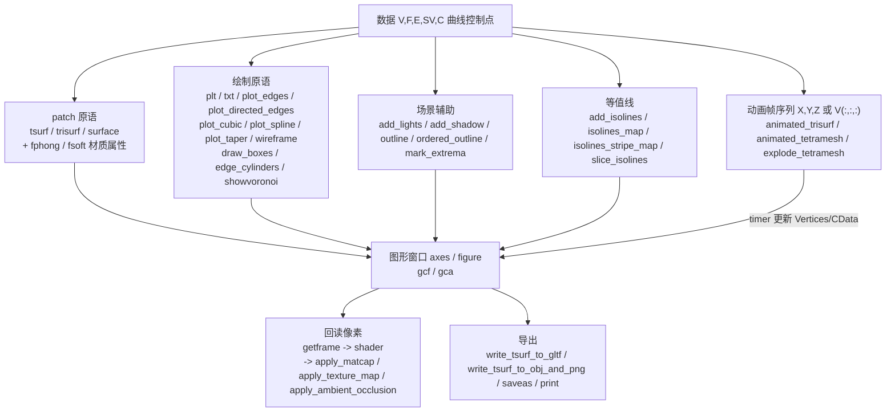

# 10.15 可视化与绘图 / Visualization & Plotting

> 本章覆盖 `mesh/` 下与 **绘制原语 (drawing primitives)**、**着色与材质 (shading & materials)**、
> **场景辅助 (scene helpers: lights / shadows / outlines / extrema)**、**等值线可视化 (isolines)**、
> **动画 (animation)** 相关的函数。它们大多不改变几何，而是把网格数据（顶点/面/标量场）
> 送入 MATLAB 图形栈（`plot`/`plot3`/`quiver`/`text`/`patch`/`trisurf`/`tsurf`/
> `light`/`timer`），或从当前图形窗口**回读像素**做着色处理。
>
> This chapter documents the plotting / visualization functions in `mesh/`: drawing primitives,
> shading & materials, scene helpers (lights, shadows, outlines, extrema), isoline visualization,
> and animation. Most functions do not modify geometry; they push mesh data into the MATLAB
> graphics stack or read pixels back from the current figure to emulate shading effects.
>
> 约定 / Notation：`V`（`#V by dim` 顶点）、`F`（`#F by 3` 三角面）、`Q`（四边形面）、
> `E`/`PE`（`#E by 2` 边）、`SV`/`S`（`#V by 1` 标量场）、`T`（四面体 `#T by 4` 或图形句柄，
> 视上下文而定）。所有锚点行号取自源码实际范围（先 Read 校验）。
>
> > ⚠️ **覆盖数量说明 / Count note**：任务清单列出 **31** 个函数名；本文件为全部 31 个函数
> > 逐一建立 `###` 条目（缺一不可）。

---

## 本章概览 / Chapter overview

### (a) 基础绘制 / Basic drawing primitives

| 函数 | 文件锚点 | 作用 | 关键依赖 |
|---|---|---|---|
| `plt` | [L1-L17](file:///c:/VSWork/gptoolbox-1/mesh/plt.m#L1-L17) | `plot`/`plot3` 的维度自适应简写（2D/3D） | —（builtin `plot`/`plot3`） |
| `txt` | [L1-L30](file:///c:/VSWork/gptoolbox-1/mesh/txt.m#L1-L30) | `text`/`text3` 简写，默认标注顶点序号 | — |
| `plot_edges` | [L1-L38](file:///c:/VSWork/gptoolbox-1/mesh/plot_edges.m#L1-L38) | 一次 `plot`/`plot3` 画出所有边 | — |
| `plot_directed_edges` | [L1-L36](file:///c:/VSWork/gptoolbox-1/mesh/plot_directed_edges.m#L1-L36) | 用 `quiver` 画有向边 | — |
| `plot_cubic` | [L1-L49](file:///c:/VSWork/gptoolbox-1/mesh/plot_cubic.m#L1-L49) | 绘制单条三次 Bezier 曲线 + 控制点骨架 | `cubic_eval`, `plot_edges`, `plt` |
| `plot_spline` | [L1-L42](file:///c:/VSWork/gptoolbox-1/mesh/plot_spline.m#L1-L42) | 绘制整条三次 Bezier 样条 | `plot_cubic` |
| `plot_taper` | [L1-L41](file:///c:/VSWork/gptoolbox-1/mesh/plot_taper.m#L1-L41) | 沿变半径曲线扫出“锥形管”并 `tsurf` | `triangulate`, `repmesh`, `tsurf`, `normalizerow` |
| `wireframe` | [L1-L74](file:///c:/VSWork/gptoolbox-1/mesh/wireframe.m#L1-L74) | 由面生成有厚度的线框四边形网格 | `normals`, `normalizerow` |
| `draw_boxes` | [L1-L44](file:///c:/VSWork/gptoolbox-1/mesh/draw_boxes.m#L1-L44) | 由 min/max 角点批量画盒子 | `trisurf`, `tsurf` |
| `edge_cylinders` | [L1-L244](file:///c:/VSWork/gptoolbox-1/mesh/edge_cylinders.m#L1-L244) | 为每条边生成圆柱 mesh（骨架可视化） | `axisanglebetween`, `remove_duplicate_vertices`, `fill_holes`, `extrude`, `axisangle2quat` |
| `showvoronoi` | [L1-L34](file:///c:/VSWork/gptoolbox-1/mesh/showvoronoi.m#L1-L34) | 显示 Voronoi 图（含无限射线截断） | `normalizerow` |

### (b) 着色与材质 / Shading & materials

| 函数 | 文件锚点 | 作用 | 关键依赖 |
|---|---|---|---|
| `shader` | [L1-L79](file:///c:/VSWork/gptoolbox-1/mesh/shader.m#L1-L79) | 模拟“片元着色器”：回读 RGB/面索引/重心坐标图 | `getframe` |
| `fphong` | [L1-L11](file:///c:/VSWork/gptoolbox-1/mesh/fphong.m#L1-L11) | 返回 Phong 光照属性 `struct` | — |
| `fsoft` | [L1-L11](file:///c:/VSWork/gptoolbox-1/mesh/fsoft.m#L1-L11) | 返回柔光材质属性 `struct` | — |
| `apply_matcap` | [L1-L50](file:///c:/VSWork/gptoolbox-1/mesh/apply_matcap.m#L1-L50) | 按视图法向把 matcap 贴图映射到网格 | `shader`, `normalizerow` |
| `apply_ambient_occlusion` | [L1-L189](file:///c:/VSWork/gptoolbox-1/mesh/apply_ambient_occlusion.m#L1-L189) | 计算并调制环境光遮蔽 | `ambient_occlusion` **[MEX]**, `per_vertex_normals`, `barycenter`, `normals` |
| `apply_texture_map` | [L1-L53](file:///c:/VSWork/gptoolbox-1/mesh/apply_texture_map.m#L1-L53) | 按 UV 把纹理映射到网格 | `shader` |
| `bake_onto_vertices` | [L1-L51](file:///c:/VSWork/gptoolbox-1/mesh/bake_onto_vertices.m#L1-L51) | 把连续函数烘焙到顶点（最小二乘） | `massmatrix`, `cotmatrix`, `quadprog` |

### (c) 场景辅助 / Scene helpers

| 函数 | 文件锚点 | 作用 | 关键依赖 |
|---|---|---|---|
| `add_lights` | [L1-L20](file:///c:/VSWork/gptoolbox-1/mesh/add_lights.m#L1-L20) | 依当前相机添加 5 盏灯 | `axisangle2matrix` |
| `add_shadow` | [L1-L175](file:///c:/VSWork/gptoolbox-1/mesh/add_shadow.m#L1-L175) | 依光源把网格投影到地面作阴影 | `matrixnormalize` |
| `outline` | [L1-L51](file:///c:/VSWork/gptoolbox-1/mesh/outline.m#L1-L51) | 求网格边界边（无序边集） | `sparse`（builtin） |
| `outline_loop` | [L1-L78](file:///c:/VSWork/gptoolbox-1/mesh/outline_loop.m#L1-L78) | 求单条有序边界环（顶点序列） | `outline`, `remove_unreferenced` |
| `ordered_outline` | [L1-L74](file:///c:/VSWork/gptoolbox-1/mesh/ordered_outline.m#L1-L74) | 求所有有序边界环（拼接 + 分段索引） | `outline` |
| `mark_extrema` | [L1-L104](file:///c:/VSWork/gptoolbox-1/mesh/mark_extrema.m#L1-L104) | 用彩色点标出标量场极值 | `local_max`, `local_min`, `point`(未解析) |

### (d) 等值线可视化 / Isoline visualization

| 函数 | 文件锚点 | 作用 | 关键依赖 |
|---|---|---|---|
| `add_isolines` | [L1-L49](file:///c:/VSWork/gptoolbox-1/mesh/add_isolines.m#L1-L49) | 在当前 patch 上叠加等值线 | `isolines` **[MEX]**, `plot_edges` |
| `isolines_map` | [L1-L72](file:///c:/VSWork/gptoolbox-1/mesh/isolines_map.m#L1-L72) | 生成“色带+细黑线”colormap（假等值线） | — |
| `isolines_stripe_map` | [L1-L11](file:///c:/VSWork/gptoolbox-1/mesh/isolines_stripe_map.m#L1-L11) | 把 colormap 变成交替条纹（纹理用） | `oklab2rgb`, `rgb2oklab` |
| `slice_isolines` | [L1-L120](file:///c:/VSWork/gptoolbox-1/mesh/slice_isolines.m#L1-L120) | 用一组等值面对网格切片 | `remove_duplicate_vertices` |

### (e) 动画 / Animation

| 函数 | 文件锚点 | 作用 | 关键依赖 |
|---|---|---|---|
| `animated_trisurf` | [L1-L132](file:///c:/VSWork/gptoolbox-1/mesh/animated_trisurf.m#L1-L132) | 交互式动画三角面（timer 循环） | `trisurf`, `plot3`, `timer` |
| `animated_tetramesh` | [L1-L49](file:///c:/VSWork/gptoolbox-1/mesh/animated_tetramesh.m#L1-L49) | 四面体网格动画（转面后委托） | `animated_trisurf` |
| `explode_tetramesh` | [L1-L61](file:///c:/VSWork/gptoolbox-1/mesh/explode_tetramesh.m#L1-L61) | 四面体“爆炸”分离动画 | `animated_tetramesh` |

### 总体数据流 / Overall data flow



---

## 逐函数条目 / Per-function entries

### `plot_cubic` — 绘制单条三次 Bezier 曲线 / Plot a cubic Bézier curve

- **文件 / File**: [mesh/plot_cubic.m](file:///c:/VSWork/gptoolbox-1/mesh/plot_cubic.m#L1-L49)
- **签名 / Signature**: `varargout = plot_cubic(C,pe,p,varargin)`；文档用法 `[pe,p] = plot_cubic(C)`
- **功能 / Purpose**: `EN: Plot one cubic Bézier curve with its control hull and update handles in-place.` /
  中文：绘制一条三次 Bezier 曲线（`cubic_eval` 采样），并画出两段控制点骨架（`plot_edges`）；当传入已存在的句柄 `pe`/`p` 时改为**原位更新**（避免重画闪烁）。
- **输入 / Inputs**:

  | 参数 | 尺寸/类型 | 含义 (中 / EN) |
  |---|---|---|
  | `C` | `4 by dim` | 4 个控制点 / four control points |
  | `pe` | handle（可选） | 已存在的控制骨架句柄 / existing control-hull handles |
  | `p` | handle（可选） | 已存在的曲线句柄 / existing curve handle |
  | `varargin` | `...` | 转发给 `plt`/`plot_edges` 的 linespec 等参数；若为单个含 2 元素的 cell，则拆为 `{pe_args,p_args}` |

- **输出 / Outputs**:

  | 参数 | 尺寸/类型 | 含义 |
  |---|---|---|
  | `pe` | `2 by 1` handles | 两段控制骨架（`C(1:2,:)`、`C(3:4,:)`）句柄 / control-hull handles |
  | `p` | handle | 曲线句柄 / curve handle |

- **可选参数 / Optional**:

  | 名称 | 取值 | 默认 | 含义 |
  |---|---|---|---|
  | `varargin{:}` | linespec/property | — | 转发给 `plt`/`plot_edges`（如 `'-k','LineWidth',2`） |
  | 单个 cell `{pe_args,p_args}` | cell(1,2) | — | 分别指定骨架/曲线参数 / split args |

- **变量流动 / Variable flow**: `C →(1 t=linspace(0,1)→ P=cubic_eval(C,t) →(2 p=plt(P,'-k') / set p) p`；`C →(3 pe=plot_edges(C,[1 2;3 4],'-o',aiblue) / set pe) pe`
- **算法步骤 / Algorithm**:
  1. 若 `varargin` 恰为长度 2 的 cell，拆为 `p_varargin`/`pe_varargin`，否则整段作为 `pe_varargin`。
  2. `t = linspace(0,1)'`；`P = cubic_eval(C,t)` 采样曲线。
  3. 若 `p` 不存在则新建 `p = plt(P,'-k','LineWidth',2,...)`，否则 `set(p,'XData','YData')` 原位更新。
  4. 保存/恢复 `hold` 状态；用 `plot_edges(C,[1 2;3 4],'-o','Color',aiblue,'LineWidth',1)` 画控制骨架（或 `set` 更新）。
  5. 依 `nargout` 返回 `pe`（及 `p`）。
- **流程图 / Flowchart**:

  ```mermaid
  flowchart TD
    A["输入 C, pe, p, varargin"] --> B{"varargin 是 2 元 cell ?"}
    B -- 是 --> C["拆分为 p_varargin / pe_varargin"]
    B -- 否 --> D["全部作为 pe_varargin"]
    C --> E["t=linspace(0,1); P=cubic_eval(C,t)"]
    D --> E
    E --> F{"p 已存在 ?"}
    F -- 否 --> G["p = plt(P,'-k',...) 新建"]
    F -- 是 --> H["set(p, XData/YData) 更新"]
    G --> I{"pe 已存在 ?"}
    H --> I
    I -- 否 --> J["pe = plot_edges(C,[1 2;3 4],'-o')"]
    I -- 是 --> K["set(pe(1)/pe(2)) 更新"]
    J --> Z["输出 pe, p"]
    K --> Z
  ```

- **依赖 / Dependencies**: `cubic_eval`, `plot_edges`, `plt`
- **See also**: `plot_spline`, `cubic_eval`, `cubic_split`

---

### `plot_spline` — 绘制整条三次 Bezier 样条 / Plot a cubic Bézier spline

- **文件 / File**: [mesh/plot_spline.m](file:///c:/VSWork/gptoolbox-1/mesh/plot_spline.m#L1-L42)
- **签名 / Signature**: `varargout = plot_spline(P,C,varargin)`；文档用法 `[pe,p] = plot_spline(P,C)`
- **功能 / Purpose**: `EN: Plot every cubic segment of a Bézier spline by looping over plot_cubic.` /
  中文：对样条的每一段循环调用 `plot_cubic`，画出整条样条（返回每段的句柄集合）。
- **输入 / Inputs**:

  | 参数 | 尺寸/类型 | 含义 (中 / EN) |
  |---|---|---|
  | `P` | `#P by dim` | 控制点位置 / control point locations |
  | `C` | `#C by 4` | 每条三次曲线的 4 个索引（指向 `P`）/ cubic indices |
  | `varargin` | `...` | 同 `plot_cubic`，可传单个 2 元 cell 拆分 |

- **输出 / Outputs**:

  | 参数 | 尺寸/类型 | 含义 |
  |---|---|---|
  | `pe` | `1 by #C` cell | 每段的控制骨架句柄 / per-segment control handles |
  | `p` | `1 by #C` cell | 每段的曲线句柄 / per-segment curve handles |

- **可选参数 / Optional**:

  | 名称 | 取值 | 默认 | 含义 |
  |---|---|---|---|
  | `varargin{:}` / `{pe_args,p_args}` | linespec / cell | — | 转发到 `plot_cubic` |

- **变量流动 / Variable flow**: `P,C →(断言 C∈[1,#P])→ for c=1:#C →(plot_cubic(P(C(c,:),:),...))→ {pe{c},p{c}} → 组装 pe,p`
- **算法步骤 / Algorithm**:
  1. 拆分 `varargin`（同 `plot_cubic`）；`assert(max(C(:))<=size(P,1))`、`assert(min(C(:))>=1)`。
  2. `p={}`、`pe={}`；循环 `c=1:size(C,1)`，调用 `[pe{c},p{c}] = plot_cubic(P(C(c,:),:),[],[],{pe_varargin,p_varargin})`，期间 `hold on`。
  3. 恢复 `hold` 状态，依 `nargout` 返回 `pe`（及 `p`）。
- **流程图 / Flowchart**:

  ```mermaid
  flowchart TD
    A["输入 P,C,varargin"] --> B["断言 C 索引合法"]
    B --> C["for c = 1:#C"]
    C --> D["plot_cubic(P(C(c,:),:),[],[],{pe_args,p_args})"]
    D --> E["pe{c},p{c}"]
    E -->|下一个 c| C
    E --> Z["输出 pe, p (cell)"]
  ```

- **依赖 / Dependencies**: `plot_cubic`
- **See also**: `plot_cubic`, `spline_to_poly`

---

### `plot_edges` — 绘制所有边 / Plot edges

- **文件 / File**: [mesh/plot_edges.m](file:///c:/VSWork/gptoolbox-1/mesh/plot_edges.m#L1-L38)
- **签名 / Signature**: `varargout = plot_edges(V,E,varargin)`；文档用法 `p = plot_edges(V,E,LINESPEC,...)`
- **功能 / Purpose**: `EN: Plot all edges E of a vertex set V with one plot/plot3 call.` /
  中文：用一次 `plot`（2D）或 `plot3`（3D）调用来画全部边；为 `NaN` 分隔技巧把每条边展开为两行坐标。
- **输入 / Inputs**:

  | 参数 | 尺寸/类型 | 含义 (中 / EN) |
  |---|---|---|
  | `V` | `#V by dim` | 顶点坐标 / vertex positions |
  | `E` | `#E by 2` | 边索引 / edges |
  | `varargin` | `...` | `plot`/`plot3` 的 linespec/property |

- **输出 / Outputs**:

  | 参数 | 尺寸/类型 | 含义 |
  |---|---|---|
  | `p` | handle | 绘图句柄 / plot handle（`nargout>=1` 时） |

- **可选参数 / Optional**:

  | 名称 | 取值 | 默认 | 含义 |
  |---|---|---|---|
  | `varargin{:}` | linespec/property | — | 转发给 `plot`/`plot3` |

- **变量流动 / Variable flow**: `V,E →(按 dim 分派)→ [V(E(:,1),k) V(E(:,2),k)]' 拼接 → plot/plot3 → p`
- **算法步骤 / Algorithm**:
  1. 若 `E` 为空直接返回。
  2. 依 `size(V,2)`：2D → `plot`；3D → `plot3`；其他维度报错 `Unsupported dimension`。
  3. 用 `[V(E(:,1),k) V(E(:,2),k)]'` 构造折线坐标（列向量），一次绘制。
  4. `nargout>=1` 时输出句柄。
- **流程图 / Flowchart**:

  ```mermaid
  flowchart TD
    A["输入 V,E,varargin"] --> B{"E 为空 ?"}
    B -- 是 --> Z["返回"]
    B -- 否 --> C{"size(V,2)"}
    C -- 2 --> D["plot(拼接X,拼接Y)"]
    C -- 3 --> E["plot3(拼接X,Y,Z)"]
    C -- 其他 --> F["error 维度不支持"]
    D --> Z
    E --> Z
    F --> Z
  ```

- **依赖 / Dependencies**: 无（builtin `plot`/`plot3`）
- **See also**: `plot_directed_edges`, `edges`

---

### `plot_directed_edges` — 用箭头绘制有向边 / Plot directed edges using quiver

- **文件 / File**: [mesh/plot_directed_edges.m](file:///c:/VSWork/gptoolbox-1/mesh/plot_directed_edges.m#L1-L36)
- **签名 / Signature**: `varargout = plot_directed_edges(V,E,varargin)`；文档用法 `p = plot_directed_edges(V,E,LINESPEC,...)`
- **功能 / Purpose**: `EN: Draw directed edges with quiver (only 2D supported).` /
  中文：用 `quiver` 绘制有向边（起点 + 方向向量）；当前实现**仅支持 2D**。
- **输入 / Inputs**:

  | 参数 | 尺寸/类型 | 含义 (中 / EN) |
  |---|---|---|
  | `V` | `#V by dim` | 顶点坐标 / vertex positions |
  | `E` | `#E by 2` | 有向边索引 / directed edges |
  | `varargin` | `...` | `quiver` 的 linespec/property |

- **输出 / Outputs**:

  | 参数 | 尺寸/类型 | 含义 |
  |---|---|---|
  | `p` | handle | quiver 句柄（`nargout>=1` 时） |

- **可选参数 / Optional**:

  | 名称 | 取值 | 默认 | 含义 |
  |---|---|---|---|
  | `varargin{:}` | linespec/property | — | 转发给 `quiver` |

- **变量流动 / Variable flow**: `V,E →(起点 V(E(:,1),:) + 方向 V(E(:,2),:)-V(E(:,1),:), scale=0)→ quiver → p`
- **算法步骤 / Algorithm**:
  1. `E` 为空则返回。
  2. `size(V,2)==2` → `quiver(x0, y0, dx, dy, 0, varargin{:})`，其中 scale 参数为 `0`（关闭自动缩放）。
  3. 其他维度报错 `Unsupported dimension`。
  4. `nargout>=1` 输出句柄。
- **流程图 / Flowchart**:

  ```mermaid
  flowchart TD
    A["输入 V,E,varargin"] --> B{"E 为空 ?"}
    B -- 是 --> Z["返回"]
    B -- 否 --> C{"size(V,2)==2 ?"}
    C -- 是 --> D["quiver(起点, 方向, 0, ...)"]
    C -- 否 --> E["error 维度不支持"]
    D --> Z
    E --> Z
  ```

- **依赖 / Dependencies**: 无（builtin `quiver`）
- **See also**: `plot_edges`

---

### `plot_taper` — 绘制变半径“锥形管” / Plot a tapered tube along a curve

- **文件 / File**: [mesh/plot_taper.m](file:///c:/VSWork/gptoolbox-1/mesh/plot_taper.m#L1-L41)
- **签名 / Signature**: `tsh = plot_taper(V,E,R,varargin)`
- **功能 / Purpose**: `EN: Given a polyline (V,E) with per-vertex radii R, build a swept tube (circles at vertices + parallelograms at edges) and plot it with tsurf.` /
  中文：给定折线 `(V,E)` 与每个顶点的半径 `R`，在顶点处生成圆盘、在边处生成平行四边形，拼成扫掠管并 `tsurf` 显示。
- **输入 / Inputs**:

  | 参数 | 尺寸/类型 | 含义 (中 / EN) |
  |---|---|---|
  | `V` | `#V by dim` | 折线顶点（dim=2）/ polyline vertices |
  | `E` | `#E by 2` | 折线边索引 / edge indices |
  | `R` | `#V by 1` 或标量 | 每个顶点半径 / per-vertex radii |
  | `varargin` | `...` | 转发给 `tsurf`（如 `'FaceColor','r'`） |

- **输出 / Outputs**:

  | 参数 | 尺寸/类型 | 含义 |
  |---|---|---|
  | `tsh` | handle | `tsurf` 句柄 / tsurf handle |

- **可选参数 / Optional**:

  | 名称 | 取值 | 默认 | 含义 |
  |---|---|---|---|
  | `varargin{:}` | property | — | 转发给 `tsurf` |

- **变量流动 / Variable flow**: `R →(标量则 repmat)→ R`；`CV,CE (单位圆) →(triangulate)→ CV,CF →(repmesh 到 V(J,:),R(J))→ CV,CF`；`V,E,R →(边平行四边形 PV,PF)→ VV=[CV;PV], FF=[CF;...] →(tsurf)→ tsh`
- **算法步骤 / Algorithm**:
  1. 若 `R` 为标量则 `repmat` 成 `#V by 1`。
  2. 生成单位圆采样点 `CV`（50 点取前 49）与边 `CE`，`triangulate` 成三角形扇（顶点处圆盘）。
  3. `J = unique(E(:))`，用 `repmesh(CV,CF,V(J,:),R(J))` 把圆盘重网格化到目标半径。
  4. 对每条边计算方向 `EV`、法向 `N`，构造 4 点平行四边形 `PV`、四边形 `PQ`（拆分三角面 `PF`）。
  5. 合并 `VV=[CV;PV]`、`FF=[CF;size(CV,1)+PF]`，调用 `tsurf(FF,VV,varargin{:})`。
- **流程图 / Flowchart**:

  ```mermaid
  flowchart TD
    A["输入 V,E,R,varargin"] --> B{"numel(R)==1 ?"}
    B -- 是 --> C["R=repmat(R,#V,1)"]
    B -- 否 --> D["保持 R"]
    C --> E["单位圆 CV,CE"]
    D --> E
    E --> F["[CV,CF]=triangulate(CV,CE)"]
    F --> G["repmesh(CV,CF,V(J,:),R(J))"]
    G --> H["每条边: 平行四边形 PV,PF"]
    H --> I["VV=[CV;PV]; FF=[CF;offset+PF]"]
    I --> Z["tsh = tsurf(FF,VV,...)"]
  ```

- **依赖 / Dependencies**: `triangulate`, `repmesh`, `tsurf`, `normalizerow`
- **See also**: `spline_to_poly`, `tsurf`, `tube`

---

### `plt` — plot/plot3 的维度自适应简写 / Dimension-adaptive shorthand for plot & plot3

- **文件 / File**: [mesh/plt.m](file:///c:/VSWork/gptoolbox-1/mesh/plt.m#L1-L17)
- **签名 / Signature**: `p = plt(V,varargin)`
- **功能 / Purpose**: `EN: Shorthand that dispatches to plot3 (3 columns) or plot (2 columns), forwarding all extra arguments verbatim.` /
  中文：把矩阵 `V` 按列数分派给 `plot3`（3 列）或 `plot`（2 列）的简写；其余参数**原样**转发。
- **支持的调用形式 / Supported call forms**（读源码逐一列出 / enumerated from source）:
  1. `plt(V)` —— `size(V,2)==3` → `plot3(V(:,1),V(:,2),V(:,3))`（[L11](file:///c:/VSWork/gptoolbox-1/mesh/plt.m#L11)）。
  2. `plt(V)` —— `size(V,2)==2` → `plot(V(:,1),V(:,2))`（[L13](file:///c:/VSWork/gptoolbox-1/mesh/plt.m#L13)）。
  3. `plt(V, varargin{:})` —— 任意 linespec/属性对，如 `plt(V,'-or','LineWidth',2)`、`plt(P,'-k','LineWidth',2)`（见 `plot_cubic` 调用）；`varargin` 直接透传给 `plot`/`plot3`。
  4. 无返回值调用 `plt(V)`（不请求输出时不构造句柄）。
  > 说明：`plt` **自身不定义**任何 `'Name',Value` 参数，全部由 `varargin` 转发；行列数非 2/3 时 `pp` 未赋值 → 会因输出未定义而报错（源码未做维度校验）。
- **输入 / Inputs**:

  | 参数 | 尺寸/类型 | 含义 (中 / EN) |
  |---|---|---|
  | `V` | `#V by 2` 或 `#V by 3` | 点列 / point list |
  | `varargin` | `...` | 转发给 `plot`/`plot3` |

- **输出 / Outputs**:

  | 参数 | 尺寸/类型 | 含义 |
  |---|---|---|
  | `p` | handle | 绘图句柄（`nargout>0` 时）/ plot handle |

- **可选参数 / Optional**:

  | 名称 | 取值 | 默认 | 含义 |
  |---|---|---|---|
  | `varargin{:}` | linespec/property | — | 直接转发给 `plot`/`plot3` |

- **变量流动 / Variable flow**: `V →(switch size(V,2))→ plot3 或 plot → pp →(nargout>0)→ p`
- **算法步骤 / Algorithm**:
  1. `switch size(V,2)`：3 → `pp = plot3(...)`；2 → `pp = plot(...)`。
  2. `varargin{:}` 原样传入。
  3. `nargout>0` 时 `p = pp`。
- **流程图 / Flowchart**:

  ```mermaid
  flowchart TD
    A["输入 V,varargin"] --> B{"size(V,2)"}
    B -- 3 --> C["pp = plot3(V(:,1),V(:,2),V(:,3),...)"]
    B -- 2 --> D["pp = plot(V(:,1),V(:,2),...)"]
    C --> E{"nargout>0 ?"}
    D --> E
    E -- 是 --> Z["p = pp"]
    E -- 否 --> Y["无输出"]
  ```

- **依赖 / Dependencies**: 无（builtin `plot`/`plot3`）
- **See also**: `txt`, `plot_edges`

---

### `txt` — 文本标注简写 / Text-label shorthand

- **文件 / File**: [mesh/txt.m](file:///c:/VSWork/gptoolbox-1/mesh/txt.m#L1-L30)
- **签名 / Signature**: `s = txt(V,varargin)`
- **功能 / Purpose**: `EN: Shorthand that dispatches to text (2 columns) or text3 (3 columns); default label is the vertex index.` /
  中文：`text`/`text3` 的简写；当未给定标注字符串时**默认用顶点序号** `num2str((1:#V)')`。
- **支持的调用形式 / Supported call forms**:
  1. `txt(V)` —— `nargin==1` 时递归调用 `txt(V, num2str((1:size(V,1))'))`（[L17-L20](file:///c:/VSWork/gptoolbox-1/mesh/txt.m#L17-L20)）。
  2. `txt(V, labels)` —— 显式给出标注内容。
  3. `txt(V, [])` —— `varargin{1}` 为空 → 自动替换为顶点序号（[L13-L15](file:///c:/VSWork/gptoolbox-1/mesh/txt.m#L13-L15)）。
  4. `txt(V, labels, 'Name',Value,...)` —— 其余参数转发给 `text`/`text3`，如 `'BackgroundColor','w'`。
- **输入 / Inputs**:

  | 参数 | 尺寸/类型 | 含义 (中 / EN) |
  |---|---|---|
  | `V` | `#V by 2` 或 `#V by 3` | 标注点坐标 / label positions |
  | `varargin` | `{labels, 'Name',Value,...}` | 标注文本及 `text` 属性 |

- **输出 / Outputs**:

  | 参数 | 尺寸/类型 | 含义 |
  |---|---|---|
  | `s` | handle array | text 句柄（`nargout>0` 时） |

- **可选参数 / Optional**:

  | 名称 | 取值 | 默认 | 含义 |
  |---|---|---|---|
  | `varargin{1}` | char/cell | `num2str((1:#V)')` | 标注文本 / label text |
  | `'Name',Value` | text 属性 | — | 转发给 `text`/`text3` |

- **变量流动 / Variable flow**: `V,varargin →(空则填默认标签)→(switch size(V,2))→ text3 或 text → ss →(nargout>0)→ s`
- **算法步骤 / Algorithm**:
  1. 若 `varargin` 为空或其首元素为空 → 填入顶点序号。
  2. 若 `nargin==1` → 递归调用自身（带默认标签）后返回。
  3. `switch size(V,2)`：3 → `text(x,y,z,...)`；2 → `text(x,y,...)`。
  4. `nargout>0` 时输出句柄。
- **流程图 / Flowchart**:

  ```mermaid
  flowchart TD
    A["输入 V,varargin"] --> B{"varargin 空或 varargin{1} 空 ?"}
    B -- 是 --> C["labels = num2str((1:#V)')"]
    B -- 否 --> D["用给定 labels"]
    C --> E{"nargin==1 ?"}
    D --> E
    E -- 是 --> F["递归 txt(V, labels)"]
    E -- 否 --> G{"size(V,2)"}
    F --> Z["返回 s"]
    G -- 3 --> H["text(x,y,z,...)"]
    G -- 2 --> I["text(x,y,...)"]
    H --> Z
    I --> Z
  ```

- **依赖 / Dependencies**: 无（builtin `text`/`text3`）
- **See also**: `plt`, `mark_extrema`

---

### `shader` — 模拟片元着色器 / Emulate a fragment shader

- **文件 / File**: [mesh/shader.m](file:///c:/VSWork/gptoolbox-1/mesh/shader.m#L1-L79)
- **签名 / Signature**: `[I,A,FI,B] = shader(orig_tsh)`
- **功能 / Purpose**: `EN: Act like a fragment shader: render the current trisurf and read back pixels to obtain an RGB frame, a mesh mask, per-pixel face indices and per-pixel barycentric coordinates.` /
  中文：充当“片元着色器”：通过临时替换 patch 的绘制内容并 `getframe` 回读像素，得到 (1) RGB 帧 `I`、(2) 网格遮罩 `A`、(3) 每像素面索引 `FI`、(4) 每像素重心坐标 `B`。这是 `apply_matcap`/`apply_texture_map` 等“像素级贴图”功能的核心。
- **输入 / Inputs**:

  | 参数 | 尺寸/类型 | 含义 (中 / EN) |
  |---|---|---|
  | `orig_tsh` | handle | 三角形网格的 trisurf/patch 句柄（须为三角网格）/ triangle-mesh handle |

- **输出 / Outputs**:

  | 参数 | 尺寸/类型 | 含义 |
  |---|---|---|
  | `I` | `h by w by 3` double | 当前窗口 RGB 帧 / rgb image frame |
  | `A` | `h by w` logical | 网格所在像素遮罩 / mask of where mesh is（仅 `nargout>=2`） |
  | `FI` | `h by w` uint | 指向 `orig_tsh.Faces` 行的面索引 / face indices（`nargout>=3`） |
  | `B` | `h by w by 3` double | 对应像素的重心坐标 / barycentric coordinates（`nargout>=4`） |

- **可选参数 / Optional**: 无（按 `nargout` 决定计算层数 / behavior depends on `nargout`）

- **变量流动 / Variable flow**: `gcf →(getframe)→ I`；`copy(orig_tsh)→(set FaceColor magenta)→ A`；`(FaceVertexCData=id2rgb(面索引))→ FI →(rgb2id)→ 面索引图`；`(Faces 重编号为 1:3#F, 顶点重排, FaceColor='interp')→ B →(归一化)→ 重心坐标`
- **算法步骤 / Algorithm**:
  1. `I = im2double(getframe(gcf).cdata)` 取当前帧。
  2. 若 `nargout>=2`：复制 `orig_tsh` 到同轴，隐藏原对象，关闭 `GraphicsSmoothing`；把副本设为纯品红 flat 面 → `A = (R==255 & G==0 & B==255)`。
  3. 若 `nargout>=3`：把每个面编号编码为颜色（`id2rgb`，256 进制），回读后用 `rgb2id` 解出 `FI`。
  4. 若 `nargout>=4`：把面重编号为 `1:numel(FF)`、顶点重排为 `VV(FF,:)`、`FaceColor='interp'`、`FaceVertexCData=repdiag(ones,3)`，回读并归一化得到重心坐标 `B`。
  5. 恢复可见性/平滑设置，删除临时副本。
- **流程图 / Flowchart**:

  ```mermaid
  flowchart TD
    A["输入 orig_tsh"] --> B["I = getframe(gcf)"]
    B --> C{"nargout>=2 ?"}
    C -- 否 --> Z["输出 I"]
    C -- 是 --> D["copy tsh; 隐藏原; 关闭平滑"]
    D --> E["设品红色 flat -> A = 掩罩"]
    E --> F{"nargout>=3 ?"}
    F -- 否 --> Z2["输出 I,A"]
    F -- 是 --> G["面编号编码为颜色 -> FI = rgb2id"]
    G --> H{"nargout>=4 ?"}
    H -- 否 --> Z3["输出 I,A,FI"]
    H -- 是 --> I["面重编号+插值 -> 归一化 -> B 重心"]
    I --> J["恢复可见性/平滑; 删除副本"]
    Z2 --> J
    Z3 --> J
    J --> Z4["输出 I,A,FI,B"]
  ```

- **依赖 / Dependencies**: 无（builtin `getframe`, `im2double`, `copyobj`, `meshgrid`, `repdiag`）
- **See also**: `apply_matcap`, `apply_texture_map`, `fphong`, `fsoft`

---

### `fphong` — 返回 Phong 光照属性 / Return Phong lighting properties

- **文件 / File**: [mesh/fphong.m](file:///c:/VSWork/gptoolbox-1/mesh/fphong.m#L1-L11)
- **签名 / Signature**: `str = fphong()`
- **功能 / Purpose**: `EN: Return a property struct for smooth Phong shading (interpolated face color + phong lighting).` /
  中文：返回一个属性结构体 `struct('FaceColor','interp','FaceLighting','phong')`，用于 `set(tsurf(...),fphong)`。
- **输入 / Inputs**: 无

- **输出 / Outputs**:

  | 参数 | 尺寸/类型 | 含义 |
  |---|---|---|
  | `str` | struct | `FaceColor='interp'`, `FaceLighting='phong'` |

- **可选参数 / Optional**: 无

- **变量流动 / Variable flow**: `(常量)→ str = struct('FaceColor','interp','FaceLighting','phong')`

- **算法步骤 / Algorithm**:
  1. 直接构造并返回常量结构体。

- **流程图 / Flowchart**:

  ```mermaid
  flowchart TD
    A["(无输入)"] --> B["str = struct(FaceColor=interp, FaceLighting=phong)"]
    B --> Z["输出 str"]
  ```

- **依赖 / Dependencies**: 无
- **See also**: `fsoft`, `shader`, `tsurf`

---

### `fsoft` — 返回柔光材质属性 / Return soft-lighting material properties

- **文件 / File**: [mesh/fsoft.m](file:///c:/VSWork/gptoolbox-1/mesh/fsoft.m#L1-L11)
- **签名 / Signature**: `str = fsoft()`
- **功能 / Purpose**: `EN: Return a property struct for soft diffuse lighting (given strength constants).` /
  中文：返回柔光材质结构体 `struct('SpecularStrength',0.2,'DiffuseStrength',0.2,'AmbientStrength',0.8)`。
- **输入 / Inputs**: 无

- **输出 / Outputs**:

  | 参数 | 尺寸/类型 | 含义 |
  |---|---|---|
  | `str` | struct | 镜面/漫反射/环境光强度 / specular, diffuse, ambient strengths |

- **可选参数 / Optional**: 无

- **变量流动 / Variable flow**: `(常量)→ str = struct(SpecularStrength=0.2, DiffuseStrength=0.2, AmbientStrength=0.8)`

- **算法步骤 / Algorithm**:
  1. 直接构造并返回常量结构体。

- **流程图 / Flowchart**:

  ```mermaid
  flowchart TD
    A["(无输入)"] --> B["str = struct(Spec=0.2, Diff=0.2, Amb=0.8)"]
    B --> Z["输出 str"]
  ```

- **依赖 / Dependencies**: 无
- **See also**: `fphong`, `shader`, `tsurf`

> **差异小结 / Differences**: `shader` 是**真正的像素级着色过程**（回读帧 + 面索引 + 重心坐标，可视为片元着色器）；`fphong`/`fsoft` 只返回**图形属性结构体**（分别控制光照模型/插值方式与材质强度系数），本身不做任何像素运算。三者常搭配使用：`tsurf(...,fphong)` + `shader`/`apply_matcap` 做材质映射。

---

### `wireframe` — 由面生成有厚度线框 / Build a thick wireframe from faces

- **文件 / File**: [mesh/wireframe.m](file:///c:/VSWork/gptoolbox-1/mesh/wireframe.m#L1-L74)
- **签名 / Signature**: `[WV,WQ,WJ] = wireframe(V,Q,thickness,offset)`
- **功能 / Purpose**: `EN: Given a tri/quad mesh, build a quad mesh whose edges are thickened into strips (no overlap accounting), optionally offset along normals.` /
  中文：把三角/四边形网格的每条边加粗为四边形条带，得到可直接渲染的线框 mesh；`offset` 不为 0 时沿顶点法向整体外推后再递归生成。
- **输入 / Inputs**:

  | 参数 | 尺寸/类型 | 含义 (中 / EN) |
  |---|---|---|
  | `V` | `#V by dim` | 顶点位置 / vertex positions |
  | `Q` | `#Q by ss` | 面索引（`ss`=3 或 4）/ element indices |
  | `thickness` | scalar | 线框粗细 / wireframe thickness |
  | `offset` | scalar | 沿法向的外推倍数（乘以 `thickness`）/ normal offset factor |

- **输出 / Outputs**:

  | 参数 | 尺寸/类型 | 含义 |
  |---|---|---|
  | `WV` | `#WV by dim` | 线框顶点 / wireframe vertices |
  | `WQ` | `#WQ by 4` | 线框四边形索引 / wireframe quads |
  | `WJ` | `#WQ by 1` | 指向原 `Q` 的索引 / map to original face indices |

- **可选参数 / Optional**: 无（全部为位置参数 / all positional）

- **变量流动 / Variable flow**: `V,Q →(拆边 E + 面法向 N + 角点偏移 O)→ WV=[V+T/2·VN; V-T/2·VN; V(Q,:)+O], WQ=条带四边形, WJ=repmat(1:#Q)`；`offset≠0 →(V+VN·offset·T/2)→ 递归 wireframe(...,0)`
- **算法步骤 / Algorithm**:
  1. 依 `ss` 拆分四边（4）或三边（3）为边与角点法向 `N`、偏移 `O`。
  2. 用稀疏累积求逐顶点法向 `VN`（`sparse(Q(:), repmat(1:3), N)` 归一化）。
  3. 若 `offset ~= 0` → `wireframe(V+VN*offset*thickness/2,Q,thickness,0)` 递归返回。
  4. 组装 `WV`（±厚度顶点 + 每条边角点偏移点）、`WQ`（正反两组四边形）、`WJ`。
- **流程图 / Flowchart**:

  ```mermaid
  flowchart TD
    A["输入 V,Q,thickness,offset"] --> B{"ss (面阶数)"}
    B -- 4 --> C["E=4边; N=角法向; O=角偏移"]
    B -- 3 --> D["E=3边; N=面法向 repmat; O=角偏移"]
    C --> E["VN = 归一化(稀疏累积法向)"]
    D --> E
    E --> F{"offset ~= 0 ?"}
    F -- 是 --> G["递归 wireframe(V+VN*offset*T/2, Q, T, 0)"]
    F -- 否 --> H["组装 WV, WQ, WJ"]
    G --> Z["输出 WV,WQ,WJ"]
    H --> Z
  ```

- **依赖 / Dependencies**: `normals`, `normalizerow`
- **See also**: `edge_cylinders`, `tsurf`

### `outline` — 网格边界边 / Boundary (outline) edges of a mesh

- **文件 / File**: [mesh/outline.m](file:///c:/VSWork/gptoolbox-1/mesh/outline.m#L1-L51)
- **签名 / Signature**: `[O] = outline(F)`
- **功能 / Purpose**: `EN: Find the boundary edges of a mesh as an oriented list of directed edges (keeps the direction with positive A-A').` /
  中文：求网格的**边界边**，返回**有向**边表 `#O by 2`；通过 `A-A'` 找出只出现一次的有向边并保留 `OV>0` 方向。注意**不保证环序**（源码注释明确 “This does not maintain original order”）。
- **输入 / Inputs**:

  | 参数 | 尺寸/类型 | 含义 (中 / EN) |
  |---|---|---|
  | `F` | `#F by polysize` | 面索引（支持任意多边形）/ face indices |

- **输出 / Outputs**:

  | 参数 | 尺寸/类型 | 含义 |
  |---|---|---|
  | `O` | `#O by 2` | 有向边界边（顶点索引）/ oriented outline edges |

- **可选参数 / Optional**: 无

- **变量流动 / Variable flow**: `F →(有向邻接 A = sparse(F, F(:,[2:end 1]),1))→ A →(A-A')→ find → (OI,OJ,OV) →(OV>0 过滤)→ O`
- **算法步骤 / Algorithm**:
  1. 构造有向邻接矩阵 `A = sparse(F, F(:,[2:end 1]), 1)`（每个面的每条有向边计 1）。
  2. `[OI,OJ,OV] = find(A-A')`：`A-A'` 中非零项即“只出现一次”的有向边；`OV>0` 给出保留方向。
  3. 输出 `O = [OI(OV>0) OJ(OV>0)]`。
- **流程图 / Flowchart**:

  ```mermaid
  flowchart TD
    A["输入 F"] --> B["A = sparse(F, F(:,[2:end 1]), 1)"]
    B --> C["[OI,OJ,OV] = find(A - A')"]
    C --> D["保留 OV>0 方向"]
    D --> Z["输出 O (#O by 2 有向边)"]
  ```

- **依赖 / Dependencies**: 无（builtin `sparse`/`find`）
- **See also**: `outline_loop`, `ordered_outline`, `boundary_faces`, `exterior_edges`

---

### `outline_loop` — 单条有序边界环 / A single ordered outline loop

- **文件 / File**: [mesh/outline_loop.m](file:///c:/VSWork/gptoolbox-1/mesh/outline_loop.m#L1-L78)
- **签名 / Signature**: `loop = outline_loop(F,varargin)`；`loop = outline_loop(O,varargin)`
- **功能 / Purpose**: `EN: Return the vertices of a single ordered outline loop, starting from the first edge's endpoint, via graph search.` /
  中文：把边界边串成**一条有序顶点环**（从首边端点出发，沿图搜索）；`O` 为有序边时直接用，否则先 `outline(F)`。
- **输入 / Inputs**:

  | 参数 | 尺寸/类型 | 含义 (中 / EN) |
  |---|---|---|
  | `F` | `#F by 3` | 三角面（`size(F,2)==3` 时先 `outline`）/ triangles |
  | 或 `O` | `#O by 2` | 已有的**有序**边界边 / oriented outline edges |

- **输出 / Outputs**:

  | 参数 | 尺寸/类型 | 含义 |
  |---|---|---|
  | `loop` | `#loop by 1` | 单条环的顶点序列 / outline endpoints of a single loop |

- **可选参数 / Optional**:

  | 名称 | 取值 | 默认 | 含义 |
  |---|---|---|---|
  | `'Unoriented'` | `logical` | `true` | 是否视为无向（**当前实现中对应分支已被注释掉，实际未生效**） |

- **变量流动 / Variable flow**: `F →(outline)→ O`（或直接给 O）→ `remove_unreferenced → IM,O,RIM` → `graphpred2path`（若可用）或 `digraph.bfsearch` → `loop → RIM(loop)`
- **算法步骤 / Algorithm**:
  1. `size(F,2)==3` → `O = outline(F)`，否则 `O = F`（假定已是有序边）。
  2. 解析 `'Unoriented'` 参数（默认 `true`）。
  3. `[~,IM] = remove_unreferenced((1:max(F(:)))',O)`；`O = IM(O)`；`RIM = sparse(IM,1,1:max(IM))`。
  4. 若存在 `graphpred2path` → 用它；否则构造 `digraph` 并 `G.bfsearch(O(1,2))` 做广度优先搜索得到 `loop`。
  5. `loop = RIM(loop)` 映射回原顶点编号。
  > 已知限制：源码注释 “Only works for single loop”（仅支持单圈）；`Unoriented` 为真的是否处理无向的逻辑已被注释（见 [L62-L75](file:///c:/VSWork/gptoolbox-1/mesh/outline_loop.m#L62-L75)）。
- **流程图 / Flowchart**:

  ```mermaid
  flowchart TD
    A["输入 F 或 O"] --> B{"size(F,2)==3 ?"}
    B -- 是 --> C["O = outline(F)"]
    B -- 否 --> D["O = F (已有序)"]
    C --> E["remove_unreferenced 重编号 -> IM, RIM"]
    D --> E
    E --> F{"存在 graphpred2path ?"}
    F -- 是 --> G["loop = graphpred2path(...)"]
    F -- 否 --> H["G = digraph(...); loop = G.bfsearch(O(1,2))"]
    G --> I["loop = RIM(loop)"]
    H --> I
    I --> Z["输出 loop"]
  ```

- **依赖 / Dependencies**: `outline`, `remove_unreferenced`
- **See also**: `outline`, `ordered_outline`

---

### `ordered_outline` — 所有有序边界环 / All ordered boundary loops

- **文件 / File**: [mesh/ordered_outline.m](file:///c:/VSWork/gptoolbox-1/mesh/ordered_outline.m#L1-L74)
- **签名 / Signature**: `[B,L] = ordered_outline(F)`
- **功能 / Purpose**: `EN: Return the ordered vertex sequence of *all* boundary loops concatenated into B, with segment starts in L.` /
  中文：把所有边界环按顺序串成一个**顶点序列** `B`（所有环首尾相接），并用 `L` 给出每个环在 `B` 中的**起始下标**（末项恒为 `numel(B)+1`）。
- **输入 / Inputs**:

  | 参数 | 尺寸/类型 | 含义 (中 / EN) |
  |---|---|---|
  | `F` | `#F by 3` | 三角面（`size(F,2)==2` 时视为边界边）/ triangles or edges |

- **输出 / Outputs**:

  | 参数 | 尺寸/类型 | 含义 |
  |---|---|---|
  | `B` | `#B by 1` | 所有环的顶点序号拼接 / concatenated outline vertex sequence |
  | `L` | `#loops+1 by 1` | 各环起点下标（末项 = `numel(B)+1`）/ boundary loop start indices |

- **可选参数 / Optional**: 无

- **变量流动 / Variable flow**: `F →(size(F,2)==2? O=F : O=outline(F))→ O →(unique/accumarray 校验 counts==2)→ while unseen 追环 → B,L`
- **算法步骤 / Algorithm**:
  1. `size(F,2)==2` → `O=F`；否则 `O = outline(F)`。
  2. `[u,m,n]=unique(O(:))`、`counts=accumarray(...)`；`assert(all(counts==2))`（边界顶点须恰好被两条边界边共享）。
  3. `while any(unseen)`：取首个未访问边，沿 `O` 的源/汇方向追踪直到回到 `start`，把顶点依次追加进 `B`，并记录环起点到 `L`。
  4. 循环结束后 `L = [L numel(B)+1]`。
- **流程图 / Flowchart**:

  ```mermaid
  flowchart TD
    A["输入 F"] --> B{"size(F,2)==2 ?"}
    B -- 是 --> C["O = F"]
    B -- 否 --> D["O = outline(F)"]
    C --> E["unique + accumarray; 断言 counts==2"]
    D --> E
    E --> F{"还有 unseen 边 ?"}
    F -- 是 --> G["取首个 unseen; 记录环起点到 L"]
    G --> H["沿 O 方向追踪直到回到 start, 顶点追加到 B"]
    H --> F
    F -- 否 --> I["L = [L numel(B)+1]"]
    I --> Z["输出 B,L"]
  ```

- **依赖 / Dependencies**: `outline`
- **See also**: `outline`, `outline_loop`

> **三者输出对比 / Output comparison**:
> - `outline` → **无序/有向**的边界**边集** `#O by 2`（只给出“哪些边是边界”）。
> - `outline_loop` → **单条**边界**环**的**顶点序列**（仅支持单圈，方便直接 `plot`）。
> - `ordered_outline` → **所有**边界环拼成一条顶点序列 `B` + 分段索引 `L`（支持多圈，需用 `L` 切分）。

---

### `add_lights` — 依相机添加 5 盏灯 / Add 5 lights relative to the camera

- **文件 / File**: [mesh/add_lights.m](file:///c:/VSWork/gptoolbox-1/mesh/add_lights.m#L1-L20)
- **签名 / Signature**: `varargout = add_lights()`；文档用法 `ls = add_lights()`
- **功能 / Purpose**: `EN: Add five local lights oriented from the current camera direction (one white key light plus four tinted fill lights).` /
  中文：基于当前相机方向 `(campos-camtarget)` 添加 5 盏 local 光：1 盏白色主光 + 4 盏绕轴旋转的彩色补光（青/粉）。
- **输入 / Inputs**:

  | 参数 | 尺寸/类型 | 含义 (中 / EN) |
  |---|---|---|
  | （无） | — | 依赖当前 `campos`/`camtarget`/`teal`/`pink` |

- **输出 / Outputs**:

  | 参数 | 尺寸/类型 | 含义 |
  |---|---|---|
  | `ls` | `1 by 5 cell` | 5 个 light 句柄 / light handles |

- **可选参数 / Optional**: 无

- **变量流动 / Variable flow**: `(campos,camtarget) → 方向向量 →(5 个 light 位置: 主光 + 绕 z/x 轴旋转)→ ls`
- **算法步骤 / Algorithm**:
  1. 定义匿名函数 `lights()` 返回 5 个 `light(...)`：位置由 `(campos-camtarget)` 及 `axisangle2matrix` 旋转得到。
  2. `ls = lights()`；`nargout>=1` 时输出。
- **流程图 / Flowchart**:

  ```mermaid
  flowchart TD
    A["(无输入; 读当前相机)"] --> B["d = campos - camtarget"]
    B --> C["5 盏灯: 1 白主光 + 4 彩色补光"]
    C --> D["ls = lights()"]
    D --> Z["输出 ls"]
  ```

- **依赖 / Dependencies**: `axisangle2matrix`
- **See also**: `add_shadow`, `apply_ambient_occlusion`

---

### `add_shadow` — 为网格添加投影阴影 / Add a projected shadow for a plotted mesh

- **文件 / File**: [mesh/add_shadow.m](file:///c:/VSWork/gptoolbox-1/mesh/add_shadow.m#L1-L175)
- **签名 / Signature**: `[h,L,M,ground] = add_shadow(T,L,varargin)`；`h = add_shadow()`（对全部）
- **功能 / Purpose**: `EN: Project the mesh (patch/scatter) onto a ground plane along each light direction using a projective shadow matrix, drawing a shadow trisurf with fading.` /
  中文：用**投影矩阵**把网格（patch 或 scatter）沿每盏灯方向投影到地面，生成阴影 `trisurf`，并支持自适应“远离接触点变淡/变深”的渐变，以及线框阴影。
- **输入 / Inputs**:

  | 参数 | 尺寸/类型 | 含义 (中 / EN) |
  |---|---|---|
  | `T` | `#T` handles | trisurf/patch/scatter 句柄，`[]` → 取 `gca` 中全部 Patch/Scatter |
  | `L` | `#L` handles | light 句柄，`[]` → 取 `gca` 中的 Light（无则 `camlight`） |

- **输出 / Outputs**:

  | 参数 | 尺寸/类型 | 含义 |
  |---|---|---|
  | `h` | `#T*#L` cell | 阴影 trisurf 句柄 / output shadow handles |
  | `L` | `#L` | 使用的 light 列表 / lights |
  | `M` | `4 by 4 by #T*#L` | 阴影投影矩阵 / shadow projection matrices |
  | `ground` | `1 by 4` | 地面平面方程 `/` ground plane equation |

- **可选参数 / Optional**:

  | 名称 | 取值 | 默认 | 含义 |
  |---|---|---|---|
  | `'Ground'` | `1 by 4` | `[0 0 -1 min(Z)]` | 地面平面方程 / ground plane |
  | `'Nudge'` | scalar | `0` | 地面下移量 / nudge ground down |
  | `'Color'` | `1 by 3` | `get(gcf,'Color')*0.9` | 阴影颜色 / shadow color |
  | `'BackgroundColor'` | `1 by 3` | `get(gcf,'Color')` | 渐隐目标背景色 / fade background |
  | `'Fade'` | `'none'`/`'local'`/`'infinite'` | `'infinite'` | 淡出模式 / fade mode |

- **变量流动 / Variable flow**: `T,L →(若无 Ground: 求 minZ)→ ground →(每对 t,l: light_pos, shadow_mat)→ U=[V 1]·shadow_mat 投影 → trisurf → tsh →(Fade: D=投影距离 → C 插值)→ C → h,M`
- **算法步骤 / Algorithm**:
  1. 解析可选参数；`T`/`L` 为空时从 `gca` 采集对象（Patch/Scatter 与 Light）。
  2. 若未给地面，遍历所有网格顶点求全局最小 `minZ`，取 `ground=[0 0 -1 minZ]`，再按 `nudge` 调整 `ground(4)`。
  3. 对每对 `(t,l)`：`light_pos=[l.Position strcmp(l.Style,'local')]`，`d = ground*light_pos'`，`shadow_mat = d*eye(4) - light_pos'*ground`；`U = [V ones]*shadow_mat'` 再齐次归一化。
  4. 用投影点画阴影（Patch → `trisurf`；Scatter → `copyobj` 并改坐标）。
  5. `Fade` 为 `local`/`infinite` 时按投影到光源 xy 的距离 `D` 在 `color`↔`background_color` 间插值成 `FaceVertexCData`。
  6. 对线框/不可见面情形设 `EdgeColor=color`；累积 `h` 与 `M`。
- **流程图 / Flowchart**:

  ```mermaid
  flowchart TD
    A["输入 T,L,参数"] --> B{"T 为空 ?"}
    B -- 是 --> C["从 gca 收集 Patch/Scatter"]
    B -- 否 --> D["使用给定 T"]
    C --> E{"L 为空 ?"}
    D --> E
    E -- 是 --> F["从 gca 收集 Light (无则 camlight)"]
    E -- 否 --> G["使用给定 L"]
    F --> H{"ground 为空 ?"}
    G --> H
    H -- 是 --> I["ground = [0 0 -1 min minZ]"]
    H -- 否 --> J["用给定 ground"]
    I --> K["for 每对 (t,l): shadow_mat = d*I - lp'*ground"]
    J --> K
    K --> L["U = 投影(V); 画阴影 trisurf"]
    L --> M{"Fade = local/infinite ?"}
    M -- 是 --> N["按距离 D 插值颜色 C -> FaceVertexCData"]
    M -- 否 --> O["恒定颜色"]
    N --> P["h,M 累积"]
    O --> P
    P --> Z["输出 h,L,M,ground"]
  ```

- **依赖 / Dependencies**: `matrixnormalize`
- **See also**: `add_lights`, `apply_ambient_occlusion`, `tsurf`

---

### `add_isolines` — 为标量着色 patch 叠加等值线 / Add isolines to a scalar-colored patch

- **文件 / File**: [mesh/add_isolines.m](file:///c:/VSWork/gptoolbox-1/mesh/add_isolines.m#L1-L49)
- **签名 / Signature**: `p = add_isolines(T,varargin)`；`p = add_isolines()`（对全部）
- **功能 / Purpose**: `EN: Draw isolines (black curves) at interior colormap levels on each patch whose FaceVertexCData is a per-vertex scalar field.` /
  中文：对每个 FaceVertexCData 为**逐顶点标量场**的 patch，在 colormap 的“内部层”位置画出黑色等值线；优先用 MEX `isolines`，否则回退 MATLAB `isolines`。
- **输入 / Inputs**:

  | 参数 | 尺寸/类型 | 含义 (中 / EN) |
  |---|---|---|
  | `T` | `#T` handles | trisurf/patch 句柄，`[]` → 取 `gca` 中全部 Patch |
  | `varargin` | `...` | 转发给 `plot_edges`（或回退分支的 `plot3`） |

- **输出 / Outputs**:

  | 参数 | 尺寸/类型 | 含义 |
  |---|---|---|
  | `p` | `#T` cell | 等值线绘图句柄 / isoline plot handles |

- **可选参数 / Optional**:

  | 名称 | 取值 | 默认 | 含义 |
  |---|---|---|---|
  | `varargin{:}` | linespec/property | — | 转发给底层 `plot_edges`/`plot3` |

- **变量流动 / Variable flow**: `T →(逐个 patch: n=size(colormap,1)+1, iso=linspace(caxis) 去除首尾)→ iso →(MEX isolines(V,F,S,iso)→ iV,iE 或 MATLAB isolines→ LS,LD)→ plot_edges/plot3 → p`
- **算法步骤 / Algorithm**:
  1. `T` 为空则从 `gca` 收集 Patch；cell 则展平。
  2. 每个 patch：`n = size(colormap,1)+1`，`a = caxis`，`iso = linspace(a(1),a(2),n)` 并去掉首尾（`iso(2:end-1)`）。
  3. 取 `V,F,S=FaceVertexCData`；`assert(size(S,2)==1)`（须为逐顶点标量）。
  4. 若 `exist('isolines')==3`（MEX 存在）→ `[iV,iE,I]=isolines(V,F,S,iso)` 并用 `plot_edges(iV,iE,'Color','k',...)`；否则用 MATLAB `isolines` 得 `LS,LD,I`，用 `plot3` 画线段。
  5. 恢复 `hold` 状态。
- **流程图 / Flowchart**:

  ```mermaid
  flowchart TD
    A["输入 T,varargin"] --> B{"T 为空 ?"}
    B -- 是 --> C["从 gca 收集 Patch"]
    B -- 否 --> D["使用给定 T"]
    C --> E["逐个 patch: iso = caxis 内部层"]
    D --> E
    E --> F{"exists('isolines')==3 ?"}
    F -- 是 --> G["MEX isolines(V,F,S,iso) -> iV,iE"]
    G --> H["plot_edges(iV,iE,'Color','k')"]
    F -- 否 --> I["MATLAB isolines -> LS,LD"]
    I --> J["plot3(线段, 'Color','k')"]
    H --> Z["输出 p (句柄)"]
    J --> Z
  ```

- **依赖 / Dependencies**: `isolines` **[MEX]**（`mex/isolines.cpp`；回退用 MATLAB `isolines`）、`plot_edges`
- **See also**: `isolines_map`, `slice_isolines`, `isolines`（MEX）

---

### `isolines_map` — 生成“色带+细黑线”colormap / Build a colormap with thin dark isoline bands

- **文件 / File**: [mesh/isolines_map.m](file:///c:/VSWork/gptoolbox-1/mesh/isolines_map.m#L1-L72)
- **签名 / Signature**: `M = isolines_map(n)`；`M = isolines_map(N)`；`M = isolines_map(...,'Name',Value,...)`
- **功能 / Purpose**: `EN: Create a colormap in which each of the n+1 color intervals is followed by a thin dark band, so that a smooth colormap shows crisp "isolines" without adding geometry.` /
  中文：生成一种 colormap：把 `n+1` 个颜色区间各自重复 `thick` 次后，插入一条细的黑线（`LineColor`）带；配合 `'FaceLighting','phong'` 可在不添加几何的情况下得到“等值线”观感（纹理式假等值线）。
- **输入 / Inputs**:

  | 参数 | 尺寸/类型 | 含义 (中 / EN) |
  |---|---|---|
  | `n` | 正整数 | 等值线条数（则共 `n+1` 个色区间，用默认 `parula`）/ number of isolines |
  | 或 `N` | `#N by 3` | 输入 colormap（则等值线数 = `#N-1`）/ input colormap |

- **输出 / Outputs**:

  | 参数 | 尺寸/类型 | 含义 |
  |---|---|---|
  | `M` | `(n+1)*(thick+1)-1 by 3` | 含细黑线带的 colormap / colormap with isoline bands |

- **可选参数 / Optional**:

  | 名称 | 取值 | 默认 | 含义 |
  |---|---|---|---|
  | `'LineColor'` | `{1|#N-1} by 3` | `[0 0 0]` | 等值线颜色 / isoline color |
  | `'Thickness'` | 正整数 | `10` | 色区间与黑线的比例（粗 : 细）/ thickness ratio |

- **变量流动 / Variable flow**: `n →(N=parula(n+1))→ N`；`N,thick,line_color →(N repmat thick 次; line_color 追加伪色)→ cat/permute/reshape → M →(去掉伪色)→ M`
- **算法步骤 / Algorithm**:
  1. 若 `varargin{1}` 是标量 → `n = varargin{1}`、`N = parula(n+1)`；否则 `N = varargin{1}`、`n = size(N,1)-1`。
  2. 解析 `'Thickness'`（默认 10，须为整数）、`'LineColor'`（默认全黑；可 1 行广播或 `n` 行）。
  3. 给 `line_color` 追加一“伪色” `[1 0 0]` 使其与 `N` 行数一致；`N = repmat(N,[1 1 thick])`。
  4. `M = reshape(permute(cat(3,N,line_color),[3 1 2]),(n+1)*(thick+1),3)`，再去掉末尾伪色 `M = M(1:end-1,:)`。
- **流程图 / Flowchart**:

  ```mermaid
  flowchart TD
    A["输入 n 或 N, 参数"] --> B{"varargin{1} 标量 ?"}
    B -- 是 --> C["n=varargin{1}; N=parula(n+1)"]
    B -- 否 --> D["N=varargin{1}; n=#N-1"]
    C --> E["line_color 追加伪色 [1 0 0]"]
    D --> E
    E --> F["N = repmat(N,[1 1 thick])"]
    F --> G["cat/permute/reshape 交织色带与黑线"]
    G --> H["去掉末尾伪色"]
    H --> Z["输出 M"]
  ```

- **依赖 / Dependencies**: 无（builtin `parula`）
- **See also**: `isolines_stripe_map`, `add_isolines`

---

### `isolines_stripe_map` — 把 colormap 变为交替条纹 / Turn a colormap into alternating stripes

- **文件 / File**: [mesh/isolines_stripe_map.m](file:///c:/VSWork/gptoolbox-1/mesh/isolines_stripe_map.m#L1-L11)
- **签名 / Signature**: `M = isolines_stripe_map(M,val)`
- **功能 / Purpose**: `EN: Darken every other row of a colormap (in OKLab space) to produce a striped texture / isoline appearance.` /
  中文：在 OKLab 色彩空间中把 colormap 的**每隔一行的亮度**乘以 `val`（默认 0.9），生成交替明暗的条纹 colormap（用于纹理化等值线观感）。
- **输入 / Inputs**:

  | 参数 | 尺寸/类型 | 含义 (中 / EN) |
  |---|---|---|
  | `M` | `#M by 3` | 输入 colormap / input colormap |
  | `val` | scalar（可选） | 暗行亮度比例 / darkening factor |

- **输出 / Outputs**:

  | 参数 | 尺寸/类型 | 含义 |
  |---|---|---|
  | `M` | `#M by 3` | 条纹化 colormap / striped colormap |

- **可选参数 / Optional**:

  | 名称 | 取值 | 默认 | 含义 |
  |---|---|---|---|
  | `val` | scalar | `0.9` | 交替行亮度系数 / alternate-row brightness |

- **变量流动 / Variable flow**: `M,val →(des=[1 1 1; val 1 1] 重复截断)→ des →(oklab2rgb(des.*rgb2oklab(M)))→ M →(clamp[0,1])→ M`
- **算法步骤 / Algorithm**:
  1. `val` 缺省 = 0.9；`nm = size(M,1)`；`des = repmat([1 1 1; val 1 1], ceil(nm/2), 1)` 并截取到 `nm` 行。
  2. `M = max(min(oklab2rgb(des .* rgb2oklab(M)), 1), 0)`（在 OKLab 中按行缩放并夹紧到 [0,1]）。
- **流程图 / Flowchart**:

  ```mermaid
  flowchart TD
    A["输入 M,val"] --> B["des = 交替 [1 1 1]/[val 1 1] 重复"]
    B --> C["rgb2oklab(M)"]
    C --> D["des .* oklab(M)"]
    D --> E["oklab2rgb(...)"]
    E --> F["clamp[0,1]"]
    F --> Z["输出条纹 M"]
  ```

- **依赖 / Dependencies**: `oklab2rgb`, `rgb2oklab`（`imageprocessing/`）
- **See also**: `isolines_map`, `add_isolines`

> **用途小结 / Purpose**: `isolines_map` 生成“色带+细黑线”的 colormap；`isolines_stripe_map` 把任意 colormap 变成黑白交替条纹。二者都不生成几何，而是**经 colormap 把等值线/条纹“画”进表面颜色**（贴图式），通常配合 `tsurf` 的 `'FaceLighting','phong'` 使用。

---

### `apply_matcap` — 按视图法向映射 matcap 贴图 / Map a matcap texture by view-space normals

- **文件 / File**: [mesh/apply_matcap.m](file:///c:/VSWork/gptoolbox-1/mesh/apply_matcap.m#L1-L50)
- **签名 / Signature**: `[Imc,A] = apply_matcap(tsh,mc)`
- **功能 / Purpose**: `EN: Replace pixel colors of the mesh with a matcap (material capture) texture, indexed by the view-space normal at each pixel.` /
  中文：把网格像素颜色替换为 matcap 贴图颜色：对每个像素用其**视图空间法向**（`(x,y)` 作为贴图坐标）在 matcap 上插值取色，得到新的帧 `Imc`（网格外保留原帧）。
- **输入 / Inputs**:

  | 参数 | 尺寸/类型 | 含义 (中 / EN) |
  |---|---|---|
  | `tsh` | handle | trisurf/patch 句柄 / triangle mesh handle |
  | `mc` | `mh by mw by 3` | matcap 贴图 / matcap rgb texture |

- **输出 / Outputs**:

  | 参数 | 尺寸/类型 | 含义 |
  |---|---|---|
  | `Imc` | `h by w by 3` | 替换面颜色后的帧 / frame with matcap colors |
  | `A` | `h by w` logical | 网格遮罩 / mask of mesh pixels |

- **可选参数 / Optional**: 无

- **变量流动 / Variable flow**: `tsh,mc →(取法向 N=-FaceNormals 或 -VertexNormals)→ N →(shader→ I,A,FI,B)→ 逐像素视图空间法向 PN →(interp2 在 mc 上采样)→ Imc = 采样.*A + I.*~A`
- **算法步骤 / Algorithm**:
  1. 若 `mc` 非浮点 → `im2double`；依 `tsh.VertexNormals` 是否为空判断面/顶点基法向 `N`。
  2. 暂存并临时改 `tsh.FaceColor='w'`、`FaceLighting='none'`；调用 `[I,A,FI,B]=shader(tsh)` 取帧/遮罩/面索引/重心。
  3. `[AZ,EL]=view`；`M = eye(3,4)*viewmtx(AZ,EL)'*eye(4,3)`；`N = N*M`（转到视图空间）。
  4. 依面/顶点基把各像素法向 `PN` 由重心插值得到，再 `normalizerow`、乘以遮罩 `A`。
  5. `[Xmc,Ymc]=meshgrid(linspace(-1,1,...))`；对 RGB 三通道分别 `interp2(Xmc,Ymc,mc(:,:,k),PN(:,:,1),-PN(:,:,2))` 采样，网格外用原帧 `I`。
  6. 还原 `tsh` 的 `FaceColor`/`FaceLighting`。
- **流程图 / Flowchart**:

  ```mermaid
  flowchart TD
    A["输入 tsh,mc"] --> B["N = -FaceNormals 或 -VertexNormals"]
    B --> C["shader(tsh) -> I,A,FI,B"]
    C --> D["M = viewmtx(AZ,EL); N = N*M"]
    D --> E["逐像素重心插值法向 PN -> 归一化 .* A"]
    E --> F{"face_based ?"}
    F -- 是 --> G["PN = N(面)"]
    F -- 否 --> H["PN = 顶点法向重心插值"]
    G --> I["interp2 在 mc 上按 (PN1,-PN2) 采样三通道"]
    H --> I
    I --> Z["Imc = 采样.*A + I.*~A; A"]
  ```

- **依赖 / Dependencies**: `shader`, `normalizerow`
- **See also**: `apply_texture_map`, `shader`, `apply_ambient_occlusion`

---

### `apply_ambient_occlusion` — 计算并调制环境光遮蔽 / Compute & apply ambient occlusion

- **文件 / File**: [mesh/apply_ambient_occlusion.m](file:///c:/VSWork/gptoolbox-1/mesh/apply_ambient_occlusion.m#L1-L189)
- **签名 / Signature**: `[AO,C,l] = apply_ambient_occlusion(t,varargin)`；`AO = apply_ambient_occlusion(t)`
- **功能 / Purpose**: `EN: Compute per-vertex/face ambient occlusion using the ambient_occlusion MEX and modulate the patch colors by it, optionally adding lights and soft lighting.` /
  中文：调用 **MEX `ambient_occlusion`** 计算每个采样点（顶点或面心）的环境光遮蔽 `AO`，据此对 patch 颜色 `C` 做调制 `(1-factor)*C + factor*(C.*(1-AO))`，并可选添加灯光/柔光。
- **输入 / Inputs**:

  | 参数 | 尺寸/类型 | 含义 (中 / EN) |
  |---|---|---|
  | `t` | handle / handle array | trisurf 或 patch 句柄（可为 cell，`[]` → 取 `gca` 中 Patch）/ mesh handle(s) |

- **输出 / Outputs**:

  | 参数 | 尺寸/类型 | 含义 |
  |---|---|---|
  | `AO` | `#V by 1`（或 `#F by 1`） | 环境光遮蔽值 / ambient occlusion values |
  | `C` | `#V|#F by 3` | 调制后的颜色 / modified colors |
  | `l` | `#l` cell | 新增灯光句柄 / light handles |

- **可选参数 / Optional**（[L113-L115](file:///c:/VSWork/gptoolbox-1/mesh/apply_ambient_occlusion.m#L113-L115) 参数映射表 / parameter map）:

  | 名称 | 取值 | 默认 | 含义 |
  |---|---|---|---|
  | `'AO'` | `#V by 1` | `[]` | 复用已算出的 AO / precomputed AO |
  | `'Factor'` | `[0,1]` | `1` | 调制强度 / modulation factor |
  | `'AddLights'` | `logical` | `true` | 是否加灯 / add lights |
  | `'SoftLighting'` | `logical` | `true` | 是否柔光 / soft lighting |
  | `'Samples'` | int | `1000` | AO 采样数 / samples |
  | `'ColorMap'` | colormap | `colormap` | 颜色映射 / colormap |
  | `'CAxis'` | `1 by 2` | `caxis` | 颜色轴 / color axis |
  | `'Colors'` | `#V|#F|1 by 3` | `[]` | 指定颜色 / colors |
  | `'Unoriented'` | `logical` | `false` | 是否无向表面 / unoriented |
  | `'Nudge'` | scalar | `0` | 沿法向微移 / nudge along normal |

- **变量流动 / Variable flow**: `t →(三角化高阶面 T,J; 解析颜色 C)→{顶点基: O=V, N=per_vertex_normals} 或 {面基: O=barycenter, N=normals} →(ambient_occlusion(V,T,O,N,samples))**[L92]** →(unoriented 再取反向 min)**[L94]** → AO →(稀疏平均)→ C = (1-factor)*C + factor*C.*(1-AO)**[L98]** →(AddLights→ 3 盏灯)**[L185-L187]**`
- **算法步骤 / Algorithm**:
  1. 解析参数（`containers.Map`）；`CM/CA` 缺省取当前 `colormap`/`caxis`。
  2. 若 `t` 为空 → 从 `gca` 取所有 `Patch`；`cell` 展平；对每个句柄逐个处理。
  3. `helper`：把高阶面三角化为 `T`（并记录 `J`）；确定颜色来源 `C`（`FaceVertexCData` 或常量/colormap 量化）。
  4. 依 `size(C,1)` 分顶点基（`O=V`，`N=per_vertex_normals`，`t.FaceColor='interp'`）或面基（`O=barycenter`，`N=normals`，`t.FaceColor='flat'`）；`O = O + nudge*N`。
  5. 若 `AO` 为空 → `AO = ambient_occlusion(V,T,O,N,samples)`（**[L92](file:///c:/VSWork/gptoolbox-1/mesh/apply_ambient_occlusion.m#L92)**）；若 `unoriented` → `AO = min(AO, ambient_occlusion(V,T,O,-N,samples))`（**[L94](file:///c:/VSWork/gptoolbox-1/mesh/apply_ambient_occlusion.m#L94)**）；面基时按 `I,J` 做稀疏平均。
  6. `t.FaceVertexCData = bsxfun(@plus,(1-factor)*C, factor*bsxfun(@times,C,1-AO))`（**[L98](file:///c:/VSWork/gptoolbox-1/mesh/apply_ambient_occlusion.m#L98)**）。
  7. `add_lights` 为真时围绕 `t` 的 `Parent.XLim/YLim/ZLim` 中心添加 3 盏 `local` 白光（**[L181-L188](file:///c:/VSWork/gptoolbox-1/mesh/apply_ambient_occlusion.m#L181-L188)**）。
- **流程图 / Flowchart**:

  ```mermaid
  flowchart TD
    A["输入 t,参数"] --> B{"t 为空 ?"}
    B -- 是 --> C["取 gca 中 Patch; cell 展平"]
    B -- 否 --> D["使用给定 t"]
    C --> E["逐句柄: 三角化 T, 定颜色 C"]
    D --> E
    E --> F{"size(C,1)==#V ?"}
    F -- 是 --> G["顶点基: O=V, N=per_vertex_normals"]
    F -- 否 --> H["面基: O=barycenter, N=normals"]
    G --> I{"AO 为空 ?"}
    H --> I
    I -- 是 --> J["AO = ambient_occlusion(V,T,O,N,samples)"]
    I -- 否 --> K["复用给定 AO"]
    J --> L{"unoriented ?"}
    L -- 是 --> M["AO = min(AO, ambient_occlusion(V,T,O,-N,samples))"]
    L -- 否 --> N["保持 AO"]
    M --> O["颜色调制 FaceVertexCData"]
    N --> O
    K --> O
    O --> P{"AddLights ?"}
    P -- 是 --> Q["添加 3 盏 local 灯"]
    P -- 否 --> R["不加灯"]
    Q --> Z["输出 AO,C,l"]
    R --> Z
  ```

- **依赖 / Dependencies**: `ambient_occlusion` **[MEX]**（调用见 [L92](file:///c:/VSWork/gptoolbox-1/mesh/apply_ambient_occlusion.m#L92)、[L94](file:///c:/VSWork/gptoolbox-1/mesh/apply_ambient_occlusion.m#L94)；实现 `mex/ambient_occlusion.cpp`，桩 `mex/ambient_occlusion.m`）、`per_vertex_normals`, `barycenter`, `normals`
- **See also**: `add_lights`, `add_shadow`, `shader`, `fsoft`

---

### `apply_texture_map` — 按 UV 映射纹理 / Map a texture via UV coordinates

- **文件 / File**: [mesh/apply_texture_map.m](file:///c:/VSWork/gptoolbox-1/mesh/apply_texture_map.m#L1-L53)
- **签名 / Signature**: `[IO,A] = apply_texture_map(tsh,UV,T,varargin)`
- **功能 / Purpose**: `EN: Replace face colors with a texture sampled at per-pixel interpolated UV coordinates.` /
  中文：把面颜色替换为纹理 `T` 在 UV 上的采样色：先用 `shader` 得到逐像素面索引与重心，插值出每个像素的 UV，再在纹理上 `interp2` 取色。
- **输入 / Inputs**:

  | 参数 | 尺寸/类型 | 含义 (中 / EN) |
  |---|---|---|
  | `tsh` | handle | trisurf 句柄 / trisurf handle |
  | `UV` | `#V by 2` | 每个顶点的 UV 坐标（映射到 `[1:size(T,2),1:size(T,1)]` 矩形）/ UV coords |
  | `T` | `th by tw by 3` | 纹理图像 / rgb texture image |

- **输出 / Outputs**:

  | 参数 | 尺寸/类型 | 含义 |
  |---|---|---|
  | `IO` | `h by w by 3` | 纹理化后的帧 / textured frame |
  | `A` | `h by w` logical | 网格遮罩 / mesh mask |

- **可选参数 / Optional**:

  | 名称 | 取值 | 默认 | 含义 |
  |---|---|---|---|
  | `'InterpArgs'` | cell | `{}` | 转发给 `interp2` 的插值参数 / interp2 args |

- **变量流动 / Variable flow**: `tsh,UV,T →(shader→ I,A,FI,B)→ PUV=重心插值 UV →(interp2(XT,YT,T,PUV))→ IT → IO = IT.*A + I.*~A`
- **算法步骤 / Algorithm**:
  1. 解析 `'InterpArgs'`（存入 `interp_args`）。
  2. `[I,A,FI,B] = shader(tsh)`；`[II,~,IV] = find(FI(:))`；`PUV(II,:) = UV(F(IV,1),:).*B1 + ... .*B2 + ... .*B3`。
  3. `[XT,YT]=meshgrid(1:size(T,2), size(T,1):-1:1)`（Y 轴翻转）；`T=im2double(T)`；对三通道 `interp2(XT,YT,T(:,:,k),PUV(:,:,1),PUV(:,:,2),interp_args{:})`。
  4. `IT(isnan(IT(:)))=0`；`IO = IT.*A + I.*~A`。
  > 已知问题：UV 映射到纹理**矩形**（而非惯例的单位方框），是为 `bwmesh` 方便；读 `.obj+.png` 时需适配。
- **流程图 / Flowchart**:

  ```mermaid
  flowchart TD
    A["输入 tsh,UV,T,InterpArgs"] --> B["shader(tsh) -> I,A,FI,B"]
    B --> C["PUV = 重心插值 UV"]
    C --> D["meshgrid XT,YT; T=im2double"]
    D --> E["interp2 三通道采样 -> IT"]
    E --> F["IT(isnan)=0"]
    F --> Z["IO = IT.*A + I.*~A; A"]
  ```

- **依赖 / Dependencies**: `shader`
- **See Also / See also**: `apply_matcap`, `shader`, `texture_coords`

---

### `bake_onto_vertices` — 把连续函数烘焙到顶点 / Bake a continuous function onto vertex values

- **文件 / File**: [mesh/bake_onto_vertices.m](file:///c:/VSWork/gptoolbox-1/mesh/bake_onto_vertices.m#L1-L51)
- **签名 / Signature**: `Z = bake_onto_vertices(S,B,V,F)`
- **功能 / Purpose**: `EN: Least-squares "vertex baking" (Kavan et al. 2011): find per-vertex values Z whose barycentric interpolation best matches sampled values S.` /
  中文：把在网格上采样得到的标量 `S`（每行由重心坐标 `B` 指定采样点）**最小二乘**地烘焙回顶点值 `Z`，目标是使重心插值尽量逼近 `S`（数据项 + 光滑项）。
- **输入 / Inputs**:

  | 参数 | 尺寸/类型 | 含义 (中 / EN) |
  |---|---|---|
  | `S` | `#S by 1` | 采样标量值 / sampled scalar values |
  | `B` | `#S by #V` | 采样点重心坐标（每行 3 个非零）/ barycentric coordinates |
  | `V` | `#V by dim` | 顶点位置 / vertex positions |
  | `F` | `#F by 3` | 三角面 / triangle indices |

- **输出 / Outputs**:

  | 参数 | 尺寸/类型 | 含义 |
  |---|---|---|
  | `Z` | `#V by 1` | 顶点值（夹紧到 [0,1]）/ vertex values |

- **可选参数 / Optional**: 无（权重 `w_smooth=1e-6`、`w_data=1-w_smooth` 为硬编码常量）

- **变量流动 / Variable flow**: `V,F →(M=massmatrix voronoi)→ M`；`V,F →(L=cotmatrix)→ L`；`Q_smooth=L'*(M\L)`；`B,S →(Q_data=B'IB, l_data=-2B'IS)→ Q,l`；`Q=w_data*Q_data+w_smooth*Q_smooth →(quadprog(2Q,l,[],[],[],[],0,1))→ Z →(夹紧[0,1])→ Z`
- **算法步骤 / Algorithm**:
  1. `w_smooth=1e-6`、`w_data=1-w_smooth`；`n=size(V,1)`。
  2. `M = massmatrix(V,F,'voronoi')`；`L = cotmatrix(V,F)`；`M = M./sum(M(:))`；`Q_smooth = L'*(M\L)`，`l_smooth = zeros(n,1)`。
  3. 数据项：`I = speye(#S)/#S`；`Q_data = B'*(I*B)`；`l_data = -2*B'*I*S`。
  4. 组合 `Q = w_data*Q_data + w_smooth*Q_smooth`，`l = w_data*l_data + w_smooth*l_smooth`。
  5. `Z = quadprog(2*Q,l,[],[],[],[],zeros(n,1),ones(n,1))`；`Z(Z>1)=1`、`Z(Z<0)=0`。
- **流程图 / Flowchart**:

  ```mermaid
  flowchart TD
    A["输入 S,B,V,F"] --> B["M = massmatrix(V,F,'voronoi'); M = M/sum(M)"]
    B --> C["L = cotmatrix(V,F); Q_smooth = L'*(M\\L)"]
    C --> D["Q_data = B'*I*B; l_data = -2*B'*I*S (I=speye(#S)/#S)"]
    D --> E["Q = w_data*Q_data + w_smooth*Q_smooth; l 同理"]
    E --> F["Z = quadprog(2Q, l, [], [], [], [], 0, 1)"]
    F --> G["Z 夹紧到 [0,1]"]
    G --> Z["输出 Z (#V by 1)"]
  ```

- **依赖 / Dependencies**: `massmatrix`, `cotmatrix`, `quadprog`（MATLAB Optimization Toolbox）
- **See also**: `apply_texture_map`, `texture_coords`, `massmatrix`

### `animated_trisurf` — 交互式动画三角面 / Interactive animated trisurf

- **文件 / File**: [mesh/animated_trisurf.m](file:///c:/VSWork/gptoolbox-1/mesh/animated_trisurf.m#L1-L132)
- **签名 / Signature**: `h = animated_trisurf(F,X,Y,Z)` 或 `h = animated_trisurf(F,V)`（`nargin==2`）
- **功能 / Purpose**: `EN: An animated, interactive trisurf: a timer updates the patch vertices/faces/colordata each tick; left-click toggles play/pause.` /
  中文：交互式动画三角面：用 30ms 周期 `timer` 循环更新 patch 的 `Vertices`/`Faces`/`CData` 实现逐帧播放；左键单击在“播放/暂停”间切换，帧到端点时自动反向（乒乓）。
- **输入 / Inputs**:

  | 参数 | 尺寸/类型 | 含义 (中 / EN) |
  |---|---|---|
  | `F` | `#F by 3 by {#frames|1}` | 逐帧三角面索引 / per-frame triangles |
  | `X` | `#V by {#frames|1}` | 逐帧 X 坐标 / X positions |
  | `Y` | `#V by {#frames|1}` | 逐帧 Y 坐标 / Y positions |
  | `Z` | `#V by {#frames|1}` | 逐帧 Z 坐标 / Z positions |
  | 或 `V`（`nargin==2`） | `#V by dim by {#frames|1}` | 顶点位置张量 / vertex tensor |

- **输出 / Outputs**:

  | 参数 | 尺寸/类型 | 含义 |
  |---|---|---|
  | `h` | handle | trisurf 句柄 / plot handle |

- **可选参数 / Optional**:
  > 源码**未定义**任何 `'Name',Value` 参数，也**没有** `'Filename'`/`'FrameRate'` 等导出/帧率参数（这些参数在本仓库实现中不存在）。播放行为由源码内部常量决定：

  | 名称（内部常量） | 取值 | 默认 | 含义 |
  |---|---|---|---|
  | `Period`（timer） | 秒 | `0.03` | 帧间隔 / timer period |
  | `ExecutionMode` | `'fixedDelay'` | — | 定时器模式 |
  | 初始 `fd` | `+1` | `+1` | 帧步进方向（到端点后翻转为 `-1`） |

- **变量流动 / Variable flow**: `(F,X,Y,Z) →(nargin==2 时从 V 拆出 X,Y,Z; fc=max 帧数)→ h=trisurf(第1帧) → timer(TimerFcn=increment_if_animating) →(左键 → animating 切换)→ increment() →(fi+=fd; 端点翻转)→ set(h,'Vertices','Faces','CData') → drawnow → 循环`
- **算法步骤 / Algorithm**:
  1. `nargin==2` 时把 `V`（`#V by dim by #frames`）拆成 `X,Y,Z`；`dim==2` 时 `Z=0`。
  2. 校验 `Y,Z` 行数与 `n` 一致；`fc = max(size(X,2),size(Y,2),size(Z,2))`；校验各维为 1 或 `fc`。
  3. `h = trisurf(F(:,:,1),X(:,1),Y(:,1),Z(:,1),'FaceColor','interp','ButtonDownFcn',@onmeshdown)`；建立不可见 `plot3` 占位以固定坐标范围。
  4. `timer('TimerFcn',@increment_if_animating,'Period',0.03,'ExecutionMode','fixedDelay')` 并 `start`。
  5. `increment()`：`fi = fi+fd`；到 `<=1` 或 `>=fc` 时翻转 `fd` 并停 `animating`；`set(h,'Vertices',X/Y/Z(:,mod(fi-1,nframes)+1))`；若 `F` 有 `fc` 帧则同步更新 `Faces`；`CData` 取 Z；`drawnow`。
  6. `onmeshdown`：左键单击切换 `animating`；若句柄被删除则停止并删除定时器。
  > 说明：任务清单提到的 `'Filename'`/`'FrameRate'` 等导出参数在本文件**不存在**；如需导出帧，应改用 `write_tsurf_to_obj_and_png` 或循环 `getframe` + `VideoWriter`（本函数未实现）。
- **流程图 / Flowchart**:

  ```mermaid
  flowchart TD
    A["输入 F,X,Y,Z (或 F,V)"] --> B{"nargin==2 ?"}
    B -- 是 --> C["V 拆为 X,Y,Z (dim=2 时 Z=0)"]
    B -- 否 --> D["直接用 X,Y,Z"]
    C --> E["h = trisurf(第 1 帧)"]
    D --> E
    E --> F["timer(Period=0.03) 启动"]
    F --> G{"左键单击切换 animating ?"}
    G -- 播放 --> H["increment(): fi = fi + fd"]
    H --> I{"fi 到端点 ?"}
    I -- 是 --> J["翻转 fd; animating=false"]
    I -- 否 --> K["set(h, Vertices/Faces/CData); drawnow"]
    J --> K
    K -->|定时循环| G
    G -- 句柄已删除 --> L["stop/delete 定时器"]
  ```

- **依赖 / Dependencies**: `trisurf`（builtin）
- **See also**: `animated_tetramesh`, `tsurf`, `trisurf`

---

### `animated_tetramesh` — 四面体网格动画 / Animated tetramesh

- **文件 / File**: [mesh/animated_tetramesh.m](file:///c:/VSWork/gptoolbox-1/mesh/animated_tetramesh.m#L1-L49)
- **签名 / Signature**: `h = animated_tetramesh(T,X,Y,Z)` 或 `h = animated_tetramesh(T,V)`（`nargin==2`）
- **功能 / Purpose**: `EN: Animate a tetrahedral mesh by extracting its unique boundary-and-internal triangle faces and delegating to animated_trisurf.` /
  中文：把四面体网格的 4 个三角形面全部展开、按排序去重得到唯一三角面 `F`，再委托 `animated_trisurf` 播放（因为 `tetramesh` 只是显示多个 surface，无法逐帧更新顶点）。
- **输入 / Inputs**:

  | 参数 | 尺寸/类型 | 含义 (中 / EN) |
  |---|---|---|
  | `T` | `#T by 4` | 四面体索引 / tetrahedra indices |
  | `X` | `#V by {#frames|1}` | 逐帧 X / X positions |
  | `Y` | `#V by {#frames|1}` | 逐帧 Y / Y positions |
  | `Z` | `#V by {#frames|1}` | 逐帧 Z / Z positions |
  | 或 `V`（`nargin==2`） | `#V by dim by #frames` | 顶点张量 / vertex tensor |

- **输出 / Outputs**:

  | 参数 | 尺寸/类型 | 含义 |
  |---|---|---|
  | `h` | handle | trisurf 句柄 / plot handle |

- **可选参数 / Optional**: 无（转发 `animated_trisurf`，其同样无 `'Name',Value`）

- **变量流动 / Variable flow**: `T →(展开 4 面 allF)→(sort rows)→(unique)→ F (#F by 3) →(nargin==2 时 V 拆 X,Y,Z)→ animated_trisurf(F,X,Y,Z) → h`
- **算法步骤 / Algorithm**:
  1. `allF = [T(:,[1 2 3]); T(:,[1 3 4]); T(:,[1 4 2]); T(:,[2 4 3])]` 展开全部四面体面。
  2. `sortedF = sort(allF,2)`；`[F,m,n] = unique(sortedF,'rows')` 去重。
  3. `nargin==2` 时把 `V` 拆成 `X,Y,Z`（`dim==2` 时 `Z=0`）。
  4. `h = animated_trisurf(F,X,Y,Z)`。
- **流程图 / Flowchart**:

  ```mermaid
  flowchart TD
    A["输入 T,X,Y,Z (或 T,V)"] --> B["allF = [四组三角面]"]
    B --> C["sortedF = sort(allF,2)"]
    C --> D["[F,~,~] = unique(sortedF,'rows')"]
    D --> E{"nargin==2 ?"}
    E -- 是 --> F["V 拆 X,Y,Z"]
    E -- 否 --> G["用给定 X,Y,Z"]
    F --> Z["h = animated_trisurf(F,X,Y,Z)"]
    G --> Z
  ```

- **依赖 / Dependencies**: `animated_trisurf`
- **See also**: `animated_trisurf`, `explode_tetramesh`, `tetramesh`

---

### `explode_tetramesh` — 四面体爆炸分离动画 / Explode a tet mesh (separate tets)

- **文件 / File**: [mesh/explode_tetramesh.m](file:///c:/VSWork/gptoolbox-1/mesh/explode_tetramesh.m#L1-L61)
- **签名 / Signature**: `h = explode_tetramesh(T,V,steps)`
- **功能 / Purpose**: `EN: Animate a tet mesh exploding: globally dilate about the centroid while locally contracting about each tet centroid, producing frames fed to animated_tetramesh.` /
  中文：生成“爆炸分离”动画：先把每个四面体的 4 个角点**拆开**（不复用顶点），随后按 `steps` 帧做**全局放大（绕整体质心）+ 局部收缩（绕各四面体质心）**，得到逐帧顶点张量交给 `animated_tetramesh`。
- **输入 / Inputs**:

  | 参数 | 尺寸/类型 | 含义 (中 / EN) |
  |---|---|---|
  | `T` | `#T by 4` | 四面体索引 / tetrahedra indices |
  | `V` | `#V by dim` | 顶点位置 / vertex positions |
  | `steps` | int（可选） | 爆炸动画步数 / number of steps |

- **输出 / Outputs**:

  | 参数 | 尺寸/类型 | 含义 |
  |---|---|---|
  | `h` | handle | trisurf 句柄 / plot handle |

- **可选参数 / Optional**:

  | 名称 | 取值 | 默认 | 含义 |
  |---|---|---|---|
  | `steps` | 正整数 | `100` | 动画帧数 / animation steps |

- **变量流动 / Variable flow**: `T,V →(拆角点: V=[V(T1);V(T2);V(T3);V(T4)], 重编号 T)→ V,T →(c=mean(V), s=linspace(1,4,steps))→ 逐帧 Vii=bsxfun(s*V, -s*c+c) 再局部收缩 → VV(:,:,ii) → animated_tetramesh(T,VV) → h →(axis equal/grow/manual)→ h`
- **算法步骤 / Algorithm**:
  1. 拆角点：`V = [V(T(:,1),:); V(T(:,2),:); V(T(:,3),:); V(T(:,4),:)]`，`T` 重编号为 4 个块。
  2. `factor=4`；`steps` 缺省 100；`s = linspace(1,factor,steps)`；整体质心 `c = mean(V)`。
  3. 逐帧 `ii`：`Vii = bsxfun(@plus, s(ii)*V, -s(ii)*c+c)`（绕整体质心放大）；再求每个四面体质心 `Cii` 并 `Vii = Vii/s(ii) + repmat(Cii,4,1)*(1-1/s(ii))`（局部收缩），存入 `VV(:,:,ii)`。
  4. `h = animated_tetramesh(T,VV)`；`axis equal`，把坐标轴范围外扩（`A + dA`），最后 `axis manual` 防止动画时自动缩放。
- **流程图 / Flowchart**:

  ```mermaid
  flowchart TD
    A["输入 T,V,steps"] --> B["拆角点: V 复制成 4 块, T 重编号"]
    B --> C["c = mean(V); s = linspace(1,4,steps)"]
    C --> D["for ii=1:steps"]
    D --> E["Vii = s*V - s*c + c (全局放大)"]
    E --> F["Cii = 各四面体质心; Vii 局部收缩"]
    F --> G["VV(:,:,ii) = Vii"]
    G -->|下一个 ii| D
    G --> H["h = animated_tetramesh(T,VV)"]
    H --> I["axis equal; 范围外扩; axis manual"]
    I --> Z["输出 h"]
  ```

- **依赖 / Dependencies**: `animated_tetramesh`
- **See also**: `animated_tetramesh`, `animated_trisurf`, `tetramesh`

---

### `draw_boxes` — 批量绘制盒子 / Draw a list of boxes

- **文件 / File**: [mesh/draw_boxes.m](file:///c:/VSWork/gptoolbox-1/mesh/draw_boxes.m#L1-L44)
- **签名 / Signature**: `t = draw_boxes(BN,BX,varargin)`
- **功能 / Purpose**: `EN: Draw a batch of axis-aligned boxes given min/max corners (3D as trisurf of 6 faces, 2D as tsurf of 4 edges).` /
  中文：给定一批盒子的最小角 `BN` 与最大角 `BX`，3D 时生成每盒 6 面共 `6*m` 四边形的 `trisurf`，2D 时生成每盒 4 条边的 `tsurf`。
- **输入 / Inputs**:

  | 参数 | 尺寸/类型 | 含义 (中 / EN) |
  |---|---|---|
  | `BN` | `#B by dim` | 最小角 / minimum corners |
  | `BX` | `#B by dim` | 最大角 / maximum corners |
  | `varargin` | `...` | 转发给 `trisurf`/`tsurf` |

- **输出 / Outputs**:

  | 参数 | 尺寸/类型 | 含义 |
  |---|---|---|
  | `t` | handle | 绘图句柄 / plot handle |

- **可选参数 / Optional**:

  | 名称 | 取值 | 默认 | 含义 |
  |---|---|---|---|
  | `varargin{:}` | property | — | 转发给 `trisurf`/`tsurf` |

- **变量流动 / Variable flow**: `BN,BX →(dim=3: 8 个角点网格 + 6 面 F；dim=2: 4 角点 + 4 边 E)→ 按盒索引偏移 → trisurf/tsurf → t`
- **算法步骤 / Algorithm**:
  1. `dim=size(BN,2)`、`m=size(BN,1)`。
  2. `dim==3`：三重循环生成 `8*m` 个角点 `V`；模板 6 面 `F` 经 `bsxfun(@plus,(F(:)-1)*m,1:m)` 偏移成 `6*m by 4`；`t=trisurf(F,V(:,1),V(:,2),V(:,3),varargin{:})`。
  3. `dim==2`：双重循环生成 `4*m` 个角点；4 边模板 `E` 偏移成 `4*m by 2`；`t=tsurf(E,V,varargin{:})`。
- **流程图 / Flowchart**:

  ```mermaid
  flowchart TD
    A["输入 BN,BX,varargin"] --> B{"dim"}
    B -- 3 --> C["8*m 角点; 6 面模板偏移 -> F (6m x 4)"]
    C --> D["trisurf(F,...)"]
    B -- 2 --> E["4*m 角点; 4 边模板偏移 -> E (4m x 2)"]
    E --> F["tsurf(E,...)"]
    D --> Z["输出 t"]
    F --> Z
  ```

- **依赖 / Dependencies**: `trisurf`（builtin）、`tsurf`
- **See also**: `box_each_element`, `bounding_box`, `cubic_aabb`

---

### `edge_cylinders` — 为每条边生成圆柱 / Generate a cylinder mesh at each edge

- **文件 / File**: [mesh/edge_cylinders.m](file:///c:/VSWork/gptoolbox-1/mesh/edge_cylinders.m#L1-L244)
- **签名 / Signature**: `[CV,CF,CJ,CI] = edge_cylinders(PV,PE,varargin)`
- **功能 / Purpose**: `EN: Build a cylinder (prism) mesh at every edge, without accounting for overlaps; useful for visualizing skeleton/edge graphs.` /
  中文：为每条边 `PE` 生成一个圆柱/棱柱 mesh（默认 4 边），把圆柱截面沿边方向对齐并平移到起点，输出合并后的顶点/面及到原边/原顶点的映射（**不考虑相互重叠**）。
- **输入 / Inputs**:

  | 参数 | 尺寸/类型 | 含义 (中 / EN) |
  |---|---|---|
  | `PV` | `#PV by 3` | 边的 3D 顶点 / 3d edge vertex positions |
  | `PE` | `#PE by 2` | 边索引 / edge indices |

- **输出 / Outputs**:

  | 参数 | 尺寸/类型 | 含义 |
  |---|---|---|
  | `CV` | `#CV by 3` | 圆柱顶点 / cylinder vertices |
  | `CF` | `#CF by 3` | 圆柱三角面 / cylinder face indices |
  | `CJ` | `#CF by 1` | 指向 `PE` 的边索引 / map to edge indices |
  | `CI` | `#CV by 1` | 指向 `PV` 的顶点索引 / map to vertex indices |

- **可选参数 / Optional**:

  | 名称 | 取值 | 默认 | 含义 |
  |---|---|---|---|
  | `'Thickness'` | scalar | `0.1 *` 平均边长 | 圆柱直径 / diameter thickness |
  | `'PolySize'` | int 或 截面顶点矩阵 | `4` | 截面边数（或自定义截面）/ number of sides |

- **变量流动 / Variable flow**: `PV,PE →(方向向量 Evec → axisanglebetween 求旋转轴 w、角 a)→(单位圆柱 [x,y,z]=cylinder(1,poly) → surf2patch → 去重 → fill_holes 封口)→ CF,CV →(沿 ne 条边复制并缩放 [thickness/2 l])→ CV →(quatrotate(R)+T 对齐)→ CV,CF,CJ,CI`
- **算法步骤 / Algorithm**:
  1. 默认 `thickness = 0.1*mean(normrow(PV(PE(:,1),:)-PV(PE(:,2))))`、`poly = 4`；解析 `'PolySize'`/`'Thickness'`。
  2. 计算边长 `l = sqrt(sum(Evec.^2,2))`；用 `axisanglebetween(Evec, [0 0 1])` 求把边对齐到 z 轴的旋转 `(w,a)`，对 `NaN`（零长边）做修正。
  3. `poly` 为标量 → `cylinder(1,poly)` + `surf2patch(...,'triangles')`，去重后用 `fill_holes` 补封口面；否则用给定截面 `triangle` + `extrude`。
  4. 将模板沿 `ne` 条边复制、按 `[thickness/2 l]` 缩放；用 `axisangle2quat(w,a)` 转四元数 `R`，`quatrotate(R,CV)+T` 把每条圆柱对齐到对应边。
  5. 组装映射 `CJ`（→ 边索引）、`CI`（→ 顶点索引）。
  > 内部定义了局部 `quatmod`/`quatnormalize`/`quat2dcm`/`quatrotate` 四个四元数辅助函数（可在无 Aerospace Toolbox 时自洽）。
- **流程图 / Flowchart**:

  ```mermaid
  flowchart TD
    A["输入 PV,PE,参数"] --> B["thickness 默认 0.1*平均边长; poly=4"]
    B --> C["Evec, l; axisanglebetween -> (w,a)"]
    C --> D{"numel(poly)==1 ?"}
    D -- 是 --> E["cylinder + surf2patch + 去重 + fill_holes"]
    D -- 否 --> F["triangle + extrude (自定义截面)"]
    E --> G["沿 ne 条边复制, 按 thickness/l 缩放"]
    F --> G
    G --> H["R = axisangle2quat(w,a); CV = quatrotate(R,CV)+T"]
    H --> Z["输出 CV,CF,CJ,CI"]
  ```

- **依赖 / Dependencies**: `axisanglebetween`, `axisangle2quat`, `remove_duplicate_vertices`, `fill_holes`, `triangle`, `extrude`, `normrow`
- **See also**: `wireframe`, `tube`, `skeleton_extraction`

---

### `mark_extrema` — 标出标量场极值点 / Mark extrema of a scalar field

- **文件 / File**: [mesh/mark_extrema.m](file:///c:/VSWork/gptoolbox-1/mesh/mark_extrema.m#L1-L104)
- **签名 / Signature**: `[s] = mark_extrema(f,'Name',Value,...)`；`[s] = mark_extrema(f,S,'Name',Value,...)`
- **功能 / Purpose**: `EN: Mark the (strict and weak) local maxima/minima of a scalar field on a surface/line plot with colored scatter points.` /
  中文：用彩色点标出面上（或线条上）标量场的**严格/弱**局部极大与极小：分别用 `local_max`/`local_min`（严格，`ep=0`）与 `local_max`/`local_min`（弱，`ep=epsilon`）求取，再着色 scatter。
- **输入 / Inputs**:

  | 参数 | 尺寸/类型 | 含义 (中 / EN) |
  |---|---|---|
  | `t`（`varargin{1}`） | handle | trisurf 或 line 句柄 / surface or line handle |
  | `S`（可选） | `#V by 1` | 标量数据（默认取 `FaceVertexCData`/`YData`）/ scalar data |

- **输出 / Outputs**:

  | 参数 | 尺寸/类型 | 含义 |
  |---|---|---|
  | `s` | `#s by 1` | 极值点 scatter 句柄 / scatter handles |

- **可选参数 / Optional**:

  | 名称 | 取值 | 默认 | 含义 |
  |---|---|---|---|
  | `'Zero'` | scalar | `0` | 视为零的阈值 / zero threshold |
  | `'Epsilon'` | scalar | `1e-15` | 弱极值容差 / near-extrema epsilon |
  | `'MaxNum'` | int | `Inf` | 最多显示极值数 / max number of extrema |

- **变量流动 / Variable flow**: `t,S →(line: V=[X;Y;0]', F=相邻边, SD=YData; else: V=Vertices, F=Faces, SD=FaceVertexCData)→(local_max/local_min(F,S) 严格; 再 ep=epsilon 弱)→ xi,ni,wxi,wni →(去 flati 公共点)→ point(a,V(...),颜色)→ s`
- **算法步骤 / Algorithm**:
  1. 取 `t=varargin{1}`；若 `varargin{2}` 非字符则作为 `S`；解析 `Zero`/`Epsilon`/`MaxNum`。
  2. 依 `get(t,'type')`：`line` → `V=[XData;YData;0]'`、`F`=相邻顶点边、`SD=YData`；否则 `V=Vertices`、`F=Faces`、`SD=FaceVertexCData`；`S` 缺省用 `SD`。
  3. 严格极值：`[xv,xi,xd]=local_max(F,S)`、`[nv,ni,nd]=local_min(F,S)`；按 `|diff|>Zero` 过滤。
  4. 弱极值：`local_max/local_min(F,S,Epsilon)` 得 `wxi/wni`，去掉与严格极值重复者。
  5. `flati = intersect([xi;wxi],[ni;wni])` 并从各集合中剔除。
  6. 用 `point(a,V(idx,:),color,200)` 分 4 组（严格极大/弱极大/严格极小/弱极小）着色 scatter（`show_flat` 为真时再加平坦点）。
  > 依赖的 `point(...)` 函数在本仓库**未找到定义**（见 “发现问题”），属于外部/缺失依赖。
- **流程图 / Flowchart**:

  ```mermaid
  flowchart TD
    A["输入 t, S, 参数"] --> B{"type=='line' ?"}
    B -- 是 --> C["V=[XData;YData;0]'; F=相邻边; SD=YData"]
    B -- 否 --> D["V=Vertices; F=Faces; SD=FaceVertexCData"]
    C --> E["local_max/local_min(F,S) 严格"]
    D --> E
    E --> F["local_max/local_min(F,S,epsilon) 弱"]
    F --> G["交集合 flati 并剔除"]
    G --> H{"MaxNum ~= Inf ?"}
    H -- 是 --> I["按 MaxNum 下采样"]
    H -- 否 --> J["全用"]
    I --> K["point(a, V(idx), 颜色) 着色 scatter"]
    J --> K
    K --> Z["输出 s (scatter 句柄)"]
  ```

- **依赖 / Dependencies**: `local_max`, `local_min`（均位于 **`mesh/`**，非 `matrix/`；见 [mesh/local_max.m](file:///c:/VSWork/gptoolbox-1/mesh/local_max.m#L1-L39)、[mesh/local_min.m](file:///c:/VSWork/gptoolbox-1/mesh/local_min.m#L1-L39)），`edges`（经 `local_max/local_min` 间接调用），`point`（**未在仓库中找到，疑似外部依赖**）
- **See also**: `local_max`, `local_min`, `add_isolines`

---

### `slice_isolines` — 按等值面切片 / Slice a mesh at isolines of a scalar field

- **文件 / File**: [mesh/slice_isolines.m](file:///c:/VSWork/gptoolbox-1/mesh/slice_isolines.m#L1-L120)
- **签名 / Signature**: `[U,G,J,BC,SU,L,T] = slice_isolines(V,F,SV,val,varargin)`；文档用法 `[U,G] = slice_isolines(V,F,SV,val)`
- **功能 / Purpose**: `EN: Slice a triangle mesh at each isoline value, subdividing crossing triangles so that the resulting mesh has edges exactly on the isolines; returns cutting vertices, faces, maps and barycentric coordinates.` /
  中文：对网格在每个等值 `val` 处**切割**：对被等值线穿过的三角形按“一上两下/一下两上”两种情形拆成 3 个子三角形（`one_below`），逐值迭代累积得到切片网格，并给出切割顶点 `U`、面 `G`、来源面 `J`、重心坐标 `BC`、插值标量 `SU`、层号 `L`。
- **输入 / Inputs**:

  | 参数 | 尺寸/类型 | 含义 (中 / EN) |
  |---|---|---|
  | `V` | `#V by dim` | 顶点 / vertices |
  | `F` | `#F by 3` | 三角面 / triangles |
  | `SV` | `#V by 1` | 逐顶点标量 / per-vertex scalar |
  | `val` | `#val by 1` | 等值（切片层）/ isoline values |

- **输出 / Outputs**:

  | 参数 | 尺寸/类型 | 含义 |
  |---|---|---|
  | `U` | `#U by 3` | 切片后网格顶点 / sliced mesh vertices |
  | `G` | `#G by 3` | 切片后三角面 / sliced faces |
  | `J` | `#G by 1` | 指向原 `F` 的面索引 / source face indices |
  | `BC` | `#U by #V` | 重心（线性插值）坐标，使 `U = BC*V` / barycentric coordinates |
  | `SU` | `#U by 1` | 在 `U` 处插值的标量 / interpolated scalar values |
  | `L` | `#G by 1` | 每个面“上方”最近一层 `val` 的索引 / next value above |
  | `T` | — | 签名中声明但**从未赋值**（见 “发现问题”） |

- **可选参数 / Optional**:

  | 名称 | 取值 | 默认 | 含义 |
  |---|---|---|---|
  | `'Manifold'` | `logical` | `false` | 是否把切片缝合为流形网格（会触发 `remove_duplicate_vertices`；源码提示已弃用，建议改用 `remesh_level_set`） |

- **变量流动 / Variable flow**: `V,F,SV,val →(初始化 U=V,G=F,SU=SV,J=1:#F,L=ones,BC=1)→ for v=1:#val →(single_val → one_below 两种情形 → G12/G21)→(L=prev_L(J)+(L-1); J=prev_J(J); BC=BCC*BC)→{Manifold: remove_duplicate_vertices}→ U,G,J,BC,SU,L`
- **算法步骤 / Algorithm**:
  1. 解析 `'Manifold'`（默认 `false`；为真时警告改用 `remesh_level_set`）。
  2. 初始化 `U=V,G=F,SU=SV,J=1:#F,L=ones(#F,1),BC=1`。
  3. 对每个 `val(v)`：`single_val` 内用 `SF=SV(F)`；`I12 = sum(SF<val,2)==1` 与 `I21 = sum(SF>=val,2)==1` 区分两种“一上两下/一下两上”跨越情形，分别经 `one_below`（排序顶点、算 λ、构造 `BC`、拆 3 三角面子块 `G`）处理；未跨越的 `untouched` 面原样保留。
  4. 复合映射：`L = prev_L(J)+(L-1)`、`J = prev_J(J)`、`BC = BCC*BC`。
  5. `Manifold` 为真 → 用 `remove_duplicate_vertices([U flag], 1e-14*bbd)` 合并切片顶点并同步 `BC/SU/G`。
  > **发现的问题**：函数签名声明第 7 个输出 `T`，但函数体从未对其赋值——若调用者请求第 7 个输出会触发 “Output argument T not assigned” 错误。文档按签名列出但标注此缺陷。
- **流程图 / Flowchart**:

  ```mermaid
  flowchart TD
    A["输入 V,F,SV,val,Manifold"] --> B["初始化 U=V,G=F,SU=SV,J=1:#F,L=1,BC=1"]
    B --> C["for v=1:#val"]
    C --> D["SF=SV(F); I12 / I21 判跨越"]
    D --> E["one_below 拆 3 三角面 -> G12/G21, BC, L"]
    E --> F["复合: L=prev_L(J)+(L-1); J=prev_J(J); BC=BCC*BC"]
    F -->|下一个 v| C
    F --> G{"Manifold ?"}
    G -- 是 --> H["remove_duplicate_vertices 合并切片顶点"]
    G -- 否 --> I["保持"]
    H --> Z["输出 U,G,J,BC,SU,L"]
    I --> Z
  ```

- **依赖 / Dependencies**: `remove_duplicate_vertices`（仅 `'Manifold'` 分支）
- **See also**: `add_isolines`, `isolines`（MEX）, `remesh_level_set`, `slice_tets`

---

### `showvoronoi` — 显示 Voronoi 图 / Display a Voronoi diagram

- **文件 / File**: [mesh/showvoronoi.m](file:///c:/VSWork/gptoolbox-1/mesh/showvoronoi.m#L1-L34)
- **签名 / Signature**: `varargout = showvoronoi(D,V,E,RP,RD,crop)`
- **功能 / Purpose**: `EN: Plot a Voronoi diagram: internal edges plus infinite rays extended by a large offset, together with the cell centers.` /
  中文：绘制 Voronoi 图：画内部边 `E`，并把无限射线 `RP/RD` 延长 `offset`（取最大边长的 2 倍）后一并画出，最后叠加单元中心点 `D`。
- **输入 / Inputs**:

  | 参数 | 尺寸/类型 | 含义 (中 / EN) |
  |---|---|---|
  | `D` | `#D by 2` | 单元中心（数据点）/ cell centers |
  | `V` | `#V by 2` | Voronoi 图顶点 / diagram vertices |
  | `E` | `#E by 2` | 内部边 / internal edges |
  | `RP` | `#RP by 1` | 无限射线起点索引 / infinite ray start indices |
  | `RD` | `#RP by 2` | 无限射线方向 / infinite direction vectors |
  | `crop` | logical（可选） | 是否裁剪到数据点范围 / crop to data points |

- **输出 / Outputs**:

  | 参数 | 尺寸/类型 | 含义 |
  |---|---|---|
  | `h` | handle | 绘图句柄数组（`nargout==1` 时）/ plot handle(s) |

- **可选参数 / Optional**:

  | 名称 | 取值 | 默认 | 含义 |
  |---|---|---|---|
  | `crop` | `logical` | `true` | 裁剪到数据点（关闭射线的 `xlim/include`）/ crop plot |

- **变量流动 / Variable flow**: `RD →(normalizerow)→ RD`；`V,E →(最大边长)→ offset`；`E,RP,RD →(拼接内部边 + 延长射线)→ EX,EY → plot → D 点 → h`
- **算法步骤 / Algorithm**:
  1. `crop` 缺省 `true`；`RD = normalizerow(RD)`（方向归一化）。
  2. `offset = 2*max(sqrt(sum((V(E(:,1),:)-V(E(:,2),:)).^2,2)))`（最大内部边长的 2 倍）。
  3. `EX/EY` 由内部边与“射线起点 + offset*方向”的行拼接而成；`h = plot(EX,EY,'-',D(:,1),D(:,2),'.')`。
  4. `crop` 为真时把边的 `'xliminclude'/'yliminclude'` 关闭，使坐标范围只由数据点决定。
  5. `nargout==1` 时输出 `h`。
- **流程图 / Flowchart**:

  ```mermaid
  flowchart TD
    A["输入 D,V,E,RP,RD,crop"] --> B["RD = normalizerow(RD)"]
    B --> C["offset = 2*max(内部边长)"]
    C --> D["EX/EY = 内部边 + 延长射线"]
    D --> E["h = plot(EX,EY,'-',D,'.')"]
    E --> F{"crop ?"}
    F -- 是 --> G["set 边 xlim/yliminclude off"]
    F -- 否 --> H["保持"]
    G --> Z["输出 h"]
    H --> Z
  ```

- **依赖 / Dependencies**: `normalizerow`
- **See also**: `readEDGE`, `voronoi`, `triangle`

---

## 结论与说明 / Notes

- 本章 31 个函数覆盖 `mesh/` 中全部“可视化与绘图”职责；多数为 MATLAB 图形栈的薄封装，少数（`shader`/`apply_matcap`/`apply_texture_map`/`apply_ambient_occlusion`）通过**回读像素**实现片元级效果。
- **MEX 依赖**：`apply_ambient_occlusion` 调用 **[MEX] `ambient_occlusion`**（[L92](file:///c:/VSWork/gptoolbox-1/mesh/apply_ambient_occlusion.m#L92)、[L94](file:///c:/VSWork/gptoolbox-1/mesh/apply_ambient_occlusion.m#L94)；实现 `mex/ambient_occlusion.cpp`，桩注释 `mex/ambient_occlusion.m`）；`add_isolines` 优先调用 **[MEX] `isolines`**（`mex/isolines.cpp`），否则回退 MATLAB `isolines`。
- **external 依赖**：本组函数**未**直接调用 `myaa`、`cbrewer`、`saveTightFigure` 等 `external/` 工具（这些名字在本组源文件中无引用）；`isolines_stripe_map` 依赖 `imageprocessing/` 的 `oklab2rgb`/`rgb2oklab`。

