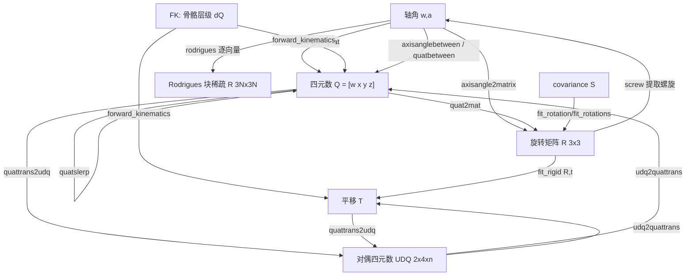

# 10-mesh / 16 刚体变换与四元数 (Rigid Transforms & Quaternions)

> 本章覆盖 `mesh/` 下 **22 个刚体变换 / 旋转表示 / 四元数相关函数**：
> `axisangle2matrix`、`axisangle2quat`、`axisanglebetween`、`quat2mat`、`quatbetween`、`quatslerp`、
> `quattrans2udq`、`udq2quattrans`、`rodrigues`、`slerp`、`fit_rotation`、`fit_rotations`、`fit_rigid`、
> `forward_kinematics`、`per_vertex_frames`、`moveEV`、`moveFV`、`moveVF`、`screw`、`revolve`、
> `rotate_about`、`qvr`。
>
> This chapter documents **22 rigid-transform / rotation-representation / quaternion functions** under `mesh/`.
>
> 所有签名、行号、可选参数均**逐字取自源码**（行号已用 `Read` 核对），不作超出源码的演绎。
> All signatures, line numbers and options are taken verbatim from the source (verified by reading the files).

---

## 本章概览 / Chapter overview

### 关键约定：四元数分量顺序 / Key convention: quaternion component order

> **结论：gptoolbox 全库统一使用"标量在前"顺序 `[w x y z]`（即 `[1 i j k]`，标量实部 `w` 位于第 1 列），
> 而非 `[x y z w]`。** 依据如下（均取自源码）：
>
> - `axisangle2quat`：`Q = [cos(TH/2) W.*sin(TH/2)]`，标量 `cos(θ/2)` 在首列
>   （[axisangle2quat.m L19](file:///c:/VSWork/gptoolbox-1/mesh/axisangle2quat.m#L19)），头注写 `#rotations by 4 (1,i,j,k)`。
> - `quatslerp` 头注写 `#Q by 4 list of quaternions [w x y z]`
>   （[quatslerp.m L7](file:///c:/VSWork/gptoolbox-1/mesh/quatslerp.m#L7)）。
> - `quattrans2udq` / `udq2quattrans` 头注写 `(1,i,j,k)`
>   （[quattrans2udq.m L9](file:///c:/VSWork/gptoolbox-1/mesh/quattrans2udq.m#L9)）。
> - `quat2mat` 用 `q(:,1)=w`、`q(:,2)=x`、`q(:,3)=y`、`q(:,4)=z`（[quat2mat.m L21-L29](file:///c:/VSWork/gptoolbox-1/mesh/quat2mat.m#L21-L29)）。
> - `quat/quatmultiply` 头注"scalar number as the first column"
>   （[quat/quatmultiply.m L7-L8](file:///c:/VSWork/gptoolbox-1/quat/quatmultiply.m#L7-L8)）。
>
> 因此本文所有 `#* by 4` 的四元数一律记作 `[w x y z]`。
> All `#* by 4` quaternions in this chapter follow the scalar-first order `[w x y z]`.

### (a) 旋转表示与转换 / Rotation representations & conversion

| 函数 (Function) | 角色 (Role) | 关键依赖 (Key deps) | 锚点 |
|---|---|---|---|
| `axisangle2matrix` | 轴角 `(w,a) → 3×3×n` 旋转矩阵（Rodrigues 公式） | `normalizerow` | [mesh/axisangle2matrix.m](file:///c:/VSWork/gptoolbox-1/mesh/axisangle2matrix.m#L1-L44) |
| `axisangle2quat` | 轴角 `(W,TH) → [w x y z]` 单位四元数 | — | [mesh/axisangle2quat.m](file:///c:/VSWork/gptoolbox-1/mesh/axisangle2quat.m#L1-L21) |
| `quat2mat` | 单位四元数 `[w x y z] → 3×3×m` 旋转矩阵 | — | [mesh/quat2mat.m](file:///c:/VSWork/gptoolbox-1/mesh/quat2mat.m#L1-L49) |
| `rodrigues` | 逐向量旋转的**块对角稀疏** `3N×3N` 旋转矩阵 `R` 与叉乘矩阵 `W` | — | [mesh/rodrigues.m](file:///c:/VSWork/gptoolbox-1/mesh/rodrigues.m#L1-L44) |
| `qvr` | 对 `X,U` 两个点集调 `quiver`/`quiver3` 的简写 | — (内置 `quiver`/`quiver3`) | [mesh/qvr.m](file:///c:/VSWork/gptoolbox-1/mesh/qvr.m#L1-L24) |

### (b) 四元数插值与两向量间旋转 / Quaternion interpolation & between-vectors

| 函数 | 角色 | 关键依赖 | 锚点 |
|---|---|---|---|
| `axisanglebetween` | 两向量 `u,v` 间的轴角 `(w,a)`（及可选 `R`） | `normalizerow`, `normrow`, `axisangle2matrix` | [mesh/axisanglebetween.m](file:///c:/VSWork/gptoolbox-1/mesh/axisanglebetween.m#L1-L64) |
| `quatbetween` | 两向量 `u,v` 间的单位四元数（`axisanglebetween`+`axisangle2quat`） | `axisanglebetween`, `axisangle2quat` | [mesh/quatbetween.m](file:///c:/VSWork/gptoolbox-1/mesh/quatbetween.m#L1-L17) |
| `quatslerp` | 四元数球面线性插值（批量，`[w x y z]`） | `normalizerow` | [mesh/quatslerp.m](file:///c:/VSWork/gptoolbox-1/mesh/quatslerp.m#L1-L31) |
| `slerp` | **向量**球面线性插值（含幅值 lerp 回填） | — | [mesh/slerp.m](file:///c:/VSWork/gptoolbox-1/mesh/slerp.m#L1-L42) |

### (c) 对偶四元数 / Dual quaternions

| 函数 | 角色 | 与 LBS/DQS 的关系 | 锚点 |
|---|---|---|---|
| `quattrans2udq` | `(Q,T) → UDQ`（`2×4×#controls`：第 1 行实部、第 2 行对偶部） | UDQ 是 DQS（对偶四元数蒙皮）的输入表示 | [mesh/quattrans2udq.m](file:///c:/VSWork/gptoolbox-1/mesh/quattrans2udq.m#L1-L28) |
| `udq2quattrans` | `UDQ → (Q,T)`（逆变换） | 从 DQS 结果还原旋转+平移，再回代 LBS 管线 | [mesh/udq2quattrans.m](file:///c:/VSWork/gptoolbox-1/mesh/udq2quattrans.m#L1-L38) |

> **UDQ 与 LBS / DQS 的关系（据源码与头注）**：`quattrans2udq` 头注注明改编自 Kavan 的 `dqconv.c`
> （[quattrans2udq.m L20](file:///c:/VSWork/gptoolbox-1/mesh/quattrans2udq.m#L20)），把"旋转四元数 + 平移向量"
> 打包成对偶四元数；对偶四元数蒙皮（DQS）对 UDQ 做线性混合后归一化，可避免线性混合蒙皮（LBS）的"糖纸/塌陷"
> 伪影。本仓库中 DQS 的消费端见 `mesh/dualquatlbs.m`（属 11 变形与蒙皮章）。LBS 则直接用 `3×4` 仿射矩阵
> （`lbs`/`lbs_matrix`）。`quattrans2udq`/`udq2quattrans` 只在表示层做相互转换，本身不做混合。
> The conversion pair packs a rotation quaternion + translation into (and out of) a dual quaternion; the
> actual DQS blending lives in `dualquatlbs` (chapter 11), not here.

### (d) 拟合与运动学 / Fitting & kinematics

| 函数 | 角色 | 关键依赖 | 锚点 |
|---|---|---|---|
| `fit_rotation` | 单矩阵最佳旋转（SVD + 反射修正） | — | [mesh/fit_rotation.m](file:///c:/VSWork/gptoolbox-1/mesh/fit_rotation.m#L1-L22) |
| `fit_rotations` | 批量最佳旋转（`dim×dim×#R`），支持 MEX 快路径 | `fit_rotations_mex` [MEX] | [mesh/fit_rotations.m](file:///c:/VSWork/gptoolbox-1/mesh/fit_rotations.m#L1-L92) |
| `fit_rigid` | 点集间最佳**刚体**变换 `(R,t)`（仅 point-to-point） | `fit_rotation` | [mesh/fit_rigid.m](file:///c:/VSWork/gptoolbox-1/mesh/fit_rigid.m#L1-L33) |
| `forward_kinematics` | 骨骼层级 → 绝对旋转/平移（前向运动学，DP 记忆化） | `quatmultiply`(quat/), `quatrotate`(内置), `quat2mat`(示例) | [mesh/forward_kinematics.m](file:///c:/VSWork/gptoolbox-1/mesh/forward_kinematics.m#L1-L62) |

### (e) 局部坐标系与网格编辑 / Local frames & mesh editing

| 函数 | 角色 | 关键依赖 | 锚点 |
|---|---|---|---|
| `per_vertex_frames` | 每顶点局部标架 `(T,N,B)`（切线/法线/副法线） | `per_vertex_normals`, `normalizerow`, `minnz` | [mesh/per_vertex_frames.m](file:///c:/VSWork/gptoolbox-1/mesh/per_vertex_frames.m#L1-L71) |
| `moveEV` | 边标量 `S_E → ` 顶点标量 `S_V`（按关联边平均） | `adjacency_matrix` | [mesh/moveEV.m](file:///c:/VSWork/gptoolbox-1/mesh/moveEV.m#L1-L23) |
| `moveFV` | 面标量 `S → ` 顶点标量 `SV`（按关联面平均） | — | [mesh/moveFV.m](file:///c:/VSWork/gptoolbox-1/mesh/moveFV.m#L1-L23) |
| `moveVF` | 顶点标量 `S → ` 面标量 `SF`（面内 3 顶点均值） | — | [mesh/moveVF.m](file:///c:/VSWork/gptoolbox-1/mesh/moveVF.m#L1-L15) |

### (f) 螺旋运动与旋转体 / Screw motion & surfaces of revolution

| 函数 | 角色 | 关键依赖 | 锚点 |
|---|---|---|---|
| `screw` | 两个刚体变换之间的**螺旋运动**参数 `(p,θ,s,d,f)` | — | [mesh/screw.m](file:///c:/VSWork/gptoolbox-1/mesh/screw.m#L1-L130) |
| `revolve` | 平面轮廓**绕 y 轴旋转**生成回转面网格 | `cdt`, `winding_number`, `barycenter`, `outline`, `remove_unreferenced`, `extrude`, `remove_duplicate_vertices`, `doublearea` | [mesh/revolve.m](file:///c:/VSWork/gptoolbox-1/mesh/revolve.m#L1-L42) |
| `rotate_about` | 把点集 `A` 绕轴 `B` 旋转 `th`（轴不必归一化） | `normalizerow`, `normrow` | [mesh/rotate_about.m](file:///c:/VSWork/gptoolbox-1/mesh/rotate_about.m#L1-L30) |

### 旋转表示互转与研究链 / Representations & R&D chain



---

## 逐函数条目 / Per-function entries

### `axisangle2matrix` — 轴角转旋转矩阵
- **文件 / File**: [mesh/axisangle2matrix.m](file:///c:/VSWork/gptoolbox-1/mesh/axisangle2matrix.m#L1-L44)
- **签名 / Signature**: `R = axisangle2matrix(w,a)`
- **功能 / Purpose**: `EN: Convert axis-angle rotations into corresponding rotation matrices.` / 中文：把批量轴角 `(w,a)` 转换为 `3×3×n` 旋转矩阵。
- **输入 / Inputs**:

  | 参数 | 尺寸/类型 | 含义 (中 / EN) |
  |---|---|---|
  | `w` | `n by 3` | 转轴向量（内部会归一化）/ rotation axis vectors |
  | `a` | `n by 1` | 旋转角（弧度）/ rotation angles (radians) |

- **输出 / Outputs**:

  | 参数 | 尺寸/类型 | 含义 |
  |---|---|---|
  | `R` | `3 by 3 by n` | 旋转矩阵堆叠 / stacked rotation matrices |

- **可选参数 / Optional**: 无（源码无 `varargin`）/ none
- **变量流动 / Variable flow**: `w,a →(sin/cos/t=1-cos, normalizerow)→ ŵ,x,y,z,s,c,t →(Rodrigues 逐元素赋值)→ R`
- **算法步骤 / Algorithm**:
  1. 断言 `w` 无 `NaN`、`size(w,1)==size(a,1)`、`size(w,2)==3` / assert shapes.
  2. 计算 `s=sin(a)`、`c=cos(a)`、`t=1-c`，并用 `normalizerow` 归一化转轴 `w`。
  3. 按 **Rodrigues 公式** `R = I + sinθ·K + (1−cosθ)·K²`（`K=[ŵ]×` 为叉乘矩阵）逐元素写入 `R(1,1,:)`…`R(3,3,:)`：对角线 `t·x²+c` 等，非对角 `t·x·y ± s·z` 等。
  4. 返回 `3×3×n`。
- **流程图 / Flowchart**:

  ```mermaid
  flowchart TD
    A["输入 w n by 3, a n by 1"] --> B{"尺寸/NaN 断言通过?"}
    B -- 否 --> E["报错 assert"]
    B -- 是 --> C["s=sin(a), c=cos(a), t=1-c"]
    C --> D["ŵ = normalizerow(w)"]
    D --> F["按 R = I + sinθ·K + (1-cosθ)·K² 逐元素填 R"]
    F --> Z["输出 R 3 by 3 by n"]
  ```

- **依赖 / Dependencies**: `normalizerow`（matrix 模块）
- **See also**: `axisangle2quat`, `quat2mat`, `rodrigues`, `axisanglebetween`, `rotate_about`

### `axisangle2quat` — 轴角转四元数
- **文件 / File**: [mesh/axisangle2quat.m](file:///c:/VSWork/gptoolbox-1/mesh/axisangle2quat.m#L1-L21)
- **签名 / Signature**: `Q = axisangle2quat(W,TH)`
- **功能 / Purpose**: `EN: Convert axis-angle representation of rotation to quaternion.` / 中文：把轴角表示转换为单位四元数 `[w x y z]`。
- **输入 / Inputs**:

  | 参数 | 尺寸/类型 | 含义 (中 / EN) |
  |---|---|---|
  | `W` | `#rotations by 3` | 转轴列表 / list of axes |
  | `TH` | `#rotations by 1` | 角度列表（弧度）/ list of angles |

- **输出 / Outputs**:

  | 参数 | 尺寸/类型 | 含义 |
  |---|---|---|
  | `Q` | `#rotations by 4` | 四元数 `[w x y z]`（标量在前）/ quaternions (scalar-first) |

- **可选参数 / Optional**: 无 / none
- **变量流动 / Variable flow**: `W,TH →(半角)→ [cos(TH/2) W.*sin(TH/2)] →(按行 L2 归一化)→ Q`
- **算法步骤 / Algorithm**:
  1. 计算半角 `TH/2`，拼装 `Q = [cos(TH/2)  W.*sin(TH/2)]`（标量 `cos` 在首列，见头注 `(1,i,j,k)`）。
  2. 按行做 L2 归一化 `Q = Q./sqrt(sum(Q.^2,2))` 得单位四元数。
- **流程图 / Flowchart**:

  ```mermaid
  flowchart TD
    A["输入 W #rot by 3, TH #rot by 1"] --> B["半角: cos(TH/2), sin(TH/2)"]
    B --> C["Q = [cos(TH/2)  W.*sin(TH/2)]"]
    C --> D["按行归一化 Q./sqrt(sum(Q.^2,2))"]
    D --> Z["输出 Q #rot by 4 (w x y z)"]
  ```

- **依赖 / Dependencies**: 无 / none
- **See also**: `quat2mat`, `quatbetween`, `axisangle2matrix`, `axisanglebetween`

### `axisanglebetween` — 两向量间的轴角旋转
- **文件 / File**: [mesh/axisanglebetween.m](file:///c:/VSWork/gptoolbox-1/mesh/axisanglebetween.m#L1-L64)
- **签名 / Signature**: `[w,a,R] = axisanglebetween(u,v,nan_replacement)`
- **功能 / Purpose**: `EN: Compute the axis and angle representation of the rotation between two vectors.` / 中文：求把每行 `u` 旋转到对应 `v` 的轴角表示。
- **输入 / Inputs**:

  | 参数 | 尺寸/类型 | 含义 (中 / EN) |
  |---|---|---|
  | `u` | `n by dim`, dim∈{2,3} | 起始行向量 / source row vectors |
  | `v` | `n by dim` | 目标行向量 / target row vectors |

- **输出 / Outputs**:

  | 参数 | 尺寸/类型 | 含义 |
  |---|---|---|
  | `w` | `n by 3`（dim=2 时裁剪为 `n by 2`） | 单位转轴（角度恰为 π 时可能为 `NaN`）/ axis vectors |
  | `a` | `n by 1` | 角度 / angles |
  | `R` | `3 by 3 by n`（dim=2 时 `2 by 2 by n`；仅 `nargout>2` 时计算） | 旋转矩阵 / rotation matrices |

- **可选参数 / Optional**:

  | 名称 | 取值 | 默认 | 含义 |
  |---|---|---|---|
  | `nan_replacement`（**位置参数**，非名值对） | `1 by 3` 向量 | 无（不提供则不替换） | 替换 `w` 中因角度恰为 π 产生的 `NaN` 行 |

- **变量流动 / Variable flow**: `u,v →(normalizerow, 2D 补零升 3D)→ û,v̂ →(cross+normalizerow)→ w →(dot+acos)→ a →(可选)→ R`
- **算法步骤 / Algorithm**:
  1. 断言 `u,v` 同尺寸、`dim∈{2,3}`；`normalizerow` 归一化。
  2. 若 `dim==2`，把 `u,v` 补零为 3D（`w` 视为 3D 轴上取前两维）。
  3. 转轴 `w = normalizerow(cross(u,v,2))`；`a = acos(dot(u,v,2))`。
  4. 对 `u≈v`（`normrow(u-v)<eps`）的行，置 `a=0`、`w=[0 0 1]`（无旋转取默认轴）。
  5. 若传入 `nan_replacement`，把 `w` 中 `NaN` 行替换为该向量。
  6. `nargout>2` 时用 `axisangle2matrix` 生成 `R`（dim=2 时截取 `R(1:2,1:2,:)`）。
  7. dim=2 时把 `w` 裁为前两列返回。
- **流程图 / Flowchart**:

  ```mermaid
  flowchart TD
    A["输入 u,v 同尺寸"] --> B["normalizerow(u), normalizerow(v)"]
    B --> C{"dim == 2 ?"}
    C -- 是 --> D["补零升 3D"]
    C -- 否 --> E["保持 3D"]
    D --> F["w = normalizerow(cross(u,v,2))"]
    E --> F
    F --> G["a = acos(dot(u,v,2))"]
    G --> H{"u ≈ v ?"}
    H -- 是 --> I["置 a=0, w=[0 0 1]"]
    H -- 否 --> J["保留 w,a"]
    I --> K{"提供 nan_replacement ?"}
    J --> K
    K -- 是 --> L["替换 NaN 行"]
    K -- 否 --> M["跳过"]
    L --> N{"nargout > 2 ?"}
    M --> N
    N -- 是 --> O["R = axisangle2matrix(w,a)"]
    N -- 否 --> P["不计算 R"]
    O --> Z["输出 w,a, 可选 R"]
    P --> Z
  ```

- **依赖 / Dependencies**: `normalizerow`, `normrow`（matrix 模块）、`axisangle2matrix`
- **See also**: `quatbetween`, `axisangle2matrix`, `quat2mat`

### `quat2mat` — 四元数转旋转矩阵
- **文件 / File**: [mesh/quat2mat.m](file:///c:/VSWork/gptoolbox-1/mesh/quat2mat.m#L1-L49)
- **签名 / Signature**: `[R] = quat2mat(q)`
- **功能 / Purpose**: `EN: Convert quaternions to 3d rotation matrices.` / 中文：把单位四元数 `[w x y z]` 转为旋转矩阵。
- **输入 / Inputs**:

  | 参数 | 尺寸/类型 | 含义 (中 / EN) |
  |---|---|---|
  | `q` | `m by 4` | 已归一化四元数 `[w x y z]`（头注 `[1 i j k]`）/ normalized quaternions |

- **输出 / Outputs**:

  | 参数 | 尺寸/类型 | 含义 |
  |---|---|---|
  | `R` | `3 by 3 by m` | 旋转矩阵堆叠 / rotation matrices |

- **可选参数 / Optional**: 无 / none
- **变量流动 / Variable flow**: `q →(断言 4 列)→ 逐元素二次型 → R`
- **算法步骤 / Algorithm**:
  1. 断言 `size(q,2)==4`。
  2. 按 `q(:,1)=w,q(:,2)=x,q(:,3)=y,q(:,4)=z` 逐元素写入标准旋转矩阵（如 `R(1,1)=w²+x²−y²−z²`、`R(1,2)=2(xy−wz)` 等）。
  3. 返回 `3×3×m`。
- **流程图 / Flowchart**:

  ```mermaid
  flowchart TD
    A["输入 q m by 4 (w x y z)"] --> B{"size(q,2)==4 ?"}
    B -- 否 --> E["报错 assert"]
    B -- 是 --> C["写 R(1,1..3,3) 各二次型项"]
    C --> Z["输出 R 3 by 3 by m"]
  ```

- **依赖 / Dependencies**: 无 / none
- **See also**: `axisangle2matrix`, `axisangle2quat`, `fit_rotations`, `forward_kinematics`

### `quatbetween` — 两向量间的单位四元数
- **文件 / File**: [mesh/quatbetween.m](file:///c:/VSWork/gptoolbox-1/mesh/quatbetween.m#L1-L17)
- **签名 / Signature**: `q = quatbetween(u,v,varargin)`
- **功能 / Purpose**: `EN: Compute the unit quaternion representation of the rotation between two vectors.` / 中文：求两向量间的单位四元数。
- **输入 / Inputs**:

  | 参数 | 尺寸/类型 | 含义 (中 / EN) |
  |---|---|---|
  | `u` | `n by dim` | 起始行向量 / source vectors |
  | `v` | `n by dim` | 目标行向量 / target vectors |

- **输出 / Outputs**:

  | 参数 | 尺寸/类型 | 含义 |
  |---|---|---|
  | `q` | `n by 4` | 单位四元数 `[w x y z]` / unit quaternions |

- **可选参数 / Optional**: 透传给 `axisanglebetween` 的**位置**参数 `nan_replacement`（`1 by 3`）

  | 名称 | 取值 | 默认 | 含义 |
  |---|---|---|---|
  | `nan_replacement` | `1 by 3` 向量 | 无 | 替换角度恰为 π 时的 `NaN` 转轴 |

- **变量流动 / Variable flow**: `u,v,varargin →(axisanglebetween)→ w,a →(axisangle2quat)→ q`
- **算法步骤 / Algorithm**:
  1. 调 `[w,a] = axisanglebetween(u,v,varargin{:})`。
  2. `q = axisangle2quat(w,a)`。
- **流程图 / Flowchart**:

  ```mermaid
  flowchart TD
    A["输入 u,v (可选 nan_replacement)"] --> B["axisanglebetween(u,v,...) -> w,a"]
    B --> C["axisangle2quat(w,a)"]
    C --> Z["输出 q n by 4 (w x y z)"]
  ```

- **依赖 / Dependencies**: `axisanglebetween`, `axisangle2quat`
- **See also**: `axisanglebetween`, `axisangle2quat`, `quatslerp`

### `quatslerp` — 四元数球面线性插值
- **文件 / File**: [mesh/quatslerp.m](file:///c:/VSWork/gptoolbox-1/mesh/quatslerp.m#L1-L31)
- **签名 / Signature**: `Qt = quatslerp(Q0,Q1,t)`
- **功能 / Purpose**: `EN: Slerp between two quaternions.` / 中文：在两个四元数之间做（批量）球面线性插值。
- **输入 / Inputs**:

  | 参数 | 尺寸/类型 | 含义 (中 / EN) |
  |---|---|---|
  | `Q0` | `#Q by 4` | `t=0` 处四元数 `[w x y z]` / quaternions at t=0 |
  | `Q1` | `#Q by 4` | `t=1` 处四元数 / quaternions at t=1 |
  | `t` | `#Q` 或 `1` | 时间参数 / times (scalar 自动广播) |

- **输出 / Outputs**:

  | 参数 | 尺寸/类型 | 含义 |
  |---|---|---|
  | `Qt` | `#Q by 4` | 时刻 `t` 的四元数 / interpolated quaternions |

- **可选参数 / Optional**: 无 / none
- **变量流动 / Variable flow**: `Q0,Q1,t →(dot, acos, sin)→ s0,s1 →(加权和 + normalizerow)→ Qt`
- **算法步骤 / Algorithm**:
  1. 若 `t` 为标量则广播为 `#Q by 1`。
  2. `d = sum(Q0.*Q1,2)`，`absD=abs(d)`，`theta=acos(absD)`，`sinTheta=sin(theta)`。
  3. 计算权重 `s0=sin((1-t)θ)/sinθ`、`s1=sin(tθ)/sinθ`。
  4. 数值边界处理：`absD>=1`（同向）时退化为线性权重 `s0=1-t`、`s1=t`；`d<0`（异半球）时 `s1=-s1`（最短路径）。
  5. `Qt = s0.*Q0 + s1.*Q1`，最后 `normalizerow` 归一化。
- **流程图 / Flowchart**:

  ```mermaid
  flowchart TD
    A["输入 Q0,Q1 #Q by 4, t"] --> B{"numel(t)==1 ?"}
    B -- 是 --> C["t 广播为 #Q by 1"]
    B -- 否 --> D["保持 t"]
    C --> E["d=sum(Q0.*Q1,2); theta=acos(abs(d))"]
    D --> E
    E --> F["s0=sin((1-t)θ)/sinθ, s1=sin(tθ)/sinθ"]
    F --> G{"abs(d) >= 1 ?"}
    G -- 是 --> H["s0=1-t, s1=t"]
    G -- 否 --> I["保留 s0,s1"]
    H --> J{"d < 0 ?"}
    I --> J
    J -- 是 --> K["s1 = -s1"]
    J -- 否 --> L["保留 s1"]
    K --> M["Qt = s0.*Q0 + s1.*Q1"]
    L --> M
    M --> N["normalizerow(Qt)"]
    N --> Z["输出 Qt #Q by 4"]
  ```

- **依赖 / Dependencies**: `normalizerow`（matrix 模块）
- **See also**: `slerp`, `quatbetween`, `axisangle2quat`

### `quattrans2udq` — 旋转+平移转对偶四元数
- **文件 / File**: [mesh/quattrans2udq.m](file:///c:/VSWork/gptoolbox-1/mesh/quattrans2udq.m#L1-L28)
- **签名 / Signature**: `UDQ = quattrans2udq(Q,T)`
- **功能 / Purpose**: `EN: Convert a rotation stored as a quaternion and a translation to a dual quaternion.` / 中文：把"四元数旋转 + 平移向量"打包成对偶四元数。
- **输入 / Inputs**:

  | 参数 | 尺寸/类型 | 含义 (中 / EN) |
  |---|---|---|
  | `Q` | `#controls by 4` | 旋转四元数 `[w x y z]` / rotation quaternions |
  | `T` | `#controls by 3` | 平移向量 / translation vectors |

- **输出 / Outputs**:

  | 参数 | 尺寸/类型 | 含义 |
  |---|---|---|
  | `UDQ` | `2 by 4 by #controls` | 对偶四元数：第 1 行实部=Q，第 2 行对偶部 / dual quaternions |

- **可选参数 / Optional**: 无 / none
- **变量流动 / Variable flow**: `Q,T →(转置放实部)→ UDQ(1,:,:) ； Q,T →(对偶部公式 0.5 组合)→ UDQ(2,:,:)`
- **算法步骤 / Algorithm**:
  1. 实部直接复制旋转四元数：`UDQ(1,:,:) = Q'`（转成 `4×1×#controls`）。
  2. 对偶部按 Kavan `dqconv.c` 公式，用 `T` 与 `Q` 各分量做 `±0.5` 线性组合逐元素赋值。
  3. 返回 `2×4×#controls`。
- **流程图 / Flowchart**:

  ```mermaid
  flowchart TD
    A["输入 Q #ctrl by 4, T #ctrl by 3"] --> B["实部: UDQ(1,:,:) = Q'"]
    A --> C["对偶部: 0.5*(T 与 Q 组合)"]
    B --> D["UDQ(2,:,:) 逐元素赋值"]
    C --> D
    D --> Z["输出 UDQ 2 by 4 by #ctrl"]
  ```

- **依赖 / Dependencies**: 无 / none
- **See also**: `udq2quattrans`, `dualquatlbs`（`mesh/`，11 章）

### `udq2quattrans` — 对偶四元数转旋转+平移
- **文件 / File**: [mesh/udq2quattrans.m](file:///c:/VSWork/gptoolbox-1/mesh/udq2quattrans.m#L1-L38)
- **签名 / Signature**: `[Q,T] = udq2quattrans(UDQ)`
- **功能 / Purpose**: `EN: Convert a dual quaternion to rotation stored as a quaternion and a translation.` / 中文：把对偶四元数还原为四元数旋转与平移。
- **输入 / Inputs**:

  | 参数 | 尺寸/类型 | 含义 (中 / EN) |
  |---|---|---|
  | `UDQ` | `2 by 4 by #rotations` | 对偶四元数 / dual quaternions |

- **输出 / Outputs**:

  | 参数 | 尺寸/类型 | 含义 |
  |---|---|---|
  | `Q` | `#rotations by 4` | 旋转四元数 `[w x y z]` / rotation quaternions |
  | `T` | `#rotations by 3` | 平移向量 / translation vectors |

- **可选参数 / Optional**: 无 / none
- **变量流动 / Variable flow**: `UDQ →(转置取实部)→ Q ； UDQ 实部/对偶部 →(2*(...) 组合)→ T`
- **算法步骤 / Algorithm**:
  1. `Q = UDQ(1,:,:)'`（实部即旋转四元数）。
  2. 按 Kavan `dqconv.c` 公式，用实部 `UDQ(1,:,:)` 与对偶部 `UDQ(2,:,:)` 做 `2*(...)` 组合，逐分量求 `T(:,1..3)`。
- **流程图 / Flowchart**:

  ```mermaid
  flowchart TD
    A["输入 UDQ 2 by 4 by #rot"] --> B["Q = UDQ(1,:,:)'"]
    A --> C["T(:,1..3): 2*(实部 与 对偶部 组合)"]
    B --> Z["输出 Q #rot by 4, T #rot by 3"]
    C --> Z
  ```

- **依赖 / Dependencies**: 无 / none
- **See also**: `quattrans2udq`
- **已知问题 / Known issue**: 源码第 32 行 `T(:,2) = 2.0*( ... -UDQ(2,4,:).*UDQ(1,2,:);` 以 `;` 结尾而**缺少右括号 `)`**
  （[udq2quattrans.m L28-L32](file:///c:/VSWork/gptoolbox-1/mesh/udq2quattrans.m#L28-L32)），按当前文本该语句存在括号不匹配的语法问题；
  逆向重建时应补为 `);`。对偶部四个分量的组合符号取自 Kavan 公式，其余与 `quattrans2udq` 互为逆过程。

### `rodrigues` — 逐向量旋转的块稀疏 Rodrigues 矩阵
- **文件 / File**: [mesh/rodrigues.m](file:///c:/VSWork/gptoolbox-1/mesh/rodrigues.m#L1-L44)
- **签名 / Signature**: `[R,W] = rodrigues(N,phi)`
- **功能 / Purpose**: `EN: Construct the rotation matrix for rotating vectors around each given vector.` / 中文：构造把每个 3D 向量绕对应转轴 `N_i` 旋转 `phi_i` 的**块对角**旋转矩阵。
- **输入 / Inputs**:

  | 参数 | 尺寸/类型 | 含义 (中 / EN) |
  |---|---|---|
  | `N` | `#N by 3` | 3D 转轴（应单位化）/ 3D axis vectors |
  | `phi` | 标量 或 `#N by 1` | 统一角度或逐向量角度 / uniform or per-vector angles |

- **输出 / Outputs**:

  | 参数 | 尺寸/类型 | 含义 |
  |---|---|---|
  | `R` | `3#N by 3#N` sparse | 块对角"旋转"矩阵（`phi` 为空时返回 `[]`）/ block-diagonal rotation matrix |
  | `W` | `3#N by 3#N` sparse | 块对角的叉乘矩阵 `[N_i]×` / block cross-product matrix |

- **可选参数 / Optional**: 无 / none
- **变量流动 / Variable flow**: `N →(sparse 组装)→ W 3N×3N ； phi,W →(R = I + sinφ W + (2 sin²(φ/2)) W²)→ R`
- **算法步骤 / Algorithm**:
  1. `m=size(N,1)`；若 `phi` 为向量则断言长度 `m` 并 `diag(sparse(phi))` 成对角。
  2. 用稀疏三元组 `I=[1 2 0 2 0 1]*m+(1:m)`、`J=[0 0 1 1 2 2]*m+(1:m)`、`V=[z −y −z x y −x]` 组装块对角叉乘矩阵 `W`（每 3×3 块为 `[N_i]×`）。
  3. 若 `phi` 为空则 `R=[]`；否则 `R = speye(3m) + sin(phi)*W + (2*sin(phi/2)^2)*W*W`（即 `I + sinφ W + (1−cosφ)W²`）。
- **流程图 / Flowchart**:

  ```mermaid
  flowchart TD
    A["输入 N #N by 3, phi 标量/向量"] --> B{"numel(phi) > 1 ?"}
    B -- 是 --> C["assert 长度, phi = diag(sparse(phi))"]
    B -- 否 --> D["保持标量 phi"]
    C --> E["组装块对角 W = blockdiag([N_i]x)"]
    D --> E
    E --> F{"phi 为空 ?"}
    F -- 是 --> G["R = []"]
    F -- 否 --> H["R = I + sin(phi)W + (2 sin^2(phi/2))WW"]
    G --> Z["输出 R, W"]
    H --> Z
  ```

- **依赖 / Dependencies**: 无（示例中用到 `normalizerow`）/ none (example uses `normalizerow`)
- **See also**: `axisangle2matrix`, `grad`, `rotate_about`

### `slerp` — 向量球面线性插值
- **文件 / File**: [mesh/slerp.m](file:///c:/VSWork/gptoolbox-1/mesh/slerp.m#L1-L42)
- **签名 / Signature**: `[C] = slerp(A,B,t)`
- **功能 / Purpose**: `EN: Spherically interpolate between two unit vectors. If not unit then this will normalize, slerp and then lerp magnitudes.` / 中文：两个**向量**间的球面线性插值（非单位向量会先归一化插值、再对幅值做线性插值）。
- **输入 / Inputs**:

  | 参数 | 尺寸/类型 | 含义 (中 / EN) |
  |---|---|---|
  | `A` | `#A by 3` | 起始向量 / source vectors |
  | `B` | `#A by 3` | 目标向量 / target vectors |
  | `t` | `#A` 或 `1` | 0..1 的插值参数（标量广播）/ interpolation parameter |

- **输出 / Outputs**:

  | 参数 | 尺寸/类型 | 含义 |
  |---|---|---|
  | `C` | `#A by 3` | 插值结果向量 / interpolated vectors |

- **可选参数 / Optional**: 无 / none
- **变量流动 / Variable flow**: `A,B →(记录幅值 Amag,Bmag; 归一化)→ Â,B̂ →(acos,sin)→ Ω →(球面插值)→ C →(幅值 lerp 回填)→ C`
- **算法步骤 / Algorithm**:
  1. 断言 `#A==#B`；`t` 标量时广播为 `#A by 1`；断言 `#A==numel(t)`。
  2. 记录原始幅值 `Amag`,`Bmag`，把 `A`,`B` 归一化。
  3. `Omega=acos(sum(A.*B,2))`；把接近 π 的值夹到 `π−1e-7`（避免除零）。
  4. `C = A·sin((1−t)Ω)/sinΩ + B·sin(tΩ)/sinΩ`。
  5. 对共线（`|Ω|<eps`）的行退化为普通 lerp `A + t(B−A)`。
  6. 最后按幅值线性插值 `C .* (Amag + t*(Bmag−Amag))`。
- **流程图 / Flowchart**:

  ```mermaid
  flowchart TD
    A["输入 A,B #A by 3, t"] --> B["断言尺寸, t 标量广播"]
    B --> C["记录 Amag,Bmag; 归一化 A,B"]
    C --> D["Omega = acos(sum(A.*B,2))"]
    D --> E["夹紧 Omega 接近 pi 的值"]
    E --> F["C = 球面插值 A,B"]
    F --> G{"共线 (|Omega| < eps) ?"}
    G -- 是 --> H["C = A + t(B-A)"]
    G -- 否 --> I["保留 C"]
    H --> J["C = C .* (Amag + t(Bmag-Amag))"]
    I --> J
    J --> Z["输出 C #A by 3"]
  ```

- **依赖 / Dependencies**: 无 / none
- **See also**: `quatslerp`, `quatbetween`

### `fit_rotation` — 单矩阵最佳旋转拟合
- **文件 / File**: [mesh/fit_rotation.m](file:///c:/VSWork/gptoolbox-1/mesh/fit_rotation.m#L1-L22)
- **签名 / Signature**: `R = fit_rotation(S)`
- **功能 / Purpose**: `EN: Find rotation for a given covariance matrix.` / 中文：对给定的 `n×n` 协方差矩阵，求最接近它的**真旋转**矩阵。
- **输入 / Inputs**:

  | 参数 | 尺寸/类型 | 含义 (中 / EN) |
  |---|---|---|
  | `S` | `n by n` | 协方差矩阵 / covariance matrix |

- **输出 / Outputs**:

  | 参数 | 尺寸/类型 | 含义 |
  |---|---|---|
  | `R` | `n by n` | 最接近 `S` 的旋转矩阵 / closest rotation |

- **可选参数 / Optional**: 无 / none
- **变量流动 / Variable flow**: `S →(svd)→ su,ss,sv → R=sv*su' →(det<0 时翻转 su 末列)→ R`
- **算法步骤 / Algorithm**:
  1. `[su,ss,sv]=svd(S)`。
  2. `R = sv*su'`（正交极化）。
  3. 若 `det(R)<0`（含反射），把 `su` 最后一列取负后重算 `R=sv*su'`，保证为真旋转。
- **流程图 / Flowchart**:

  ```mermaid
  flowchart TD
    A["输入 S n by n"] --> B["svd(S) -> su,ss,sv"]
    B --> C["R = sv*su'"]
    C --> D{"det(R) < 0 ?"}
    D -- 是 --> E["su(:,end) = -su(:,end); R = sv*su'"]
    D -- 否 --> F["保留 R"]
    E --> Z["输出 R"]
    F --> Z
  ```

- **依赖 / Dependencies**: 无 / none
- **See also**: `fit_rotations`, `fit_rigid`

### `fit_rotations` — 批量最佳旋转拟合
- **文件 / File**: [mesh/fit_rotations.m](file:///c:/VSWork/gptoolbox-1/mesh/fit_rotations.m#L1-L92)
- **签名 / Signature**: `[R,SS] = fit_rotations(S,varargin)`
- **功能 / Purpose**: `EN: Given an input mesh and new positions find rotations for every vertex that best maps its one ring to the new one ring.` / 中文：对逐顶点（或逐元素）的协方差矩阵批量求最佳旋转（ARAP 的局部步）。
- **输入 / Inputs**:

  | 参数 | 尺寸/类型 | 含义 (中 / EN) |
  |---|---|---|
  | `S` | `dim by dim by #rotations` | 待拟合旋转的协方差矩阵堆叠 / stacked covariance matrices |

- **输出 / Outputs**:

  | 参数 | 尺寸/类型 | 含义 |
  |---|---|---|
  | `R` | `dim by dim by #rotations` | 最佳旋转矩阵堆叠 / fitted rotations |
  | `SS` | `dim by dim by #rotations` | 每次 SVD 的奇异值对角（`ss` 写入各 `SS(:,:,ii)`）/ svd diagonals |

- **可选参数 / Optional**:

  | 名称 | 取值 | 默认 | 含义 |
  |---|---|---|---|
  | `'AllowFlips'` | `logical` | `false` | 允许最佳拟合为旋转**或反射**（不翻转则强制真旋转）/ allow reflection |
  | `'SinglePrecision'` | `logical` | `true` | 若可用则用单精度（在本 `.m` 快/慢路径中**仅被解析、未实际使用**，主要供 MEX 路径）/ parsed only in .m path |
  | `'Mex'` | `logical` | `true` | 是否优先调用 `fit_rotations_mex`（仅当 `~AllowFlips` 且 MEX 可用）/ allow mex fast path |

- **变量流动 / Variable flow**: `S →(解析参数 allow_flips,use_mex)→ S →(若 mex 可用且未 AllowFlips)→ fit_rotations_mex → R ； 否则 →(逐 ii: svd → sv*su' → det<0 修正)→ R,SS`
- **算法步骤 / Algorithm**:
  1. 取 `dim`,`nr`，默认 `allow_flips=false`、`use_mex=true`、`single_precision=true`；用 `containers.Map` 解析 `'AllowFlips'/'SinglePrecision'/'Mex'` 三个名值对，非法参数报错。
  2. **MEX 快路径**：若 `use_mex && fit_rotations_mex && ~allow_flips`，把 `S` 重排为 `[nr*dim, dim]` 调 `fit_rotations_mex(SS,...)` 再 reshape 回 `dim×dim×nr` 返回。
  3. **循环路径**：对每个 `ii` 做 `svd(S(:,:,ii))`，`Ri=sv*su'`，记录 `SS(:,:,ii)=ss`；若非 `allow_flips` 且 `det(Ri)<0`（用**局部函数 `det3`**）则翻转 `su` 末列重算；写入 `R(:,:,ii)`。
- **流程图 / Flowchart**:

  ```mermaid
  flowchart TD
    A["输入 S dim x dim x #R, 名值参数"] --> B["解析 AllowFlips/SinglePrecision/Mex"]
    B --> C{"use_mex && fit_rotations_mex && ~allow_flips ?"}
    C -- 是 --> D["重排 S 为 #R*dim x dim"]
    D --> E["R = fit_rotations_mex(S, ...)"]
    E --> F["reshape 回 dim x dim x #R"]
    F --> Z["输出 R, SS"]
    C -- 否 --> G["for ii = 1:#R"]
    G --> H["svd(S(:,:,ii)) -> su,ss,sv"]
    H --> I["Ri = sv*su'; SS(:,:,ii) = ss"]
    I --> J{"~AllowFlips && det3(Ri) < 0 ?"}
    J -- 是 --> K["su(:,end) = -su(:,end); Ri = sv*su'"]
    J -- 否 --> L["保留 Ri"]
    K --> M["R(:,:,ii) = Ri"]
    L --> M
    M -->|ii < #R| G
    M --> Z
  ```

- **依赖 / Dependencies**: `fit_rotations_mex` **[MEX]**（[mex/fit_rotations_mex.m](file:///c:/VSWork/gptoolbox-1/mex/fit_rotations_mex.m#L1-L3) 为桩，返回 `false`；实现在 [mex/fit_rotations_mex.cpp](file:///c:/VSWork/gptoolbox-1/mex/fit_rotations_mex.cpp)）
- **See also**: `fit_rotation`, `fit_rigid`, `arap`, `covariance_scatter_matrix`
- **说明 / Note**: 头注与真实名值对为 `'AllowFlips'/'SinglePrecision'/'Mex'`（[fit_rotations.m L29-L30](file:///c:/VSWork/gptoolbox-1/mesh/fit_rotations.m#L29-L30)）；
  头注未列 `'Mex'`，且 `single_precision` 变量被解析但未在循环路径中使用。

### `fit_rigid` — 点集间最佳刚体变换
- **文件 / File**: [mesh/fit_rigid.m](file:///c:/VSWork/gptoolbox-1/mesh/fit_rigid.m#L1-L33)
- **签名 / Signature**: `[R,t] = fit_rigid(V,U)`
- **功能 / Purpose**: `EN: Fit a rigid transformation that best matches V to U in the least squares sense: min Σ ||vi − R(ui+t)||².` / 中文：求把 `U` 对齐到 `V` 的最小二乘刚体变换。
- **输入 / Inputs**:

  | 参数 | 尺寸/类型 | 含义 (中 / EN) |
  |---|---|---|
  | `V` | `#V by dim` | 目标点集 / target points |
  | `U` | `#V by dim` | 源点集 / source points |

- **输出 / Outputs**:

  | 参数 | 尺寸/类型 | 含义 |
  |---|---|---|
  | `R` | `dim by dim` | 旋转矩阵（**转置存储**，用法 `U*R`）/ transposed rotation |
  | `t` | `1 by dim` | 平移向量 / translation |

- **可选参数 / Optional**: 无 / none（`method` 在源码内被硬编码为 `'point-to-point'`，`'point-to-plane'` 分支为空）

  | 名称 | 取值 | 默认 | 含义 |
  |---|---|---|---|
  | （无对外选项） | — | — | 源码无 `varargin`；`method='point-to-point'` 写死 |

- **变量流动 / Variable flow**: `U,V →(去质心外积)→ S →(转置传入 fit_rotation)→ R →(质心差)→ t`
- **算法步骤 / Algorithm**:
  1. 取 `method='point-to-point'`。
  2. 计算去质心外积 `S = (U−mean(U))' * (V−mean(V))`。
  3. `R = fit_rotation(S')`（对 `S'` 用 SVD 拟合旋转）。
  4. `t = mean(V) − mean(U)*R`（质心对齐，误差由 `R` 承担）。
- **流程图 / Flowchart**:

  ```mermaid
  flowchart TD
    A["输入 V,U #V by dim"] --> B["S = (U-mean(U))'*(V-mean(V))"]
    B --> C["R = fit_rotation(S')"]
    C --> D["t = mean(V) - mean(U)*R"]
    D --> Z["输出 R (转置), t"]
  ```

- **依赖 / Dependencies**: `fit_rotation`
- **See also**: `fit_rotation`, `fit_rotations`
- **说明 / Note**: 无 `'Scaling'` 选项；头注输出说明即写明 `R` 为"rotation matrix **transposed**"，示例用 `UU = bsxfun(@plus,U*R,t)`（行向量约定）。

### `forward_kinematics` — 前向运动学（骨骼层级）
- **文件 / File**: [mesh/forward_kinematics.m](file:///c:/VSWork/gptoolbox-1/mesh/forward_kinematics.m#L1-L62)
- **签名 / Signature**: `[Q,T] = forward_kinematics(C,BE,P,dQ)`
- **功能 / Purpose**: `EN: Compute absolute transformations from FK hierarchy and relative bone rotations.` / 中文：由骨骼层级与相对骨旋转递推绝对旋转与平移（前向运动学）。
- **输入 / Inputs**:

  | 参数 | 尺寸/类型 | 含义 (中 / EN) |
  |---|---|---|
  | `C` | `#C by dim` | 关节位置 / joint positions |
  | `BE` | `#BE by 2` | 骨边索引（指向 `C` 的行）/ bone edge indices into C |
  | `P` | `#BE by 1` | 每根骨的父骨索引（`<1` 视为根）/ parent index into BE |
  | `dQ` | `#BE by 4` | 相对骨旋转四元数 `[w x y z]` / relative rotations |

- **输出 / Outputs**:

  | 参数 | 尺寸/类型 | 含义 |
  |---|---|---|
  | `Q` | `#BE by 4` | 绝对旋转四元数 `[w x y z]` / absolute rotations |
  | `T` | `#BE by 3` | 绝对平移（源码分配 `zeros(m,3)`；头注写 `#BE by 2` 疑为笔误）/ absolute translations |

- **可选参数 / Optional**: 无 / none
- **变量流动 / Variable flow**: `dQ,P →(自底向上递归 fk_helper, 记忆化 computed)→ Q ； Q,P,BE,C →(quatrotate/quatmultiply 递推)→ T`
- **算法步骤 / Algorithm**:
  1. `m=size(BE,1)`，断言 `m==size(dQ,1)==size(P,1)`。
  2. 初始化 `computed=false(m,1)`、`Q=zeros(m,4)`、`T=zeros(m,3)`（动态规划记忆化）。
  3. 对每根骨 `b` 调 `fk_helper(b)`：
     - 若父 `P(b)<1`（根）：`Q(b,:)=dQ(b,:)`；`r=C(BE(b,1),:)`；`T(b,:)=r − quatrotate(dQ(b,:),r)`。
     - 否则先算父 `fk_helper(P(b))`：`Q(b,:)=quatmultiply(Q(p,:),dQ(b,:))`；`T(b,:)=T(p,:) − quatrotate(Q(b,:),r) + quatrotate(Q(p,:),r)`。
  4. 标记 `computed(b)=true`，避免重复计算。
- **流程图 / Flowchart**:

  ```mermaid
  flowchart TD
    A["输入 C, BE, P, dQ"] --> B["m = size(BE,1); 断言尺寸"]
    B --> C["computed=false; Q=zeros(m,4); T=zeros(m,3)"]
    C --> D["for b = 1:m: fk_helper(b)"]
    D --> E{"computed(b) ?"}
    E -- 是 --> F["跳过 (记忆化)"]
    E -- 否 --> G{"P(b) < 1 (根) ?"}
    G -- 是 --> H["Q(b,:)=dQ(b,:); T(b,:)=r-quatrotate(dQ(b,:),r)"]
    G -- 否 --> I["fk_helper(P(b)) 先算父"]
    I --> J["Q(b,:)=quatmultiply(Q(p,:),dQ(b,:))"]
    J --> K["T(b,:)=T(p,:)-quatrotate(Q(b,:),r)+quatrotate(Q(p,:),r)"]
    H --> L["computed(b)=true"]
    K --> L
    L --> Z["输出 Q #BE by 4, T #BE by 3"]
    F --> Z
  ```

- **依赖 / Dependencies**: `quatmultiply`（[quat/](file:///c:/VSWork/gptoolbox-1/quat/quatmultiply.m) 模块）、`quatrotate`（MATLAB 内置，非本仓库文件）；`quat2mat` 仅出现在头注示例
- **See also**: `lbs`, `dualquatlbs`, `skinning_transformations`, `deform_skeleton`, `quat2mat`

### `per_vertex_frames` — 每顶点局部标架
- **文件 / File**: [mesh/per_vertex_frames.m](file:///c:/VSWork/gptoolbox-1/mesh/per_vertex_frames.m#L1-L71)
- **签名 / Signature**: `[T,N,B,I] = per_vertex_frames(V,F,varargin)`
- **功能 / Purpose**: `EN: Compute local frames for each vertex of a triangle mesh.` / 中文：为三角网格每个顶点计算局部标架（切线/法线/副法线）。
- **输入 / Inputs**:

  | 参数 | 尺寸/类型 | 含义 (中 / EN) |
  |---|---|---|
  | `V` | `#V by 3` | 顶点坐标 / vertex positions |
  | `F` | `#F by 3` | 三角面索引 / triangle indices |

- **输出 / Outputs**:

  | 参数 | 尺寸/类型 | 含义 |
  |---|---|---|
  | `T` | `#V by 3` | 切向量 / tangent vectors |
  | `N` | `#V by 3` | 法向量 / normal vectors |
  | `B` | `#V by 3` | 副法线 / binormal vectors |
  | `I` | `#V by 1` | 用于确定法平面的邻居顶点索引 / neighbor index used |

- **可选参数 / Optional**:

  | 名称 | 取值 | 默认 | 含义 |
  |---|---|---|---|
  | `'Neighbors'` | `#V by 1` 预计算索引 | `[]`（内部自动计算） | 直接提供已算好的 `I`，跳过邻居搜索 / precomputed I |

- **变量流动 / Variable flow**: `V,F →(per_vertex_normals)→ N ； 若 I 为空 →(构造边 E, 稀疏点积 D, minnz)→ I →(归一化边向量)→ Te →(cross)→ B →(cross)→ T`
- **算法步骤 / Algorithm**:
  1. 用 `containers.Map` 解析 `'Neighbors'`（默认 `I=[]`），非法参数报错。
  2. `N = per_vertex_normals(V,F)`。
  3. 若 `I` 为空：构造无向边 `E`（每面三条边及其反向），组装稀疏矩阵 `D(i,j)=1+n_i·e_ij`（取正负两向的 `max`，避免 `e_ij=−n_i` 情形），`[~,I]=minnz(D)` 取"最像切线"的邻居索引。
  4. `Te = normalizerow(V(I,:)-V)`（邻居边向量），`B = normalizerow(cross(Te,N,2))`（副法线），`T = cross(B,N,2)`（重算与 `N,B` 正交的切线）。
- **流程图 / Flowchart**:

  ```mermaid
  flowchart TD
    A["输入 V,F (可选 Neighbors)"] --> B["解析 'Neighbors' -> I"]
    B --> C["N = per_vertex_normals(V,F)"]
    C --> D{"I 为空 ?"}
    D -- 是 --> E["构造无向边 E"]
    E --> F["稀疏 D(i,j)=1+max(n_i e_ij, n_i e_ji)"]
    F --> G["[~,I] = minnz(D)"]
    D -- 否 --> H["沿用已提供的 I"]
    G --> I["Te = normalizerow(V(I,:)-V)"]
    H --> I
    I --> J["B = normalizerow(cross(Te,N,2))"]
    J --> K["T = cross(B,N,2)"]
    K --> Z["输出 T,N,B,I"]
  ```

- **依赖 / Dependencies**: `per_vertex_normals`, `normalizerow`, `minnz`
- **See also**: `per_vertex_normals`, `minnz`
- **说明 / Note**: 源码**只有一个**名值对 `'Neighbors'`（[per_vertex_frames.m L28-L30](file:///c:/VSWork/gptoolbox-1/mesh/per_vertex_frames.m#L28-L30)）；不存在 `'NormalWeight'/'TangentWeight'/'DoNotNormalize'` 等参数。

### `moveEV` — 边标量搬到顶点
- **文件 / File**: [mesh/moveEV.m](file:///c:/VSWork/gptoolbox-1/mesh/moveEV.m#L1-L23)
- **签名 / Signature**: `S_V = moveEV(V, E, S_E)`
- **功能 / Purpose**: `EN: Seems to give each vertex the average value across its incident edges?` / 中文：把定义在**边**上的标量按其关联边平均，搬到**顶点**上。
- **输入 / Inputs**:

  | 参数 | 尺寸/类型 | 含义 (中 / EN) |
  |---|---|---|
  | `V` | `#V by dim` | 顶点坐标（仅用于确定顶点数）/ vertex positions |
  | `E` | `#E by 2` | 边索引 / edge indices |
  | `S_E` | `#E by 1` | 边上的标量值 / scalars on edges |

- **输出 / Outputs**:

  | 参数 | 尺寸/类型 | 含义 |
  |---|---|---|
  | `S_V` | `#V by 1` | 顶点上的标量值 / scalars on vertices |

- **可选参数 / Optional**: 无 / none
- **变量流动 / Variable flow**: `E →(adjacency_matrix)→ A → num_neighbors=sum(A,2) ； S_E →(累加到两端点)→ S_V →(0.5*S_V./num_neighbors)→ S_V`
- **算法步骤 / Algorithm**:
  1. `A=adjacency_matrix(E)`，`num_neighbors=sum(A,2)`。
  2. `S_V=zeros(#V,1)`；把每条边的 `S_E` 累加到其两个端点。
  3. `S_V = 0.5 * S_V ./ num_neighbors`（含 `0.5` 系数，见"说明"）。
- **流程图 / Flowchart**:

  ```mermaid
  flowchart TD
    A["输入 V, E #E by 2, S_E"] --> B["A = adjacency_matrix(E); num_neighbors = sum(A,2)"]
    B --> C["S_V = zeros(#V,1)"]
    C --> D["S_V(E(:,1)) += S_E; S_V(E(:,2)) += S_E"]
    D --> E["S_V = 0.5*S_V ./ num_neighbors"]
    E --> Z["输出 S_V #V by 1"]
  ```

- **依赖 / Dependencies**: `adjacency_matrix`
- **See also**: `moveFV`, `moveVF`
- **说明 / Note**: 头注以问号表示语义不确定；实现里有额外的 `0.5` 因子（[moveEV.m L21](file:///c:/VSWork/gptoolbox-1/mesh/moveEV.m#L21)），若目标是"关联边平均"则该系数会使结果偏小一半，使用时需注意。

### `moveFV` — 面标量搬到顶点
- **文件 / File**: [mesh/moveFV.m](file:///c:/VSWork/gptoolbox-1/mesh/moveFV.m#L1-L23)
- **签名 / Signature**: `[ SV ] = moveFV(V,F,S)`
- **功能 / Purpose**: `EN: Move a scalar field defined on faces to vertices by averaging.` / 中文：把**面**上的标量场按关联面平均搬到**顶点**。
- **输入 / Inputs**:

  | 参数 | 尺寸/类型 | 含义 (中 / EN) |
  |---|---|---|
  | `V` | `#V by dim` | 顶点坐标（用于确定顶点数）/ vertex positions |
  | `F` | `#F by 3` | 三角面索引 / triangle indices |
  | `S` | `#F by k` | 面上的标量场 / scalars on faces |

- **输出 / Outputs**:

  | 参数 | 尺寸/类型 | 含义 |
  |---|---|---|
  | `SV` | `#V by k` | 顶点上的标量场 / scalars on vertices |

- **可选参数 / Optional**: 无 / none
- **变量流动 / Variable flow**: `F,S →(逐面把 S(i,:) 累加到三个顶点, 计数 COUNT)→ SV,COUNT →(SV./COUNT)→ SV`
- **算法步骤 / Algorithm**:
  1. `SV=zeros(#V,size(S,2))`，`COUNT=zeros(#V,1)`。
  2. 对每个面 `i`：把 `S(i,:)` 累加到该面三个顶点；对应 `COUNT` 加 1。
  3. `SV = SV ./ repmat(COUNT,1,size(S,2))`（按每顶点关联面数取平均）。
- **流程图 / Flowchart**:

  ```mermaid
  flowchart TD
    A["输入 V, F, S #F by k"] --> B["SV=zeros(#V,k); COUNT=zeros(#V,1)"]
    B --> C["for i=1:#F"]
    C --> D["SV(F(i,:),:) += repmat(S(i,:),3,1)"]
    D --> E["COUNT(F(i,:)) += 1"]
    E -->|i < #F| C
    E --> F["SV = SV ./ repmat(COUNT,1,k)"]
    F --> Z["输出 SV #V by k"]
  ```

- **依赖 / Dependencies**: 无 / none
- **See also**: `moveVF`, `moveEV`

### `moveVF` — 顶点标量搬到面
- **文件 / File**: [mesh/moveVF.m](file:///c:/VSWork/gptoolbox-1/mesh/moveVF.m#L1-L15)
- **签名 / Signature**: `[ SF ] = moveVF(F,S)`
- **功能 / Purpose**: `EN: Move a scalar field defined on vertices to faces by averaging.` / 中文：把定义在**顶点**上的标量按面内 3 顶点均值搬到**面**。
- **输入 / Inputs**:

  | 参数 | 尺寸/类型 | 含义 (中 / EN) |
  |---|---|---|
  | `F` | `#F by 3` | 三角面索引 / triangle indices |
  | `S` | `#V by k` | 顶点上的标量场 / scalars on vertices |

- **输出 / Outputs**:

  | 参数 | 尺寸/类型 | 含义 |
  |---|---|---|
  | `SF` | `#F by k` | 面上的标量场 / scalars on faces |

- **可选参数 / Optional**: 无 / none
- **变量流动 / Variable flow**: `F →(稀疏矩阵 M, 每面 3 个顶点各 1/3)→ M ； M,S →(SF = M*S)→ SF`
- **算法步骤 / Algorithm**:
  1. 用 `sparse(repmat((1:#F)',3,1), [F(:,1) F(:,2) F(:,3)], 1/3)` 构造平均矩阵 `M`（#F × #V）。
  2. `SF = M*S`（每面取其 3 个顶点值的平均）。
- **流程图 / Flowchart**:

  ```mermaid
  flowchart TD
    A["输入 F #F by 3, S #V by k"] --> B["M = sparse(面索引, 顶点索引, 1/3)"]
    B --> C["SF = M*S"]
    C --> Z["输出 SF #F by k"]
  ```

- **依赖 / Dependencies**: 无 / none（`sparse` 为内置）
- **See also**: `moveFV`, `moveEV`

### `screw` — 两刚体变换间的螺旋运动
- **文件 / File**: [mesh/screw.m](file:///c:/VSWork/gptoolbox-1/mesh/screw.m#L1-L130)
- **签名 / Signature**: `[p,theta,s,d,f] = screw(R1,t1,R2,t2)`
- **功能 / Purpose**: `EN: Find a screw motion which interpolates two given rigid transformations.` / 中文：求插值两个刚体变换 `(R1,t1)`,`(R2,t2)` 的螺旋运动参数。
- **输入 / Inputs**:

  | 参数 | 尺寸/类型 | 含义 (中 / EN) |
  |---|---|---|
  | `R1` | `dim by dim` | 起始旋转 / first rotation |
  | `t1` | `1 by dim` | 起始平移 / first translation |
  | `R2` | `dim by dim` | 目标旋转 / second rotation |
  | `t2` | `1 by dim` | 目标平移 / second translation |

- **输出 / Outputs**:

  | 参数 | 尺寸/类型 | 含义 |
  |---|---|---|
  | `p` | `1 by dim`（2D 时 `1 by 2`） | 螺旋轴上一点 / point on screw axis |
  | `theta` | 标量 | 绕螺旋轴转角 / rotation angle |
  | `s` | `1 by dim`（仅 3D 有意义） | 螺旋轴方向 / screw axis |
  | `d` | 标量（仅 3D） | 沿螺旋轴平移 / translation along axis |
  | `f` | `1 by dim` | 当旋转变化为 0 时的补偿平移 / fudge factor |

- **可选参数 / Optional**: 无 / none
- **变量流动 / Variable flow**: `R1,t1,R2,t2 →(dim 分支)→ 2D: 求不动点 p, θ, f ； 3D: 由 dR 求轴 s, θ, 再求 p, d`
- **算法步骤 / Algorithm**:
  1. 断言 `R1,R2` 为 `dim×dim`、`t1,t2` 长度 `dim`；`t1,t2` 设为行向量。
  2. **dim==2**：
     - 若 `R2≈R1`：纯平移，`f=t2−t1`，`p=[0 0]`，`θ=0`。
     - 否则换基 `t=(t2−t1)*R1'`、`R=R2*R1'`，解不动点 `p=(−t)/(R−I)` 后换回 `p=p*R1+t1`；`θ=atan2(R2(2),R2(1))−atan2(R1(2),R1(1))`（规约到 `(−π,π]`）；`f=[0 0]`。
  3. **dim==3**：
     - 若 `dR=R2−R1` 有 ≥2 行范数≈0：纯平移，`f=t2−t1`、`s=[0 0 1]`、`θ=0`、`d=0`、`p=[0 0 0]`。
     - 否则由 `dR` 三行两两叉乘之和得 `s_tilde`，归一化得轴 `s`；`θ = 2*asin(0.5*|dR(1,:)|/|cross(s,R1(1,:))|)`；由两点 `o1=0*R1+t1`、`o2=0*R2+t2` 求 `d=sum((o2−o1).*s,2)` 与轴上点 `p=0.5*(o2+o1+cross(s,o2−o1,2)/tan(−θ/2))`；`f=[0 0 0]`。
- **流程图 / Flowchart**:

  ```mermaid
  flowchart TD
    A["输入 R1,t1,R2,t2"] --> B["断言尺寸; t1,t2 置为行向量"]
    B --> C{"dim == 2 ?"}
    C -- 是 --> D{"R2 约等于 R1 ?"}
    D -- 是 --> E["f=t2-t1; p=[0 0]; theta=0"]
    D -- 否 --> F["换基: t=(t2-t1)R1'; R=R2R1'"]
    F --> G["不动点 p=(-t)/(R-I); p=pR1+t1"]
    G --> H["theta=atan2 差, 规约 (-pi,pi]; f=[0 0]"]
    C -- 否 --> I{"dR=R2-R1 有两行≈0 ?"}
    I -- 是 --> J["纯平移: f=t2-t1; s=[0 0 1]; theta=0; d=0; p=[0 0 0]"]
    I -- 否 --> K["s_tilde = 三行两两叉乘和; s=normalizerow"]
    K --> L["theta = 2 asin(...)"]
    L --> M["d = sum((o2-o1).*s); p = 0.5*(o2+o1+cross(s,o2-o1)/tan(-theta/2))"]
    E --> Z["输出 p,theta,s,d,f"]
    H --> Z
    J --> Z
    M --> Z
  ```

- **依赖 / Dependencies**: 无（示例中用到 `axisangle2matrix`）/ none (example uses `axisangle2matrix`)

### `revolve` — 绕 y 轴的回转面
- **文件 / File**: [mesh/revolve.m](file:///c:/VSWork/gptoolbox-1/mesh/revolve.m#L1-L42)
- **签名 / Signature**: `[V,F] = revolve(PV,PE,n)`
- **功能 / Purpose**: `EN: Create a surface of revolution around the y-axis.` / 中文：由平面轮廓（xy 平面）绕 y 轴旋转 `n` 个角采样生成回转面三角网格。
- **输入 / Inputs**:

  | 参数 | 尺寸/类型 | 含义 (中 / EN) |
  |---|---|---|
  | `PV` | `#PV by 2` | xy 平面上的轮廓点 / 2D profile points |
  | `PE` | `#PE by 2` | 指向 `PV` 的边索引 / edge indices into PV |
  | `n` | 标量 | 角向采样数 / number of angular samples |

- **输出 / Outputs**:

  | 参数 | 尺寸/类型 | 含义 |
  |---|---|---|
  | `V` | `#V by 3` | 3D 顶点坐标 / 3D vertex positions |
  | `F` | `#F by 3` | 三角面索引 / triangle indices |

- **可选参数 / Optional**: 无 / none
- **变量流动 / Variable flow**: `PV,PE →(镜像成闭合 ±x 轮廓 PV2,PE2)→ cdt 得 PV,PF →(winding_number, outline)→ 取左半轮廓 PE →(remove_unreferenced)→ extrude 到 n 层 →(映射到圆柱面 cos/sin)→(remove_duplicate_vertices, doublearea)→ V,F`
- **算法步骤 / Algorithm**:
  1. 断言 `size(PV,2)==2`（仅支持 2D）。
  2. 构造闭合轮廓 `PE2=[PE; size(PV,1)+fliplr(PE)]`、`PV2=[PV; PV.*[-1 1]]`（镜像到 −x）。
  3. 用 `cdt`（带 `'UseBoundingBox',1`，加入顶/底两个辅助点）约束三角化得 `PV,PF`；用 `winding_number` 求内点，`outline` 取边界，再取 `x<0` 侧的轮廓边 `PE`；`remove_unreferenced` 清理。
  4. `extrude(PV,PE,'Levels',n)` 沿第 3 维拉出 `n` 层；把层索引 1 的 z 归 0。
  5. 把第 3 维（层参数）映射为角度绕 y 轴旋转：`V=[x·cos(2π·z/…) y −x·sin(2π·z/…)]`（源码 `V(:,3)*2*pi`）。
  6. `remove_duplicate_vertices(V,0)` 合并重合点并重映射 `F`；用 `doublearea` 保留正向面。
- **流程图 / Flowchart**:

  ```mermaid
  flowchart TD
    A["输入 PV #PV by 2, PE, n"] --> B{"size(PV,2)==2 ?"}
    B -- 否 --> E["报错: Only 2D supported"]
    B -- 是 --> C["镜像得 PV2, PE2 (闭合轮廓)"]
    C --> D["cdt(PV2,PE2, UseBoundingBox) -> PV,PF"]
    D --> F["winding_number -> W; outline -> O"]
    F --> G["取 x<0 侧轮廓边 PE; remove_unreferenced"]
    G --> H["extrude(PV,PE,'Levels',n)"]
    H --> I["层参数 -> 角度 绕 y 轴 cos/sin 映射"]
    I --> J["remove_duplicate_vertices(V,0); F=J(F)"]
    J --> K["F = F(doublearea>0,:)"]
    K --> Z["输出 V #V by 3, F #F by 3"]
  ```

- **依赖 / Dependencies**: `cdt`, `winding_number`, `barycenter`, `outline`, `remove_unreferenced`, `extrude`, `remove_duplicate_vertices`, `doublearea`
- **See also**: `extrude`, `cdt`, `winding_number`

### `rotate_about` — 绕轴旋转点集
- **文件 / File**: [mesh/rotate_about.m](file:///c:/VSWork/gptoolbox-1/mesh/rotate_about.m#L1-L30)
- **签名 / Signature**: `C = rotate_about(A,B,th)`
- **功能 / Purpose**: `EN: Rotate vectors A about axis defined by vector B by amount th.` / 中文：把点集 `A` 绕轴向量 `B` 旋转角 `th`（轴不必归一化）。
- **输入 / Inputs**:

  | 参数 | 尺寸/类型 | 含义 (中 / EN) |
  |---|---|---|
  | `A` | `#A by 3` | 空间点 / points in space |
  | `B` | `#A by 3` 或 `1 by 3` | 轴向量（不必归一化）/ axis vectors |
  | `th` | `#A` 或 `1` | 旋转角 / rotation angles |

- **输出 / Outputs**:

  | 参数 | 尺寸/类型 | 含义 |
  |---|---|---|
  | `C` | `#A by 3` | 旋转后的点 / rotated positions |

- **可选参数 / Optional**: 无 / none
- **变量流动 / Variable flow**: `A,B →(投影)→ Apara ； Aperp=A−Apara →(cross2)→ W →(cos/sin, normrow)→ C`
- **算法步骤 / Algorithm**:
  1. 局部函数 `cross2(a,b)` 逐行叉乘（比内置 `cross` 快）。
  2. 把 `A` 分解为平行分量 `Apara`（沿 `B` 投影）与垂直分量 `Aperp`。
  3. `W = cross2(B,Aperp)`（与 `Aperp` 正交的方向）。
  4. `C = |Aperp|·( (cosθ/|Aperp|)·Aperp + (sinθ/|W|)·W ) + Apara`（在垂直平面内按角度旋转）。
- **流程图 / Flowchart**:

  ```mermaid
  flowchart TD
    A["输入 A, B, th"] --> B["Apara = (A·B)/(B·B) * B"]
    B --> C["Aperp = A - Apara"]
    C --> D["W = cross2(B, Aperp)"]
    D --> E["X1=cos(th)/normrow(Aperp); X2=sin(th)/normrow(W)"]
    E --> F["C = normrow(Aperp).*(X1.*Aperp+X2.*W) + Apara"]
    F --> Z["输出 C #A by 3"]
  ```

- **依赖 / Dependencies**: `normalizerow`, `normrow`（matrix 模块）
- **See also**: `axisangle2matrix`, `axisanglebetween`
- **说明 / Note**: 头注 Warning 给出等价关系 `rotate_about(A,B,th) = A * axisangle2matrix(B,-th)`（[rotate_about.m L13-L14](file:///c:/VSWork/gptoolbox-1/mesh/rotate_about.m#L13-L14)）。

### `qvr` — quiver/quiver3 简写
- **文件 / File**: [mesh/qvr.m](file:///c:/VSWork/gptoolbox-1/mesh/qvr.m#L1-L24)
- **签名 / Signature**: `q = qvr(X,U,varargin)`
- **功能 / Purpose**: `EN: Shorthand for quiver(X(:,1),X(:,2),U(:,1),U(:,2),...)` / 中文：把点集 `X` 与向量集 `U` 直接喂给 `quiver`/`quiver3` 的简写（自动按维度与广播选择）。
- **输入 / Inputs**:

  | 参数 | 尺寸/类型 | 含义 (中 / EN) |
  |---|---|---|
  | `X` | `#P by 2` 或 `#P by 3`（可 1 行广播） | 起点 / anchor points |
  | `U` | `#P by 2` 或 `#P by 3`（可 1 行广播） | 向量 / direction vectors |

- **输出 / Outputs**:

  | 参数 | 尺寸/类型 | 含义 |
  |---|---|---|
  | `q` | 图形句柄（`nargout>0` 时） | `quiver`/`quiver3` 返回的句柄 / graphics handle |

- **可选参数 / Optional**: `varargin` 原样透传给 `quiver`/`quiver3`（如 `'LineWidth'` 等）/ forwarded verbatim

  | 名称 | 取值 | 默认 | 含义 |
  |---|---|---|---|
  | `varargin{:}` | 任意 | — | 透传给 `quiver`/`quiver3` 的参数 |

- **变量流动 / Variable flow**: `X,U →(单行广播)→ X,U →(按 size(X,2) 分支)→ quiver3 / quiver → qq →(nargout>0)→ q`
- **算法步骤 / Algorithm**:
  1. 若 `X` 只有 1 行，则复制成与 `U` 同高；若 `U` 只有 1 行同理广播。
  2. 按 `size(X,2)`：`3 → quiver3(...)`，`2 → quiver(...)`，透传 `varargin`。
  3. `nargout>0` 时返回句柄 `q`。
- **流程图 / Flowchart**:

  ```mermaid
  flowchart TD
    A["输入 X, U, varargin"] --> B{"size(X,1) == 1 ?"}
    B -- 是 --> C["X = repmat(X, size(U,1), 1)"]
    B -- 否 --> D["保持 X"]
    C --> E{"size(U,1) == 1 ?"}
    D --> E
    E -- 是 --> F["U = repmat(U, size(X,1), 1)"]
    E -- 否 --> G["保持 U"]
    F --> H{"size(X,2) ?"}
    G --> H
    H -- "== 3" --> I["qq = quiver3(X,U,varargin)"]
    H -- "== 2" --> J["qq = quiver(X,U,varargin)"]
    I --> K{"nargout > 0 ?"}
    J --> K
    K -- 是 --> L["q = qq"]
    K -- 否 --> Z["无输出"]
    L --> Z
  ```

- **依赖 / Dependencies**: 无（`quiver`/`quiver3` 为内置）/ none (built-ins)
- **See also**: `quiver`, `quiver3`

---

## 依赖与 MEX 汇总 / Dependencies & MEX summary

- **matrix 模块函数**：`normalizerow`（`axisangle2matrix`/`axisanglebetween`/`quatslerp`/`per_vertex_frames`/`rotate_about`）、
  `normrow`（`axisanglebetween`/`rotate_about`）、`minnz`（`per_vertex_frames`）、`adjacency_matrix`（`moveEV`）。
  （本组函数**未**直接调用 `rand_rotation`；`rand_rotation` 见 [matrix/rand_rotation.m](file:///c:/VSWork/gptoolbox-1/matrix/rand_rotation.m)，属随机旋转生成工具。）
- **quat 模块**：`quatmultiply`（`forward_kinematics`）。
- **MEX**：`fit_rotations_mex`（`fit_rotations` 快路径；桩 [mex/fit_rotations_mex.m](file:///c:/VSWork/gptoolbox-1/mex/fit_rotations_mex.m) 默认返回 `false`，实现在 [mex/fit_rotations_mex.cpp](file:///c:/VSWork/gptoolbox-1/mex/fit_rotations_mex.cpp)）。
- **外部/内置**：`quatrotate`（MATLAB 内置，`forward_kinematics` 使用）、`quiver`/`quiver3`（`qvr`）、`sparse`/`svd`/`bsxfun` 等。

