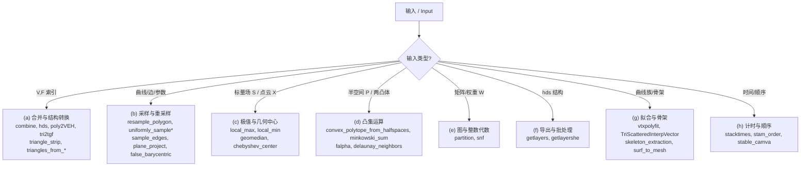

# 10.17 杂项工具 / Miscellaneous Tools

> 本章覆盖 `mesh/` 下 32 个**不易归入其它主题**的通用工具：网格合并与数据结构转换、
> 曲线/边采样与重采样、标量场极值与几何中心、凸集（半空间/闵可夫斯基和/对偶）运算、
> 图与整数代数（聚类、Smith 标准形）、半边结构分层导出、曲线拟合与骨架提取、计时与重排序等。
>
> This chapter documents 32 miscellaneous utilities under `mesh/`: mesh merging & data-structure
> conversion, curve/edge sampling & resampling, scalar-field extrema & geometric centers, convex-set
> operations (halfspaces / Minkowski sum / duality), graph & integer algebra (clustering, Smith normal
> form), halfedge layer export, curve fitting & skeletonization, and timing/reordering helpers.
>
> 约定 / Notation：`V` 顶点位置、`F` 三角面索引、`E` 边索引、`P` 点集、`S` 标量场、`Q` 四边形。
> 锚点行号均取自源码实际范围（先 Read 校验）。
>
> > ⚠️ **要点提示 / Highlights**：`hds` **不是 classdef**，而是输出 struct 的普通函数；
> > `snf` 是在 **GF(2)** 上做行/列消元的 `O(m·n·min(m,n))` 实现；`skeleton_extraction` 为**纯 .m**
> > （不依赖 MEX）；`stam_order` 用于把规则 13 面片重排为 **Jos Stam 的 Loop 细分求值顺序**。

---

## 本章概览 / Chapter overview

### (a) 网格合并与数据结构转换 / Mesh merging & data-structure conversion

| 函数 | 文件锚点 | 作用 | 关键依赖 |
|---|---|---|---|
| `combine` | [L1-L29](file:///c:/VSWork/gptoolbox-1/mesh/combine.m#L1-L29) | 合并两网格（第二个是"并集"表面），保留第一个网格全部顶点 | `setdiff`, `ismember` |
| `hds` | [L1-L128](file:///c:/VSWork/gptoolbox-1/mesh/hds.m#L1-L128) | 由三角面构建**半边数据结构** struct（含边界半边） | `getlayers` |
| `poly2VEH` | [L1-L52](file:///c:/VSWork/gptoolbox-1/mesh/poly2VEH.m#L1-L52) | `poly` 结构数组 → 顶点/边/孔洞列表 | `point_inside_polygon` |
| `tri2tgf` | [L1-L23](file:///c:/VSWork/gptoolbox-1/mesh/tri2tgf.m#L1-L23) | 三角网格 → `.tgf` 图（骨架）文件 | `load_mesh`, `writeTGF` |
| `triangle_strip` | [L1-L16](file:///c:/VSWork/gptoolbox-1/mesh/triangle_strip.m#L1-L16) | 由 2D 曲线 `(P,E)` 生成三角条带（3D） | — |
| `triangles_from_edges` | [L1-L26](file:///c:/VSWork/gptoolbox-1/mesh/triangles_from_edges.m#L1-L26) | 无向图中枚举全部 3-团（三角形） | — |
| `triangles_from_strip` | [L1-L27](file:///c:/VSWork/gptoolbox-1/mesh/triangles_from_strip.m#L1-L27) | 由条带索引流生成三角面（保持朝向） | — |

### (b) 采样与重采样 / Sampling & resampling

| 函数 | 文件锚点 | 作用 | 关键依赖 |
|---|---|---|---|
| `resample_polygon` | [L1-L34](file:///c:/VSWork/gptoolbox-1/mesh/resample_polygon.m#L1-L34) | 细分多边形边，使新边长 ≤ `h` | `edge_lengths` |
| `uniformly_sample` | [L1-L107](file:///c:/VSWork/gptoolbox-1/mesh/uniformly_sample.m#L1-L107) | 按**弧长**均匀采样有序曲线（支持 Loop/多 patch） | `edge_lengths`, `manifold_patches`, `remove_unreferenced`, `edges_to_path` |
| `uniformly_sample_edges` | [L1-L23](file:///c:/VSWork/gptoolbox-1/mesh/uniformly_sample_edges.m#L1-L23) | 每条边以 ≈`h` 间距采样并去重 | — |
| `sample_edges` | [L1-L65](file:///c:/VSWork/gptoolbox-1/mesh/sample_edges.m#L1-L65) | 每条边插入 `samples_per_edge` 个点并给出新边表 | — |
| `plane_project` | [L1-L43](file:///c:/VSWork/gptoolbox-1/mesh/plane_project.m#L1-L43) | 每个三角形**内在**展平到 2D 平面 | — |
| `false_barycentric` | [L1-L24](file:///c:/VSWork/gptoolbox-1/mesh/false_barycentric.m#L1-L24) | "伪"重心细分：加面重心但不切边 | `barycenter` |

### (c) 极值与几何中心 / Extrema & geometric centers

| 函数 | 文件锚点 | 作用 | 关键依赖 |
|---|---|---|---|
| `local_max` | [L1-L39](file:///c:/VSWork/gptoolbox-1/mesh/local_max.m#L1-L39) | 标量场局部极大值与落差 | `edges`（`matrix/maxnz`） |
| `local_min` | [L1-L39](file:///c:/VSWork/gptoolbox-1/mesh/local_min.m#L1-L39) | 标量场局部极小值与落差 | `edges`（`matrix/minnz`） |
| `geomedian` | [L1-L68](file:///c:/VSWork/gptoolbox-1/mesh/geomedian.m#L1-L68) | 几何中位数（L1 中位数，Weiszfeld 迭代） | `normrow`（matrix） |
| `chebyshev_center` | [L1-L47](file:///c:/VSWork/gptoolbox-1/mesh/chebyshev_center.m#L1-L47) | 凸多面体**最大内切球**球心（LP） | `linprog` |

### (d) 凸集运算 / Convex-set operations

| 函数 | 文件锚点 | 作用 | 关键依赖 |
|---|---|---|---|
| `convex_polytope_from_halfspaces` | [L1-L152](file:///c:/VSWork/gptoolbox-1/mesh/convex_polytope_from_halfspaces.m#L1-L152) | 半空间交集 → 原始/对偶多面体 | `chebyshev_center`, `dual`, `barycenter`, `normalizerow`, `normals` |
| `minkowski_sum` | [L1-L48](file:///c:/VSWork/gptoolbox-1/mesh/minkowski_sum.m#L1-L48) | 两网格的闵可夫斯基和（暴力 O(n²)） | `linear_sweep`, `edges`, `remove_unreferenced`, `remove_duplicate_vertices`, `mesh_boolean`[MEX] |
| `falpha` | [L1-L14](file:///c:/VSWork/gptoolbox-1/mesh/falpha.m#L1-L14) | 生成 `FaceAlpha`/`EdgeAlpha` 结构 | — |
| `delaunay_neighbors` | [L1-L159](file:///c:/VSWork/gptoolbox-1/mesh/delaunay_neighbors.m#L1-L159) | 查询点的 Delaunay 邻居（角扫描贪心） | — |

### (e) 图与整数/代数 / Graph & integer algebra

| 函数 | 文件锚点 | 作用 | 关键依赖 |
|---|---|---|---|
| `partition` | [L1-L126](file:///c:/VSWork/gptoolbox-1/mesh/partition.m#L1-L126) | 按坐标把顶点聚成 `k` 组（贪心种子+`kmeans`） | `kmeans`, `all_pairs_distances` |
| `snf` | [L1-L51](file:///c:/VSWork/gptoolbox-1/mesh/snf.m#L1-L51) | **GF(2) 上的 Smith 标准形**（行/列消元） | — |

### (f) 导出与批处理 / Export & batch

| 函数 | 文件锚点 | 作用 | 关键依赖 |
|---|---|---|---|
| `getlayers` | [L1-L63](file:///c:/VSWork/gptoolbox-1/mesh/getlayers.m#L1-L63) | 由 `hds` 结构递归求顶点层与层半边 | — |
| `getlayershe` | [L1-L70](file:///c:/VSWork/gptoolbox-1/mesh/getlayershe.m#L1-L70) | 已知 `mesh.layers` 时只求层半边 | — |

### (g) 曲线拟合与骨架 / Curve fitting & skeleton

| 函数 | 文件锚点 | 作用 | 关键依赖 |
|---|---|---|---|
| `vtxpolyfit` | [L1-L114](file:///c:/VSWork/gptoolbox-1/mesh/vtxpolyfit.m#L1-L114) | 每个顶点邻域内的**正则化多项式拟合**系数 | `hds`（`mmesh.adj` 等） |
| `TriScatteredInterpVector` | [L1-L36](file:///c:/VSWork/gptoolbox-1/mesh/TriScatteredInterpVector.m#L1-L36) | 向量场散点插值（按分量建插值器） | `TriScatteredInterp` |
| `skeleton_extraction` | [L1-L286](file:///c:/VSWork/gptoolbox-1/mesh/skeleton_extraction.m#L1-L286) | Au et al. 2008 网格收缩骨架提取（**纯 m**） | `cotmatrix`, `massmatrix`, `min_quad_with_fixed`, `avgedge`, `adjacency_matrix`, `adjacency_edge_cost_matrix`, `pca`, `conncomp`, `remove_unreferenced` |
| `surf_to_mesh` | [L1-L28](file:///c:/VSWork/gptoolbox-1/mesh/surf_to_mesh.m#L1-L28) | `surf` 网格 `(X,Y,Z)` → 三角网格 | `surf2patch`, `remove_duplicate_vertices`, `doublearea` |

### (h) 计时与顺序 / Timing & order

| 函数 | 文件锚点 | 作用 | 关键依赖 |
|---|---|---|---|
| `stacktimes` | [L1-L43](file:///c:/VSWork/gptoolbox-1/mesh/stacktimes.m#L1-L43) | 一组矩阵 × 一组向量（稀疏批量乘） | `sparse` |
| `stam_order` | [L1-L73](file:///c:/VSWork/gptoolbox-1/mesh/stam_order.m#L1-L73) | 规则 13 面片重排为 Jos Stam 顺序 | `adjacency_matrix` |
| `stable_camva` | [L1-L18](file:///c:/VSWork/gptoolbox-1/mesh/stable_camva.m#L1-L18) | 改视角但保持缩放（dolly zoom） | `camva`, `campos`, `camtarget` |

### 输入类型 → 通用工具分派 / Input-kind dispatch



---

## (a) 网格合并与数据结构转换 / Mesh merging & data-structure conversion

### `combine` — 合并两个网格（第二个为"并集"表面）
- **文件 / File**: [mesh/combine.m](file:///c:/VSWork/gptoolbox-1/mesh/combine.m#L1-L29)
- **签名 / Signature**: `[OV,OF] = combine(IV,IF,EV,EF)`
- **功能 / Purpose**: `EN: Merge two meshes where the second was built as the surface of the union of the first mesh's volume and a third mesh, so the output keeps all first-mesh vertices (unreferenced ones correspond to first-mesh vertices absent from the second).` / 中文：合并两网格，`(IV,IF)` 在前，`(EV,EF)` 的顶点是 `IV` 的子序列 + 新顶点；结果保留 `IV` 全部顶点（未被引用的即只在第一个网格出现者）。
- **输入 / Inputs**:

  | 参数 | 尺寸/类型 | 含义 (中 / EN) |
  |---|---|---|
  | `IV` | `#IV by dim` | 第一个网格顶点 / vertices of first mesh |
  | `IF` | `#IF by 3` | 第一个网格面 / faces of first mesh |
  | `EV` | `#EV by dim` | 第二个网格顶点 / vertices of second mesh |
  | `EF` | `#EF by 3` | 第二个网格面 / faces of second mesh |

- **输出 / Outputs**:

  | 参数 | 尺寸/类型 | 含义 |
  |---|---|---|
  | `OV` | `#IV+新增 by dim` | 输出顶点 = `IV` 后接 `EV` 中新点 |
  | `OF` | `#EF by 3` | 重映射后的输出面 |

- **可选参数 / Optional**: 无 / none。
- **变量流动 / Variable flow**: `IV,EV →(OV=[IV;setdiff(EV,IV,'rows')])→ OV →(ismember(EV,OV))→ LOC →(LOC(EF))→ OF`
- **算法步骤 / Algorithm**:
  1. `OV = [IV; setdiff(EV,IV,'rows')]`：拼接"第一个网格全部顶点 + 第二个网格出现但第一个网格没有的顶点"。
  2. `[TF,LOC] = ismember(EV,OV,'rows')`：为 `EV` 的每行在 `OV` 中定位。
  3. `assert(min(LOC)>0)` 保证映射无遗漏；`OF = LOC(EF)` 重写面索引。
- **流程图 / Flowchart**:

  ```mermaid
  flowchart TD
    A["输入 IV,IF,EV,EF"] --> B["OV = [IV; setdiff(EV,IV)"]
    B --> C["[TF,LOC] = ismember(EV,OV)"]
    C --> D["OF = LOC(EF)"]
    D --> Z["输出 OV,OF"]
  ```

- **依赖 / Dependencies**: 仅内建 `setdiff`, `ismember`（无同库依赖）。
- **See also**: `mesh_boolean`, `remove_unreferenced`, `remove_duplicate_vertices`

### `hds` — 半边数据结构构建
- **文件 / File**: [mesh/hds.m](file:///c:/VSWork/gptoolbox-1/mesh/hds.m#L1-L128)
- **签名 / Signature**: `mesh = hds(F,nlayers)`
- **功能 / Purpose**: `EN: Build a halfedge data structure (as a plain struct, NOT a classdef) from a list of consistently-oriented triangle indices; supports border halfedges and constant-time next/prev/opp/tail/tip/face lookups.` / 中文：由朝向一致的三角面列表构建**半边数据结构**，支持边界半边与常数时间的 `next/prev/opp/tail/tip/he2face` 查询。
- **是否 classdef / classdef?**: **否 / No**。源码第 37 行为 `function mesh = hds(F,nlayers)`,是**函数文件**（输出 struct），而非 `classdef`。
- **输入 / Inputs**:

  | 参数 | 尺寸/类型 | 含义 (中 / EN) |
  |---|---|---|
  | `F` | `#F by 3` | 三角面索引（约定逆时针、共享边朝向相反）/ triangle indices |
  | `nlayers` | 标量 `>=1` | 传给 `getlayers` 的层数 / number of layers |

- **输出 / Outputs**:

  | 参数 | 尺寸/类型 | 含义 |
  |---|---|---|
  | `mesh` | `struct` | 半边结构：`nfaces,F,nhe,face2he,he2face,prev,next,tail,tip,bndhe,adj,opp,layers,interior,layershe,nvert` |

- **可选参数 / Optional**: 无 / none（`nlayers` 为位置参数，源码末尾直接 `getlayers(mesh,nlayers)`，未给默认值）。
- **变量流动 / Variable flow**: `F,nlayers →(nonborder maps: he2face/prev/next/tail/tip)→(sparse 邻接 he_tag=sparse(tail,tip,1))→(he_tag-he_tag'==1 找边界)→(追加边界半边)→(构建 opp: he 转置排序拼接)→ mesh →(getlayers)→ layers/layershe/interior`
- **算法步骤 / Algorithm**:
  1. 由 `F` 初始化各非边界半边映射：`nhe=3*nf`，`face2he=[1:3:3*nf]`，`nvert=max(F(:))`，`prev/next/tail/tip` 用 `F` 的循环移位构造。
  2. 构造稀疏邻接 `he_tag=sparse(tail,tip,1)`；`find(he_tag-he_tag'==1)` 得边界顶点/半边 `tip_b,tail_b`，追加与边界边方向相反的**边界半边**（其 `he2face=0`，索引段 `bndhe`）。
  3. 用 `tip2bhe`/`tail2bhe`（`sortrows`）配对得到沿边界的 `next/prev`。
  4. 构造 `he=sparse(tail,tip,[he_indices bhe_indices])`，`adj=he'`；对 `he,adj` 求三元组并 `sortrows([i j v])`，按 `(tail,tip)` 对齐得到 `opp`（对偶半边映射）。
  5. `[layers,interior,layershe]=getlayers(mesh,nlayers)` 写入分层。
- **流程图 / Flowchart**:

  ```mermaid
  flowchart TD
    A["输入 F,nlayers"] --> B["初始化 nonborder maps<br/>he2face,prev,next,tail,tip"]
    B --> C["he_tag = sparse(tail,tip,1)"]
    C --> D{"he_tag - he_tag' == 1"}
    D -- 是 --> E["追加边界半边<br/>bndhe, he2face=0"]
    E --> F["配对边界 next/prev<br/>tip2bhe/tail2bhe"]
    F --> G["构建 opp<br/>sparse he / he' 排序拼接"]
    G --> H["getlayers(mesh,nlayers)"]
    H --> Z["输出 struct mesh"]
  ```

- **依赖 / Dependencies**: `getlayers`（内部同章）。
- **See also**: `getlayers`, `getlayershe`, `vtxpolyfit`

### `poly2VEH` — poly 结构数组转顶点/边/孔洞
- **文件 / File**: [mesh/poly2VEH.m](file:///c:/VSWork/gptoolbox-1/mesh/poly2VEH.m#L1-L52)
- **签名 / Signature**: `[V,E,H,h] = poly2VEH(poly)`
- **功能 / Purpose**: `EN: Convert a `poly` struct array (each component = one boundary loop of (x,y) plus an inner-hole flag) into vertex / edge / hole lists.` / 中文：把 `poly` 结构数组（每个分量是一条 `(x,y)` 边界环 + 是否内孔标志）转成顶点、边、孔洞位置列表。
- **输入 / Inputs**:

  | 参数 | 尺寸/类型 | 含义 (中 / EN) |
  |---|---|---|
  | `poly` | `1 by C struct` | 分量数组，字段 `x,y,hole` / struct array with `x,y,hole` |

- **输出 / Outputs**:

  | 参数 | 尺寸/类型 | 含义 |
  |---|---|---|
  | `V` | `#V by 2` | 多边形顶点 / polygon vertices |
  | `E` | `#E by 2` | 多边形边索引 / edge indices |
  | `H` | `#H by 2` | 孔洞位置（`point_inside_polygon`）/ hole positions |
  | `h` | — | 签名含但**源码未赋值**（返回空）/ declared but never assigned |

- **可选参数 / Optional**: 无 / none。
- **变量流动 / Variable flow**: `poly →(逐分量筛 >=3 顶点)→ component_vertices/component_E →(偏移拼接)→ V,E →(hole==1 → point_inside_polygon)→ H`
- **算法步骤 / Algorithm**:
  1. 遍历每个分量，跳过顶点数 `<3` 的退化分量。
  2. 该分量 `(x,y)` 拼接进 `V`；构造首尾闭合成环的 `component_E`，加上已有 `E` 行数偏移后拼接。
  3. 若 `poly(i).hole==1`，用 `point_inside_polygon` 取内部点追加到 `H`。
  4. 若 `size(H,1) >= size(poly,2)` 给出告警（孔洞数过多）。
- **流程图 / Flowchart**:

  ```mermaid
  flowchart TD
    A["输入 poly 结构数组"] --> B{"遍历分量<br/>顶点数 >= 3 ?"}
    B -- 否 --> B
    B -- 是 --> C["V += [x y];<br/>E += 环边(带偏移)"]
    C --> D{"poly(i).hole == 1 ?"}
    D -- 是 --> E["H += point_inside_polygon(...)"]
    D -- 否 --> B
    E --> B
    B --> Z["输出 V,E,H"]
  ```

- **依赖 / Dependencies**: `point_inside_polygon`。
- **See also**: `png2poly`, `poly2mesh`

### `tri2tgf` — 三角网格转 TGF 骨架文件
- **文件 / File**: [mesh/tri2tgf.m](file:///c:/VSWork/gptoolbox-1/mesh/tri2tgf.m#L1-L23)
- **签名 / Signature**: `tri2tgf(input_name,output_name)`
- **功能 / Purpose**: `EN: Read a triangle mesh and write its unique edge set as a TGF graph file (a "skeleton file").` / 中文：读取三角网格，把它去重后的边集写成 `.tgf` 图文件（骨架文件）。
- **输入 / Inputs**:

  | 参数 | 尺寸/类型 | 含义 (中 / EN) |
  |---|---|---|
  | `input_name` | 字符串 | 输入网格文件（`.off`/`.obj`）/ input mesh file |
  | `output_name` | 字符串 | 输出 `.tgf` 文件 / output graph file |

- **输出 / Outputs**: 无返回值（写文件）/ no return value (writes file)。
- **可选参数 / Optional**: 无 / none。
- **变量流动 / Variable flow**: `input_name →(load_mesh)→ V,F →(三边拼接 + sort)→ E →(unique,'rows')→ E →(writeTGF)→ output_name`
- **算法步骤 / Algorithm**:
  1. `[V,F] = load_mesh(input_name)`。
  2. 拼接三条边后逐行 `sort`（内部边重复出现）。⚠️ **源码第 16-18 行写作** `[F(:,1) (:,2); F(:,2) (:,3); F(:,3) (:,1)]'`，其中的 `(:,2)`/`(:,3)` **缺少前面的 `F`**（意图应为 `F(:,2)`/`F(:,3)`/`F(:,1)`）；这是疑似的笔误，按字面在 MATLAB 中无法通过——见文末"发现的问题"。
  3. `unique(E,'rows')` 去重得唯一无向边。
  4. `writeTGF(output_name,V,E)` 写出。
- **流程图 / Flowchart**:

  ```mermaid
  flowchart TD
    A["输入 input_name"] --> B["[V,F]=load_mesh(input_name)"]
    B --> C["拼接三边并 sort"]
    C --> D["E = unique(E,'rows')"]
    D --> Z["writeTGF(output_name,V,E)"]
  ```

- **依赖 / Dependencies**: `load_mesh`, `writeTGF`。
- **See also**: `writeTGF`, `load_mesh`, `facetgraph`

### `triangle_strip` — 曲线生成三角条带
- **文件 / File**: [mesh/triangle_strip.m](file:///c:/VSWork/gptoolbox-1/mesh/triangle_strip.m#L1-L16)
- **签名 / Signature**: `[V,F] = triangle_strip(P,E)`
- **功能 / Purpose**: `EN: Build a strip of triangles by duplicating a 2D curve into two parallel sheets (z = ±1).` / 中文：把 2D 曲线复制成两层（`z=±1`）并连接成三角条带。
- **输入 / Inputs**:

  | 参数 | 尺寸/类型 | 含义 (中 / EN) |
  |---|---|---|
  | `P` | `#P by 2` | 2D 曲线点 / 2D points |
  | `E` | `#E by 2` | 边索引 / edge indices into P |

- **输出 / Outputs**:

  | 参数 | 尺寸/类型 | 含义 |
  |---|---|---|
  | `V` | `2#P by 3` | 双层顶点 / doubled 3D points |
  | `F` | `2#E by 3` | 条带三角面 / strip triangles |

- **可选参数 / Optional**: 无 / none。
- **变量流动 / Variable flow**: `P,E →(V=[P -1; P +1])→ V →(F=[E n+E(:,1); n+fliplr(E) E(:,2)])→ F`
- **算法步骤 / Algorithm**:
  1. `n=size(P,1)`；`V=[P -ones(n,1); P ones(n,1)]` 生成上下两层 `z=±1`。
  2. `F=[E n+E(:,1); n+fliplr(E) E(:,2)]`：每条边生成两个三角形形成条带。
- **流程图 / Flowchart**:

  ```mermaid
  flowchart TD
    A["输入 P,E"] --> B["V = [P -1; P +1]"]
    B --> C["F = [E n+E(:,1); n+fliplr(E) E(:,2)]"]
    C --> Z["输出 V,F"]
  ```

- **依赖 / Dependencies**: 无 / none。
- **See also**: `triangles_from_strip`, `triangles_from_edges`

### `triangles_from_edges` — 由边枚举三角形（3-团）
- **文件 / File**: [mesh/triangles_from_edges.m](file:///c:/VSWork/gptoolbox-1/mesh/triangles_from_edges.m#L1-L26)
- **签名 / Signature**: `F = triangles_from_edges(E)`
- **功能 / Purpose**: `EN: Given undirected edges E, find all 3-cliques (triangles) using sparse adjacency products.` / 中文：给定无向边 `E`，用稀疏邻接乘积找出所有 3-团（三角形）。
- **输入 / Inputs**:

  | 参数 | 尺寸/类型 | 含义 (中 / EN) |
  |---|---|---|
  | `E` | `#E by 2` | 无向边 / undirected edges |

- **输出 / Outputs**:

  | 参数 | 尺寸/类型 | 含义 |
  |---|---|---|
  | `F` | `#F by 3` | 无朝向三角形 / unoriented triangles |

- **可选参数 / Optional**: 无 / none。
- **变量流动 / Variable flow**: `E →(E2V=边-顶点关联)→(V2V=顶点邻接)→(E2V*V2V==2 的 (I,J))→(sort([E(I,:) J],2))→(unique,'rows')→ F`
- **算法步骤 / Algorithm**:
  1. `n=max(E(:))`；`E2V=sparse(边索引,E,1)`（边 → 两端点关联），`V2V=sparse([E(:,1) E(:,2)],[E(:,2) E(:,1)],1)`（顶点邻接）。
  2. 一条边到某顶点恰有 **2 条**长度 1 路径 ⟺ 该边与该顶点构成 3-团；`find(E2V*V2V==2)` 得候选 `(I,J)`。
  3. `sort([E(I,:) J],2)` 行内排序后 `unique(...,'rows')` 得无朝向三角形。
- **流程图 / Flowchart**:

  ```mermaid
  flowchart TD
    A["输入 E"] --> B["E2V = 边→顶点关联"]
    B --> C["V2V = 顶点邻接"]
    C --> D["find(E2V*V2V == 2)"]
    D --> E["sort([E(I,:) J],2)"]
    E --> Z["unique(...,'rows') → F"]
  ```

- **依赖 / Dependencies**: 无 / none（稀疏矩阵乘积）。
- **See also**: `bfs_orient`, `edges`, `triangles_from_strip`

### `triangles_from_strip` — 索引流生成三角形
- **文件 / File**: [mesh/triangles_from_strip.m](file:///c:/VSWork/gptoolbox-1/mesh/triangles_from_strip.m#L1-L27)
- **签名 / Signature**: `F = triangles_from_strip(S)`
- **功能 / Purpose**: `EN: Create a triangle list from a stream of strip indices, alternating orientation to preserve manifold orientation.` / 中文：由条带索引流 `S` 生成三角面列表，交替翻转朝向以保持定向。
- **输入 / Inputs**:

  | 参数 | 尺寸/类型 | 含义 (中 / EN) |
  |---|---|---|
  | `S` | `#S by 1` | 条带顶点索引流 / list of indices |

- **输出 / Outputs**:

  | 参数 | 尺寸/类型 | 含义 |
  |---|---|---|
  | `F` | `#S-2 by 3` | 三角面索引 / triangle indices |

- **可选参数 / Optional**: 无 / none。
- **变量流动 / Variable flow**: `S →(S=S(:))→(奇偶两条并发序列拼接)→(reshape 3×...)→ F`
- **算法步骤 / Algorithm**:
  1. `S = S(:)` 列化（源码注释给出等价 `for` 循环版本，`mod(s,2)` 交替 `fliplr`）。
  2. 向量化：偶数起点用 `[S(1:2:end-2) S(2:2:end-1) S(3:2:end)]`，奇数起点用翻转的 `[S(3:2:end-1) S(2:2:end-2) S(4:2:end)]`，拼接后 `reshape(...,3,#S-2)'`。
- **流程图 / Flowchart**:

  ```mermaid
  flowchart TD
    A["输入 S"] --> B["S = S(:)"]
    B --> C["偶数条: S(1:2:..),S(2:2:..),S(3:2:..)"]
    C --> D["奇数条: S(3:2:..),S(2:2:..),S(4:2:..)"]
    D --> E["reshape(F',3,#S-2)'"]
    E --> Z["输出 F"]
  ```

- **依赖 / Dependencies**: 无 / none。
- **See also**: `triangle_strip`, `triangles_from_edges`

---

## (b) 采样与重采样 / Sampling & resampling

### `resample_polygon` — 细分多边形边使长度不超过 h
- **文件 / File**: [mesh/resample_polygon.m](file:///c:/VSWork/gptoolbox-1/mesh/resample_polygon.m#L1-L34)
- **签名 / Signature**: `[Q,F] = resample_polygon(P,E,h)`
- **功能 / Purpose**: `EN: Sample polygon edges so that every resulting edge is shorter than h.` / 中文：细分多边形各边，使每条新边长 ≤ `h`。
- **输入 / Inputs**:

  | 参数 | 尺寸/类型 | 含义 (中 / EN) |
  |---|---|---|
  | `P` | `#P by dim` | 输入点 / input points |
  | `E` | `#E by 2` | 输入边索引 / edge indices |
  | `h` | 标量 | 边长上界 / upper bound on edge length |

- **输出 / Outputs**:

  | 参数 | 尺寸/类型 | 含义 |
  |---|---|---|
  | `Q` | `#Q by dim` | 输出点（原 `P` + 新增）/ output points |
  | `F` | `#F by 2` | 输出边索引 / output edges |

- **可选参数 / Optional**: 无 / none。
- **变量流动 / Variable flow**: `P,E →(edge_lengths)→ l →(逐边: l<=h 保留 / 否则 linspace 插值 num_segs=ceil(l/h))→ 追加 M 到 Q, 新边到 F → Q,F`
- **算法步骤 / Algorithm**:
  1. `Q=P; F=[]; l=edge_lengths(P,E)`。
  2. 逐边：若 `l(e)<=h` 直接保留 `E(e,:)`；否则取起点 `Ps`、终点 `Pd`，`num_segs=ceil(l(e)/h)`，在内部参数 `t(2:end-1)` 处线性插值得 `M`，将新边 `[s 新点; 新点 d]` 追加到 `F`，`M` 追加到 `Q`。
- **流程图 / Flowchart**:

  ```mermaid
  flowchart TD
    A["输入 P,E,h"] --> B["l = edge_lengths(P,E)"]
    B --> C{"遍历边 e"}
    C --> D{"l(e) <= h ?"}
    D -- 是 --> E["F += E(e,:)"]
    D -- 否 --> F["num_segs=ceil(l/h)<br/>t=linspace, M 插值"]
    F --> G["F += 新边; Q += M"]
    E --> C
    G --> C
    C --> Z["输出 Q,F"]
  ```

- **依赖 / Dependencies**: `edge_lengths`。
- **See also**: `uniformly_sample_edges`, `sample_edges`, `remesh`

### `uniformly_sample` — 有序曲线弧长均匀采样
- **文件 / File**: [mesh/uniformly_sample.m](file:///c:/VSWork/gptoolbox-1/mesh/uniformly_sample.m#L1-L107)
- **签名 / Signature**: `[NV,NI] = uniformly_sample(V,un,varargin)`
- **功能 / Purpose**: `EN: Uniformly (in arc length) sample an ordered open curve; supports closed loops and sampling each manifold patch proportionally to its length.` / 中文：对有序开放曲线按**弧长**均匀采样；支持闭环，以及按各流形 patch 长度比例分配样本数。
- **输入 / Inputs**:

  | 参数 | 尺寸/类型 | 含义 (中 / EN) |
  |---|---|---|
  | `V` | `#V by dim` | 有序曲线点 / ordered curve points |
  | `un` | 标量 | 目标样本数 `{100}` / # of samples |

- **输出 / Outputs**:

  | 参数 | 尺寸/类型 | 含义 |
  |---|---|---|
  | `NV` | `un by dim` | 均匀采样点 / sampled points |
  | `NI` | `un by 1` | 每样本对应前驱节点索引 / previous node index |

- **可选参数 / Optional**:

  | 名称 | 取值 | 默认 | 含义 |
  |---|---|---|---|
  | `'Loop'` | `logical` | `false` | 是否闭环（首尾相接）/ treat as closed loop |
  | `'E'` | `#E by 2` | `[]` | 边表；给出则按 `manifold_patches` 分 patch 采样 / edges |

- **变量流动 / Variable flow**: `V,un,(Loop,E) →(Loop 时 V=[V;V(1,:)])→(若 E: edge_lengths→manifold_patches→accumarray→un_C 按长度分配)→(逐 patch edges_to_path + 递归)→ NV | (无 E: 逐段累积弧长线性插值)→ NV,NI`
- **算法步骤 / Algorithm**:
  1. 解析 `'Loop'`/`'E'`；若 `loop` 则把首点复制到末尾。
  2. **有 E**：`l=edge_lengths`，`manifold_patches(E)` 得 patch 标签 `C`，`accumarray(C,l)` 得各 patch 长度 `lC`，`un_C=round(un*lC/totl)`；对每个 patch 用 `remove_unreferenced`+`edges_to_path` 抽出路径（判断是否闭环），递归调用本函数，拼接 `NV`（`NI` 置 `nan`）。
  3. **无 E**：用相邻点差算段长 `l`，沿弧长以 `(totl)/(un-1)` 等间距走，逐点线性插值得 `NV`，记录所在段 `NI`；末样本取 `V(end,:)`。
  4. 若 `loop`，去掉最后一个样本。
- **流程图 / Flowchart**:

  ```mermaid
  flowchart TD
    A["输入 V,un,Loop,E"] --> B{"Loop?"}
    B -- 是 --> C["V = [V; V(1,:)]"]
    B -- 否 --> D["保持 V"]
    C --> E{"E 非空?"}
    D --> E
    E -- 是 --> F["edge_lengths + manifold_patches<br/>按长度分配 un_C"]
    F --> G["逐 patch edges_to_path<br/>递归 uniformly_sample"]
    G --> Z["拼接输出 NV"]
    E -- 否 --> H["逐段累积弧长<br/>等距线性插值"]
    H --> Z
  ```

- **依赖 / Dependencies**: `edge_lengths`, `manifold_patches`, `remove_unreferenced`, `edges_to_path`。
- **See also**: `uniformly_sample_edges`, `sample_edges`, `cubic_uniformly_sample`

### `uniformly_sample_edges` — 边以 ≈h 间距采样
- **文件 / File**: [mesh/uniformly_sample_edges.m](file:///c:/VSWork/gptoolbox-1/mesh/uniformly_sample_edges.m#L1-L23)
- **签名 / Signature**: `[S,SI] = uniformly_sample_edges(V,E,h)`
- **功能 / Purpose**: `EN: Sample edges of (V,E) with spacing close to h, then remove duplicate sample locations.` / 中文：对 `(V,E)` 每条边以接近 `h` 的间距采样，再去重。
- **输入 / Inputs**:

  | 参数 | 尺寸/类型 | 含义 (中 / EN) |
  |---|---|---|
  | `V` | `#V by dim` | 顶点 / vertex locations |
  | `E` | `#E by 2` | 边索引 / edge indices |
  | `h` | 标量 | 目标间距 / desired spacing |

- **输出 / Outputs**:

  | 参数 | 尺寸/类型 | 含义 |
  |---|---|---|
  | `S` | `#S by dim` | 采样点 / sample locations |
  | `SI` | `#SI by 1` | 每样本所属边索引 / edge index |

- **可选参数 / Optional**: 无 / none。
- **变量流动 / Variable flow**: `V,E,h →(逐边 n=ceil(len/h)+1, linspace 插值)→ S,SI →(unique(S,'rows'))→ S →(SI(I))→ SI`
- **算法步骤 / Algorithm**:
  1. 逐边计算 `n=ceil(‖V(e1)-V(e2)‖/h)+1`，用 `linspace(0,1,n)` 线性插值采样点，记录所属边 `SI`。
  2. `[S,I]=unique(S,'rows')` 去重，`SI=SI(I)` 同步筛选。
- **流程图 / Flowchart**:

  ```mermaid
  flowchart TD
    A["输入 V,E,h"] --> B{"遍历边 e"}
    B --> C["n=ceil(len/h)+1<br/>linspace 插值"]
    C --> D["S += 采样点; SI += e"]
    D --> B
    B --> E["[S,I]=unique(S,'rows')"]
    E --> Z["SI = SI(I) → S,SI"]
  ```

- **依赖 / Dependencies**: 无 / none。
- **See also**: `sample_edges`, `resample_polygon`, `uniformly_sample`

### `sample_edges` — 每条边插入固定数量的点
- **文件 / File**: [mesh/sample_edges.m](file:///c:/VSWork/gptoolbox-1/mesh/sample_edges.m#L1-L65)
- **签名 / Signature**: `[S,SE] = sample_edges(V,E,samples_per_edge)`
- **功能 / Purpose**: `EN: Compute samples_per_edge extra points along each edge (endpoints excluded), returning S that still contains V so E remains valid over S, plus the refined edge list SE.` / 中文：在每条边上（不含端点）插入 `samples_per_edge` 个点，返回仍包含 `V` 的 `S`（故 `E` 仍定义于 `S`）以及细分边表 `SE`。
- **输入 / Inputs**:

  | 参数 | 尺寸/类型 | 含义 (中 / EN) |
  |---|---|---|
  | `V` | `#V by dim` | 顶点 / vertices |
  | `E` | `#E by 2` | 边 / edges |
  | `samples_per_edge` | 标量 | 每条边插入点数（不含端点）/ extra samples per edge |

- **输出 / Outputs**:

  | 参数 | 尺寸/类型 | 含义 |
  |---|---|---|
  | `S` | `≤ #E*(2+spe) by dim` | 采样顶点（以 `V` 起始）/ sampled vertices |
  | `SE` | `#SE by 2` | 采样点间的新边 / edges between samples |

- **可选参数 / Optional**: 无 / none。
- **变量流动 / Variable flow**: `V,E,spe →(边界: 空 E / spe<0)→(否则 t=linspace 去端点 → 逐坐标/逐边 repmat → lerp)→ S=[V;S] →(构造 E1,E2,off)→ SE`
- **算法步骤 / Algorithm**:
  1. 平凡情形：`E` 空返回空；`samples_per_edge<0` 时 `S=V,SE=[]`。
  2. 否则 `t=linspace(0,1,spe+2)` 去首尾得内部参数；reshape/repmat 成"逐边逐坐标"参数序列。
  3. `sp/ep` 为重复的起点/终点坐标，`S=sp.*(1-t)+ep.*t`（分段线性插值），reshape 后前置 `V`。
  4. 构造内部样本边 `E1,E2`（带偏移 `off`）与两端连接边，拼成 `SE`。
- **流程图 / Flowchart**:

  ```mermaid
  flowchart TD
    A["输入 V,E,spe"] --> B{"E 空 或 spe<0 ?"}
    B -- "E 空" --> Z0["S=[],SE=[]"]
    B -- "spe<0" --> Z1["S=V,SE=[]"]
    B -- 否 --> C["t=linspace(0,1,spe+2) 去端点"]
    C --> D["reshape/repmat 逐边逐坐标"]
    D --> E["S = sp.*(1-t)+ep.*t ; S=[V;S]"]
    E --> F["构造 E1,E2,off"]
    F --> Z["输出 S,SE"]
  ```

- **依赖 / Dependencies**: 无 / none。
- **See also**: `uniformly_sample_edges`, `resample_polygon`, `upsample`

### `plane_project` — 三角形逐面内在展平
- **文件 / File**: [mesh/plane_project.m](file:///c:/VSWork/gptoolbox-1/mesh/plane_project.m#L1-L43)
- **签名 / Signature**: `[U,UF,I] = plane_project(V,F)`
- **功能 / Purpose**: `EN: Project each triangle to the 2D plane by its intrinsic edge lengths (first corner at origin, second on x-axis, third by law of cosines), yielding a per-face flattened mesh with an incidence map.` / 中文：按**内在边长**把每个三角形展平到 2D（第一角在原点、第二角在 x 轴、第三角由余弦定理定），输出逐面展平网格与顶点→展平点的关联矩阵。
- **输入 / Inputs**:

  | 参数 | 尺寸/类型 | 含义 (中 / EN) |
  |---|---|---|
  | `V` | `#V by 3` | 顶点 / vertex positions |
  | `F` | `#F by 3` | 三角面 / mesh indices |

- **输出 / Outputs**:

  | 参数 | 尺寸/类型 | 含义 |
  |---|---|---|
  | `U` | `#F*3 by 2` | 逐面展平点 / triangle positions |
  | `UF` | `#F by 3` | `U` 的三角面索引 / indices into U |
  | `I` | `#V by #F*3` | 稀疏关联矩阵 / incidence map |

- **可选参数 / Optional**: 无 / none。
- **变量流动 / Variable flow**: `V,F →(三条边长 l)→(l1,l2,l3)→(U: 角0=0, 角1=(l1,0), 角2=(u,v))→ U,UF →(sparse(F(:),1:3nf,1))→ I`
- **算法步骤 / Algorithm**:
  1. 计算编号与对角顶点对应的三条边长 `l`（`l1,l2,l3` 分别为对角顶点 1/2/3 的对边）。
  2. 角 0 置原点；角 1 沿 x 轴取 `l1`；角 2 用 `x=(-l2²+l3²+l1²)/(2l1)`、`y=sqrt(l3²-x²)` 定位。
  3. `UF=[1:nf; nf+(1:nf); 2nf+(1:nf)]'`；`I=sparse(F(:),1:3nf,1,#V,nf*3)` 记录顶点到展平点的归属。
- **流程图 / Flowchart**:

  ```mermaid
  flowchart TD
    A["输入 V,F"] --> B["三条边长 l"]
    B --> C["角0=原点, 角1=(l1,0)"]
    C --> D["角2: x=(-l2²+l3²+l1²)/(2l1)<br/>y=sqrt(l3²-x²)"]
    D --> E["UF=[1:nf; nf+..; 2nf+..]'"]
    E --> Z["I=sparse(F(:),1:3nf,1) → U,UF,I"]
  ```

- **依赖 / Dependencies**: 无 / none。
- **See also**: `cotmatrix`, `edge_lengths`, `flatten_dcel`

### `false_barycentric` — 伪重心细分
- **文件 / File**: [mesh/false_barycentric.m](file:///c:/VSWork/gptoolbox-1/mesh/false_barycentric.m#L1-L24)
- **签名 / Signature**: `[VV,FF,I,J] = false_barycentric(V,F)`
- **功能 / Purpose**: `EN: Conduct a "false" barycentric subdivision: add one barycenter per face as a new vertex and split each triangle into 3 sub-triangles incident to that barycenter — note this is NOT barycentric subdivision (edges are not split, so shared edges create T-junctions).` / 中文：做"伪"重心细分——每个面新增一个重心顶点并把该三角面拆成 3 个以重心为顶点的三角形；这**不是**真正的重心细分（不切边，故相邻面会形成 T 型接缝）。
- **输入 / Inputs**:

  | 参数 | 尺寸/类型 | 含义 (中 / EN) |
  |---|---|---|
  | `V` | `#V by dim` | 顶点 / vertex positions |
  | `F` | `#F by 3` | 三角面 / triangle indices |

- **输出 / Outputs**:

  | 参数 | 尺寸/类型 | 含义 |
  |---|---|---|
  | `VV` | `#V+#F by dim` | 原顶点 + 面重心 / original + barycenters |
  | `FF` | `3*#F by 3` | 三个子三角面 / sub-triangles |
  | `I` | `#FF by 1` | 每个新面对应的原面索引 / index into F |
  | `J` | `#F by 1` | 新增重心顶点索引（`F(:)`）/ added midpoint indices |

- **可选参数 / Optional**: 无 / none。
- **变量流动 / Variable flow**: `V,F →(barycenter(V,F))→ VV=[V;...] →(K=n+[1..f])→ FF=[F(:,[2 3]) K; F(:,[3 1]) K; F(:,[1 2]) K] →(I=repmat(1:f,1,3)')→ I;J=F(:)`
- **算法步骤 / Algorithm**:
  1. `VV=[V; barycenter(V,F)]`，`K=n+(1:size(F,1))'` 为重心顶点索引。
  2. `FF=[F(:,[2 3]) K; F(:,[3 1]) K; F(:,[1 2]) K]`：每个面拆成以原边 + 重心为顶点的 3 个三角形。
  3. `I=repmat(1:size(F,1),1,3)'`（新面→原面）；`J=F(:)`。
- **流程图 / Flowchart**:

  ```mermaid
  flowchart TD
    A["输入 V,F"] --> B["VV = [V; barycenter(V,F)]"]
    B --> C["K = n + (1:f)'"]
    C --> D["FF = [F(:,[2 3]) K; F(:,[3 1]) K; F(:,[1 2]) K]"]
    D --> Z["输出 VV,FF,I,J"]
  ```

- **依赖 / Dependencies**: `barycenter`。
- **See also**: `dual_subdivide`, `barycentric_subdivision`, `upsample`

---

## (c) 极值与几何中心 / Extrema & geometric centers

### `local_max` — 标量场局部极大值
- **文件 / File**: [mesh/local_max.m](file:///c:/VSWork/gptoolbox-1/mesh/local_max.m#L1-L39)
- **签名 / Signature**: `[max_v,max_i,max_diff] = local_max(F,S,ep)`
- **功能 / Purpose**: `EN: Find values, indices and largest neighbor-drop of local maxima of a scalar field on a mesh: a vertex is a local max when the max over its neighbors of (S(vertex) - S(neighbor)) < ep.` / 中文：求网格上标量场的局部极大值及其索引与最大相邻落差；判定条件为"顶点相对每个邻居的 `S` 差最大的那个 `< ep`"。
- **输入 / Inputs**:

  | 参数 | 尺寸/类型 | 含义 (中 / EN) |
  |---|---|---|
  | `F` | `#F by 3`（或 `#E by 2`） | 三角面（`F` 为 2 列时当作边表）/ faces or edges |
  | `S` | `#V by 1` | 标量场 / scalar values |
  | `ep` | 标量 | 阈值 `{0}` / threshold |

- **输出 / Outputs**:

  | 参数 | 尺寸/类型 | 含义 |
  |---|---|---|
  | `max_v` | `#maxima by 1` | 极大值 / values |
  | `max_i` | `#maxima by 1` | 极大值顶点索引 / indices into S |
  | `max_diff` | `#maxima by 1` | 与邻居的最大差 / max drop to neighbors |

- **可选参数 / Optional**:

  | 名称 | 取值 | 默认 | 含义 |
  |---|---|---|---|
  | `ep` | 标量 | `0` | 判定阈值（源码用 `exist('ep','var')` 默认）/ threshold |

- **变量流动 / Variable flow**: `F,S,ep →(F 2 列则 E=F 否则 edges(F))→ E →(E=[E;fliplr(E)])→ A=sparse(E(:,1),E(:,2),S(E1)-S(E2)) →(maxnz(A)')→ maxA →(find(maxA<ep))→ max_i → max_diff,max_v`
- **算法步骤 / Algorithm**:
  1. 若 `F` 两列视作边表，否则 `E=edges(F)`；`E=[E;fliplr(E)]` 使邻接对称。
  2. 构造稀疏矩阵 `A(i,j)=S(i)-S(j)`。
  3. `maxA=maxnz(A)'`（`matrix/maxnz` 取每列非零最大值）；`[max_i,~]=find(maxA<ep)`——即"到所有邻居的差都小于 ep"的顶点为局部极大。
  4. 取 `max_diff=maxA(max_i)`、`max_v=S(max_i)`。
- **流程图 / Flowchart**:

  ```mermaid
  flowchart TD
    A["输入 F,S,ep"] --> B{"size(F,2)==2 ?"}
    B -- 是 --> C["E = F"]
    B -- 否 --> D["E = edges(F)"]
    C --> E["E = [E; fliplr(E)]"]
    D --> E
    E --> F["A = sparse(E1,E2,S(E1)-S(E2))"]
    F --> G["maxA = maxnz(A)'"]
    G --> H["find(maxA < ep) → max_i"]
    H --> Z["max_diff, max_v"]
  ```

- **依赖 / Dependencies**: `edges`（mesh），`maxnz`（**matrix 模块**）。
- **See also**: `local_min`, `maxnz`, `minnz`

### `local_min` — 标量场局部极小值
- **文件 / File**: [mesh/local_min.m](file:///c:/VSWork/gptoolbox-1/mesh/local_min.m#L1-L39)
- **签名 / Signature**: `[min_v,min_i,min_diff] = local_min(F,S,ep)`
- **功能 / Purpose**: `EN: Find values, indices and largest neighbor-rise of local minima of a scalar field on a mesh: a vertex is a local min when the min over its neighbors of (S(vertex) - S(neighbor)) > -ep.` / 中文：求网格上标量场的局部极小值及其索引与最大相邻抬升；判定条件为"顶点相对每个邻居的 `S` 差最小的那个 `> -ep`"。
- **输入 / Inputs**:

  | 参数 | 尺寸/类型 | 含义 (中 / EN) |
  |---|---|---|
  | `F` | `#F by 3`（或 `#E by 2`） | 三角面或边表 / faces or edges |
  | `S` | `#V by 1` | 标量场 / scalar values |
  | `ep` | 标量 | 阈值 `{0}` / threshold |

- **输出 / Outputs**:

  | 参数 | 尺寸/类型 | 含义 |
  |---|---|---|
  | `min_v` | `#minima by 1` | 极小值 / values |
  | `min_i` | `#minima by 1` | 极小值顶点索引 / indices into S |
  | `min_diff` | `#minima by 1` | 与邻居的最小差 / min drop to neighbors |

- **可选参数 / Optional**:

  | 名称 | 取值 | 默认 | 含义 |
  |---|---|---|---|
  | `ep` | 标量 | `0` | 判定阈值 / threshold |

- **变量流动 / Variable flow**: `F,S,ep →(边表 E)→(对称化)→ A=sparse(E1,E2,S(E1)-S(E2)) →(minnz(A)')→ minA →(find(minA>-ep))→ min_i → min_diff,min_v`
- **算法步骤 / Algorithm**:
  1. 同 `local_max`：得边表并对称化为 `E`。
  2. 构造 `A(i,j)=S(i)-S(j)`。
  3. `minA=minnz(A)'`（`matrix/minnz` 取每列非零最小）；`[min_i,~]=find(minA>-ep)`——即"到所有邻居的差都大于 -ep"者为局部极小。
  4. `min_diff=minA(min_i)`、`min_v=S(min_i)`。
- **流程图 / Flowchart**:

  ```mermaid
  flowchart TD
    A["输入 F,S,ep"] --> B{"size(F,2)==2 ?"}
    B -- 是 --> C["E = F"]
    B -- 否 --> D["E = edges(F)"]
    C --> E["E = [E; fliplr(E)]"]
    D --> E
    E --> F["A = sparse(E1,E2,S(E1)-S(E2))"]
    F --> G["minA = minnz(A)'"]
    G --> H["find(minA > -ep) → min_i"]
    H --> Z["min_diff, min_v"]
  ```

- **依赖 / Dependencies**: `edges`（mesh），`minnz`（**matrix 模块**）。
- **See also**: `local_max`, `minnz`, `maxnz`

### `geomedian` — 几何中位数（L1 中位数）
- **文件 / File**: [mesh/geomedian.m](file:///c:/VSWork/gptoolbox-1/mesh/geomedian.m#L1-L68)
- **签名 / Signature**: `y = geomedian(X,eta,y)`
- **功能 / Purpose**: `EN: Compute the geometric median (L1 / spatial median) of a point set, i.e. the point minimizing the weighted sum of Euclidean distances, via Weiszfeld's algorithm with the modification of "The multivariate L1-median and associated data depth".` / 中文：求点集的**几何中位数**（L1/空间中位数，即最小化加权欧氏距离和 `Σ ηᵢ‖Xᵢ-y‖` 的点），用 Weiszfeld 迭代及论文《The multivariate L1-median and associated data depth》的修正。
- **定义 / Definition**: `argmin_y Σᵢ ηᵢ‖Xᵢ - y‖₂`（当某 `Xᵢ = y` 时用论文的修正步)。
- **输入 / Inputs**:

  | 参数 | 尺寸/类型 | 含义 (中 / EN) |
  |---|---|---|
  | `X` | `#X by dim` | 输入点 / input points |
  | `eta` | `#X by 1` | 权重 `{1}` / weights |
  | `y` | `dim by 1` | 初值 `{median(X)}` / initial guess |

- **输出 / Outputs**:

  | 参数 | 尺寸/类型 | 含义 |
  |---|---|---|
  | `y` | `dim by 1` | 几何中位数 / geometric median |

- **可选参数 / Optional**: `eta`（默认全 1）、`y`（默认 `median(X)`）；均为位置参数。
- **变量流动 / Variable flow**: `X,eta,y →(unique,'rows' 合并重复并 accumarray 累加 eta)→ X,eta →(Weiszfeld: V=X-y, D=normrow(V), Q=eta./D, y_tilde=ΣQ X / ΣQ)→(若 y 命中某 Xᵢ 用修正式)→ y →(‖y-y0‖∞<1e-7 停)→ y`
- **算法步骤 / Algorithm**:
  1. 默认 `eta=[]`、`y=median(X)`；`unique(X,'rows')` 去重并用 `accumarray` 合并权重。
  2. 迭代（≤100）：`V=X-y`，`D=normrow(V)`，`keep=D>eps`，`Q=eta./D`；加权重心 `y_tilde=ΣQ(keep).*X(keep)/ΣQ(keep)`。
  3. 若 `y` 不落在任何 `Xᵢ` 上（`keep` 全 1）则 `y=y_tilde`；否则用论文修正：`ratio=eta_y/r_y`、`y=(1-ratio)⁻¹ y_tilde + min(1,ratio) y`。
  4. `‖y-y0‖∞<1e-7` 收敛；到达 `max_iters` 告警。
- **流程图 / Flowchart**:

  ```mermaid
  flowchart TD
    A["输入 X,eta,y"] --> B["unique(X) + accumarray 合并 eta"]
    B --> C{"iter <= 100 ?"}
    C -- 否 --> Z0["告警(达最大迭代)"]
    C -- 是 --> D["V=X-y; D=normrow(V); Q=eta./D"]
    D --> E["y_tilde = ΣQ·X / ΣQ"]
    E --> F{"某 Xᵢ == y ?"}
    F -- 否 --> G["y = y_tilde"]
    F -- 是 --> H["修正: ratio=eta_y/r_y<br/>y=(1-ratio)⁻¹y_tilde+min(1,ratio)y"]
    G --> I{"‖y-y0‖∞ < 1e-7 ?"}
    H --> I
    I -- 否 --> C
    I -- 是 --> Z["输出 y"]
  ```

- **依赖 / Dependencies**: `normrow`（**matrix 模块**）。
- **See also**: `median`, `kmeans`, `chebyshev_center`

### `chebyshev_center` — 凸多面体最大内切球球心
- **文件 / File**: [mesh/chebyshev_center.m](file:///c:/VSWork/gptoolbox-1/mesh/chebyshev_center.m#L1-L47)
- **签名 / Signature**: `[x0,lp] = chebyshev_center(P)`
- **功能 / Purpose**: `EN: Return the Chebyshev center of the convex polytope defined by halfspaces `pᵢ·[x 1] ≤ 0`, i.e. the center of the largest inscribed ball; solved as a linear program.` / 中文：返回半空间 `pᵢ·[x 1] ≤ 0` 定义的凸多面体的 **Chebyshev 中心**（最大内切球球心），用线性规划求解。
- **定义 / Definition**: 设半空间 `aᵢ·x ≤ bᵢ`（`aᵢ=P(i,1:end-1)`, `bᵢ=-P(i,end)`），则 `max r s.t. aᵢ·x + r‖aᵢ‖ ≤ bᵢ`，`x0=x*`。
- **输入 / Inputs**:

  | 参数 | 尺寸/类型 | 含义 (中 / EN) |
  |---|---|---|
  | `P` | `#P by dim+1` | 半空间系数（每行 `[a b]`）/ halfspace coefficients |

- **输出 / Outputs**:

  | 参数 | 尺寸/类型 | 含义 |
  |---|---|---|
  | `x0` | `1 by dim` | Chebyshev 中心 / center |
  | `lp` | `struct` | `res,fval,exitflag,output`（仅 `nargout>=2`）/ LP info |

- **可选参数 / Optional**: 无 / none。
- **变量流动 / Variable flow**: `P →(norm_vector=‖P(:,1:end-1)‖)→ c=[0..0 -1]; A=[P(:,1:end-1) norm_vector]; b=-P(:,end) →(linprog dual-simplex-highs)→ res →(x0=res(1:end-1)')→ x0`
- **算法步骤 / Algorithm**:
  1. `norm_vector=sqrt(sum(P(:,1:end-1).^2,2))`；`c=zeros(dim+1,1)`，`c(end)=-1`（最小化 `-r`）。
  2. 不等式约束 `A=[P(:,1:end-1) norm_vector]`、`b=-P(:,end)`（对应 `aᵢ·x + r‖aᵢ‖ ≤ bᵢ`）。
  3. `linprog(c,A,b,[],[],[],[],options)`，`options` 用 `'dual-simplex-highs'`、`OptimalityTolerance=1e-10`、`ConstraintTolerance=1e-10`。
  4. `x0=res(1:end-1)'`；`nargout>=2` 时返回 `lp` 结构。
- **流程图 / Flowchart**:

  ```mermaid
  flowchart TD
    A["输入 P (#P×dim+1)"] --> B["norm_vector = ‖P(:,1:end-1)‖"]
    B --> C["c = [0...0 -1]"]
    C --> D["A=[P(:,1:end-1) norm_vector], b=-P(:,end)"]
    D --> E["linprog dual-simplex-highs"]
    E --> F["x0 = res(1:end-1)'"]
    F --> Z["输出 x0 (,lp)"]
  ```

- **依赖 / Dependencies**: `linprog`（MATLAB Optimization Toolbox 内建，非同库）。
- **See also**: `convex_polytope_from_halfspaces`, `incenter`, `linear_program`

---

## (d) 凸集运算 / Convex-set operations

### `convex_polytope_from_halfspaces` — 半空间交集生成多面体（原始 + 对偶）
- **文件 / File**: [mesh/convex_polytope_from_halfspaces.m](file:///c:/VSWork/gptoolbox-1/mesh/convex_polytope_from_halfspaces.m#L1-L152)
- **签名 / Signature**: `[pV,pPI,pPC,dV,dF,dN,x0] = convex_polytope_from_halfspaces(P,x0_in)`
- **功能 / Purpose**: `EN: Construct the convex polytope `pᵢ·[x 1] ≤ 0` in both primal and dual space: build dual vertices, convex-hull them (convhull/convhulln), then dualize the hull faces back to primal points.` / 中文：构造半空间 `pᵢ·[x 1] ≤ 0` 交集多面体：先求对偶顶点并对其做凸包（`convhull`/`convhulln`），再把对偶面反解回原始顶点。
- **输入 / Inputs**:

  | 参数 | 尺寸/类型 | 含义 (中 / EN) |
  |---|---|---|
  | `P` | `#P by 4` | 半空间系数（`ndim=size(P,2)-1`）/ halfspace coefficients |
  | `x0_in` | `1 by ndim` | 可选内点 / optional interior point |

- **输出 / Outputs**:

  | 参数 | 尺寸/类型 | 含义 |
  |---|---|---|
  | `pV` | `#pV by ndim` | 原始顶点（半空间交点）/ primal points |
  | `pPI` | `#pPI by 1` | 多边形索引流 / polygon indices into pV |
  | `pPC` | `#pPC by 1` | 多边形边数累积和 / cumulative polygon valences |
  | `dV` | `#dV by ndim` | 对偶点 / dual points |
  | `dF` | `#dF by 3` | 对偶面三角化 / dual faces |
  | `dN` | `#dN by ndim` | 对偶面法向 / dual face normals |
  | `x0` | `1 by ndim` | 内点（未给则 `chebyshev_center` 计算）/ interior point |

- **可选参数 / Optional**:

  | 名称 | 取值 | 默认 | 含义 |
  |---|---|---|---|
  | `x0_in` | `1 by ndim` | 无 | 已知内点；仅当 `max(P*[x0_in 1]') < -1e-13` 才接受 / interior point |

- **变量流动 / Variable flow**: `P,x0_in →(校验 n_planes>=ndim+1)→ a=P(:,1:ndim), b=P(:,end) →(x0 校验或 chebyshev_center)→ dV=-a./(a·x0+b) →(convhull/convhulln)→ dF →(ndim=2: 展开 pE→pPI,pPC / ndim=3: dual(dV,dF) 得 pPI,pPC)→(barycenter, normalizerow, normals)→ BC,dN,c →(pV=x0+dN./c)→ pV`
- **算法步骤 / Algorithm**:
  1. `ndim=size(P,2)-1`；若 `n_planes<ndim+1` 报 `Infeasible`。拆出 `a,b`。
  2. 若提供 `x0_in` 且满足 `max(P*[x0_in 1]')<-1e-13` 接受之，否则 `x0=chebyshev_center(P)`。
  3. 对偶点 `dV=-a./(sum(a.*x0,2)+b)`；若含 `NaN/Inf` 报退化错误。
  4. 对 `dV` 求凸包：优先 `convhull`，失败时（点太少/需更好 x0）退到 `convhulln`（注意 `convhulln` 会翻转朝向，故 `fliplr`）。
  5. `ndim==2` 时手写展开对偶边为 `pE→pPI,pPC`；`ndim==3` 时用 `dual(dV,dF)` 计算对偶多边形。
  6. 由 `BC=barycenter(dV,dF)`、`dN=normalizerow(normals(dV,dF))`、`c=sum(dN.*BC,2)` 得原始顶点 `pV=x0+dN./c`。
- **流程图 / Flowchart**:

  ```mermaid
  flowchart TD
    A["输入 P,x0_in"] --> B{"n_planes >= ndim+1 ?"}
    B -- 否 --> E1["error Infeasible"]
    B -- 是 --> C{"x0_in 有效?"}
    C -- 否 --> D["x0 = chebyshev_center(P)"]
    C -- 是 --> D2["x0 = x0_in"]
    D --> F["dV = -a./(sum(a.*x0,2)+b)"]
    D2 --> F
    F --> G{"含 NaN/Inf ?"}
    G -- 是 --> E2["error 退化对偶顶点"]
    G -- 否 --> H["convhull / convhulln(dV) → dF"]
    H --> I{"ndim ?"}
    I -- 2 --> J["展开 pE → pPI,pPC"]
    I -- 3 --> K["dual(dV,dF) → pPI,pPC"]
    J --> L["barycenter/normals → BC,dN,c"]
    K --> L
    L --> Z["pV = x0 + dN./c"]
  ```

- **依赖 / Dependencies**: `chebyshev_center`, `dual`, `barycenter`, `normalizerow`（matrix）, `normals`。
- **See also**: `chebyshev_center`, `halfspace_intersection`, `minkowski_sum`, `dual`

### `minkowski_sum` — 两网格闵可夫斯基和
- **文件 / File**: [mesh/minkowski_sum.m](file:///c:/VSWork/gptoolbox-1/mesh/minkowski_sum.m#L1-L48)
- **签名 / Signature**: `[SV,SF,J] = minkowski_sum(VA,FA,VB,FB)`
- **功能 / Purpose**: `EN: A deliberately slow, non-robust implementation of the Minkowski sum of two triangle meshes by sweeping the vertices of one mesh along every edge of the other; may self-intersect and be slow even for simple input (author's note).` / 中文：两三角网格闵可夫斯基和的**故意低速、非鲁棒**实现：把一个网格顶点沿另一个网格的每条边扫掠；结果可能自交、对简单输入也很慢（作者自述）。
- **输入 / Inputs**:

  | 参数 | 尺寸/类型 | 含义 (中 / EN) |
  |---|---|---|
  | `VA` | `#VA by 3` | 网格 A 顶点 / vertices of A |
  | `FA` | `#FA by 3` | 网格 A 面 / faces of A |
  | `VB` | `#VB by 3` | 网格 B 顶点 / vertices of B |
  | `FB` | `#FB by 3` | 网格 B 面 / faces of B |

- **输出 / Outputs**:

  | 参数 | 尺寸/类型 | 含义 |
  |---|---|---|
  | `SV` | `#SV by 3` | 结果顶点 / result vertices |
  | `SF` | `#SF by 3` | 结果面 / result faces |
  | `J` | `#SF by 1` | 出生面（追溯来源）/ birth triangles |

- **可选参数 / Optional**: 无 / none。
- **变量流动 / Variable flow**: `VA,FA,VB,FB →(A 沿 B 各边 linear_sweep)→ SVAB,SFAB,JAB →(B 沿 A 各边 linear_sweep)→ SVBA,SFBA,JBA →(拼接 + 偏移 J)→ SV,SF,J →(remove_unreferenced / remove_duplicate_vertices)→(mesh_boolean union)→ SV,SF,J(SJ)`
- **算法步骤 / Algorithm**:
  1. 内部函数 `linear_sweep_edges(VA,FA,VB,EB)`：对 `EB` 每条边 `(se→de)` 取方向 `v=de-se`，把 `VA` 平移 `se` 后沿 `v` 做 `linear_sweep(...,'SelfUnion',false)`，累加顶点/面/出生面 `J`。
  2. 主流程调用两次（A 沿 B 的边、B 沿 A 的边）并拼接，`J` 加上偏移（`size(FA,1)+1` 区分 A/B 来源）。
  3. `remove_unreferenced` 清冗余顶点、`remove_duplicate_vertices(SV,0)` 合并重合点。
  4. `mesh_boolean(SV,SF,[],[],'union')` 做自并；`J=J(SJ)`。
- **流程图 / Flowchart**:

  ```mermaid
  flowchart TD
    A["输入 VA,FA,VB,FB"] --> B["A 沿 edges(FB) 扫掠<br/>linear_sweep_edges"]
    A --> C["B 沿 edges(FA) 扫掠<br/>linear_sweep_edges"]
    B --> D["拼接 SV,SF,J (含来源偏移)"]
    C --> D
    D --> E["remove_unreferenced"]
    E --> F["remove_duplicate_vertices"]
    F --> G["mesh_boolean union"]
    G --> Z["输出 SV,SF,J"]
  ```

- **依赖 / Dependencies**: `linear_sweep`, `edges`（mesh）, `remove_unreferenced`, `remove_duplicate_vertices`, `mesh_boolean` **[MEX]**（`mex/mesh_boolean`）。
- **See also**: `linear_sweep`, `mesh_boolean`, `convex_polytope_from_halfspaces`, `combine`

### `falpha` — 生成 FaceAlpha/EdgeAlpha 结构
- **文件 / File**: [mesh/falpha.m](file:///c:/VSWork/gptoolbox-1/mesh/falpha.m#L1-L14)
- **签名 / Signature**: `str = falpha(alpha,ealpha)`
- **功能 / Purpose**: `EN: Simply return `struct('FaceAlpha',alpha,'EdgeAlpha',ealpha)` for use as tsurf/plot options.` / 中文：直接返回 `struct('FaceAlpha',alpha,'EdgeAlpha',ealpha)`，便于作为 `tsurf`/绘制的选项。
- **输入 / Inputs**:

  | 参数 | 尺寸/类型 | 含义 (中 / EN) |
  |---|---|---|
  | `alpha` | 标量 | 面透明度 `{0.6}` / face alpha |
  | `ealpha` | 标量 | 边透明度 `{alpha}` / edge alpha |

- **输出 / Outputs**:

  | 参数 | 尺寸/类型 | 含义 |
  |---|---|---|
  | `str` | `1 by 1 struct` | 含 `FaceAlpha`,`EdgeAlpha` 的结构 / options struct |

- **可选参数 / Optional**:

  | 名称 | 取值 | 默认 | 含义 |
  |---|---|---|---|
  | `alpha` | 标量 | `0.6` | 面透明度 / face alpha |
  | `ealpha` | 标量 | `alpha` | 边透明度 / edge alpha |

- **变量流动 / Variable flow**: `alpha,ealpha →(默认填值)→ struct(...) → str`
- **算法步骤 / Algorithm**:
  1. `nargin<1` 时 `alpha=0.6`；`nargin<2` 时 `ealpha=alpha`。
  2. 返回 `struct('FaceAlpha',alpha,'EdgeAlpha',ealpha)`。
- **流程图 / Flowchart**:

  ```mermaid
  flowchart TD
    A["输入 alpha,ealpha"] --> B["默认 alpha=0.6, ealpha=alpha"]
    B --> C["str = struct('FaceAlpha',alpha,'EdgeAlpha',ealpha)"]
    C --> Z["输出 str"]
  ```

- **依赖 / Dependencies**: 无 / none。
- **See also**: `fphong`, `tsurf`, `cprintf`

### `delaunay_neighbors` — 查询点的 Delaunay 邻居
- **文件 / File**: [mesh/delaunay_neighbors.m](file:///c:/VSWork/gptoolbox-1/mesh/delaunay_neighbors.m#L1-L159)
- **签名 / Signature**: `N = delaunay_neighbors(q,P)`
- **功能 / Purpose**: `EN: Find the Delaunay neighbors of a query point q among a 2D point list P, without building the full Delaunay triangulation: sort points by angle around q, then sweep keeping edges satisfying the empty-circumcircle (law-of-cosines) test.` / 中文：在不建完整 Delaunay 三角剖分的前提下求查询点 `q` 在 2D 点集 `P` 中的 Delaunay 邻居：按 `q` 周围角度排序后角扫描，用"空外接圆"（余弦定理）判据保留合格边。
- **输入 / Inputs**:

  | 参数 | 尺寸/类型 | 含义 (中 / EN) |
  |---|---|---|
  | `q` | `1 by 2` | 查询点 / query point |
  | `P` | `#P by 2` | 邻近点 / nearby points |

- **输出 / Outputs**:

  | 参数 | 尺寸/类型 | 含义 |
  |---|---|---|
  | `N` | `#N by 1` | 邻居点在 `P` 中的索引 / neighboring indices |

- **可选参数 / Optional**: 无 / none。
- **变量流动 / Variable flow**: `q,P →(P=P-q)→(l=‖P‖)→(追加 4 个 1e10·max_l 远处的"保护点")→ P,l →(θ=atan2, sort 得 I)→(最近点置首)→(角扫描: isdel 判据 → 前进/回退维护栈 N)→(去掉保护点)→ N`
- **算法步骤 / Algorithm**:
  1. `P=P-q`，`q=[0 0]`；`l=sqrt(sum(P.^2,2))`。
  2. 追加 4 个距离 `s=1e10*max_l` 的**保护点**（处理 `q` 在凸包上的情形），`l` 相应扩充。
  3. `th=atan2(P(:,2),P(:,1))` 排序得索引 `I`；记录最近点 `closest`，把 `I` 重排使最近点在前。
  4. 栈 `N` 初始化含最近点；`p1i=2,p2i=3`。循环：用 `isdel(P,l,p0,p1,p2)`（两夹角之和 ≤ π，源自 Shewchuk incircle 的等价角判据）判断 `q-p1` 是否为 Delaunay 边——是则压栈 `p1`，否则回退（弹栈）直到满足；`p1i/p2i` 沿环前进（`mod` 回绕）直至走完所有点。
  5. `N=setdiff(N,保护点索引)` 并恢复 `P`。
- **流程图 / Flowchart**:

  ```mermaid
  flowchart TD
    A["输入 q,P"] --> B["P=P-q; l=‖P‖"]
    B --> C["追加 4 个 1e10·max_l 保护点"]
    C --> D["θ=atan2 → sort → I; 最近点置首"]
    D --> E["栈 N=[最近点]; p1i=2,p2i=3"]
    E --> F{"isdel(P,l,p0,p1,p2) ?"}
    F -- 是 --> G["N 压栈 p1"]
    F -- 否 --> H["回退: 弹栈直至 isdel(N(end-1),N(end),p2)"]
    G --> I{"p1i == n ?"}
    H --> I
    I -- 否 --> J["p1i/p2i 环前进 (mod)"]
    J --> F
    I -- 是 --> K["去掉保护点"]
    K --> Z["输出 N"]
  ```

- **依赖 / Dependencies**: 无 / none（纯 MATLAB 循环）。
- **See also**: `delaunay`, `adjacency_matrix`, `triangulate`

---

## (e) 图与整数/代数 / Graph & integer algebra

### `partition` — 顶点坐标聚类分组
- **文件 / File**: [mesh/partition.m](file:///c:/VSWork/gptoolbox-1/mesh/partition.m#L1-L126)
- **签名 / Signature**: `[G,S,D] = partition(W,k,S,WS)`
- **功能 / Purpose**: `EN: Partition vertices into k groups by their coordinate vectors using greedy farthest-point seeding then k-means, so vertices close in space fall in the same group.` / 中文：按坐标向量把顶点聚为 `k` 组：先用贪心最远点选种子，再跑 `kmeans`，使"空间上接近"的顶点同组。
- **输入 / Inputs**:

  | 参数 | 尺寸/类型 | 含义 (中 / EN) |
  |---|---|---|
  | `W` | `#V by dim` | 坐标/特征矩阵（源码注释亦写作 `V`）/ coordinates |
  | `k` | 标量 | 组数 `{dim}` / number of groups |
  | `S` | 列表 | 初始种子顶点 `{[]}` / initial seed vertices |
  | `WS` | `k by dim` | 种子权重 `{W(S,:)}` / seed weights |

- **输出 / Outputs**:

  | 参数 | 尺寸/类型 | 含义 |
  |---|---|---|
  | `G` | `#V by 1` | 每顶点的组标号 `1..k` / group index |
  | `S` | `k by 1` | 种子顶点索引 / seed vertices |
  | `D` | `#V by 1` | 到最近种子的平方距离 / squared distance to closest seed |

- **可选参数 / Optional**:

  | 名称 | 取值 | 默认 | 含义 |
  |---|---|---|---|
  | `k` | 标量 | `size(W,2)` | 组数 / # groups |
  | `S` | 列表 | `[]` | 初始种子（为空则按 `sum(W.^2,2)` 最大者选首种子）/ seeds |
  | `WS` | 矩阵 | `W(S,:)` | 种子权重 / seed weights |

- **变量流动 / Variable flow**: `W,k,S,WS →(首个种子按 ∑W² 最大)→(D=σ² 到种子 1; G=1)→(贪心 for ii=2:k: 选 D 最大者为新种子, min 更新 D/G)→(kmeans(W,k,'Start',W(S,:)))→(all_pairs_distances 找最近质心)→ G,S,D`
- **算法步骤 / Algorithm**:
  1. `n=size(W,1), m=size(W,2)`；`k` 默认 `m`，断言 `k>=1`；`S` 默认 `[]`、`WS` 默认 `W(S,:)`。
  2. 若无 `S`：按 `sum(W.^2,2)` 降序取最远点作首个种子。
  3. 初始化 `D=σ²(W,W(S(1),:))`、`G=ones(n,1)`；`for ii=2:k` 贪心取 `D` 最大者为新种子，`[D,C]=min([D, 到新种子距离],[],2)`，`G(C==2)=ii`。
  4. 用 `kmeans(W,k,'Start',W(S,:))` 得最终 `G,centroids,D`；`all_pairs_distances(W,centroids)` 取最近质心作为输出 `S`。
- **流程图 / Flowchart**:

  ```mermaid
  flowchart TD
    A["输入 W,k,S,WS"] --> B["默认 k=m, S=[], WS=W(S,:)"]
    B --> C{"S 为空?"}
    C -- 是 --> D["选 ∑W² 最大者为首种子"]
    C -- 否 --> E["使用给定 S"]
    D --> F["D=σ²(W,种子1); G=1"]
    E --> F
    F --> G{"ii = 2..k"}
    G --> H["选 D 最大者为新种子<br/>min 更新 D,G"]
    H --> G
    G --> I["kmeans(W,k,'Start',W(S,:))"]
    I --> J["all_pairs_distances → 最近质心"]
    J --> Z["输出 G,S,D"]
  ```

- **依赖 / Dependencies**: `kmeans`（MATLAB Statistics Toolbox）, `all_pairs_distances`（mesh）。
- **See also**: `kmeans`, `geomedian`, `partition_polygons`

### `snf` — GF(2) 上的 Smith 标准形
- **文件 / File**: [mesh/snf.m](file:///c:/VSWork/gptoolbox-1/mesh/snf.m#L1-L51)
- **签名 / Signature**: `S = snf(D)`
- **功能 / Purpose**: `EN: Smith Normal Form of a boundary-operator matrix D, computed over GF(2) (all entries interpreted as logicals with xor arithmetic). The straight-forward O(m·n·min(m,n)) implementation.` / 中文：求边界算子矩阵 `D` 的 Smith 标准形；由于实现只对矩阵取 `logical` 并用 `xor`（即 **GF(2)** 上的行/列消元），得到的是 `GF(2)` 意义下的标准形（对角线为若干 1 后接 0）。作者注明这是"直白"的 `O(m·n·min(m,n))` 实现。
- **输入 / Inputs**:

  | 参数 | 尺寸/类型 | 含义 (中 / EN) |
  |---|---|---|
  | `D` | `m by n` | 边界算子矩阵 / boundary operator matrix |

- **输出 / Outputs**:

  | 参数 | 尺寸/类型 | 含义 |
  |---|---|---|
  | `S` | `m by n`（`logical`） | Smith 标准形 / Smith Normal Form |

- **可选参数 / Optional**: 无 / none。
- **算法步骤 / Algorithm**（含**复杂度**说明 / with complexity）:
  1. `S=logical(D)`，`max_x=min(m,n)`。
  2. 对 `x=1..max_x`：在子阵 `S(x:end,x:end)` 中 `find(...,1)` 找首个非零元 `(k,l)`（**枢轴**）；`k,l` 回偏移到全局索引。
  3. `swap_rows(S,x,k)`、`swap_cols(S,x,l)` 把枢轴搬到 `(x,x)`。
  4. 用 `xor` 消元：对 `S(x+1:m,x)` 中为真的行 `i` 做 `S(i,:)=xor(S(i,:),S(x,:))`（下消）；对 `S(x,x+1:n)` 中为真的列 `j` 做 `S(:,j)=xor(S(:,j),S(:,x))`（右消）。
  5. 复杂度：`min(m,n)` 个枢轴，每个枢轴做 `O((m+n)·n)`（或 `O((m+n)·m)`）的行/列异或，总计 **`O(m·n·min(m,n))`**（源码注释："straight forward O(m*n*n) implementation"）。
- **变量流动 / Variable flow**: `D →(logical)→ S →(x 循环: find 枢轴 → swap_rows/swap_cols → xor 消元)→ S`
- **流程图 / Flowchart**:

  ```mermaid
  flowchart TD
    A["输入 D"] --> B["S = logical(D); max_x=min(m,n)"]
    B --> C{"x = 1..max_x"}
    C --> D["find(S(x:end,x:end),1) → 枢轴 (k,l)"]
    D --> E{"找到枢轴?"}
    E -- 否 --> C
    E -- 是 --> F["swap_rows(S,x,k); swap_cols(S,x,l)"]
    F --> G["行消元: S(i,:)=xor(S(i,:),S(x,:))"]
    G --> H["列消元: S(:,j)=xor(S(:,j),S(:,x))"]
    H --> C
    C --> Z["输出 S"]
  ```

- **依赖 / Dependencies**: 无 / none（内建 `find`,`xor`,`sortrows` 无关；仅用逻辑矩阵运算）。
- **See also**: `dmd`, `smith_normal_form`, `rank`

---

## (f) 导出与批处理 / Export & batch

### `getlayers` — 半边结构的顶点层与层半边
- **文件 / File**: [mesh/getlayers.m](file:///c:/VSWork/gptoolbox-1/mesh/getlayers.m#L1-L63)
- **签名 / Signature**: `[layers,interior,layershe] = getlayers(mesh, nlayers)`
- **功能 / Purpose**: `EN: Given a manifold mesh stored as a halfedge struct, compute vertex layers and their associated halfedges: layer(1) = boundary vertices, layer(i) = vertices edge-adjacent to layer(i-1); also return interior vertices and per-layer halfedge sets.` / 中文：对以半边结构 `mesh` 存储的流形网格，递归求顶点层与其层半边：`layer(1)` 为边界顶点，`layer(i)` 为与 `layer(i-1)` 边相邻的顶点；并返回内部顶点与每层的半边集合。
- **输出组织 / Output organization**: `layers` 是 **cell 数组**（`layers{i}` = 第 i 层顶点索引集）；`layershe` 是 **cell 数组**（`layershe{i}` = 第 i 层半边索引集）；`interior` 是单条**向量**（不属于任何层的内部顶点索引）。
- **输入 / Inputs**:

  | 参数 | 尺寸/类型 | 含义 (中 / EN) |
  |---|---|---|
  | `mesh` | `struct` | `hds` 产生的半边结构 / halfedge struct |
  | `nlayers` | 标量 `>=1` | 层数 / number of layers |

- **输出 / Outputs**:

  | 参数 | 尺寸/类型 | 含义 |
  |---|---|---|
  | `layers` | `1 by nlayers cell` | 各层顶点索引 / vertex sets per layer |
  | `interior` | `#interior by 1` | 内部顶点索引 / interior vertices |
  | `layershe` | `1 by nlayers cell` | 各层半边索引 / halfedge sets per layer |

- **可选参数 / Optional**: 无 / none。
- **变量流动 / Variable flow**: `mesh,nlayers →(layers{1}=tip(bndhe), layershe{1}=bndhe)→(i=2..nlayers: layers{i}=setdiff(tail(指向 layer{i-1} 的 he), 前层并))→(tri_with_i_edge + tri_with_outside_vert 筛面)→(he=tri 三半边 → 过滤 tip/tail∈layer{i} → opp→next 得 layer{i-1})→ layershe{i} →(allprev_layers 累积)→ interior=setdiff(1:nvert, 前层并)`
- **算法步骤 / Algorithm**:
  1. `layers{1}=mesh.tip(mesh.bndhe)`、`layershe{1}=mesh.bndhe`，`allprev_layers=layers{1}`。
  2. `for i=2:nlayers`：`layers{i}=setdiff(mesh.tail(ismember(mesh.tip,layers{i-1}) 的半边), allprev_layers)`（与上一层边相邻、且未出现过）。
  3. 找"恰好两个顶点在 `layer{i}`、余一顶点在 `layer{i-1}`"的三角面 `tri_with_outside_vert`；取其三条半边 `he_ind`，保留 `tip`/`tail` 均在 `layer{i}` 者，再经 `next(opp(...))` 指向"对面三角形顶点"，剔除该顶点属于 `layer{i-1}` 者即得 `layershe{i}`。
  4. `allprev_layers=union(layers{i},allprev_layers)`；循环结束 `interior=setdiff(1:mesh.nvert,allprev_layers)`。
- **流程图 / Flowchart**:

  ```mermaid
  flowchart TD
    A["输入 mesh,nlayers"] --> B["layers{1}=tip(bndhe)<br/>layershe{1}=bndhe"]
    B --> C{"i = 2..nlayers"}
    C --> D["layers{i}=setdiff(tail(指向 layer{i-1}), 前层并)"]
    D --> E["筛 tri: 两顶点在 layer{i}, 一顶点在 layer{i-1}"]
    E --> F["he=三半边; 保留 tip/tail∈layer{i}"]
    F --> G["next(opp(he)) 剔除非 layer{i-1} → layershe{i}"]
    G --> C
    C --> H["interior = setdiff(1:nvert, 前层并)"]
    H --> Z["输出 layers,interior,layershe"]
  ```

- **依赖 / Dependencies**: 无 / none（依赖 `mesh` 的 `hds` 字段）。
- **See also**: `hds`, `getlayershe`, `vtxpolyfit`

### `getlayershe` — 已知层时求层半边
- **文件 / File**: [mesh/getlayershe.m](file:///c:/VSWork/gptoolbox-1/mesh/getlayershe.m#L1-L70)
- **签名 / Signature**: `[layershe] = getlayershe(mesh, outside_region_of_interest, nlayers)`
- **功能 / Purpose**: `EN: Same as getlayers but instead of finding layers by shrinking from the boundary it expects mesh.layers to already hold the indices, so it only computes the per-layer halfedges.` / 中文：功能同 `getlayers` 的层半边部分，但**不**从头收缩求层——它假定 `mesh.layers` 已含正确层索引，仅计算各层的半边。
- **输出组织 / Output organization**: 只返回 `layershe`（**cell 数组**，`layershe{i}` = 第 i 层半边索引集）；层顶点来自**输入** `mesh.layers`。
- **输入 / Inputs**:

  | 参数 | 尺寸/类型 | 含义 (中 / EN) |
  |---|---|---|
  | `mesh` | `struct` | 含 `layers` 字段的半边结构 / halfedge struct with `layers` |
  | `outside_region_of_interest` | 索引集 | 第 1 层的"外部"参考顶点集 / outside region for layer 1 |
  | `nlayers` | 标量 `>=1` | 层数 / number of layers |

- **输出 / Outputs**:

  | 参数 | 尺寸/类型 | 含义 |
  |---|---|---|
  | `layershe` | `1 by nlayers cell` | 各层半边索引 / per-layer halfedge sets |

- **可选参数 / Optional**: 无 / none。
- **变量流动 / Variable flow**: `mesh,outside,nlayers →(i=1..nlayers: tri_with_i_edge using mesh.layers{i})→(i==1 用 outside_region_of_interest, 否则用 mesh.layers{i-1})→(he=三半边 → 过滤 tip/tail∈layer{i} → next(opp(...)))→ layershe{i} → layershe`
- **算法步骤 / Algorithm**:
  1. 与 `getlayers` 相同的"两个顶点在 `layer{i}`"筛面逻辑，但层顶点直接取 `mesh.layers{i}`。
  2. 第 1 层的"外部顶点集"用参数 `outside_region_of_interest`（`getlayers` 中对应 `layer{i-1}`），其余层用 `mesh.layers{i-1}`。
  3. 过滤/转向同 `getlayers`，得 `layershe{i}`；循环返回 cell 数组。
- **流程图 / Flowchart**:

  ```mermaid
  flowchart TD
    A["输入 mesh,outside_region_of_interest,nlayers"] --> B{"i = 1..nlayers"}
    B --> C["tri_with_i_edge (mesh.layers{i})"]
    C --> D{"i == 1 ?"}
    D -- 是 --> E["外部集 = outside_region_of_interest"]
    D -- 否 --> F["外部集 = mesh.layers{i-1}"]
    E --> G["he=三半边; 保留 tip/tail∈layer{i}"]
    F --> G
    G --> H["next(opp(he)) → layershe{i}"]
    H --> B
    B --> Z["输出 layershe"]
  ```

- **依赖 / Dependencies**: 无 / none（依赖 `mesh.layers`）。
- **See also**: `getlayers`, `hds`

---

## (g) 曲线拟合与骨架 / Curve fitting & skeleton

### `vtxpolyfit` — 每个顶点的正则化多项式拟合
- **文件 / File**: [mesh/vtxpolyfit.m](file:///c:/VSWork/gptoolbox-1/mesh/vtxpolyfit.m#L1-L114)
- **签名 / Signature**: `[polycoefs] = vtxpolyfit(V,mmesh,vtxset,vals,deg)`
- **功能 / Purpose**: `EN: Produce a #V by m matrix of polynomial coefficients (m = (deg+1)(deg+2)/2, monomial order 1,u,v,u²,uv,v²,…) by regularized least-squares fitting within each vertex's hds neighborhood (restricted to non-interior vertices, augmented with opposite-triangle vertices).` / 中文：在每个顶点的 hds 邻域内做**正则化最小二乘**多项式拟合，输出 `#V by m` 系数矩阵（`m=(deg+1)(deg+2)/2`，单项式序 `1,u,v,u²,uv,v²,...`）；邻域限制在非内部顶点，并补充"对面三角形"额外顶点以增强稳定性。
- **输入 / Inputs**:

  | 参数 | 尺寸/类型 | 含义 (中 / EN) |
  |---|---|---|
  | `V` | `#V by 2` | 点（用前两列 `u,v` 作自变量）/ points |
  | `mmesh` | `struct` | `hds` 产生的半边结构 / hds struct |
  | `vtxset` | 索引集 | 要拟合的顶点集 / set of indices |
  | `vals` | `#V by 1` | 顶点上的值 / values at vertices |
  | `deg` | 标量 | 多项式总次数（拟用于 1,2）/ total degree |

- **输出 / Outputs**:

  | 参数 | 尺寸/类型 | 含义 |
  |---|---|---|
  | `polycoefs` | `#V by m`（稀疏） | 每顶点的多项式系数 / polynomial coefficients |

- **可选参数 / Optional**: 无 / none。
- **变量流动 / Variable flow**: `deg →(num_monom=(deg+1)(deg+2)/2, powu/powv)→(vtxset_sorted, noninterior=setdiff(1:nvert,interior))→(adj_vtxset 限制在非内部)→(extras=tip(next(opp(prev(heind)))) 补顶点)→(加对角)→(nbrlists/nbrstarts/nbrends/nbrsizes)→(P 块对角单项式矩阵)→(A=P'P+1e-15 I; rhs=P'*vals)→(A\rhs)→(sparse 回填 vtxset_sorted)→ polycoefs`
- **算法步骤 / Algorithm**:
  1. 按 `deg` 枚举单项式幂次 `powu,powv`（`u^l v^m, l+m<=deg`）。
  2. 由 `mmesh.interior` 得 `noninterior`；构造 `vtxset` 到非内部的邻接 `adj_vtxset`。
  3. 额外顶点 `extravtx=mmesh.tip(mmesh.next(mmesh.opp(mmesh.prev(heind))))`（走一条半边序列得到对面三角形顶点），过滤内部顶点后并入邻接；再加对角（自邻）。
  4. `find` 得 `nbrlists`，`unique`/差分得每顶点邻域起止与大小（并与另一算法交叉验证，打印差值）；邻域过小则告警。
  5. 构造块对角单项式矩阵 `P`（行=邻域条目、列=各顶点的单项式），解正则化最小二乘 `(P'P+1e-15·I) coef = P'·vals(nbrlists(:,2))`。
  6. 用 `sparse` 把结果回填到 `#V by m`，行序同 `vtxset_sorted`。
- **流程图 / Flowchart**:

  ```mermaid
  flowchart TD
    A["输入 V,mmesh,vtxset,vals,deg"] --> B["枚举单项式 powu,powv<br/>num_monom=(deg+1)(deg+2)/2"]
    B --> C["noninterior = setdiff(1:nvert, interior)"]
    C --> D["adj_vtxset = adj(vtxset, noninterior)"]
    D --> E["补对面三角形顶点 extras"]
    E --> F["加对角 → nbrlists/nbrstarts/nbrends"]
    F --> G{"邻域大小 >= num_monom ?"}
    G -- 否 --> W["warning: 邻域太小"]
    G -- 是 --> H["构造块对角 P"]
    W --> H
    H --> I["A=P'P+1e-15·I; rhs=P'·vals; coef=A\\rhs"]
    I --> Z["sparse 回填 → polycoefs"]
  ```

- **依赖 / Dependencies**: `hds`（提供 `mmesh.adj/interior/tip/next/opp/prev/nvert`）。
- **See also**: `hds`, `local_max`, `getlayers`

### `TriScatteredInterpVector` — 向量场散点插值
- **文件 / File**: [mesh/TriScatteredInterpVector.m](file:///c:/VSWork/gptoolbox-1/mesh/TriScatteredInterpVector.m#L1-L36)
- **签名 / Signature**: `[F] = TriScatteredInterpVector(V,D)`
- **功能 / Purpose**: `EN: Simple extension of TriScatteredInterp to handle vector values: build one TriScatteredInterp per data coordinate and return a function handle that evaluates all of them, stacking results into an (size(X) by m) array.` / 中文：把散点插值 `TriScatteredInterp` 简单扩展到**向量值**：为 `D` 每个分量各建一个插值器，返回一个函数句柄，一次求值把所有分量叠成 `size(X) by m`。
- **输入 / Inputs**:

  | 参数 | 尺寸/类型 | 含义 (中 / EN) |
  |---|---|---|
  | `V` | `#V by 2` | 数据点位置 / data positions |
  | `D` | `#V by m` | 数据向量 / data vectors |

- **输出 / Outputs**:

  | 参数 | 尺寸/类型 | 含义 |
  |---|---|---|
  | `F` | `function_handle` | 求值句柄 `DXY = F(X,Y)`（`size(X) by m`）/ evaluator |

- **可选参数 / Optional**: 无 / none。
- **变量流动 / Variable flow**: `V,D →(m=size(D,2); A=cell(1,m))→(逐分量 TriScatteredInterp(V,D(:,ii)))→ A →(F=@EvalTriScatteredInterpVector)→ F(X,Y): cellfun→cell2mat→reshape([size(X) m])`
- **算法步骤 / Algorithm**:
  1. `m=size(D,2)`，`A=cell(1,m)`；`for ii=1:m` 建立 `TriScatteredInterp(V,D(:,ii))` 存入 `A{ii}`。
  2. `F=@EvalTriScatteredInterpVector`。该子函数对每个插值器做 `I(X,Y)`，`cellfun` 得 cell，`cell2mat` 后 `reshape` 成 `[size(X) m]`。
- **流程图 / Flowchart**:

  ```mermaid
  flowchart TD
    A["输入 V,D"] --> B["m = size(D,2); A = cell(1,m)"]
    B --> C{"ii = 1..m"}
    C --> D["A{ii} = TriScatteredInterp(V,D(:,ii))"]
    D --> C
    C --> E["F = @EvalTriScatteredInterpVector"]
    E --> Z["调用 F(X,Y): cellfun → cell2mat → reshape [size(X) m]"]
  ```

- **依赖 / Dependencies**: `TriScatteredInterp`（MATLAB 内建/旧版 scatter 插值）。
- **See also**: `TriScatteredInterp`, `scatteredInterpolant`, `plane_project`

### `skeleton_extraction` — 网格收缩骨架提取
- **文件 / File**: [mesh/skeleton_extraction.m](file:///c:/VSWork/gptoolbox-1/mesh/skeleton_extraction.m#L1-L286)
- **签名 / Signature**: `[W,E,U] = skeleton_extraction(V,F)`
- **功能 / Purpose**: `EN: Compute the "skeleton" of a surface mesh following "Skeleton Extraction by Mesh Contraction" [Au et al. 2008]: iteratively contract the mesh with an implicit Laplacian/mass minimization, then thin it by PCA-based local merging and component rejoining. Pure .m (does NOT rely on a MEX; the QSlim-style simplification is commented out and replaced by a different combinatorial simplification).` / 中文：按《Skeleton Extraction by Mesh Contraction》(Au et al. 2008) 提取曲面骨骼：用隐式 Laplacian/质量最小化迭代收缩网格，再以 PCA 局部合并 + 连通分量重连做细化。**纯 .m 实现，不依赖 MEX**；QSlim 式简化在源码中被注释，改用不同的组合简化。
- **是否 MEX / MEX?**: **否 / No**——全部在 `mesh/skeleton_extraction.m` 中用 MATLAB 完成（`min_quad_with_fixed` 亦为 `matrix/` 下的 .m 实现）。
- **输入 / Inputs**:

  | 参数 | 尺寸/类型 | 含义 (中 / EN) |
  |---|---|---|
  | `V` | `#V by 3` | 网格顶点 / vertex positions |
  | `F` | `#F by 3` | 网格面 / mesh indices |

- **输出 / Outputs**:

  | 参数 | 尺寸/类型 | 含义 |
  |---|---|---|
  | `W` | `#W by 3` | 骨架顶点 / skeleton vertices |
  | `E` | `#E by 2` | 骨架边 / skeleton edges into W |
  | `U` | `#V by 3` | 收缩后（细化前）顶点 / vertices before thinning |

- **可选参数 / Optional**: 无 / none（`viz` 为源码内写死的 `false`，仅调试用）。
- **变量流动 / Variable flow**: `V,F →(delta=1e-3·bbox²; U=V)→(迭代: L=cotmatrix, M=massmatrix, b=update 约束点, U=min_quad_with_fixed(-(M-deltaL),2MU,b,U(b,:)))→(‖U-U_prev‖∞<1e-2·h 停)→ U →(W=U; A=adjacency+eye; EC=adjacency_edge_cost)→(逐顶点 PCA 细化: phi=L1/ΣL, 若 phi<0.99 停; 沿 EC 扩张; 记端点边 E)→(连通分量合并: conncomp + pdist2 最近对 → 平均 → 去重)→ W,E`
- **算法步骤 / Algorithm**:
  1. `delta=1e-3·(max(V)-min(V))²`，`U=V`，`h=avgedge(V,F)`。
  2. **收缩循环**：`L=cotmatrix(U,F)`、`M=massmatrix(U,F,'barycentric')`；把 `‖L‖` 巨大的行视为约束 `b=union(find(any(abs(L)>1e5,2)),b)`；解 `U=min_quad_with_fixed(-(M-delta*L), 2*M*U, b, U(b,:))`；当 `max|U-U_prev|<1e-2·h` 停止。
  3. 令 `W=U`；`A=adjacency_matrix(F)+I`、`EC=adjacency_edge_cost_matrix(U,F)`，`phi`/`marked` 置初。
  4. **PCA 细化**：对未标记顶点 `wi`，取当前邻域 `pN`，对 `W(pN,:)` 做 `pca`，`phi(wi)=L(1)/sum(L)`；若 `phi<0.99` 停；否则沿 `EC`（除以连通数 `CCI`、置自身 0）找代价最小邻居 `j` 扩张，直至不再变化。若得到非空 `N`，按 PCA 第一主成分 `S(:,1)` 排序取两端 `O(1),O(end)` 连边，清空 `A(I,:)/A(:,I)`，`marked(N)=true`，`E=[E;O(1) O(end)]`。
  5. **分量合并**：反复 `remove_unreferenced`、`conncomp`；若多于一个分量，`pdist2(W,W)`（同分量置 `inf`）取最近点对 `(i,j)` 做**运行平均**并索引合并，`E` 去重，直到单分量或无边。
- **流程图 / Flowchart**:

  ```mermaid
  flowchart TD
    A["输入 V,F"] --> B["delta=1e-3·bbox²; U=V; h=avgedge"]
    B --> C["L=cotmatrix(U,F); M=massmatrix(U,F,'barycentric')"]
    C --> D["b=约束点; U=min_quad_with_fixed(-(M-deltaL),2MU,b,U(b,:))"]
    D --> E{"‖U-U_prev‖∞ < 1e-2·h ?"}
    E -- 否 --> C
    E -- 是 --> F["W=U; A=adjacency+eye; EC=邻接边代价"]
    F --> G["逐顶点 PCA: phi=L1/ΣL"]
    G --> H{"phi < 0.99 ?"}
    H -- 否 --> I["沿 EC 扩张邻域"]
    I --> G
    H -- 是 --> J["取主成分两端连边 E; marked(N)=true"]
    J --> K{"遍历完所有 W 顶点?"}
    K -- 否 --> G
    K -- 是 --> L["conncomp / remove_unreferenced"]
    L --> M{"ncc > 1 ?"}
    M -- 是 --> N["pdist2 最近对 → 平均合并; E 去重"]
    N --> L
    M -- 否 --> Z["输出 W,E,U"]
  ```

- **依赖 / Dependencies**: `cotmatrix`, `massmatrix`（mesh）, `min_quad_with_fixed`, `minnz`（**matrix 模块**）; `avgedge`, `adjacency_matrix`, `adjacency_edge_cost_matrix`, `remove_unreferenced`, `doublearea`（mesh）; `pca`（MATLAB 统计工具箱）, `conncomp`, `pdist2`（MATLAB 内建）。**无 MEX**。
- **See also**: `cotmatrix`, `massmatrix`, `min_quad_with_fixed`, `skeleton_extraction`（QSlim 分支在源码中注释）

### `surf_to_mesh` — surf 网格转三角网格
- **文件 / File**: [mesh/surf_to_mesh.m](file:///c:/VSWork/gptoolbox-1/mesh/surf_to_mesh.m#L1-L28)
- **签名 / Signature**: `[V,F] = surf_to_mesh(X,Y,Z)`
- **功能 / Purpose**: `EN: Convert a grid-based `surf` representation to a triangle mesh: `surf2patch` then split each quad into two triangles, remove duplicate vertices and drop degenerate faces.` / 中文：把基于网格的 `surf` 表示转成三角网格：`surf2patch` 后把每个四边形拆成两个三角形，去重顶点并剔除退化面。
- **输入 / Inputs**:

  | 参数 | 尺寸/类型 | 含义 (中 / EN) |
  |---|---|---|
  | `X` | `m by n` | x 坐标网格 / x-coordinates |
  | `Y` | `m by n` | y 坐标网格 / y-coordinates |
  | `Z` | `m by n` | z 坐标网格 / z-coordinates |

- **输出 / Outputs**:

  | 参数 | 尺寸/类型 | 含义 |
  |---|---|---|
  | `V` | `#V by 3` | 顶点 / vertex positions |
  | `F` | `#F by 3` | 三角面 / face indices |

- **可选参数 / Optional**: 无 / none（`clean=true` 为源码内写死开关）。
- **变量流动 / Variable flow**: `X,Y,Z →(surf2patch)→ s2p.faces/s2p.vertices →(quad 拆两三角: F(:,[1 2 3]); F(:,[1 3 4]))→ F,V →(remove_duplicate_vertices(V,1e-7))→ V,VJ →(F=VJ(F))→(doublearea>eps 过滤)→ V,F`
- **算法步骤 / Algorithm**:
  1. `s2p=surf2patch(X,Y,Z)`，取 `F=s2p.faces`、`V=s2p.vertices`。
  2. `F=[F(:,[1 2 3]); F(:,[1 3 4])]` 把四边形拆成三角形。
  3. `clean` 分支：`remove_duplicate_vertices(V,1e-7)` 得 `V,VI,VJ`，`F=VJ(F)`；剔除 `doublearea(V,F)<=eps` 的退化面。
- **流程图 / Flowchart**:

  ```mermaid
  flowchart TD
    A["输入 X,Y,Z"] --> B["s2p = surf2patch(X,Y,Z)"]
    B --> C["F=[F(:,[1 2 3]); F(:,[1 3 4])]"]
    C --> D{"clean ?"}
    D -- 否 --> Z["输出 V,F"]
    D -- 是 --> E["remove_duplicate_vertices(V,1e-7)"]
    E --> F["F = VJ(F); 剔除 doublearea<=eps"]
    F --> Z
  ```

- **依赖 / Dependencies**: `surf2patch`（MATLAB 内建）, `remove_duplicate_vertices`, `doublearea`（mesh）。
- **See also**: `surf2patch`, `gridmesh`, `mesh_to_surf`

---

## (h) 计时与顺序 / Timing & order

### `stacktimes` — 一组矩阵乘一组向量
- **文件 / File**: [mesh/stacktimes.m](file:///c:/VSWork/gptoolbox-1/mesh/stacktimes.m#L1-L43)
- **签名 / Signature**: `SV = stacktimes(S,V)`
- **功能 / Purpose**: `EN: Multiply each matrix in a vertical stack of matrices S by the corresponding row-vector in V, equivalent to a loop over the s stacked m-by-n blocks (or a m-by-n-by-s 3D array).` / 中文：把**竖直堆叠**的一组矩阵 `S` 与对应的行向量 `V` 逐一相乘；等价于对 `s` 个 `m by n` 块（或 `m by n by s` 三维数组）做循环。
- **输入 / Inputs**:

  | 参数 | 尺寸/类型 | 含义 (中 / EN) |
  |---|---|---|
  | `S` | `s*m by n` 或 `m by n by s` | 竖直堆叠矩阵 / 3D 数组 / stacked matrices |
  | `V` | `s by n` | `s` 个 n 维行向量 / list of row-vectors |

- **输出 / Outputs**:

  | 参数 | 尺寸/类型 | 含义 |
  |---|---|---|
  | `SV` | `s by m` | `s` 个 m 维结果行向量 / result row-vectors |

- **可选参数 / Optional**: 无 / none。
- **变量流动 / Variable flow**: `S,V →(S 三维则 permute/reshape 成竖直堆叠)→(s,n,m; 断言尺寸匹配)→(构造稀疏选择矩阵 I,J,S(:))→(sparse(I,J,S(:))*reshape(V',s*n,1))→(reshape(...,m,s)')→ SV`
- **算法步骤 / Algorithm**:
  1. `s=size(V,1), n=size(V,2)`。
  2. 若 `size(S,3)~=1`（3D 数组）：断言 `s==size(S,3)`，`m=size(S,1)`，`S=reshape(permute(S,[2,1,3]),[n,s*m])'` 转成竖直堆叠；否则断言 `n==size(S,2)`、`m=size(S,1)/s` 为整数。
  3. 构造稀疏矩阵的行列索引 `I,J`（把大矩阵的每个有效元素放到乘积向量中的正确位置），`SV=reshape(sparse(I,J,S(:))*reshape(V',s*n,1),m,s)'`。
- **流程图 / Flowchart**:

  ```mermaid
  flowchart TD
    A["输入 S,V"] --> B{"size(S,3) ~= 1 ?"}
    B -- 是 --> C["permute/reshape → 竖直堆叠; m=size(S,1)"]
    B -- 否 --> D["断言 n==size(S,2); m=size(S,1)/s"]
    C --> E["构造稀疏 I,J"]
    D --> E
    E --> F["SV = sparse(I,J,S(:)) * reshape(V',s*n,1)"]
    F --> Z["reshape(m,s)' → SV"]
  ```

- **依赖 / Dependencies**: 无 / none（内建 `sparse`,`reshape`,`permute`）。
- **See also**: `sparse`, `kron`, `blkdiag`

### `stam_order` — 规则面片重排为 Stam 顺序
- **文件 / File**: [mesh/stam_order.m](file:///c:/VSWork/gptoolbox-1/mesh/stam_order.m#L1-L73)
- **签名 / Signature**: `[I,J] = stam_order(F,A)`
- **功能 / Purpose**: `EN: For a regular patch of 13 faces / 12 vertices around a "center" facet f (all its corners valence 6), determine the vertex and face reordering so that the reordered mesh (V(I,:), J(F)) fits Jos Stam's ordering in "Evaluation of Loop Subdivision Surfaces"; the facet F(f,:) maps to [4 7 8] in Stam's patch.` / 中文：对围绕"中心面" `f`（其三角顶点度数均为 6）的规则 13 面 / 12 顶点面片，求出顶点与面的**重排序**，使重排后的网格 `(V(I,:), J(F))` 符合 Jos Stam《Evaluation of Loop Subdivision Surfaces》中的面片顺序（中心面映射到 Stam 的 `[4 7 8]`）。
- **用途 / Use**: 用于把局部规则 patch 的顶点/面**重排**成 Stam 的规范编号，从而套用其（稀疏）Loop 细分求值/模板——即"Stam 顺序的稀疏重排序"。
- **输入 / Inputs**:

  | 参数 | 尺寸/类型 | 含义 (中 / EN) |
  |---|---|---|
  | `F` | `13 by 3` | 规则面片的三角面索引 / 13 patch faces |
  | `A` | `max(F) by max(F)` | 邻接矩阵 `{[]}` / adjacency matrix |

- **输出 / Outputs**:

  | 参数 | 尺寸/类型 | 含义 |
  |---|---|---|
  | `I` | `12 by 1` | 顶点置换（`V(I,:)` 重排 / vertex permutation） |
  | `J` | `12 by 1` | 面置换（`J(F)` 重排，`{J=full(sparse(I,1,1:12))}`）/ face permutation |

- **可选参数 / Optional**:

  | 名称 | 取值 | 默认 | 含义 |
  |---|---|---|---|
  | `A` | `max(F) by max(F)` | `adjacency_matrix(F)` | 邻接矩阵 / adjacency |

- **变量流动 / Variable flow**: `F,A →(断言 13 面 / 12 顶点)→(C6=度数为 6)→(f=中心面 find(all(C6(F),2)))→(I(4),I(7),I(8)=F(f,:))→(按邻接交 A(i,:) & A(j,:) 依次定位 I(5),I(3),I(11),I(12),I(9),I(2),I(1),I(6),I(10))→(J=full(sparse(I,1,1:12)))→ I,J`
- **算法步骤 / Algorithm**:
  1. 断言 `size(F,1)==13`；`A` 缺省由 `adjacency_matrix(F)` 给出；断言 `nnz(any(A))==12`（12 个顶点）。
  2. `C6=sum(A,2)==6`（度数为 6 的顶点）；`f=find(all(C6(F),2),1)` 定位**中心面**，无则报"非规则面片"。
  3. Stam 的 4/7/8 顶点 = 中心面的三个顶点：`I(4)=F(f,1); I(7)=F(f,2); I(8)=F(f,3)`。
  4. 清空中心面列 `A(:,F(f,:))=0`，随后用两个已知邻居的**共同邻居**（`find(A(I(a),:) & A(I(b),:))`）沿邻接**逐点标号**：`I(5),I(3),I(11),I(12),I(9),I(2),I(1),I(6),I(10)`（其间 `A(:,I(I~=0))=0` 去重）。
  5. `J=full(sparse(I,1,1:12))`：以顶点置换推出面置换（使 `J(F)` 顺序与 `I` 一致）。
- **流程图 / Flowchart**:

  ```mermaid
  flowchart TD
    A["输入 F,A"] --> B["断言 13 面; A 缺省 adjacency_matrix(F)"]
    B --> C["C6 = sum(A,2)==6; f=中心面"]
    C --> D{"找到中心面 f ?"}
    D -- 否 --> E["error: 非规则面片"]
    D -- 是 --> F["I(4),I(7),I(8) = F(f,:)"]
    F --> G["A(:,F(f,:))=0"]
    G --> H["用共同邻居逐一标号<br/>I(5),I(3),I(11),I(12),I(9),I(2),I(1),I(6),I(10)"]
    H --> I["J = full(sparse(I,1,1:12))"]
    I --> Z["输出 I,J"]
  ```

- **依赖 / Dependencies**: `adjacency_matrix`（mesh）。
- **See also**: `loop`, `subdivide`, `upsample`

### `stable_camva` — 改视角保持缩放（dolly zoom）
- **文件 / File**: [mesh/stable_camva.m](file:///c:/VSWork/gptoolbox-1/mesh/stable_camva.m#L1-L18)
- **签名 / Signature**: `stable_camva(a)`
- **功能 / Purpose**: `EN: Act like camva (set camera view angle) without changing zoom, i.e. a dolly zoom: set the view angle then move the camera position so the projected size of the target stays fixed.` / 中文：行为类似 `camva`（设置视角张角），但**保持缩放不变**（即 dolly zoom）：设置视角后用 `campos` 反向移动相机，使目标的投影大小维持不变。
- **输入 / Inputs**:

  | 参数 | 尺寸/类型 | 含义 (中 / EN) |
  |---|---|---|
  | `a` | 标量 | 目标视角张角（度）/ view angle in degrees |

- **输出 / Outputs**: 无（作用于当前坐标轴 camera）/ no return (mutates camera)。
- **可选参数 / Optional**: 无 / none。
- **变量流动 / Variable flow**: `a →(记录 old_a=camva, old_t=camtarget, old_p=campos)→(camva(a))→(s=tan(a/2)/tan(old_a/2))→(p=(old_p-old_t)/s+old_t)→(campos(p))`
- **算法步骤 / Algorithm**:
  1. 记录 `old_a=camva`、`old_t=camtarget`、`old_p=campos`。
  2. `camva(a)` 设置新视角张角。
  3. 由 `s=tan(a/2·π/180)/tan(old_a/2·π/180)`（张角正切比）沿"目标→相机"方向缩放距离：`p=(old_p-old_t)/s+old_t`，`campos(p)`。
- **流程图 / Flowchart**:

  ```mermaid
  flowchart TD
    A["输入 a"] --> B["old_a=camva; old_t=camtarget; old_p=campos"]
    B --> C["camva(a)"]
    C --> D["s = tan(a/2)/tan(old_a/2)"]
    D --> E["p = (old_p-old_t)/s + old_t"]
    E --> Z["campos(p)"]
  ```

- **依赖 / Dependencies**: `camva`, `campos`, `camtarget`（MATLAB 图形内建）。
- **See also**: `camva`, `campos`, `camtarget`, `camzoom`

---

> **说明 / Notes**
> - **matrix 模块依赖** / matrix-module deps：`maxnz`、`minnz`（`local_max`/`local_min`）、`normrow`（`geomedian`）、`normalizerow`（`convex_polytope_from_halfspaces`）、`min_quad_with_fixed`（`skeleton_extraction`）。
> - **MEX 依赖** / MEX dep：`mesh_boolean`（`mex/mesh_boolean`，被 `minkowski_sum` 调用）。
> - 其余外部依赖为 MATLAB 内建/工具箱函数：`linprog`（Optimization）、`kmeans`（Statistics）、`pca`（Statistics）、`conncomp`/`pdist2`/`surf2patch`/`TriScatteredInterp`（内建）。

> **发现的问题 / Discovered issues**
> 1. **`hds` 不是 classdef**：源码第 37 行为 `function mesh = hds(F,nlayers)`，返回 struct；半边的 `next/prev/opp/tail/tip/he2face` 均为 struct 字段数组而非方法。`nlayers` 无默认值，缺省会因 `getlayers(mesh,nlayers)` 报错。
> 2. **`snf` 实为 GF(2) 上的消元**：源码用 `logical(D)` + `xor` 做行/列消元（非整数 Smith 标准形），对角线为 1…1,0…0；复杂度 `O(m·n·min(m,n))`。若期望整数不变量（如挠系数）需另实现 gcd/Bezout 版本。
> 3. **`skeleton_extraction` 为纯 .m，无 MEX**：收缩/细化全部用 `cotmatrix`/`massmatrix`/`min_quad_with_fixed`（均为 .m）+ `pca` 实现；源码中 QSlim 式组合简化整段被注释。
> 4. **`tri2tgf` 疑似语法/笔误**：第 16-18 行的 `[F(:,1) (:,2); F(:,2) (:,3); F(:,3) (:,1)]` 中，`(:,2)`/`(:,3)`/`(:,1)` 缺少前导 `F`，按字面在 MATLAB 中无法索引（应为 `F(:,2)` 等）。
> 5. **`poly2VEH` 的第 4 个输出 `h` 从未赋值**：签名声明 `[V,E,H,h]`，但函数体内未对 `h` 赋值（返回空），属未完成的占位输出。
> 6. **`chebyshev_center` 依赖 MATLAB `linprog('dual-simplex-highs')`**：该算法名与容差选项属较新版本 MATLAB，旧版可能不受支持。


