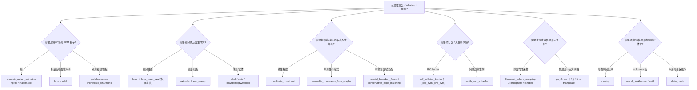

# 10-mesh / 18 专用算子与细分 (Specialized Operators & Subdivision)

> 本章覆盖 `mesh/` 下 **30 个「专用 / 非通用」函数**：非协调 Crouzeix–Raviart 有限元算子、
> 细分与实体（shell/solid）构造、约束与匹配装配工具、自碰撞（IPC 风格）barrier 函数、
> 球面/球体随机采样器、以及三角化/实体化封装。
>
> This chapter documents **30 specialized functions** under `mesh/`: non-conforming
> Crouzeix–Raviart FEM operators, subdivision & solid/shell construction, constraint &
> matching assembly utilities, self-collision (IPC-style) barrier functions, random
> samplers, and triangulation/solidification wrappers.

**约定 / Conventions**（与 [../appendices/03-doc-template.md](../appendices/03-doc-template.md) 一致）

- 文件锚点均为源码真实行号，格式 `file:///c:/VSWork/gptoolbox-1/mesh/<name>.m#Lx-Ly`。
- `V`=`#V by dim` 顶点，`F`=`#F by 3` 三角面（或 `#F by 4` 四面体），`E`=`#E by 2` 边，`T`=`#T by 4` 四面体。
- 依赖项标注其所在模块：`[mesh]` / `[matrix]` / `[mex]` / `[quat]` / `[external]`。
- 每个条目含 Mermaid 流程图（R4）与变量流动链（R5）。

---

## 本章概览 / Chapter overview

### (a) FEM / 非协调元算子 (FEM / Non-conforming element operators)

| 函数 | 文件 | 作用一句话 |
|---|---|---|
| `crouzeix_raviart_cotmatrix` | [crouzeix_raviart_cotmatrix.m](file:///c:/VSWork/gptoolbox-1/mesh/crouzeix_raviart_cotmatrix.m#L1-L118) | 边中点自由度（CR 元）的**边/面域**余切拉普拉斯 `L`（`#E by #E`） |
| `crouzeix_raviart_grad` | [crouzeix_raviart_grad.m](file:///c:/VSWork/gptoolbox-1/mesh/crouzeix_raviart_grad.m#L1-L50) | CR 元的分片常值梯度矩阵 `G`（`#F*dim by #uE`） |
| `crouzeix_raviart_massmatrix` | [crouzeix_raviart_massmatrix.m](file:///c:/VSWork/gptoolbox-1/mesh/crouzeix_raviart_massmatrix.m#L1-L41) | CR 元对角质量矩阵 `M`（`#E by #E`） |
| `bwstencil` | [bwstencil.m](file:///c:/VSWork/gptoolbox-1/mesh/bwstencil.m#L1-L46) | 由二值图像生成可 3D 打印的「模板 / stencil」实体 |
| `pseudoedge_dof` | [pseudoedge_dof.m](file:///c:/VSWork/gptoolbox-1/mesh/pseudoedge_dof.m#L1-L87) | 由控制点位移推导旋转自由度（LBS 的伪边旋转） |
| `lapsmoothF` | [lapsmoothF.m](file:///c:/VSWork/gptoolbox-1/mesh/lapsmoothF.m#L1-L27) | 面（face）标量场的拉普拉斯平滑 |
| `prebiharmonic` | [prebiharmonic.m](file:///c:/VSWork/gptoolbox-1/mesh/prebiharmonic.m#L1-L117) | 前双调和核（Multiscale Biharmonic Kernels, SGP 2011），QP 求解 |
| `monotonic_biharmonic` | [monotonic_biharmonic.m](file:///c:/VSWork/gptoolbox-1/mesh/monotonic_biharmonic.m#L1-L406) | 单调双调和坐标（二次规划 + 单调性约束） |

### (b) 细分与实体构造 (Subdivision & solid construction)

| 函数 | 文件 | 作用一句话 |
|---|---|---|
| `loop` | [loop.m](file:///c:/VSWork/gptoolbox-1/mesh/loop.m#L1-L171) | Loop 细分（`iter` 次），返回新的 `(VV,FF)` 与细分矩阵 `SS` |
| `loop_exact_eval` | [loop_exact_eval.m](file:///c:/VSWork/gptoolbox-1/mesh/loop_exact_eval.m#L1-L155) | Loop 极限曲面上任意点的**精确求值**（Stam 正则 patch） |
| `extrude` | [extrude.m](file:///c:/VSWork/gptoolbox-1/mesh/extrude.m#L1-L116) | 沿 z 方向挤出 2D 网格 1 个单位并连接边界 |
| `linear_sweep` | [linear_sweep.m](file:///c:/VSWork/gptoolbox-1/mesh/linear_sweep.m#L1-L145) | 网格沿向量 `sweep` 的**线性扫掠曲面**（与线段的 Minkowski 和） |
| `shell` | [shell.m](file:///c:/VSWork/gptoolbox-1/mesh/shell.m#L1-L51) | 为三角网格构造厚度为 `th` 的**薄壳** |
| `solid` | [solid.m](file:///c:/VSWork/gptoolbox-1/mesh/solid.m#L1-L81) | 用广义绕数管线把「脏」网格清理为**实体（四面体）** |
| `delta_mush` | [delta_mush.m](file:///c:/VSWork/gptoolbox-1/mesh/delta_mush.m#L1-L97) | Delta Mush 变形（Mancewicz 2014）：平滑形变同时保留细节 |

### (c) 约束与匹配 (Constraints & matching)

| 函数 | 文件 | 作用一句话 |
|---|---|---|
| `material_boundary_facets` | [material_boundary_facets.m](file:///c:/VSWork/gptoolbox-1/mesh/material_boundary_facets.m#L1-L13) | 提取不同材质 id 之间的**界面边**（material boundary） |
| `flipped_tet_orders` | [flipped_tet_orders.m](file:///c:/VSWork/gptoolbox-1/mesh/flipped_tet_orders.m#L1-L23) | 返回会导致负体积的四面体顶点排列（12×4，奇排列） |
| `coordinate_constraint` | [coordinate_constraint.m](file:///c:/VSWork/gptoolbox-1/mesh/coordinate_constraint.m#L1-L36) | 构造「线性精度」约束矩阵（广义重心坐标 / 蒙皮权重） |
| `inequality_constraints_from_graphs` | [inequality_constraints_from_graphs.m](file:///c:/VSWork/gptoolbox-1/mesh/inequality_constraints_from_graphs.m#L1-L39) | 把邻接图转为线性不等式约束（`monotonic_biharmonic` 使用） |
| `conservative_edge_matching` | [conservative_edge_matching.m](file:///c:/VSWork/gptoolbox-1/mesh/conservative_edge_matching.m#L1-L108) | 选出互不共享顶点的边子集（保守边匹配） |

### (d) 自碰撞障碍 (Self-collision barriers)

> `self_collision_barrier` 计算「点—点(cap)」与「点—线段(line)」两类接触的障碍能量及其一、二阶导，
> 障碍函数取 IPC 形式 `b(d,tol) = -(d-tol)^2 · log(d/tol)`（见 [Li et al. 2020]），
> 也可退化为 Smith & Schaefer 2015 的 `(tol/d - 1)^2` 形式。
> `_cap_sym` 与 `_line_sym` 是**由符号工具箱自动生成**的求值器（勿手改）。

| 函数 | 文件 | 作用一句话 |
|---|---|---|
| `self_collision_barrier` | [self_collision_barrier.m](file:///c:/VSWork/gptoolbox-1/mesh/self_collision_barrier.m#L1-L257) | 2D 线复形点—边自碰撞的 barrier 能量 `f`、梯度 `G`、Hessian `H` |
| `self_collision_barrier_cap_sym` | [self_collision_barrier_cap_sym.m](file:///c:/VSWork/gptoolbox-1/mesh/self_collision_barrier_cap_sym.m#L1-L84) | 自动生成的「cap/顶点」障碍求值器（4 维输入） |
| `self_collision_barrier_line_sym` | [self_collision_barrier_line_sym.m](file:///c:/VSWork/gptoolbox-1/mesh/self_collision_barrier_line_sym.m#L1-L483) | 自动生成的「线段内部」障碍求值器（6 维输入） |

### (e) 采样与三角化 (Sampling & triangulation)

| 函数 | 文件 | 作用一句话 |
|---|---|---|
| `fibonacci_sphere_sampling` | [fibonacci_sphere_sampling.m](file:///c:/VSWork/gptoolbox-1/mesh/fibonacci_sphere_sampling.m#L1-L24) | 用 Fibonacci 螺旋在单位球面均匀撒 `P` 个点 |
| `randball` | [randball.m](file:///c:/VSWork/gptoolbox-1/mesh/randball.m#L1-L13) | 在 `dim` 维球体**内部**均匀采样 `n` 点 |
| `randsphere` | [randsphere.m](file:///c:/VSWork/gptoolbox-1/mesh/randsphere.m#L1-L97) | 在球面采样（多种方法：naive/trig/rejection/stratified/lloyd） |
| `poly2mesh` | [poly2mesh.m](file:///c:/VSWork/gptoolbox-1/mesh/poly2mesh.m#L1-L36) | **[已弃用]** 读取 `.poly` 并用 Triangle 三角化其内部 |

### (f) 其它 (Miscellaneous)

| 函数 | 文件 | 作用一句话 |
|---|---|---|
| `closing` | [closing.m](file:///c:/VSWork/gptoolbox-1/mesh/closing.m#L1-L107) | 网格的形态学**闭运算**（先膨胀 sigma+eps 再腐蚀 sigma） |
| `murali_funkhouser` | [murali_funkhouser.m](file:///c:/VSWork/gptoolbox-1/mesh/murali_funkhouser.m#L1-L153) | 按 Murali & Funkhouser 1997 计算「solidness」标量场 |
| `smith_and_schaefer` | [smith_and_schaefer.m](file:///c:/VSWork/gptoolbox-1/mesh/smith_and_schaefer.m#L1-L177) | 有界双射参数化（Smith & Schaefer 2015）的数值求解循环 |

### 「问题类型 → 选择专门工具」/ Problem-type selector



---

## 逐函数条目 / Per-function entries

### `crouzeix_raviart_cotmatrix` — Crouzeix–Raviart 余切拉普拉斯矩阵
- **文件 / File**: [mesh/crouzeix_raviart_cotmatrix.m](file:///c:/VSWork/gptoolbox-1/mesh/crouzeix_raviart_cotmatrix.m#L1-L118)
- **签名 / Signature**: `[L,E,EMAP] = crouzeix_raviart_cotmatrix(V,F)`
- **功能 / Purpose**: `EN: Compute the edge-based Crouzeix-Raviart cotangent Laplacian (test functions at edge midpoints).` / 中文：构造基于**边中点自由度**的非协调 CR 余切拉普拉斯矩阵；三角形时 `L` 为 `#E by #E`，四面体时以「面片(facet)」为自由度。
- **输入 / Inputs**:

  | 参数 | 尺寸/类型 | 含义 (中/英) |
  |---|---|---|
  | `V` | `#V by dim` | 顶点坐标 / vertex positions |
  | `F` | `#F by 3` 或 `#F by 4` | 三角形或四面体索引 / simplex indices |

- **输出 / Outputs**:

  | 参数 | 尺寸/类型 | 含义 |
  |---|---|---|
  | `L` | `#E by #E`（ss=3）/ `#F by #F`（ss=4） | 基于边/面的稀疏 CR 余切矩阵 |
  | `E` | `#E by 2`（或面片列表） | 唯一边（四面体时为唯一面片） |
  | `EMAP` | `#F*3`（或 `#F*4`） | 有向半边→唯一边的映射 |

- **可选参数 / Optional**: 无 / none
- **变量流动 / Variable flow**: `V,F →(cotangent, ×2)→ C →(sort+unique)→ E,EMAP →(sparse(EMAP(LI),EMAP(LJ),LV))→ L`
- **算法步骤 / Algorithm**:
  1. `ss=3`：`C = 2*cotangent(V,F)`；`allE` 取三条有向半边；`E,EMAP = unique(sort(allE,2),'rows')`。
  2. 由 `F2E` 构造 `LI,LJ,LV`：每面 6 个有向项，**非对角元 `-2·cot αij`、对角元 `+2·cot`**（按对角顶点重排 `C(:,[3 1 2 ...])`）。
  3. `L = sparse(EMAP(LI),EMAP(LJ),LV,#E,#E)`。
  4. `ss=4`：对四个面片重复上述逻辑（`C = -2*cotangent(V,T)`），得到面片域算子。
  5. 其它 `ss` 报错 `Simplex size ... unsupported`。
- **流程图 / Flowchart**:

  ```mermaid
  flowchart TD
    A["输入 V,F"] --> B{"size(F,2)?"}
    B -- 3 --> C["C = 2*cotangent(V,F)"]
    C --> D["allE = 三条有向半边"]
    D --> E["[E,~,EMAP] = unique(sort(allE,2))"]
    E --> F["LI,LJ,LV 组装 6 项/面"]
    F --> G["L = sparse(EMAP(LI),EMAP(LJ),LV)"]
    B -- 4 --> H["面片(C = -2*cotangent(V,T))"]
    H --> G
    B -- 其它 --> I["error"]
    G --> Z["输出 L,E,EMAP"]
  ```
- **依赖 / Dependencies**: `cotangent` [mesh]
- **See also**: `crouzeix_raviart_grad`, `crouzeix_raviart_massmatrix`, `cotmatrix`, `edge_laplacian`
- **关系说明 / Note on CR dof**: CR 元每个**边**一个自由度，故 `L` 为 `#E by #E`（非协调元，自由度=边数而非顶点数）；这与顶点域的 `cotmatrix`（`#V by #V`）不同。由 `crouzeix_raviart_grad` 例证可得恒等式 `L ≈ G' · repdiag(diag(A)/2,3) · G`（见 `crouzeix_raviart_grad` 条目），即 CR 拉普拉斯 = 分片常值梯度经面积权重的散度复合。

### `crouzeix_raviart_grad` — Crouzeix–Raviart 梯度矩阵
- **文件 / File**: [mesh/crouzeix_raviart_grad.m](file:///c:/VSWork/gptoolbox-1/mesh/crouzeix_raviart_grad.m#L1-L50)
- **签名 / Signature**: `[G,uE,EMAP] = crouzeix_raviart_grad(V,F)`
- **功能 / Purpose**: `EN: Compute the piecewise-constant gradient matrix of non-conforming Crouzeix-Raviart elements (values at edge midpoints).` / 中文：计算 CR 元的分片常值梯度矩阵；输入为边中点上的分段线性函数取值，输出为每面常值梯度向量。
- **输入 / Inputs**:

  | 参数 | 尺寸/类型 | 含义 (中/英) |
  |---|---|---|
  | `V` | `#V by dim` | 顶点坐标 |
  | `F` | `#F by 3` | 三角面索引 |

- **输出 / Outputs**:

  | 参数 | 尺寸/类型 | 含义 |
  |---|---|---|
  | `G` | `#F*dim by #uE` | 每面常值梯度的稀疏矩阵 |
  | `uE` | `#uE by 2` | 唯一无向边 |
  | `EMAP` | `#F*3` | 有向半边→`uE` 的映射 |

- **可选参数 / Optional**: 无 / none（仅支持三角形，`assert(size(F,2)==3)`）
- **变量流动 / Variable flow**: `V,F →(半边 E)→ unique→ uE,EMAP →(边向量 EV)→(法向 N, 面积 dblA, 单位法向 U)→ EVp → sparse(...)→ G`
- **算法步骤 / Algorithm**:
  1. 由 `F` 取有向半边 `E`，`[uE,~,EMAP]=unique(sort(E,2),'rows')`。
  2. 边向量 `EV = V(E(:,2),:)-V(E(:,1),:)`；使用 `normals(V,F)` 得 `N`，`dblA=normrow(N)`，`U=normalizerow(N)`。
  3. 把每条边向量绕面法向旋转 90° 并除以 `dblA/2`：`EVp = -cross(repmat(U./(dblA/2),3,1),EV)`。
  4. `G = sparse(#F*dim 行号, EMAP, EVp+eps, dim*m, #uE)`。
- **流程图 / Flowchart**:

  ```mermaid
  flowchart TD
    A["输入 V,F"] --> B["E = 有向半边"]
    B --> C["[uE,~,EMAP] = unique(sort(E,2))"]
    C --> D["EV = V(E2)-V(E1)"]
    D --> E["N = normals(V,F); dblA,U"]
    E --> F["EVp = -cross(U./(dblA/2),EV)"]
    F --> G["G = sparse(..., EMAP, EVp+eps)"]
    G --> Z["输出 G,uE,EMAP"]
  ```
- **依赖 / Dependencies**: `normals` [mesh], `normrow` [matrix], `normalizerow` [matrix]
- **See also**: `crouzeix_raviart_cotmatrix`, `crouzeix_raviart_massmatrix`, `grad`

### `crouzeix_raviart_massmatrix` — Crouzeix–Raviart 质量矩阵
- **文件 / File**: [mesh/crouzeix_raviart_massmatrix.m](file:///c:/VSWork/gptoolbox-1/mesh/crouzeix_raviart_massmatrix.m#L1-L41)
- **签名 / Signature**: `[M,E,EMAP] = crouzeix_raviart_massmatrix(V,F)`
- **功能 / Purpose**: `EN: Compute the Crouzeix-Raviart mass matrix; M(e,e) is the sum of 1/3 the areas of the triangles adjacent to edge e (for tets, facets).` / 中文：CR 元（对角）质量矩阵，`M(e,e)` 为边 `e` 两侧三角形各 `1/3` 面积之和；四面体时以面片为自由度。
- **输入 / Inputs**:

  | 参数 | 尺寸/类型 | 含义 (中/英) |
  |---|---|---|
  | `V` | `#V by dim` | 顶点坐标 |
  | `F` | `#F by 3` 或 `#F by 4` | 三角形 / 四面体索引 |

- **输出 / Outputs**:

  | 参数 | 尺寸/类型 | 含义 |
  |---|---|---|
  | `M` | `#E by #E` 对角 | 基于边（面片）的对角质量矩阵 |
  | `E` | `#E by 2` | 唯一边（或面片列表） |
  | `EMAP` | `#F*3`（或 `#F*4`） | 半边→唯一边映射 |

- **可选参数 / Optional**: 无 / none
- **变量流动 / Variable flow**: `V,F →(allE, unique)→ E,EMAP →(doublearea/2 = TA)→ sparse(EMAP,EMAP,repmat(TA/3,3,1))→ M`
- **算法步骤 / Algorithm**:
  1. `ss=3`：`allE`→`[E,~,EMAP]=unique(sort(allE,2),'rows')`；`TA = doublearea(V,F)/2`（面积）。
  2. `M = sparse(EMAP,EMAP,repmat(TA/3,3,1),#E,#E)` —— 每条边累加相邻三角形的 `1/3` 面积。
  3. `ss=4`：以四面体的四个面为自由度，`vol = volume(V,T)`，`M = sparse(FMAP,FMAP,repmat(vol/4,4,1))`。
- **流程图 / Flowchart**:

  ```mermaid
  flowchart TD
    A["输入 V,F"] --> B{"size(F,2)?"}
    B -- 3 --> C["allE → unique → E,EMAP"]
    C --> D["TA = doublearea(V,F)/2"]
    D --> E["M = sparse(EMAP,EMAP,repmat(TA/3,3,1))"]
    B -- 4 --> F["vol = volume(V,T); 面片 unique"]
    F --> G["M = sparse(FMAP,FMAP,repmat(vol/4,4,1))"]
    E --> Z["输出 M,E,EMAP"]
    G --> Z
  ```
- **依赖 / Dependencies**: `doublearea` [mesh], `volume` [mesh]
- **See also**: `crouzeix_raviart_cotmatrix`, `crouzeix_raviart_grad`, `massmatrix`, `edge_laplacian`

### `bwstencil` — 二值图像 → 3D 打印模板
- **文件 / File**: [mesh/bwstencil.m](file:///c:/VSWork/gptoolbox-1/mesh/bwstencil.m#L1-L46)
- **签名 / Signature**: `[V,F] = bwstencil(im,varargin)`
- **功能 / Purpose**: `EN: Create a 3D-printable stencil from an input binary image.` / 中文：把二值图像转为可 3D 打印的模板/镂空板（厚度即图像平面到 z=1 的挤出）。
- **输入 / Inputs**:

  | 参数 | 尺寸/类型 | 含义 (中/英) |
  |---|---|---|
  | `im` | `h by w` 二值图像 | 输入二值图 / binary image |

- **输出 / Outputs**:

  | 参数 | 尺寸/类型 | 含义 |
  |---|---|---|
  | `V` | `#V by 3` | 顶点位置，`V(:,3)` 为 0（底层）或 1（顶层） |
  | `F` | `#F by 3` | 三角面索引 |

- **可选参数 / Optional**: 透传给 `bwmesh`（见 `bwmesh.m`，例如 `'Tol'`、`'SmoothingIters'`）

  | 名称 | 取值 | 默认 | 含义 |
  |---|---|---|---|
  | `'Tol'` | 数值 | `bwmesh` 默认 | 轮廓容差（透传） |
  | `'SmoothingIters'` | 整数 | `bwmesh` 默认 | 轮廓平滑迭代数（透传） |

- **变量流动 / Variable flow**: `im →(im2bw/警告)→(imfill 去岛)→(imresize ×2)→ bwmesh(~im)→ extrude→ remesh_planar_patches→ V,F`
- **算法步骤 / Algorithm**:
  1. 非逻辑输入先 `im2bw`（并 `warning`）。
  2. `imfill(im,'holes')` 填洞；若有岛则替换并警告。
  3. `im = imresize(im,2,'nearest')` 放大 2 倍。
  4. `[V,F] = bwmesh(~im,varargin{:})` 生成轮廓网格；再 `extrude(V,F)` 挤出成体，最后 `remesh_planar_patches` 重网格化。
- **流程图 / Flowchart**:

  ```mermaid
  flowchart TD
    A["输入 im"] --> B{"islogical(im)?"}
    B -- 否 --> C["im = im2bw(im) + warning"]
    B -- 是 --> D["imfill(im,'holes')"]
    C --> D
    D --> E{"含岛?"}
    E -- 是 --> F["im = imh + warning"]
    E -- 否 --> G["im = imresize(im,2,'nearest')"]
    F --> G
    G --> H["bwmesh(~im,varargin)"]
    H --> I["extrude(V,F)"]
    I --> J["remesh_planar_patches(V,F)"]
    J --> Z["输出 V,F"]
  ```
- **依赖 / Dependencies**: `bwmesh` [mesh], `extrude` [mesh], `remesh_planar_patches` [mesh]（另用 MATLAB 内置 `im2bw`,`imfill`,`imresize`）
- **See also**: `bwmesh`, `polygonize`, `remesh_planar_patches`

### `lapsmoothF` — 面标量场的拉普拉斯平滑
- **文件 / File**: [mesh/lapsmoothF.m](file:///c:/VSWork/gptoolbox-1/mesh/lapsmoothF.m#L1-L27)
- **签名 / Signature**: `[S] = lapsmoothF(TT,S,a,it)`
- **功能 / Purpose**: `EN: Laplacian smoothing for a scalar field defined on faces.` / 中文：对定义在面（三角形）上的标量场做拉普拉斯平滑。
- **输入 / Inputs**:

  | 参数 | 尺寸/类型 | 含义 (中/英) |
  |---|---|---|
  | `TT` | `#F by 3` | 三角形-三角形拓扑（用 `tt` 生成）/ face-face topology |
  | `S` | `#F by 1` | 面上的标量场 / scalar field over faces |
  | `a` | `0..1` 标量 | 平滑强度 / smoothing strength |
  | `it` | 整数 | 迭代次数 / number of iterations |

- **输出 / Outputs**:

  | 参数 | 尺寸/类型 | 含义 |
  |---|---|---|
  | `S` | `#F by 1` | 平滑后的标量场 |

- **可选参数 / Optional**: 无 / none（均为位置参数）
- **变量流动 / Variable flow**: `TT,S,a,it →(it 次双重循环：对每面取拓扑邻居均值)→ S_new = (1-a)·S + a·mean(neighbors) → S`
- **算法步骤 / Algorithm**:
  1. 外层 `for x=1:it`；内层 `for i=1:#F`。
  2. 对该面 3 个拓扑邻居 `TT(i,j)`（`-1` 表无邻居，跳过）累加 `acc` 与计数 `count`。
  3. 更新 `S(i) = (1-a)*S(i) + a*acc/count`（原地更新，Jacobi/Gauss-Seidel 混合）。
- **流程图 / Flowchart**:

  ```mermaid
  flowchart TD
    A["输入 TT,S,a,it"] --> B{"x <= it?"}
    B -- 是 --> C{"i <= #F?"}
    C -- 是 --> D{"j <= 3 且 TT(i,j) != -1?"}
    D -- 是 --> E["acc += S(TT(i,j)); count++"]
    D -- 否 --> F["S(i) = (1-a)S(i) + a*acc/count"]
    E --> D
    F --> C
    C -- 否 --> B
    B -- 否 --> Z["输出 S"]
  ```
- **依赖 / Dependencies**: 无同库依赖（需外部先用 `tt` 计算 `TT`）
- **See also**: `tt`, `laplacian_smooth`, `per_vertex_normals`

### `prebiharmonic` — 前双调和核
- **文件 / File**: [mesh/prebiharmonic.m](file:///c:/VSWork/gptoolbox-1/mesh/prebiharmonic.m#L1-L117)
- **签名 / Signature**: `D = prebiharmonic(W,L,a,t,k)`
- **功能 / Purpose**: `EN: Compute the pre-biharmonic kernel from Multiscale Biharmonic Kernels (Raif Rustamov, SGP 2011) via a QP.` / 中文：按 [Rustamov, SGP 2011] 通过二次规划求解「前双调和核」在某源点上的取值向量 `D`。
- **输入 / Inputs**:

  | 参数 | 尺寸/类型 | 含义 (中/英) |
  |---|---|---|
  | `W` | `#V by #V` 稀疏 | 顶点面积权重（见 `massmatrix`） |
  | `L` | `#V by #V` 稀疏 | 余切矩阵（见 `cotmatrix`） |
  | `a` | 标量 | 曲面总面积 / total area |
  | `t` | `0..1` | 支撑大小比例（内部按 `t = a*t` 缩放） |
  | `k` | 整数 | 源顶点 / source vertex |

- **输出 / Outputs**:

  | 参数 | 尺寸/类型 | 含义 |
  |---|---|---|
  | `D` | `#V by 1` | 核值向量 / kernel values |

- **可选参数 / Optional**: 无 / none
- **变量流动 / Variable flow**: `(W,L,a,t,k) →(t=a*t)→ (构造 QP: Q=blkdiag(0,2W^{-1}), c=0, A/lc/uc/lx/ux) → mskqpopt → res.sol.itr.xx(1:n) → D`
- **算法步骤 / Algorithm**:
  1. 变量 `x=[f;r]`，能量 `½x'Qx + c'x`，其中 `Q = blkdiag(0, 2W^{-1})`，`c=0`。
  2. 约束 (a) `w'f ≤ t`（支撑约束）；
  3. 约束 (b) `x(k)=1`（源点固定）；
  4. 约束 (c) `L f - r = 0`（`n` 行，双调和关系）；
  5. 约束 (d) `f ≥ 0`（非负）。
  6. 组装稀疏 `A`，调用 MOSEK 的 `mskqpopt(Q,c,A,lc,uc,lx,ux,param)` 求解，取 `res.sol.itr.xx(1:n)` 作为 `D`。
- **流程图 / Flowchart**:

  ```mermaid
  flowchart TD
    A["输入 W,L,t,k (+a)"] --> B["t = a*t; n = #V"]
    B --> C["Q = blkdiag(0, 2W^-1); c = 0"]
    C --> D["(a) w'f <= t"]
    D --> E["(b) x(k)=1"]
    E --> F["(c) L f - r = 0 (n 行)"]
    F --> G["(d) f >= 0 (n 行)"]
    G --> H["A = sparse(Ai,Aj,Av)"]
    H --> I["mskqpopt(Q,c,A,lc,uc,lx,ux,param)"]
    I --> Z["D = res.sol.itr.xx(1:n)"]
  ```
- **依赖 / Dependencies**: `mskqpopt`（MOSEK 外部求解器）
- **See also**: `massmatrix`, `cotmatrix`, `monotonic_biharmonic`
- **注意 / Caveat**: 文件头注释写作 `D = prebiharmonic(W,L,t,k)`，与真实签名 `(W,L,a,t,k)` 不一致（参数 `a` 缺失）。

### `pseudoedge_dof` — 伪边旋转自由度推导
- **文件 / File**: [mesh/pseudoedge_dof.m](file:///c:/VSWork/gptoolbox-1/mesh/pseudoedge_dof.m#L1-L87)
- **签名 / Signature**: `[L] = pseudoedge_dof(C,PE,D,Q)`
- **功能 / Purpose**: `EN: Compute automatic dof (rotations) for point handles in linear blend skinning, given only translations, using pseudo edges.` / 中文：在仅有控制点位移的前提下，利用「伪边」为线性混合蒙皮（LBS）点手柄自动推导旋转自由度（线性变换 `dim×dim×#C`）。
- **输入 / Inputs**:

  | 参数 | 尺寸/类型 | 含义 (中/英) |
  |---|---|---|
  | `C` | `#C by dim` | 控制点静止位置 |
  | `PE` | `#PE by 2` | 伪边（`C` 的行索引） |
  | `D` | `#C by dim` | 控制点位移 |
  | `Q` | `#C by 4` | 各控制点已有四元数旋转 `[1 i j k]`（可选，默认单位） |

- **输出 / Outputs**:

  | 参数 | 尺寸/类型 | 含义 |
  |---|---|---|
  | `L` | `dim by dim by #C` | 各控制点的线性变换（旋转 `R` + 平移 `T`） |

- **可选参数 / Optional**:

  | 名称 | 取值 | 默认 | 含义 |
  |---|---|---|---|
  | `Q` | `#C by 4` 四元数 | `[1 0 0 0]` | 已有旋转，可与伪边旋转复合 |

- **变量流动 / Variable flow**: `C,PE,D,Q →(无 PE 则 L=平移,返回)→ rest_PE, pose_PE →(axisanglebetween)→ w,a →(axisangle2quat)→ Qpe →(按控制点求和 Qc)→ Q ← quatmultiply(Q,Qc) →(quat2mat)→ R → T = D + R·(-C) + C → L`
- **算法步骤 / Algorithm**:
  1. 若 `PE` 为空：`L(:,1:dim,:)=eye`，`L(:,dim+1,:)=D'`，直接返回。
  2. 计算每条伪边的静止向量 `rest_PE` 与姿态向量 `pose_PE`。
  3. `[w,a]=axisanglebetween(rest_PE,pose_PE,[0 0 1])`，转四元数 `Qpe`；用稀疏矩阵把同一控制点的伪边四元数相乘（求和/归一化）。
  4. `Q = quatmultiply(Q, normalizerow(Qc))`，`R = quat2mat(normalizerow(Q))`。
  5. `T = D + R·(-C) + C`（绕控制点旋转并叠加位移）；组装 `L`。
- **流程图 / Flowchart**:

  ```mermaid
  flowchart TD
    A["输入 C,PE,D,Q"] --> B{"PE 为空?"}
    B -- 是 --> C["L = 单位旋转 + 平移 D"]
    B -- 否 --> D["rest_PE, pose_PE"]
    D --> E["axisanglebetween → w,a → axisangle2quat → Qpe"]
    E --> F["按控制点求和 Qc = sparse(...)"]
    F --> G["Q = quatmultiply(Q, normalizerow(Qc))"]
    G --> H["R = quat2mat(normalizerow(Q))"]
    H --> I["T = D + R(-C) + C"]
    I --> Z["输出 L (dim by dim+1 by #C)"]
    C --> Z
  ```
- **依赖 / Dependencies**: `axisanglebetween` [mesh], `axisangle2quat` [mesh], `quatmultiply` [quat], `quat2mat` [mesh], `normalizerow` [matrix], `stacktimes` [mesh]
- **See also**: `lbs`, `quat2mat`, `per_vertex_frames`

### `material_boundary_facets` — 材质界面边提取
- **文件 / File**: [mesh/material_boundary_facets.m](file:///c:/VSWork/gptoolbox-1/mesh/material_boundary_facets.m#L1-L13)
- **签名 / Signature**: `E = material_boundary_facets(F,FI)`
- **功能 / Purpose**: `EN: Extract unique edge boundaries between elements with different material ids.` / 中文：提取不同材质 id 之间的公共边（界面边），以及仅被单一材质邻接的边界边。
- **输入 / Inputs**:

  | 参数 | 尺寸/类型 | 含义 (中/英) |
  |---|---|---|
  | `F` | `#F by 3` | 三角面索引 |
  | `FI` | `#F by 1` | 每个面的材质 id / material ids |

- **输出 / Outputs**:

  | 参数 | 尺寸/类型 | 含义 |
  |---|---|---|
  | `E` | `#E by 2` | 位于不同 id 元素之间（或边界）的唯一边 |

- **可选参数 / Optional**: 无 / none
- **变量流动 / Variable flow**: `F,FI →(sort 三条半边 + unique)→ uE,EMAP → uE2FI = sparse(EMAP, repmat(FI,3,1),1) → 保留 sum==1（边界）或 (sum>0 的列数)==2（跨材质）→ E`
- **算法步骤 / Algorithm**:
  1. 收集三条有向半边并排序，`[uE,~,EMAP]=unique(sort(...,2),'rows')`。
  2. `uE2FI = sparse(EMAP, repmat(FI,3,1), 1)`：每条边↔各材质 id 出现次数。
  3. 取 `sum(uE2FI,2)==1`（只被一个材质接触的边界边）或 `sum(uE2FI>0,2)==2`（被两种材质接触的界面边）。
- **流程图 / Flowchart**:

  ```mermaid
  flowchart TD
    A["输入 F,FI"] --> B["uE,EMAP = unique(sort(半边,2))"]
    B --> C["uE2FI = sparse(EMAP, repmat(FI,3,1), 1)"]
    C --> D{"sum==1 或 (sum>0)列数==2 ?"}
    D -- 是 --> E["保留该边"]
    D -- 否 --> F["丢弃"]
    E --> Z["输出 E (材质界面/边界边)"]
    F --> Z
  ```
- **依赖 / Dependencies**: 仅用 MATLAB 内置 `unique`,`sparse`
- **See also**: `boundary_facets`, `outline`, `connected_components`

### `flipped_tet_orders` — 翻转四面体顶点排列
- **文件 / File**: [mesh/flipped_tet_orders.m](file:///c:/VSWork/gptoolbox-1/mesh/flipped_tet_orders.m#L1-L23)
- **签名 / Signature**: `flipped_order = flipped_tet_orders()`
- **功能 / Purpose**: `EN: Return the tet index orders that are flipped inside out (negative volume).` / 中文：返回 12 种会导致「里外翻转」（负体积）的四面体顶点排列。常用于在重标定四面体朝向时作查表。
- **输入 / Inputs**: 无 / none
- **输出 / Outputs**:

  | 参数 | 尺寸/类型 | 含义 |
  |---|---|---|
  | `flipped_order` | `12 by 4` | 负体积的顶点排列（奇排列）/ flipped tet orderings |

- **可选参数 / Optional**: 无 / none
- **变量流动 / Variable flow**: `(无输入) → 常量表 → flipped_order`
- **算法步骤 / Algorithm**:
  1. 直接返回硬编码的 12×4 常量表（`4 3 1 2` … `1 2 4 3`），即 4 个顶点的 12 种奇排列。
- **流程图 / Flowchart**:

  ```mermaid
  flowchart TD
    A["(无输入)"] --> B["返回 12x4 常量表"]
    B --> Z["flipped_order"]
  ```
- **依赖 / Dependencies**: 无 / none
- **See also**: `volume`, `orient_tet_mesh`, `faces_first`
- **注意 / Caveat**: 文件头注释称输出为 `20 by 4`，但代码实际为 **12×4**（4 个顶点仅有 12 个奇排列，`20` 应为笔误）。

### `linear_sweep` — 线性扫掠（线段 Minkowski 和）
- **文件 / File**: [mesh/linear_sweep.m](file:///c:/VSWork/gptoolbox-1/mesh/linear_sweep.m#L1-L145)
- **签名 / Signature**: `[SV,SF,J,DT] = linear_sweep(V,F,sweep,varargin)`
- **功能 / Purpose**: `EN: Compute the surface of the solid sweep of a mesh along a vector, i.e. the Minkowski sum of (V,F) and the segment 0→sweep.` / 中文：计算网格 `(V,F)` 沿向量 `sweep` 扫掠所得立体的表面（即与线段 `(0,0)→sweep` 的 Minkowski 和）。
- **输入 / Inputs**:

  | 参数 | 尺寸/类型 | 含义 (中/英) |
  |---|---|---|
  | `V` | `#V by dim` | 顶点坐标 |
  | `F` | `#F by dim` | 面片索引（2D 为边，3D 为三角面） |
  | `sweep` | `1 by dim` | 扫掠方向与距离 |

- **输出 / Outputs**:

  | 参数 | 尺寸/类型 | 含义 |
  |---|---|---|
  | `SV` | `#SV by dim` | 扫掠体表面顶点 |
  | `SF` | `#SF by dim` | 表面面片索引 |
  | `J` | `#F by 1` | 出生父级（来源 `F` / `F+v` / 侧面）索引 |
  | `DT` | `#F by 1` | 面法向与扫掠方向点积（仅 3D 输出） |

- **可选参数 / Optional**:

  | 名称 | 取值 | 默认 | 含义 |
  |---|---|---|---|
  | `'SelfUnion'` | `true`/`false` | `true` | 是否解析自交并取自并集（仅 3D；`false` 更快但非凸输入会自交） |

- **变量流动 / Variable flow**: `V,F,sweep → U=V+sweep`；`dim=2`：`(N 法向, D 点积)` → 侧面 `Epw`，`triangle` 剖分 → `winding_number` 分类 → `outline` 取边界 → `SV,SF`；`dim=3`：`DT` 定向 → 每个三角面构建棱柱 `G` → `mesh_boolean(...,'union')`（或直接输出）→ `SV,SF,J`
- **算法步骤 / Algorithm**:
  1. 2D：边作为`F`；由法向与 `sweep` 点积划分正/负向边；构造墙（walls）`Epw`；用 `triangle` 剖分内部；`winding_number` 找出内部（`w≠0`）；`outline` 提取边界。
  2. 3D：`DT = sum(N.*sweep)`；将面向背向的面翻转；把 `V` 与 `V+sweep` 拼接；为每个三角面构造棱柱体积（`GT` 上下底 + `GQ` 侧面）。
  3. `[S,GQ]=total_signed_occurrences(GQ)` 消去内部重合侧面；合成三角面集合 `G`。
  4. 若 `SelfUnion`：`[SV,SF,SJ]=mesh_boolean(W,G,[],[],'union')` 并据此重排 `J`；否则直接返回 `SV=W,SF=G`。
- **流程图 / Flowchart**:

  ```mermaid
  flowchart TD
    A["输入 V,F,sweep"] --> B["U = V+sweep; dim=size(V,2)"]
    B --> C{"dim?"}
    C -- 2 --> D["法向点积 D → Ep/Em; 墙 Epw"]
    D --> E["triangle 剖分 → winding_number 分类"]
    E --> F["outline 取边界 → SV,SF"]
    C -- 3 --> G["DT 定向; 翻转背向面"]
    G --> H["构建棱柱 GT+GQ"]
    H --> I["total_signed_occurrences 去重"]
    I --> J{"SelfUnion?"}
    J -- 是 --> K["mesh_boolean union"]
    J -- 否 --> L["SV=W; SF=G"]
    F --> Z["输出 SV,SF,J,DT"]
    K --> Z
    L --> Z
  ```
- **依赖 / Dependencies**: `normalizerow` [matrix], `triangle` [mex/external], `barycenter` [mesh], `winding_number` [mex], `outline` [mesh], `remove_unreferenced` [mesh], `normals` [mesh], `total_signed_occurrences` [mesh], `mesh_boolean` [mex]
- **See also**: `extrude`, `swept_volume`, `mesh_boolean`, `winding_number`

### `monotonic_biharmonic` — 单调双调和坐标
- **文件 / File**: [mesh/monotonic_biharmonic.m](file:///c:/VSWork/gptoolbox-1/mesh/monotonic_biharmonic.m#L1-L406)
- **签名 / Signature**: `[W,f] = monotonic_biharmonic(V,F,b,bc,'ParameterName',ParameterValue,...)`
- **功能 / Purpose**: `EN: Compute "monotonic biharmonic" coordinates via QP; each weight minimizes Laplacian energy subject to monotonicity constraints from harmonic coordinates.` / 中文：通过二次规划计算「单调双调和」坐标：每个权重函数在（来自调和坐标的）单调性约束下最小化拉普拉斯能量（k 阶双调和）。
- **输入 / Inputs**:

  | 参数 | 尺寸/类型 | 含义 (中/英) |
  |---|---|---|
  | `V` | `#V by dim` | 顶点坐标 |
  | `F` | `#F by 3`（2D）或 `#F by 4`（3D） | 面/四面体索引 |
  | `b` | 边界顶点索引 | boundary vertices |
  | `bc` | `size(b) by #handles` | 各手柄边界条件 |

- **输出 / Outputs**:

  | 参数 | 尺寸/类型 | 含义 |
  |---|---|---|
  | `W` | `#V by #handles` | 权重矩阵 / weight matrix |
  | `f` | 标量 | 最近一次求解目标值（辅助输出） |

- **可选参数 / Optional**:

  | 名称 | 取值 | 默认 | 含义 |
  |---|---|---|---|
  | `'k'` | 整数 | `2` | 求解 k 阶调和 |
  | `'OptType'` | `'conic'`/`'quad'`/`'legacy-quad'` | 依 MOSEK 存在性 | 优化问题形式 |
  | `'Algorithm'` | `'interior-point'`/`'active-set'` | `'interior-point'` | 求解算法 |
  | `'QuadProgParam'` | 结构体 | 默认 | MOSEK/quadprog 参数 |
  | `'MonotonicityGraph'` | `#handles` cell | 由调和坐标生成 | 单调性图（`W(i,k)<=W(j,k)`） |
  | `'MonotonicityTGraph'` | `#handles` cell | `[]` | 三角形（平均）约束 |
  | `'Data'` / `'DataWeight'` | 矩阵 / 权 | `[]` / `1` | 数据项（尽量接近） |
  | `'SubGraph'` | logical | `false` | 迭代用指数级增长的子图 |
  | `'IterateConstraints'` | logical | `false` | 迭代更新约束 |
  | `'ExtremaBC'` | 0/1 矩阵 | `bc` | 生成单调性图用的极值 bc |
  | `'MaxIter'` | 整数 | `inf` | 最大迭代 |
  | `'MonotonicityEpsilon'` | 标量 | `0` | 单调性松弛 epsilon |
  | `'LEQScale'` | 标量 | `1` | 线性不等式缩放 |
  | `'Quiet'` | 字符串 | `'echo(0)'` | 静默/详细 |

- **变量流动 / Variable flow**: `V,F,b,bc →(构建 L,M;奇数 k 还需 G,TA)→ M 归一化 →(构造 Q 或 FF)→(数据项 S)→(单调性图 A→不等式约束 Aleq,ATleq)→ quadprog/conic → x → W(:,i)`
- **算法步骤 / Algorithm**:
  1. 解析 `varargin`（见上表）；据 `size(F,2)` 选 `cotmatrix3/massmatrix3/grad3`（3D）或 `cotmatrix_embedded/massmatrix_embedded`（2D）。
  2. `M = M./max(abs(diag(M)))` 归一化。
  3. 按 `opt_type` 构造二次系数矩阵：`legacy-quad` 迭代 `Q = -L*(M\Q)`；`quad/conic` 构造（可能矩形的）`FF`（偶 k 用 `sqrt(M)\FF`，奇 k 用 `sqrt(TA)*G*FF`）。
  4. 若有 `Data`：追加数据项到 `Q/FF` 与线性项 `l`。
  5. 若无 `A`：用 `kharmonic` + `monotonicity_matrix` 自动生成单调性图 `A{i}`。
  6. 对每个手柄：`inequality_constraints_from_graphs` 生成 `Aleq`；`Aeq=speye(n,n)(b,:)`；按算法调 `quadprog` 或 `conic` 求解，得权重写入 `W(:,i)`。
- **流程图 / Flowchart**:

  ```mermaid
  flowchart TD
    A["输入 V,F,b,bc,opts"] --> B{"size(F,2)?"}
    B -- 4 --> C["L=cotmatrix3; M=massmatrix3 (+grad3)"]
    B -- 3 --> D["L=cotmatrix_embedded; M=massmatrix_embedded (+grad)"]
    C --> E["M 归一化"]
    D --> E
    E --> F{"opt_type?"}
    F -- legacy-quad --> G["Q = -L*(M\\Q) 迭代"]
    F -- quad/conic --> H["构造 FF (sqrt(M)/sqrt(TA)G)"]
    G --> I["附加 Data/线性项 l"]
    H --> I
    I --> J{"A 为空?"}
    J -- 是 --> K["kharmonic → monotonicity_matrix → A{i}"]
    J -- 否 --> L["使用给定 A"]
    K --> M["inequality_constraints_from_graphs → Aleq,ATleq"]
    L --> M
    M --> N["quadprog/conic 逐手柄求解"]
    N --> Z["输出 W,f"]
  ```
- **依赖 / Dependencies**: `cotmatrix3`,`massmatrix3`,`grad3`,`cotmatrix_embedded`,`massmatrix_embedded` [mesh], `doublearea`,`volume`,`repdiag`,`kharmonic`,`monotonicity_matrix`,`inequality_constraints_from_graphs`,`conic`,`mark_extrema` [mesh], `default_quadprog_param`,`min_quad_with_fixed_active_set` [matrix], `quadprog`（MATLAB/优化工具箱）
- **See also**: `biharmonic_bounded`, `boundary_conditions`, `kharmonic`, `harmonic`, `inequality_constraints_from_graphs`

### `delta_mush` — Delta Mush 变形
- **文件 / File**: [mesh/delta_mush.m](file:///c:/VSWork/gptoolbox-1/mesh/delta_mush.m#L1-L97)
- **签名 / Signature**: `[U,Dl,I] = delta_mush(V,F,U0,'ParameterName',ParameterValue,...)`
- **功能 / Purpose**: `EN: Deform a mesh according to "Delta Mush" (Mancewicz et al. 2014): smooth deformations while preserving detail.` / 中文：按 [Mancewicz et al. 2014] 做 Delta Mush 变形：先平滑得到「参考」形变，再在局部标架中把原始细节（delta）重新叠加，从而平滑形变但保留细节。
- **输入 / Inputs**:

  | 参数 | 尺寸/类型 | 含义 (中/英) |
  |---|---|---|
  | `V` | `#V by 3` | 原始顶点 |
  | `F` | `#F by 3` | 三角面索引 |
  | `U0` | `#V by 3` | 粗形变后的顶点位置 |

- **输出 / Outputs**:

  | 参数 | 尺寸/类型 | 含义 |
  |---|---|---|
  | `U` | `#V by 3` | 最终形变顶点 |
  | `Dl` | `#V by 3` | 局部 delta（可在 `'Delta'` 复用） |
  | `I` | `#V by 1` | 决定法平面所用的邻居索引（可在 `'Neighbors'` 复用） |

- **可选参数 / Optional**:

  | 名称 | 取值 | 默认 | 含义 |
  |---|---|---|---|
  | `'Delta'` | `#V by 3` | `[]` | 预计算局部 delta（需配合 `'Neighbors'`） |
  | `'Neighbors'` | `#V by 1` | `[]` | 预计算邻居索引 `I` |
  | `'Smooth'` | 函数句柄 | `@(U)delta_mush_smooth(V,F,U,10)` | 自定义平滑例程 |

- **变量流动 / Variable flow**: `V,F,U0 →(smooth_fun(V))→ VS →(per_vertex_frames 得 T,N,B,I)→ 逆标架 → Dl = in_frame(V-VS) →(smooth_fun(U0))→ US →(per_vertex_frames)→ U = US + in_frame(Dl,T,N,B)`
- **算法步骤 / Algorithm**:
  1. 若未提供 `smooth_fun`，默认用 `delta_mush_smooth`（10 次「逆距离加权」拉普拉斯平滑）。
  2. 未提供 `Dl` 时：`VS=smooth_fun(V)`；`[T,N,B,I]=per_vertex_frames(VS,F)`；构造「逆标架」`ITNB`；`Dl = in_frame(V-VS, IT,IN,IB)`。
  3. `US = smooth_fun(U0)`；`[T,N,B]=per_vertex_frames(US,F,'Neighbors',I)`；`U = US + in_frame(Dl,T,N,B)`。
- **流程图 / Flowchart**:

  ```mermaid
  flowchart TD
    A["输入 V,F,U0"] --> B{"提供 Smooth?"}
    B -- 否 --> C["smooth_fun = delta_mush_smooth(...,10)"]
    B -- 是 --> D["使用自定义句柄"]
    C --> E{"Dl 为空?"}
    D --> E
    E -- 是 --> F["VS=smooth_fun(V); 逆标架 ITNB"]
    F --> G["Dl = in_frame(V-VS)"]
    E -- 否 --> H["使用给定 Dl"]
    G --> I["US = smooth_fun(U0); per_vertex_frames(US)"]
    H --> I
    I --> Z["U = US + in_frame(Dl,T,N,B)"]
  ```
- **依赖 / Dependencies**: `adjacency_edge_cost_matrix` [mesh], `per_vertex_frames` [mesh]（`laplacian_smooth` 仅在注释中被作为替代选项提及）
- **See also**: `laplacian_smooth`, `conformalized_mean_curvature_flow`, `per_vertex_frames`, `lbs`

### `shell` — 薄壳构造
- **文件 / File**: [mesh/shell.m](file:///c:/VSWork/gptoolbox-1/mesh/shell.m#L1-L51)
- **签名 / Signature**: `[U,G] = shell(V,F,th,'ParameterName',ParameterValue,...)`
- **功能 / Purpose**: `EN: Compute a thin shell around a triangle mesh with thickness th.` / 中文：为三角网格构造厚度为 `th` 的薄壳（沿顶点法向偏移一层并缝合边界）。
- **输入 / Inputs**:

  | 参数 | 尺寸/类型 | 含义 (中/英) |
  |---|---|---|
  | `V` | `#V by 3` | 网格顶点 |
  | `F` | `#F by 3` | 三角面索引 |
  | `th` | 标量 | 期望壳厚度 |

- **输出 / Outputs**:

  | 参数 | 尺寸/类型 | 含义 |
  |---|---|---|
  | `U` | `2*#V by 3` | 输出顶点（`V` 总在前） |
  | `G` | `#G by 3` | 三角面索引 |

- **可选参数 / Optional**:

  | 名称 | 取值 | 默认 | 含义 |
  |---|---|---|---|
  | `'Normals'` | `#V by 3` | 面积加权顶点法向 | 用于构造壳的法向（会乘 `th`） |

- **变量流动 / Variable flow**: `V,F,th →(N = per_vertex_normals 归一化)→ N*th → O = outline(F) → U = [V; V+N] → G = [fliplr(F); n+F; 侧面 O]`
- **算法步骤 / Algorithm**:
  1. 若无 `'Normals'`：`N = normalizerow(per_vertex_normals(V,F))`；`N = N*th`。
  2. `O = outline(F)` 取边界边；`U = [V; V+N]`。
  3. `G` 由四部分拼接：翻转的顶面 `fliplr(F)`、偏移的底面 `n+F`、以及两组边界侧面（`O` 的两个方向），形成封闭薄壳。
- **流程图 / Flowchart**:

  ```mermaid
  flowchart TD
    A["输入 V,F,th"] --> B{"提供 Normals?"}
    B -- 否 --> C["N = normalizerow(per_vertex_normals(V,F))"]
    B -- 是 --> D["使用给定 N"]
    C --> E["N = N*th"]
    D --> E
    E --> F["O = outline(F); U = [V; V+N]"]
    F --> Z["G = [fliplr(F); n+F; 侧面]"]
  ```
- **依赖 / Dependencies**: `per_vertex_normals` [mesh], `normalizerow` [matrix], `outline` [mesh]
- **See also**: `extrude`, `solid`, `offset_surface`, `outline`

### `solid` — 网格实体化（绕数管线）
- **文件 / File**: [mesh/solid.m](file:///c:/VSWork/gptoolbox-1/mesh/solid.m#L1-L81)
- **签名 / Signature**: `[CV,CT,TV,TT,w,SV,SF] = solid(V,F,'ParameterName',ParameterValue,...)`
- **功能 / Purpose**: `EN: Clean a mesh using the generalized winding number pipeline with default settings (Jacobson et al. 2013): "Shoot for the moon!!!"` / 中文：用广义绕数管线把「脏」输入网格清理并实体化为四面体网格（[Jacobson et al. 2013]）；即：清理→TetGen 四面体化→绕数筛选内部体→提取边界。**用途**：把开放/自交/非流形网格变成可用于体积计算、仿真、布尔运算的**水密实体**。
- **输入 / Inputs**:

  | 参数 | 尺寸/类型 | 含义 (中/英) |
  |---|---|---|
  | `V` | `#V by 3` | 输入网格顶点 |
  | `F` | `#F by 3` | 三角面索引 |

- **输出 / Outputs**:

  | 参数 | 尺寸/类型 | 含义 |
  |---|---|---|
  | `CV` | `#CV by 3` | 输出网格顶点 |
  | `CT` | `#CT by 3`（或 4） | 输出「实体」单元索引（四面体；`SurfaceOnly` 时为三角面） |
  | `TV` | `#TV by 3` | 四面体网格顶点 |
  | `TT` | `#TT by 4` | 四面体索引 |
  | `w` | `#TT by 1` | 各四面体的绕数 |
  | `SV` | `#SV by 3` | 清理后（仍自交）的网格顶点 |
  | `SF` | `#SF by 3` | 清理后残留网格面索引 |

- **可选参数 / Optional**:

  | 名称 | 取值 | 默认 | 含义 |
  |---|---|---|---|
  | `'SurfaceOnly'` | `true`/`false` | `false` | 仅返回表面三角面并移除未引用顶点 |

- **变量流动 / Variable flow**: `V,F →(clean_mesh 'Quiet','Single')→ SV,SF →(cdt + tetgen flags 尝试)→ TV,TT →(w = winding_number at barycenters, vol=volume)→(avg_w = w'·vol/Σvol; 若 <0 取反)→ CT = TT(w>avg_w) → remove_unreferenced → CV,CT`
- **算法步骤 / Algorithm**:
  1. `[SV,SF]=clean_mesh(V,F,'Quiet',true,'Single',true)` 清理网格。
  2. 依次尝试 TetGen 参数表 `{'-Y','-Y -T1e-16','','-T1e-16'}` 调 `cdt(SV,SF,'TetgenFlags',...)`，成功即停。
  3. `w = winding_number(V,F, barycenter(TV,TT))`；`vol = volume(TV,TT)`；`avg_w = w'·(vol/Σvol)`；若 `avg_w<0` 则取反（里外翻转检测）。
  4. `CT = TT(w>avg_w,:)` 保留内部四面体；可选 `boundary_faces`；`remove_unreferenced` 输出 `CV,CT`。
- **流程图 / Flowchart**:

  ```mermaid
  flowchart TD
    A["输入 V,F"] --> B["clean_mesh(V,F) → SV,SF"]
    B --> C["逐组 tetgen flags 调 cdt"]
    C --> D{"cdt 成功?"}
    D -- 否 --> C
    D -- 是 --> E["w = winding_number(V,F, barycenters)"]
    E --> F["vol=volume; avg_w 加权平均"]
    F --> G{"avg_w < 0?"}
    G -- 是 --> H["w = -w"]
    G -- 否 --> I["CT = TT(w>avg_w)"]
    H --> I
    I --> J{"SurfaceOnly?"}
    J -- 是 --> K["CT = boundary_faces(CT)"]
    J -- 否 --> L["保持四面体"]
    K --> M["remove_unreferenced → CV,CT"]
    L --> M
    M --> Z["输出 CV,CT,TV,TT,w,SV,SF"]
  ```
- **依赖 / Dependencies**: `clean_mesh` [mesh], `cdt` [mesh], `barycenter` [mesh], `winding_number` [mex], `volume` [mesh], `boundary_faces` [mesh], `remove_unreferenced` [mesh], `tetgen` [external/wrappers]
- **See also**: `winding_number_clean`, `clean_mesh`, `cdt`, `boundary_faces`

### `loop` — Loop 细分
- **文件 / File**: [mesh/loop.m](file:///c:/VSWork/gptoolbox-1/mesh/loop.m#L1-L171)
- **签名 / Signature**: `[VV,FF,SS,J] = loop(V,F,iter)`
- **功能 / Purpose**: `EN: Perform iter iterations of Loop subdivision (produces 4^n|F| faces).` / 中文：执行 `iter` 次 Loop 细分；每次把每个三角面分成 4 个，并给出新顶点位置的线性细分矩阵 `SS`（`VV = SS*V`）。
- **输入 / Inputs**:

  | 参数 | 尺寸/类型 | 含义 (中/英) |
  |---|---|---|
  | `V` | `#V by 3` | 顶点坐标 |
  | `F` | `#F by 3` | 面索引 |
  | `iter` | 整数 | 迭代次数（默认 1） |

- **输出 / Outputs**:

  | 参数 | 尺寸/类型 | 含义 |
  |---|---|---|
  | `VV` | `#VV by 3` | 新顶点位置 |
  | `FF` | `#FF by 3` | 新面索引 |
  | `SS` | `#VV by #V` | 线性细分矩阵，使 `VV = SS*V` |
  | `J` | `#FF by 1` | 每个新面到原始面的索引 |

- **可选参数 / Optional**: 无 / none（`iter` 为第三个位置参数，可省略）
- **变量流动 / Variable flow**: `V,F,iter →(循环)→ O=outline(FF), A=adjacency_matrix(FF) → 顶点 valence val, beta → Seven（内部偶顶点）、Sboundary（边界 3/8,1/8）→ Sodd（奇顶点 3/8 或 1/2, flaps 1/8）→ S=[Seven;Sodd] → VV=S*VV; SS=S*SS → 新面 FEF 重索引 → FF`
- **算法步骤 / Algorithm**:
  1. 初始化 `VV=V, SS=I, FF=F, J=1:#F`。
  2. 每次迭代：`n=#VV`；`O=outline(FF)` 找边界顶点；`interior = 非边界顶点`。
  3. `A=adjacency_matrix(FF)`，`val=sum(A,2)`，`beta=(1/val)·(5/8-(3/8+1/4·cos(2π/val))²)`。
  4. **Even（原）顶点**：内部顶点用 `Seven = A(:,interior)·beta + diag(1-val·beta)`；边界顶点用 `3/8·self + 1/8·两邻居`。
  5. **Odd（新）顶点**：对每条唯一边 `E`，`Sodd` 中内部边两端各 `3/8` 且加两个「flap」顶点各 `1/8`；边界边用 `1/2`+`1/2`（无 flap）。断言 `sum(Sodd,2)==1`。
  6. `S=[Seven;Sodd]`；`VV=S*VV`；`SS=S*SS`；按 `FEF` 生成 4 个新面并 `FE2E` 重索引得 `FF`。
- **流程图 / Flowchart**:

  ```mermaid
  flowchart TD
    A["输入 V,F,iter"] --> B["VV=V; SS=I; FF=F; J=1:#F"]
    B --> C{"i <= iter?"}
    C -- 是 --> D["O=outline(FF); 边界/内部顶点"]
    D --> E["A=adjacency_matrix; val, beta"]
    E --> F["Seven: 内部 beta / 边界 3-8,1-8"]
    F --> G["唯一边 E; flaps; Sodd (3/8 或 1/2 + 1/8)"]
    G --> H["S=[Seven;Sodd]; VV=S*VV; SS=S*SS"]
    H --> I["FEF 4 新面/面; FE2E 重索引 → FF"]
    I --> C
    C -- 否 --> Z["输出 VV,FF,SS,J"]
  ```
- **依赖 / Dependencies**: `outline` [mesh], `adjacency_matrix` [mesh]
- **See also**: `loop_exact_eval`, `upsample`, `subdivide`, `stam_order`

### `loop_exact_eval` — Loop 极限曲面精确求值
- **文件 / File**: [mesh/loop_exact_eval.m](file:///c:/VSWork/gptoolbox-1/mesh/loop_exact_eval.m#L1-L155)
- **签名 / Signature**: `[x,S,B0,k] = loop_exact_eval(V,F,f,bc,AF)`
- **功能 / Purpose**: `EN: Exactly evaluate the limit position of a point on a Loop subdivision surface, given face f and barycentric coordinates bc.` / 中文：给定面 `f` 及其重心坐标 `bc`，精确求值该点在 Loop 细分**极限曲面**上的位置（Stam 正则 patch 方法）：不断细分直到查询点落入由 12 顶点/13 面构成的**正则 patch**，再用 Stam 的分片多项式基函数闭式求值。
- **输入 / Inputs**:

  | 参数 | 尺寸/类型 | 含义 (中/英) |
  |---|---|---|
  | `V` | `#V by dim` | 顶点坐标 |
  | `F` | `#F by 3` | 三角面索引 |
  | `f` | 整数 | 包含查询点的面索引 |
  | `bc` | `3 by 1` | 面 `f` 内的重心坐标 |
  | `AF` | `#F by #F` 稀疏 | 面邻接（共享**顶点**才有非零），可省略 `[]` |

- **输出 / Outputs**:

  | 参数 | 尺寸/类型 | 含义 |
  |---|---|---|
  | `x` | `dim by 1` | 查询点的极限位置 |
  | `S` | `12 by #V` 稀疏 | 细分系数矩阵（12 行按 Stam 顺序） |
  | `B0` | `12 by 1` | 正则 patch 上基函数在查询点的取值 |
  | `k` | 整数 | 到达正则 patch 所需细分数 |

- **可选参数 / Optional**:

  | 名称 | 取值 | 默认 | 含义 |
  |---|---|---|---|
  | `AF` | `#F by #F` 稀疏 | `[]`（内部由 `FV*FV'` 构造） | 面邻接矩阵 |

- **变量流动 / Variable flow**: `(V,F,f,bc,AF) → S=I,k=0 →(循环：局部 patch 裁剪/remove_unreferenced/递归细分 loop)→ 判定正则 (12 顶点 13 面 val=6) →(是)→ stam_order + Bfun(Stam 基)→ B0,S0 → S=S0*S → x=B0*S*V`
- **算法步骤 / Algorithm**:
  1. 断言查询点不在/越过顶点（`~any(bc>=1)`）；若 `k==0` 且点在边界边上则报错。
  2. 取 `f` 及其顶点邻居面组成紧 patch；`remove_unreferenced` 更新 `S`。
  3. **正则判定**：`size(V0,1)==12 && size(F0,1)==13 && 角点 valence 均为 6`。
  4. 若正则：`I=stam_order(F0,A)` 重排；用 12 个 Stam 分片多项式基函数 `Bfun(bc0(2),bc0(3))` 得 `B0`；`S0=I` 行重排；`S=S0*S`；`break`。
  5. 否则：`[V1,F1,S1,SJ]=loop(V0,F0,1)`；`S=S1*S`；按 `bc0` 判断落在哪个子三角形（`ch`），滚动更新 `bc0/f0`；`k++`；`AF=[]` 继续。
  6. `x = B0*S*V`。
- **流程图 / Flowchart**:

  ```mermaid
  flowchart TD
    A["输入 V,F,f,bc(,AF)"] --> B["S=I; k=0"]
    B --> C["裁剪 f 顶点邻居 patch; remove_unreferenced"]
    C --> D{"正则? 12V/13F/val=6"}
    D -- 是 --> E["stam_order; B0=Bfun(bc); S0=I 重排"]
    E --> F["S = S0*S"]
    F --> Z["x = B0*S*V"]
    D -- 否 --> G["loop(V0,F0,1) → V1,F1,S1"]
    G --> H["S=S1*S; 选子三角形 ch; 滚动 bc0/f0; k++"]
    H --> C
  ```
- **依赖 / Dependencies**: `loop` [mesh], `stam_order` [mesh], `adjacency_matrix` [mesh], `on_boundary` [mesh], `remove_unreferenced` [mesh]
- **See also**: `loop`, `stam_order`, `upsample`, `limit_surface`

### `extrude` — 2D 网格沿 z 挤出
- **文件 / File**: [mesh/extrude.m](file:///c:/VSWork/gptoolbox-1/mesh/extrude.m#L1-L116)
- **签名 / Signature**: `[VV,FF,J] = extrude(V,F,'ParameterName',ParameterValue,...)`
- **功能 / Purpose**: `EN: Extrude a 2d mesh in the z direction by 1, connecting boundaries appropriately.` / 中文：把 2D 网格（三角面或曲线段）沿 z 方向拉伸 1 个单位并正确缝合边界，可选加底面盖与多分层。
- **输入 / Inputs**:

  | 参数 | 尺寸/类型 | 含义 (中/英) |
  |---|---|---|
  | `V` | `#V by 2` | 2D 顶点坐标 |
  | `F` | `#F by 3` 或 `#E by 2` | 三角面索引，或曲线段索引（CCW） |

- **输出 / Outputs**:

  | 参数 | 尺寸/类型 | 含义 |
  |---|---|---|
  | `VV` | `#VV by 3` | 3D 顶点 |
  | `FF` | `#FF by 3` | 三角面索引 |
  | `J` | `#VV by 1` | 每个输出顶点来源的原顶点索引 |

- **可选参数 / Optional**:

  | 名称 | 取值 | 默认 | 含义 |
  |---|---|---|---|
  | `'Cap'` | `true`/`false` | `size(F,2)>2` | 是否加**底面盖** |
  | `'Levels'` | 整数 | `1` | 分层数（stacks） |

- **变量流动 / Variable flow**: `V,F,cap,levels → O=outline(F)（或曲线 F）→ faces_first(V,F,O) 重排 →（按 levels 生成顶/底顶点 Z 坐标）→ FO 侧面四边形/三角形 → 拼接 + RIM 重映射 → VV,FF,J`
- **算法步骤 / Algorithm**:
  1. 解析 `Cap`/`Levels`；`Cap` 默认 `size(F,2)>2`；曲线输入（`size(F,2)==2`）强制 `Cap=false`。
  2. `O=outline(F)` 取边界；`[VB,FB,OB,IM]=faces_first(V,F,O)` 重排使边界顶点靠前。
  3. 由 `levels` 生成中间层顶点（z 由 `1-1/levels` 到 `0`）；按 `cap` 决定是否加底盖。
  4. 逐层构造侧面 `FO`（三角形用两个三角面封闭每条边界边，四边形直接四顶点）。
  5. 拼接 `FF=[FB;FO;(可选底盖)]`，用 `RIM` 重映射回原顶点编号，输出 `VV,FF,J`。
- **流程图 / Flowchart**:

  ```mermaid
  flowchart TD
    A["输入 V,F,(Cap,Levels)"] --> B{"size(F,2)?"}
    B -- "3/4" --> C["O = outline(F)"]
    B -- 2 --> D["曲线输入: 强制 Cap=false; O=F"]
    C --> E["faces_first(V,F,O) 重排"]
    D --> E
    E --> F["按 Levels 生成中间层顶点"]
    F --> G["构造侧面 FO (逐层)"]
    G --> H{"cap?"}
    H -- 是 --> I["FF = [FB; FO; 底盖]"]
    H -- 否 --> J["FF = [FB; FO]"]
    I --> K["RIM 重映射回原编号"]
    J --> K
    K --> Z["输出 VV,FF,J"]
  ```
- **依赖 / Dependencies**: `outline` [mesh], `faces_first` [mesh]
- **See also**: `linear_sweep`, `shell`, `bwstencil`, `upsample`

### `closing` — 网格形态学闭运算
- **文件 / File**: [mesh/closing.m](file:///c:/VSWork/gptoolbox-1/mesh/closing.m#L1-L107)
- **签名 / Signature**: `[CV,CF,OV,OF] = closing(V,F,sigma,'ParameterName',ParameterValue,...)`
- **功能 / Purpose**: `EN: Create a mesh of the morphological closing of a given mesh: dilate by sigma+epsilon then erode by sigma.` / 中文：计算网格的形态学**闭运算**：先按 `sigma+epsilon` 膨胀、再按 `sigma` 腐蚀，从而填补小于结构元的凹陷/孔洞。
- **输入 / Inputs**:

  | 参数 | 尺寸/类型 | 含义 (中/英) |
  |---|---|---|
  | `V` | `#V by 3` | 网格顶点 |
  | `F` | `#F by 3` | 三角面索引 |
  | `sigma` | 标量 | 结构元半径 |

- **输出 / Outputs**:

  | 参数 | 尺寸/类型 | 含义 |
  |---|---|---|
  | `CV` | `#CV by 3` | 闭运算结果顶点 |
  | `CF` | `#CF by 3` | 闭运算结果面索引 |
  | `OV` | `#OV by 3` | 中间膨胀结果顶点 |
  | `OF` | `#OF by 3` | 中间膨胀结果面索引 |

- **可选参数 / Optional**:

  | 名称 | 取值 | 默认 | 含义 |
  |---|---|---|---|
  | `'Epsilon'` | 标量 | `sign(sigma)*max(0.01σ,0.1h)` | 膨胀多出的 epsilon |
  | `'SignedDistanceType'` | `'pseudonormal'` 等 | `'pseudonormal'` | 符号距离类型（见 `signed_distance_isosurface`） |
  | `'ContouringMethod'` | `'marching_cubes'` | `'marching_cubes'` | 等值面提取方法（暂仅支持 mc） |
  | `'GridSize'` | 整数 | `100` | 体素网格分辨率 |

- **变量流动 / Variable flow**: `V,F,sigma →(epsilon)→ dim=size(V,2)`；`2D`：`voxel_grid→signed_distance→contour_edges(sigma)` 得 `OV,OE`，再 `signed_distance→contour_edges(-sigma)` 得 `CV,CE`；`3D`：`signed_distance_isosurface(Level=sigma+eps)` 得 `OV,OF`，再 `signed_distance_isosurface(Level=-sigma)` 得 `CV,CF`
- **算法步骤 / Algorithm**:
  1. 解析可选参数；断言 `ContouringMethod=='marching_cubes'`。
  2. 若 `epsilon` 为空：`h=max(range(V))/gs`；`epsilon=sign(sigma)*max(0.01*sigma,0.1*h)`。
  3. 2D：`bounding_box→voxel_grid` 建栅格；`signed_distance`→`contour_edges(...,sigma)` 得膨胀轮廓 `OV,OE`（空则返回空）；再对 `OV,OE` 求 `signed_distance` 并 `contour_edges(...,-sigma)` 得 `CV,CE`。
  4. 3D：两次 `signed_distance_isosurface`（`Level=σ+ε` 再 `Level=-σ`）完成膨胀与腐蚀。
- **流程图 / Flowchart**:

  ```mermaid
  flowchart TD
    A["输入 V,F,sigma,opts"] --> B["epsilon 默认计算"]
    B --> C{"dim=size(V,2)?"}
    C -- 2 --> D["bounding_box + voxel_grid; signed_distance"]
    D --> E["contour_edges(+sigma) → OV,OE"]
    E --> F{"OE 空?"}
    F -- 是 --> G["CV=CF=[]"]
    F -- 否 --> H["signed_distance(OV,OE); contour_edges(-sigma) → CV,CE"]
    C -- 3 --> I["signed_distance_isosurface(Level=σ+ε) → OV,OF"]
    I --> J{"OF 空?"}
    J -- 是 --> G
    J -- 否 --> K["signed_distance_isosurface(Level=-σ) → CV,CF"]
    H --> Z["输出 CV,CF,OV,OF"]
    K --> Z
    G --> Z
  ```
- **依赖 / Dependencies**: `bounding_box` [mesh], `voxel_grid` [mesh], `signed_distance` [mex], `contour_edges` [mesh], `signed_distance_isosurface` [mex]
- **See also**: `opening`, `dilate`, `erode`, `signed_distance_isosurface`, `offset_surface`

### `conservative_edge_matching` — 保守边匹配
- **文件 / File**: [mesh/conservative_edge_matching.m](file:///c:/VSWork/gptoolbox-1/mesh/conservative_edge_matching.m#L1-L108)
- **签名 / Signature**: `[EE,I] = conservative_edge_matching(E,'ParameterName',ParameterValue,...)`
- **功能 / Purpose**: `EN: Find a set of given edges so that no two edges share a vertex.` / 中文：从给定边集中选出一个子集，使任意两条被选边**不共享顶点**（一种保守匹配/独立边集）。
- **输入 / Inputs**:

  | 参数 | 尺寸/类型 | 含义 (中/英) |
  |---|---|---|
  | `E_orig` | `#E by 2` | 输入边列表 |

- **输出 / Outputs**:

  | 参数 | 尺寸/类型 | 含义 |
  |---|---|---|
  | `EE` | `#EE by 2` | 选中的边子集 |
  | `I` | `#EE by 1` | 索引，使 `EE=E_orig(I,:)` |

- **可选参数 / Optional**:

  | 名称 | 取值 | 默认 | 含义 |
  |---|---|---|---|
  | `'Method'` | `'one-per-component'`/`'random'`/`'recursive'` | `'one-per-component'` | 选择策略 |

- **变量流动 / Variable flow**: `E_orig →(空则直接返回)→(顶点重编号 unique E)→ 按 method 选 I → EE = E_orig(I,:)`
- **算法步骤 / Algorithm**:
  1. 空边集直接返回。
  2. 对 `E_orig(:)` 重编号以缩小图为 `E`（复杂度 O(#E)）。
  3. `'one-per-component'`：`connected_components(E)` 得连通分量，每个分量用稀疏矩阵取「最后一条」边作为代表（`E2C` 反转后取 `max`）。
  4. `'recursive'`：反复调 `random` 并移除与已选边共享顶点的边直至耗尽。
  5. `'random'`：随机取 `ns` 条边，检查每个顶点 valence 是否为 1；若冲突则折半 `ns` 重试，至 `ns<=1`。
  6. `EE = E_orig(I,:)`。
- **流程图 / Flowchart**:

  ```mermaid
  flowchart TD
    A["输入 E_orig,Method"] --> B{"#E==0?"}
    B -- 是 --> C["EE=E_orig; I=[]; 返回"]
    B -- 否 --> D["顶点重编号 unique → E"]
    D --> E{"Method?"}
    E -- one-per-component --> F["connected_components; 每分量取 1 条"]
    E -- recursive --> G["反复 random + 移除邻接边"]
    E -- random --> H["随机取 ns 条; 若 valence>1 折半重试"]
    F --> I["EE = E_orig(I,:)"]
    G --> I
    H --> I
    I --> Z["输出 EE,I"]
  ```
- **依赖 / Dependencies**: `connected_components` [mesh]
- **See also**: `edge_matching`, `connected_components`, `max_flow`, `edge_bevel`

### `inequality_constraints_from_graphs` — 由图构造不等式约束
- **文件 / File**: [mesh/inequality_constraints_from_graphs.m](file:///c:/VSWork/gptoolbox-1/mesh/inequality_constraints_from_graphs.m#L1-L39)
- **签名 / Signature**: `[Aleq,ATleq] = inequality_constraints_from_graphs(F,A,AT)`
- **功能 / Purpose**: `EN: Convert adjacency matrix graphs into linear inequality constraints.` / 中文：把（单调性）邻接图 `A` 与三角形（平均）约束 `AT` 转成线性不等式约束矩阵 `Aleq·x ≤ 0`、`ATleq·x ≤ 0`，供 `monotonic_biharmonic` 的 QP 使用。
- **输入 / Inputs**:

  | 参数 | 尺寸/类型 | 含义 (中/英) |
  |---|---|---|
  | `F` | `#F by 3` | 三角面索引 |
  | `A` | `#n by #n` 稀疏 | 单调性图，`A(i,j)≠0` 表示要 `W(i)<=W(j)` |
  | `AT` | `#F by #F` 稀疏 | 三角形（平均）约束（可省略） |

- **输出 / Outputs**:

  | 参数 | 尺寸/类型 | 含义 |
  |---|---|---|
  | `Aleq` | `#nnz(A) by n` | 由 `A` 产生的约束：每行 `+1(AI列) -1(AJ列)` |
  | `ATleq` | `#nnz(AT) by n` | 由 `AT` 产生的约束（三角形顶点平均之差） |

- **可选参数 / Optional**: 无 / none（`AT` 为第三个位置参数，可省略）
- **变量流动 / Variable flow**: `A → [AI,AJ,AV]=find(A) → Aleq = [I,-I] 两列/行 → (若 AT 非空) ATleq = (F(ATI) 均 1/3 与 F(ATJ) 均 -1/3)`
- **算法步骤 / Algorithm**:
  1. `assert(~isempty(A))`；`n=size(A,1)`。
  2. `[AI,AJ,AV]=find(A)`；`nleq=#nnz`；`Aleq = sparse([1:nleq 1:nleq]', [AI;AJ], [1;-1])` —— 即约束 `W(AI)-W(AJ) ≤ 0`。
  3. 若 `AT` 非空：`[ATI,...]=find(AT)`；`ATleq` 每行由 `F(ATI,:)` 顶点 `+1/3` 与 `F(ATJ,:)` 顶点 `-1/3` 组成（三角形平均之差）。
- **流程图 / Flowchart**:

  ```mermaid
  flowchart TD
    A["输入 F,A(,AT)"] --> B["[AI,AJ,~] = find(A)"]
    B --> C["Aleq: 每行 +1(AI), -1(AJ)"]
    C --> D{"AT 非空?"}
    D -- 是 --> E["[ATI,~,~]=find(AT)"]
    E --> F["ATleq: F(ATI) +1/3, F(ATJ) -1/3"]
    D -- 否 --> G["ATleq = []"]
    F --> Z["输出 Aleq,ATleq"]
    G --> Z
  ```
- **依赖 / Dependencies**: 仅用 MATLAB 内置 `find`,`sparse`
- **See also**: `monotonic_biharmonic`, `monotonicity_matrix`, `min_quad_with_fixed`

### `coordinate_constraint` — 线性精度约束矩阵
- **文件 / File**: [mesh/coordinate_constraint.m](file:///c:/VSWork/gptoolbox-1/mesh/coordinate_constraint.m#L1-L36)
- **签名 / Signature**: `[Alp,blp] = coordinate_constraint(V,C)`
- **功能 / Purpose**: `EN: Build a "coordinate constraint" matrix for enforcing linear precision in generalized barycentric coordinates or skinning weights.` / 中文：构造「线性精度」约束矩阵：要求重构 `Σ_j W(i,j)·C(j,:) = V(i,:)`，用于广义重心坐标或蒙皮权重的最小二乘求解。
- **输入 / Inputs**:

  | 参数 | 尺寸/类型 | 含义 (中/英) |
  |---|---|---|
  | `V` | `#V by dim` | 采样位置（如精细网格顶点） |
  | `C` | `#C by dim` | 笼/控制顶点位置 |

- **输出 / Outputs**:

  | 参数 | 尺寸/类型 | 含义 |
  |---|---|---|
  | `Alp` | `#V*dim by #C*#V` 稀疏 | 约束系数矩阵 |
  | `blp` | `#V*dim by 1` | 右端项（=`V(:)`） |

- **可选参数 / Optional**: 无 / none
- **变量流动 / Variable flow**: `V,C →(n=#V, c=#C, d=dim)→ 构造 AlpI/AlpJ/AlpV → Alp = sparse(...)，blp = V(:)`
- **算法步骤 / Algorithm**:
  1. `n=size(V,1)`，`d=size(C,2)`（断言 `d==size(V,2)`），`c=size(C,1)`。
  2. 按 `n*c*d` 展平构造行/列索引：`AlpI` 依维度 `(1:d)` 偏移、`AlpJ` 依控制点列块偏移。
  3. `Alp = sparse(AlpI,AlpJ,repmat(C,n,1),n*d,c*n)`，`blp = V(:)`。
  4. 典型用法：`W = min_quad_with_fixed(Q,[],b,bc,Alp,blp)`，检验 `Alp*W(:) == blp`。
- **流程图 / Flowchart**:

  ```mermaid
  flowchart TD
    A["输入 V,C"] --> B["n=#V; c=#C; d=dim"]
    B --> C["构造 AlpI/AlpJ (n*c*d 展开)"]
    C --> D["AlpV = repmat(C,n,1)"]
    D --> E["Alp = sparse(AlpI,AlpJ,AlpV,n*d,c*n)"]
    E --> F["blp = V(:)"]
    F --> Z["输出 Alp,blp"]
  ```
- **依赖 / Dependencies**: 仅用 MATLAB 内置 `sparse`,`repmat`,`reshape`
- **See also**: `barycentric_coordinates`, `min_quad_with_fixed`, `harmonic`, `biharmonic_coordinates`

### `self_collision_barrier` — 自碰撞障碍能量
- **文件 / File**: [mesh/self_collision_barrier.m](file:///c:/VSWork/gptoolbox-1/mesh/self_collision_barrier.m#L1-L257)
- **签名 / Signature**: `[f,G,H] = self_collision_barrier(V,E,tol)`
- **功能 / Purpose**: `EN: Compute a barrier function (and its derivatives) for point-edge collisions of a strictly feasible line-complex in 2D.` / 中文：对 2D 严格可行（无自交、无翻转）的线复形，计算「点—边」自碰撞的障碍能量 `f` 及梯度 `G`、Hessian `H`。用于 `smith_and_schaefer` 的双射参数化与 IPC（[Li et al. 2020]）式接触求解。
- **输入 / Inputs**:

  | 参数 | 尺寸/类型 | 含义 (中/英) |
  |---|---|---|
  | `V` | `#V by 2` | 顶点位置 |
  | `E` | `#E by 2` | 边索引 |
  | `tol` | 标量 | barrier 起作用的距离阈值，默认 `1e-3`（即 `'dhat'`） |

- **输出 / Outputs**:

  | 参数 | 尺寸/类型 | 含义 |
  |---|---|---|
  | `f` | 标量 | 总目标值（障碍能量之和） |
  | `G` | `#V*2 by 1` | 梯度 |
  | `H` | `#V*2 by #V*2` 稀疏 | Hessian |

- **可选参数 / Optional**:

  | 名称 | 取值 | 默认 | 含义 |
  |---|---|---|---|
  | `tol`（位置参数 `'dhat'`/距离阈值） | 标量 | `1e-3` | `d<tol` 时 barrier 项为正；式中 `d` 为点—线段距离 |

- **障碍能量公式 / Barrier energy formula**:
  - **IPC 形式（本文件实际使用，行 201）**：`b(d,tol) = -(d - tol)^2 · log(d / tol)`，其中 `d` 为点—线段（或点—点）距离。
  - **Smith & Schaefer 2015 形式（源码注释保留，行 199）**：`b(d,tol) = (tol/d - 1)^2`。
  - 只有当 `d < tol` 时 barrier 为正，随 `d→0` 趋于 `+∞`，从而阻止碰撞/翻转。
- **变量流动 / Variable flow**: `V,E,tol →(候选对 AABB 筛选 box_each_element/box_intersect，剔除共享顶点的对)→ point_segment_squared_distance → keep = sqrD<tol^2 → 按 T∈{0,1} 分为 cap（点—点）与 line（点—线段内部）→ 分别调 self_collision_barrier_cap / _line → G=Gline+Gcap, H=Hline+Hcap`
- **算法步骤 / Algorithm**:
  1. 定义 `barrier = @(D,tol) -(D-tol).^2.*log(D./tol)`（IPC）与内部函数 `point_segment_squared_distance`。
  2. `b=unique(E)`；用 `box_each_element`/`box_intersect` 找 AABB 相交的「顶点 `b` × 边 `E`」候选对 `I`；剔除与边共享顶点的对。
  3. 计算平方距离 `sqrD` 与投影参数 `T`，仅保留 `sqrD<tol^2` 的对。
  4. `cap = (T==0 | T==1)`（最近点为端点 → 点—点接触），其余为 line（点—线段内部接触）。
  5. 构造 `IJKline`（`[b, E]`）与 `IJcap`（`[b, 端点]`），分别调两个符号生成的纯函数；`_sym` 文件不存在时会用 `sym`/`matlabFunction` 自动生成。
  6. 累加得 `f`、`G`、`H`；`H` 可选经 `psd_project_rows` 做逐行 PSD 投影（`psd_project=true`）。
- **流程图 / Flowchart**:

  ```mermaid
  flowchart TD
    A["输入 V,E,tol"] --> B["b=unique(E); AABB 筛选 box_intersect"]
    B --> C["剔除共享顶点对 → I"]
    C --> D["point_segment_squared_distance → sqrD,T"]
    D --> E["keep = sqrD < tol^2"]
    E --> F{"T==0 或 T==1 ?"}
    F -- 是 --> G["cap 对: IJcap → self_collision_barrier_cap"]
    F -- 否 --> H["line 对: IJKline → self_collision_barrier_line"]
    G --> I["f += fcap; G += Gcap; H += Hcap"]
    H --> I
    I --> J["H 可选 psd_project_rows"]
    J --> Z["输出 f,G,H"]
  ```
- **依赖 / Dependencies**: `box_each_element`,`barycenter` [mesh], `box_intersect` [mex], `full_sparse` [matrix], `fast_sparse`,`psd_project_rows` [mex]，以及自动生成的 `self_collision_barrier_cap_sym` / `self_collision_barrier_line_sym` [mesh]
- **See also**: `smith_and_schaefer`, `symmetric_dirichlet`, `is_self_intersecting`, `self_collision_barrier_cap_sym`, `self_collision_barrier_line_sym`
- **与 IPC 的关系 / Relation to IPC**: 该 barrier 采用 IPC（[Li et al. 2020]）中经典的「对数障碍」形式，与 IPC 的主要区别在于 IPC 使用 `b(d,dhat) = -(d-dhat)^2 log(d/dhat)` 作为接触势并配合自适应屏障刚度 `κ`；这里把 `tol` 作为 `dhat` 直接传入，且 Hessian 做了 PSD 投影以保证牛顿法正定。

### `self_collision_barrier_cap_sym` — 自动生成的 cap（点—点）障碍求值器
- **文件 / File**: [mesh/self_collision_barrier_cap_sym.m](file:///c:/VSWork/gptoolbox-1/mesh/self_collision_barrier_cap_sym.m#L1-L84)
- **签名 / Signature**: `[sf,out2,out3] = self_collision_barrier_cap_sym(in1,tol1)`
- **功能 / Purpose**: `EN: Auto-generated evaluator for the "cap" (vertex-vertex) barrier term and its first/second derivatives.` / 中文：由符号工具箱自动生成的「cap」（顶点—顶点）障碍项及其一、二阶导求值器；**请勿手改**，修改 `self_collision_barrier.m` 后需删除本文件以重新生成。
- **输入 / Inputs**:

  | 参数 | 尺寸/类型 | 含义 (中/英) |
  |---|---|---|
  | `in1` | `#pair by 4` | 每行 `[px py cx cy]`（两点坐标） |
  | `tol1` | 标量 | 障碍阈值 `tol` |

- **输出 / Outputs**:

  | 参数 | 尺寸/类型 | 含义 |
  |---|---|---|
  | `sf` | `#pair by 1` | 障碍值 `-(d-tol)^2 log(d/tol)` |
  | `out2` | `#pair by 4` | 对 4 个输入坐标的一阶导 |
  | `out3` | `#pair by 16` | 4×4 Hessian（按行展平） |

- **可选参数 / Optional**: 无 / none（按 `nargout` 决定是否计算导数）
- **变量流动 / Variable flow**: `in1,tol1 →(中间量 t2..t67)→ sf = -log(tol/d)*(d-tol)^2 → out2 = ∇ → out3 = ∇²`
- **算法步骤 / Algorithm**:
  1. 由 `in1` 的 4 个分量计算差值 `t11=X1-X2, t12=X3-X4`，平方和 `t19`，`d = t22 = sqrt(t19)`。
  2. `sf = -log(tol/d)·(d-tol)^2`（即 IPC 形式）。
  3. `nargout>1` 时给出 4 分量梯度 `out2`；`nargout>2` 时给出 16 分量 Hessian `out3`。
- **流程图 / Flowchart**:

  ```mermaid
  flowchart TD
    A["输入 in1 (4 分量), tol1"] --> B["差值 t11,t12; d=sqrt(t19)"]
    B --> C["sf = -log(tol/d)*(d-tol)^2"]
    C --> D{"nargout>1 ?"}
    D -- 是 --> E["out2 = 梯度(4)"]
    D -- 否 --> Z["输出 sf"]
    E --> F{"nargout>2 ?"}
    F -- 是 --> G["out3 = Hessian(16)"]
    F -- 否 --> Z2["输出 sf,out2"]
    G --> Z3["输出 sf,out2,out3"]
  ```
- **依赖 / Dependencies**: 无（纯数值表达式，由 Symbolic Math Toolbox 生成）
- **See also**: `self_collision_barrier`, `self_collision_barrier_line_sym`

### `self_collision_barrier_line_sym` — 自动生成的 line（点—线段内部）障碍求值器
- **文件 / File**: [mesh/self_collision_barrier_line_sym.m](file:///c:/VSWork/gptoolbox-1/mesh/self_collision_barrier_line_sym.m#L1-L483)
- **签名 / Signature**: `[sf,out2,out3] = self_collision_barrier_line_sym(in1,tol1)`
- **功能 / Purpose**: `EN: Auto-generated evaluator for the "line" (point-segment interior) barrier term and derivatives.` / 中文：由符号工具箱自动生成的「line」（点—线段**内部**投影）障碍项及其一、二阶导求值器；**请勿手改**。
- **输入 / Inputs**:

  | 参数 | 尺寸/类型 | 含义 (中/英) |
  |---|---|---|
  | `in1` | `#pair by 6` | 每行 `[px py ax ay bx by]`（点与线段两端点） |
  | `tol1` | 标量 | 障碍阈值 `tol` |

- **输出 / Outputs**:

  | 参数 | 尺寸/类型 | 含义 |
  |---|---|---|
  | `sf` | `#pair by 1` | 障碍值 |
  | `out2` | `#pair by 6` | 对 6 个输入坐标的一阶导 |
  | `out3` | `#pair by 36` | 6×6 Hessian（按行展平） |

- **可选参数 / Optional**: 无 / none（按 `nargout` 决定是否计算导数）
- **变量流动 / Variable flow**: `in1,tol1 →(投影 t = ((p-a)·(b-a))/|b-a|^2 → 最近点 c=a+ba·t → d=|p-c|)→ sf = -log(tol/d)(d-tol)^2 → 梯度/ Hessian`
- **算法步骤 / Algorithm**:
  1. 由 `in1` 分量解析 `p,a,b`；`t = ((p-a)·(b-a))/|b-a|^2`；最近点 `c=a+ba·t`；`d=|p-c|`。
  2. `sf = -log(tol/d)(d-tol)^2`。
  3. `nargout>1` 给 6 分量梯度；`nargout>2` 给 36 分量 Hessian。
- **流程图 / Flowchart**:

  ```mermaid
  flowchart TD
    A["输入 in1 (6 分量), tol1"] --> B["t = (pa.ba)/|ba|^2"]
    B --> C["c = a + ba*t; d = |p-c|"]
    C --> D["sf = -log(tol/d)*(d-tol)^2"]
    D --> E{"nargout>1 ?"}
    E -- 是 --> F["out2 = 梯度(6)"]
    E -- 否 --> Z["输出 sf"]
    F --> G{"nargout>2 ?"}
    G -- 是 --> H["out3 = Hessian(36)"]
    G -- 否 --> Z2["输出 sf,out2"]
    H --> Z3["输出 sf,out2,out3"]
  ```
- **依赖 / Dependencies**: 无（纯数值表达式，由 Symbolic Math Toolbox 生成）
- **See also**: `self_collision_barrier`, `self_collision_barrier_cap_sym`

### `fibonacci_sphere_sampling` — Fibonacci 螺旋球面采样
- **文件 / File**: [mesh/fibonacci_sphere_sampling.m](file:///c:/VSWork/gptoolbox-1/mesh/fibonacci_sphere_sampling.m#L1-L24)
- **签名 / Signature**: `Q = fibonacci_sphere_sampling(P,phi)`
- **功能 / Purpose**: `EN: Generate P points on the unit sphere using a Fibonacci spiral (near-uniform).` / 中文：用 Fibonacci 螺旋在单位球面上近似均匀地生成 `P` 个点。
- **输入 / Inputs**:

  | 参数 | 尺寸/类型 | 含义 (中/英) |
  |---|---|---|
  | `P` | 整数 | 点数（应为奇数，`P=2N+1`） |
  | `phi` | 标量 | 黄金比例，默认 `(1+sqrt(5))/2` |

- **输出 / Outputs**:

  | 参数 | 尺寸/类型 | 含义 |
  |---|---|---|
  | `Q` | `P by 3` | 单位球面上的点 |

- **可选参数 / Optional**:

  | 名称 | 取值 | 默认 | 含义 |
  |---|---|---|---|
  | `phi` | 标量 | `(1+sqrt(5))/2` | 黄金比例（位置参数） |

- **变量流动 / Variable flow**: `P,phi → N=(P-1)/2 → i=linspace(-N,N,P)' → sin_lat=2i/P, cos_lat=sqrt(1-sin_lat²), lon=2πi/phi² → Q=[cos_lat·cos lon, cos_lat·sin lon, sin_lat]`
- **算法步骤 / Algorithm**:
  1. `N=(P-1)/2`；`i=linspace(-N,N,P)'`（纬度均匀分布）。
  2. `sin_lat=2i/P`；`cos_lat=sqrt(1-sin_lat.^2)`；经度 `lon=2πi/phi^2`。
  3. 转笛卡尔坐标 `Q`（方法出自 `arXiv:0912.4540`）。
- **流程图 / Flowchart**:

  ```mermaid
  flowchart TD
    A["输入 P,(phi)"] --> B["N=(P-1)/2; i=linspace(-N,N,P)"]
    B --> C["sin_lat=2i/P; cos_lat=sqrt(1-sin_lat^2)"]
    C --> D["lon=2*pi*i/phi^2"]
    D --> Z["Q = [cos_lat cos lon, cos_lat sin lon, sin_lat]"]
  ```
- **依赖 / Dependencies**: 仅用 MATLAB 内置 `linspace`,`sqrt`,`cos`,`sin`
- **See also**: `randsphere`, `randball`, `sphere`, `cube_sphere`

### `randball` — 球体内均匀采样
- **文件 / File**: [mesh/randball.m](file:///c:/VSWork/gptoolbox-1/mesh/randball.m#L1-L13)
- **签名 / Signature**: `x = randball(n,dim)`
- **功能 / Purpose**: `EN: Uniformly sample n points inside a dim-dimensional ball.` / 中文：在 `dim` 维球体**内部**均匀采样 `n` 个点（半径用 `u^(1/dim)` 变换保证体积均匀）。
- **输入 / Inputs**:

  | 参数 | 尺寸/类型 | 含义 (中/英) |
  |---|---|---|
  | `n` | 整数 | 采样点数 |
  | `dim` | 整数 | 球体维度 |

- **输出 / Outputs**:

  | 参数 | 尺寸/类型 | 含义 |
  |---|---|---|
  | `x` | `n by dim` | 采样点 |

- **可选参数 / Optional**: 无 / none
- **变量流动 / Variable flow**: `n,dim → normalizerow(normrnd(0,1,n,dim)) → 单位方向 × rand(n,1).^(1/dim) → x`
- **算法步骤 / Algorithm**:
  1. `directions = normalizerow(normrnd(0,1,n,dim))`（球面均匀方向）。
  2. 半径 `r = rand(n,1).^(1/dim)`（`r^dim` 均匀 ⇒ 体积均匀）。
  3. `x = directions .* r`。
- **流程图 / Flowchart**:

  ```mermaid
  flowchart TD
    A["输入 n,dim"] --> B["方向 = normalizerow(normrnd(0,1,n,dim))"]
    B --> C["半径 r = rand(n,1).^(1/dim)"]
    C --> Z["x = 方向 .* r"]
  ```
- **依赖 / Dependencies**: `normalizerow` [matrix]
- **See also**: `randsphere`, `fibonacci_sphere_sampling`

### `randsphere` — 球面采样（多方法）
- **文件 / File**: [mesh/randsphere.m](file:///c:/VSWork/gptoolbox-1/mesh/randsphere.m#L1-L97)
- **签名 / Signature**: `[N] = randsphere(n,'ParameterName',ParameterValue,...)`
- **功能 / Purpose**: `EN: Randomly sample n points on a sphere (several methods; default 'trig').` / 中文：在球面随机采样 `n` 个点，提供多种采样方法（默认 `'trig'`，基于阿基米德定理的均匀采样）。
- **输入 / Inputs**:

  | 参数 | 尺寸/类型 | 含义 (中/英) |
  |---|---|---|
  | `n` | 整数 | 点数（默认为 1） |

- **输出 / Outputs**:

  | 参数 | 尺寸/类型 | 含义 |
  |---|---|---|
  | `N` | `n by 3` | 球面上的采样点 |

- **可选参数 / Optional**:

  | 名称 | 取值 | 默认 | 含义 |
  |---|---|---|---|
  | `'Method'` | `'trig'`/`'naive'`/`'rejection'`/`'normal-deviation'`/`'stratified'`/`'lloyd'` | `'trig'` | 采样方法 |

- **变量流动 / Variable flow**: `n,method → switch`：`naive`：`normalizerow(2rand-1)`；`normal-deviation`：`normalizerow(normrnd)`；`rejection`：拒绝采样迭代；`trig`：`Z,A,R=sqrt(1-Z²)`；`stratified`：分层抖动；`lloyd`：`stratified` 后 10 次 Lloyd 松弛 → N
- **算法步骤 / Algorithm**:
  1. 解析 `'Method'`（默认 `'trig'`）；`n` 默认 1。
  2. `'trig'`：`Z=2rand-1`，`A=2π·rand`，`R=sqrt(1-Z.^2)`，`N=[Z R·cosA R·sinA]`（阿基米德定理，`Shao & Badler 96`）。
  3. `'lloyd'`：先用 `'stratified'` 初始化，再用 `convhulln`+`massmatrix('voronoi')`+`adjacency_matrix` 做 10 次 Lloyd 迭代（减质心、归一化）。
- **流程图 / Flowchart**:

  ```mermaid
  flowchart TD
    A["输入 n,Method"] --> B{"Method?"}
    B -- naive --> C["normalizerow(2rand-1)"]
    B -- normal-deviation --> D["normalizerow(normrnd)"]
    B -- rejection --> E["拒绝采样直到 n 点"]
    B -- trig --> F["Z,A,R=sqrt(1-Z^2)"]
    B -- stratified --> G["分层抖动"]
    B -- lloyd --> H["stratified + 10 次 Lloyd 松弛"]
    C --> Z["输出 N"]
    D --> Z
    E --> Z
    F --> Z
    G --> Z
    H --> Z
  ```
- **依赖 / Dependencies**: `normalizerow`,`normrow` [matrix], `massmatrix`,`adjacency_matrix` [mesh], `convhulln`（MATLAB 内置）
- **See also**: `randball`, `fibonacci_sphere_sampling`, `sphere`

### `poly2mesh` — 多边形文件三角化（已弃用）
- **文件 / File**: [mesh/poly2mesh.m](file:///c:/VSWork/gptoolbox-1/mesh/poly2mesh.m#L1-L36)
- **签名 / Signature**: `[V,F] = poly2mesh(filename,minimum_angle,maximum_area)`
- **功能 / Purpose**: `EN: [DEPRECATED] Triangulate the interior of a polygon read from a .poly file using Triangle.` / 中文：**[已弃用]** 读取 `.poly` 文件并用 Triangle（Shewchuk）三角化其内部；函数启动时打印弃用警告，建议直接调 `triangle`。
- **输入 / Inputs**:

  | 参数 | 尺寸/类型 | 含义 (中/英) |
  |---|---|---|
  | `filename` | 字符串 | `.poly` 文件路径 |
  | `minimum_angle` | 标量 | Triangle 的最小角参数（可选） |
  | `maximum_area` | 标量 | Triangle 的最大面积参数（可选） |

- **输出 / Outputs**:

  | 参数 | 尺寸/类型 | 含义 |
  |---|---|---|
  | `V` | `#V by 2` | 顶点位置 |
  | `F` | `#F by 3` | 三角面索引 |

- **可选参数 / Optional**:

  | 名称 | 取值 | 默认 | 含义 |
  |---|---|---|---|
  | `minimum_angle` | 标量 | 无 | 生成 `-qN` 参数 |
  | `maximum_area` | 标量 | 无 | 生成 `-aN` 参数 |

- **变量流动 / Variable flow**: `filename,minimum_angle,maximum_area →(basename 去 .poly)→ 组装命令行 args = '-p[qN][aN]' → execute_triangle(args,basename) → V,F`
- **算法步骤 / Algorithm**:
  1. `warning('THIS FILE IS DEPRECATED. CALL TRIANGLE.M DIRECTLY INSTEAD')`。
  2. `basename = regexprep(filename,'\.poly$','')`。
  3. 若给了最小角/最大面积则拼 `qN`/`aN`；`command_line_args = ['-p' ...]`。
  4. `[V,F] = execute_triangle(command_line_args, basename)`。
- **流程图 / Flowchart**:

  ```mermaid
  flowchart TD
    A["输入 filename,(min_angle,max_area)"] --> B["warning 已弃用"]
    B --> C["basename = 去 .poly"]
    C --> D["args = '-p' + qN + aN"]
    D --> Z["execute_triangle(args,basename) → V,F"]
  ```
- **依赖 / Dependencies**: `execute_triangle`（**仓库中未找到该 .m 文件，可能为遗留/外部依赖**）
- **See also**: `triangle`, `writePOLY`, `poly2VEH`, `polygonize`
- **与 `polygonize`/`triangulate` 的区别 / vs. polygonize & triangulate**: `poly2mesh` 是**读取 `.poly` 文件**并整条链路由外部 Triangle 完成的旧封装；`polygonize` 把**掩膜/占用栅格**转成多边形轮廓再网格化；`triangulate`（`[mex]`，libigl）直接对**多边形/点集**在内存中做约束 Delaunay 三角化，是现代替代入口。

### `murali_funkhouser` — Solidness 标量场（Murali & Funkhouser 1997）
- **文件 / File**: [mesh/murali_funkhouser.m](file:///c:/VSWork/gptoolbox-1/mesh/murali_funkhouser.m#L1-L153)
- **签名 / Signature**: `[S,DV,DEle,DF,DN] = murali_funkhouser(V,F,'ParameterName',ParameterValue,...)`
- **功能 / Purpose**: `EN: Compute "solidness" according to "Consistent solid and boundary representations from arbitrary polygonal data" (Murali & Funkhouser 1997).` / 中文：按论文 **Murali & Funkhouser 1997, "Consistent solid and boundary representations from arbitrary polygonal data"** 计算「solidness」标量场：先用输入曲面把空间剖分成单元（`dim+1` 单形，3D 即四面体），再解一个「面积加权拉普拉斯 − 正对角」线性系统，得到每个空间单元属于实体内部的得分 `S`（`S>0` 视为 solid）。
- **输入 / Inputs**:

  | 参数 | 尺寸/类型 | 含义 (中/英) |
  |---|---|---|
  | `V` | `#V by dim` | 顶点位置 |
  | `F` | `#F by dim` | 面片索引（2D 为边，3D 为三角面） |

- **输出 / Outputs**:

  | 参数 | 尺寸/类型 | 含义 |
  |---|---|---|
  | `S` | `#DEle by 1` | 每个空间单元的 solidness 值（`>0` 为实体） |
  | `DV` | `#DV by dim` | 空间剖分顶点 |
  | `DEle` | `#DEle by dim+1` | 空间剖分单元索引 |
  | `DF` | `#DF by dim` | 组成输入 `F` 的面片 |
  | `DN` | `#DEle by dim+1` | 单元的邻接（`-1` 表示无邻居） |

- **可选参数 / Optional**:

  | 名称 | 取值 | 默认 | 含义 |
  |---|---|---|---|
  | `'AlreadyClean'` | `true`/`false` | `false` | 仅 3D 有效；输入已清理则跳过 `clean` |

- **变量流动 / Variable flow**: `V,F →(3D: clean → cdt/-Y；2D: cdt/-q31) → DV,DEle,DF,DN → allF(所有单元面)+面积 A → inSF=面是否属于 SF → 组装 M（对角 Ai、非对角 oij-tij）→ chol 分解 → 固定边界(b) → S`
- **算法步骤 / Algorithm**:
  1. `dim=size(F,2)`；3D 时（未 `'AlreadyClean'`）先 `clean(V,F,...)`，再 `cdt(SV,SF,'TetgenFlags','-Y',...)`（`murali_funkhouser` 用到大包围盒 `BoundingBoxUpsample=10, BoundingBoxPush=3`）；2D 用两次 `cdt(...,'TriangleFlags','-q31'/-q32 -a...)`。
  2. 列出所有单元的面 `allF` 与单元面积（2D 用边长和）。
  3. `in_elements(DF,DEle)` 断言每个输入面都在某单元上；`inSF` 标记 `allF` 中属于 `SF` 的面。
  4. 组装线性系统 `(L - D)·s = 0` 的矩阵 `M`：对角 `Ai`（面积/体积和，仅计有邻居项），非对角 `oij - tij`。
  5. 找出「边界单元但其边界面非原始外面」的集合 `b` 固定为 `-1`；`chol` 求解内部单元 `S(in)`。
- **流程图 / Flowchart**:

  ```mermaid
  flowchart TD
    A["输入 V,F,(AlreadyClean)"] --> B{"dim?"}
    B -- 3 --> C["clean(V,F) → SV,SF; cdt '-Y'"]
    B -- 2 --> D["cdt '-q31' → 再 cdt '-q32 -a...'"]
    C --> E["DV,DEle,DF,DN"]
    D --> E
    E --> F["allF 与面积 A; inSF 标记"]
    F --> G["组装 M: 对角 Ai, 非对角 oij-tij"]
    G --> H["chol(M(in,in))"]
    H --> I["固定边界 b=-1; 解 S(in)"]
    I --> Z["输出 S,DV,DEle,DF,DN"]
  ```
- **依赖 / Dependencies**: `statistics`,`clean`（**`clean` 在仓库中未找到同名 .m**）、`cdt` [mesh], `doublearea` [mesh], `in_elements` [mesh], `on_boundary` [mesh], `boundary_faces` [mesh]（示例中）, `remove_unreferenced` [mesh]（示例中）
- **See also**: `solid`, `cdt`, `in_elements`, `on_boundary`, `boundary_faces`

### `smith_and_schaefer` — 有界双射参数化（Smith & Schaefer 2015）
- **文件 / File**: [mesh/smith_and_schaefer.m](file:///c:/VSWork/gptoolbox-1/mesh/smith_and_schaefer.m#L1-L177)
- **签名 / Signature**: `[U,data] = smith_and_schaefer(V,F,U0,'ParameterName',ParameterValue,...)`
- **功能 / Purpose**: `EN: Numerical solve for a bijective (flip-free, self-intersection-free) parameterization as in "Bijective Parameterization with Free Boundaries" (Smith & Schaefer 2015).` / 中文：按 **Smith & Schaefer 2015, "Bijective Parameterization with Free Boundaries"** 求解**无翻转、无自交**的双射参数化；优化对称 Dirichlet 能量 + 自碰撞 barrier，并用自适应刚度 `u` 与回溯线搜索保证可行性。
- **输入 / Inputs**:

  | 参数 | 尺寸/类型 | 含义 (中/英) |
  |---|---|---|
  | `V` | `#V by 3` | 3D 顶点 |
  | `F` | `#F by 3` | 面索引 |
  | `U0` | `#V by 2` | 初始可行（无翻转/无自交）UV 状态；为空则用 `tutte` |

- **输出 / Outputs**:

  | 参数 | 尺寸/类型 | 含义 |
  |---|---|---|
  | `U` | `#V by 2` | 输出可行 UV |
  | `data` | 结构体 | 含 `u,iter,iters_since_stall,K,converged,f`，便于续跑 |

- **可选参数 / Optional**:

  | 名称 | 取值 | 默认 | 含义 |
  |---|---|---|---|
  | `'Data'` | 结构体 | `struct()` | 续跑状态 |
  | `'MaxIters'` | 整数 | `100` | 最大迭代 |
  | `'Quiet'` | logical | `false` | 是否静默 |
  | `'Tol'` | 标量 | `avgedge(V,O)/4` | 边界 barrier 容差（见 `self_collision_barrier`） |
  | `'PreventBoundaryOverlaps'` | logical | `true` | 是否加入边界自碰撞 barrier |

- **变量流动 / Variable flow**: `V,F,U0 →(U0 空则 tutte)→ O=boundary_faces; tol 默认 → 迭代：symmetric_dirichlet + self_collision_barrier 拼 f0,G0,H0 → 混合 Hessian (1-w)H0+wI → 牛顿步 dU → backtracking_line_search → 更新 U；停滞则倍增 u`
- **算法步骤 / Algorithm**:
  1. 无 `U0` 时 `U0=tutte(V,F)`；`O=boundary_faces(F)`；`tol` 默认 `avgedge(V,O)/4`。
  2. 定义 `self_intersecting`、`flipped`（基于 `doublearea` 符号）与刚度映射 `u2w = u/(u+1)`；断言初始不可行不存在。
  3. 迭代：`symmetric_dirichlet(U0,F,V)` 得 `fsd,Gsd,Hsd`；若 `PreventBoundaryOverlaps` 再加 `self_collision_barrier(U0,O,tol)`。
  4. 混合 Hessian `Htilde=(1-w)H0 + w·I`，解 `dU = Htilde\(-G0)`。
  5. `backtracking_line_search(f_fun, U0, G0, dU, 0.01, 0.5)` 找步长；若目标变化过小/步长过小则停滞，倍增 `u` 重试；连续 `K` 次成功则减半 `u`。
  6. 收敛（`1-u2w(u)<1e-10` 时纯梯度下降停滞）即结束。
- **流程图 / Flowchart**:

  ```mermaid
  flowchart TD
    A["输入 V,F,U0,opts"] --> B{"U0 空?"}
    B -- 是 --> C["U0 = tutte(V,F)"]
    B -- 否 --> D["使用给定 U0"]
    C --> E["O=boundary_faces; tol 默认"]
    D --> E
    E --> F["f0 = symmetric_dirichlet (+ self_collision_barrier)"]
    F --> G["Htilde = (1-w)H0 + wI; dU = Htilde\\(-G0)"]
    G --> H{"dU 足够大?"}
    H -- 否 --> I["停滞 → u *= 2"]
    H -- 是 --> J["backtracking_line_search → U1"]
    J --> K{"目标变化/步长过小?"}
    K -- 是 --> I
    K -- 否 --> L["U = U1; iters_since_stall++"]
    L --> M{"iters_since_stall >= K?"}
    M -- 是 --> N["u = max(u/2,1e-8)"]
    M -- 否 --> F
    I --> O{"收敛?"}
    N --> F
    O -- 是 --> Z["输出 U,data"]
    O -- 否 --> F
  ```
- **依赖 / Dependencies**: `tutte` [mesh], `boundary_faces` [mesh], `avgedge` [mesh], `symmetric_dirichlet` [mesh], `self_collision_barrier` [mesh], `is_self_intersecting` [mesh], `doublearea` [mesh], `backtracking_line_search` [matrix]
- **See also**: `self_collision_barrier`, `symmetric_dirichlet`, `tutte`, `arap`, `harmonic`

