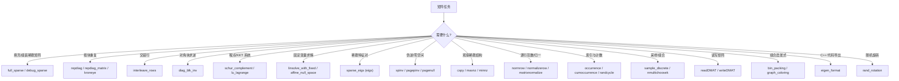

# 20.1 稀疏矩阵工具与线性代数助手 / Sparse Matrix Utilities & Linear-Algebra Helpers

> 本文件覆盖 `matrix/` 中的 34 个函数：稀疏结构操作、逐行向量运算、索引/计数工具、
> 特征值与伪逆、固定变量线性系统求解、DMAT 文本 I/O 与若干组合/几何工具。
> This file covers 34 functions in `matrix/`: sparse-structure ops, row-wise vector ops,
> indexing/counting helpers, eigen/pseudo-inverse, fixed-variable linear systems,
> DMAT text I/O, and combinatorial/geometry helpers.

---

## 本章概览 / Chapter Overview

**模块职责 / Module responsibility**

- 本文件收录 `matrix/` 目录中一组**通用可复用的稀疏矩阵与线性代数底层工具**。它们不针对
  某一具体几何算法，而是被 `mesh/`、`imageprocessing/`、`wrappers/` 等上层模块共享调用的
  "零碎但高频"构件：把稀疏矩阵按块填充/重复/交错、按行做向量归一化、统计元素出现次数、
  用 Arnoldi/Krylov 迭代求稀疏广义特征对、用 QR 分解构造稀疏伪逆、把带约束（Lagrange
  乘子 / 固定变量）的线性系统转化为无约束求解，以及读写 DMAT 文本格式。
- This file collects a set of **generic, reusable sparse-matrix and linear-algebra primitives**
  from `matrix/`. They are shared building blocks (block repeat/interleave, row-wise
  normalization, occurrence counting, sparse generalized eigenproblems, sparse
  pseudo-inverse, constrained/fixed-variable linear solves, DMAT text I/O) used across
  `mesh/`, `imageprocessing/` and `wrappers/`.

**分类总览 / Categorization**

(a) 稀疏结构操作 / Sparse-structure ops：`repdiag`、`repdiag_matrix`、`kroneye`、
`interleave_rows`、`schur_complement`、`diag_blk_inv`、`full_sparse`、`debug_sparse`、
`cspy`、`maxnz`、`minnz`

| 函数 | 作用 / Purpose |
|---|---|
| `repdiag` | 沿对角线重复单个矩阵 d 次（函数版）/ repeat one matrix d times along diagonal |
| `repdiag_matrix` | 同上但封装为类，利用重复结构加速乘法/求逆/Chol / class wrapper exploiting block structure |
| `kroneye` | 快速 `kron(A,speye(n))` / fast Kronecker with identity |
| `interleave_rows` | 交错两个同形矩阵的行 / interleave rows of two matrices |
| `schur_complement` | 用 Schur 补求解 KTK 鞍点系统 / solve saddle-point KTK system |
| `diag_blk_inv` | 对角块矩阵分块求逆 / blockwise inverse of diagonal-block matrix |
| `full_sparse` | 比 `full(sparse(...))` 更快的稠密化 / faster dense materialization |
| `debug_sparse` | 带尺寸打印的 `sparse` 包装 / debug wrapper around sparse |
| `cspy` | 稀疏图案可视化（正红负蓝）/ sparsity spy with sign coloring |
| `maxnz` / `minnz` | 每列最大/最小非零元及行号 / per-column max/min nonzero |

(b) 逐行向量运算 / Row-wise vector ops：`normrow`、`normalizerow`、`matrixnormalize`、
`copysign`、`squease`

| 函数 | 作用 / Purpose |
|---|---|
| `normrow` | 逐行 L2 范数（数值稳健）/ robust row-wise l2 norms |
| `normalizerow` | 逐行单位化 / unit-normalize each row |
| `matrixnormalize` | 全矩阵归一化到 [0,1]（含 uint8）/ global normalize to [0,1] |
| `copysign` | 用 B 的符号加在 |A| 上（位运算）/ copy sign of B onto |A| |
| `squease` | 缓动函数及其逆 / easing function and its inverse |

(c) 索引/计数工具 / Indexing & counting：`cumoccurrence`、`occurrence`、`nmultichoosek`、
`randcycle`、`sample_discrete`

| 函数 | 作用 / Purpose |
|---|---|
| `cumoccurrence` | 累积出现次数 / cumulative occurrence count |
| `occurrence` | 每个元素第几次出现（支持 'rows'）/ nth occurrence |
| `nmultichoosek` | 可重复 k-组合 / k-combinations with repetition |
| `randcycle` | 随机重标号唯一值 / randomly reindex unique values |
| `sample_discrete` | Alias 表法离散分布采样 / alias-table discrete sampling |

(d) 特征值与伪逆 / Eigen & pseudo-inverse：`sparse_eigs`、`spinv`、`pagenull`、`pagepinv`、
`eigen_format`

| 函数 | 作用 / Purpose |
|---|---|
| `sparse_eigs` | 稀疏（压缩）广义特征模 ADMM/二次规划求解 / sparse "compressed" eigenmodes |
| `spinv` | 稀疏 Moore-Penrose 伪逆因子分解 / sparse pseudo-inverse factorization |
| `pagenull` | 分页矩阵零空间 / per-page null space |
| `pagepinv` | 分页矩阵伪逆 / per-page pseudo-inverse |
| `eigen_format` | 生成 Eigen C++ 矩阵初始化代码 / emit Eigen C++ literal |

(e) 固定变量线性系统 / Fixed-variable linear systems：`affine_null_space`、
`linsolve_with_fixed`、`lu_lagrange`

| 函数 | 作用 / Purpose |
|---|---|
| `affine_null_space` | 求 Ax=b 的零空间基 + 特解 / null-space basis + particular solution |
| `linsolve_with_fixed` | 已知部分变量求解 Ax=b / solve with some x known |
| `lu_lagrange` | Q=[A' A C; C' 0] 的 LU 分解 / LU of KKT matrix |

(f) I/O：`readDMAT`、`writeDMAT`

| 函数 | 作用 / Purpose |
|---|---|
| `readDMAT` / `writeDMAT` | DMAT 文本（可选二进制）矩阵读写 / DMAT text (opt. binary) I/O |

(g) 其它 / Other：`bin_packing`、`graph_coloring`、`rand_rotation`

| 函数 | 作用 / Purpose |
|---|---|
| `bin_packing` | 装箱问题的首次适应贪心启发式 / first-fit bin packing heuristic |
| `graph_coloring` | 保守图着色启发式 / conservative graph coloring heuristic |
| `rand_rotation` | 均匀采样 SO(n) / uniform SO(n) sampling |

**"矩阵问题 → 选择工具"导图 / "Matrix problem → pick a tool" map**



---

### `copysign` — 按符号复制（位级）/ copy sign bitwise

- **文件 / File**: [matrix/copysign.m](file:///c:/VSWork/gptoolbox-1/matrix/copysign.m#L1-L22)
- **签名 / Signature**: `C = copysign(A,B)`
- **功能 / Purpose**: `EN: Return abs(A) with the sign of B (vectorized, bitwise).` / 中文：返回幅值为 `|A|`、符号取自 `B` 的矩阵，即 `C(i)=|A(i)|` 当 `B(i)>=0`，否则 `C(i)=-|A(i)|`。
- **输入 / Inputs**:

  | 参数 | 尺寸/类型 | 含义 (中 / EN) |
  |---|---|---|
  | `A` | `m by n` double | 幅值来源 / source of magnitude |
  | `B` | `m by n` double | 符号来源（<0 为负）/ source of sign (negative if `<0`) |

- **输出 / Outputs**:

  | 参数 | 尺寸/类型 | 含义 |
  |---|---|---|
  | `C` | `m by n` double | 带符号结果 / signed result |

- **可选参数 / Optional**: 无 / none
- **变量流动 / Variable flow**: `A →(typecast 为 uint64，清符号位)→ A_abs`；`B →(typecast 为 uint64，取符号位)→ S`；`A_abs,S →(bitor)→ C(uint64) →(typecast)→ C(double)`
- **算法步骤 / Algorithm**:
  1. `signmask` = 0 与 -0 的 uint64 位模式异或，即 IEEE-754 双精度的符号位掩码（`0x8000...`）。
  2. `not_signmask` = `bitcmp(signmask)`，即除符号位外全 1。
  3. `C = typecast(bitor(bitand(typecast(A,'uint64'),not_signmask), bitand(typecast(B,'uint64'),signmask)),'double')`：A 去符号位后与 B 的符号位合并。
- **流程图 / Flowchart**:

  ```mermaid
  flowchart TD
    A["输入 A,B"] --> B["A 去符号位 / B 取符号位"]
    B --> C["bitor 合并 uint64"]
    C --> Z["typecast 为 double 输出 C"]
  ```

- **依赖 / Dependencies**: 无（仅 MATLAB 位运算 `bitxor`/`bitcmp`/`bitand`/`bitor`/`typecast`）
- **See also**: `abs`, `sign`

---

### `cspy` — 带符号着色的稀疏图案可视化 / signed sparsity spy

- **文件 / File**: [matrix/cspy.m](file:///c:/VSWork/gptoolbox-1/matrix/cspy.m#L1-L22)
- **签名 / Signature**: `cspy(S,epsilon)`
- **功能 / Purpose**: `EN: Visualize sparsity pattern, coloring positive entries red and negative entries blue.` / 中文：可视化稀疏矩阵图案，正值红色、负值蓝色。
- **输入 / Inputs**:

  | 参数 | 尺寸/类型 | 含义 |
  |---|---|---|
  | `S` | `m by n` sparse/dense | 待可视化矩阵 / matrix to visualize |
  | `epsilon` | scalar | 零阈值 / zero threshold |

- **输出 / Outputs**: 无（绘制到当前坐标轴）/ none (draws to current axes)

- **可选参数 / Optional**:

  | 名称 | 取值 | 默认 | 含义 |
  |---|---|---|---|
  | `epsilon` | scalar | `0` | 小于此绝对值视为零 / tolerance to treat as zero |

- **变量流动 / Variable flow**: `S,epsilon →(spy(S>epsilon,'r'))→ 红点`；`S,epsilon →(spy(S<-epsilon,'b'))→ 蓝点`
- **算法步骤 / Algorithm**:
  1. `nargin<2` 时 `epsilon=0`。
  2. `spy(S>epsilon,'r')` 画正值图案，`hold on`。
  3. `spy(S<-epsilon,'b')` 叠加负值图案，`hold off`。
- **流程图 / Flowchart**:

  ```mermaid
  flowchart TD
    A["输入 S,epsilon"] --> B{"nargin<2?"}
    B -- 是 --> C["epsilon=0"]
    B -- 否 --> D["保持 epsilon"]
    C --> E["spy 正值(红)"]
    D --> E
    E --> F["hold on; spy 负值(蓝)"]
    F --> Z["hold off 输出图"]
  ```

- **依赖 / Dependencies**: `spy`（MATLAB 内置）
- **See also**: `spy`

---

### `cumoccurrence` — 累积出现次数 / cumulative occurrence

- **文件 / File**: [matrix/cumoccurrence.m](file:///c:/VSWork/gptoolbox-1/matrix/cumoccurrence.m#L1-L20)
- **签名 / Signature**: `y = cumoccurrence(x)`
- **功能 / Purpose**: `EN: For each element x(i), return how many times that value has appeared so far (1-based).` / 中文：对每个 `x(i)`，返回其值截止目前是第几次出现（1 起）。
- **输入 / Inputs**:

  | 参数 | 尺寸/类型 | 含义 |
  |---|---|---|
  | `x` | 列表 / list | 待统计元素 / elements |

- **输出 / Outputs**:

  | 参数 | 尺寸/类型 | 含义 |
  |---|---|---|
  | `y` | 同 `x` | `y(i)=j` 表示 `x(i)` 是第 j 次出现 / nth occurrence index |

- **可选参数 / Optional**: 无 / none
- **变量流动 / Variable flow**: `x →(sort 得 s,is)→ diff → find(非零)→ d(f)=f → cummax → ic`；`ic,is → (2:numel+1)-ic → y(is)`
- **算法步骤 / Algorithm**:
  1. `[s,is]=sort(x)` 排序并记录索引，`d=[1;diff(s)]` 求相邻差分。
  2. `f=find(d)` 为"新值"位置，令 `d(f)=f`。
  3. `ic=cummax(d)` 累积最大，得到每个排序位置的"组起始索引"。
  4. `y(is)=(2:numel(s)+1).'-ic` 计算每个位置在其组内的序号并回填。
- **流程图 / Flowchart**:

  ```mermaid
  flowchart TD
    A["输入 x"] --> B["sort → s,is"]
    B --> C["d = [1; diff(s)]"]
    C --> D["f=find(d); d(f)=f"]
    D --> E["ic = cummax(d)"]
    E --> Z["y(is) = (2:numel+1)-ic"]
  ```

- **依赖 / Dependencies**: 无（`sort`/`diff`/`find`/`cummax` 内置）
- **See also**: `occurrence`, `unique`, `histcounts`

---

### `debug_sparse` — 带尺寸打印的 sparse 包装 / debug sparse

- **文件 / File**: [matrix/debug_sparse.m](file:///c:/VSWork/gptoolbox-1/matrix/debug_sparse.m#L1-L13)
- **签名 / Signature**: `S = debug_sparse(I,J,V,varargin)`
- **功能 / Purpose**: `EN: Print I/J/V sizes (and target size) then call sparse — a debugging aid.` / 中文：先打印 `I`,`J`,`V` 的尺寸（以及目标矩阵尺寸），再调用 `sparse`，用于调试稀疏组装。
- **输入 / Inputs**:

  | 参数 | 尺寸/类型 | 含义 |
  |---|---|---|
  | `I` | `nnz by 1` | 行下标 / row indices |
  | `J` | `nnz by 1` | 列下标 / column indices |
  | `V` | `nnz by 1` | 值 / values |
  | `varargin` | `{m,n}` | 可选目标尺寸 / optional target size |

- **输出 / Outputs**:

  | 参数 | 尺寸/类型 | 含义 |
  |---|---|---|
  | `S` | sparse | 组装结果 / assembled sparse matrix |

- **可选参数 / Optional**:

  | 名称 | 取值 | 默认 | 含义 |
  |---|---|---|---|
  | `m` | integer | `max(I(:))` | 行数 / #rows |
  | `n` | integer | `max(J(:))` | 列数 / #cols |

- **变量流动 / Variable flow**: `I,J,V,m,n →(打印尺寸)→ 日志`；`I,J,V,varargin →(sparse)→ S`
- **算法步骤 / Algorithm**:
  1. 打印 `I`,`J`,`V` 尺寸。
  2. 若 `nargin>3` 用 `varargin{1:2}` 作 `m,n` 打印 `S: m n`；否则用 `max(I),max(J)`。
  3. `S = sparse(I,J,V,varargin{:})`。
- **流程图 / Flowchart**:

  ```mermaid
  flowchart TD
    A["输入 I,J,V,(m,n)"] --> B["打印 I/J/V 尺寸"]
    B --> C{"nargin>3?"}
    C -- 是 --> D["用 m,n 打印 S 尺寸"]
    C -- 否 --> E["用 max(I),max(J)"]
    D --> Z["S = sparse(I,J,V,varargin)"]
    E --> Z
  ```

- **依赖 / Dependencies**: `sparse`（内置）
- **See also**: `sparse`, `full_sparse`

---

### `diag_blk_inv` — 对角块矩阵的分块求逆 / blockwise inverse

- **文件 / File**: [matrix/diag_blk_inv.m](file:///c:/VSWork/gptoolbox-1/matrix/diag_blk_inv.m#L1-L42)
- **签名 / Signature**: `N = diag_blk_inv(M,k)`
- **功能 / Purpose**: `EN: Invert an n*k by n*k matrix composed of k by k diagonal blocks, via recursive blockwise (Schur complement) inversion.` / 中文：对由全为对角矩阵的分块组成的 `n*k by n*k` 矩阵，用分块公式递归求逆。
- **输入 / Inputs**:

  | 参数 | 尺寸/类型 | 含义 |
  |---|---|---|
  | `M` | `n*k by n*k` | 由对角块构成的方阵 / diagonal-block square matrix |
  | `k` | integer | 块尺寸 / block size |

- **输出 / Outputs**:

  | 参数 | 尺寸/类型 | 含义 |
  |---|---|---|
  | `N` | `n*k by n*k` | `M` 的逆 / inverse of `M` |

- **可选参数 / Optional**: 无 / none
- **变量流动 / Variable flow**: `M,k →(k==1?)→ 对角取倒数`；否则 `M →(切 4 块 A,B,C,D)→ Ainv=diag_blk_inv(A,k-1) → S=D-C*Ainv*B → Sinv → 组装 N`
- **算法步骤 / Algorithm**:
  1. 若 `k==1`：断言 `isdiag(M)`，返回 `diag(sparse(1./diag(M)))`。
  2. 断言方阵且 `k` 整除尺寸；`n=size(M,1)/k`。
  3. 按 `(k-1)*n`、`n` 分界切出 4 块 `A,B,C,D`；断言 `D` 为对角阵。
  4. 递归 `Ainv=diag_blk_inv(A,k-1)`；Schur 补 `S=D-C*Ainv*B`；`Sinv=diag_blk_inv(S,1)`。
  5. 按块逆公式组装 `N`。
- **流程图 / Flowchart**:

  ```mermaid
  flowchart TD
    A["输入 M,k"] --> B{"k==1?"}
    B -- 是 --> C["N = diag(1./diag(M))"]
    B -- 否 --> D["切块 A,B,C,D"]
    D --> E["Ainv = diag_blk_inv(A,k-1)"]
    E --> F["S = D - C*Ainv*B"]
    F --> G["Sinv = diag_blk_inv(S,1)"]
    G --> Z["组装 N = [Ainv+Ainv*B*Sinv*C*Ainv, -Ainv*B*Sinv; ...]"]
    C --> Z
  ```

- **依赖 / Dependencies**: 自身递归（`diag_blk_inv`）；`isdiag`,`diag`,`sparse`（内置）
- **See also**: `inv`, `blkdiag`, `pagepinv`

---

### `eigen_format` — 生成 Eigen C++ 矩阵字面量 / emit Eigen C++ literal

- **文件 / File**: [matrix/eigen_format.m](file:///c:/VSWork/gptoolbox-1/matrix/eigen_format.m#L1-L36)
- **签名 / Signature**: `varargout = eigen_format(A,name)`
- **功能 / Purpose**: `EN: Generate Eigen (C++) code that constructs matrix A (optionally declaring a named variable and pushing values into it).` / 中文：把 MATLAB 矩阵 `A` 生成为 Eigen C++ 初始化代码（可给出变量名 `name`，先声明再 `<<` 填值）。
- **输入 / Inputs**:

  | 参数 | 尺寸/类型 | 含义 |
  |---|---|---|
  | `A` | `m by n` numeric/logical | 源矩阵 / source matrix |
  | `name` | char | 可选变量名 / optional variable name |

- **输出 / Outputs**:

  | 参数 | 尺寸/类型 | 含义 |
  |---|---|---|
  | `varargout{1}` | char | 生成的代码字符串（`nargout>=1` 时）/ generated code string |

- **可选参数 / Optional**:

  | 名称 | 取值 | 默认 | 含义 |
  |---|---|---|---|
  | `name` | char | 无 | 若给定则输出 `Eigen::MatrixX… name(r,c); name << …;` |

- **变量流动 / Variable flow**: `A[,name] →(推断类型 t/格式串)→ s{}(声明+数据) → strjoin → varargout{1}` 或 `fprintf`
- **算法步骤 / Algorithm**:
  1. 构造格式串 `format = '  %0.17g,…\n'`（每行 `size(A,2)` 个 `%0.17g`），使用全精度。
  2. 若给了 `name`：按 `islogical`→`<bool,...>`；否则按 1×n→`RowVectorX`、m×1→`VectorX`、其余→`MatrixX`；再按是否全为整数加 `i`（int）或 `d`（double）；生成声明串 `Eigen::T name(m,n);` 与 `name<< `。
  3. 追加按行（`A'`）格式化的数据；去掉结尾多余字符，补 `;`。
  4. `nargout>=1` 返回字符串，否则 `fprintf` 打印。
- **流程图 / Flowchart**:

  ```mermaid
  flowchart TD
    A["输入 A[,name]"] --> B{"给了 name?"}
    B -- 是 --> C["推断 Eigen 类型 t"]
    C --> D["s{1}=声明; s{2}='name<< '"]
    B -- 否 --> E["s = {}"]
    D --> F["追加按行数据 (A')"]
    E --> F
    F --> G{"nargout>=1?"}
    G -- 是 --> Z1["返回代码字符串"]
    G -- 否 --> Z2["fprintf 打印"]
  ```

- **依赖 / Dependencies**: 无（纯 MATLAB；**不调用任何 MEX**）。`typecast` 无关；仅 `sprintf`/`strjoin`
- **See also**: `matlab2cpp`, `readDMAT`

---

### `full_sparse` — 更快的稠密化 / faster full(sparse(...))

- **文件 / File**: [matrix/full_sparse.m](file:///c:/VSWork/gptoolbox-1/matrix/full_sparse.m#L1-L14)
- **签名 / Signature**: `F = full_sparse(I,J,V,S1,S2)`
- **功能 / Purpose**: `EN: Equivalent to full(sparse(I,J,V,S1,S2)) but faster, implemented via accumarray.` / 中文：等价于 `full(sparse(I,J,V,S1,S2))` 但更快，用 `accumarray` 实现。
- **输入 / Inputs**:

  | 参数 | 尺寸/类型 | 含义 |
  |---|---|---|
  | `I` | `nnz by 1` | 行下标 / row indices |
  | `J` | `nnz by 1` | 列下标 / col indices |
  | `V` | `nnz by 1` | 值 / values |
  | `S1`,`S2` | scalar | 目标尺寸 / target size |

- **输出 / Outputs**:

  | 参数 | 尺寸/类型 | 含义 |
  |---|---|---|
  | `F` | `S1 by S2` dense | 稠密矩阵 / dense matrix |

- **可选参数 / Optional**:

  | 名称 | 取值 | 默认 | 含义 |
  |---|---|---|---|
  | `S1`,`S2` | integer | 自动推断 | 输出尺寸 / output size |

- **变量流动 / Variable flow**: `I,J,V[,S1,S2] →(accumarray)→ F`
- **算法步骤 / Algorithm**:
  1. `nargin>3`：`F=accumarray([I(:) J(:)],V(:),[S1 S2])`。
  2. 否则：`F=accumarray([I(:) J(:)],V(:))`（尺寸自动以 max 下标为准）。
- **流程图 / Flowchart**:

  ```mermaid
  flowchart TD
    A["输入 I,J,V[,S1,S2]"] --> B{"nargin>3?"}
    B -- 是 --> C["accumarray(...,[S1 S2])"]
    B -- 否 --> D["accumarray(...)"]
    C --> Z["输出 F (dense)"]
    D --> Z
  ```

- **依赖 / Dependencies**: `accumarray`（内置）
- **See also**: `sparse`, `accumarray`, `debug_sparse`

---

### `interleave_rows` — 交错两矩阵的行 / interleave rows

- **文件 / File**: [matrix/interleave_rows.m](file:///c:/VSWork/gptoolbox-1/matrix/interleave_rows.m#L1-L21)
- **签名 / Signature**: `C = interleave_rows(A,B)`
- **功能 / Purpose**: `EN: Given two n by m matrices, build a 2n by m matrix whose even/odd rows alternate between A and B.` / 中文：把两个同形 `n by m` 矩阵按行交错成 `2n by m`：奇数行取 `A`，偶数行取 `B`。
- **输入 / Inputs**:

  | 参数 | 尺寸/类型 | 含义 |
  |---|---|---|
  | `A` | `n by m` | 第一矩阵（输出顶行为其顶行）/ first matrix |
  | `B` | `n by m` | 第二矩阵 / second matrix |

- **输出 / Outputs**:

  | 参数 | 尺寸/类型 | 含义 |
  |---|---|---|
  | `C` | `2n by m` | 交错行结果 / row-interleaved matrix |

- **可选参数 / Optional**: 无 / none
- **变量流动 / Variable flow**: `A,B →(校验同形)→ [A(:) B(:)]' →(reshape)→ C`
- **算法步骤 / Algorithm**:
  1. `size(A)~=size(B)` 报错。
  2. `C=reshape([A(:) B(:)]',size(A,1)*2,size(A,2))`：把两矩阵按列主序展开、拼接转置后重排为 `2n×m`。
- **流程图 / Flowchart**:

  ```mermaid
  flowchart TD
    A["输入 A,B"] --> B{"size(A)==size(B)?"}
    B -- 否 --> E["error 形状不一致"]
    B -- 是 --> C["reshape([A(:) B(:)]', 2n, m)"]
    C --> Z["输出 C (2n by m)"]
  ```

- **依赖 / Dependencies**: 无（`reshape` 内置）
- **See also**: `reshape`, `vertcat`

---

### `kroneye` — 与单位阵的快速 Kronecker 积 / fast kron with identity

- **文件 / File**: [matrix/kroneye.m](file:///c:/VSWork/gptoolbox-1/matrix/kroneye.m#L1-L37)
- **签名 / Signature**: `K = kroneye(A,n)`
- **功能 / Purpose**: `EN: Compute kron(A, speye(n,n)) faster than kron(A,speye(n)).` / 中文：以更快方式计算 `kron(A,speye(n,n))`（与稀疏单位阵的 Kronecker 积）。
- **输入 / Inputs**:

  | 参数 | 尺寸/类型 | 含义 |
  |---|---|---|
  | `A` | `#rows by #cols` sparse | 源矩阵 / source matrix |
  | `n` | integer | 单位阵尺寸 / identity size |

- **输出 / Outputs**:

  | 参数 | 尺寸/类型 | 含义 |
  |---|---|---|
  | `K` | `#rows*n by #cols*n` sparse | Kronecker 结果 / result |

- **可选参数 / Optional**: 无 / none
- **变量流动 / Variable flow**: `A →(非稀疏则转稀疏)→ A`；`A,n →(n>10*size(A,1)? kron(A,speye))→ K` 或 `A →(blkdiag 复制 n 份)→ K0 →(行/列置换 I,J)→ K`
- **算法步骤 / Algorithm**:
  1. `A` 非稀疏先 `sparse(A)`。
  2. 若 `n > 10*size(A,1)`：直接 `K=kron(A,speye(n))`（此时 blkdiag 反而慢）。
  3. 否则 `C=cell(n,1)`，每格 `A`，`K=blkdiag(C{:})`（得到 `kron(speye(n),A)` 的块对角）。
  4. 构造行置换 `I`、列置换 `J` 把块对角重排为 `kron(A,speye(n))`：`K=K(I,J)`。
- **流程图 / Flowchart**:

  ```mermaid
  flowchart TD
    A["输入 A,n"] --> B{"issparse(A)?"}
    B -- 否 --> C["A = sparse(A)"]
    B -- 是 --> D["保持"]
    C --> E{"n > 10*size(A,1)?"}
    D --> E
    E -- 是 --> F["K = kron(A,speye(n))"]
    E -- 否 --> G["C=cell(n,1) 全 A; K=blkdiag(C{:})"]
    G --> H["构造置换 I,J"]
    H --> Z["K = K(I,J)"]
    F --> Z
  ```

- **依赖 / Dependencies**: `kron`,`speye`,`blkdiag`,`sparse`（内置）
- **See also**: `repdiag`, `kron`

---

### `maxnz` — 每列最大非零元 / per-column max nonzero

- **文件 / File**: [matrix/maxnz.m](file:///c:/VSWork/gptoolbox-1/matrix/maxnz.m#L1-L25)
- **签名 / Signature**: `[Y,I] = maxnz(X)`
- **功能 / Purpose**: `EN: Find the maximum non-zero entry in each column of sparse X (ignoring structural zero entries).` / 中文：在稀疏矩阵 `X` 的每列中求最大非零元（忽略结构零）。
- **输入 / Inputs**:

  | 参数 | 尺寸/类型 | 含义 |
  |---|---|---|
  | `X` | `m by n` sparse | 源矩阵 / source matrix |

- **输出 / Outputs**:

  | 参数 | 尺寸/类型 | 含义 |
  |---|---|---|
  | `Y` | `1 by n` | 每列最大非零值 / max nonzero per column |
  | `I` | `1 by n` | 对应行号 / row index |

- **可选参数 / Optional**: 无 / none
- **变量流动 / Variable flow**: `X →(find)→ XI,XJ,XV →(建倒数矩阵 X_i)→ min(X_i),max(X) → 合并 → Y,I`
- **算法步骤 / Algorithm**:
  1. `[XI,XJ,XV]=find(X)`；构造 `X_i=sparse(XI,XJ,XV.^-1,…)`（每非零元取倒数，零保持为零）。
  2. 对 `X_i` 求 `min`（即原值最大非零），对 `X` 求 `max`。
  3. 把 `minX_i==0`、`maxX==0` 置 `-inf`（排除零）。
  4. 拼 `[minX_i.^-1; maxX]`，取 `max` 得 `Y`；用 `sub2ind` 从候选行号里选出正确的 `I`。
- **流程图 / Flowchart**:

  ```mermaid
  flowchart TD
    A["输入 X"] --> B["find → XI,XJ,XV"]
    B --> C["X_i = sparse(1/V); min(X_i), max(X)"]
    C --> D["零置 -inf"]
    D --> E["Y = max([1/minX_i; maxX])"]
    E --> Z["I 由 sub2ind 选取"]
  ```

- **依赖 / Dependencies**: `find`,`sparse`,`min`,`max`,`sub2ind`（内置）
- **See also**: `min`, `max`, `minnz`

### `minnz` — 每列最小非零元 / per-column min nonzero

- **文件 / File**: [matrix/minnz.m](file:///c:/VSWork/gptoolbox-1/matrix/minnz.m#L1-L34)
- **签名 / Signature**: `[Y,I] = minnz(X)`
- **功能 / Purpose**: `EN: Find the minimum non-zero entry in each column of sparse X (ignoring structural zero entries, handling ±Inf).` / 中文：在稀疏矩阵 `X` 的每列中求最小非零元（忽略结构零，处理 `±Inf`）。
- **输入 / Inputs**:

  | 参数 | 尺寸/类型 | 含义 |
  |---|---|---|
  | `X` | `m by n` sparse | 源矩阵 / source matrix |

- **输出 / Outputs**:

  | 参数 | 尺寸/类型 | 含义 |
  |---|---|---|
  | `Y` | `1 by n` | 每列最小非零值 / min nonzero per column |
  | `I` | `1 by n` | 对应行号 / row index |

- **可选参数 / Optional**: 无 / none
- **变量流动 / Variable flow**: `X →(find 建倒数矩阵 X_i)→ max(X_i) 与 min(X) → 处理 Inf → 合并 → Y,I`
- **算法步骤 / Algorithm**:
  1. `[XI,XJ,XV]=find(X)`，构造倒数矩阵 `X_i`（与原 `maxnz` 对称）。
  2. 记录 `X==inf` 位置；对 `X_i` 取 `max`（即原值最小非零）；对 `X` 取 `min`。
  3. `maxX_i==0` 置 `inf`；`infX_i` 处特殊处理（`maxX_i=0`、行号取自 `infI_i`）。
  4. 拼 `[maxX_i.^-1; minX]` 取 `min` 得 `Y`，`sub2ind` 选出 `I`。
- **流程图 / Flowchart**:

  ```mermaid
  flowchart TD
    A["输入 X"] --> B["find → X_i = 1/V"]
    B --> C["max(X_i), min(X); 记录 inf 位置"]
    C --> D["零置 inf; 处理 inf 特例"]
    D --> E["Y = min([1/maxX_i; minX])"]
    E --> Z["I 由 sub2ind 选取"]
  ```

- **依赖 / Dependencies**: `find`,`sparse`,`min`,`max`,`sub2ind`（内置）
- **See also**: `min`, `max`, `maxnz`

---

### `matrixnormalize` — 全矩阵归一化到 [0,1] / global normalize

- **文件 / File**: [matrix/matrixnormalize.m](file:///c:/VSWork/gptoolbox-1/matrix/matrixnormalize.m#L1-L27)
- **签名 / Signature**: `N = matrixnormalize(M)`
- **功能 / Purpose**: `EN: Normalize all matrix values into the range [0,1], type-aware (double/single/logical/uint8).` / 中文：把矩阵整体归一化到 `[0,1]`，并按类型分别处理（double/single/logical/uint8）。
- **输入 / Inputs**:

  | 参数 | 尺寸/类型 | 含义 |
  |---|---|---|
  | `M` | any | 输入矩阵 / input matrix |

- **输出 / Outputs**:

  | 参数 | 尺寸/类型 | 含义 |
  |---|---|---|
  | `N` | 相应类型 | 归一化矩阵 / normalized matrix |

- **可选参数 / Optional**: 无 / none
- **变量流动 / Variable flow**: `M →(按 class 分支)→ N`
- **算法步骤 / Algorithm**:
  1. `class(M)` 分支：`double/single` → `(M-min(M(:)))./(max(M(:))-min(M(:)))`。
  2. `logical` → 直接返回 `M`。
  3. `uint8` → `(M-min)*(255/(max-min))`（保持 0..255）。
  4. 其它类型报错 `Class not supported`。
- **流程图 / Flowchart**:

  ```mermaid
  flowchart TD
    A["输入 M"] --> B{"class(M)?"}
    B -- double/single --> C["N=(M-min)/(max-min)"]
    B -- logical --> D["N=M"]
    B -- uint8 --> E["N=(M-min)*255/(max-min)"]
    B -- 其它 --> F["error"]
    C --> Z["输出 N"]
    D --> Z
    E --> Z
  ```

- **依赖 / Dependencies**: 无（`min`/`max` 内置）
- **See also**: `normalizerow`, `imshow`

---

### `normalizerow` — 逐行单位化 / unit-normalize rows

- **文件 / File**: [matrix/normalizerow.m](file:///c:/VSWork/gptoolbox-1/matrix/normalizerow.m#L1-L21)
- **签名 / Signature**: `B = normalizerow(A)`
- **功能 / Purpose**: `EN: Normalize each row so its l2 norm is 1 (codegen-friendly; sparse fast path).` / 中文：把每行按 L2 范数归一化为单位向量（支持代码生成；稀疏走快速路径）。
- **输入 / Inputs**:

  | 参数 | 尺寸/类型 | 含义 |
  |---|---|---|
  | `A` | `#A by D` | 行向量列表 / list of row vectors |

- **输出 / Outputs**:

  | 参数 | 尺寸/类型 | 含义 |
  |---|---|---|
  | `B` | `#A by D` | 归一化行 / normalized rows |

- **可选参数 / Optional**: 无 / none
- **变量流动 / Variable flow**: `A →(issparse?)→ 稀疏: bsxfun 除以行范数 / 稠密: A./normrow(A) → B`
- **算法步骤 / Algorithm**:
  1. 若 `issparse(A)`：`B=bsxfun(@times,A,1./sqrt(sum(A.^2,2)))`（对稀疏快约 20×）。
  2. 否则 `B=A./normrow(A)`（`normrow` 用数值稳健范数）。
- **流程图 / Flowchart**:

  ```mermaid
  flowchart TD
    A["输入 A"] --> B{"issparse(A)?"}
    B -- 是 --> C["bsxfun: A ./ sqrt(sum(A.^2,2))"]
    B -- 否 --> D["A ./ normrow(A)"]
    C --> Z["输出 B"]
    D --> Z
  ```

- **依赖 / Dependencies**: `normrow`
- **See also**: `normrow`, `bsxfun`, `matrixnormalize`

---

### `normrow` — 逐行 L2 范数（稳健）/ robust row-wise norms

- **文件 / File**: [matrix/normrow.m](file:///c:/VSWork/gptoolbox-1/matrix/normrow.m#L1-L23)
- **签名 / Signature**: `B = normrow(A)`
- **功能 / Purpose**: `EN: Compute l2 norms of the rows of A, with a numerically robust (max-scaled) formula for D!=2.` / 中文：计算 `A` 每行的 L2 范数；`D!=2` 时用最大值缩放实现数值稳健。
- **输入 / Inputs**:

  | 参数 | 尺寸/类型 | 含义 |
  |---|---|---|
  | `A` | `#A by D` | 行向量列表 / row vectors |

- **输出 / Outputs**:

  | 参数 | 尺寸/类型 | 含义 |
  |---|---|---|
  | `B` | `#A by 1` | 每行范数 / row norms |

- **可选参数 / Optional**: 无 / none
- **变量流动 / Variable flow**: `A →(size(A,2)?)→ 2: hypot(A(:,1),A(:,2)) / 其它: M=max(abs(A),[],2); B=M.*sqrt(sum((A./M).^2,2)); B(M==0)=0`
- **算法步骤 / Algorithm**:
  1. `size(A,2)==2`：`B=hypot(A(:,1),A(:,2))`。
  2. 否则：`M=max(abs(A),[],2)`；`B=M.*sqrt(sum((A./M).^2,2))`；`M==0` 处置 0（避免 0/0）。
- **流程图 / Flowchart**:

  ```mermaid
  flowchart TD
    A["输入 A"] --> B{"size(A,2)==2?"}
    B -- 是 --> C["B = hypot(A(:,1),A(:,2))"]
    B -- 否 --> D["M = max(abs(A),[],2)"]
    D --> E["B = M.*sqrt(sum((A./M).^2,2))"]
    E --> F["B(M==0)=0"]
    C --> Z["输出 B"]
    F --> Z
  ```

- **依赖 / Dependencies**: 无（`hypot`/`max`/`sqrt`/`sum` 内置）
- **See also**: `normalizerow`, `hypot`, `vecnorm`

---

### `occurrence` — 元素第几次出现 / nth occurrence

- **文件 / File**: [matrix/occurrence.m](file:///c:/VSWork/gptoolbox-1/matrix/occurrence.m#L1-L32)
- **签名 / Signature**: `O = occurrence(A,varargin)`
- **功能 / Purpose**: `EN: Mark the occurrence index of elements (or rows) in A, so O(i)=j means A(i) is the j-th seen value.` / 中文：标记元素（或行）的出现序号，`O(i)=j` 表示 `A(i)` 是第 j 次出现。
- **输入 / Inputs**:

  | 参数 | 尺寸/类型 | 含义 |
  |---|---|---|
  | `A` | 向量/矩阵 | 元素集合 / elements |

- **输出 / Outputs**:

  | 参数 | 尺寸/类型 | 含义 |
  |---|---|---|
  | `O` | 同 `A` | 出现序号 / occurrence index |

- **可选参数 / Optional**:

  | 名称 | 取值 | 默认 | 含义 |
  |---|---|---|---|
  | `'rows'` | flag | 无 | 按行求出现次数 / count occurrences of rows |

- **变量流动 / Variable flow**: `A →('rows'? sortrows+unique rows / 否则 sort+unique)→ S,K,J,I → O=((1:numel)-J(I)')+1 → O(K)=O → reshape`
- **算法步骤 / Algorithm**:
  1. 若 `varargin{1}=='rows'`：`[S,K]=sortrows(A)`；`[~,J,I]=unique(S,'stable','rows')`。
  2. 否则：非向量先 `A=A(:)`；`[S,K]=sort(A)`；`[~,J,I]=unique(S,'stable')`。
  3. `O=((1:numel(K))-J(I)')+1`，再 `O(K)=O` 回填原序。
  4. 按模式 `reshape` 为 `#A×1`（rows）或原尺寸。
- **流程图 / Flowchart**:

  ```mermaid
  flowchart TD
    A["输入 A[,rows]"] --> B{"'rows' 模式?"}
    B -- 是 --> C["sortrows → S,K; unique rows → J,I"]
    B -- 否 --> D["A=A(:); sort → S,K; unique → J,I"]
    C --> E["O=((1:numel)-J(I)')+1; O(K)=O"]
    D --> E
    E --> Z["reshape 输出 O"]
  ```

- **依赖 / Dependencies**: `sort`,`sortrows`,`unique`（内置）
- **See also**: `cumoccurrence`, `unique`, `ismember`

---

### `pagenull` — 分页矩阵零空间 / per-page null space

- **文件 / File**: [matrix/pagenull.m](file:///c:/VSWork/gptoolbox-1/matrix/pagenull.m#L1-L16)
- **签名 / Signature**: `Y = pagenull(X,tol)`
- **功能 / Purpose**: `EN: Null space of each page of a 3D array via batched SVD (pages must share the same rank).` / 中文：对 3D 数组逐页求零空间（基于批量 SVD；各页秩必须相同）。
- **输入 / Inputs**:

  | 参数 | 尺寸/类型 | 含义 |
  |---|---|---|
  | `X` | `m by n by p` | 分页矩阵 / stack of matrices |
  | `tol` | scalar | 秩容差 / rank tolerance |

- **输出 / Outputs**:

  | 参数 | 尺寸/类型 | 含义 |
  |---|---|---|
  | `Y` | `n by (n-r) by p` | 每页零空间基 / per-page null basis |

- **可选参数 / Optional**:

  | 名称 | 取值 | 默认 | 含义 |
  |---|---|---|---|
  | `tol` | scalar | `max(m,n)*eps(max(s))` | 奇异值阈值 / singular value threshold |

- **变量流动 / Variable flow**: `X →(pagesvd 'vector')→ s,V →(r=sum(s>tol))→ 校验各页秩 → Y=V(:,r+1:end,:)`
- **算法步骤 / Algorithm**:
  1. `[~,s,V]=pagesvd(X,'vector')`。
  2. 无 `tol` 时 `tol=max(m,n).*eps(max(s,[],1))`。
  3. `r=sum(s>tol,1)`；若各页 `r` 不一致报错 `variableNullity`。
  4. `Y=V(:,r(1)+1:end,:)` 返回。
- **流程图 / Flowchart**:

  ```mermaid
  flowchart TD
    A["输入 X[,tol]"] --> B["pagesvd → s,V"]
    B --> C["tol 默认 = max(m,n)*eps(max(s))"]
    C --> D["r = sum(s>tol)"]
    D --> E{"各页 r 相同?"}
    E -- 否 --> F["error variableNullity"]
    E -- 是 --> Z["Y = V(:,r(1)+1:end,:)"]
  ```

- **依赖 / Dependencies**: `pagesvd`、`pagenorm`（若调用 `pagepinv`）；MATLAB 内置
- **See also**: `pagepinv`, `null`, `pagesvd`

---

### `pagepinv` — 分页矩阵伪逆 / per-page pseudo-inverse

- **文件 / File**: [matrix/pagepinv.m](file:///c:/VSWork/gptoolbox-1/matrix/pagepinv.m#L1-L18)
- **签名 / Signature**: `Y = pagepinv(X,tol)`
- **功能 / Purpose**: `EN: Moore-Penrose pseudo-inverse of each page of a 3D array (batched SVD).` / 中文：对 3D 数组逐页求 Moore-Penrose 伪逆（批量 SVD）。
- **输入 / Inputs**:

  | 参数 | 尺寸/类型 | 含义 |
  |---|---|---|
  | `X` | `m by n by p` | 分页矩阵 / stack |
  | `tol` | scalar | 奇异值阈值 / tolerance |

- **输出 / Outputs**:

  | 参数 | 尺寸/类型 | 含义 |
  |---|---|---|
  | `Y` | `n by m by p` | 每页伪逆 `Y(:,:,i)=pinv(X(:,:,i))` |

- **可选参数 / Optional**:

  | 名称 | 取值 | 默认 | 含义 |
  |---|---|---|---|
  | `tol` | scalar | `max(size(X(:,:,1)))*eps(pagenorm(s,inf))` | 奇异值阈值 |

- **变量流动 / Variable flow**: `X →(pagesvd 'econ','vector')→ U,s,V →(s>tol 取倒数)→ s+ → Y=pagemtimes(permute(s).*V,'none',U,'ctranspose')`
- **算法步骤 / Algorithm**:
  1. `[U,s,V]=pagesvd(X,'econ','vector')`。
  2. 无 `tol`：`tol=max(size(X(:,:,1)))*eps(pagenorm(s,inf))`。
  3. `s(s>tol)=1./s(s>tol)`（其余置 0）。
  4. `Y=pagemtimes(permute(s,[2 1 3]).*V,'none',U,'ctranspose')` 组装伪逆。
- **流程图 / Flowchart**:

  ```mermaid
  flowchart TD
    A["输入 X[,tol]"] --> B["pagesvd econ' → U,s,V"]
    B --> C["tol 默认 = max(m,n)*eps(pagenorm(s,inf))"]
    C --> D["s(s>tol)=1./s(s>tol)"]
    D --> Z["Y = pagemtimes(s'.*V, U')"]
  ```

- **依赖 / Dependencies**: `pagesvd`,`pagenorm`,`pagemtimes`（MATLAB 内置，需 R2022a+）
- **See also**: `pagenull`, `pinv`, `pagesvd`

---

### `repdiag` — 沿对角线重复矩阵 / repeat matrix along diagonal

- **文件 / File**: [matrix/repdiag.m](file:///c:/VSWork/gptoolbox-1/matrix/repdiag.m#L1-L50)
- **签名 / Signature**: `B = repdiag(A,d)`
- **功能 / Purpose**: `EN: Repeat a matrix A d times along the diagonal, giving an (m*d) by (n*d) matrix (sparse/dense matching A).` / 中文：把矩阵 `A` 沿对角线重复 d 次，得到 `m*d by n*d` 矩阵（稀疏/稠密属性随 `A`）。
- **输入 / Inputs**:

  | 参数 | 尺寸/类型 | 含义 |
  |---|---|---|
  | `A` | `m by n` dense/sparse | 待重复矩阵 / matrix to repeat |
  | `d` | integer | 重复次数 / number of repeats |

- **输出 / Outputs**:

  | 参数 | 尺寸/类型 | 含义 |
  |---|---|---|
  | `B` | `m*d by n*d` | 块对角结果 / block-diagonal result |

- **可选参数 / Optional**: 无 / none
- **变量流动 / Variable flow**: `A,d →(cell(d,1) 全填 A)→ blkdiag(C{:}) → B`
- **算法步骤 / Algorithm**:
  1. 建 `C=cell(d,1)`，用 `deal(A)` 全部填充 `A`。
  2. `B=blkdiag(C{:})`（等价 `kron(speye(d),A)`，比 for 循环 IJV 快约 10×）。
- **流程图 / Flowchart**:

  ```mermaid
  flowchart TD
    A["输入 A,d"] --> B["C=cell(d,1); C{:}=A"]
    B --> Z["B = blkdiag(C{:})"]
  ```

- **依赖 / Dependencies**: `blkdiag`（内置）
- **See also**: `kroneye`, `repdiag_matrix`, `kron`, `blkdiag`

---

### `repdiag_matrix` — 重复块对角矩阵类 / repeated-block-diagonal class

- **文件 / File**: [matrix/repdiag_matrix.m](file:///c:/VSWork/gptoolbox-1/matrix/repdiag_matrix.m#L1-L164)
- **签名 / Signature**: `obj = repdiag_matrix(A,d)`（`classdef`；方法见下）
- **功能 / Purpose**: `EN: A class representing M=repdiag(A,d)=kron(eye(d),A), exposing A and d and exploiting the repeated block structure to make *, \, chol, transpose faster.` / 中文：封装 `M=repdiag(A,d)=kron(eye(d),A)` 的类，暴露 `A`、`d` 字段，并利用重复块结构加速 `mtimes`、`mldivide`、`chol`、转置。
- **输入 / Inputs**:

  | 参数 | 尺寸/类型 | 含义 |
  |---|---|---|
  | `A` | `m by n` | 沿对角重复的矩阵 / repeated matrix |
  | `d` | integer | 重复次数 / number of copies |

- **输出 / Outputs**:

  | 参数 | 尺寸/类型 | 含义 |
  |---|---|---|
  | `obj` | `repdiag_matrix` | 对象，含只读属性 `A`、`d` / object with read-only `A`,`d` |

- **可选参数 / Optional**: 无 / none
- **方法 / Methods**:

  | 方法 | 说明 / Purpose |
  |---|---|
  | `expand` | 返回真实矩阵 `repdiag(A,d)` / materialize |
  | `mtimes` | `this*that`（支持 类*矩阵、矩阵*类、类*类）/ optimized multiplication |
  | `mldivide` | `this\B`（对每块左除后重排）/ optimized backslash |
  | `chol` | 对 `A` 求 Chol 再 `repdiag_matrix` 包装（支持 1–3 输出）/ block Cholesky |
  | `transpose`/`ctranspose` | 转置 / 共轭转置 / transpose variants |

- **变量流动 / Variable flow**: `A,d →(构造)→ obj`；`obj,that →(mtimes/mldivide/chol/transpose)→ 新 obj 或矩阵`
- **算法步骤 / Algorithm**:
  1. 构造：`this.A=varargin{1}; this.d=varargin{2}`。
  2. `mtimes` 分三种情形：类×普通（把 `B` 按块 reshape，逐块左乘 `A` 再拼回）；普通×类（转置技巧 `(that'*this')'`）；类×类（要求 `d` 与 `A` 形状一致，`A*that.A` 再包装）。
  3. `mldivide`：按块 `reshape` 后 `A\BB` 再拼回。
  4. `chol`：对 `A` 求 `chol`，第 1、3 输出用 `repdiag_matrix` 包装。
  5. `transpose`/`ctranspose`：对 `A` 转置后重新包装。
- **流程图 / Flowchart**:

  ```mermaid
  flowchart TD
    A["构造 repdiag_matrix(A,d)"] --> B{"调用哪个方法?"}
    B -- mtimes --> C["按块 reshape / A*BB / 重排"]
    B -- mldivide --> D["reshape → A\\BB → 重排"]
    B -- chol --> E["chol(A) → 包装"]
    B -- transpose --> F["转置 A → 包装"]
    C --> Z1["结果矩阵 / 新对象"]
    D --> Z1
    E --> Z1
    F --> Z1
  ```

- **依赖 / Dependencies**: `repdiag`（`expand` 调用）、`chol`、`reshape`（内置）
- **See also**: `repdiag`, `blkdiag`, `kron`

---

### `schur_complement` — Schur 补求解鞍点系统 / Schur-complement saddle-point solve

- **文件 / File**: [matrix/schur_complement.m](file:///c:/VSWork/gptoolbox-1/matrix/schur_complement.m#L1-L132)
- **签名 / Signature**: `[x,y,AFUN] = schur_complement(AFUN,B,C,f,g,varargin)`
- **功能 / Purpose**: `EN: Solve the KTK/saddle-point system [[A B']; [B C]] [x;y]=[f;g] via the Schur complement method (Benzi et al. 2005).` / 中文：用 Schur 补方法求解 KTK/鞍点系统 `[[A B']; [B C]][x;y]=[f;g]`（参见 Benzi et al. 2005）。
- **输入 / Inputs**:

  | 参数 | 尺寸/类型 | 含义 |
  |---|---|---|
  | `A` 或 `AFUN` | `n by n` SPD 或函数句柄 | `A` 本身，或求解 `x=A\b` 的函数 / matrix or solver handle |
  | `B` | `m by n` | 满行秩约束矩阵 / full-row-rank constraints |
  | `C` | `m by m` | 通常为零 / typically zero |
  | `f` | `n by #b` | 上右端项 / upper RHS |
  | `g` | `m by #b` | 下右端项 / lower RHS |

- **输出 / Outputs**:

  | 参数 | 尺寸/类型 | 含义 |
  |---|---|---|
  | `x` | `n by #b` | 主变量解 / primary variable |
  | `y` | `m by #b` | 约束变量解 / constraint variable |
  | `AFUN` | handle | 求解 `A\b` 的函数 / solver handle |

- **可选参数 / Optional**:

  | 名称 | 取值 | 默认 | 含义 |
  |---|---|---|---|
  | `'Iterative'` | logical | `false` | Schur 补用迭代解（pcg）而非 Cholesky / iterative solve |
  | `'Preconditioner'` | matrix | `[]` | 迭代求解的预条件 / preconditioner |
  | `'Dense'` | logical | `true` | Schur 补是否全稠密求解 / dense Schur solve |

- **变量流动 / Variable flow**: `A →(chol_fun/ldl_fun)→ AFUN,p`；`f,g,B,C,AFUN →(BAif=B*AFUN(f))→ 下式 (B*A\B'-C)y=BAif-g → y`；`y →(x=AFUN(f-B'*y))→ x`
- **算法步骤 / Algorithm**:
  1. 若首参不是句柄：`chol_fun` 做 `[L,p,Q]=chol(A,'lower')`，闭包 `AFUN=@(b) Q*(U\(L\(P*b)))`；若 `p!=0` 警告并改 `ldl_fun`（`[L,D,Q]=ldl(A)`）再递归调用自身。
  2. `C` 为空时置 `sparse(m,m)`；解析 `Iterative/Preconditioner/Dense`。
  3. `f` 为空时 `BAif`/`f` 置 0；否则 `BAif=B*AFUN(f)`。
  4. 迭代分支：`pcg(@(y) B*(AFUN(B'*y))-C*y, BAif-g, tol=1e-14, max_iter=10000, preconditioner)`。
  5. 稠密分支：`BABTC=B*AFUN(B')-C`（可选 `full`），`y=BABTC\(BAif-g)`。
  6. 回代 `x=AFUN(f-B'*y)`；可选返回 `AFUN`。
- **流程图 / Flowchart**:

  ```mermaid
  flowchart TD
    A["输入 AFUN/A,B,C,f,g"] --> B{"是函数句柄?"}
    B -- 否 --> C["chol_fun(A) → AFUN,p"]
    C --> D{"p!=0?"}
    D -- 是 --> E["ldl_fun(A)"]
    D -- 否 --> F["递归调用 schur_complement"]
    E --> F
    B -- 是 --> G["解析 Iterative/Preconditioner/Dense"]
    F --> G
    G --> H["BAif = B*AFUN(f)"]
    H --> I{"Iterative?"}
    I -- 是 --> J["pcg 解 y"]
    I -- 否 --> K["BABTC=B*AFUN(B')-C; y=BABTC\\(BAif-g)"]
    J --> L["x = AFUN(f-B'*y)"]
    K --> L
    L --> Z["输出 x,y,AFUN"]
  ```

- **依赖 / Dependencies**: `chol`,`ldl`,`pcg`,`full`,`sparse`（内置）
- **See also**: `min_quad_with_fixed`, `lu_lagrange`

### `sparse_eigs` — 稀疏（压缩）广义特征模 / sparse "compressed" eigenmodes

- **文件 / File**: [matrix/sparse_eigs.m](file:///c:/VSWork/gptoolbox-1/matrix/sparse_eigs.m#L1-L407)
- **签名 / Signature**: `[Phi,lambda,E] = sparse_eigs(L,D,k,mu,varargin)`
- **功能 / Purpose**: `EN: Compute k sparse ("compressed") modes of a generalized eigenproblem by minimizing tr(φ'Lφ)+μ‖φ‖₁ subject to φ'Dφ=I.` / 中文：通过最小化 `tr(φ'Lφ)+μ‖φ‖₁`（约束 `φ'Dφ=I`）求稀疏广义特征模，是全库重要的底层算子（用于压缩流形模/压缩振动模）。
- **输入 / Inputs**:

  | 参数 | 尺寸/类型 | 含义 |
  |---|---|---|
  | `L` | `#L by #L` sparse 半正定 | 刚度矩阵 / stiffness matrix |
  | `D` | `#L by #L` 对角正定 | 质量矩阵 / mass matrix |
  | `k` | integer | 请求模态数 / number of modes |
  | `mu` | scalar | 稀疏参数（越大越稀疏）/ sparsity parameter |

- **输出 / Outputs**:

  | 参数 | 尺寸/类型 | 含义 |
  |---|---|---|
  | `Phi` | `#L by k` | 模态（按能量降序）/ modes sorted by energy |
  | `lambda` | `k by k` 对角 | 能量值（`L*Phi≠lambda*Phi`）/ energy diagonal matrix |
  | `E` | `#L by k`（内部变量）| 分裂 ADMM 的辅助变量（源码未显式赋值，随循环更新）/ auxiliary split variable |

- **可选参数 / Optional**（**以真实源码为准** / per real source）:

  | 名称 | 取值 | 默认 | 含义 |
  |---|---|---|---|
  | `'Method'` | `'neumann'` \| `'brandt'` | `'neumann'` | 优化算法：ADMM（Neumann 2014）或二次规划（Brandt & Hildebrandt 2017） |
  | `'Constrained'` | logical | `false` | 是否解 L1 "约束"问题（`‖φi‖₁=‖φ₁‖₁`），仅 brandt |
  | `'ADMM'` | logical | `false` | neumann 下是否改用 `admm.m` 驱动（更慢，因函数句柄开销）|
  | `'MaxIter'` | integer | `2000` | ADMM/二次规划外层最大迭代 / max outer iterations |
  | `'QuadProgMaxIter'` | integer | `100` | brandt 中每次 `quadprog_box` 的最大迭代 / inner QP iterations |
  | `'ConductMatching'` | logical | `false` | 每次 SVD 后是否做 Hungarian 匹配 / Hungarian matching per SVD |
  | `'Aeq'` | matrix | `[]` | `#Aeq by #L` 线性等式约束（`Aeq*Phi=0`，右端为 0）/ equality constraints |

  > 说明：本版本 `sparse_eigs` 的接口只有 `L,D,k,mu` 四个位置参数 + 上表选项，**不存在** `'k'`/`'sigma'`/`'mode'`/`'OPTS'`/`'F'`/`'Accurate'` 这类选项名（内部对 `eigs(L,D,k,'sm')` 的调用是硬编码的）。

- **变量流动 / Variable flow**:
  `L,D,k,mu[,opts] →(解析参数, 预计算 Dsqrt/Disqrt/I/M, in_beq) → 分支{neumann: ADMM 或手写循环; brandt: 逐模态 QP} → Phi →(符号翻转) →(按 sum(Phi.*(L*Phi)) 降序 sort) → Phi,lambda(=diag(lambda))`

- **算法步骤 / Algorithm**:
  1. 默认 `method='neumann'`、`constrained=false`、`max_iter=2000`、`conduct_matching=false`、`admm_function=false`、`quadprog_max_iter=100`、`in_Aeq=[]`；用 `containers.Map` 解析 `'ADMM','Method','ConductMatching','Constrained','MaxIter','QuadProgMaxIter','Aeq'`；`in_beq=zeros(size(in_Aeq,1),k)`。
  2. **预计算（neumann）**：`n=size(L,1)`；断言 `D` 对角；`Dsqrt=diag(sqrt(diag(D)))`、`Disqrt=diag(1./sqrt(diag(D)))`、`I=speye(n)`、`M=D`；定义 `shrink(u,delta)=sign(u).*max(abs(u)-delta,0)`；两个嵌套函数 `argmin_Phi`、`argmin_ES`（供 `admm` 驱动用）。
  3. **neumann 分支**：
     - 若 `admm_function`：初值 `eigs(L,D,k,'sm')`，构造 `state`，调用 `admm(@argmin_Phi,@argmin_ES,[I;I],-blkdiag(I,I),zeros(2*n,k),state,'MaxIter',max_iter)`。
     - 否则手写 ADMM：初值 `Phi=eigs(L,D,k,'sm')`，`S=Phi`、`Psi=Dsqrt*Phi`、`E=S`、`U=zeros(2*n,k)`、`rho=1`，迭代 `max_iter`：
       1. 更新 `Phi`：`Y=Dsqrt*(E-UE+S-US)`；`[V,W,VT]=svd(Y'*Y)`；`Psi=Y*(V*isqrt(W)*VT')`；`Phi=Disqrt*Psi`。
       2. 若 `conduct_matching`：`matchpairs(pdist2(Phi',0.5*(E+S)'),1e16)` 后重排列。
       3. 更新 `S`：`S=shrink(Phi+US,(mu/rho)*full(diag(M)))`。
       4. 更新 `E`：`rho` 变化时重构 `A=rho*I+L+L'`（无约束用 `chol`，否则构造 `[A Aeq';Aeq 0]` 用 `ldl` 分解），`E=chol_solve(rho*(Phi+UE))`。
       5. 更新 `U=U+[Phi;Phi]-[E;S]`；计算原始/对偶残差，每 `check_interval=10` 步按 Boyd 自适应调整 `rho`（`bmu=5, btao_inc=2, btao_dec=2`）；用 `eps_pri/eps_dual` 判停。
  4. **brandt 分支**：断言尺寸；`[U,~]=eigs(L,D,k+1,'sm')`，取 `abs(fliplr(U(:,1:k)))` 作初值；`M=D`；对每个模态 `i=1:k` 迭代 `max_iter`：构造等约束 `Aeqc=[c'*D -c'*D]`（`c=U(:,i)/sqrt(U(:,i)'*D*U(:,i))`）、与已定模态正交的约束 `Aeqj`，`constrained&&i>1` 时再加 L1 约束 `Aeq1=[1'*M 1'*M]`（`Beq1=‖U₁‖₁`）；`Q=[L -L;-L L]`；用 `quadprog_box(Q,f,Aeq,Beq,lx,ux,state,'MaxIter',quadprog_max_iter,'Aeq_li',true)` 求解，`U(:,i)=Ui(1:n)-Ui(n+1:2n)`；`rel_delta<1e-7` 时跳出。
  5. **收尾（两分支共用）**：`neg=sum(D*Phi)<0`，翻转 `Phi(:,neg)=-Phi`；`[lambda,I]=sort(sum(Phi.*(L*Phi)),'descend')`；`Phi=Phi(:,I)`；`lambda=diag(lambda)`。
- **流程图 / Flowchart**:

  ```mermaid
  flowchart TD
    A["输入 L,D,k,mu,opts"] --> B["解析参数 + 预计算 Dsqrt/M/I"]
    B --> C{"method?"}
    C -- neumann --> D{"admm_function?"}
    D -- 是 --> E["admm(@argmin_Phi,@argmin_ES,...)"]
    D -- 否 --> F["初值 eigs(L,D,k,'sm')"]
    F --> G["循环: 更新 Phi (SVD)"]
    G --> H["可选 Hungarian matching"]
    H --> I["更新 S (shrink)"]
    I --> J["更新 E (chol/ldl 解 + Aeq)"]
    J --> K["更新 U; 自适应 rho; 判停"]
    K --> G
    C -- brandt --> L["初值 eigs(L,D,k+1,'sm')"]
    L --> M["逐模态: 构造 Q,f,Aeq"]
    M --> N["quadprog_box 解 → U(:,i)"]
    N --> O{"rel_delta<1e-7?"}
    O -- 否 --> M
    O -- 是 --> P["下一模态"]
    E --> Q["符号翻转"]
    P --> Q
    Q --> R["按 sum(Phi.*(L*Phi)) 降序排序"]
    R --> Z["Phi, lambda"]
  ```

- **依赖 / Dependencies**: `eigs`、`svd`、`chol`、`ldl`、`decomposition`、`speye`、`blkdiag`、`matchpairs`、`pdist2`；同库：`admm`（matrix/）、`quadprog_box`（matrix/）、`default_quadprog_param`（可选，仅 `use_quadprog=true` 时，源码中该开关为 `false`）。**无 MEX、无 external 依赖**。
- **See also**: `eigs`, `admm`, `quadprog_box`, `min_quad_with_fixed`

---

### `spinv` — 稀疏伪逆因子分解 / sparse pseudo-inverse factorization

- **文件 / File**: [matrix/spinv.m](file:///c:/VSWork/gptoolbox-1/matrix/spinv.m#L1-L89)
- **签名 / Signature**: `[Q,J,F,T,I,V,E] = spinv(A,varargin)`
- **功能 / Purpose**: `EN: Compute a sparse factorization of the Moore-Penrose pseudo-inverse A⁺ of a rank-deficient sparse A, so that x = E*(V*(I'*(T'\(F'*(J'*(Q'*b)))))) gives the minimum-norm least-squares solution.` / 中文：对（可亏秩）稀疏矩阵 `A` 求 Moore-Penrose 伪逆 `A⁺` 的稀疏因子分解；用 `x=E*(V*(I'*(T'\(F'*(J'*(Q'*b))))))` 得到最小范数最小二乘解（**不要预乘成稠密 A⁺**）。
- **输入 / Inputs**:

  | 参数 | 尺寸/类型 | 含义 |
  |---|---|---|
  | `A` | `m by n` sparse | 源矩阵（秩 r<min(m,n)）/ source matrix |

- **输出 / Outputs**:

  | 参数 | 尺寸/类型 | 含义 |
  |---|---|---|
  | `Q` | `m by m` sparse 正交 | QR 左因子 / orthogonal factor |
  | `J` | `m by r` sparse 矩形单位 | 取前 r 行 / rectangular identity |
  | `F` | `r by r` sparse 置换 | QR 置换 / permutation |
  | `T` | `r by r` sparse 三角 | 三角因子 / triangular factor |
  | `I` | `r by n` sparse 矩形单位 | 矩形单位 / rectangular identity |
  | `V` | `n by n` sparse 正交 | 正交因子 / orthogonal factor |
  | `E` | `n by n` sparse 置换 | 列置换 / permutation |

- **可选参数 / Optional**:

  | 名称 | 取值 | 默认 | 含义 |
  |---|---|---|---|
  | `'Epsilon'` | scalar | `1e-15` | 由 QR 判定秩的容差 / rank tolerance |

- **变量流动 / Variable flow**: `A →(qr → Q,R,E)→ r=last(any(abs(R)>eps,2)) → R1R2=R(1:r,:) → (qr(R1R2') → V,Tfull,F) → T=Tfull(1:r,:) → Q,J,F,T,I,V,E`
- **算法步骤 / Algorithm** (见源码注释推导)：
  1. 解析 `'Epsilon'`；`m,n=size(A)`。
  2. `[Q,R,E]=qr(A)`（`AE=QR`）。
  3. 秩 `r=find(any(abs(R)>epsilon,2),1,'last')`；`R1R2=R(1:r,:)`，`J=speye(m,r)`（`AE=Q*J*R1R2`）。
  4. `[V,Tfull,F]=qr(R1R2')`（`R1R2'F=V*Tfull`）；`T=Tfull(1:r,:)`，`I=speye(r,n)`（`R1R2'=V*I'*T*F'`）。
  5. 由此 `AE=Q*J*F*T'*I*V'`，解 `Ax=b` 得 `x=E*(V*(I'*(T'\(F'*(J'*(Q'*b))))))`。
- **流程图 / Flowchart**:

  ```mermaid
  flowchart TD
    A["输入 A, 'Epsilon'"] --> B["[Q,R,E]=qr(A)"]
    B --> C["r = find(any(|R|>eps,2),1,last)"]
    C --> D["R1R2=R(1:r,:); J=speye(m,r)"]
    D --> E["[V,Tfull,F]=qr(R1R2')"]
    E --> F["T=Tfull(1:r,:); I=speye(r,n)"]
    F --> Z["输出 Q,J,F,T,I,V,E"]
  ```

- **依赖 / Dependencies**: `qr`、`speye`（内置）
- **See also**: `pinv`, `pagepinv`, `affine_null_space`, `linsolve_with_fixed`

---

### `squease` — 缓动函数及其逆 / easing function and inverse

- **文件 / File**: [matrix/squease.m](file:///c:/VSWork/gptoolbox-1/matrix/squease.m#L1-L34)
- **签名 / Signature**: `[out1,out2] = squease(T)`
- **功能 / Purpose**: `EN: Evaluate a closed-form smooth easing function (1 output) or additionally its derivative ratio (2 outputs); the "there and back" easing used for interpolation.` / 中文：求一个闭式平滑缓动函数（1 输出），或额外给出其导数比（2 输出）；用于 "there-and-back" 插值。
- **输入 / Inputs**:

  | 参数 | 尺寸/类型 | 含义 |
  |---|---|---|
  | `T` | 任意尺寸 double | 输入参数 / input values |

- **输出 / Outputs**:

  | 参数 | 尺寸/类型 | 含义 |
  |---|---|---|
  | `out1` | 同 `T` | 缓动值 / eased value |
  | `out2` | 同 `T` | 逆/导数比（仅 `nargout==2`）/ inverse/derivative ratio |

- **可选参数 / Optional**: 无 / none
- **变量流动 / Variable flow**: `T →(nargout==1? 立方根分支 / nargout==2? 额外 out2)→ out1[,out2]`
- **算法步骤 / Algorithm**:
  1. `nargout==1`：`t2=T./4; t3=t2-5/108; t4=t3.^2; t5=t4+1/5832; t6=sqrt(t5); t7=t3+t6; t8=t7.^(1/3); t9=1./t8; t10=t9./18; t12=t8-t10+1/3; out1=t12.^2.*(t8.*-3+t9./6+2)+t12.^3`。
  2. `nargout==2`：同一形式的常量展开版本，并计算 `out2`（分子/分母均为 `T` 与 `t7,t9,t10` 的多项式分式）。
- **流程图 / Flowchart**:

  ```mermaid
  flowchart TD
    A["输入 T"] --> B{"nargout?"}
    B -- 1 --> C["t2..t12 计算 → out1"]
    B -- 2 --> D["展开常量 → out1, out2"]
    C --> Z["输出 out1"]
    D --> Z
  ```

- **依赖 / Dependencies**: 无（纯算术，`sqrt`/`^-1`/`^` 内置）
- **See also**: `smoothstep`（概念相关）, `interp1`

---

### `affine_null_space` — 仿射零空间与特解 / affine null space + particular solution

- **文件 / File**: [matrix/affine_null_space.m](file:///c:/VSWork/gptoolbox-1/matrix/affine_null_space.m#L1-L223)
- **签名 / Signature**: `[N,x0] = affine_null_space(A,b,varargin)`
- **功能 / Purpose**: `EN: For a system Ax=b, return a matrix N spanning the right null space of A and a feasible solution x0, so that A*(N*y+x0)=b for any y.` / 中文：对 `Ax=b`，求得张成 `A` 右零空间的矩阵 `N` 与一个可行解 `x0`，使对任意 `y` 有 `A*(N*y+x0)=b`。
- **输入 / Inputs**:

  | 参数 | 尺寸/类型 | 含义 |
  |---|---|---|
  | `A` | `m by n` sparse | 系数矩阵 / coefficient matrix |
  | `b` | `m by #b` | 右端项（可省略→0）/ right-hand side |

- **输出 / Outputs**:

  | 参数 | 尺寸/类型 | 含义 |
  |---|---|---|
  | `N` | `n by #N` | 零空间基（`#N = m - rank(A)`，源码注释如此）/ null-space basis |
  | `x0` | `n by #b` | 可行特解 / feasible particular solution |

- **可选参数 / Optional**:

  | 名称 | 取值 | 默认 | 含义 |
  |---|---|---|---|
  | `'Method'` | `'qr'` \| `'luq'` \| `'rq'` \| `'svd'` \| `'rrlu'` | `'qr'` | 分解方法：`qr`(A' 的 QR，稳健最慢)、`luq`(LUQ 分解)、`rq`(A 的 QR，m<<n 时好)、`svd`(仅小/稠密)、`rrlu`(简化 LUQ，源码标注 **broken**) |
  | `'Tol'` | scalar | `max(max(size(A))*norm(A,1)*eps, 100*eps)` | 判零容差 / rank tolerance |

- **变量流动 / Variable flow**: `A,b,tol,method →(method 分支求 N,x0)→ 阈值裁剪 → N,x0`；收尾 `find(N)` 后 `N=sparse(NI,NJ,(|NV|>tol).*NV,…)`；若 `A*x0≠b` 警告
- **算法步骤 / Algorithm**:
  1. 解析 `'Method'`（默认 `'qr'`）、`'Tol'`；`b` 缺省置 0；`tol` 缺省如上。
  2. 按方法求 `N`、`x0`：
     - `luq`：`[L,U,Q]=luq(A',0,tol)`；`LL=L^-1`；`S=max(abs(U),[],2)`；取 `S<=tol` 的行 `J=LL(J,:)'` 为 `N`；`x0=LL'*(speye(...)*(Unc'\(Q'\b)))`。
     - `rrlu`：`[L,U,P,Q]=lu(sparse(A),tol)`；构造 `R,C` 与 `M=[-U11\U12;I]`；`N=Q*C*M`；`x0=Q*C*y`（源码注释说明该法 **broken**）。
     - `qr`：`[Q,R,E]=qr(A')`；`nc=last(any(abs(R)>tol,2))`；`x0=Q(:,1:nc)*(R(1:nc,1:nc)'\(E(:,1:nc)'*b))`（需 2 输出）；`N=Q(:,nc+1:end)`。
     - `rq`：`[Q,R,E]=qr(A)`；`N=E*[-(R1\R2);speye(n-nc)]`；`x0=E*[R1\b1;0]`。
     - `svd`：`[U,S,V]=svd(full(A))`；阈值置零并取奇异值倒数；`N=V(:,保留列)`；`x0=Apinv*b`。
  3. 统一把 `|N|<tol` 的元素裁剪为 0（返回稀疏 `N`）。
  4. 若 `nargout>1 && ~all(all(abs(A*x0-b)<tol))`：发 `MATLAB:singularMatrix` 警告（`b` 可能与约束不相容）。
- **流程图 / Flowchart**:

  ```mermaid
  flowchart TD
    A["输入 A[,b], opts"] --> B["解析 Method/Tol; b 默认 0"]
    B --> C{"method?"}
    C -- luq --> D["luq(A') 求 N,x0"]
    C -- rrlu --> E["lu 求 N,x0 (broken)"]
    C -- qr --> F["qr(A') 求 N,x0"]
    C -- rq --> G["qr(A) 求 N,x0"]
    C -- svd --> H["svd(full(A)) 求 N,x0"]
    D --> I["阈值裁剪 N"]
    E --> I
    F --> I
    G --> I
    H --> I
    I --> J{"A*x0≈b?"}
    J -- 否 --> K["warning singularity"]
    J -- 是 --> Z["输出 N,x0"]
    K --> Z
  ```

- **依赖 / Dependencies**: `qr`,`svd`,`lu`,`speye`,`full`,`norm`,`eps`（内置）；`external/luq.m`（方法 `luq` 时）；`spspaces`（相关，非直接调用）
- **See also**: `spinv`, `linsolve_with_fixed`, `null`

---

### `lu_lagrange` — KKT/拉格朗日矩阵的 LU 分解 / LU of KKT matrix

- **文件 / File**: [matrix/lu_lagrange.m](file:///c:/VSWork/gptoolbox-1/matrix/lu_lagrange.m#L1-L125)
- **签名 / Signature**: `[L,U,p,PT] = lu_lagrange(ATA,C,J,S)`
- **功能 / Purpose**: `EN: Compute an LU decomposition of the symmetric-not-positive-definite KKT matrix Q=[[A'*A C];[C' 0]] given ATA symmetric positive definite and C full column rank (the "Schur complement trick").` / 中文：对 KKT（拉格朗日）矩阵 `Q=[[A'*A C];[C' 0]]` 求 LU 分解（`ATA` 对称正定、`C` 满列秩），即 "Schur 补技巧"。
- **输入 / Inputs**:

  | 参数 | 尺寸/类型 | 含义 |
  |---|---|---|
  | `ATA` | `n by n` SPD | 二次系数（原未知量）/ quadratic coefficients |
  | `C` | `n by m` | 拉格朗日乘子对应的约束系数 / Lagrange constraint coefficients |
  | `J` | `n by n` | 可选：`chol(ATA,'lower')` 的因子 / lower Cholesky factor |
  | `S` | `n by n` | 可选：`[J,p,S]=chol(...)` 的置换 / permutation from chol |

- **输出 / Outputs**:

  | 参数 | 尺寸/类型 | 含义 |
  |---|---|---|
  | `L` | `(n+m) by (n+m)` | 下三角，`Q=L*U` / lower factor |
  | `U` | 上三角 | `Q=L*U` / upper factor |
  | `p` | scalar | 最后一次 `chol` 的失败标志 / chol flag |
  | `PT` | `(n+m) by (n+m)` | 置换，`PT'*Q*PT=L*U`（需给 `S`）/ permutation |

- **可选参数 / Optional**:

  | 名称 | 取值 | 默认 | 含义 |
  |---|---|---|---|
  | `J` | `n by n` | 内部 `chol` | 预分解的 Cholesky 下三角 / precomputed chol factor |
  | `S` | `n by n` | 内部 `chol` | chol 置换（需 4 输出）/ chol permutation |

- **变量流动 / Variable flow**: `ATA,C[,J,S] →(chol)→ J(S) → M=J\(S'*C) 或 J\C →(chol(M'*M))→ K(T) → U=[J' M; Z' -K']; L=U' 翻转右下块 → L,U,p,PT`
- **算法步骤 / Algorithm**:
  1. `n=size(ATA,1)`、`m=size(C,2)`；断言 `C` 无全零列、尺寸匹配。
  2. `J` 缺省：`nargout>=4` 用 `[J,p,S]=chol(ATA,'lower')`，否则 `[J,p]=chol(ATA,'lower')`。
  3. `p!=0` 直接返回。
  4. `M=J\(S'*C)`（有 `S`）或 `M=J\C`；`[K,p]=chol(M'*M,'lower')`（稀疏时同时得 `T`）。
  5. `p!=0` 返回。
  6. 组装：`nargout>=4` 时 `M=M*T`、`PT=blkdiag(S,T)`；`U=[J' M; Z' -K']`；`L=U'`，再把 `L` 右下 `m×m` 块取负。
- **流程图 / Flowchart**:

  ```mermaid
  flowchart TD
    A["输入 ATA,C[,J,S]"] --> B["断言无零列/尺寸"]
    B --> C{"给了 J?"}
    C -- 否 --> D["chol(ATA,'lower') → J,p[,S]"]
    C -- 是 --> E["用给的 J,S"]
    D --> F{"p!=0?"}
    E --> F
    F -- 是 --> Z0["返回空 L,U"]
    F -- 否 --> G["M = J\\(S'*C)"]
    G --> H["chol(M'*M) → K[,T,p]"]
    H --> I{"p!=0?"}
    I -- 是 --> Z0
    I -- 否 --> J["U=[J' M;Z' -K']; PT=blkdiag(S,T)"]
    J --> K["L=U'; 右下块取负"]
    K --> Z["输出 L,U,p,PT"]
  ```

- **依赖 / Dependencies**: `chol`,`blkdiag`,`speye`,`sparse`（内置）
- **See also**: `chol`, `lu`, `min_quad_with_fixed`, `schur_complement`

---

### `linsolve_with_fixed` — 已知部分变量求解 / solve with fixed variables

- **文件 / File**: [matrix/linsolve_with_fixed.m](file:///c:/VSWork/gptoolbox-1/matrix/linsolve_with_fixed.m#L1-L40)
- **签名 / Signature**: `x = linsolve_with_fixed(A,b,known,c)`（源码函数名为 `linesolve_with_fixed`，拼写有误但文件名/调用名为 `linsolve_with_fixed`）
- **功能 / Purpose**: `EN: Solve Ax=b where a subset of unknowns x(known)=c is known; eliminate them and solve the reduced system.` / 中文：求解 `Ax=b`，其中一部分未知量 `x(known)=c` 已知；消去已知量后解缩减系统。
- **输入 / Inputs**:

  | 参数 | 尺寸/类型 | 含义 |
  |---|---|---|
  | `A` | `n by n` | 二次系数矩阵 / system matrix |
  | `b` | `n by 1` | 线性右端项 / RHS |
  | `known` | `c by 1` | 已知量下标 / indices of known variables |
  | `c` | `c by 1` | 已知量取值 / known values |

- **输出 / Outputs**:

  | 参数 | 尺寸/类型 | 含义 |
  |---|---|---|
  | `x` | `n by cols` | 完整解 / full solution |

- **可选参数 / Optional**: 无 / none
- **变量流动 / Variable flow**: `A,b,known,c →(构造置换 P:未知在前已知在后, PI=排序逆)→ A=A(P,P), b=b(P) → 切 U,K → x=U\(b-K*c) → 回填 [x;c] → x=x(PI)`
- **算法步骤 / Algorithm**:
  1. `Nk=length(known)`、`Uk=size(A,1)-Nk`。
  2. 构造置换：`idx=1:n`，`idx(known)=0`，`P=[find(idx');known]`，`[y,PI]=sort(P)`。
  3. 重排 `A=A(P,P)`、`b=b(P)`，切出未知块 `U=A(1:Uk,1:Uk)`、耦合块 `K=A(1:Uk,Uk+1:end)`、`b=b(1:Uk)`。
  4. `x=U\(b-K*c)`；拼 `[x;c]` 后按 `PI` 还原次序。
- **流程图 / Flowchart**:

  ```mermaid
  flowchart TD
    A["输入 A,b,known,c"] --> B["构造置换 P 与逆 PI"]
    B --> C["A=A(P,P); b=b(P)"]
    C --> D["切 U,K; b=b(1:Uk)"]
    D --> E["x = U\\(b-K*c)"]
    E --> F["x=[x;c]; x=x(PI)"]
    F --> Z["输出 x"]
  ```

- **依赖 / Dependencies**: 无（`find`/`sort` 内置）
- **See also**: `mldivide`, `min_quad_with_fixed`, `affine_null_space`

---

### `readDMAT` — 读取 DMAT 矩阵文件 / read DMAT

- **文件 / File**: [matrix/readDMAT.m](file:///c:/VSWork/gptoolbox-1/matrix/readDMAT.m#L1-L48)
- **签名 / Signature**: `W = readDMAT(filename)`
- **功能 / Purpose**: `EN: Read a matrix from a .dmat file. First line is <#cols> <#rows>, then values with columns running fastest (column-major).` / 中文：从 `.dmat` 文件读矩阵。首行 `<列数> <行数>`，其后数据按列优先（column-major）排列。
- **输入 / Inputs**:

  | 参数 | 尺寸/类型 | 含义 |
  |---|---|---|
  | `filename` | char | `.dmat` 文件名 / file name |

- **输出 / Outputs**:

  | 参数 | 尺寸/类型 | 含义 |
  |---|---|---|
  | `W` | read size | 读出的矩阵 / matrix read |

- **可选参数 / Optional**: 无 / none
- **DMAT 文本格式 / DMAT text format**（读源码得出真实格式）:
  - 首行：`<#cols> <#rows>`（用 `fscanf(fp,'%d %d',[1 2])` 读，随后 `fliplr` 得到 `[rows cols]`，即文件中先列后行）。
  - 数据：`fscanf(fp,'%g',size_W)` 按 **列优先** 顺序读 `#rows*#cols` 个数值。
  - **二进制可选**：若文本头之后仍能读到第二组 `%d %d`（`c_B==2 && all(size_B>0)`）且前面头为 `0 0`（`~any(size_W)` 且 `W` 为空），则跳到二进制分支：读掉一个 `\n` 字符后以 `fread(...,'*double')` 读 `prod(size)*8` 字节，再 `reshape`。（此分支与 `writeDMAT` 的 `ascii=false` 输出对应。）
- **变量流动 / Variable flow**: `filename →(fopen 'r')→ fp →(fscanf 头)→ size_W →(fscanf '%g')→ W →(feof? 可能转二进制读取)→ W →(尺寸校验)`
- **算法步骤 / Algorithm**:
  1. `fp=fopen(filename,'r')`。
  2. `size_W=fliplr(fscanf(fp,'%d %d',[1 2]))`；`W=fscanf(fp,'%g',size_W)`。
  3. 若 `~feof(fp)`：读 `[size_B,c_B]=fscanf(fp,'%d %d',[1 2])`，`size_B=fliplr(size_B)`；若 `c_B==2 && all(size_B>0)`：断言文本头为 `0 0`、`W` 空；读一个 `\n`；`W=fread(fp,prod(size_B),'*double')` 后 `reshape(W,size_B)`。
  4. `fclose(fp)`；若 `size_W` 与 `size(W)` 不符报错。
- **流程图 / Flowchart**:

  ```mermaid
  flowchart TD
    A["输入 filename"] --> B["fopen 读取"]
    B --> C["读头 <cols> <rows> → size_W"]
    C --> D["fscanf '%g' 读 W"]
    D --> E{"~feof(fp)?"}
    E -- 是 --> F{"读到第二组头且>0?"}
    F -- 是 --> G["跳 \n; fread '*double' → W"]
    F -- 否 --> H["结束"]
    E -- 否 --> H
    G --> I["fclose + 尺寸校验"]
    H --> I
    I --> Z["输出 W"]
  ```

- **依赖 / Dependencies**: `fopen`,`fscanf`,`fread`,`feof`,`fclose`（MATLAB 内置 I/O）。**不调用任何 MEX**（本函数为纯 MATLAB，未调用 `mex/` 下的 `fast_sparse` 或其它 MEX）。
- **See also**: `writeDMAT`

---

### `writeDMAT` — 写出 DMAT 矩阵文件 / write DMAT

- **文件 / File**: [matrix/writeDMAT.m](file:///c:/VSWork/gptoolbox-1/matrix/writeDMAT.m#L1-L48)
- **签名 / Signature**: `writeDMAT(filename,W,ascii)`
- **功能 / Purpose**: `EN: Write a matrix to a .dmat file. First line is <#cols> <#rows>, then values with columns running fastest. Default text; optional binary (double).` / 中文：把矩阵写入 `.dmat` 文件。首行 `<列数> <行数>`，数据按列优先排列。默认文本，可选二进制（double）。
- **输入 / Inputs**:

  | 参数 | 尺寸/类型 | 含义 |
  |---|---|---|
  | `filename` | char | 输出文件名 / file name |
  | `W` | matrix | 待写矩阵 / matrix to write |
  | `ascii` | logical | 是否文本（默认 true）/ text flag |

- **输出 / Outputs**: 无（写文件）/ none

- **可选参数 / Optional**:

  | 名称 | 取值 | 默认 | 含义 |
  |---|---|---|---|
  | `ascii` | logical | `true` | `true` 文本；`false` 二进制 double |

- **DMAT 文本格式 / DMAT text format**（与 `readDMAT` 对齐）:
  - 文本：首行 `fprintf('%d %d\n',fliplr(size(W)))` 即 `<#cols> <#rows>`；随后 `fprintf('%.16g\n',W)`（列优先，每行一值）。
  - 二进制（`ascii=false`）：先写 `0 0\n`（占位文本头），再写 `%d %d\n` 的 `<cols> <rows>`，随后 `fwrite(...,'double')` 写原始 double（非 double 输入会警告并转换）。
- **变量流动 / Variable flow**: `filename,W,ascii →(文本? fprintf 头+数据 / 二进制? 写 0 0\n + 头 + fwrite double)→ 文件`
- **算法步骤 / Algorithm**:
  1. `fp=fopen(filename,'w')`。
  2. `ascii` 缺省或为真：写头 `fliplr(size(W))`，再 `fprintf('%.16g\n',W)`。
  3. 否则：先写 `0 0\n`，再写头 `fliplr(size(W))`；`W` 非 double 时警告；`fwrite(fp,double(W),'double')`。
  4. `fclose(fp)`。
- **流程图 / Flowchart**:

  ```mermaid
  flowchart TD
    A["输入 filename,W[,ascii]"] --> B["fopen 'w'"]
    B --> C{"ascii 缺省或为真?"}
    C -- 是 --> D["写头 <cols rows>; fprintf '%.16g'"]
    C -- 否 --> E["写 '0 0'; 写头; fwrite double"]
    D --> F["fclose"]
    E --> F
    F --> Z["写文件完成"]
  ```

- **依赖 / Dependencies**: `fopen`,`fprintf`,`fwrite`,`fclose`（MATLAB 内置 I/O）。**无 MEX**。
- **See also**: `readDMAT`

### `nmultichoosek` — 可重复 k-组合 / k-combinations with repetition

- **文件 / File**: [matrix/nmultichoosek.m](file:///c:/VSWork/gptoolbox-1/matrix/nmultichoosek.m#L1-L16)
- **签名 / Signature**: `combs = nmultichoosek(values, k)`
- **功能 / Purpose**: `EN: Generate all k-combinations with repetition (multisets) drawn from a set of values.` / 中文：从给定集合生成所有可重复的 k-组合（多重集）。
- **输入 / Inputs**:

  | 参数 | 尺寸/类型 | 含义 |
  |---|---|---|
  | `values` | `#values` | 候选集合（应已去重）/ candidate set |
  | `k` | integer | 组合长度 / combination size |

- **输出 / Outputs**:

  | 参数 | 尺寸/类型 | 含义 |
  |---|---|---|
  | `combs` | `nchoosek(#values+k-1,k) by k` | 组合列表 / list of combinations |

- **可选参数 / Optional**: 无 / none
- **变量流动 / Variable flow**: `values,k →(nchoosek(1:n+k-1,k) 减 0:k-1)→ 索引矩阵 →(values(...) reshape)→ combs`
- **算法步骤 / Algorithm**:
  1. 断言 `numel(values)>=k`；`n=numel(values)`。
  2. `combs=bsxfun(@minus,nchoosek(1:n+k-1,k),0:k-1)`（"bars and stars" 编码）。
  3. `combs=reshape(values(combs),[],k)` 映射回元素值。
- **流程图 / Flowchart**:

  ```mermaid
  flowchart TD
    A["输入 values,k"] --> B{"numel(values)>=k?"}
    B -- 否 --> E["assert 失败"]
    B -- 是 --> C["nchoosek(1:n+k-1,k) - (0:k-1)"]
    C --> Z["combs = reshape(values(...),[],k)"]
  ```

- **依赖 / Dependencies**: `nchoosek`,`bsxfun`（内置）
- **See also**: `nchoosek`, `perms`

---

### `sample_discrete` — Alias 表法离散采样 / alias-table discrete sampling

- **文件 / File**: [matrix/sample_discrete.m](file:///c:/VSWork/gptoolbox-1/matrix/sample_discrete.m#L1-L66)
- **签名 / Signature**: `[S,D,J] = sample_discrete(D,n)`
- **功能 / Purpose**: `EN: Sample a discrete distribution given by probabilities D, n times, using the Alias Table Method in O(n+m) time.` / 中文：用 Alias 表法对离散分布 `D` 采样 n 次，运行时间 O(n+m)。
- **输入 / Inputs**:

  | 参数 | 尺寸/类型 | 含义 |
  |---|---|---|
  | `D` | `m` | 概率向量（和为 1）/ probabilities summing to 1 |
  | `n` | integer | 采样次数 / number of samples |

- **输出 / Outputs**:

  | 参数 | 尺寸/类型 | 含义 |
  |---|---|---|
  | `S` | `n` | 采样得到的下标 / sampled indices |
  | `D` | `m` | Alias 表高度（就地修改）/ alias table heights |
  | `J` | `m` | "上半"重映射索引 / upper-half reindices |

- **可选参数 / Optional**: 无 / none
- **变量流动 / Variable flow**: `D →(:); D=D*m → 分 Below/Above 队列 → while 配对构造 J,D → R1,R2=rand(n,1) → S=I(R1), S(upper)=J(R1(upper))`
- **算法步骤 / Algorithm**:
  1. `D=D(:)`；`m=numel(D)`；断言 `|sum(D)-1|<1e-15`。
  2. `D=D*m`（阈值变为 1）；`B=find(D<1)`（Below），`A=find(D>=1)`（Above）；`J=(1:m)'`。
  3. 循环：从 Below 取 `b`，从 Above 取 `a`，`J(b)=a`，`D(a)=(D(a)+D(b))-1`；若 `D(a)<1` 把 `a` 移到 Below。
  4. 采样：`R1=floor(rand(n,1)*m)+1`，`R2=rand(n,1)`；`upper=R2>=D(R1)`；`S=(1:m)'(R1)`，`upper` 位置改为 `J(R1(upper))`。
- **流程图 / Flowchart**:

  ```mermaid
  flowchart TD
    A["输入 D,n"] --> B["D=D(:)*m; 断言 sum=1"]
    B --> C["分成 Below B / Above A 队列"]
    C --> D{"Bl>0 且 Al>0?"}
    D -- 是 --> E["配对 b,a; J(b)=a; D(a)-=1-D(b)"]
    E --> F["若 D(a)<1 移到 Below"]
    F --> D
    D -- 否 --> G["R1,R2 = rand"]
    G --> H["S=(1:m)(R1); upper→J"]
    H --> Z["输出 S,D,J"]
  ```

- **依赖 / Dependencies**: 无（`rand`/`floor`/`find` 内置）
- **See also**: `randsample`, `rand`, `randperm`

---

### `randcycle` — 随机重标号唯一值 / randomly reindex unique values

- **文件 / File**: [matrix/randcycle.m](file:///c:/VSWork/gptoolbox-1/matrix/randcycle.m#L1-L15)
- **签名 / Signature**: `[C,u,IA,IC] = randcycle(A)`
- **功能 / Purpose**: `EN: Randomly reindex a list of indices while preserving the partition structure (unique values are permuted).` / 中文：随机重标号一个索引列表，同时保持其分组结构（对唯一值做随机置换）。
- **输入 / Inputs**:

  | 参数 | 尺寸/类型 | 含义 |
  |---|---|---|
  | `A` | `#A` | 唯一值为 u 的索引列表 / index list |

- **输出 / Outputs**:

  | 参数 | 尺寸/类型 | 含义 |
  |---|---|---|
  | `C` | `#C` | 重标号后的列表 / relabeled list |
  | `u,IA,IC` | - | `unique(A)` 的输出 / outputs of unique |

- **可选参数 / Optional**: 无 / none
- **变量流动 / Variable flow**: `A →(unique → u,IA,IC)→ u=u(randperm(end)) → C=u(IC)`
- **算法步骤 / Algorithm**:
  1. `[u,IA,IC]=unique(A)`。
  2. `u=u(randperm(end))` 打乱唯一值。
  3. `C=u(IC)` 用原分组索引回填。
- **流程图 / Flowchart**:

  ```mermaid
  flowchart TD
    A["输入 A"] --> B["[u,IA,IC]=unique(A)"]
    B --> C["u = u(randperm(end))"]
    C --> Z["C = u(IC)"]
  ```

- **依赖 / Dependencies**: `unique`,`randperm`（内置）
- **See also**: `unique`, `randperm`

---

### `rand_rotation` — 均匀采样 SO(n) / uniform SO(n) sampling

- **文件 / File**: [matrix/rand_rotation.m](file:///c:/VSWork/gptoolbox-1/matrix/rand_rotation.m#L1-L30)
- **签名 / Signature**: `R = rand_rotation(n)`
- **功能 / Purpose**: `EN: Uniformly sample a rotation matrix R in SO(n) (det=1, orthogonal).` / 中文：均匀采样一个 `SO(n)` 旋转矩阵 `R`（正交且 `det=1`）。
- **输入 / Inputs**:

  | 参数 | 尺寸/类型 | 含义 |
  |---|---|---|
  | `n` | integer | 维度 / dimension |

- **输出 / Outputs**:

  | 参数 | 尺寸/类型 | 含义 |
  |---|---|---|
  | `R` | `n by n` | 旋转矩阵 / rotation matrix |

- **可选参数 / Optional**: 无 / none
- **变量流动 / Variable flow**: `n →(qr(randn(n)) → Q,R)→ r=diag(R); L=diag(r./|r|) → R=Q*L → 修正 det → R`
- **算法步骤 / Algorithm**:
  1. `[Q,R]=qr(randn(n))`。
  2. `r=diag(R)`，`L=diag(r./abs(r))`（把负对角翻正），`R=Q*L`。
  3. `i=1`（源码固定），`R(i,:)=R(i,:)*det(R)` 修正使 `det(R)=1`。
  4. 断言 `|det(R)-1|<1e-10`。
- **流程图 / Flowchart**:

  ```mermaid
  flowchart TD
    A["输入 n"] --> B["[Q,R]=qr(randn(n))"]
    B --> C["L=diag(r./|r|)"]
    C --> D["R=Q*L"]
    D --> E["R(1,:)*=det(R) 使 det=1"]
    E --> Z["输出 R (assert det≈1)"]
  ```

- **依赖 / Dependencies**: `qr`,`randn`,`diag`,`det`（内置）。注释提及 `quat2mat`/`randrot`/`compact`（已注释掉的 3D 加速路径，非实际调用）
- **See also**: `randrot`, `randn`, `qr`

---

### `bin_packing` — 装箱贪心启发式 / first-fit bin packing

- **文件 / File**: [matrix/bin_packing.m](file:///c:/VSWork/gptoolbox-1/matrix/bin_packing.m#L1-L79)
- **签名 / Signature**: `[b,S] = bin_packing(a,V,varargin)`
- **功能 / Purpose**: `EN: Pack n items of sizes a into the smallest number b of equal-capacity bins V, using a randomized first-fit heuristic.` / 中文：把 n 个尺寸为 `a` 的物品装入容量均为 `V` 的箱子，用随机化首次适应（first-fit）贪心求尽量少的箱数 `b`。
- **输入 / Inputs**:

  | 参数 | 尺寸/类型 | 含义 |
  |---|---|---|
  | `a` | `#a` | 物品尺寸 / item sizes |
  | `V` | scalar | 单箱容量 / bin capacity |

- **输出 / Outputs**:

  | 参数 | 尺寸/类型 | 含义 |
  |---|---|---|
  | `b` | scalar | 最小箱数 / number of bins |
  | `S` | `#a` | 每个物品的箱号（1:b）/ bin assignment |

- **可选参数 / Optional**:

  | 名称 | 取值 | 默认 | 含义 |
  |---|---|---|---|
  | `'MaxIters'` | integer | `5` | 尝试次数（1=自然序，2=降序，其余随机）/ number of greedy attempts |

- **变量流动 / Variable flow**: `a,V[,MaxIters] →(iter=1..max_iters 生成顺序 P)→ ar=a(P); Br=repmat(V,n,1) →(first-fit)→ Sr,Br →(若更优则更新 b,B,S)→ b,S`
- **算法步骤 / Algorithm**（贪心 / greedy）:
  1. 解析 `'MaxIters'`；断言 `all(a<V)`；`n=numel(a)`；`b=inf`、`S=zeros(n,1)`。
  2. 对 `iter=1..max_iters`：`iter==1` 用自然序 `P=(1:n)'`；`iter==2` 用 `sort(a,'descend')`（首次适应降序 FFD）；否则 `randperm(n)`。
  3. `ar=a(P)`，`Sr=zeros(n,1)`，`Br=repmat(V,n,1)`（各箱剩余容量）。
  4. 逐个物品：`j=find(Br>ar(i),1,'first')`（O(n) 找首个可容纳的箱）；若 `j>=b` 提前终止；否则 `Sr(i)=j`、`Br(j)=Br(j)-ar(i)`。
  5. 成功完成时 `br=find(Br==V,1,'first')-1`（未动过的首箱序号即用箱数）；若 `br<b` 更新 `b=br`、`B=Br`、`S(P)=Sr`。
- **流程图 / Flowchart**:

  ```mermaid
  flowchart TD
    A["输入 a,V,MaxIters"] --> B["断言 all(a<V); b=inf"]
    B --> C{"iter<=max_iters?"}
    C -- 是 --> D["生成顺序 P (自然/降序/随机)"]
    D --> E["ar=a(P); Br=repmat(V,n,1)"]
    E --> F{"遍历物品 i?"}
    F -- 是 --> G["j=find(Br>ar(i),1)"]
    G --> H{"j>=b?"}
    H -- 是 --> I["提前终止本次尝试"]
    H -- 否 --> J["Sr(i)=j; Br(j)-=ar(i)"]
    J --> F
    F -- 否 --> K["br=first(full)-1; 若更优更新 b,S"]
    K --> C
    C -- 否 --> Z["输出 b,S"]
  ```

- **依赖 / Dependencies**: 无（`sort`/`randperm`/`find`/`repmat` 内置）
- **See also**: `graph_coloring`

> **源码注意 / Source caveat**: 函数声明输出为 `[b,S]`，但内部还有局部变量 `B`（最后一次可行的剩余容量）**未作为输出**；此外若某次尝试在 `i` 循环中从未触发 `j>=b` 跳出，`j` 会保留上一次 `find` 结果（可能为空），循环后的 `if j>=b` 判断依赖该值，属边界行为。

---

### `graph_coloring` — 保守图着色启发式 / conservative graph coloring

- **文件 / File**: [matrix/graph_coloring.m](file:///c:/VSWork/gptoolbox-1/matrix/graph_coloring.m#L1-L77)
- **签名 / Signature**: `[C,nc] = graph_coloring(A,nc)`
- **功能 / Purpose**: `EN: Heuristically color a graph from its adjacency matrix, aiming for a conservative (possibly non-minimal) coloring; increases nc with a warning if it cannot find one.` / 中文：由邻接矩阵对图做启发式着色，目标是"保守"着色（可能非最少色）；若找不到则增加 `nc` 并告警。
- **输入 / Inputs**:

  | 参数 | 尺寸/类型 | 含义 |
  |---|---|---|
  | `A` | `#V by #V` | 邻接矩阵 / adjacency matrix |
  | `nc` | integer | 期望颜色数（平面/三角网格 7，四面体 13 常较快）/ desired number of colors |

- **输出 / Outputs**:

  | 参数 | 尺寸/类型 | 含义 |
  |---|---|---|
  | `C` | `#V` | 颜色号（1:nc）/ color ids |
  | `nc` | integer | 实际使用颜色数（≥ 输入 `nc`）/ effective number of colors |

- **可选参数 / Optional**: 无 / none
- **变量流动 / Variable flow**: `A →(triu 边)→ FI,FJ →(按 val 小端定向)→ EI,EJ`；`nc →(外层扩大 + 内层重试)→ C(随机初值→冲突点重随机)`；`C,nc`
- **算法步骤 / Algorithm**（随机迭代贪心 / randomized iterative greedy）:
  1. `n=size(A,1)`；`[FI,FJ]=find(triu(A,1))` 取无向边。
  2. 按度数定向：`val=sum(A,2)`；`swap=val(FI)<val(FJ)`；`EI=FI.*swap+FJ.*~swap`、`EJ=FJ.*swap+FI.*~swap`（总是让低度数端在前，注释称对近最优 `nc` 提速 300×）。
  3. `onc=nc`；外层 `max_outer=10`：
     - 内层 `retry=1:10`：`C=ceil(nc*rand(n,1))` 随机初值；迭代 `2*ceil(sqrt(n))` 次：`bad=unique(EI(C(EI)==C(EJ)))` 找同色边端点；`numel(bad)==0` 跳出；否则把这些点置 NaN 后重随机。全部无冲突则跳出。
     - 若无冲突跳出；否则 `nc=nc+1`；`nc>max_outer` 时报错 `Failed to converge.`。
  4. 若 `nc~=onc` 发警告 `Had to increasing number of colors`。
- **流程图 / Flowchart**:

  ```mermaid
  flowchart TD
    A["输入 A,nc"] --> B["triu 取边 FI,FJ"]
    B --> C["按度数定向 → EI,EJ"]
    C --> D{"outer<=10?"}
    D -- 是 --> E["retry 内: C=随机初值"]
    E --> F{"iter<=2*sqrt(n)?"}
    F -- 是 --> G["bad=同色边端点"]
    G --> H{"bad 为空?"}
    H -- 是 --> I["本次 retry 成功"]
    H -- 否 --> J["冲突点重随机"]
    J --> F
    I --> K{"retry 内无冲突?"}
    K -- 是 --> L["收敛"]
    K -- 否 --> E
    L --> M["可选: 若 nc!=onc 警告"]
    D -- 否/冲突 --> N["nc=nc+1; 若>10 报错"]
    N --> D
    M --> Z["输出 C,nc"]
  ```

- **依赖 / Dependencies**: `find`,`triu`,`unique`,`rand`,`sum`,`ceil`,`sqrt`（内置）
- **See also**: `bin_packing`, `facet_adjacency_matrix`（mesh/，常用输入来源）
