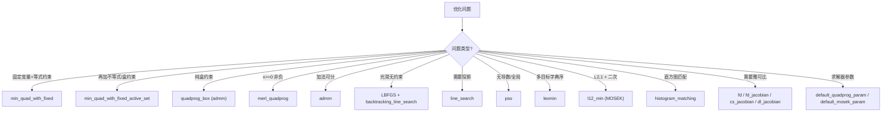

# 20.2 优化求解器 / Optimization Solvers

> 本章覆盖 `matrix/` 下与**数值优化求解**相关的 18 个函数：从全库最高扇入的核心约束二次规划求解器
> `min_quad_with_fixed` 及其不等式版活动集扩展，到 ADMM、L-BFGS、回溯线搜索、粒子群（PSO）、
> 多目标字典序最小化（lexmin）、盒约束二次规划包装、L2,1 范数锥规划、有限差分/复步/自动微分雅可比，
> 以及直方图匹配与 MOSEK/quadprog 默认参数工具。
>
> This chapter covers 18 **numerical optimization solvers** in `matrix/`: the library-wide
> highest-fan-in constrained quadratic-programming core `min_quad_with_fixed` and its
> inequality/active-set extension, plus ADMM, L-BFGS, backtracking line search, PSO,
> multi-objective lexicographic minimization, a box-QP wrapper, an L2,1-norm conic program,
> finite-difference/complex-step/autodiff Jacobians, histogram matching, and MOSEK/quadprog
> default-parameter helpers.

- 语言 / Language：中英对照（中文为主）
- 相关章节 / See also：[20.1 稀疏矩阵工具](01-sparse-utilities.md)、
  [appendices/03-doc-template.md](../appendices/03-doc-template.md)、
  [60-mex](../60-mex/README.md)
- 命名约定 / Notation：`A`/`H`/`Q` 二次系数矩阵 `n by n`、`B`/`f`/`h` 线性系数 `n by 1`、
  `known`/`b` 固定变量索引、`Y`/`bc` 固定值、`Aeq`/`Beq` 等式约束、`Aieq`/`Bieq` 不等式约束、
  `lx`/`ux` 上下界、`Z`/`X`/`x` 解向量、`F`/`state` 预计算结构体

---

## 本章概览 / Chapter Overview

**模块职责 / Module responsibility**

- 本文件收录 `matrix/` 中一组**优化求解器与导数/参数辅助工具**。它们服务于 `mesh/`、
  `imageprocessing/` 等上层模块的几何优化问题：变形、参数化、测地、颜色匹配等最终都归结为
  "带约束/带边界条件的二次或非线性最小化"。其中 `min_quad_with_fixed` 是全库被调用最多的
  求解内核（fan-in 最高），几乎所有使用 Lagrange 乘子/固定变量的线性系统求解都经它落地。
- This file collects a set of **optimization solvers and derivative/parameter helpers** in
  `matrix/`. They back the geometric optimization problems of `mesh/` and `imageprocessing/`
  (deformation, parameterization, geodesics, color matching), all reducing to constrained or
  boundary-conditioned quadratic/nonlinear minimization. `min_quad_with_fixed` is the
  library-wide highest fan-in solver core.

**分类总览 / Categorization**

(a) 约束二次规划核心 / Constrained QP core

| 函数 | 作用 / Purpose | 备注 |
|---|---|---|
| `min_quad_with_fixed` | 固定变量 + 等式约束的二次最小化（KKT/Lagrange）/ constrained QP via KKT | 全库核心，预分解复用 |
| `min_quad_with_fixed_active_set` | 追加不等式/盒约束的活动集迭代 / active-set on top of the core | 循环上调 `min_quad_with_fixed` |
| `quadprog_box` | 盒约束 QP，用 ADMM 实现 / box-QP via ADMM | 包装 `admm` |
| `merl_quadprog` | `x>=0` 的并行 QP 乘子更新 / nonneg QP multiplier update | Brand & Chen 11 |

(b) 通用一阶 / 无约束 / 全局优化 / First-order, unconstrained & global

| 函数 | 作用 / Purpose | 备注 |
|---|---|---|
| `admm` | 通用 ADMM 框架（回调式）/ generic ADMM with callbacks | 自适应 `rho` |
| `LBFGS` | L-BFGS 步方向类（Nocedal & Wright）/ L-BFGS step-direction class | classdef |
| `line_search` | 带投影的简单二分线搜索 / projected bisection line search | |
| `backtracking_line_search` | Armijo 回溯线搜索 / Armijo backtracking | |
| `pso` | 粒子群（全局、无导数）/ particle swarm optimization | |

(c) 多目标与正则 / Multi-objective & regularization

| 函数 | 作用 / Purpose | 备注 |
|---|---|---|
| `lexmin` | 字典序多目标最小化 / lexicographic multi-objective | `method` 5 分支 |
| `l12_min` | L2,1 范数 + 二次项的锥规划 / L2,1-norm conic program | 依赖 MOSEK |

(d) 导数 / 差分辅助 / Derivatives & finite differences

| 函数 | 作用 / Purpose | 备注 |
|---|---|---|
| `fd` | 有限差分/复步求导（支持任意形状 x）/ finite-difference derivative | |
| `fd_jacobian` | 前向差分雅可比 / FD Jacobian | 已废弃 |
| `cs_jacobian` | 复步差分雅可比 / complex-step Jacobian | 已废弃 |
| `dl_jacobian` | `dlarray` 自动微分雅可比 / autodiff Jacobian | 依赖 Deep Learning Toolbox |

(e) 参数与其它 / Parameters & misc

| 函数 | 作用 / Purpose | 备注 |
|---|---|---|
| `default_quadprog_param` | 返回 MOSEK/quadprog 默认参数与可用性 / default solver params | |
| `default_mosek_param` | 已废弃，转调 `default_quadprog_param` / deprecated wrapper | |
| `histogram_matching` | 直方图匹配（可平滑）/ histogram matching | 依赖 `min_quad_with_fixed` |

**"优化问题 → 选择求解器"导图 / "Optimization problem → pick a solver" map**



---

## 逐函数详解 / Per-function reference

### `min_quad_with_fixed` — 固定变量 + 等式约束的二次最小化（核心）
- **文件 / File**: [matrix/min_quad_with_fixed.m](file:///c:/VSWork/gptoolbox-1/matrix/min_quad_with_fixed.m#L1-L456)
- **签名 / Signature**: `[Z,F,Lambda,Lambda_known] = min_quad_with_fixed(A,B,known,Y,Aeq,Beq,F)`
- **功能 / Purpose**: `EN: Minimize the quadratic energy Z'*A*Z + Z'*B + C subject to Z(known)=Y and optionally Aeq*Z=Beq, via a KKT/Lagrange system with pre-factorization.` / 中文：在 `Z(known)=Y`（可选再叠加 `Aeq*Z=Beq`）约束下最小化二次型 `Z'*A*Z + Z'*B + C`，用 Karush–Kuhn–Tucker（Lagrange 乘子）鞍点系统求解，并返回可复用的预分解结构 `F`。
- **输入 / Inputs**:

  | 参数 | 尺寸/类型 | 含义 (中 / EN) |
  |---|---|---|
  | `A` | `n by n`（稀疏/稠密） | 二次系数矩阵 / quadratic coefficients |
  | `B` | `n by 1` 或 `[]` | 线性系数，空则视作 0 / linear coefficients (empty ⇒ 0) |
  | `known` | `#known by 1` 或 `[]` | 固定变量索引 / fixed-variable indices |
  | `Y` | `#known by cols` 或 `[]` | 对应固定值 / fixed values |
  | `Aeq` | `m by n`（可选） | 线性等式约束系数 / equality constraint coefficients |
  | `Beq` | `m by 1`（可选） | 等式约束右端，空则视作 0 / RHS (empty ⇒ 0) |
  | `F` | `struct`（可选，见下） | 预分解缓存 / 作为第 7 个位置参数传入 | 

- **输出 / Outputs**:

  | 参数 | 尺寸/类型 | 含义 |
  |---|---|---|
  | `Z` | `n by cols` | 解 / solution |
  | `F` | `struct` | 预分解结构（见下表）/ prefactorization record |
  | `Lambda` | `m by cols` | `Aeq` 各行对应的 Lagrange 乘子 / multipliers for Aeq |
  | `Lambda_known` | `#known by cols` | 固定值对应的 Lagrange 乘子 / multipliers for known |

- **可选参数 / Optional（注意：本实现无 `varargin`）**：

  > ⚠️ **源码事实**：本文件**不使用** `varargin`/`containers.Map`。所有可选行为通过
  > **第 7 个位置参数 `F`（struct）** 传递，且 `F` 同时充当"输出预分解缓存"与"输入选项"：
  > 若 `F.force_Aeq_li` 存在则强制指定约束线性无关性判定（见 L200、L214–L216）。
  >
  > | `F` 字段 | 取值 | 默认 | 含义 |
  > |---|---|---|---|
  > | `F.precomputed` | logical | `false` | 是否已有有效预分解；`false` 时重新 `precompute`（L97–L102） |
  > | `F.force_Aeq_li` | logical | 无 | 强制 `Aeq_li`（跳过 QR 判秩）/ force linear independence flag |
  >
  > `F` 被 `precompute` 填充的字段（供复用）：`n`、`known`、`unknown`、`Ak`、`lagrange`、
  > `blank_eq`、`Auu_sym`、`Auu_pd`、`ldl`、`Aeq_li`、`preY`，以及分解因子
  > `L`/`D`/`U`/`P`/`Q`/`S`；QR 分支另存 `Aeq`、`AeqTQ1`、`AeqTQ2`、`AeqTR1`、`AeqTE`、`Auu`。

- **变量流动 / Variable flow**:
  `A,B,known,Y,Aeq,Beq →(precompute: 取 unknown & Ak)→ [A Aeq';Aeq 0] →(判对称性/正定/约束线性无关)→`
  `(chol → L/S) 或 (ldl → L,D,P,S) 或 (lu → L,U,P,Q) 或 (QR null-space → AeqTQ2) → F →`
  `(solve: 组装 NB = preY*Y + [B;0] − [0;2*Beq])→ 回代 → Z →(散回 known 值 & 抽取 lagrange)→ Z,Lambda,Lambda_known`
- **算法步骤 / Algorithm**:

  本文件含两个嵌套函数：`precompute`（L106–L327）与 `solve`（L329–L454）。

  **A. 主入口（L81–L103）**
  1. `nargin<4` 时置 `known=[]`,`Y=[]`；`nargin<6` 时置 `Aeq=[]`,`Beq=[]`；`Beq` 空则补 `zeros(size(Aeq,1),1)`；`nargin<7` 时 `F=[]`（L81–L95）。
  2. 若 `F` 为空、无 `precomputed` 字段或为 `false`，则调用 `F = precompute(A,known,Aeq,F)`（L97–L102）。
  3. 调用 `[Z,Lambda,Lambda_known] = solve(F,B,Y,Beq)`（L103）。

  **B. `precompute`（L106–L327）**
  1. `n = size(A,1)` 并缓存 `F.n`；`Aeq` 空则补 `zeros(0,n)`（L122–L128）。
  2. 一系列 `assert` 校验尺寸与 `known` 索引范围（L130–L141）。
  3. `F.known = known`；`F.unknown = find(~sparse(1,known,true,1,n))`（L144–L146）。
  4. 取 `Auu = A(unknown,unknown)`、`F.Ak = A(known,:)`（L148–L150）。
  5. 计算对称性度量 `sym_measure = max|Auu−Auu'| / max|Auu|`，置 `F.Auu_sym`（L154–L168）。
  6. 检测"空约束" `F.blank_eq = ~any(Aeq(:,unknown),2)`，存在则告警并剔除（L171–L177）。
  7. `neq = size(Aeq,1)`；若 `Auu_sym && neq==0` 则对 `Auu` 做 Cholesky（稀疏用 `[L,p,S]=chol(Auu,'lower')`），置 `F.Auu_pd = (p==0)`（L184–L194）。
  8. 判约束线性无关：`neq>1` 且未强制时，对 `Aeq(:,unknown)'` 做 QR，取 `nc = find(any(AeqTR,2),1,'last')`，`F.Aeq_li = (nc==neq)`；否则 `true`。若 `F.force_Aeq_li` 存在则覆盖（L200–L216）。
  9. **分支：`F.Aeq_li == true`（原始 Lagrange 法）**（L220–L271）
     - 设 `F.lagrange = n+(1:neq)`；稀疏/稠密不匹配时告警；把 KKT 系统拼为 `A = [A Aeq'; Aeq Z]`（`Z=sparse(neq,neq)`）。
     - 预算 `F.preY = A([unknown lagrange],known) + A(known,[unknown lagrange])'`。
     - 分解 `NA = A([unknown lagrange],[unknown lagrange])`：若 `Auu_sym` 且 `neq==0 && Auu_pd` 直接复用 `L`（`F.U=L',F.P=S',F.Q=S`）；否则若 `Auu_sym` 用 `ldl`（置 `F.ldl=true`）；否则用 `lu`。
  10. **分支：`F.Aeq_li == false`（QR 零空间替换）**（L272–L325）
      - 由 `AeqTQ/AeqTR/AeqTE` 截取 `AeqTQ1/AeqTR1`，令 `AeqTQ2 = AeqTQ(:,(nc+1):end)`。
      - 投影 Hessian `QRAuu = AeqTQ2' * Auu * AeqTQ2`，对其 Cholesky（稀疏/稠密分支），断言 `p==0`。
      - 预算 `F.preY = A(unknown,known) + A(known,unknown)'`，并保存 `F.Aeq/AeqTQ1/AeqTQ2/AeqTR1/AeqTE/Auu`。
  11. `F.precomputed = true`（L326）。

  **C. `solve`（L329–L454）**
  1. `kr = numel(F.known)`；`kr==0` 时断言 `Y` 空并规范列数；断言 `kr==size(Y,1)`（L350–L359）。
  2. 由 `Y/B/Beq` 推断 `cols`，缺者补零（L360–L379）；`F.blank_eq` 处剔除 `Beq` 行（L381–L383）。
  3. **`F.Aeq_li` 分支**（L387–L421）：组装
     `NB = preY*Y + [B(unknown);0] + [0; −2*Beq(lagrange−n)]`；
     初值 `Z(F.known,:)=Y`；按 `F.ldl` 选择 LDL（`F.S*(F.P*(F.L'\(F.D\(F.L\(F.P'*(F.S*NB))))))`）或 LU 回代 `F.Q*(F.U\(F.L\(F.P*NB)))`，均乘 `−0.5`；抽出 `Lambda`（`Z(F.lagrange,:)`，剔除 blank_eq 行）并截去乘子部分。
  4. **QR 分支**（L422–L451）：`Beq = −F.Aeq(:,known)*Y + Beq`；`NB = −0.5*(B(unknown)+preY*Y)`；`eff_Beq = AeqTE'*Beq` 并裁剪；`lambda_0 = AeqTQ1*(AeqTR1T\eff_Beq)`；`QRB = −AeqTQ2'*(Auu*lambda_0) + AeqTQ2'*NB`；`lambda = F.Q*(F.U\(F.L\(F.P*QRB)))`；`Z(F.unknown) = AeqTQ2*lambda + lambda_0`；`Lambda` 由投影公式给出（余维约束补 0）。
  5. 统一计算 `Lambda_known = −(F.Ak*Z + 0.5*B(F.known,:))`（L453）。
- **流程图 / Flowchart**:

  ```mermaid
  flowchart TD
    A["输入 A,B,known,Y,Aeq,Beq,F"] --> B{"F.precomputed 为真?"}
    B -- 否 --> P["precompute(A,known,Aeq,F)"]
    B -- 是 --> S
    P --> S["solve(F,B,Y,Beq)"]
    P --> P1["F.unknown = setdiff(1:n,known)"]
    P1 --> P2{"Aeq_li ?"}
    P2 -- 是 --> P3["KKT = [A Aeq';Aeq 0]"]
    P3 --> P4{"Auu 对称?"}
    P4 -- 是, neq=0, PD --> P5["chol → L,S"]
    P4 -- 是 --> P6["ldl → L,D,P,S"]
    P4 -- 否 --> P7["lu → L,U,P,Q"]
    P2 -- 否 --> P8["QR 零空间投影 → chol(QRAuu)"]
    P5 --> S
    P6 --> S
    P7 --> S
    P8 --> S
    S --> R{"Aeq_li ?"}
    R -- 是 --> R1["NB = preY*Y + [B;0] + [0;-2*Beq]"]
    R1 --> R2["回代 -0.5*... → Z"]
    R -- 否 --> R3["lambda_0, QRB → lambda"]
    R3 --> R4["Z(unknown) = AeqTQ2*lambda + lambda_0"]
    R2 --> K["Lambda_known = -(Ak*Z + 0.5*B(known))"]
    R4 --> K
    K --> Z["输出 Z,F,Lambda,Lambda_known"]
  ```

- **依赖 / Dependencies**: 仅使用 MATLAB 内置 `chol`/`ldl`/`lu`/`qr`/`sparse`/`find`/`bsxfun`/`assert`，**无同库依赖**；内部嵌套函数 `precompute`（L106）、`solve`（L329）。
- **See also**: `min_quad_with_fixed_active_set`, `quadprog_box`, `linsolve_with_fixed`, `affine_null_space`, `lu_lagrange`
- **备注 / Note**: 头部注释给出 `min_quad_with_fixed_pcg` 示例（L53–L60），但源码并无此变体；Kuhn `min_quad_with_fixed` 的 libigl C++ 版支持 `mosek/quadprog/force_iterative/superLU` 等参数，本 MATLAB 实现**均不支持**。

### `min_quad_with_fixed_active_set` — 追加不等式/盒约束的活动集求解
- **文件 / File**: [matrix/min_quad_with_fixed_active_set.m](file:///c:/VSWork/gptoolbox-1/matrix/min_quad_with_fixed_active_set.m#L1-L344)
- **签名 / Signature**: `[Z,F,Lambda] = min_quad_with_fixed_active_set(A,B,known,Y,Aeq,Beq,Aieq,Bieq,lx,ux,F,varargin)`
- **功能 / Purpose**: `EN: Minimize Z'*A*Z + Z'*B subject to Z(known)=Y, optionally Aeq*Z=Beq, plus inequality Aieq*Z<=Bieq and box lx<=Z<=ux, by iterating equality solves with a growing active set.` / 中文：在固定变量、等式约束之外，继续支持线性不等式 `Aieq*Z<=Bieq` 与盒约束 `lx<=Z<=ux`；通过"离群约束逐步激活"的活动集迭代反复调用 `min_quad_with_fixed`。
- **输入 / Inputs**:

  | 参数 | 尺寸/类型 | 含义 (中 / EN) |
  |---|---|---|
  | `A`,`B` | `n by n`,`n by 1` | 二次/线性系数 / quadratic & linear coefficients |
  | `known`,`Y` | `#known`,`#known by cols` | 固定变量 / fixed variables |
  | `Aeq`,`Beq` | `meq by n`,`meq by 1` | 等式约束 / equality constraints |
  | `Aieq`,`Bieq` | `mieq by n`,`mieq by 1` | 不等式约束 / inequality constraints |
  | `lx`,`ux` | `n by 1` 或标量或 `[]` | 下/上界（空 ⇒ −Inf/Inf）/ bounds |
  | `F` | `struct` | 预计算/活动集缓存 / state struct |

- **输出 / Outputs**:

  | 参数 | 尺寸/类型 | 含义 |
  |---|---|---|
  | `Z` | `n by cols` | 解 / solution |
  | `F` | `struct` | 含 `iter`、`as_lx`、`as_ux`、`as_ieq` 等活动集缓存 |
  | `Lambda` | `meq by 1` | 等式约束 Lagrange 乘子（由内部 `min_quad_with_fixed` 返回） |

- **可选参数 / Optional**（`containers.Map`，L113–L115）：

  | 名称 | 取值 | 默认 | 含义 |
  |---|---|---|---|
  | `'Quiet'` | logical | `false` | 抑制迭代告警 / suppress warnings |
  | `'MaxIter'` | 整数 | `1000`（源码 L103；头注释误写 `{100}`） | 最大迭代 |
  | `'ForceAeqLI'` | logical | `[]` | 透传给核心求解器强制约束线性无关 / pass-through |
  | `'InactiveThreshold'` | 标量 | `eps` | 乘子阈值：低于则解除激活 / deactivation threshold |
  | `'StopThreshold'` | 标量 | `eps` | 相邻解变化收敛阈值 / stopping threshold |
  | `'ActiveThreshold'` | 标量 | `eps` | 违反量阈值：超过则激活约束 / activation threshold |

- **变量流动 / Variable flow**:
  `A,B,known,Y,Aeq,Beq,Aieq,Bieq,lx,ux →(初始化 F.Z0/as_*、边界扩展标量→向量)→ 循环:`<br>
  `Z →(违反量 new_as_lx/new_as_ux/new_as_ieq)→ 并入活动集 → known_i=[known;as_lx;as_ux], Aeq_i=[Aeq;Aieq(as_ieq,:)] → min_quad_with_fixed → Z,Lambda,Lambda_known →(乘子筛选 Λ>inactive_threshold 收缩活动集)→ 收敛判定 diff<stop_threshold → Z`
- **算法步骤 / Algorithm**:
  1. 初始化 `F` 缺省字段 `Z0/as_ieq/as_lx/as_ux`；默认参数 `max_iter=1000, inactive/stop/active_threshold=eps, quiet=false`（L88–L107）。
  2. 解析 `varargin`（L113–L128）；计算 `n`、`cols`（要求 `cols==1`）（L132–L139）。
  3. 把标量 `lx/ux` 扩展为 `n by 1`，空则取 `∓Inf`；断言 `all(lx<=ux)`（L141–L173）。
  4. `Z=F.Z0`；进入无限循环（L182–L327）：
     - 若 `Z` 非空：算违反量 `new_as_lx = find(Z−lx < −active_threshold)`、`new_as_ux = find(Z−ux > active_threshold)`、`new_as_ieq = find(Aieq*Z−Bieq > active_threshold)`；计算 `diff = sum((old_Z−Z).^2)`，若 `diff<stop_threshold` 则 `break`（L186–L212）。
     - 用 `unique`/`setdiff` 去重并把新约束并入 `F.as_lx/as_ux/as_ieq`（L223–L233）。
     - 构造扩展系统：`known_i=[known;as_lx;as_ux]`、`Y_i=[Y;lx(as_lx);ux(as_ux)]`、`Aeq_i=[Aeq;Aieq(as_ieq,:)]`、`Beq_i=[Beq;Bieq(as_ieq)]`，调 `min_quad_with_fixed(A,B,known_i,Y_i,Aeq_i,Beq_i,struct('force_Aeq_li',force_Aeq_li))`（L255–L261）。
     - 由 `Lambda`/`Lambda_known` 提取 `Lambda_lx/Lambda_ux/Lambda_ieq`（下界乘子取负，因统一为 `<=`）（L272–L276）。
     - 可选可视化（若 `F.t`/`F.im` 存在）（L288–L311）。
     - 按 `Λ > inactive_threshold` **收缩**活动集（L314–L316）；若达 `max_iter` 则告警退出（L318–L324）；否则 `F.iter++`。
  5. 嵌套函数 `energy(ZZ)`（L329–L342）提供能量评估（有 `Aeq` 时 `assert(false)`，未实现）。
- **流程图 / Flowchart**:

  ```mermaid
  flowchart TD
    A["输入 A,B,known,Y,约束,lx,ux,F,opts"] --> B["初始化默认参数 & F 字段"]
    B --> C["lx/ux 标量→向量, 空→∓Inf"]
    C --> D["Z = F.Z0"]
    D --> E{"Z 非空?"}
    E -- 是 --> F["算违反量 new_as_lx/ux/ieq"]
    F --> G{"diff < stop_threshold ?"}
    G -- 是 --> Z1["输出 Z,F,Lambda"]
    G -- 否 --> H["old_Z = Z; 去重并入活动集"]
    E -- 否 --> H
    H --> I["known_i/Aeq_i 扩展"]
    I --> J["min_quad_with_fixed → Z,Lambda"]
    J --> K["提取 Lambda_lx/ux/ieq"]
    K --> L{"iter == max_iter ?"}
    L -- 是 --> W["告警"] --> Z1
    L -- 否 --> M["按 Λ>inactive 收缩活动集"]
    M --> N["iter++"]
    N --> E
  ```

- **依赖 / Dependencies**: `min_quad_with_fixed` ([matrix/min_quad_with_fixed.m](file:///c:/VSWork/gptoolbox-1/matrix/min_quad_with_fixed.m#L1))；MATLAB 内置 `containers.Map`/`assignin`/`unique`/`setdiff`/`speye`
- **See also**: `min_quad_with_fixed`, `quadprog_box`, `merl_quadprog`
- **备注 / Note**: 头注释称 `'MaxIter'` 默认 `{100}`（L27），但源码实为 `1000`（L103）；另有大量被注释掉的历史代码与未实现的 `treat_constant_bound_as_linear_constraints` 分支（默认 `false`，L164）。

### `quadprog_box` — 盒约束二次规划（ADMM 实现）
- **文件 / File**: [matrix/quadprog_box.m](file:///c:/VSWork/gptoolbox-1/matrix/quadprog_box.m#L1-L90)
- **签名 / Signature**: `[X,state] = quadprog_box(H,f,Aeq,Beq,lx,ux,state,varargin)`
- **功能 / Purpose**: `EN: Minimize ½ trace(X'*H*X) + trace(X'*f) subject to Aeq*X=Beq and lx<=X<=ux, solved by ADMM with a precomputed X-subproblem factorization.` / 中文：求 `½ tr(X'HX) + tr(X'f)` 在 `Aeq*X=Beq` 与 `lx<=X<=ux` 下的最小值，用 ADMM 实现，并把 X 子问题的分解预先缓存到 `state`。
- **输入 / Inputs**:

  | 参数 | 尺寸/类型 | 含义 (中 / EN) |
  |---|---|---|
  | `H` | `#X by #X` 稀疏 | 二次系数（含隐含 ½，与 `quadprog` 一致）/ quadratic (implied ½) |
  | `f` | `#X by dim` | 线性系数 / linear coefficients |
  | `Aeq`,`Beq` | `#Aeq by #X`,`#Beq by dim` | 等式约束 / equality constraints |
  | `lx`,`ux` | `#X by dim` | 上下界 / bounds |
  | `state` | `struct` 或 `[]` | 预计算（`X0` 初值即置于此）/ precompute state |

- **输出 / Outputs**:

  | 参数 | 尺寸/类型 | 含义 |
  |---|---|---|
  | `X` | `#X by dim` | 解 / solution |
  | `state` | `struct` | 可复用（仅当 `H`、`Aeq` 不变时）；`f`/`Beq`/`lx`/`ux` 可变 |

- **可选参数 / Optional**（`containers.Map`，L36–L38）：

  | 名称 | 取值 | 默认 | 含义 |
  |---|---|---|---|
  | `'MaxIter'` | 整数 | `800` | ADMM 最大迭代 |
  | `'Aeq_li'` | logical | `[]` | 透传约束线性无关标志给 `min_quad_with_fixed` |

- **变量流动 / Variable flow**:
  `H,f,Aeq,Beq,lx,ux,state →(n=size(H,1), I=speye)→ admm(argmin_X,argmin_Z,I,−I,0)`；<br>
  循环内：`argmin_X(Z,U,rho)` →（若 `Aeq` 空）`chol(rho/2*I+H)` 缓存 `X_solve`，否则 `min_quad_with_fixed` 缓存 `mqwf` → `X`；`argmin_Z(X,U)` → `Z = min(max(U+X,lx),ux)` → `X,state`
- **算法步骤 / Algorithm**:
  1. 默认 `max_iter=800`，解析 `varargin`（L33–L51）。
  2. 定义 `argmin_X(Z,U,rho,data)`（L53–L77）：当 `rho` 变化时重建分解——若 `Aeq` 空，对 `A = rho/2*I + H` 做 `chol` 并缓存闭包 `data.X_solve`；否则先以 `min_quad_with_fixed(rho/2*I+2*H, −f, [],[], Aeq,Beq, mqwf)` 预分解，缓存 `X_solve(rhs,Beq) = min_quad_with_fixed([], −2*rhs, [],[],[],Beq, mqwf)`；随后返回 `X = X_solve(−f + rho/2*(Z−U), Beq)`。
  3. 定义 `argmin_Z(X,U,rho,data)`（L79–L81）：`Z = min(max(U+X, lx), ux)`（盒投影）。
  4. `n=size(H,1)`、`I=speye(n)`、`k = max([size(f,2) size(lx,2) size(ux,2) size(Beq,2)])`（L84–L86）。
  5. 调 `admm(@argmin_X, @argmin_Z, I, −I, zeros(n,k), state, 'MaxIter', max_iter)`，取 `[X,~,state]`（L87）。
- **流程图 / Flowchart**:

  ```mermaid
  flowchart TD
    A["输入 H,f,Aeq,Beq,lx,ux,state"] --> B["解析 opts (MaxIter,Aeq_li)"]
    B --> C["I=speye(n); k=max 列数"]
    C --> D["admm(argmin_X,argmin_Z,I,-I,0)"]
    D --> E["argmin_X: rho 变化?"]
    E -- 是, Aeq 空 --> F["chol(rho/2*I+H) → X_solve"]
    E -- 是, Aeq 非空 --> G["min_quad_with_fixed 预分解 → mqwf"]
    E -- 否 --> H
    F --> H["X = X_solve(-f+rho/2*(Z-U),Beq)"]
    G --> H
    H --> I["argmin_Z: Z=min(max(U+X,lx),ux)"]
    I --> D
    D --> Z["输出 X,state"]
  ```

- **依赖 / Dependencies**: `admm` ([matrix/admm.m](file:///c:/VSWork/gptoolbox-1/matrix/admm.m#L1))、`min_quad_with_fixed` ([matrix/min_quad_with_fixed.m](file:///c:/VSWork/gptoolbox-1/matrix/min_quad_with_fixed.m#L1))；内置 `chol`/`speye`
- **See also**: `admm`, `min_quad_with_fixed`, `min_quad_with_fixed_active_set`, `sparse_eigs`
- **备注 / Note**: 头部注释的调用原型 `quadprog_box(H,f,Aieq,Bieq,Aeq,Beq,lx,ux,X0,state)` 与真实签名不符——源码中 `Aieq/Bieq` 被注释忽略（L14–L15），真实为 `(H,f,Aeq,Beq,lx,ux,state,varargin)`。

### `admm` — 通用 ADMM 框架（回调式）
- **文件 / File**: [matrix/admm.m](file:///c:/VSWork/gptoolbox-1/matrix/admm.m#L1-L132)
- **签名 / Signature**: `[X,Z,state] = admm(argmin_X,argmin_Z,A,B,c,state,varargin)`
- **功能 / Purpose**: `EN: Generic ADMM solver for min f(X)+g(Z) s.t. A*X+B*Z=c, with adaptive penalty rho and residual-based termination.` / 中文：求解 `min f(X)+g(Z) s.t. A*X+B*Z=c` 的通用 ADMM 框架；子问题以回调提供，含自适应惩罚参数 `rho` 与原始/对偶残差终止。
- **输入 / Inputs**:

  | 参数 | 尺寸/类型 | 含义 (中 / EN) |
  |---|---|---|
  | `argmin_X` | function handle | `[X,data]=argmin_X(Z,U,rho,data)` 的 X 子问题 / X-subproblem |
  | `argmin_Z` | function handle | `[Z,data]=argmin_Z(X,U,rho,data)` 的 Z 子问题 / Z-subproblem |
  | `A`,`B` | `#c by #X`,`#c by #Z` | 约束矩阵 / constraint matrices |
  | `c` | `#c by dim` | 约束常数 / constraint constant |
  | `state` | `struct` 或 `[]` | 持久状态（`X/Z/U/rho/…`）/ persistent state |

- **输出 / Outputs**:

  | 参数 | 尺寸/类型 | 含义 |
  |---|---|---|
  | `X` | `#X by dim` | 主变量 / primary |
  | `Z` | `#Z by dim` | 对偶变量 / dual |
  | `state` | `struct` | 含 `iter`、`rho`、回调 `data` 等 |

- **可选参数 / Optional**（`containers.Map`，L49–L51）：

  | 名称 | 取值 | 默认 | 含义 |
  |---|---|---|---|
  | `'MaxIter'` | 整数 | `2000` | 最大迭代 |
  | `'Callback'` | function handle | `@(state) []` | 每步回调 / per-iteration callback |
  | `'TolAbs'` | 标量 | `1e-8` | 绝对容差 / absolute tolerance |
  | `'TolRel'` | 标量 | `1e-6` | 相对容差 / relative tolerance |

- **变量流动 / Variable flow**:
  `A,B,c,state →(初始化 X/Z/U ~ rand, rho=1)→ 循环:`<br>
  `argmin_X(Z,U,rho)→X → argmin_Z(X,U,rho)→Z → U += A*X+B*Z−c →(对偶残差 rho*||A'B(Z_prev−Z)||, 原始残差 ||AX+BZ−c||)→(每 10 步按 bmu/btao 调 rho & 缩放 U)→(eps_pri/eps_dual 判定)→ X,Z,state`
- **算法步骤 / Algorithm**:
  1. 默认 `max_iter=2000`、`callback=@(state)[]`、`tol_abs=1e-8`、`tol_rel=1e-6`；解析 `varargin`（L44–L64）。
  2. 固定参数 `check_interval=10`、`bmu=5`、`btao_inc=2`、`btao_dec=2`（L66–L69）。
  3. 初始化 `state`：`X/Z` 用 `rand`、`U` 用 0、`rho=1`、`rho_prev=nan`、回调 `data=[]`（L72–L93）。
  4. `cnorm = norm(c,'fro')`；主循环 `for iter=1:max_iter`（L95–L129）：
     - `X = argmin_X(Z,U,rho,dataX)`；`Z_prev=Z`；`Z = argmin_Z(X,U,rho,dataZ)`（L98–L100）。
     - `U = U + A*X + B*Z − c`；调用 `callback(state)`（L102–L103）。
     - 对偶残差 `dual_residual = rho*||A'*B*(Z_prev−Z)||_F`、原始残差 `residual = ||A*X+B*Z−c||_F`（L110–L111）。
     - 每 `check_interval` 步自适应调整：`residual > bmu*dual_residual` 则 `rho *= btao_inc`（并 `U /= btao_inc`）；反之 `rho /= btao_dec`（并 `U *= btao_dec`）（L112–L121）。
     - 计算 `eps_pri`、`eps_dual`（Boyd 判据）；`residual<eps_pri && dual_residual<eps_dual` 则 `break`（L123–L128）。
  5. `X=state.X`、`Z=state.Z`（L130–L131）。
- **流程图 / Flowchart**:

  ```mermaid
  flowchart TD
    A["输入 回调,A,B,c,state,opts"] --> B["解析 opts & 初始化 state"]
    B --> C["iter=1"]
    C --> D["X = argmin_X(Z,U,rho)"]
    D --> E["Z = argmin_Z(X,U,rho)"]
    E --> F["U += A*X+B*Z-c"]
    F --> G["callback(state)"]
    G --> H["算 residual, dual_residual"]
    H --> I{"iter mod 10 == 0 ?"}
    I -- 是 --> J{"residual > bmu*dual ?"}
    J -- 是 --> J1["rho*=2; U/=2"]
    J -- 否 --> K{"dual > bmu*residual ?"}
    K -- 是 --> K1["rho/=2; U*=2"]
    I -- 否 --> L
    J1 --> L
    K1 --> L
    K --> L{"收敛 (residual<eps_pri & dual<eps_dual) ?"}
    L -- 是 --> Z["输出 X,Z,state"]
    L -- 否 --> M{"iter == max_iter ?"}
    M -- 否 --> N["iter++"] --> D
    M -- 是 --> Z
  ```

- **依赖 / Dependencies**: 无同库依赖（纯 MATLAB；`norm`/`rand`/`mod`/`containers.Map`）
- **See also**: `quadprog_box`, `sparse_eigs`, `min_quad_with_fixed_active_set`

### `LBFGS` — L-BFGS 步方向类
- **文件 / File**: [matrix/LBFGS.m](file:///c:/VSWork/gptoolbox-1/matrix/LBFGS.m#L1-L118)
- **签名 / Signature**: `L = LBFGS(m)`（构造）；`[L,dx] = step(L,xk,dfdxk)`（方法）；即 `classdef LBFGS`
- **功能 / Purpose**: `EN: A class that computes the L-BFGS step direction dx = -H_k ∇f_k from stored (s,y) history; the caller performs the actual step (e.g. with backtracking_line_search).` / 中文：实现 L-BFGS 算法，用最近 `m` 步的 `(s,y)` 历史构造步方向 `dx = −Hₖ ∇fₖ`；实际步长由调用方（如 `backtracking_line_search`）决定。
- **输入 / Inputs**（构造与方法）:

  | 参数 | 尺寸/类型 | 含义 (中 / EN) |
  |---|---|---|
  | `m` | 整数（可选，构造） | 记忆的历史状态数 / memory size |
  | `xk` | `#x`（方法） | 当前点 / current values |
  | `dfdxk` | `#x`（方法） | 当前梯度 / current gradient |

- **输出 / Outputs**:

  | 参数 | 尺寸/类型 | 含义 |
  |---|---|---|
  | `L` | `LBFGS` 对象 | 更新后的对象（含历史）/ updated object |
  | `dx` | `#x` | 步方向 / step direction |

- **可选参数 / Optional**:

  | 名称 | 取值 | 默认 | 含义 |
  |---|---|---|---|
  | `m` | 整数 | `10` | 属性 `m`（构造参数缺省时）/ memory depth |

- **变量流动 / Variable flow**:
  `construct(m) → 属性 m,k,xk,dfdxk,s,y,rho,alpha → step(xk,dfdxk) →(增量 Δx, Δg → s,y,ρ=1/(y's))→(两循环 L-BFGS 递归 Algorithm 7.4)→ dx`
- **算法步骤 / Algorithm**:
  1. 构造：`this.m = m`（缺省 `10`）（L40–L45）。
  2. `step`：把 `xk/dfdxk` 规范为列向量；定义 `iter2ind(i)=mod(i-1,m)+1`（L64–L69）。
  3. 首次调用（`k==0`）初始化历史容器 `s/y/rho/alpha` 为 `NaN`；否则计算 `s(:,K)=xk−xk_old`、`y(:,K)=dfdxk−g_old`、`rho(K)=1/(y's)`（L72–L82）。
  4. 记录 `this.xk/dfdxk`、`k++`；若 `k==1` 直接 `dx=−dfdxk`（L84–L91）。
  5. 两循环递归（Algorithm 7.4）：先逆向 `for i=k-1:...` 累积 `alpha` 并更新 `q`；再用 `gamma_k = (s'y)/(y'y)` 作 `H0k`；再顺向更新得 `r`（L93–L112）。
  6. `dx = reshape(−r, size(xk))`（L113）。
- **流程图 / Flowchart**:

  ```mermaid
  flowchart TD
    A["构造 LBFGS(m)"] --> B["step(xk,dfdxk)"]
    B --> C["向量化 xk,dfdxk"]
    C --> D{"k == 0 ?"}
    D -- 是 --> D1["初始化 s,y,rho,alpha"]
    D -- 否 --> D2["s,y,rho 记录增量"]
    D1 --> E["xk=..., k++"]
    D2 --> E
    E --> F{"k == 1 ?"}
    F -- 是 --> G["dx = -dfdxk"]
    F -- 否 --> H["逆向循环累积 alpha,q"]
    H --> I["H0k = gamma_k"]
    I --> J["顺向循环 → r"]
    J --> K["dx = -r"]
    G --> Z["输出 L,dx"]
    K --> Z
  ```

- **依赖 / Dependencies**: 无同库依赖（Nocedal & Wright Algorithm 7.4/7.5）
- **See also**: `backtracking_line_search`, `line_search`

### `line_search` — 带投影的简单线搜索
- **文件 / File**: [matrix/line_search.m](file:///c:/VSWork/gptoolbox-1/matrix/line_search.m#L1-L38)
- **签名 / Signature**: `[step_size,X,obj,step,iter,max_iter] = line_search(obj_fun,proj_fun,X0,step0,max_step_size)`
- **功能 / Purpose**: `EN: Given an objective, a projection onto the feasible set, an initial point and a desired step direction, find a feasible step size by repeated halving until the objective decreases.` / 中文：给定目标函数、约束投影函数、初始点与期望步方向，反复二分步长直到目标下降，返回安全步长与投影后的新解。
- **输入 / Inputs**:

  | 参数 | 尺寸/类型 | 含义 (中 / EN) |
  |---|---|---|
  | `obj_fun` | function handle | 目标函数 `/` objective |
  | `proj_fun` | function handle | 约束投影 `/` projection |
  | `X0` | `#X by 1` | 初值 / initial |
  | `step0` | `#X by 1` | 期望步方向 / desired direction |
  | `max_step_size` | 标量 | 初始（最大）步长 / max step size |

- **输出 / Outputs**:

  | 参数 | 尺寸/类型 | 含义 |
  |---|---|---|
  | `step_size` | 标量 | 安全步长 / safe step size |
  | `X` | `#X by 1` | 新值 `X = proj_fun(X0+step_size*step0)` |
  | `obj` | 标量 | `X` 处目标值 / objective at X |
  | `step` | `#X by 1` | 投影前的实际步 `step_size*step0` |
  | `iter` | 整数 | 实际迭代次数 / iterations used |
  | `max_iter` | 整数 | 上限 `20` |

- **可选参数 / Optional**: 无 / None（`max_iter` 为内部常量 `20`）
- **变量流动 / Variable flow**: `obj_fun,proj_fun,X0,step0,max_step_size → obj0=obj_fun(proj_fun(X0)) → 循环: step=step_size*step0 → X=proj_fun(X0+step) → obj=obj_fun(X) →(obj<obj0 返回 : step_size*=0.5)→ 超 max_iter 回退 step_size=0`
- **算法步骤 / Algorithm**:
  1. `step_size = max_step_size`；`obj0 = obj_fun(proj_fun(X0))`；`max_iter = 20`（L21–L23）。
  2. 循环 `iter=1:20`：`step=step_size*step0`；`X=proj_fun(X0+step)`；`obj=obj_fun(X)`（L24–L27）。
  3. `obj<obj0` 则返回当前结果；否则 `step_size *= 0.5`（L28–L32）。
  4. 循环耗尽则回退：`step_size=0`、`X=X0`、`obj=obj0`、`step=0`（L34–L37）。
- **流程图 / Flowchart**:

  ```mermaid
  flowchart TD
    A["输入 obj_fun,proj_fun,X0,step0,max_step_size"] --> B["obj0 = obj_fun(proj_fun(X0))"]
    B --> C["iter=1"]
    C --> D{"iter <= 20 ?"}
    D -- 否 --> E["回退: step_size=0, X=X0"]
    D -- 是 --> F["step=step_size*step0; X=proj_fun(X0+step); obj=obj_fun(X)"]
    F --> G{"obj < obj0 ?"}
    G -- 是 --> Z["输出 step_size,X,obj,step"]
    G -- 否 --> H["step_size *= 0.5; iter++"] --> D
    E --> Z
  ```

- **依赖 / Dependencies**: 无同库依赖（依赖调用方提供的 `obj_fun`/`proj_fun`）
- **See also**: `backtracking_line_search`, `LBFGS`

### `backtracking_line_search` — Armijo 回溯线搜索
- **文件 / File**: [matrix/backtracking_line_search.m](file:///c:/VSWork/gptoolbox-1/matrix/backtracking_line_search.m#L1-L40)
- **签名 / Signature**: `[t,x,fx] = backtracking_line_search(f,x0,dfx0,dx,alpha,beta,max_iter)`
- **功能 / Purpose**: `EN: Backtracking line search (Armijo / sufficient decrease) selecting t by repeatedly shrinking by beta until f(x0+t*dx) <= f(x0)+t*alpha*dfx0'dx.` / 中文：回溯线搜索（Armijo 充分下降条件），以 `beta` 逐步缩小步长 `t`，直到满足 `f(x0+t*dx) <= f(x0)+t*alpha*<dfx0,dx>`。
- **输入 / Inputs**:

  | 参数 | 尺寸/类型 | 含义 (中 / EN) |
  |---|---|---|
  | `f` | function handle | 返回标量目标 / scalar objective |
  | `x0` | `#x` | 当前点 / current point |
  | `dfx0` | `#x` | 当前梯度 / gradient at x0 |
  | `dx` | `#x` | 提议步 / proposed step |
  | `alpha` | 标量 ∈(0,½) | 充分下降系数 / sufficient-decrease fraction |
  | `beta` | 标量 ∈(0,1) | 每步缩小因子 / shrink factor |
  | `max_iter` | 整数（可选） | 最大迭代 / max iterations |

- **输出 / Outputs**:

  | 参数 | 尺寸/类型 | 含义 |
  |---|---|---|
  | `t` | 标量 | 选中步长 / step size |
  | `x` | `#x` | `x = x0 + t*dx` |
  | `fx` | 标量 | `f(x)` |

- **可选参数 / Optional**:

  | 名称 | 取值 | 默认 | 含义 |
  |---|---|---|---|
  | `max_iter` | 整数 | `30` | 最大回溯次数 / max iterations |

- **变量流动 / Variable flow**: `f,x0,dfx0,dx,alpha,beta → t=1 → fx0=f(x0) → threshold=alpha*sum(dfx0.*dx) → 循环: x=x0+t*dx → fx=f(x) →(fx<=fx0+t*threshold 返回 : t*=beta)→ 耗尽回退 t=0`
- **算法步骤 / Algorithm**:
  1. 断言 `0<alpha<0.5`、`0<beta<1`（L21–L22）。
  2. `t=1`、`fx0=f(x0)`；`nargin<7` 时 `max_iter=30`（L23–L27）。
  3. `alpha_dfdx0_dx = alpha*sum(dfx0.*dx,'all')`（L28）。
  4. 循环：`x=x0+t*dx`、`fx=f(x)`；若 `fx<=fx0+t*alpha_dfdx0_dx` 返回；否则 `t*=beta`（L29–L36）。
  5. 超限回退 `t=0,x=x0,fx=fx0`（L37–L39）。
- **流程图 / Flowchart**:

  ```mermaid
  flowchart TD
    A["输入 f,x0,dfx0,dx,alpha,beta,max_iter"] --> B["t=1; fx0=f(x0)"]
    B --> C["threshold=alpha*sum(dfx0.*dx)"]
    C --> D["iter=1"]
    D --> E{"iter <= max_iter ?"}
    E -- 否 --> F["回退: t=0, x=x0, fx=fx0"]
    E -- 是 --> G["x=x0+t*dx; fx=f(x)"]
    G --> H{"fx <= fx0 + t*threshold ?"}
    H -- 是 --> Z["输出 t,x,fx"]
    H -- 否 --> I["t *= beta; iter++"] --> E
    F --> Z
  ```

- **依赖 / Dependencies**: 无同库依赖（`assert`/`sum` 内置；[Boyd 2006] Alg. 9.2）
- **See also**: `line_search`, `LBFGS`

### `pso` — 粒子群优化（全局、无导数）
- **文件 / File**: [matrix/pso.m](file:///c:/VSWork/gptoolbox-1/matrix/pso.m#L1-L82)
- **签名 / Signature**: `[x,fval] = pso(fcn,lb,ub,varargin)`
- **功能 / Purpose**: `EN: Particle swarm optimization minimizing fcn over the box [lb,ub], with velocity update and clamping to bounds.` / 中文：在盒 `[lb,ub]` 内用粒子群（velocity/position 迭代）最小化 `fcn`。
- **输入 / Inputs**:

  | 参数 | 尺寸/类型 | 含义 (中 / EN) |
  |---|---|---|
  | `fcn` | function handle | 标量目标 `/` scalar objective |
  | `lb`,`ub` | `1 by nvars` | 下/上界 / bounds |

- **输出 / Outputs**:

  | 参数 | 尺寸/类型 | 含义 |
  |---|---|---|
  | `x` | `1 by nvars` | 最优位置 / best position |
  | `fval` | 标量 | 最优目标值 / best objective |

- **可选参数 / Optional**:

  | 名称 | 取值 | 默认 | 含义 |
  |---|---|---|---|
  | `varargin` | — | — | ⚠️ 源码**完全忽略** `varargin`，不解析任何键 / varargin is accepted but ignored |

- **变量流动 / Variable flow**: `fcn,lb,ub →(population=200, position~U(lb,ub), velocity→0.1*(ub-lb).*rand)→(fcn_all 逐粒子评估)→ best_f,best_position →(循环: 更新 velocity/position → 边界裁剪 clamp → 评估 f → 更新历史 → 取全局最优)→ x,fval`
- **算法步骤 / Algorithm**:
  1. `nvars=numel(lb)`；`lb/ub` 置为行向量（L3–L5）。
  2. 常数 `max_iters=10`、`population=200`；`position = lb + rand(population,nvars).*(ub-lb)`；自定义 `randn`；`velocity = 0.1*(ub-lb).*randn(nvars)`（L6–L10）。
  3. 定义 `fcn_all`：对每个粒子调用 `fcn`（`arrayfun` + `cell2mat`）（L12–L16）。
  4. 初始评估得 `best_f,best_position`，并取全局最优 `x,fval`（L18–L21）。
  5. 系数 `omega=0.7, phi_p=0.15, phi_g=0.15`（L28–L30）。
  6. 循环 `iter=1:max_iters`：更新 `velocity`（惯性 + 个体最优 + 全局最优）；`position = min(max(lb,position),ub)`（`reflection` 分支默认关闭）（L31–L45）。
  7. 重新评估 `f`，更新 `best_position`/`best_f`，取 `x,fval`（L75–L79）。
- **流程图 / Flowchart**:

  ```mermaid
  flowchart TD
    A["输入 fcn,lb,ub"] --> B["初始化 population/position/velocity"]
    B --> C["评估 fcn_all → best_f,best_position,x,fval"]
    C --> D["iter=1"]
    D --> E{"iter <= max_iters ?"}
    E -- 否 --> Z["输出 x,fval"]
    E -- 是 --> F["velocity = omega*v + phi_p*r1*(pbest-x) + phi_g*r2*(gbest-x)"]
    F --> G{"reflection ?"}
    G -- 否 --> H["position = min(max(lb,position),ub)"]
    G -- 是 --> I["反射越界速度"]
    H --> J["f = fcn_all(position)"]
    I --> J
    J --> K["更新 best_f/best_position; 取全局最优"]
    K --> L["iter++"] --> E
  ```

- **依赖 / Dependencies**: 无同库依赖（`rand`/`arrayfun`/`cell2mat` 内置）
- **See also**: `merl_quadprog`, `admm`
- **备注 / Note**: `varargin` 出现在签名但函数体从不读取，属"预留未实现"；`reflection` 分支恒为 `false`（默认走裁剪）。

### `lexmin` — 字典序多目标最小化
- **文件 / File**: [matrix/lexmin.m](file:///c:/VSWork/gptoolbox-1/matrix/lexmin.m#L1-L301)
- **签名 / Signature**: `[Z,E,ZZ] = lexmin(H,ff,varargin)`
- **功能 / Purpose**: `EN: Solve the multi-objective minimization min{E1(x),...,Ek(x)} with lexicographic ordering, where Ei = ½ x' H{i} x + x' f{i}.` / 中文：按字典序（`E1` 优先于 `E2`……）求解多目标最小化，各目标为 `Ei = ½ x'H{i}x + x'f{i}`。
- **输入 / Inputs**:

  | 参数 | 尺寸/类型 | 含义 (中 / EN) |
  |---|---|---|
  | `H` | `k`-元 cell，`n by n` 稀疏 | 各目标二次系数 / per-energy quadratics |
  | `ff` | `k`-元 cell 或 `k by n by 1` | 各目标线性系数 / per-energy linear terms |

- **输出 / Outputs**:

  | 参数 | 尺寸/类型 | 含义 |
  |---|---|---|
  | `Z` | `n by 1` | 解向量 / solution |
  | `E` | `k by 1` | 各目标值 / outcome vector |
  | `ZZ` | cell（仅 `'kanoun'` 路径） | 各子问题解 |

- **可选参数 / Optional**（`containers.Map`，L87–L89）：

  | 名称 | 取值 | 默认 | 含义 |
  |---|---|---|---|
  | `'Eps1'` | 标量 | `0` | 各能量的 Tikhonov 正则 / regularization for energies |
  | `'Eps2'` | 标量 | `0` | 约束的 Tikhonov 正则 / regularization for constraints |
  | `'Method'` | `'mosekopt'`/`'fmincon'`/`'lagrange-multiplier'`/`'null-space'`/`'kanoun'` | `'null-space'` | 求解方法 / method |
  | `'Normalize'` | logical | `false` | 逐能量按 `max|H{i}|` 归一化 / per-energy normalization |
  | `'NullSpaceMethod'` | `'qr'`/`'luq'` | `'luq'` | 零空间分解法 / null-space decomposition |
  | `'fminconOptions'` | cell | `{}` | 透传给 `fmincon` 的选项 / extra fmincon options |
  | `'Z0'` | `n by 1` | `[]` | 初始解 / initial guess（映射到变量 `Z`） |

- **变量流动 / Variable flow**:
  `H,ff →(可选 normalize)→ k=numel(H), n=size(H{1},1) →(switch method):`<br>
  `null-space: N=1,Z=0 → 逐 i: fi=N'(Hi Z+fi), Hi=N'Hi N → affine_null_space → Ni,Y → Z=N Y+Z, N=N Ni`<br>
  `mosekopt: 逐 i 组装 prob(qosub/qcsub) → mosekopt → Z`；<br>
  `fmincon: 逐 i 以 objective/constraints/hessian → fmincon → Z,E`；<br>
  `lagrange-multiplier: 累积 C/D 与 QR → C\D`；`kanoun: quadprog + ldl 累积 Aeq → Z`
- **算法步骤 / Algorithm**:
  1. 定义局部 `f(i)`（cell 或数组取第 i 个线性项）（L42–L48）。
  2. 默认 `E=[]`、`normalize=false`、`method='null-space'`、`null_space_method='luq'`、`fmincon_options={}`、`eps1=eps2=0`；解析 `varargin`（L78–L102）。
  3. `k=numel(H)`；若 `normalize` 则逐能量按 `si=max|H{i}|` 缩放 `H{i}` 与 `ff`（L104–L117）。
  4. `n=size(H{1},1)`；按 `method` 分支（L122–L293）：
     - `'mosekopt'`：逐 i 组装 `prob`（`c`、`qosubi/j/val`、把前 `i-1` 个能量作为二次锥约束 `qcsub*`、`buc=E(j)+1e-6`），调 `mosekopt('minimize echo(0)',prob)`，记 `E(i)`、`Z`（L123–L161）。
     - `'fmincon'`：`Z` 初值缺省 `−f(1)`；构造 `objective/constraints/hessian`，逐 i 以 `interior-point`、开启 `GradObj/Hessian/GradConstr` 调 `fmincon`，把先前目标作为不等式约束（L162–L198）。
     - `'lagrange-multiplier'`：`C=H{1},D=−f(1)`，循环做 `qr(C')`、判秩 `nc`、拼接 KKT `C=[A C';C 0]`；当满秩或 `i==k` 时 `Z=C\D`（L199–L231）。
     - `'null-space'`（默认）：`N=1,Z=0`；逐 i：`Hi=N'*H{i}*N`、`fi=N'*(H{i}*Z+f(i))`，调 `affine_null_space(Hi+eps2*I, −fi, 'Method', null_space_method)` 得 `Ni,Y`；`Z=N*Y+Z`；`Ni` 空列则提前结束；否则 `N=N*Ni`（L232–L261）。
     - `'kanoun'`：按 [De Lasa 2010] §8.1，逐 i 用 `quadprog(Hi,f(i),[],[],Aeq,Beq)`，再由 `ldl(Hi+eps2*I)` 的因子构造 `Ai=sqrt(D)*L'*P'*S'` 累积 `Aeq/Beq`，记 `E`（L262–L293）。
  5. 若 `nargout>1`，用最终 `Z` 重算 `E(i) = ½ Z'H{i}Z + Z'f(i)`（L295–L300）。
- **流程图 / Flowchart**:

  ```mermaid
  flowchart TD
    A["输入 H,ff,opts"] --> B["解析 opts; k=numel(H)"]
    B --> C{"normalize ?"}
    C -- 是 --> C1["逐能量缩放"]
    C -- 否 --> D
    C1 --> D["n=size(H{1},1)"]
    D --> E{"method ?"}
    E -- null-space --> F["N=1,Z=0; 逐 i: affine_null_space → Z,N"]
    E -- mosekopt --> G["逐 i 组装 prob; mosekopt → Z"]
    E -- fmincon --> H["逐 i fmincon(内点法) → Z,E"]
    E -- lagrange-multiplier --> I["累积 KKT; C\\D → Z"]
    E -- kanoun --> J["quadprog + ldl 累积 Aeq → Z"]
    F --> K{"nargout > 1 ?"}
    G --> K
    H --> K
    I --> K
    J --> K
    K -- 是 --> L["重算 E(i)"]
    K -- 否 --> M
    L --> Z["输出 Z,E,ZZ"]
    M --> Z
  ```

- **依赖 / Dependencies**: `affine_null_space` ([matrix/affine_null_space.m](file:///c:/VSWork/gptoolbox-1/matrix/affine_null_space.m#L1))；`min_quad_with_fixed` 仅在注释中出现（L269，未启用）；外部 `mosekopt`（MOSEK，仓库内无 `.m`）、`fmincon`/`optimoptions`/`quadprog`（Optimization Toolbox）、`ldl`/`qr`
- **See also**: `affine_null_space`, `min_quad_with_fixed`, `sparse_eigs`
- **备注 / Note**: `switch` 中实现了头注释未列出的 `'mosekopt'` 与 `'kanoun'` 两种方法（L123、L262）；`'lagrange-multiplier'` 分支自述"bad for multiple reasons"。

### `merl_quadprog` — 非负二次规划（乘子迭代）
- **文件 / File**: [matrix/merl_quadprog.m](file:///c:/VSWork/gptoolbox-1/matrix/merl_quadprog.m#L1-L83)
- **签名 / Signature**: `x = merl_quadprog(varargin)`（`Q = varargin{1}`、`h = varargin{2}`，其余为参数对）
- **功能 / Purpose**: `EN: Minimize ½ x'Qx − x'h subject to x>=0 using the multiplicative-update method of "Parallel Quadratic Programming for Image Processing" [Brand & Chen 2011].` / 中文：按 [Brand & Chen 2011] 的并行二次规划方法，求解 `min ½ x'Qx − x'h s.t. x>=0` 的乘子迭代。
- **输入 / Inputs**:

  | 参数 | 尺寸/类型 | 含义 (中 / EN) |
  |---|---|---|
  | `Q` | `n by n` 对称半正定 | 二次系数 / quadratic coefficients |
  | `h` | `n by 1` | 线性系数（注意符号）/ linear coefficients (note sign) |

- **输出 / Outputs**:

  | 参数 | 尺寸/类型 | 含义 |
  |---|---|---|
  | `x` | `n by 1` | 解向量 / solution |

- **可选参数 / Optional**（手工 `switch` 解析，L36–L50）：

  | 名称 | 取值 | 默认 | 含义 |
  |---|---|---|---|
  | `'MaxIter'` | 整数 | `inf` | 最大迭代 / max iterations |
  | `'X0'` | `n by 1` | `ones(n,1)` | 初始猜测 / initial guess |

- **变量流动 / Variable flow**: `Q,h →(n, 断言, h 列化)→ r=max(diag(Q),max(−Q,[],2)) → Qp=max(Q,0)+diag(r), Qm=max(−Q,0)+diag(r) → hp=max(h,0)+s, hm=max(−h,0)+s → 迭代 x = x.*(hp+Qm*x)./(hm+Qp*x) →(收敛 diff<=tol 或 it>=max_iter)→ x`
- **算法步骤 / Algorithm**:
  1. `Q=varargin{1}`、`h=varargin{2}`；`n=size(Q,1)`；断言尺寸与 `h`；`h=h(:)`（L21–L27）。
  2. 默认 `max_iter=inf`、`tol=1e-7`、`x0=ones(n,1)`；解析参数对（L29–L50）。
  3. 分解：`r = max(diag(Q), max(−Q,[],2))`；`s=ones(n,1)`；`Qp = max(Q,0)+diag(r)`、`Qm = max(−Q,0)+diag(r)`（断言 `Qp` 稀疏）；`hp = max(h,0)+s`、`hm = max(−h,0)+s`（L52–L64）。
  4. 迭代：`x = x.*(hp+Qm*x)./(hm+Qp*x)`；`it++`；`diff=max|x−x_prev|`；`it>=max_iter` 或 `diff<=tol` 返回（L66–L80）。
- **流程图 / Flowchart**:

  ```mermaid
  flowchart TD
    A["输入 Q,h,opts"] --> B["n=size(Q,1); h=h(:)"]
    B --> C["r=max(diag(Q),max(-Q,[],2))"]
    C --> D["Qp=max(Q,0)+diag(r); Qm=max(-Q,0)+diag(r)"]
    D --> E["hp=max(h,0)+s; hm=max(-h,0)+s"]
    E --> F["x = x0"]
    F --> G["x = x.*(hp+Qm*x)./(hm+Qp*x); it++"]
    G --> H{"it >= max_iter ?"}
    H -- 是 --> Z["输出 x"]
    H -- 否 --> I{"diff <= tol ?"}
    I -- 是 --> Z
    I -- 否 --> G
  ```

- **依赖 / Dependencies**: 无同库依赖（`diag`/`max`/`sparse` 内置；[Brand & Chen 11]）
- **See also**: `quadprog_box`, `min_quad_with_fixed_active_set`, `admm`

### `default_mosek_param` — 已废弃的参数入口（转调）
- **文件 / File**: [matrix/default_mosek_param.m](file:///c:/VSWork/gptoolbox-1/matrix/default_mosek_param.m#L1-L4)
- **签名 / Signature**: `[param,mosek_exists] = default_mosek_param()`
- **功能 / Purpose**: `EN: Deprecated. Emits a warning and simply forwards to default_quadprog_param().` / 中文：**已废弃**，发出告警后直接转调 `default_quadprog_param()`。
- **输入 / Inputs**:

  | 参数 | 尺寸/类型 | 含义 (中 / EN) |
  |---|---|---|
  | 无 | — | — |

- **输出 / Outputs**:

  | 参数 | 尺寸/类型 | 含义 |
  |---|---|---|
  | `param` | struct/optimset | 求解器参数 / solver parameters |
  | `mosek_exists` | logical | MOSEK 是否可用 / whether MOSEK exists |

- **可选参数 / Optional**: 无 / None
- **变量流动 / Variable flow**: `→(warning 废弃)→ default_quadprog_param() → param,mosek_exists`
- **算法步骤 / Algorithm**:
  1. `warning('deprecated. please call default_quadprog_param()')`（L2）。
  2. `[param,mosek_exists] = default_quadprog_param()`（L3）。
- **流程图 / Flowchart**:

  ```mermaid
  flowchart TD
    A["调用 default_mosek_param()"] --> B["发出废弃告警"]
    B --> C["default_quadprog_param()"]
    C --> Z["输出 param,mosek_exists"]
  ```

- **依赖 / Dependencies**: `default_quadprog_param` ([matrix/default_quadprog_param.m](file:///c:/VSWork/gptoolbox-1/matrix/default_quadprog_param.m#L1))
- **See also**: `default_quadprog_param`

### `default_quadprog_param` — 默认求解器参数 + MOSEK 可用性
- **文件 / File**: [matrix/default_quadprog_param.m](file:///c:/VSWork/gptoolbox-1/matrix/default_quadprog_param.m#L1-L99)
- **签名 / Signature**: `[param,mosek_exists] = default_quadprog_param()`
- **功能 / Purpose**: `EN: Return default parameters for the available QP backend: MOSEK params if mosekopt exists, otherwise an optimset for MATLAB's interior-point-convex quadprog.` / 中文：返回默认求解参数：若存在 `mosekopt` 则给出对应版本（6/8/9/其它）的 MOSEK 参数，否则给出 MATLAB `quadprog` 的 `interior-point-convex` 选项。
- **输入 / Inputs**:

  | 参数 | 尺寸/类型 | 含义 (中 / EN) |
  |---|---|---|
  | 无 | — | — |

- **输出 / Outputs**:

  | 参数 | 尺寸/类型 | 含义 |
  |---|---|---|
  | `param` | struct/optimset | 参数结构 / parameter struct |
  | `mosek_exists` | logical | MOSEK 是否可用 / whether MOSEK exists |

- **可选参数 / Optional**: 无 / None（`persistent num_threads` 缓存线程数）
- **变量流动 / Variable flow**: `→ exist('mosekopt','file')? → 是: 推断 num_threads →(which mosekopt 含 /6,/8,/9?)→ 设 param.MSK_* / MSK_IPAR_CHECK_CONVEXITY → mosek_exists=true；否: verLessThan(matlab,7.12)? → 告警 或 optimset(TolFun=1e-16, interior-point-convex, MaxIter=1000) → param,mosek_exists`
- **算法步骤 / Algorithm**:
  1. `persistent num_threads`（L10）。
  2. 若 `exist('mosekopt','file')`（L18）：
     - 若 `num_threads` 空，则取 `max(feature('numCores')−1,1)`；在 Unix 上再经 `sysctl hw.ncpu` 修正（L20–L33）。
     - 依 `which('mosekopt')` 版本分支设置参数：含 `mosek/6` 设 `MSK_IPAR_NUM_THREADS`；含 `mosek/8` 设一组 `MSK_DPAR_INTPNT*_TOL_* = 1e-14`；含 `mosek/9` 设 `MSK_IPAR_NUM_THREADS`；否则设 `MSK_IPAR_INTPNT_NUM_THREADS` 与 `Diagnostics='on'/'Display','iter'` 等（L35–L64）。
     - 统一设 `param.MSK_IPAR_CHECK_CONVEXITY = 'MSK_CHECK_CONVEXITY_NONE'`；`mosek_exists=true`（L65–L72）。
  3. 否则 `mosek_exists=false`：若 `verLessThan('matlab','7.12')` 发出"旧版 MATLAB 稀疏 QP 很慢"告警；否则 `param = optimset('TolFun',1e-16,'Algorithm','interior-point-convex','MaxIter',1000,'Display','off')`（L73–L98）。
- **流程图 / Flowchart**:

  ```mermaid
  flowchart TD
    A["调用 default_quadprog_param()"] --> B{"mosekopt 存在?"}
    B -- 是 --> C["推断 num_threads"]
    C --> D{"mosekopt 路径含?"}
    D -- /6 --> D1["MSK_IPAR_NUM_THREADS"]
    D -- /8 --> D2["一组 MSK_DPAR_INTPNT*_TOL_*=1e-14"]
    D -- /9 --> D3["MSK_IPAR_NUM_THREADS"]
    D -- 其它 --> D4["NUM_THREADS + Diagnostics/Display"]
    D1 --> E
    D2 --> E
    D3 --> E
    D4 --> E["MSK_IPAR_CHECK_CONVEXITY=NONE; mosek_exists=true"]
    B -- 否 --> F{"verLessThan(matlab,7.12)?"}
    F -- 是 --> F1["告警: 旧版很慢"]
    F -- 否 --> F2["optimset(interior-point-convex, TolFun=1e-16, MaxIter=1000)"]
    E --> Z["输出 param,mosek_exists"]
    F1 --> Z
    F2 --> Z
  ```

- **依赖 / Dependencies**: 外部 `mosekopt`（MOSEK，仓库内无 `.m`）；内置 `optimset`/`feature`/`verLessThan`/`isunix`/`system`
- **See also**: `default_mosek_param`, `lexmin`, `l12_min`

### `l12_min` — L2,1 范数 + 二次项的最小化（锥规划）
- **文件 / File**: [matrix/l12_min.m](file:///c:/VSWork/gptoolbox-1/matrix/l12_min.m#L1-L87)
- **签名 / Signature**: `X = l12_min(A,B,b,bc,C,D)`
- **功能 / Purpose**: `EN: Solve min ‖A X − B‖_1,2 (+ ½‖C X − D‖_F²) subject to X(b)=bc, formulated as a second-order cone program for MOSEK.` / 中文：求解 `min ‖AX−B‖_{1,2} + ½‖CX−D‖_F² s.t. X(b)=bc`，构造为二阶锥规划交给 MOSEK。
- **输入 / Inputs**:

  | 参数 | 尺寸/类型 | 含义 (中 / EN) |
  |---|---|---|
  | `A` | `#A by #X` 稀疏 | 数据矩阵 / data matrix |
  | `B` | `#A by #B` | 目标数据 / target data |
  | `b` | `#b` 或 `[]` | 固定行索引 / fixed row indices |
  | `bc` | `#b by #B` 或 `[]` | 对应固定值 / fixed values |
  | `C` | `#C by #X` 稀疏 或 `[]` | 二次项矩阵 / quadratic-term matrix |
  | `D` | `#C by #B` 或 `[]` | 二次项目标 / quadratic-term target |

- **输出 / Outputs**:

  | 参数 | 尺寸/类型 | 含义 |
  |---|---|---|
  | `X` | `#X by #B` | 解矩阵 / solution |

- **可选参数 / Optional**: 无 / None
- **变量流动 / Variable flow**: `A,B,b,bc,C,D →(n=size(A,2), nb=size(B,2), na/nc)→(缺省: b/bc 空, C/D 空→nq=0)→ 组装 prob.c/prob.a/prob.blc/buc/blx/bux → mosekopt('symbcon') 取锥类型 → prob.cones.* → mosekopt('minimize') → res.sol.itr.xx(1:n*nb) → reshape → X`
- **算法步骤 / Algorithm**:
  1. 缺省 `b=[]`、`bc=[]`、`C=[]`、`D=[]`；有 `C/D` 时 `nq=1` 否则 `nq=0`（L33–L45）。
  2. 取 `nb=size(B,2)`、`na=size(A,1)`、`nc=size(C,1)`、`n=size(A,2)`；`C`/`D` 空则补 `sparse(0,n)`/`sparse(0,nb)`（L47–L58）。
  3. 组装锥规划：`prob.c`（含 `n*nb+na*nb` 个 X/松弛变量 + `na` 个范数变量 + `nc*nb` 二次松弛 + `nq`）、等式块 `prob.a`（`kroneye(A,nb) −speye` 与 `kroneye(C,nb) −speye`），`prob.blc=buc=[B(:);D(:)]`（L60–L67）。
  4. 若有 `b`：把对应分量 `blx/bux` 收紧为 `bc`（L68–L74）。
  5. `mosekopt('symbcon echo(0)')` 取 `MSK_CT_QUAD`；填 `prob.cones.type/sub/subptr`（L75–L84）。
  6. `mosekopt('minimize echo(0)',prob)`；`X = reshape(res.sol.itr.xx(1:n*nb), n, nb)`（L85–L86）。
- **流程图 / Flowchart**:

  ```mermaid
  flowchart TD
    A["输入 A,B,b,bc,C,D"] --> B{"C/D 给定?"}
    B -- 是 --> B1["nq=1"]
    B -- 否 --> B2["nq=0"]
    B1 --> C
    B2 --> C["取 n,nb,na,nc; 补齐空维"]
    C --> D["组装 prob.c / prob.a / blc,buc"]
    D --> E{"b 非空?"}
    E -- 是 --> E1["blx/bux(bb)=bc"]
    E -- 否 --> F
    E1 --> F["mosekopt(symbcon) → 锥类型"]
    F --> G["填 prob.cones.*"]
    G --> H["mosekopt(minimize) → res.sol.itr.xx"]
    H --> Z["X = reshape(...) "]
  ```

- **依赖 / Dependencies**: `kroneye` ([matrix/kroneye.m](file:///c:/VSWork/gptoolbox-1/matrix/kroneye.m#L1))；外部 `mosekopt`（MOSEK）
- **See also**: `default_quadprog_param`, `lexmin`

### `fd` — 有限差分 / 复步求导
- **文件 / File**: [matrix/fd.m](file:///c:/VSWork/gptoolbox-1/matrix/fd.m#L1-L78)
- **签名 / Signature**: `dfdx = fd(f,x,epsilon,use_complex_step)`
- **功能 / Purpose**: `EN: Finite-difference (central) or complex-step approximation of the derivative of a function f over an arbitrary-shaped input x, returning a #f by #x1 by ... by #xn tensor.` / 中文：对任意形状输入 `x`，用中心差分或复步差分近似函数 `f` 的导数，输出形状为 `size(f) × size(x)` 的张量。
- **输入 / Inputs**:

  | 参数 | 尺寸/类型 | 含义 (中 / EN) |
  |---|---|---|
  | `f` | function handle | 返回 `#f` 向量 / returns vector of size #f |
  | `x` | `#x1 by ... by #xn` | 输入 / inputs |
  | `epsilon` | 标量（可选） | 步长 / step size |
  | `use_complex_step` | logical（可选） | 是否用复步 / complex step |

- **输出 / Outputs**:

  | 参数 | 尺寸/类型 | 含义 |
  |---|---|---|
  | `dfdx` | `#f by #x1 by ... by #xn` | 导数张量 / derivative tensor |

- **可选参数 / Optional**:

  | 名称 | 取值 | 默认 | 含义 |
  |---|---|---|---|
  | `epsilon` | 标量 | `1e-5*max([abs(x(:));1])` | 差分步长 / step size |
  | `use_complex_step` | logical | `false` | 复步模式 / complex-step mode |

- **变量流动 / Variable flow**: `f,x →(默认 epsilon/complex)→ 循环 i=1:numel(x): 复步: dx(i)=1i*eps → f(x+dx) → imag/eps；实步: x(i)±eps → (f⁺−f⁻)/(2eps)→ 依 xdim 写入 dfdx(:,...,i) → dfdx`
- **算法步骤 / Algorithm**:
  1. `nargin<3` 时 `epsilon = 1e-5*max([abs(x(:));1])`；`nargin<4` 时 `use_complex_step=false`（L23–L28）。
  2. `dfdx=[]`、`dx=zeros(size(x))`（L30–L31）。
  3. 循环 `i=1:numel(x)`（L32–L75）：
     - 复步：`dx(i)=1i*epsilon`、`fxi_p=f(x+dx)`、`dfdx_i=imag(fxi_p)/epsilon`、复位 `dx(i)=0`。
     - 实步：`x(i)=x_i±epsilon` 分别求 `f`，`dfdx_i=(fxi_p−fxi_m)/(2*epsilon)`，复位 `x(i)=x_i`。
     - 首步根据 `size(fxi_p)` 推得 `xdim` 并分配 `dfdx` 尺寸（`size_f` 把 `numel(x)` 放到 `xdim`）。
     - 按 `xdim`（2/3/4）写入 `dfdx(:,i)`/`dfdx(:,:,i)`/`dfdx(:,:,:,i)`；否则报 `not implemented`。
- **流程图 / Flowchart**:

  ```mermaid
  flowchart TD
    A["输入 f,x,(epsilon),(use_complex_step)"] --> B["默认 epsilon=1e-5*max(|x|,1); complex=false"]
    B --> C["i=1"]
    C --> D{"i <= numel(x) ?"}
    D -- 否 --> Z["输出 dfdx"]
    D -- 是 --> E{"use_complex_step ?"}
    E -- 是 --> E1["dx(i)=1i*eps; dfdx_i=imag(f(x+dx))/eps"]
    E -- 否 --> E2["x(i)±eps; dfdx_i=(f+ - f-)/(2eps)"]
    E1 --> F{"i == 1 ?"}
    E2 --> F
    F -- 是 --> F1["由 size(f) 定 xdim; 分配 dfdx"]
    F -- 否 --> G
    F1 --> G{"xdim ?"}
    G -- 2 --> G1["dfdx(:,i)=dfdx_i"]
    G -- 3 --> G2["dfdx(:,:,i)=dfdx_i"]
    G -- 4 --> G3["dfdx(:,:,:,i)=dfdx_i"]
    G1 --> H["i++"] --> D
    G2 --> H
    G3 --> H
  ```

- **依赖 / Dependencies**: 无同库依赖（`imag`/`zeros` 内置）
- **See also**: `fd_jacobian`, `cs_jacobian`, `dl_jacobian`
- **备注 / Note**: 示例注释引用 `okloop`（L20），该函数不在本章范围、疑为外部/失传工具。

### `fd_jacobian` — 有限差分雅可比（已废弃）
- **文件 / File**: [matrix/fd_jacobian.m](file:///c:/VSWork/gptoolbox-1/matrix/fd_jacobian.m#L1-L42)
- **签名 / Signature**: `dfdx = fd_jacobian(obj,x,epsilon)`
- **功能 / Purpose**: `EN: Central finite-difference approximation of the Jacobian of obj at x (obsolete: use fd).` / 中文：用中心差分近似 `obj` 在 `x` 处的雅可比（**已废弃**，建议改用 `fd`）。
- **输入 / Inputs**:

  | 参数 | 尺寸/类型 | 含义 (中 / EN) |
  |---|---|---|
  | `obj` | function handle | `f = obj(x)` |
  | `x` | `#x` | 查询点 / query point |
  | `epsilon` | 标量（可选） | 步长 / step size |

- **输出 / Outputs**:

  | 参数 | 尺寸/类型 | 含义 |
  |---|---|---|
  | `dfdx` | `#f by #x` | 雅可比近似 / Jacobian approximation |

- **可选参数 / Optional**:

  | 名称 | 取值 | 默认 | 含义 |
  |---|---|---|---|
  | `epsilon` | 标量 | `1e-5` | 差分步长 / step size |

- **变量流动 / Variable flow**: `obj,x → x=x(:) → out=obj(x), nout=numel(out) →(稀疏? sparse 分配 : zeros)→ 循环 i: dx(i)=eps → (obj(x+dx)−obj(x−dx))/(2eps) → dfdx(:,i) → dfdx`
- **算法步骤 / Algorithm**:
  1. `x = reshape(x,[],1)`；`nargin<3` 时 `epsilon=1e-5`（L23–L26）。
  2. `out=obj(x)`、`nout=numel(out)`；按 `issparse(out)` 分配 `dfdx`（L27–L33）。
  3. 循环 `i=1:numel(x)`：`dx(i)=epsilon`、`dfdx(:,i)=(obj(x+dx)−obj(x−dx))/(2*epsilon)`（L34–L40）。
- **流程图 / Flowchart**:

  ```mermaid
  flowchart TD
    A["输入 obj,x,(epsilon)"] --> B["x=x(:); out=obj(x)"]
    B --> C["分配 dfdx (sparse/zeros)"]
    C --> D["i=1"]
    D --> E{"i <= numel(x) ?"}
    E -- 否 --> Z["输出 dfdx"]
    E -- 是 --> F["dx(i)=eps; dfdx(:,i)=(obj(x+dx)-obj(x-dx))/(2eps)"]
    F --> G["i++"] --> E
  ```

- **依赖 / Dependencies**: 无同库依赖（`reshape`/`numel`/`issparse` 内置）
- **See also**: `fd`, `cs_jacobian`, `dl_jacobian`
- **备注 / Note**: 头注释明确标注 `Obsolete, use fd`（L20）。

### `cs_jacobian` — 复步差分雅可比（已废弃）
- **文件 / File**: [matrix/cs_jacobian.m](file:///c:/VSWork/gptoolbox-1/matrix/cs_jacobian.m#L1-L40)
- **签名 / Signature**: `dfdx = cs_jacobian(obj,x,epsilon)`
- **功能 / Purpose**: `EN: Jacobian of a real-valued function that is holomorphic near x, via complex-step finite differences (obsolete: use fd(...,use_complex_step=true)).` / 中文：对在 `x` 附近全纯的实值函数，用复步差分求雅可比（**已废弃**，建议改用 `fd(...,'use_complex_step',true)`）。
- **输入 / Inputs**:

  | 参数 | 尺寸/类型 | 含义 (中 / EN) |
  |---|---|---|
  | `obj` | function handle | `f = obj(x)` |
  | `x` | `#x` | 查询点 / query point |
  | `epsilon` | 标量（可选） | 复步步长 / step size |

- **输出 / Outputs**:

  | 参数 | 尺寸/类型 | 含义 |
  |---|---|---|
  | `dfdx` | `#f by #x` | 雅可比近似 / Jacobian approximation |

- **可选参数 / Optional**:

  | 名称 | 取值 | 默认 | 含义 |
  |---|---|---|---|
  | `epsilon` | 标量 | `1e-100` | 复步步长 / complex-step size |

- **变量流动 / Variable flow**: `obj,x → x=x(:) → dfdx=zeros(numel(obj(x)),numel(x)) → 循环 i: dx(i)=1i*eps → imag(obj(x+dx))/eps → dfdx(:,i) → dfdx`
- **算法步骤 / Algorithm**:
  1. `x = reshape(x,[],1)`；`nargin<3` 时 `epsilon=1e-100`（L27–L30）。
  2. 分配 `dfdx=zeros(numel(obj(x)),numel(x))`（L31）。
  3. 循环 `i=1:numel(x)`：`dx(i)=1i*epsilon`、`dfdx(:,i)=imag(obj(x+dx))/epsilon`（L32–L38）。
- **流程图 / Flowchart**:

  ```mermaid
  flowchart TD
    A["输入 obj,x,(epsilon)"] --> B["x=x(:); 分配 dfdx"]
    B --> C["i=1"]
    C --> D{"i <= numel(x) ?"}
    D -- 否 --> Z["输出 dfdx"]
    D -- 是 --> E["dx(i)=1i*eps; dfdx(:,i)=imag(obj(x+dx))/eps"]
    E --> F["i++"] --> D
  ```

- **依赖 / Dependencies**: 无同库依赖（`imag`/`zeros` 内置）
- **See also**: `fd`, `fd_jacobian`, `dl_jacobian`
- **备注 / Note**: 头注释标注 `Obsolete, use fd(...,use_complex_step=true)`（L24）；示例强调使用 `.'` 而非 `'` 以避免共轭转置（L18）。

### `dl_jacobian` — dlarray 自动微分雅可比
- **文件 / File**: [matrix/dl_jacobian.m](file:///c:/VSWork/gptoolbox-1/matrix/dl_jacobian.m#L1-L15)
- **签名 / Signature**: `dfdx = dl_jacobian(obj,x)`
- **功能 / Purpose**: `EN: Jacobian of obj at x using MATLAB Deep Learning Toolbox automatic differentiation (dlarray).` / 中文：用 MATLAB 深度学习工具箱的 `dlarray` 自动微分计算 `obj` 在 `x` 处的雅可比。
- **输入 / Inputs**:

  | 参数 | 尺寸/类型 | 含义 (中 / EN) |
  |---|---|---|
  | `obj` | function handle | `f = obj(x)` |
  | `x` | `#x` | 查询点 / query point |

- **输出 / Outputs**:

  | 参数 | 尺寸/类型 | 含义 |
  |---|---|---|
  | `dfdx` | `#f by #x` | 雅可比（自动微分）/ autodiff Jacobian |

- **可选参数 / Optional**: 无 / None
- **变量流动 / Variable flow**: `obj,x → dl_x=dlarray(x) → res=obj(dl_x) → (意图返回雅可比)`
- **算法步骤 / Algorithm**:
  1. `dl_x = dlarray(x)`（L11）。
  2. `res = obj(dl_x)`（L12，无分号，会打印结果）。
- **流程图 / Flowchart**:

  ```mermaid
  flowchart TD
    A["输入 obj,x"] --> B["dl_x = dlarray(x)"]
    B --> C["res = obj(dl_x)"]
    C --> Z["(意图) 输出 dfdx"]
  ```

- **依赖 / Dependencies**: 外部 `dlarray`（Deep Learning Toolbox，仓库内无 `.m`）
- **See also**: `fd`, `cs_jacobian`, `fd_jacobian`
- **备注 / Note**: ⚠️ **实现不完整**：函数声明输出 `dfdx`，但函数体从未给 `dfdx` 赋值（只赋给 `res`），直接调用会触发 MATLAB "输出参数 dfdx 未赋值"错误；且 `res` 行缺分号。文件仅 15 行，疑为半成品。

### `histogram_matching` — 直方图匹配（可选平滑）
- **文件 / File**: [matrix/histogram_matching.m](file:///c:/VSWork/gptoolbox-1/matrix/histogram_matching.m#L1-L61)
- **签名 / Signature**: `Z = histogram_matching(X,Y,sigma)`
- **功能 / Purpose**: `EN: Match values X to the distribution of Y via Z = H_Y^{-1}(H_X(X)); optionally smooth the displacement field by solving a Laplacian-regularized quadratic problem.` / 中文：通过 `Z = H_Y⁻¹(H_X(X))` 把 `X` 匹配到 `Y` 的分布；可选地用拉普拉斯正则二次问题对位移场做平滑。
- **输入 / Inputs**:

  | 参数 | 尺寸/类型 | 含义 (中 / EN) |
  |---|---|---|
  | `X` | `#X` | 直方图值（假定在 [0,1]）/ histogram values on [0,1] |
  | `Y` | `#Y` | 被匹配到的值 / values to be matched to |
  | `sigma` | 标量（可选） | 平滑参数 / smoothing parameter |

- **输出 / Outputs**:

  | 参数 | 尺寸/类型 | 含义 |
  |---|---|---|
  | `Z` | `#X` | 匹配到 `Y` 后的值（保持 `size(X)`）|

- **可选参数 / Optional**:

  | 名称 | 取值 | 默认 | 含义 |
  |---|---|---|---|
  | `sigma` | 标量 | `0`（即不平滑） | 平滑强度，`sigma>0` 时启用 | 

- **变量流动 / Variable flow**: `X,Y,sigma → X,Y 列化 →(sort X → x,I; t_x=linspace)→(unique Y → y; t_y=linspace)→ z=interp1(t_y,y,t_x,'linear','extrap') → dx=z−x →(sigma>0: 建 1D 边 E, cotmatrix/massmatrix, 解 min_quad_with_fixed)→ dx → Z(I)=x+dx → reshape → Z`
- **算法步骤 / Algorithm**:
  1. 记录 `dims=size(X)`；`X=X(:)`,`Y=Y(:)`（L14–L16）。
  2. `[x,I]=sort(X)`；`t_x=linspace(0,1,numel(x))'`（L18–L20）。
  3. `y=unique(Y)`；`t_y=linspace(0,1,numel(y))'`（L21–L23）。
  4. `z = interp1(t_y, y, t_x, 'linear', 'extrap')`（分位点逆映射）（L29）。
  5. `dx = z − x`（位移）（L31）。
  6. 若 `nargin>2 && sigma>0`：构造 1D 折线边 `E`，`L=cotmatrix(t_x,E)`、`M=massmatrix(t_x,E)`，边界 `b=[1;numel(dx)]`、`bc=[dx(1);dx(end)]`、`w=sigma^2`，解 `dx = min_quad_with_fixed(−0.5*w*L+0.5*M, −M*dx, b, bc)`（L34–L42）。
  7. `Z(I) = x + dx`；`Z = reshape(Z, dims)`（L44、L60）。
- **流程图 / Flowchart**:

  ```mermaid
  flowchart TD
    A["输入 X,Y,(sigma)"] --> B["X,Y 列化; dims=size(X)"]
    B --> C["[x,I]=sort(X); t_x=linspace(0,1,#X)"]
    C --> D["y=unique(Y); t_y=linspace(0,1,#y)"]
    D --> E["z = interp1(t_y,y,t_x) ; dx = z-x"]
    E --> F{"sigma > 0 ?"}
    F -- 是 --> G["建边 E; L=cotmatrix; M=massmatrix"]
    G --> H["dx = min_quad_with_fixed(-0.5*w*L+0.5*M, -M*dx, b, bc)"]
    F -- 否 --> I
    H --> I["Z(I) = x + dx"]
    I --> J["Z = reshape(Z, dims)"]
    J --> Z["输出 Z"]
  ```

- **依赖 / Dependencies**: `cotmatrix` ([mesh/cotmatrix.m](file:///c:/VSWork/gptoolbox-1/mesh/cotmatrix.m#L1))、`massmatrix` ([mesh/massmatrix.m](file:///c:/VSWork/gptoolbox-1/mesh/massmatrix.m#L1))、`min_quad_with_fixed` ([matrix/min_quad_with_fixed.m](file:///c:/VSWork/gptoolbox-1/matrix/min_quad_with_fixed.m#L1))；内置 `sort`/`unique`/`interp1`/`linspace`
- **See also**: `min_quad_with_fixed`, `cotmatrix`, `massmatrix`
- **备注 / Note**: 文献出处注释为 "Villani p. 73"（L11）；函数头注释将 `sigma` 写作"可选 (default: 0)"，与代码 `nargin>2 && sigma>0` 一致。

---

## 函数清单核对表 / Coverage Checklist

| 函数 | 锚点 / Anchor | 一行目的 |
|---|---|---|
| `min_quad_with_fixed` | [matrix/min_quad_with_fixed.m](file:///c:/VSWork/gptoolbox-1/matrix/min_quad_with_fixed.m#L1-L456) | 固定变量+等式约束二次最小化的 KKT 核心求解器（可复用预分解） |
| `min_quad_with_fixed_active_set` | [matrix/min_quad_with_fixed_active_set.m](file:///c:/VSWork/gptoolbox-1/matrix/min_quad_with_fixed_active_set.m#L1-L344) | 在核心求解器上追加不等式/盒约束的活动集迭代 |
| `quadprog_box` | [matrix/quadprog_box.m](file:///c:/VSWork/gptoolbox-1/matrix/quadprog_box.m#L1-L90) | 盒约束二次规划（ADMM 实现 + 子问题分解缓存） |
| `admm` | [matrix/admm.m](file:///c:/VSWork/gptoolbox-1/matrix/admm.m#L1-L132) | 通用 ADMM 框架（回调式子问题 + 自适应 rho） |
| `LBFGS` | [matrix/LBFGS.m](file:///c:/VSWork/gptoolbox-1/matrix/LBFGS.m#L1-L118) | L-BFGS 步方向类（两循环递归） |
| `line_search` | [matrix/line_search.m](file:///c:/VSWork/gptoolbox-1/matrix/line_search.m#L1-L38) | 带投影的二分线搜索 |
| `backtracking_line_search` | [matrix/backtracking_line_search.m](file:///c:/VSWork/gptoolbox-1/matrix/backtracking_line_search.m#L1-L40) | Armijo 回溯线搜索 |
| `pso` | [matrix/pso.m](file:///c:/VSWork/gptoolbox-1/matrix/pso.m#L1-L82) | 粒子群全局优化（无导数） |
| `lexmin` | [matrix/lexmin.m](file:///c:/VSWork/gptoolbox-1/matrix/lexmin.m#L1-L301) | 字典序多目标二次最小化（5 种方法） |
| `merl_quadprog` | [matrix/merl_quadprog.m](file:///c:/VSWork/gptoolbox-1/matrix/merl_quadprog.m#L1-L83) | `x>=0` 非负二次规划的乘子迭代 |
| `default_mosek_param` | [matrix/default_mosek_param.m](file:///c:/VSWork/gptoolbox-1/matrix/default_mosek_param.m#L1-L4) | 已废弃，转调 `default_quadprog_param` |
| `default_quadprog_param` | [matrix/default_quadprog_param.m](file:///c:/VSWork/gptoolbox-1/matrix/default_quadprog_param.m#L1-L99) | 返回 MOSEK/quadprog 默认参数与可用性 |
| `l12_min` | [matrix/l12_min.m](file:///c:/VSWork/gptoolbox-1/matrix/l12_min.m#L1-L87) | L2,1 范数+二次项的锥规划（MOSEK） |
| `fd` | [matrix/fd.m](file:///c:/VSWork/gptoolbox-1/matrix/fd.m#L1-L78) | 有限差分/复步求导（任意形状 x） |
| `fd_jacobian` | [matrix/fd_jacobian.m](file:///c:/VSWork/gptoolbox-1/matrix/fd_jacobian.m#L1-L42) | 中心差分雅可比（已废弃） |
| `cs_jacobian` | [matrix/cs_jacobian.m](file:///c:/VSWork/gptoolbox-1/matrix/cs_jacobian.m#L1-L40) | 复步差分雅可比（已废弃） |
| `dl_jacobian` | [matrix/dl_jacobian.m](file:///c:/VSWork/gptoolbox-1/matrix/dl_jacobian.m#L1-L15) | `dlarray` 自动微分雅可比（实现不完整） |
| `histogram_matching` | [matrix/histogram_matching.m](file:///c:/VSWork/gptoolbox-1/matrix/histogram_matching.m#L1-L61) | 直方图匹配（可选拉普拉斯平滑） |
