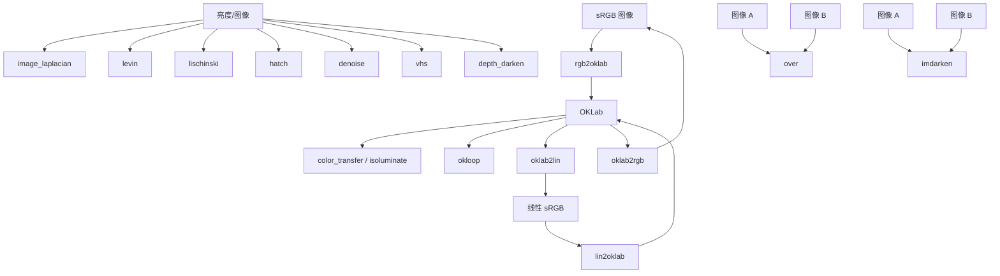

# 30.1 色彩科学与图像着色 / Color Science and Colorization

> 本章覆盖 `imageprocessing/` 下与**色彩空间转换、色彩迁移、图像着色与混合、以及基于图像拉普拉斯的编辑**相关的函数。
> 核心是两条主线：
> (1) **OKLab 色彩空间家族**（`lin2oklab`/`oklab2lin`/`oklab2rgb`/`rgb2oklab`/`okloop`）——常量记忆性、感知均匀的现代色彩空间，
> 是 `color_transfer`、`isoluminate` 等算法的底座；
> (2) **拉普拉斯编辑与混合**（`image_laplacian`/`levin`/`lischinski` 提供着色系统矩阵，`over`/`imdarken` 提供 alpha 混合）。
> 另含若干图像风格化工具：`depth_darken`（深度缓冲反锐化掩蔽）、`vhs`（VHS 故障风）、`hatch`（排线抖动）、
> `denoise`（可控金字塔贝叶斯去噪）、`median_filter`、`gray2rgb`、`gray_bars`（实为深度竖条 `depth_bars`）、`random_color`。
>
> This chapter covers the **color-space conversion, color transfer, image colorization/blending,
> and image-Laplacian-based editing** functions of `imageprocessing/`. Two main threads:
> (1) the **OKLab color-space family** (perceptually uniform, constant-hue), which underpins
> `color_transfer` and `isoluminate`; and (2) **Laplacian editing & compositing**
> (`image_laplacian`/`levin`/`lischinski` build the colorization system matrix; `over`/`imdarken`
> perform alpha compositing). Also included: `depth_darken`, `vhs`, `hatch`, `denoise`,
> `median_filter`, `gray2rgb`, `gray_bars` (actually `depth_bars`), and `random_color`.

- 语言 / Language：中英对照（中文为主）
- 相关章节 / See also：[30 图像处理目录](README.md)、
  [附录 逐函数文档模板](../appendices/03-doc-template.md)、
  [10.10 图像转网格与轮廓](../10-mesh/10-image-to-mesh-and-contours.md)、[60-mex](../60-mex/README.md)
- 命名约定 / Notation：`im` 图像（`h by w` 灰度或 `h by w by 3` RGB）、`L` 亮度/拉普拉斯、`D` 逆深度（`1/depth`）、
  `lin` 线性 sRGB、`ok` OKLab、`W` 权重、`C` 合成结果、`alpha` 透明掩膜
- 说明 / Note：本章**全部函数为纯 MATLAB 实现**，不派发到 `mex/`，故无 `[MEX]` 标注。

---

## 本章概览 / Chapter Overview

### (a) OKLab 色彩空间家族 / The OKLab color-space family

| 函数 | 方向 / Direction | 主要输出 | 说明 |
|---|---|---|---|
| `lin2oklab` | 线性 sRGB → OKLab | `ok` | 线性 sRGB→LMS→立方根→OKLab |
| `oklab2lin` | OKLab → 线性 sRGB | `lin` | 上式的逆（立方代替立方根） |
| `rgb2oklab` | sRGB → OKLab | `ok` | `rgb2lin` ∘ `lin2oklab` |
| `oklab2rgb` | OKLab → sRGB | `rgb` | `oklab2lin` ∘ `lin2rgb`，含复数分支 |
| `okloop` | 生成 OKLab 色环 | `RGB,OK` | 固定 `L`、极坐标 `(a,b)` 取色 |

### (b) 色彩迁移 / 着色 / Color transfer & colorization

| 函数 | 目的 / Purpose | 主要输出 | 说明 |
|---|---|---|---|
| `color_transfer` | 示例驱动视频调色 / example-based grading | `O` | 亮度直方图匹配 + 分带 Monge-Kantorovich 色度迁移 |
| `isoluminate` | 统一/反照率化图像光照 / uniform illumination | `out` | 把色度缩放到 gamut 内、亮度取均值 |
| `image_laplacian` | Levin 中心着色拉普拉斯 / Levin colorization Laplacian | `L` | 边权 `exp(-ΔI²/2ω²)`，对称 Laplacian |
| `levin` | Levin 论文随附代码的着色矩阵 / original Levin code matrix | `L` | **非对称**系统矩阵（非能量系数矩阵） |
| `lischinski` | 色调局部调整拉普拉斯 / tonal adjustment Laplacian | `A` | 边权 `-λ(|ΔL|^α+ε)^-1` |

### (c) 混合 / 风格化 / 工具 / Compositing, stylization & tools

| 函数 | 目的 / Purpose | 主要输出 | 说明 |
|---|---|---|---|
| `over` | alpha 合成 A over B | `C,alpha_C` | Porter-Duff source-over |
| `imdarken` | 变暗混合 / darken blend | `C,alpha_C` | 取较暗像素（Android DARKEN 公式） |
| `depth_darken` | 深度反锐化掩蔽加暗 | `C,U,Um` | [Luft et al. 2006] |
| `gray2rgb` | 灰度→伪彩 / grayscale to pseudocolor | `rgb` | 按颜色数均匀映射到给定 colormap |
| `gray_bars` | 指定深度处叠加竖条 | `G` | 文件内函数名为 `depth_bars`（见条目） |
| `random_color` | 随机颜色生成 | `R` | 支持 `Pastel` 与内置 colormap |
| `hatch` | 排线抖动 / hatched dithering | `H` | `levels` 级排线 |
| `vhs` | VHS 故障风滤镜 | `V` | 色层错位 + 弯曲条带 + 扫描线 |
| `median_filter` | 逐通道中值滤波 | `M` | `medfilt2` 的通道包装 |
| `denoise` | 可控金字塔贝叶斯去噪 | `denoised,noise` | [Simoncelli 1996] 风格去噪 |
| `lin2oklab`/`oklab2lin` 等 | 颜色转换 | — | 见 (a) |

### 概览流程图 / Overview diagram



---

## 逐函数详解 / Per-function reference

### `color_transfer` — 示例驱动的图像/视频调色（色彩迁移）
- **文件 / File**: [imageprocessing/color_transfer.m](file:///c:/VSWork/gptoolbox-1/imageprocessing/color_transfer.m#L1-L151)
- **签名 / Signature**: `O = color_transfer(M,I)`
- **功能 / Purpose**: `EN: Example-based video color grading: transfer the color statistics of a reference image M onto an input image I in OKLab space.` / 中文：在 OKLab 空间中，把参考图 `M` 的色彩统计迁移到输入图 `I`，实现示例驱动的调色。
- **输入 / Inputs**:

  | 参数 | 尺寸/类型 | 含义 (中 / EN) |
  |---|---|---|
  | `M` | `h by w by 3` | 参考图像（如 Amélie 的一帧）/ reference image |
  | `I` | `h by w by 3` | 待调色输入图像 / input image to be graded |

- **输出 / Outputs**:

  | 参数 | 尺寸/类型 | 含义 |
  |---|---|---|
  | `O` | `h by w by 3` | 调色结果（与 `I` 同尺寸）/ output image |

- **可选参数 / Optional**: 无 / None（函数内常量 `k=3` 亮度带、`w=0.1` 重叠率）

  > 局部函数：`luminance_band_weights`（[L13-L43](file:///c:/VSWork/gptoolbox-1/imageprocessing/color_transfer.m#L13-L43)）、
  > `weighted_mean_covariance`（[L45-L53](file:///c:/VSWork/gptoolbox-1/imageprocessing/color_transfer.m#L45-L53)）、
  > `color_transfer_ok`（[L56-L143](file:///c:/VSWork/gptoolbox-1/imageprocessing/color_transfer.m#L56-L143)）。

- **变量流动 / Variable flow**:
  `M,I →(im2double)→ M,I →(rgb2oklab)→ M_ok,I_ok →(1 亮度直方图匹配)→ O_L →(2 分带权重 I_W,M_W)→`
  `(3 每带加权均值/协方差 → Monge-Kantorovich 变换 T,t)→ O_ab →(4 带权重加权合成)→ O_ab →(5 拼接 O_L 与 O_ab)→ O_ok →(oklab2rgb)→ O`
- **算法步骤 / Algorithm**:
  1. `im2double` 归一化 → `rgb2oklab` 转 OKLab，拆出亮度 `I_L=I_ok(:,:,1)`、`M_L`（L145–L148）。
  2. 亮度通道做直方图匹配 `O_L = histogram_matching(I_L,M_L,0.1)`（L59）。
  3. 用 `luminance_band_weights`（`pchip` 插值、10% 重叠、逐像素权重归一）把亮度划分为 `k=3` 个带，得 `I_W,M_W`（L61–L65）。
  4. 对每个带 `i=1..3`：由色度 `a,b` 通道算加权均值 `I_mu(i,:)`、`M_mu(i,:)` 与加权协方差 `I_sigma(:,:,i)`、`M_sigma(:,:,i)`（L76–L78）。
  5. 解线性 Monge-Kantorovich 变换 `T σᵢ Tᵀ = σₘ`：`T = √σᵢ⁻¹ √(√σᵢ σₘ √σᵢ) √σᵢ⁻¹`（`sqrtm` 实现），平移 `t(i,:)=M_mu-I_mu*T`（L82–L97）。
  6. 逐带变换 `O_ab(:,:,i) = I_ab*T(:,:,i)+t(i,:)`（L99）。
  7. 用亮度带权重在 3 个带间加权合成 `O_ab`（L127），再与 `O_L` 拼接为 `O_ok`（L128），最后 `oklab2rgb` 得 `O`（L150）。
- **流程图 / Flowchart**:

  ```mermaid
  flowchart TD
    A["输入 M,I"] --> B["im2double → rgb2oklab"]
    B --> C["O_L = histogram_matching(I_L,M_L)"]
    B --> D["luminance_band_weights → I_W,M_W (k=3)"]
    C --> E["for i = 1..k"]
    D --> E
    E --> F["weighted_mean_covariance → mu,sigma"]
    F --> G["sqrtm → Monge-Kantorovich T,t"]
    G --> H["O_ab(:,:,i) = I_ab*T + t"]
    H --> I{"i < k ?"}
    I -- 是 --> E
    I -- 否 --> J["带权重加权合成 O_ab"]
    J --> K["cat(O_L,O_ab) → O_ok"]
    K --> Z["O = oklab2rgb(O_ok)"]
  ```

- **依赖 / Dependencies**: `histogram_matching` ([matrix/histogram_matching.m](file:///c:/VSWork/gptoolbox-1/matrix/histogram_matching.m#L1))、`rgb2oklab` ([L1](file:///c:/VSWork/gptoolbox-1/imageprocessing/rgb2oklab.m#L1))、`oklab2rgb` ([L1](file:///c:/VSWork/gptoolbox-1/imageprocessing/oklab2rgb.m#L1))；非本库依赖 `im2double`、`sqrtm`、`interp1`、`sort`、`gmres`（MATLAB 内置）
- **See also**: `rgb2oklab`, `oklab2rgb`, `isoluminate`, `histogram_matching`

### `gray2rgb` — 灰度图像按颜色数映射为伪彩
- **文件 / File**: [imageprocessing/gray2rgb.m](file:///c:/VSWork/gptoolbox-1/imageprocessing/gray2rgb.m#L1-L88)
- **签名 / Signature**: `rgb = gray2rgb(im,map,n)`
- **功能 / Purpose**: `EN: Use a colormap to convert a grayscale/intensity image with n colors to a pseudocolor RGB image, mapping the n colors evenly onto the colormap (not by value).` / 中文：用给定 colormap 把含 `n` 种灰度的图像转成伪彩 RGB，`n` 种颜色**均匀**映射到 colormap 上（而非按亮度值）。
- **输入 / Inputs**:

  | 参数 | 尺寸/类型 | 含义 (中 / EN) |
  |---|---|---|
  | `im` | `h by w` | 灰度图像 / grayscale image |
  | `map` | `m by 3`（可选） | colormap / colormap |
  | `n` | 标量（可选） | `im` 中的颜色数 / number of colors in im |

- **输出 / Outputs**:

  | 参数 | 尺寸/类型 | 含义 |
  |---|---|---|
  | `rgb` | `h by w by 3` | 伪彩 RGB 图像 / pseudocolor RGB image |

- **可选参数 / Optional**（均为位置可选参数，靠 `exist(...,'var')` 判断）:

  | 名称 | 取值 | 默认 | 含义 |
  |---|---|---|---|
  | `map` | `m by 3` colormap | 当前 figure 的 `colormap`，无 figure 时 `jet(n)` | 目标色图 |
  | `n` | 整数 | `size(unique(im),1)`（唯一灰度数） | 颜色数 |

- **变量流动 / Variable flow**:
  `im,map,n →(缺省 n=#unique,map=colormap/jet)→ n,map →(若 m≤256 走 gray2ind+label2rgb，否则 fallback 手写分段线性)→ rgb`；当无 `gray2ind` 或 `n>65536` 时进入手写 5 段线性插值的 `x1..x5` 分支。
- **算法步骤 / Algorithm**:
  1. `n` 缺省为唯一灰度数；`map` 缺省为当前 figure 的 `colormap`，若无 figure 则 `jet(n)`（L31–L49）。
  2. 若存在 `gray2ind` 且 `n<=65536`（L51）：`in = gray2ind(im,n)`；必要时 uint8→uint16（L55–L57）。
  3. `m<=256` 用 `label2rgb(idivide(in,n/m,'fix')+1,map)`，否则 `ind2rgb(idivide(in,n/m,'fix'),map)`（L59–L63）。
  4. 依 `im` 类型做 `im2double`/`im2uint16` 回转换（L67–L71）。
  5. 否则（fallback，L72–L86）：手写 5 段线性"jet 式"分段函数，由 `x1..x5` 掩膜组合出 `rgb` 三通道。
- **流程图 / Flowchart**:

  ```mermaid
  flowchart TD
    A["输入 im,(map),(n)"] --> B{"给了 n ?"}
    B -- 否 --> B1["n = size(unique(im),1)"]
    B -- 是 --> C
    B1 --> C{"给了 map ?"}
    C -- 否 --> C1["map = colormap 或 jet(n)"]
    C -- 是 --> D
    C1 --> D{"存在 gray2ind 且 n<=65536 ?"}
    D -- 是 --> E["in = gray2ind(im,n)"]
    E --> F{"m<=256 ?"}
    F -- 是 --> F1["label2rgb(...)"]
    F -- 否 --> F2["ind2rgb(...)"]
    F1 --> Z["输出 rgb"]
    F2 --> Z
    D -- 否 --> G["手写 5 段线性插值"]
    G --> Z
  ```

- **依赖 / Dependencies**: 无本库依赖；非本库依赖 Image Processing Toolbox：`gray2ind`、`label2rgb`、`ind2rgb`、`idivide`、`colormap`、`jet`、`im2double`、`im2uint16`、`unique`
- **See also**: `rgb2gray`, `hsv2rgb`, `rgb2hsv`, `imshow`（文档头声明）

### `gray_bars` — 在指定深度处叠加竖条（文件内函数名为 `depth_bars`）
- **文件 / File**: [imageprocessing/gray_bars.m](file:///c:/VSWork/gptoolbox-1/imageprocessing/gray_bars.m#L1-L40)
- **签名 / Signature**: `G = depth_bars(im,D,d,varargin)`（⚠️ 文件名 `gray_bars.m` 与函数名 `depth_bars` **不一致**）
- **功能 / Purpose**: `EN: Add vertical bars to an image at a specific depth, where bars appear only where the inverse-depth is below d.` / 中文：在图像中"指定深度 `d`"处叠加竖条：仅对逆深度 `D<d` 的像素叠加条带颜色。
- **输入 / Inputs**:

  | 参数 | 尺寸/类型 | 含义 (中 / EN) |
  |---|---|---|
  | `im` | `h by w by c` | 输入图像 / input image |
  | `D` | `h by w` | 逆深度 `1/depth` / inverse depth |
  | `d` | 标量 | 竖条所在深度阈值 / depth of bars |

- **输出 / Outputs**:

  | 参数 | 尺寸/类型 | 含义 |
  |---|---|---|
  | `G` | `h by w by c` | 叠加竖条后的图像 / image with bars |

- **可选参数 / Optional**（`containers.Map` 参数表）：

  | 名称 | 取值 | 默认 | 含义 |
  |---|---|---|---|
  | `'Color'` | `1 by c` | `repmat(0.8,[1 nc])` | 竖条颜色 / bar color |

- **变量流动 / Variable flow**:
  `im,D,d,(color) →(确定条宽 w=ceil(size(im,2)/40))→ w →(在 1/3、2/3 处各画一条宽 w 的竖条)→ B →(按 D<d 前景/背景 bsxfun 叠加)→ G`
- **算法步骤 / Algorithm**:
  1. 取通道数 `nc`，条色缺省 `0.8`（L15–L16）；解析 `'Color'` 参数（L18–L31）。
  2. `w = ceil(size(im,2)/40)`（条宽，L34）。
  3. 复制 `B=im`，对每通道在 `floor(end/3-w/2+(1:w))` 与 `floor(2*end/3-w/2+(1:w))` 两列区间写入 `color(c)`（L35–L38）。
  4. `G = bsxfun(@times,B,D<d) + bsxfun(@times,im,D>=d)`：按逆深度阈值选择条带像素与原图（L39）。
- **流程图 / Flowchart**:

  ```mermaid
  flowchart TD
    A["输入 im,D,d,(Color)"] --> B["nc = size(im,3); color 缺省 0.8"]
    B --> C["w = ceil(w/40)"]
    C --> D["for c = 1..nc: 在两处画竖条 → B"]
    D --> E{"D < d ?"}
    E -- 是 --> F["取竖条像素 B"]
    E -- 否 --> G["取原图像素 im"]
    F --> Z["输出 G"]
    G --> Z
  ```

- **依赖 / Dependencies**: 无本库依赖；非本库依赖 `containers.Map`、`assignin`、`bsxfun`（MATLAB 内置）
- **See also**: `depth_darken`
- **备注 / Note**: 该 `.m` 文件头注释为 `DEPTH_BARS`，函数体为 `depth_bars`，**文件名 `gray_bars.m` 与函数名不符**（历史命名遗留）。

### `lin2oklab` — 线性 sRGB 转 OKLab
- **文件 / File**: [imageprocessing/lin2oklab.m](file:///c:/VSWork/gptoolbox-1/imageprocessing/lin2oklab.m#L1-L32)
- **签名 / Signature**: `ok = lin2oklab(lin)`
- **功能 / Purpose**: `EN: Convert colors in linear sRGB color space to OKLab: linear sRGB → LMS → cube root → OKLab.` / 中文：把**线性 sRGB** 颜色转换到 OKLab：线性 sRGB → LMS → 立方根 → OKLab。
- **输入 / Inputs**:

  | 参数 | 尺寸/类型 | 含义 (中 / EN) |
  |---|---|---|
  | `lin` | `#h by #w by 3` 或 `#lin by 3` | 线性 sRGB 图像或颜色表 / linear-sRGB image or color list |

- **输出 / Outputs**:

  | 参数 | 尺寸/类型 | 含义 |
  |---|---|---|
  | `ok` | 与 `lin` 同尺寸 | OKLab 颜色 / OKLab colors |

- **可选参数 / Optional**: 无 / None
- **变量流动 / Variable flow**:
  `lin →(若为 #lin by 3 列表则 permute 展开)→ lin →(1 线性 sRGB→LMS 3×3 矩阵)→ lms →(2 逐元素立方根 lms.^(1/3))→ lms' →(3 LMS'→OKLab 3×3 矩阵)→ ok →(若曾 permute 则反 permute)→ ok`
- **算法步骤 / Algorithm**:
  1. 若输入是 `#lin by 3` 颜色列表（`size(lin,3)==1 && size(lin,2)==3`）则 `permute(lin,[1 3 2])` 并记 `was_permuted=true`（L13–L17）。
  2. **线性 sRGB → LMS**：`lms = M1 * lin`（矩阵系数 L19–L22，行：`0.4121656120,0.5362752080,0.0514575653` 等）。
  3. **非线性化（立方根）**：`lms = lms.^(1/3)`（L23）。
  4. **LMS' → OKLab**：`ok = M2 * lms'`（矩阵系数 L24–L27）。
  5. 若曾 permute 则反 permute 还原形状（L29–L31）。
- **色彩空间数学 / Color-space math**: 定义 `M1 = [[0.4121656120,0.5362752080,0.0514575653],[0.2118591070,0.6807189584,0.1074065790],[0.0883097947,0.2818474174,0.6302613616]]`，`M2 = [[0.2104542553,0.7936177850,-0.0040720468],[1.9779984951,-2.4285922050,0.4505937099],[0.0259040371,0.7827717662,-0.8086757660]]`；即 `OKLab = M2 · (M1 · lin)^(1/3)`。对 in-gamut 的线性 sRGB（分量∈[0,1]），`L∈[0,1]`、`a,b` 约在 `[-0.4,0.4]`。
- **流程图 / Flowchart**:

  ```mermaid
  flowchart TD
    A["输入 lin"] --> B{"是 #lin by 3 列表 ?"}
    B -- 是 --> B1["permute → 3D"]
    B -- 否 --> C
    B1 --> C["lms = M1 * lin"]
    C --> D["lms = lms.^(1/3)"]
    D --> E["ok = M2 * lms"]
    E --> F{"was_permuted ?"}
    F -- 是 --> F1["反 permute"]
    F -- 否 --> Z
    F1 --> Z["输出 ok"]
  ```

- **依赖 / Dependencies**: 无本库依赖（纯 MATLAB）
- **See also**: `oklab2lin`, `rgb2oklab`, `oklab2rgb`, `rgb2lin`, `lin2rgb`

### `oklab2lin` — OKLab 转线性 sRGB
- **文件 / File**: [imageprocessing/oklab2lin.m](file:///c:/VSWork/gptoolbox-1/imageprocessing/oklab2lin.m#L1-L32)
- **签名 / Signature**: `lin = oklab2lin(ok)`
- **功能 / Purpose**: `EN: Convert colors in OKLab color space to linear sRGB: OKLab → LMS → cube → linear sRGB (inverse of lin2oklab).` / 中文：把 OKLab 颜色转回线性 sRGB：OKLab → LMS → 立方 → 线性 sRGB（`lin2oklab` 的逆）。
- **输入 / Inputs**:

  | 参数 | 尺寸/类型 | 含义 (中 / EN) |
  |---|---|---|
  | `ok` | `#h by #w by 3` 或 `#ok by 3` | OKLab 图像或颜色表 / OKLab image or list |

- **输出 / Outputs**:

  | 参数 | 尺寸/类型 | 含义 |
  |---|---|---|
  | `lin` | 与 `ok` 同尺寸 | 线性 sRGB 颜色 / linear sRGB |

- **可选参数 / Optional**: 无 / None
- **变量流动 / Variable flow**:
  `ok →(若为 #ok by 3 列表则 permute)→ ok →(1 OKLab→LMS' 逆矩阵)→ lms' →(2 逐元素立方 lms.^3)→ lms →(3 LMS→线性 sRGB 逆矩阵)→ lin →(若曾 permute 则反 permute)→ lin`
- **算法步骤 / Algorithm**:
  1. 若输入是颜色列表则 permute 并记 `was_permuted`（L13–L17）。
  2. **OKLab → LMS'**：`lms = M2⁻¹ * ok`（L19–L22，如 `ok1+0.3963377774*ok2+0.2158037573*ok3`）。
  3. **立方**：`lms = lms.^3`（L23）。
  4. **LMS → 线性 sRGB**：`lin = M1⁻¹ * lms`（L24–L27，如 `+4.0767245293*lms1-3.3072168827*lms2+0.2307590544*lms3`）。
  5. 若曾 permute 则反 permute（L29–L31）。
- **色彩空间数学 / Color-space math**: 是 `lin2oklab` 的精确逆：以 `M2⁻¹`（OKLab→LMS'）与 `M1⁻¹`（LMS→线性 sRGB）作用，并把立方根换成**立方**。输出 `lin` 为线性 sRGB，通常落在 `[0,1]`，但 out-of-gamut 时可为负值。
- **流程图 / Flowchart**:

  ```mermaid
  flowchart TD
    A["输入 ok"] --> B{"是 #ok by 3 列表 ?"}
    B -- 是 --> B1["permute → 3D"]
    B -- 否 --> C
    B1 --> C["lms = M2inv * ok"]
    C --> D["lms = lms.^3"]
    D --> E["lin = M1inv * lms"]
    E --> F{"was_permuted ?"}
    F -- 是 --> F1["反 permute"]
    F -- 否 --> Z
    F1 --> Z["输出 lin"]
  ```

- **依赖 / Dependencies**: 无本库依赖（纯 MATLAB）
- **See also**: `lin2oklab`, `rgb2oklab`, `oklab2rgb`, `rgb2lin`, `lin2rgb`

### `oklab2rgb` — OKLab 转 sRGB
- **文件 / File**: [imageprocessing/oklab2rgb.m](file:///c:/VSWork/gptoolbox-1/imageprocessing/oklab2rgb.m#L1-L37)
- **签名 / Signature**: `rgb = oklab2rgb(ok)`
- **功能 / Purpose**: `EN: Convert OKLab colors to sRGB by composing oklab2lin with the sRGB gamma encoding, with a complex-input branch for finite differencing.` / 中文：把 OKLab 颜色转 sRGB：先 `oklab2lin`，再做 sRGB gamma 编码；对复数输入走手写分支以支持复数步长有限差分。
- **输入 / Inputs**:

  | 参数 | 尺寸/类型 | 含义 (中 / EN) |
  |---|---|---|
  | `ok` | `#h by #w by 3` 或 `#ok by 3` | OKLab 图像或颜色表 / OKLab image or list |

- **输出 / Outputs**:

  | 参数 | 尺寸/类型 | 含义 |
  |---|---|---|
  | `rgb` | 与 `ok` 同尺寸 | sRGB 颜色 / sRGB colors |

- **可选参数 / Optional**: 无 / None
- **变量流动 / Variable flow**:
  `ok →(oklab2lin)→ lin →{isreal(lin)? 是→(lin2rgb)→ rgb : 否→(手写 gamma：in_sign,abs/log/exp 分段)→ rgb}`
- **算法步骤 / Algorithm**:
  1. `lin = oklab2lin(ok)`（L12）。
  2. 若 `isreal(lin)`：`rgb = lin2rgb(lin)`（L13–L14）。
  3. 否则（复数输入，L15–L36）：手写 `lin2rgb` 的 gamma 编码——取符号 `in_sign`、`x=abs(real(x))+1i*imag(x)`，按 `x<0.0031308` 分线性段 `y=c*x` 与 gamma 段 `y=a*x^gamma+b`（`a=1.055,b=-0.055,c=12.92,gamma=1/2.4`），再还原符号。
- **色彩空间数学 / Color-space math**: `oklab2rgb = lin2rgb ∘ oklab2lin`；`lin2rgb` 施加 sRGB 传递函数 `y = 12.92·x`（`x≤0.0031308`）或 `y = 1.055·x^(1/2.4)-0.055`（否则）。输出 `rgb` 通常∈`[0,1]`。
- **流程图 / Flowchart**:

  ```mermaid
  flowchart TD
    A["输入 ok"] --> B["lin = oklab2lin(ok)"]
    B --> C{"isreal(lin) ?"}
    C -- 是 --> D["rgb = lin2rgb(lin)"]
    C -- 否 --> E["手写 gamma 编码"]
    E --> E1["in_sign; x=abs(real)+1i*imag"]
    E1 --> E2{"real(x) < d ?"}
    E2 -- 是 --> E3["线性段 y = c*x"]
    E2 -- 否 --> E4["gamma 段 y = a*x^g + b"]
    E3 --> F["还原符号"]
    E4 --> F
    D --> Z["输出 rgb"]
    F --> Z
  ```

- **依赖 / Dependencies**: `oklab2lin` ([L1](file:///c:/VSWork/gptoolbox-1/imageprocessing/oklab2lin.m#L1))；非本库依赖 `lin2rgb`（Image Processing Toolbox）、`cast`、`real`、`imag`（MATLAB 内置）
- **See also**: `rgb2oklab`, `lin2oklab`, `oklab2lin`, `rgb2lin`, `lin2rgb`

### `rgb2oklab` — sRGB 转 OKLab
- **文件 / File**: [imageprocessing/rgb2oklab.m](file:///c:/VSWork/gptoolbox-1/imageprocessing/rgb2oklab.m#L1-L21)
- **签名 / Signature**: `ok = rgb2oklab(rgb)`
- **功能 / Purpose**: `EN: Convert RGB (sRGB) colors to OKLab by linearizing sRGB then applying lin2oklab.` / 中文：把 sRGB 颜色转 OKLab：先 `rgb2lin` 线性化，再 `lin2oklab`。
- **输入 / Inputs**:

  | 参数 | 尺寸/类型 | 含义 (中 / EN) |
  |---|---|---|
  | `rgb` | `#h by #w by 3` 或 `#rgb by 3` | sRGB 图像或颜色表 / sRGB image or list |

- **输出 / Outputs**:

  | 参数 | 尺寸/类型 | 含义 |
  |---|---|---|
  | `ok` | 与 `rgb` 同尺寸 | OKLab 颜色 / OKLab colors |

- **可选参数 / Optional**: 无 / None
- **变量流动 / Variable flow**: `rgb →(rgb2lin, sRGB gamma 逆)→ lin →(lin2oklab)→ ok`
- **算法步骤 / Algorithm**:
  1. `lin = rgb2lin(rgb)`（L19）——施加 sRGB gamma 逆（线性化）。
  2. `ok = lin2oklab(lin)`（L20）——线性 sRGB→LMS→立方根→OKLab。
  文档内附示例：对极端蓝/白两色做线性插值并比较 RGB 直线与 OKLab 直线（L13–L18）。
- **流程图 / Flowchart**:

  ```mermaid
  flowchart TD
    A["输入 rgb"] --> B["lin = rgb2lin(rgb)"]
    B --> C["ok = lin2oklab(lin)"]
    C --> Z["输出 ok"]
  ```

- **依赖 / Dependencies**: `rgb2lin`（Image Processing Toolbox）、`lin2oklab` ([L1](file:///c:/VSWork/gptoolbox-1/imageprocessing/lin2oklab.m#L1))
- **See also**: `rgb2lin`, `lin2rgb`, `oklab2rgb`, `lin2oklab`, `oklab2lin`

### `okloop` — 生成 OKLab 色环 / 色弧
- **文件 / File**: [imageprocessing/okloop.m](file:///c:/VSWork/gptoolbox-1/imageprocessing/okloop.m#L1-L27)
- **签名 / Signature**: `[RGB,OK] = okloop(nc, arc, shift)`
- **功能 / Purpose**: `EN: Generate nc colors sampled uniformly on a circular arc in OKLab (constant L, hue-finishing loop) and return both their OKLab and sRGB values.` / 中文：在 OKLab 空间中于一段圆弧上均匀取样生成 `nc` 种颜色（固定亮度 `L`、色度沿角度旋转），同时返回 OKLab 与 sRGB 值。
- **输入 / Inputs**:

  | 参数 | 尺寸/类型 | 含义 (中 / EN) |
  |---|---|---|
  | `nc` | 标量（可选） | 颜色数 / number of colors |
  | `arc` | 标量（可选） | 色弧张角（弧度）/ arc angle sweeping the hue |
  | `shift` | 标量（可选） | 起始相角偏移 / phase shift |

- **输出 / Outputs**:

  | 参数 | 尺寸/类型 | 含义 |
  |---|---|---|
  | `RGB` | `nc by 3` | sRGB 颜色表 / sRGB colors |
  | `OK` | `nc by 3` | 对应的 OKLab 颜色表（`L` 常数，`a,b` 在圆上）/ OKLab colors |

- **可选参数 / Optional**（`nargin` 判定）:

  | 名称 | 取值 | 默认 | 含义 |
  |---|---|---|---|
  | `nc` | 整数 | `256` | 颜色数 |
  | `arc` | 标量 | `2*pi` | 色弧角跨度 |
  | `shift` | 标量 | `0` | 起始相角 |

- **变量流动 / Variable flow**:
  `nc,arc,shift →(默认值)→ nc,arc,shift →(th=linspace(shift,arc+shift,nc+1)，去掉末点)→ th →(OK=[L, r·cosθ, r·sinθ])→ OK →(oklab2rgb)→ RGB`
- **算法步骤 / Algorithm**:
  1. 缺省 `nc=256`、`arc=2*pi`、`shift=0`（L17–L19）。
  2. `th = linspace(0+shift, arc+shift, nc+1)'`，去掉最后一个重复点（L21–L22）。
  3. 取常数亮度 `l=0.75010101010101016`、色度半径 `r=0.12755316371916220`，`OK = [repmat(l,nc,1), r*[cos(th) sin(th)]]`（L23–L25）。
  4. `RGB = oklab2rgb(OK)`（L26）。
- **色彩空间数学 / Color-space math**: 在 OKLab 中的 `(a,b)` 平面取半径 `r≈0.1276` 的圆弧（角度 `θ` 从 `shift` 扫到 `arc+shift`），亮度 `L≈0.7501` 固定；这等价于在 OKLCH 的 hue 上均匀绕行、chroma 恒定，从而得到"等感知亮度、只变色相"的连续配色。`OK` 列序为 `L,a,b`，数值约 `L=0.7501`、`|(a,b)|=0.1276`。
- **流程图 / Flowchart**:

  ```mermaid
  flowchart TD
    A["输入 nc,arc,shift"] --> B{"nargin < 1 ?"}
    B -- 是 --> B1["nc = 256"]
    B -- 否 --> C
    B1 --> C{"nargin < 2 ?"}
    C -- 是 --> C1["arc = 2*pi"]
    C -- 否 --> D
    C1 --> D{"nargin < 3 ?"}
    D -- 是 --> D1["shift = 0"]
    D -- 否 --> E
    D1 --> E["th = linspace(shift,arc+shift,nc+1); th=th(1:end-1)"]
    E --> F["OK = [L, r*cos(th), r*sin(th)]"]
    F --> G["RGB = oklab2rgb(OK)"]
    G --> Z["输出 RGB,OK"]
  ```

- **依赖 / Dependencies**: `oklab2rgb` ([L1](file:///c:/VSWork/gptoolbox-1/imageprocessing/oklab2rgb.m#L1))；非本库依赖 `linspace`、`repmat`、`cos`、`sin`（MATLAB 内置）
- **See also**: `oklab2rgb`, `rgb2oklab`, `color_transfer`, `random_color`

### `random_color` — 生成随机颜色列表
- **文件 / File**: [imageprocessing/random_color.m](file:///c:/VSWork/gptoolbox-1/imageprocessing/random_color.m#L1-L59)
- **签名 / Signature**: `R = random_color(n,preset)`
- **功能 / Purpose**: `EN: Generate a list of random RGB colors, optionally filtered to a "Pastel" palette or sampled from a named built-in colormap.` / 中文：生成随机 RGB 颜色列表，可选按 `Pastel`（柔和色）筛选或从内置 colormap（如 `jet`）中随机取样。
- **输入 / Inputs**:

  | 参数 | 尺寸/类型 | 含义 (中 / EN) |
  |---|---|---|
  | `n` | 标量或尺寸向量（可选） | 颜色数量/尺寸 / number of colors |
  | `preset` | 字符串（可选） | 预设名 / preset name |

- **输出 / Outputs**:

  | 参数 | 尺寸/类型 | 含义 |
  |---|---|---|
  | `R` | `n by 3` | RGB 颜色列表 / list of RGB colors |

- **可选参数 / Optional**（`exist(...,'var')` 判定）:

  | 名称 | 取值 | 默认 | 含义 |
  |---|---|---|---|
  | `n` | 整数/尺寸 | `1` | 颜色数 |
  | `preset` | `''` / `'Pastel'` / `'jet'`/`'hsv'`/`'hot'`/`'pink'`/`'flag'`/`'bone'`/`'gray'`/`'cool'`/`'copper'` | `''` | 预设；空串即纯随机 |

- **变量流动 / Variable flow**:
  `n,preset →(switch preset)→ {'' → rand([n,3]); 'Pastel' → 重试迭代 (归一化+亮度/灰度过滤); colormap 名 → f(n*10) 再 randperm 取样}→ R →(|Pastel 时 +34/255 提亮)→ R`
- **算法步骤 / Algorithm**:
  1. `n` 缺省 `1`、`preset` 缺省 `''`（L16–L21）。
  2. `switch preset`（L23–L57）：
     - `''`：`R = rand([n,3])`（L25）。
     - `'Pastel'`（L26–L49）：以 `max_attempts=10*prod(n)` 迭代，用 `291/255` 归一化 + 重试，过滤"过亮"（`max-min>221/255`）与"过灰"（`std<68/255`）的颜色，最后 `reshape` 并整体加 `34/255`。
     - colormap 名（`'jet'` 等，L50–L54）：`str2func(preset)` 生成 `n*10` 色，`randperm` 打乱后取前 `n` 行。
     - `otherwise`：`error('Unsupported preset')`（L56）。
- **流程图 / Flowchart**:

  ```mermaid
  flowchart TD
    A["输入 n,preset"] --> B["switch preset"]
    B -- "'' 空串" --> B1["R = rand([n,3])"]
    B -- Pastel --> P1["attempt=0; retry=true"]
    P1 --> P2{"attempt < max_attempts ?"}
    P2 -- 是 --> P3["归一化 + 亮度/灰度过滤 → next_retry"]
    P3 --> P4{"any(next_retry) ?"}
    P4 -- 是 --> P2
    P4 -- 否 --> P5["break"]
    P2 -- 否 --> P5
    P5 --> P6["R + 34/255"]
    B -- "colormap 名 (jet/hsv/...)" --> C1["f(str2func); randperm 取样"]
    B -- otherwise --> C2["error('Unsupported preset')"]
    B1 --> Z["输出 R"]
    P6 --> Z
    C1 --> Z
  ```

- **依赖 / Dependencies**: 无本库依赖；非本库依赖 `rand`、`str2func`、`randperm`、`reshape`、`std`（MATLAB 内置）
- **See also**: `okloop`, `gray2rgb`, `colormap`
- **备注 / Note**: 文档头写作 `R = random_color(size)`，而实现参数名为 `n`，且 `prod(n)` 暗示 `n` 可为尺寸向量；`Pastel` 分支中 `next_retry` 被"过亮"判定覆盖后又被"过灰"判定整体覆盖（L38–L42），行为以代码为准。

### `depth_darken` — 深度缓冲反锐化掩蔽加暗
- **文件 / File**: [imageprocessing/depth_darken.m](file:///c:/VSWork/gptoolbox-1/imageprocessing/depth_darken.m#L1-L53)
- **签名 / Signature**: `[C,U,Um] = depth_darken(im,D,varargin)`
- **功能 / Purpose**: `EN: Enhance an image by darkening it according to the unsharp mask of its depth buffer [Luft et al. 2006].` / 中文：按深度缓冲的反锐化掩蔽对图像加暗，以增强深度感 [Luft et al. 2006]。
- **输入 / Inputs**:

  | 参数 | 尺寸/类型 | 含义 (中 / EN) |
  |---|---|---|
  | `im` | `h by w by c` | 彩色图像 / color image |
  | `D` | `h by w` | 逆深度图像 `1/depth` / inverse depth image |

- **输出 / Outputs**:

  | 参数 | 尺寸/类型 | 含义 |
  |---|---|---|
  | `C` | `h by w by c` | 加暗后的彩色图像 / depth-darkened image |
  | `U` | `h by w` | 深度的反锐化**掩蔽**（含正负）/ unsharp mask of depth |
  | `Um` | `h by w` | 用于加暗的负部 / negative part used for darkening |

- **可选参数 / Optional**（`containers.Map` 参数表）:

  | 名称 | 取值 | 默认 | 含义 |
  |---|---|---|---|
  | `'Lambda'` | 标量 | `0.3` | 加暗强度 / darkening intensity |
  | `'Sigma'` | 标量 | `0.08*h` | 高斯模糊半径 / blur radius |

- **变量流动 / Variable flow**:
  `im,D,(lambda,sigma) →(sigma 缺省 0.08*size(D,1))→ sigma →(fspecial 高斯核 G)→ G →(D - imfilter(D,G))→ U →(取负部 (U<0).*U)→ Um →(im + lambda*Um)→ C`
- **算法步骤 / Algorithm**:
  1. 缺省 `lambda=0.3`、`sigma=[]`；解析 `'Lambda'`/`'Sigma'`（L21–L39）。
  2. 若 `sigma` 为空则 `sigma = 0.08*size(D,1)`（L41–L43）。
  3. 构造高斯核 `G = fspecial('gaussian',ceil(2*sigma),sigma)`（L45）。
  4. 反锐化掩蔽 `U = D - imfilter(D,G,'replicate')`（L47）。
  5. 只保留负部 `Um = (U<0).*U`（L49）。
  6. 加暗 `C = bsxfun(@plus,im,lambda*Um)`（L51）。
- **流程图 / Flowchart**:

  ```mermaid
  flowchart TD
    A["输入 im,D,(Lambda,Sigma)"] --> B{"sigma 为空 ?"}
    B -- 是 --> B1["sigma = 0.08*size(D,1)"]
    B -- 否 --> C
    B1 --> C["G = fspecial('gaussian',...)"]
    C --> D["U = D - imfilter(D,G)"]
    D --> E["Um = (U<0).*U"]
    E --> F["C = im + lambda*Um"]
    F --> Z["输出 C,U,Um"]
  ```

- **依赖 / Dependencies**: 无本库依赖；非本库依赖 Image Processing Toolbox：`fspecial`、`imfilter`；MATLAB 内置 `containers.Map`、`assignin`、`bsxfun`
- **See also**: `gray_bars`, `imdarken`, `over`

### `imdarken` — 变暗混合（darken blend）
- **文件 / File**: [imageprocessing/imdarken.m](file:///c:/VSWork/gptoolbox-1/imageprocessing/imdarken.m#L1-L23)
- **签名 / Signature**: `[C,alpha_C] = imdarken(A,alpha_A,B,alpha_B)`
- **功能 / Purpose**: `EN: Blend image A over B, replacing pixels in B when the corresponding pixel in A is darker (darken blend mode).` / 中文：把图像 `A` 叠加到 `B` 上，当 `A` 的对应像素更暗时替换 `B`（变暗混合模式）。
- **输入 / Inputs**:

  | 参数 | 尺寸/类型 | 含义 (中 / EN) |
  |---|---|---|
  | `A` | `w by h by c` | 图像 A / image A |
  | `alpha_A` | `w by h by c` 或 `w by h` 或标量 | A 的 alpha 掩膜 / alpha mask |
  | `B` | `w by h by c` | 图像 B / image B |
  | `alpha_B` | 同上 | B 的 alpha 掩膜 / alpha mask |

- **输出 / Outputs**:

  | 参数 | 尺寸/类型 | 含义 |
  |---|---|---|
  | `C` | `w by h by c` | 结果图像（**始终 double**）/ result image |
  | `alpha_C` | 同 `alpha` 形状 | 结果 alpha / result alpha mask |

- **可选参数 / Optional**: 无 / None
- **变量流动 / Variable flow**: `A,alpha_A,B,alpha_B →(alpha_C = alpha_A+alpha_B-alpha_B.*alpha_A)→ alpha_C →(C = (1-alpha_B).*A+(1-alpha_A).*B+min(B,A))→ C`
- **算法步骤 / Algorithm**:
  1. 合成 alpha：`alpha_C = alpha_A+alpha_B-alpha_B.*alpha_A`（L21）。
  2. 变暗混合：`C = (1-alpha_B).*A + (1-alpha_A).*B + min(B,A)`（L22，Android `BlendMode.DARKEN` 公式）。
- **流程图 / Flowchart**:

  ```mermaid
  flowchart TD
    A["输入 A,alpha_A,B,alpha_B"] --> B["alpha_C = aA + aB - aB.*aA"]
    B --> C["C = (1-aB).*A + (1-aA).*B + min(B,A)"]
    C --> Z["输出 C,alpha_C"]
  ```

- **依赖 / Dependencies**: 无本库依赖（纯 MATLAB；`min` 内置）
- **See also**: `over`, `depth_darken`

### `isoluminate` — 统一光照（色度缩放到 gamut 内）
- **文件 / File**: [imageprocessing/isoluminate.m](file:///c:/VSWork/gptoolbox-1/imageprocessing/isoluminate.m#L1-L79)
- **签名 / Signature**: `out = isoluminate(in,uniform)`
- **功能 / Purpose**: `EN: Re-render an image so all its colors share a single lightness, shrinking chroma into the sRGB gamut; optionally search for the best common lightness.` / 中文：把图像所有颜色重渲染到**同一亮度**，并将色度缩放到 sRGB gamut 内；可选地对公共亮度做一维搜索。
- **输入 / Inputs**:

  | 参数 | 尺寸/类型 | 含义 (中 / EN) |
  |---|---|---|
  | `in` | `h by w by 3` | 输入 RGB 图像 / input RGB image |
  | `uniform` | logical（可选） | 是否搜索最佳公共亮度 / search best lightness |

- **输出 / Outputs**:

  | 参数 | 尺寸/类型 | 含义 |
  |---|---|---|
  | `out` | 与 `in` 同尺寸 | 统一光照后的图像 / re-illuminated image |

- **可选参数 / Optional**:

  | 名称 | 取值 | 默认 | 含义 |
  |---|---|---|---|
  | `uniform` | `true`/`false` | `false` | 为 `true` 时对亮度 `l` 做暴力搜索（1D 搜索最优）|

- **变量流动 / Variable flow**:
  `in,uniform →(reshape)→ rgb_in →(rgb2oklab)→ lab_in →(变量：l,s)→ lab=[repmat(l), s.*ab_in] →(oklab2rgb)→ rgb →(reshape)→ out`；
  其中 `s` 由嵌套函数 `local(l,ab_in,s_min,s_max,uniform,iter)` 用二分/递归在 `[0,1]` 上求"使 `oklab2rgb` 结果落在 `[0,1]³` 的最大缩放"。
- **算法步骤 / Algorithm**:
  1. `uniform` 缺省 `false`（L2–L4）；`size_in=size(in)`，`rgb_in` 展平，`lab_in = rgb2oklab(rgb_in)`（L5–L7）。
  2. 若 `uniform`（L26–L40）：对 `l=linspace(0,1)` 遍历，`s = local(l,ab_in,0,1,true,0)`，构造 `lab`、算误差 `E`，保留最优 `best_l,best_s`。
  3. 否则（L41–L44）：`l = mean(lab_in(:,1))`；`s = local(l,ab_in,0,1,false,0)`。
  4. 构造 `lab = [repmat(l,#pixels,1), s.*lab_in(:,2:3)]`（L45）；`rgb = oklab2rgb(lab)`；`out = reshape(rgb,size_in)`（L46–L47）。
  5. 嵌套 `local`（L50–L77）：二分缩放 `s`，用 `oklab2rgb` 是否越界（`rgb<0|rgb>1`）收缩 `s_max/s_min`，递归至多 10 次（`iter>10` 时取 `s_min`）。
- **流程图 / Flowchart**:

  ```mermaid
  flowchart TD
    A["输入 in,(uniform)"] --> B["lab_in = rgb2oklab(reshape(in))"]
    B --> C{"uniform ?"}
    C -- 是 --> D["for l = linspace(0,1)"]
    D --> D1["s = local(l,...,true,0)"]
    D1 --> D2{"E < min_E ?"}
    D2 -- 是 --> D3["更新 best_l,best_s"]
    D2 -- 否 --> D4
    D3 --> D4{"l 遍历完 ?"}
    D4 -- 否 --> D
    D4 -- 是 --> E["l=best_l; s=best_s"]
    C -- 否 --> F["l = mean(lab_in(:,1)); s = local(l,...,false,0)"]
    E --> G["lab = [l, s.*ab_in]"]
    F --> G
    G --> H["rgb = oklab2rgb(lab)"]
    H --> Z["out = reshape(rgb,size_in)"]
    subgraph LOCAL["local(l,ab_in,s_min,s_max,uniform,iter)"]
      L0["iter > 10 ?"] -- 是 --> L1["s = s_min; return"]
      L0 -- 否 --> L2["s = 0.5*(s_min+s_max)"]
      L2 --> L3{"oklab2rgb 越界 ?"}
      L3 -- 是 --> L4["s_max(bad)=s"]
      L3 -- 否 --> L5["s_min(~bad)=s"]
      L4 --> L6["递归 local(...,iter+1)"]
      L5 --> L6
    end
  ```

- **依赖 / Dependencies**: `rgb2oklab` ([L1](file:///c:/VSWork/gptoolbox-1/imageprocessing/rgb2oklab.m#L1))、`oklab2rgb` ([L1](file:///c:/VSWork/gptoolbox-1/imageprocessing/oklab2rgb.m#L1))；非本库依赖 `reshape`、`mean`、`linspace`、`repmat`（MATLAB 内置）；内部嵌套函数 `local`（[L50-L77](file:///c:/VSWork/gptoolbox-1/imageprocessing/isoluminate.m#L50-L77)）
- **See also**: `rgb2oklab`, `oklab2rgb`, `color_transfer`, `okloop`

### `over` — alpha 合成（A over B）
- **文件 / File**: [imageprocessing/over.m](file:///c:/VSWork/gptoolbox-1/imageprocessing/over.m#L1-L37)
- **签名 / Signature**: `[C,alpha_C] = over(A,alpha_A,B,alpha_B)`
- **功能 / Purpose**: `EN: Composite image A over image B using alpha masking (Porter-Duff source-over).` / 中文：用 alpha 掩膜把图像 `A` 合成到图像 `B` 之上（source-over 合成）。
- **输入 / Inputs**:

  | 参数 | 尺寸/类型 | 含义 (中 / EN) |
  |---|---|---|
  | `A` | `w by h by c` | 图像 A / image A |
  | `alpha_A` | `w by h by c` 或 `w by h` 或标量 | A 的 alpha / alpha mask |
  | `B` | `w by h by c` | 图像 B / image B |
  | `alpha_B` | 同上 | B 的 alpha / alpha mask |

- **输出 / Outputs**:

  | 参数 | 尺寸/类型 | 含义 |
  |---|---|---|
  | `C` | `w by h by c` | 结果图像（**始终 double**）/ result image |
  | `alpha_C` | 同 `alpha` 形状 | 结果 alpha / result alpha |

- **可选参数 / Optional**: 无 / None
- **变量流动 / Variable flow**:
  `A,alpha_A,B,alpha_B →(im2double 归一)→ A,alpha_A,B,alpha_B →(C = A*alpha_A + B*alpha_B*(1-alpha_A))→ C,alpha_A →(alpha_C = alpha_A+alpha_B*(1-alpha_A))→ alpha_C →(按 alpha_C 除，0 保护 zero2one)→ C`
- **算法步骤 / Algorithm**:
  1. `im2double` 归一化四个输入（L23–L26）。
  2. 合成颜色：`C = bsxfun(@times,A,alpha_A) + bsxfun(@times,B,alpha_B.*(1-alpha_A))`（L29）。
  3. 合成 alpha：`alpha_C = alpha_A + alpha_B.*(1-alpha_A)`（L31）。
  4. 用 `zero2one` 保护除零后，`C = C./alpha_C`（预乘→直通，L32–L34）。
- **流程图 / Flowchart**:

  ```mermaid
  flowchart TD
    A["输入 A,alpha_A,B,alpha_B"] --> B["im2double ×4"]
    B --> C["C = A*aA + B*aB.*(1-aA)"]
    C --> D["alpha_C = aA + aB.*(1-aA)"]
    D --> E["C = C ./ zero2one(alpha_C)"]
    E --> Z["输出 C,alpha_C"]
  ```

- **依赖 / Dependencies**: 无本库依赖；非本库依赖 `im2double`、`bsxfun`（MATLAB 内置）
- **See also**: `imdarken`, `depth_darken`

### `hatch` — 排线抖动（hatched dithering）
- **文件 / File**: [imageprocessing/hatch.m](file:///c:/VSWork/gptoolbox-1/imageprocessing/hatch.m#L1-L63)
- **签名 / Signature**: `H = hatch(im,levels,thickness)`
- **功能 / Purpose**: `EN: Compute a dithered hatched image with a specified number of hatching levels and line thickness.` / 中文：生成具有指定排线级数与线宽的抖动（排线）图像。
- **输入 / Inputs**:

  | 参数 | 尺寸/类型 | 含义 (中 / EN) |
  |---|---|---|
  | `im` | `h by w`（或 `h by w by 3`） | 原始图像 / input image |
  | `levels` | 标量 | 排线级数（`>1`）/ number of hatching levels |
  | `thickness` | 标量 | 单条排线的厚度 / thickness of hatch lines |

- **输出 / Outputs**:

  | 参数 | 尺寸/类型 | 含义 |
  |---|---|---|
  | `H` | 与 `im` 同尺寸（double） | 排线抖动图像 / hatched image |

- **可选参数 / Optional**: 无 / None（`levels`、`thickness` 均为**必选位置参数**；代码中**未设默认值**，头注释标注 `levels {3}` 但实现并无该默认）

- **变量流动 / Variable flow**:
  `im,levels,thickness →(灰度化/转 double)→ im →(H=zeros(size(im)))→ for i=0..levels-1: (ratio=i/(levels-1), lo=i/levels) →(逐级构造 0/1 排线 pattern → 平铺/裁切为 pattern_mask)→(H(im>lo)=pattern_mask(im>lo))→ H`
- **算法步骤 / Algorithm**:
  1. `assert(levels>1)`（L17）。
  2. 灰度化：`size(im,3)==3` 时 `rgb2gray`；其他维度报错（L20–L28）。
  3. 非浮点则 `im2double`（L31–L36）。
  4. `H = zeros(size(im))`（L39）；对 `i=0..levels-1`（L40）：
     - `ratio=i/(levels-1)`、`lo=i/levels`（L42–L43）；
     - 构造长度 `levels-1` 的 0/1 模式 `pattern`（累计均值与 `ratio` 比较，L45–L48），复制 `thickness` 列并展平（L49–L50）；
     - 用 `repmat` 平铺到图像尺寸并裁切得 `pattern_mask`（L51–L53）；
     - `H(im>lo) = pattern_mask(im>lo)`（L57）。
- **流程图 / Flowchart**:

  ```mermaid
  flowchart TD
    A["输入 im,levels,thickness"] --> B{"size(im,3) ?"}
    B -- 3 --> B1["rgb2gray"]
    B -- 1 --> C
    B -- 其他 --> B2["error"]
    B1 --> C{"isfloat ?"}
    C -- 否 --> C1["im2double"]
    C -- 是 --> D
    C1 --> D["H = zeros(size(im))"]
    D --> E["for i = 0..levels-1"]
    E --> F["ratio=i/(levels-1); lo=i/levels"]
    F --> G["构造 0/1 pattern → pattern_mask"]
    G --> H["H(im>lo) = pattern_mask(im>lo)"]
    H --> I{"i 遍历完 ?"}
    I -- 否 --> E
    I -- 是 --> Z["输出 H"]
  ```

- **依赖 / Dependencies**: 无本库依赖；非本库依赖 `rgb2gray`、`im2double`（Image Processing Toolbox）；`bwareaopen`/`medfilt2` 仅出现在被注释的清理代码（L60–L62）
- **See also**: `dith`
- **备注 / Note**: 头注释称 `levels {3}`，但函数体内**没有** `levels`/`thickness` 的默认赋值，二者必须显式传入。

### `vhs` — VHS 故障风滤镜
- **文件 / File**: [imageprocessing/vhs.m](file:///c:/VSWork/gptoolbox-1/imageprocessing/vhs.m#L1-L123)
- **签名 / Signature**: `V = vhs(im,varargin)`
- **功能 / Purpose**: `EN: Apply a VHS (analog-tape) filter to an image: channel-misalignment, exclusion blending, bent strip, scanlines, color gradient and soft light.` / 中文：对图像施加 VHS 模拟磁带风格滤镜：色层错位、exclusion 混合、弯曲条带、水平扫描线、随机色渐变与柔光等叠加。
- **输入 / Inputs**:

  | 参数 | 尺寸/类型 | 含义 (中 / EN) |
  |---|---|---|
  | `im` | `h by w by c` | 输入图像 / input image |

- **输出 / Outputs**:

  | 参数 | 尺寸/类型 | 含义 |
  |---|---|---|
  | `V` | `h by w by c by f` | 结果（`f` 帧序列）/ output image sequence |

- **可选参数 / Optional**（`containers.Map` 参数表）:

  | 名称 | 取值 | 默认 | 含义 |
  |---|---|---|---|
  | `'VerticalLoop'` | `true`/`false` | `false` | 条带随时间垂直循环、输出多帧动画 |

- **变量流动 / Variable flow**:
  `im,(looping) →(im2double)→ im →(strip_top 依 looping 取 1 或 ceil(0.4h))→ strip_top →while true: (A/B/C 三色层置零通道并随机平移) →(exclusion 混合 ex → F)→(maketform/imtransform 弯曲条带 strip)→(ol 叠加灰线/水平线 L)→(随机色渐变 R 的 ol 混合)→(sl 柔光混合 N)→(imsharpen)→ V(:,:,:,iter)→ strip_top+=round(0.057h), iter++)→ V`
- **算法步骤 / Algorithm**:
  1. `im2double`（L17）；`looping` 缺省 `false`，解析 `'VerticalLoop'`（L19–L35）。
  2. `strip_top` 依 `looping` 取 `1` 或 `ceil(0.4*size(im,1))`（L37–L41）。
  3. 进入 `while true`（L44）：把 `A/B/C` 各清零一个颜色通道并做随机水平/垂直平移（`nudge`，L55–L65）。
  4. exclusion 混合 `F = D + 0.3*(ex(ex(C,B),A)-D)`，`D=im`（L68）。
  5. 构造自定义 `maketform` 反变换 `bend`，用 `imtransform` 弯曲条带 `strip`（L72–L83）。
  6. 用 `ol`（overlay）在 `strip_top±1` 行叠加灰色线 `G`（L86–L89）；构造水平扫描线 `L`（`imfilter`+`fspecial` 高斯）并 `ol` 混合（L93–L97）。
  7. 叠加随机色渐变 `R`（由 `gray2rgb(R,colormap(jet(255)))` 生成）`F = F+0.05*(ol(F,R)-F)`（L100–L104）。
  8. 柔光 `F = F + 0.15*(sl(F,N)-F)`（`N=rand(size(im))`，L107–L108）。
  9. `V(:,:,:,iter) = imsharpen(F)`（L111）；`strip_top += round(0.057h)`，`iter++`（L116–L117）。
  10. 若 `~looping` 或 `strip_top>size(im,1)` 则 `break`（L118–L120）。
- **流程图 / Flowchart**:

  ```mermaid
  flowchart TD
    A["输入 im,(VerticalLoop)"] --> B["im2double; looping 缺省 false"]
    B --> C{"looping ?"}
    C -- 是 --> C1["strip_top = 1"]
    C -- 否 --> C2["strip_top = ceil(0.4h)"]
    C1 --> D
    C2 --> D["while true"]
    D --> E["A/B/C 置零通道 + 随机平移"]
    E --> F["exclusion 混合 → F"]
    F --> G["maketform/imtransform 弯曲条带 strip"]
    G --> H["ol 叠加灰线 + 水平扫描线 L"]
    H --> I["叠加随机色渐变 R"]
    I --> J["sl 柔光混合 N"]
    J --> K["V(:,:,:,iter) = imsharpen(F)"]
    K --> L["strip_top += round(0.057h); iter++"]
    L --> M{"~looping 或 strip_top>h ?"}
    M -- 否 --> D
    M -- 是 --> Z["输出 V"]
  ```

- **依赖 / Dependencies**: `gray2rgb` ([L1](file:///c:/VSWork/gptoolbox-1/imageprocessing/gray2rgb.m#L1))；非本库依赖 `im2double`、`colormap`、`jet`、`maketform`、`imtransform`、`imfilter`、`fspecial`、`imsharpen`、`rand`、`bsxfun`（MATLAB/IPT；`maketform`/`imtransform` 为**已弃用**函数）
- **See also**: `gray2rgb`, `hatch`, `depth_darken`

### `denoise` — 可控金字塔贝叶斯去噪
- **文件 / File**: [imageprocessing/denoise.m](file:///c:/VSWork/gptoolbox-1/imageprocessing/denoise.m#L1-L92)
- **签名 / Signature**: `[denoised, noise] = denoise(noisy_signal,prior,std_noise)`
- **功能 / Purpose**: `EN: Denoise an image by building a steerable frequency pyramid and deriving probabilistic coring functions (top 5 bands) from a clean prior, then remapping the noisy coefficients.` / 中文：构建可控频率金字塔，用"干净先验图"估计概率化 coring 函数（仅最高 5 个带），据此重映射含噪系数以实现去噪；过程会打印并发图展示估计器。
- **输入 / Inputs**:

  | 参数 | 尺寸/类型 | 含义 (中 / EN) |
  |---|---|---|
  | `noisy_signal` | 图像矩阵 | 含噪图像 / noisy image |
  | `prior` | 同尺寸 | 无噪的相似先验图 / similar clean prior |
  | `std_noise` | 标量 | 噪声标准差（高斯）/ noise std |

- **输出 / Outputs**:

  | 参数 | 尺寸/类型 | 含义 |
  |---|---|---|
  | `denoised` | 同 `noisy_signal` | 去噪结果 / denoised image |
  | `noise` | 同 `noisy_signal` | 生成的噪声图 / generated noise image |

- **可选参数 / Optional**: 无 / None（内部常量：`EPSILON=1e-6`、直方图 bins `-0.3:0.01:0.3`、金字塔参数 `3,3`）
- **变量流动 / Variable flow**:
  `noisy_signal,prior,std_noise →(noise = std_noise.*randn(...))→ noise →(buildSFpyr(.,3,3) ×3)→ prior_pyr,noisy_signal_pyr,noise_pyr →(for band=1..5: pyrBand 取带 → hist 估 Pn、Px → conv2 贝叶斯估计 b(y))→ bayesian_estimator →(interp1 重映射 → setPyrBand 写回)→ noisy_signal_pyr →(reconSFpyr)→ denoised`
- **算法步骤 / Algorithm**:
  1. 生成噪声 `noise = std_noise.*randn(size(noisy_signal))`（L20）。
  2. 对 `prior`、`noisy_signal`、`noise` 分别 `buildSFpyr(.,3,3)` 建可控金字塔（L23–L25）。
  3. 打开估计器绘图 figure 并设位置（L32–L34）。
  4. 对 `band_index=1..5`（L36）：
     - `pyrBand` 抽出三者的该带（L38–L40）；
     - 用 `-0.3:0.01:0.3` 直方图估计 `Pn`（噪声，加 `EPSILON`）与 `Px`（先验）（L46–L50）；
     - 按 [Simoncelli 1996] 公式 `b(y)=∫Pn(y-z)zPx(z)dz / ∫Pn(y-z)Px(z)dz`，用 `conv2` 实现贝叶斯估计 `bayesian_estimator`（L60–L62）；
     - `subplot` 画出估计器与直线对比（L65–L74）；
     - `interp1` 用估计器重映射 `noisy_signal_band` 得 `denoised_band`，`setPyrBand` 写回金字塔（L77–L81）。
  5. `print('-depsc','bayesian_estimator_plots')` 输出估计器图（L87）。
  6. `denoised = reconSFpyr(noisy_signal_pyr,noisy_signal_ind)`（L90）。
- **流程图 / Flowchart**:

  ```mermaid
  flowchart TD
    A["输入 noisy_signal,prior,std_noise"] --> B["noise = std_noise.*randn(...)"]
    B --> C["buildSFpyr ×3 → 三个金字塔"]
    C --> D["for band_index = 1..5"]
    D --> E["pyrBand 取 prior/noise/signal 的该带"]
    E --> F["hist → Pn, Px"]
    F --> G["conv2 → bayesian_estimator b(y)"]
    G --> H["subplot 绘图"]
    H --> I["interp1 重映射 → denoised_band"]
    I --> J["setPyrBand 写回金字塔"]
    J --> K{"band_index < 5 ?"}
    K -- 是 --> D
    K -- 否 --> L["print('-depsc',...)"]
    L --> M["reconSFpyr → denoised"]
    M --> Z["输出 denoised,noise"]
  ```

- **依赖 / Dependencies**: ⚠️ **缺失依赖（仓库内无定义，来自外部可控金字塔工具箱 Steerable Pyramid Toolbox / Simoncelli）**：`buildSFpyr`、`reconSFpyr`、`pyrBand`、`setPyrBand`；非本库依赖 `randn`、`hist`、`conv2`、`interp1`、`figure`、`subplot`、`plot`、`print`（MATLAB 内置）
- **See also**: `median_filter`, `hatch`
- **备注 / Note**: 全仓库搜索确认 `buildSFpyr`/`reconSFpyr`/`pyrBand`/`setPyrBand` **无任何 `.m` 定义**，调用前需自行引入该外部工具箱，否则运行即报未定义函数。

### `median_filter` — 逐通道中值滤波
- **文件 / File**: [imageprocessing/median_filter.m](file:///c:/VSWork/gptoolbox-1/imageprocessing/median_filter.m#L1-L17)
- **签名 / Signature**: `M = median_filter(im)`
- **功能 / Purpose**: `EN: A simple wrapper that applies medfilt2 (2D median filtering) to each channel of a color image.` / 中文：对彩色图像的每个通道分别调用 `medfilt2`（2D 中值滤波）的简单包装。
- **输入 / Inputs**:

  | 参数 | 尺寸/类型 | 含义 (中 / EN) |
  |---|---|---|
  | `im` | `w by h by c` | 彩色图像 / color image |

- **输出 / Outputs**:

  | 参数 | 尺寸/类型 | 含义 |
  |---|---|---|
  | `M` | `w by h by c` | 各通道中值滤波结果 / per-channel median-filtered image |

- **可选参数 / Optional**: 无 / None
- **变量流动 / Variable flow**: `im →(for c=1..size(im,3): M(:,:,c)=medfilt2(im(:,:,c)))→ M`
- **算法步骤 / Algorithm**:
  1. `M = zeros(size(im))`（L13）。
  2. 对每个通道 `c`，`M(:,:,c) = medfilt2(im(:,:,c))`（L14–L15）。
- **流程图 / Flowchart**:

  ```mermaid
  flowchart TD
    A["输入 im"] --> B["M = zeros(size(im))"]
    B --> C["for c = 1..size(im,3)"]
    C --> D["M(:,:,c) = medfilt2(im(:,:,c))"]
    D --> E{"c 遍历完 ?"}
    E -- 否 --> C
    E -- 是 --> Z["输出 M"]
  ```

- **依赖 / Dependencies**: 无本库依赖；非本库依赖 `medfilt2`（Image Processing Toolbox）
- **See also**: `denoise`, `hatch`

### `image_laplacian` — Levin 中心着色图像拉普拉斯
- **文件 / File**: [imageprocessing/image_laplacian.m](file:///c:/VSWork/gptoolbox-1/imageprocessing/image_laplacian.m#L1-L76)
- **签名 / Signature**: `L = image_laplacian(varargin)`，实际调用 `L = image_laplacian(im)` 或 `L = image_laplacian(im,'Omega',omega)`
- **功能 / Purpose**: `EN: Compute the image Laplacian in the manner of "Colorization using Optimization" [Levin et al. 2004], with edge weights exp(-||ΔI||²/(2·omega²)).` / 中文：按 [Levin et al. 2004]《Colorization using Optimization》的方式构造图像拉普拉斯（对称 Laplacian，而非双调和），边权为 `exp(-||ΔI||²/(2ω²))`。
- **输入 / Inputs**:

  | 参数 | 尺寸/类型 | 含义 (中 / EN) |
  |---|---|---|
  | `im` | `h by w by (3|1)`（double） | 输入图像（`varargin{1}`）/ input image |

- **输出 / Outputs**:

  | 参数 | 尺寸/类型 | 含义 |
  |---|---|---|
  | `L` | `w*h by w*h` sparse | 图像拉普拉斯矩阵 / image Laplacian matrix |

- **可选参数 / Optional**（自 `varargin{2}` 起解析）:

  | 名称 | 取值 | 默认 | 含义 |
  |---|---|---|---|
  | `'Omega'` | 标量 | `0.1` | 相似度带宽 / similarity bandwidth |

  > 头注释给出参考尺寸对应的 ω：谐波/双调和（`185×138×1` → 0.05/0.1 等），默认取 `0.1`。

- **变量流动 / Variable flow**:
  `im,('Omega') →(h,w,n=h*w)→ n →(reshape 生成像素索引 I，构造 4 邻域边表 E=[left-right; right-left; bottom-top; top-bottom])→ E(r,s) →(imlong=reshape(im,n,c) → wrs=exp(-‖imlong(r)-imlong(s)‖²/(2ω²)))→ wrs →(L=sparse(r,s,wrs,n,n) → L=diag(sum(L,2))-L)→ L`
- **算法步骤 / Algorithm**:
  1. `im=varargin{1}`；`h,w,n=h*w`（L20–L32）；若 `im` 非 double 则 `im2double`（L34–L37）。
  2. 从 `varargin{2}` 起解析 `'Omega'`，缺省 `0.1`（L30, L39–L50）。
  3. 生成像素索引 `I=reshape(1:n,h,w)`，取左右/上下相邻对构成 **4 邻域双向边表** `E`（L53–L65），并 `assert` 边数 `=((h-1)w+(w-1)h)*2`（L66）。
  4. `imlong=reshape(im,n,c)`；边权 `wrs = exp(-sum((imlong(r,:)-imlong(s,:)).^2,2)./(2*omega^2))`（L69–L71）。
  5. `L = sparse(r,s,wrs,n,n)`，再 `L = diag(sum(L,2)) - L` 得到对称（正半定）Laplacian（L73–L75）。
- **流程图 / Flowchart**:

  ```mermaid
  flowchart TD
    A["输入 im,('Omega')"] --> B["h,w,n = h*w"]
    B --> C{"im 是 double ?"}
    C -- 否 --> C1["im2double"]
    C -- 是 --> D
    C1 --> D{"varargin 有 'Omega' ?"}
    D -- 是 --> D1["omega = 给定值"]
    D -- 否 --> D2["omega = 0.1"]
    D1 --> E
    D2 --> E["构造 4 邻域双向边表 E"]
    E --> F["wrs = exp(-‖ΔI‖²/(2ω²))"]
    F --> G["L = sparse(r,s,wrs,n,n)"]
    G --> H["L = diag(sum(L,2)) - L"]
    H --> Z["输出 L"]
  ```

- **依赖 / Dependencies**: 无本库依赖；非本库依赖 `sparse`、`diag`、`reshape`、`exp`、`im2double`（MATLAB 内置）
- **See also**: `cotmatrix`, `levin`, `lischinski`

### `levin` — Levin 论文随附代码的着色系统矩阵
- **文件 / File**: [imageprocessing/levin.m](file:///c:/VSWork/gptoolbox-1/imageprocessing/levin.m#L1-L84)
- **签名 / Signature**: `L = levin(ntscIm)`
- **功能 / Purpose**: `EN: Build the image system matrix from the code accompanying "Colorization Using Optimization" [Levin et al. 2004]; it is NON-symmetric and should be used as a system (not an energy) matrix.` / 中文：复现 [Levin et al. 2004]《Colorization Using Optimization》随附代码构造的着色系统矩阵；该矩阵**非对称**，应作为**方程系统矩阵**（而非能量二次型系数矩阵）使用。
- **输入 / Inputs**:

  | 参数 | 尺寸/类型 | 含义 (中 / EN) |
  |---|---|---|
  | `ntscIm` | `h by w` | 亮度图像 / luminance image |

- **输出 / Outputs**:

  | 参数 | 尺寸/类型 | 含义 |
  |---|---|---|
  | `L` | `w*h by w*h` sparse | 着色系统矩阵（**非对称**）/ sparse system matrix |

- **可选参数 / Optional**: 无 / None（代码内常量 `wd=1`，即 3×3 邻域；其余为论文固定常量 `0.6`、`log(0.01)`、`2e-6`）
- **变量流动 / Variable flow**:
  `ntscIm →(n,m,imgSize=n*m,indsM)→ indsM →(for j=1..m, i=1..n: 收集 3×3 邻域亮度 gvals，算 csig 并 exp 归一化权重)→ vals →(每像素对角线置 1)→ L=sparse(row_inds,col_inds,vals,consts_len,imgSize)`
- **算法步骤 / Algorithm**:
  1. `n,m=size`，`imgSize=n*m`，`indsM=reshape(1:imgSize,n,m)`；`wd=1`（L17–L25）。
  2. 预分配三元组 `col_inds,row_inds,vals` 与 `gvals`（L27–L32）。
  3. 双重循环 `j=1..m`、`i=1..n`（L35–L36）：对 `wd` 内邻域（排除自身）收集亮度 `gvals`，记录 `row_inds/col_inds`（L41–L50）。
  4. 计算局部方差 `c_var`，`csig=c_var*0.6`；并按论文规则夹取 `csig = max(-mgv/log(0.01), 2e-6)`（L52–L62）。
  5. 邻域权重 `gvals = exp(-(gvals-t_val)²/csig)` 并归一化，写入 `vals` 的负值区（L64–L66）。
  6. 每像素对角线项 `vals=1`（L70–L73）。
  7. 裁掉多余三元组，`L = sparse(row_inds,col_inds,vals,consts_len,imgSize)`（L79–L84）。
- **流程图 / Flowchart**:

  ```mermaid
  flowchart TD
    A["输入 ntscIm"] --> B["n,m,imgSize,indsM; wd=1"]
    B --> C["预分配三元组 col_inds,row_inds,vals"]
    C --> D["for j = 1..m"]
    D --> E["for i = 1..n"]
    E --> F["收集 3×3 邻域亮度 gvals"]
    F --> G["c_var, csig = c_var*0.6"]
    G --> H{"csig < -mgv/log(0.01) ?"}
    H -- 是 --> H1["csig = -mgv/log(0.01)"]
    H -- 否 --> I
    H1 --> I{"csig < 2e-6 ?"}
    I -- 是 --> I1["csig = 2e-6"]
    I -- 否 --> J
    I1 --> J["gvals = exp(-Δ²/csig) 归一化 → 负值 vals"]
    J --> K["对角线 vals = 1"]
    K --> L{"i,j 遍历完 ?"}
    L -- 否 --> E
    L -- 是 --> M["sparse(row_inds,col_inds,vals)"]
    M --> Z["输出 L"]
  ```

- **依赖 / Dependencies**: 无本库依赖；非本库依赖 `sparse`、`mean`、`min`、`log`、`exp`、`zeros`、`reshape`（MATLAB 内置）
- **See also**: `image_laplacian`, `lischinski`
- **备注 / Note**: 与 `image_laplacian` 不同——`levin` 复刻论文原始代码，产出**非对称**矩阵（行和为 1 的加权系统），而 `image_laplacian` 构造对称 Laplacian。

### `lischinski` — 色调局部调整拉普拉斯
- **文件 / File**: [imageprocessing/lischinski.m](file:///c:/VSWork/gptoolbox-1/imageprocessing/lischinski.m#L1-L70)
- **签名 / Signature**: `A = lischinski(L,varargin)`
- **功能 / Purpose**: `EN: Construct the discrete Laplacian for a lightness image according to "Interactive Local Adjustment of Tonal Values" [Lischinski et al. 2006].` / 中文：按 [Lischinski et al. 2006]《Interactive Local Adjustment of Tonal Values》为由亮度图构造离散拉普拉斯矩阵。
- **输入 / Inputs**:

  | 参数 | 尺寸/类型 | 含义 (中 / EN) |
  |---|---|---|
  | `L` | `h by w` | 亮度图像 / lightness image |

- **输出 / Outputs**:

  | 参数 | 尺寸/类型 | 含义 |
  |---|---|---|
  | `A` | `h*w by h*w` sparse | 稀疏拉普拉斯（**对称**）/ sparse Laplacian |

- **可选参数 / Optional**（`switch` 解析）:

  | 名称 | 取值 | 默认 | 含义 |
  |---|---|---|---|
  | `'Lambda'` | 标量 | `0.2` | 边权强度 / edge-weight lambda |
  | `'Alpha'` | 标量 | `1` | 亮度差幂次 / lightness-difference exponent |
  | `'Epsilon'` | 标量 | `0.0001` | 防除零小量 / epsilon |

- **变量流动 / Variable flow**:
  `L,(lambda,alpha,epsilon) →(h,w,n=h*w)→ n →(indices=reshape(1:n,h,w) → 下边 down_I/down_J、横边 across_I/across_J → I=[down_I;across_I], J=[down_J;across_J])→ I,J →(A=sparse(I,J,-lambda*(|L(I)-L(J)|^alpha+epsilon)^-1,n,n))→ A →(A=A+A' 对称化 → A=A-diag(sum(A,2)) 对角线取负行和)→ A`
- **算法步骤 / Algorithm**:
  1. 缺省 `lambda=0.2`、`alpha=1`、`epsilon=0.0001`；`switch` 解析三个可选参数（L20–L44）。
  2. `h,w,n=h*w`（L47–L50）。
  3. `indices=reshape(1:w*h,h,w)`，取"下边" `down_I/down_J` 与"横边" `across_I/across_J`，拼成 `I,J`（L53–L61）。
  4. 构造下三角边权 `A = sparse(I,J,-lambda*(abs(L(I)-L(J)).^alpha+epsilon).^-1,n,n)`（L63）。
  5. `A = A + A'` 对称化（L65）。
  6. `A = A - diag(sum(A,2))`：对角线置为负的行和，使每行之和为 0（L67）。
- **流程图 / Flowchart**:

  ```mermaid
  flowchart TD
    A["输入 L,(Lambda,Alpha,Epsilon)"] --> B["默认 lambda=0.2, alpha=1, epsilon=1e-4"]
    B --> C["switch 解析可选参数"]
    C --> D["h,w,n = h*w"]
    D --> E["构造 down/across 边 → I,J"]
    E --> F["A = sparse(I,J,-lambda*(|ΔL|^alpha+eps)^-1)"]
    F --> G["A = A + A'"]
    G --> H["A = A - diag(sum(A,2))"]
    H --> Z["输出 A"]
  ```

- **依赖 / Dependencies**: 无本库依赖；非本库依赖 `sparse`、`diag`、`reshape`、`abs`（MATLAB 内置）
- **See also**: `levin`, `image_laplacian`

---

## 交叉引用 / Cross references

- OKLab 色彩空间的感知均匀性、色差与配色生成：见 `okloop`、`rgb2oklab`、`oklab2rgb`
- 着色/编辑的图像转网格与轮廓：见 [10.10 图像转网格与轮廓](../10-mesh/10-image-to-mesh-and-contours.md)
- MEX 编译与外部依赖（含 Steerable Pyramid Toolbox 的引入）：见 [60-mex](../60-mex/README.md)
- 全局函数索引：见 [appendices/01-global-function-index.md](../appendices/01-global-function-index.md)
- 文档写作规范：见 [appendices/03-doc-template.md](../appendices/03-doc-template.md)

---

## 函数清单核对表 / Coverage Checklist

| # | 函数 | 锚点 (anchor) | 一行用途 |
|---|---|---|---|
| 1 | `color_transfer` | [color_transfer.m](file:///c:/VSWork/gptoolbox-1/imageprocessing/color_transfer.m#L1-L151) | 示例驱动色彩迁移（亮度直方图匹配 + 分带色度迁移） |
| 2 | `gray2rgb` | [gray2rgb.m](file:///c:/VSWork/gptoolbox-1/imageprocessing/gray2rgb.m#L1-L88) | 灰度按颜色数均匀映射为伪彩 |
| 3 | `gray_bars`（函数 `depth_bars`） | [gray_bars.m](file:///c:/VSWork/gptoolbox-1/imageprocessing/gray_bars.m#L1-L40) | 指定深度处叠加竖条 |
| 4 | `lin2oklab` | [lin2oklab.m](file:///c:/VSWork/gptoolbox-1/imageprocessing/lin2oklab.m#L1-L32) | 线性 sRGB → LMS → 立方根 → OKLab |
| 5 | `oklab2lin` | [oklab2lin.m](file:///c:/VSWork/gptoolbox-1/imageprocessing/oklab2lin.m#L1-L32) | OKLab → LMS → 立方 → 线性 sRGB |
| 6 | `oklab2rgb` | [oklab2rgb.m](file:///c:/VSWork/gptoolbox-1/imageprocessing/oklab2rgb.m#L1-L37) | OKLab → sRGB（含复数 gamma 分支） |
| 7 | `rgb2oklab` | [rgb2oklab.m](file:///c:/VSWork/gptoolbox-1/imageprocessing/rgb2oklab.m#L1-L21) | sRGB → 线性化 → OKLab |
| 8 | `okloop` | [okloop.m](file:///c:/VSWork/gptoolbox-1/imageprocessing/okloop.m#L1-L27) | 在 OKLab 圆弧上取样生成色环 |
| 9 | `random_color` | [random_color.m](file:///c:/VSWork/gptoolbox-1/imageprocessing/random_color.m#L1-L59) | 随机颜色（支持 Pastel / colormap） |
| 10 | `depth_darken` | [depth_darken.m](file:///c:/VSWork/gptoolbox-1/imageprocessing/depth_darken.m#L1-L53) | 深度缓冲反锐化掩蔽加暗 |
| 11 | `imdarken` | [imdarken.m](file:///c:/VSWork/gptoolbox-1/imageprocessing/imdarken.m#L1-L23) | 变暗混合（darken blend） |
| 12 | `isoluminate` | [isoluminate.m](file:///c:/VSWork/gptoolbox-1/imageprocessing/isoluminate.m#L1-L79) | 统一亮度并把色度缩放到 gamut 内 |
| 13 | `over` | [over.m](file:///c:/VSWork/gptoolbox-1/imageprocessing/over.m#L1-L37) | alpha 合成 A over B |
| 14 | `hatch` | [hatch.m](file:///c:/VSWork/gptoolbox-1/imageprocessing/hatch.m#L1-L63) | 排线抖动 |
| 15 | `vhs` | [vhs.m](file:///c:/VSWork/gptoolbox-1/imageprocessing/vhs.m#L1-L123) | VHS 故障风滤镜 |
| 16 | `denoise` | [denoise.m](file:///c:/VSWork/gptoolbox-1/imageprocessing/denoise.m#L1-L92) | 可控金字塔贝叶斯去噪 |
| 17 | `median_filter` | [median_filter.m](file:///c:/VSWork/gptoolbox-1/imageprocessing/median_filter.m#L1-L17) | 逐通道中值滤波 |
| 18 | `image_laplacian` | [image_laplacian.m](file:///c:/VSWork/gptoolbox-1/imageprocessing/image_laplacian.m#L1-L76) | Levin 中心着色对称图像拉普拉斯 |
| 19 | `levin` | [levin.m](file:///c:/VSWork/gptoolbox-1/imageprocessing/levin.m#L1-L84) | Levin 论文随附代码的非对称着色系统矩阵 |
| 20 | `lischinski` | [lischinski.m](file:///c:/VSWork/gptoolbox-1/imageprocessing/lischinski.m#L1-L70) | 色调局部调整拉普拉斯 |
