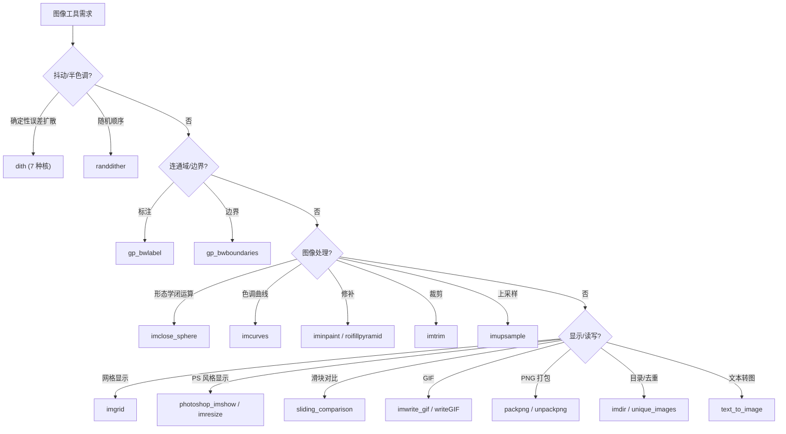

# 30.2 图像工具、抖动与读写 / Image Tools, Dithering and I/O

> 本章覆盖 `imageprocessing/` 中与**图像工具函数**相关的一批文件：抖动与随机抖动、
> 交互式涂鸦/喷绘、连通域与边界（`gp_` 系列）、形态学闭运算、曲线色调映射、
> 图像目录枚举、图像网格显示、拉普拉斯修补、自动裁剪、2× 上采样、GIF/PNG 读写
> 以及 Photoshop 风格的缩放显示等。
>
> 颜色科学与着色相关函数见 [01-color-science-and-colorization.md](01-color-science-and-colorization.md)。
>
> This chapter covers the **image utility** files of `imageprocessing/`: dithering and
> random dithering, interactive scribble/spray painting, connected components and
> boundaries (`gp_` family), morphological closing, spline tone-curve mapping, image
> directory listing, gridded image display, Laplacian inpainting, auto-trim, 2×
> upsampling, GIF/PNG I/O, and Photoshop-style zoom display.
>
> Color-science and colorization functions live in
> [01-color-science-and-colorization.md](01-color-science-and-colorization.md).

- 语言 / Language：中英对照（中文为主）
- 相关章节 / See also：[30-imageprocessing/README.md](README.md)、
  [appendices/03-doc-template.md](../appendices/03-doc-template.md)、
  [10.14 曲线与样条](../10-mesh/14-curves-and-splines.md)、[40-utility](../40-utility/README.md)
- 命名约定 / Notation：`im`/`I` 图像 `h by w by c`、`BW`/`M` 二值掩膜 `h by w`、
  `A`/`B` 二值图像或图像对、`G`/`rgba` PNG 打包通道、`z` 缩放倍数
- 外部依赖标记 / External：`[IPT]` = Image Processing Toolbox（如 `bwdist`、`impyramid`、
  `imresize`、`rgb2gray` 等）、`[ML]` = Statistics and Machine Learning Toolbox（`knnsearch`）

---

## 本章概览 / Chapter Overview

### (a) 抖动 / Dithering

| 函数 | 目的 / Purpose | 主要输出 | 说明 |
|---|---|---|---|
| `dith` | 误差扩散抖动（7 种核）/ error-diffusion dithering | `D` | 逐像素景格扫描，按核把量化误差扩散到邻域 |
| `randdither` | 随机顺序抖动 / random-order dithering | `D` | 随机像素访问顺序 + 高斯核（带已处理掩膜） |

### (b) 交互式标注 / Interactive capture

| 函数 | 目的 / Purpose | 主要输出 | 说明 |
|---|---|---|---|
| `get_scribbles` | 用户绘制多笔涂鸦掩膜 / draw scribble masks | `SI,S` | 交互绘图后抓帧 `getframe`，`rgb2ind` 转 scribble id |
| `get_spray_painting` | 在当前坐标轴上"喷绘"擦除 / spray-paint erase | `im,sh` | 高斯笔刷沿当前轴坐标衰减像素值 |

### (c) 连通域 / 形态学与色调 / Components, morphology & tone

| 函数 | 目的 / Purpose | 主要输出 | 说明 |
|---|---|---|---|
| `gp_bwboundaries` | 区域与孔洞的边界像素 / region & hole boundaries | `B,L,N,P` | 基于 `gp_bwlabel` + 有限差分邻接的边界追踪 |
| `gp_bwlabel` | 连通成分标注 / connected-component labeling | `L,NUM` | 用 `fd_laplacian` 邻接 + `conncomp` |
| `imclose_sphere` | 半径 `r` 球体形态学闭运算 / sphere closing | `B` | 两次 `bwdist` 近似球体膨胀-腐蚀 |
| `imcurves` | 样条曲线色调映射（类 Photoshop 曲线）/ spline tone curve | `Z,XV` | `interp1` 样条重映射每个通道 |

### (d) 显示 / 处理与修补 / Display, processing & inpainting

| 函数 | 目的 / Purpose | 主要输出 | 说明 |
|---|---|---|---|
| `imdir` | 枚举目录中的可读图像 / list image files | `files` | 用 `imformats` 扩展名做 `dir` |
| `imgrid` | 叠加网格显示图像 / display image with grid | `t` | `surf`/`trisurf` 彩色面片 |
| `iminpaint` | 拉普拉斯修补 / Laplacian inpainting | `Z` | `fd_laplacian` + `min_quad_with_fixed` 调和填充 |
| `imtrim` | 自动裁剪 / auto-crop like Photoshop Trim | `C,top,bottom,left,right` | 按角落颜色差阈值找边界 |
| `imupsample` | 2× patch 上采样 / patch-based 2× upsampling | `im` | 最近邻/Shepard 权重 + `knnsearch` |
| `roifillpyramid` | 金字塔 ROI 填充 / pyramid ROI fill | `J` | 多分辨率金字塔 + `roifilt2` 迭代解 Laplace |
| `sliding_comparison` | 滑块对比两图 / sliding splitter compare | `ph,ih` | 鼠标移动分割线 |

### (e) 读写 / 打包与显示 / I/O, packing & display

| 函数 | 目的 / Purpose | 主要输出 | 说明 |
|---|---|---|---|
| `imwrite_gif` | 序列写为动画 GIF / write animated GIF | — | 循环 `rgb2ind` + `imwrite` |
| `writeGIF` | 带逐帧延迟的 GIF 写出 / GIF with per-frame delay | — | `imwrite(...,'DelayTime'/'Delay')` |
| `packpng` | 灰度 double 打包进 8/16 位 RGBA PNG / pack to RGBA PNG | `rgba` | 逐通道位平面打包 |
| `unpackpng` | 从 RGBA PNG 解包灰度 double / unpack RGBA PNG | `G,depth` | `packpng` 的逆过程 |
| `photoshop_imresize` | Photoshop 风格缩放（大倍数画像素分格）/ Photoshop-like resize | `rim` | 大倍数叠加像素分隔掩膜 |
| `photoshop_imshow` | Photoshop 风格显示 + 自适应重采样 / Photoshop-like show | — | 绑定 `ResizeFcn` 动态重采样 |
| `text_to_image` | 文本渲染为灰度图 / render text to image | `im` | 调用 ImageMagick `convert` |

### 决策图 / Decision diagram — 需求 → 选择函数



---

## 逐函数详解 / Per-function reference

### `dith` — 误差扩散抖动（7 种核）
- **文件 / File**: [imageprocessing/dith.m](file:///c:/VSWork/gptoolbox-1/imageprocessing/dith.m#L1-L109)
- **签名 / Signature**: `D = dith(im,K,offset)`
  调用形式：`D = dith(im)` 或 `D = dith(im,K)` 或 `D = dith(im,K,offset)`
- **功能 / Purpose**: `EN: Dither a grayscale image by error-diffusion using a named kernel (Floyd-Steinberg/Jarvis/Stucki/Sierra variants/Atkinson) or a custom kernel matrix.` / 中文：用误差扩散法对灰度图抖动；`K` 既可为算法名字符串（内置 7 种核），也可为自定义核矩阵。
- **输入 / Inputs**:

  | 参数 | 尺寸/类型 | 含义 (中 / EN) |
  |---|---|---|
  | `im` | `h by w`（或 `h by w by 3`） | 待抖动灰度图 / grayscale image |

- **输出 / Outputs**:

  | 参数 | 尺寸/类型 | 含义 |
  |---|---|---|
  | `D` | `h by w`（double，取值 0/1） | 抖动后的二值化图像 / dithered image |

- **可选参数 / Optional**（`K`/`offset` 为位置参数，非 `varargin`）：

  | 名称 | 取值 | 默认 | 含义 |
  |---|---|---|---|
  | `K` | `'Floyd-Steinberg'`/`'Jarvis'`/`'Stucki'`/`'Sierra3'`/`'Sierra2'`/`'Sierra-lite'`/`'Atkinson'` 或核矩阵 | `'Floyd-Steinberg'` | 算法名或误差扩散核 / algorithm name or kernel |
  | `offset` | `1 by 2` 整数（`[y,x]`） | 随算法而定（见下） | 当前像素在核中的位置偏移；当 `K` 为矩阵时**必须**提供 |

  内置核与偏移（L53–L77）：

  | 算法 | `offset` | 核 (归一化前) |
  |---|---|---|
  | `Floyd-Steinberg` | `[0,1]` | `[0,0,7;3,5,1]/16` |
  | `Jarvis` | `[0,2]` | `[0 0 0 7 5;3 5 7 5 3;1 3 5 3 1]/48` |
  | `Stucki` | `[0,2]` | `[0 0 0 8 4;2 4 8 4 2;1 2 4 2 1]/42` |
  | `Sierra3` | `[0,2]` | `[0 0 0 5 3;2 4 5 4 2;0 2 3 2 0]/32` |
  | `Sierra2` | `[0,2]` | `[0 0 0 4 3;1 2 3 2 1]/16` |
  | `Sierra-lite` | `[0,0]` | `[0,2;1,1]/4` |
  | `Atkinson` | `[0,1]` | `[0 0 1 1;1 1 1 0;0 1 0 0]/8` |

- **变量流动 / Variable flow**: `im →(通道检查/转灰度)→ im →(转 double)→ im →(补边写入 O)→ O →(光栅扫描: D(y,x)=round(O(y,x)); e=O(y,x)-D(y,x); O(Y,X)+=K.*e)→ (O,D)→ D →(裁回原尺寸)→ D`
- **算法步骤 / Algorithm**:
  1. 取尺寸 `h,w`；若 `K` 未给则默认 `'Floyd-Steinberg'`（L22–L32）。
  2. 通道检查：`size(im,3)` 为 1 保持；为 3 用 `rgb2gray` 并告警；否则报错（L34–L43）。
  3. 非浮点输入用 `im2double` 转换并告警（L45–L51）。
  4. 若 `K` 为 `char`，按名字选择内置核并设定 `offset`；否则断言 `offset` 已提供（L53–L80）。
  5. 建立**补边**工作区 `D/O = zeros(size(im)+size(K))`，把原图写到 `O(offset+(1:h), offset+(1:w))`（L82–L85）。
  6. 预计算扩散区域相对索引 `dY=(1:size(K,1))-1-offset(1)`、`dX=(1:size(K,2))-1-offset(2)`（L87–L89）。
  7. **光栅扫描**（非蛇形）：外层 `y`自上而下、内层 `x`自左向右（L91–L104）：`D(y,x)=round(O(y,x))`；误差 `e = O(y,x)-D(y,x)`；把 `K.*e` 累加到邻域 `O(Y,X)`。
  8. 裁掉补边，`D = D(offset(1)+(1:h), offset(2)+(1:w))`（L106–L107）。
- **流程图 / Flowchart**:

  ```mermaid
  flowchart TD
    A["输入 im,K,offset"] --> B{"K 给定?"}
    B -- 否 --> B1["K = Floyd-Steinberg"]
    B -- 是 --> C
    B1 --> C{"size(im,3)?"}
    C -- 1 --> D
    C -- 3 --> C1["rgb2gray + 告警"] --> D
    C -- else --> C2["error"] --> Z0["中止"]
    D{"isfloat(im)?"} -- 否 --> D1["im2double + 告警"] --> E
    D -- 是 --> E{"class(K) 是 char?"}
    E -- 是 --> E1["按名字取内置核/offset"]
    E -- 否 --> E2["断言 offset 已给"]
    E1 --> F["补边写入 O,D"]
    E2 --> F
    F --> G["预计算 dY,dX"]
    G --> H["y 自上而下"]
    H --> I["x 自左向右"]
    I --> J["D=round(O); e=O-D; O(Y,X)+=K.*e"]
    J --> I
    I --> H
    H --> K["裁回原尺寸"]
    K --> Z["输出 D"]
  ```

- **依赖 / Dependencies**: `rgb2gray` `[IPT]`、`im2double` `[IPT]`；无本库依赖
- **See also**: `randdither`
- **备注 / Note**: 函数头注释中的原型写作 `dither(...)`（与文件名/函数名 `dith` 不一致，疑为陈旧注释）；且扫描为**常规光栅顺序**（自上而下、自左向右），**不是**蛇形（serpentine）顺序；`offset` 同时是形参名，在字符串核分支中被覆写。

### `randdither` — 随机顺序抖动
- **文件 / File**: [imageprocessing/randdither.m](file:///c:/VSWork/gptoolbox-1/imageprocessing/randdither.m#L1-L64)
- **签名 / Signature**: `D = randdither(im)`
- **功能 / Purpose**: `EN: Dither an image by visiting pixels in a random order and diffusing the quantization error with a Gaussian kernel restricted to not-yet-processed pixels.` / 中文：以随机像素顺序访问图像，用高斯核把量化误差扩散到尚未处理的像素上完成抖动。
- **输入 / Inputs**:

  | 参数 | 尺寸/类型 | 含义 (中 / EN) |
  |---|---|---|
  | `im` | `h by w` | 灰度图 / grayscale image |

- **输出 / Outputs**:

  | 参数 | 尺寸/类型 | 含义 |
  |---|---|---|
  | `D` | `h by w` | 抖动后图像 / dithered image |

- **可选参数 / Optional**: 无 / None
- **变量流动 / Variable flow**: `im →(补边写入 O)→ O →(ind2sub 生成全部像素坐标 P → randperm 打乱)→ P →(按 P 顺序: D=round(O); e=O-D; 掩膜 F 屏蔽已处理; KK=F(Y,X).*K; 归一化后 O(Y,X)+=KK.*e)→ D →(裁回)→ D`
- **算法步骤 / Algorithm**:
  1. 取 `h,w`；设置核 `K` 与 `offset`（L14–L20）。
     ⚠️ 先赋 `K=[1,2,1;2,0,2;1,2,1]`/`offset=[1,1]`，立即被 `K=fspecial('gaussian',5,5)`/`offset=[2,2]` **覆盖**（前者为死代码）。
  2. 把核中心置 0 并归一化 `K=K./sum(K(:))`（L22–L23）。
  3. 建立补边工作区 `D/O`，原图写入 `O(offset+(1:h),offset+(1:w))`（L25–L29）。
  4. 生成所有像素坐标 `P=[I;J]'`，用 `randperm` 随机打乱顺序，并加 `offset` 平移（L31–L36）。
  5. 用 `F=ones(...)` 追踪"尚未处理"的像素（L38–L39）；预计算 `dY,dX`（L41–L43）。
  6. 按随机顺序遍历（L45–L59）：`D(y,x)=round(O(y,x))`；`e=O(y,x)-D(y,x)`；`F(y,x)=0`；取 `KK=F(Y,X).*K`（只扩散到未处理像素），若 `sum(KK)>0` 则 `KK=KK./sum(KK)`，`O(Y,X)+=KK.*e`。
  7. 裁回原尺寸输出 `D`（L61–L62）。
- **流程图 / Flowchart**:

  ```mermaid
  flowchart TD
    A["输入 im"] --> B["K/offset 赋值 (前者死代码)"]
    B --> C["K 中心置0 并归一化"]
    C --> D["补边写入 O"]
    D --> E["ind2sub 全像素 → randperm 打乱 → P"]
    E --> F["F = ones 未处理掩膜"]
    F --> G{"按 P 顺序遍历完?"}
    G -- 否 --> H["D=round(O); e=O-D; F(y,x)=0"]
    H --> I["KK = F(Y,X).*K"]
    I --> J{"sum(KK)>0?"}
    J -- 是 --> J1["KK 归一化; O(Y,X)+=KK.*e"]
    J -- 否 --> G
    J1 --> G
    G -- 是 --> K["裁回原尺寸"]
    K --> Z["输出 D"]
  ```

- **依赖 / Dependencies**: `fspecial` `[IPT]`、`ind2sub`、`randperm`；无本库依赖
- **See also**: `dith`
- **备注 / Note**: 头注释 `Input: im grayscale image.` 与实现一致；但 `K`/`offset` 的初始赋值被覆盖，属无效代码（L17–L20）。

### `get_scribbles` — 用户涂鸦掩膜
- **文件 / File**: [imageprocessing/get_scribbles.m](file:///c:/VSWork/gptoolbox-1/imageprocessing/get_scribbles.m#L1-L167)
- **签名 / Signature**: `[SI,S] = get_scribbles(im,varargin)`
- **功能 / Purpose**: `EN: Display an image, let the user draw colored scribbles interactively, then capture the result as a scribble-id mask and an RGB scribble mask.` / 中文：显示图像，让用户用彩色画笔交互式绘制涂鸦，回车后抓取画布并转换为涂鸦 id 掩膜与 RGB 掩膜。
- **输入 / Inputs**:

  | 参数 | 尺寸/类型 | 含义 (中 / EN) |
  |---|---|---|
  | `im` | `h by w by channels` | 待标注图像 / image to annotate |

- **输出 / Outputs**:

  | 参数 | 尺寸/类型 | 含义 |
  |---|---|---|
  | `SI` | `h by w` | 涂鸦 id 掩膜（0=无涂鸦，其余为笔划编号）/ scribble id mask |
  | `S` | `h by w by 3`（与输入同类） | RGB 涂鸦掩膜 / RGB scribble mask |

- **可选参数 / Optional**（`containers.Map` 解析 L22–L36）：

  | 名称 | 取值 | 默认 | 含义 |
  |---|---|---|---|
  | `'LineWidth'` | 标量 | `10` | 画笔线宽 / brush line width |

- **变量流动 / Variable flow**: `im →(imshow 显示)→ h →(鼠标回调累积折线 P{pc}, 绘制 p{pc}, 颜色取 cbrewer('Set1',50))→ 画布 →(回车/ESC: 清屏改底色后 getframe)→ S →(imtrim+imresize 对齐)→ S →(rgb2ind(S,[0 0 0;C],'nodither'))→ SI →(按 class(im) 转回)→ S`
- **算法步骤 / Algorithm**:
  1. `gcf` + `imshow(im)`；解析 `'LineWidth'`（默认 10）为 `line_width`（L16–L36）。
  2. 关闭 `rotate3d`，绑定 `ButtonDownFcn`/`keypressfcn`，提示 "Draw scribbles, then hit ENTER"（L38–L41）。
  3. 初始化 `P={}`（每笔折线）、`p={}`（句柄）、`pc=0`（笔划计数），取色图 `C=cbrewer('Set1',50)`（L43–L46）。
  4. 阻塞循环等待 `done`（由 `finish()` 置真），期间 `drawnow`（L48–L51）。
  5. 完成后关闭抗锯齿、把画布底色改为洋红并清空 CData，`getframe(gcf)` 抓帧得 `S`（L60–L68）。
  6. `S = imresize(imtrim(im2double(S)),[size(im,1) size(im,2)],'nearest')` 对齐到原尺寸（L69）。
  7. `SI = rgb2ind(S,[0 0 0;C],'nodither')` 得到涂鸦 id（L73）。
  8. 按 `class(im)` 用 `im2double/im2single/im2uint8/im2uint16/im2int16` 把 `S` 转回同类（L80–L95）。
  9. 嵌套回调：`ondown` 起新笔（`pc++`）、`ondrag` 追加点、`onup` 结束拖动、`onkeypress` 遇 ESC/ENTER 调 `finish()`（L98–L166）。
- **流程图 / Flowchart**:

  ```mermaid
  flowchart TD
    A["输入 im,+LineWidth"] --> B["imshow(im); 绑定回调"]
    B --> C["初始化 P,p,pc=0,C=cbrewer"]
    C --> D{"done?"}
    D -- 否 --> D1["drawnow; 等待鼠标/按键"]
    D1 --> D
    D -- 是 --> E["改底色/关平滑; getframe → S"]
    E --> F["imresize(imtrim(S)) 对齐"]
    F --> G["SI = rgb2ind(S,[0 0 0;C])"]
    G --> H{"class(im)?"}
    H -- double/uint8/... --> H1["转回同类"]
    H -- 其他 --> H2["warning"]
    H1 --> Z["输出 SI,S"]
    H2 --> Z
  ```

- **依赖 / Dependencies**: `imshow` `[IPT]`、`imtrim`（[imageprocessing/imtrim.m](file:///c:/VSWork/gptoolbox-1/imageprocessing/imtrim.m#L1-L115)）、`imresize` `[IPT]`、`rgb2ind` `[IPT]`、`im2double`/`im2single`/`im2uint8`/`im2uint16`/`im2int16` `[IPT]`、`cbrewer`（[external/cbrewer.m](file:///c:/VSWork/gptoolbox-1/external/cbrewer.m#L1)）
- **See also**: `get_spray_painting`, `imtrim`
- **备注 / Note**: 头注释中 `%C  colors ...` 一行被注释掉且未作为输出返回；`next_color` 中返回 `C(pc,:)`，若笔划数超过 50 会越界。

### `get_spray_painting` — 交互式喷绘擦除
- **文件 / File**: [imageprocessing/get_spray_painting.m](file:///c:/VSWork/gptoolbox-1/imageprocessing/get_spray_painting.m#L1-L68)
- **签名 / Signature**: `[im,sh] = get_spray_painting()`
- **功能 / Purpose**: `EN: Interactively spray-paint (erase) pixels over the current axes by dragging the mouse; a Gaussian brush darkens a grayscale texture map.` / 中文：在当前坐标轴上拖动鼠标"喷绘"：用高斯笔刷逐步减小（擦除）灰度纹理贴图的像素值。
- **输入 / Inputs**: 无 / None（对当前 `gcf` 主动作）

- **输出 / Outputs**:

  | 参数 | 尺寸/类型 | 含义 |
  |---|---|---|
  | `im` | `h by w` | 被喷绘修改后的灰度图 / painted grayscale image |
  | `sh` | surf 句柄 | 纹理贴图 surf 对象句柄 / texture-mapped surface handle |

- **可选参数 / Optional**: 无 / None
- **变量流动 / Variable flow**: `axis() → A →(算 h,w,ratio)→ im=ones(h,w) →(meshgrid + surf 'texturemap')→ sh →(鼠标按下/拖动: p → 归一化到像素坐标 → 局部窗口 I,J → im(I,J) 减去 Kij 并裁剪 [0,1] → sh.CData=im)→ im,sh`
- **算法步骤 / Algorithm**:
  1. `figure(gcf)`，绑定 `windowbuttondownfcn`/`KeyPressFcn`，取当前 `A=axis()`（L7–L11）。
  2. 由轴范围估算 `h,w` 与宽高比；若尺寸退化（`<=1`）则取 `w=512,h=ceil(ratio*w)`（L12–L19）。
  3. 初始化 `im=ones(h,w)`；用 `meshgrid` + `surf(...,'CData',im,'FaceColor','texturemap')` 建立纹理贴图 `sh`（L20–L24）。
  4. 笔刷半径 `r=20`，核 `K=matrixnormalize(fspecial('gaussian',r*2+1,5))`（L26–L29）。
  5. 阻塞等待喷绘结束（`still_painting`，由任意按键置假）（L31–L34）。
  6. 嵌套 `paint_at(p)`：把轴坐标 `p` 映射为像素坐标，取窗口 `I,J`，`im(I,J)=min(max(im(I,J)-Kij,0),1)` 并刷新 `sh.CData`（L36–L43）。
  7. 回调 `ondown`/`ondrag`/`onup` 记录并连续绘制；`onkeypress` 结束（L44–L68）。
- **流程图 / Flowchart**:

  ```mermaid
  flowchart TD
    A["fig=gcf; A=axis()"] --> B{"h<=1 或 w<=1?"}
    B -- 是 --> B1["w=512; h=ceil(ratio*w)"]
    B -- 否 --> C
    B1 --> C["im=ones(h,w)"]
    C --> D["surf 'texturemap' → sh"]
    D --> E["K = gaussian 笔刷核"]
    E --> F{"still_painting?"}
    F -- 是 --> F1["drawnow; 等待鼠标"]
    F1 --> G["paint_at(p): im(I,J) 减 Kij 裁剪"]
    G --> F
    F -- 否 --> Z["输出 im,sh"]
  ```

- **依赖 / Dependencies**: `matrixnormalize`（[matrix/matrixnormalize.m](file:///c:/VSWork/gptoolbox-1/matrix/matrixnormalize.m#L1)）、`fspecial` `[IPT]`、`meshgrid`、`surf`
- **See also**: `get_scribbles`
- **备注 / Note**: 函数头只声明 `Outputs: im`，实际返回 `[im,sh]`（两个输出）；也无 `Inputs` 段（该函数不接受输入）。

### `gp_bwboundaries` — 区域与孔洞的边界像素
- **文件 / File**: [imageprocessing/gp_bwboundaries.m](file:///c:/VSWork/gptoolbox-1/imageprocessing/gp_bwboundaries.m#L1-L107)
- **签名 / Signature**: `[B,L,N,P] = gp_bwboundaries(BW,CONN)`
- **功能 / Purpose**: `EN: Trace the boundary pixel lists of regions and holes in a logical image, returning a label image and the count of true regions.` / 中文：追踪二值图像中区域与孔洞的边界像素序列，返回标注图像与真实区域个数；相当于自研版 `bwboundaries`。
- **输入 / Inputs**:

  | 参数 | 尺寸/类型 | 含义 (中 / EN) |
  |---|---|---|
  | `BW` | `h by w` logical | 二值图像 / binary image |

- **输出 / Outputs**:

  | 参数 | 尺寸/类型 | 含义 |
  |---|---|---|
  | `B` | 长度 `#boundaries` 的 cell | 每个元素 `B{b}` 为 `#B{b} by 2` 的 `[row,col]` 边界像素（首尾闭合）/ boundary pixel lists |
  | `L` | `h by w` | 区域与孔洞的 id（0 表示与边界相接的未标注 false 像素）/ label image |
  | `N` | 标量 | 真实区域个数（`B` 的前 `N` 个为区域，其余为孔洞）/ number of regions |
  | `P` | — | 作为输出占位（源码中在循环内被复用为临时折线序列，最终未赋予有意义的整体结果）/ placeholder |

- **可选参数 / Optional**:

  | 名称 | 取值 | 默认 | 含义 |
  |---|---|---|---|
  | `CONN` | `4` 或 `8` | `8` | 前景连通性 / foreground connectivity |

- **变量流动 / Variable flow**: `BW,CONN →(fd_laplacian 建 A4/A8 → 按 CONN 组 A{1},A{2})→ (A{1},A{2}) →(gp_bwlabel(BW)=LN; gp_bwlabel(~BW)=LP)→ L →(BFS 由外部种子 O 交替扩张 K{1},K{2} 至覆盖全部标签)→ (K,outside,inside) →(逐标签逐边界 gp_bwlabel 提取 BWcc → 用 A{3-e} 邻接贪心追踪折线 P)→ B,N →(去掉接触边界的外部标签并重编号)→ L`
- **算法步骤 / Algorithm**:
  1. `CONN` 缺省 `8`（L20–L22）。
  2. 用 `fd_laplacian` 建 4/8 邻接：`A4`、`A8`，按 `CONN` 把"追踪用/扩张用"邻接分别放入 `A{1}`、`A{2}`（L24–L34）。
  3. 标注前景与背景：`LN=gp_bwlabel(BW)`、`LP=gp_bwlabel(~BW)`，合并为 `L`（背景标签加上偏移 `max(LN)`）（L36–L39）。
  4. 从图像**外部边界** BFS 种子 `O` 出发，交替用 `A{1}`/`A{2}` 扩张 `K{1}`/`K{2}`，维护 `outside`/`inside` 标签集合，直到所有标签被覆盖（L42–L70）。
  5. 对每个标签 `c` 与每个扩张类 `e`，`BWc=K{e}&L==c`；用 `gp_bwlabel(BWc,8)` 分出连通块（L72–L77）。
  6. 对每个连通块 `BWcc`，用对角邻接 `A{3-e}` 经 `find` 起点 + 沿行取 `max` 贪心，串出折线 `P`，首尾闭合后存入 `B{e}`（L78–L96）。
  7. `N=numel(B{1})`；`B` 首列区域、其余孔洞（L100–L101）。
  8. 剔除与外部边界相连的标签并重编号：`L = L.*~ismember(L, L.*(O&~BW))`，再做 `unique` 重排（L103–L105）。
- **流程图 / Flowchart**:

  ```mermaid
  flowchart TD
    A["输入 BW,CONN"] --> B{"nargin<2?"}
    B -- 是 --> B1["CONN=8"]
    B -- 否 --> C
    B1 --> C["A4/A8 = fd_laplacian 邻接"]
    C --> D["按 CONN 组 A{1},A{2}"]
    D --> E["LN=gp_bwlabel(BW); LP=gp_bwlabel(~BW)"]
    E --> F["L = LN + (LN==0).*(LP+max(LN))"]
    F --> G["BFS 自外部 O 交替扩张 K{1},K{2}"]
    G --> H{"所有标签已覆盖?"}
    H -- 否 --> G
    H -- 是 --> I["逐标签/逐类: gp_bwlabel(BWc,8)"]
    I --> J["A{3-e} 贪心追踪折线 P → B{e}"]
    J --> K["N=numel(B{1}); B=[区域;孔洞]"]
    K --> L["剔除接触边界的标签并重编号 L"]
    L --> Z["输出 B,L,N,P"]
  ```

- **依赖 / Dependencies**: `fd_laplacian`（[mesh/fd_laplacian.m](file:///c:/VSWork/gptoolbox-1/mesh/fd_laplacian.m#L1)）、`gp_bwlabel`（[imageprocessing/gp_bwlabel.m](file:///c:/VSWork/gptoolbox-1/imageprocessing/gp_bwlabel.m#L1-L34)）、`conncomp`（经 `gp_bwlabel` 间接，[mesh/conncomp.m](file:///c:/VSWork/gptoolbox-1/mesh/conncomp.m#L1)）；MATLAB 内置 `union`/`setdiff`/`find`/`sparse`/`ind2sub`
- **See also**: `gp_bwlabel`, `bwboundaries`(MATLAB)
- **备注 / Note**: 与 MATLAB 内置 `bwboundaries` **不同**（自研、依赖 `fd_laplacian` 邻接与 `gp_bwlabel`）。头注释 `[B,L,N] = gp_bwboundaries(BW,CONN)` 未列出第 4 个输出 `P`；且 `P` 在 L85 起被复用为临时变量，最终并不是一个稳定的输出。

### `gp_bwlabel` — 连通成分标注
- **文件 / File**: [imageprocessing/gp_bwlabel.m](file:///c:/VSWork/gptoolbox-1/imageprocessing/gp_bwlabel.m#L1-L34)
- **签名 / Signature**: `[L,NUM] = gp_bwlabel(BW,N)`
- **功能 / Purpose**: `EN: Label connected components of the true regions of a logical image (self-rolled drop-in for MATLAB's bwlabel), defaulting to 4-connectivity.` / 中文：对二值图像中真值区域做连通成分标注（自研版 `bwlabel`），默认 4 邻接。
- **输入 / Inputs**:

  | 参数 | 尺寸/类型 | 含义 (中 / EN) |
  |---|---|---|
  | `BW` | `h by w` logical | 二值图像 / binary image |

- **输出 / Outputs**:

  | 参数 | 尺寸/类型 | 含义 |
  |---|---|---|
  | `L` | `h by w` | 区域 id（0 为未标注）/ label image |
  | `NUM` | 标量 | 成分个数 / number of components |

- **可选参数 / Optional**:

  | 名称 | 取值 | 默认 | 含义 |
  |---|---|---|---|
  | `N` | `4` 或 `8` | `4` | 连通性 / connectivity |

- **变量流动 / Variable flow**: `BW,N →(fd_laplacian 邻接 A; N==8 时 A=A*A>1)→ A →(A(~BW,:)=0; A(:,~BW)=0 限定前景)→ A →(conncomp → 第二输出 L)→ L →(L(~BW)=0; unique 重排; reshape(L-1))→ L,num`
- **算法步骤 / Algorithm**:
  1. 断言 `islogical(BW)`（L14）。
  2. `N` 缺省 `4`（L16–L18）。
  3. 用 `fd_laplacian(size(BW))~=0` 建邻接 `A`；若 `N==8`，`A=(A*1*A)>1` 得到 8 邻接（L20–L24）。
  4. 仅保留前景：`A(~BW,:)=0`、`A(:,~BW)=0`（L25–L26）。
  5. `[~,L]=conncomp(A)` 取第二输出为标签（L27）。
  6. 清背景 `L(~BW(:))=0`，`unique` 重排并把编号整体减 1（背景变 0）（L29–L31）。
  7. 断言背景全为 0；`NUM=max(L(:))`（L32–L33）。
- **流程图 / Flowchart**:

  ```mermaid
  flowchart TD
    A["输入 BW,N"] --> B["assert islogical(BW)"]
    B --> C{"nargin<2?"}
    C -- 是 --> C1["N=4"]
    C -- 否 --> D
    C1 --> D["A = fd_laplacian(size(BW))~=0"]
    D --> E{"N==8?"}
    E -- 是 --> E1["A = (A*A)>1"]
    E -- 否 --> F
    E1 --> F["A(~BW,:)=0; A(:,~BW)=0"]
    F --> G["[~,L]=conncomp(A)"]
    G --> H["L(~BW)=0; unique; reshape(L-1)"]
    H --> Z["输出 L,NUM"]
  ```

- **依赖 / Dependencies**: `fd_laplacian`（[mesh/fd_laplacian.m](file:///c:/VSWork/gptoolbox-1/mesh/fd_laplacian.m#L1)）、`conncomp`（[mesh/conncomp.m](file:///c:/VSWork/gptoolbox-1/mesh/conncomp.m#L1)）
- **See also**: `gp_bwboundaries`, `bwlabel`(MATLAB)
- **备注 / Note**: 与 MATLAB 内置 `bwlabel` **不同**（自研实现）。头注释 `L = gp_bwlabel(BW)` 未列出第二个输出 `NUM`；注释说"Assuming [0 1 0;1 1 1;0 1 0] connectivity"（即 4 邻接），与默认 `N=4` 一致。

### `imclose_sphere` — 球体形态学闭运算
- **文件 / File**: [imageprocessing/imclose_sphere.m](file:///c:/VSWork/gptoolbox-1/imageprocessing/imclose_sphere.m#L1-L24)
- **签名 / Signature**: `B = imclose_sphere(A,r)`
- **功能 / Purpose**: `EN: Morphological closing of a binary image with a sphere of radius r, implemented by two distance transforms instead of a ball structuring element.` / 中文：用半径 `r` 的球体对二值图像做闭运算；用两次距离变换近似球体膨胀-腐蚀，避免构造球体结构元。
- **输入 / Inputs**:

  | 参数 | 尺寸/类型 | 含义 (中 / EN) |
  |---|---|---|
  | `A` | `h by w`（或 `h by w by d`）logical | 二值图像 / binary image |
  | `r` | 标量 | 球体半径 / sphere radius |

- **输出 / Outputs**:

  | 参数 | 尺寸/类型 | 含义 |
  |---|---|---|
  | `B` | 与 `A` 同尺寸 logical | 闭运算结果 / closed binary image |

- **可选参数 / Optional**: 无 / None
- **变量流动 / Variable flow**: `A →(断言 logical)→ A →(padarray 各维补 ceil(r))→ A →(bwdist(bwdist(A>0)>r)>r)→ B →(裁掉补边)→ B`
- **算法步骤 / Algorithm**:
  1. 断言 `islogical(A)`（L16）。
  2. `rc=ceil(r)`，`padarray` 在每一维两侧各补 `rc`（L17–L19）。
  3. `B = bwdist(bwdist(A>0)>r)>r`：内层 `bwdist` 做球体**膨胀**（距离 ≤ r），再布尔取反后外层 `bwdist` 做球体**腐蚀**，整体即闭运算（L20）。
  4. 用 `arrayfun` 计算每维保留区间 `(rc+1):(sizeB(dim)-rc)`，裁回原尺寸（L21–L23）。
- **流程图 / Flowchart**:

  ```mermaid
  flowchart TD
    A["输入 A,r"] --> B["assert islogical(A)"]
    B --> C["rc=ceil(r); padarray 各维补 rc"]
    C --> D["bwdist(A>0)>r  (膨胀)"]
    D --> E["bwdist(...)>r  (腐蚀)"]
    E --> F["裁掉补边"]
    F --> Z["输出 B"]
  ```

- **依赖 / Dependencies**: `padarray` `[IPT]`、`bwdist` `[IPT]`、`arrayfun`；**需要 Image Processing Toolbox**
- **See also**: `imclose`(MATLAB IPT), `strel`(MATLAB IPT)
- **备注 / Note**: 头注释的示例用 `strel('sphere',32)`，但 `strel('sphere')` 本身也要求 Image Processing Toolbox；本函数同样依赖 `bwdist`/`padarray`。

### `imcurves` — 样条曲线色调映射
- **文件 / File**: [imageprocessing/imcurves.m](file:///c:/VSWork/gptoolbox-1/imageprocessing/imcurves.m#L1-L149)
- **签名 / Signature**: `[Z,XV] = imcurves(im,XV,varargin)`
- **功能 / Purpose**: `EN: Filter an image using a monotone-ish spline mapping of input intensity to output intensity (like Photoshop's Curves tool), optionally with interactive control-point editing.` / 中文：用样条把输入灰度映射到输出灰度（类似 Photoshop 曲线工具）来滤波；可选交互式增删/拖动控制点。
- **输入 / Inputs**:

  | 参数 | 尺寸/类型 | 含义 (中 / EN) |
  |---|---|---|
  | `im` | `h by w by c` | 待滤波图像 / image to filter |
  | `XV` | `n by 2` | 样条控制点 `[参数位置, 取值]` / spline control points |

- **输出 / Outputs**:

  | 参数 | 尺寸/类型 | 含义 |
  |---|---|---|
  | `Z` | `h by w by c` | 滤波后图像 / filtered image |
  | `XV` | `n by 2` | （可能被交互修改的）控制点 / control points |

- **可选参数 / Optional**（`containers.Map` 解析 L26–L42）：

  | 名称 | 取值 | 默认 | 含义 |
  |---|---|---|---|
  | `'Interactive'` | `true`/`false` | `XV` 为空时 `true`，否则 `false` | 是否交互编辑控制点 / interactive editing |

- **变量流动 / Variable flow**: `im,XV →(interactive? XV为空则 XV=[[0;1][0;1]] 且交互)→ XV →(filter: interp1(XV(:,1),XV(:,2),Z,'spline') → 端点钳制 → clip[0,1])→ Z →(交互时 waitfor 结束, 非交互直接 filter)→ Z,XV`
- **算法步骤 / Algorithm**:
  1. 初始化：`interactive=true`；若 `XV` 未给或为空则 `XV=[[0;1] [0;1]]` 并保持交互；否则 `interactive=false`（L17–L23）。
  2. 解析 `'Interactive'` 选项（L26–L42）。
  3. 交互分支（L44–L83）：必要时按窗口宽度缩放图像 `im_fit`；`filter` 得到 `Z_fit`；左侧 `imshow` 显示结果、右侧用 `linspace(0,1,100)` 的 `t` 绘制映射曲线与散点 `sct(XV,...)`；绑定拖拽/新增/删除回调，`waitfor(ssh,'Userdata','finished')` 等待回车结束。
  4. 非交互分支：`Z = filter(im)`（L81–L83）。
  5. 嵌套 `filter(Z)`（L107–L114）：`Y = interp1(XV(:,1),XV(:,2),Z,'spline')`；对超出控制点参数范围（`>max` 或 `<min` 对应值）的像素做端点钳制；最后 `max(min(Y,1),0)` 裁剪到 `[0,1]`。
  6. 交互回调：`startNewDragFcn` 在曲线下方插入新控制点并选中；`startDragFcn` 就近选中；`draggingFcn` 拖动并将坐标夹到 `[0,1]`；`keyPressFcn` 支持回车完成与退格删除（L93–L148）。
- **流程图 / Flowchart**:

  ```mermaid
  flowchart TD
    A["输入 im,XV,+Interactive"] --> B{"XV 为空?"}
    B -- 是 --> B1["XV=[[0;1][0;1]]; interactive=true"]
    B -- 否 --> B2["interactive=false"]
    B1 --> C["解析 Interactive 选项"]
    B2 --> C
    C --> D{"interactive?"}
    D -- 是 --> E["显示曲线/图像; 绑定回调"]
    E --> F["waitfor 直到回车"]
    F --> G["finish(): Z=filter(im)"]
    D -- 否 --> H["Z = filter(im)"]
    G --> I
    H --> I["filter: interp1 spline + 端点钳制 + clip"]
    I --> Z["输出 Z,XV"]
  ```

- **依赖 / Dependencies**: `interp1`、`imresize` `[IPT]`、`imshow` `[IPT]`、`plot`、`sct`（[mesh/sct.m](file:///c:/VSWork/gptoolbox-1/mesh/sct.m#L1)）
- **See also**: `imtrim`, `photoshop_imresize`
- **备注 / Note**: 该函数是**逐像素样条色调映射**（曲线滤波器），与"扩散曲线（diffusion curves）光栅化"并非同一算法——后者在 `imageprocessing/` 中由其他文件承担（见 [01-color-science-and-colorization.md](01-color-science-and-colorization.md)）。

### `imdir` — 枚举目录中的图像文件
- **文件 / File**: [imageprocessing/imdir.m](file:///c:/VSWork/gptoolbox-1/imageprocessing/imdir.m#L1-L23)
- **签名 / Signature**: `files = imdir(dir_name)`
- **功能 / Purpose**: `EN: Return the list of MATLAB-readable image files (by extension) inside a directory.` / 中文：按 MATLAB 可读的图像扩展名，返回指定目录下的图像文件列表。
- **输入 / Inputs**:

  | 参数 | 尺寸/类型 | 含义 (中 / EN) |
  |---|---|---|
  | `dir_name` | 字符串 | 目录路径 / directory path |

- **输出 / Outputs**:

  | 参数 | 尺寸/类型 | 含义 |
  |---|---|---|
  | `files` | struct 数组 | `dir` 返回的文件结构体数组 / struct array of files |

- **可选参数 / Optional**: 无 / None
- **变量流动 / Variable flow**: `dir_name →(imformats() → formats.ext)→ exts →(exts 与其大写拼接)→ exts →(逐扩展名 dir([dir_name '/*.' ext]) 累加)→ files`
- **算法步骤 / Algorithm**:
  1. `formats = imformats()` 取 MATLAB 支持的图像格式（L15）。
  2. 构造小写+大写扩展名列表 `exts = [formats.ext upper(formats.ext)]`（L17）。
  3. 对每个扩展名执行 `dir([dir_name '/*.' exts{k}])` 并纵向累加到 `files`（L19–L22）。
- **流程图 / Flowchart**:

  ```mermaid
  flowchart TD
    A["输入 dir_name"] --> B["formats = imformats()"]
    B --> C["exts = [ext upper(ext)]"]
    C --> D{"还有扩展名?"}
    D -- 是 --> E["dir(dir_name/*.ext) 累加"]
    E --> D
    D -- 否 --> Z["输出 files"]
  ```

- **依赖 / Dependencies**: `imformats`、`dir`；无本库依赖
- **See also**: `dir`(MATLAB), `unique_images`

### `imgrid` — 叠加网格显示图像
- **文件 / File**: [imageprocessing/imgrid.m](file:///c:/VSWork/gptoolbox-1/imageprocessing/imgrid.m#L1-L58)
- **签名 / Signature**: `varargout = imgrid(im,varargin)`（调用 `t = imgrid(im,...)`）
- **功能 / Purpose**: `EN: Display an image as a grid of colored quadrilateral faces (optionally annotated with pixel values).` / 中文：把图像显示为彩色四边形网格面片，可选在每个像素上标注数值。
- **输入 / Inputs**:

  | 参数 | 尺寸/类型 | 含义 (中 / EN) |
  |---|---|---|
  | `im` | `h by w by channels` | 颜色/数值图像 / image of colors/values |

- **输出 / Outputs**:

  | 参数 | 尺寸/类型 | 含义 |
  |---|---|---|
  | `t` | handle | 彩色面片 surf/trisurf 句柄 / handle to surface |

- **可选参数 / Optional**（`containers.Map` 解析 L19–L33）：

  | 名称 | 取值 | 默认 | 含义 |
  |---|---|---|---|
  | `'ShowValues'` | `logical` | `false` | 是否在像素上显示数值 / show numeric values |

- **变量流动 / Variable flow**: `im →(meshgrid(-0.5+(1:w+1),-0.5+(1:h+1)))→ X,Y →(surf→surf2patch)→ Q,V →(size(im,3)==1? trisurf(CData=im(:)) : trisurf(FaceVertexCData=reshape(im,[],3)))→ t →(可选 ShowValues: text)→ 轴设置 → t`
- **算法步骤 / Algorithm**:
  1. 默认 `corner=[1 1]`、`show_values=false`；解析 `'ShowValues'`（L15–L33）。
  2. `meshgrid` 生成半像素偏移的格点 `X,Y`，`surf` 后 `surf2patch` 得 `Q,V`（L35–L37）。
  3. 若单通道：`trisurf(Q,...,'CData',im(:),'EdgeColor',[0.2 0.2 0.2])`；若开启 `ShowValues`，对非零像素用 `text` 标数值（L38–L45）。
  4. 否则三通道：`imC=reshape(im,[],3)`，`trisurf(...,'FaceVertexCData',imC)`（L46–L49）。
  5. `axis equal`、`YDir reverse`、把 X 轴放到顶部并设灰, `view(2)`（L50–L54）。
  6. `nargout>0` 时返回句柄（L55–L57）。
- **流程图 / Flowchart**:

  ```mermaid
  flowchart TD
    A["输入 im,+ShowValues"] --> B["解析 ShowValues"]
    B --> C["meshgrid → X,Y; surf → surf2patch → Q,V"]
    C --> D{"size(im,3)==1?"}
    D -- 是 --> D1["trisurf CData=im(:)"]
    D1 --> D2{"ShowValues?"}
    D2 -- 是 --> D3["text 标注非零像素"]
    D2 -- 否 --> E
    D3 --> E
    D -- 否 --> D4["trisurf FaceVertexCData"]
    D4 --> E["轴设置 axis equal/view(2)"]
    E --> Z["输出 t"]
  ```

- **依赖 / Dependencies**: `meshgrid`、`surf`、`surf2patch`、`trisurf`、`text`；无本库依赖
- **See also**: `photoshop_imshow`, `sliding_comparison`

### `iminpaint` — 拉普拉斯图像修补
- **文件 / File**: [imageprocessing/iminpaint.m](file:///c:/VSWork/gptoolbox-1/imageprocessing/iminpaint.m#L1-L21)
- **签名 / Signature**: `Z = iminpaint(im,M)`
- **功能 / Purpose**: `EN: Inpaint the region M of image im by solving a Laplace (harmonic) equation with the surrounding known pixels as boundary values.` / 中文：以掩膜外已知像素为边界条件，用调和（Laplace）方程求解掩膜区域的像素值，实现图像修补。
- **输入 / Inputs**:

  | 参数 | 尺寸/类型 | 含义 (中 / EN) |
  |---|---|---|
  | `im` | `h by w by c` | 含待填补区域的图像 / image with hole |
  | `M` | `h by w`（logical 或下标） | 待修补掩膜 / mask of region to fill |

- **输出 / Outputs**:

  | 参数 | 尺寸/类型 | 含义 |
  |---|---|---|
  | `Z` | `h by w by c` | 修补后图像 / inpainted image |

- **可选参数 / Optional**: 无 / None
- **变量流动 / Variable flow**: `im,M →(逻辑掩膜 reshape 到 h by w)→ M →(fd_laplacian(size(im)) → L)→ L →(b=find(M), X=reshape(im,[],c))→ (b,X) →(min_quad_with_fixed(-L,[],b,X(b,:),...))→ Z →(reshape 回)→ Z`
- **算法步骤 / Algorithm**:
  1. 若 `M` 为逻辑值：断言元素数与图像前两维一致，若为向量则 reshape 到 `h by w`（L10–L15）。
  2. `L = fd_laplacian(size(im(:,:,1)))` 建网格 Laplace（负对角）（L16）。
  3. `b = find(M)` 为已知（被固定）像素的线性索引；`X = reshape(im,[],size(im,3))`（L17–L18）。
  4. `Z = min_quad_with_fixed(-L,[],b,X(b,:),[],[],struct('force_Aeq_li',true))`：在 `b` 处固定已知值，解 `-L` 的二次型（等价于调和插值），得全部像素值（L19）。
  5. `Z = reshape(Z,size(im))`（L20）。
- **流程图 / Flowchart**:

  ```mermaid
  flowchart TD
    A["输入 im,M"] --> B{"islogical(M)?"}
    B -- 是 --> B1["reshape M 到 h by w"]
    B -- 否 --> C
    B1 --> C["L = fd_laplacian(size(im))"]
    C --> D["b=find(M); X=reshape(im,[],c)"]
    D --> E["min_quad_with_fixed(-L,[],b,X(b,:),...,force_Aeq_li)"]
    E --> F["reshape 回图像尺寸"]
    F --> Z["输出 Z"]
  ```

- **依赖 / Dependencies**: `fd_laplacian`（[mesh/fd_laplacian.m](file:///c:/VSWork/gptoolbox-1/mesh/fd_laplacian.m#L1)）、`min_quad_with_fixed`（[matrix/min_quad_with_fixed.m](file:///c:/VSWork/gptoolbox-1/matrix/min_quad_with_fixed.m#L1)）
- **See also**: `roifillpyramid`, `roifill`(MATLAB IPT)
- **备注 / Note**: 头注释写作 `Z = iminpaint(im,M)`，与实现一致。此处为**单尺度调和修补**；多尺度金字塔版本是 `roifillpyramid`。命名中 `b=find(M)` 的语义是"被固定的已知像素"，即掩膜内像素由邻域调和插值求出。

### `imtrim` — 自动裁剪
- **文件 / File**: [imageprocessing/imtrim.m](file:///c:/VSWork/gptoolbox-1/imageprocessing/imtrim.m#L1-L115)
- **签名 / Signature**: `[C,top, bottom, left, right] = imtrim(im,varargin)`
- **功能 / Purpose**: `EN: Auto-crop an image like Photoshop's Edit>Trim, by comparing each pixel to a corner color and cutting away rows/columns within a threshold.` / 中文：类似 Photoshop 的"裁剪"：以某个角落颜色为基准，用颜色差阈值找到内容边界并裁掉外围。
- **输入 / Inputs**:

  | 参数 | 尺寸/类型 | 含义 (中 / EN) |
  |---|---|---|
  | `im` | `h by w by nc`（可含 `4th` 维帧） | 待裁剪图像 / image to trim |

- **输出 / Outputs**:

  | 参数 | 尺寸/类型 | 含义 |
  |---|---|---|
  | `C` | `sh by sw by nc` | 裁剪后的图像 / cropped image |
  | `top` | 标量 | 顶边像素索引 / top index |
  | `bottom` | 标量 | 底边像素索引 / bottom index |
  | `left` | 标量 | 左边像素索引 / left index |
  | `right` | 标量 | 右边像素索引 / right index |

- **可选参数 / Optional**（`while`/`switch` 解析 L40–L63）：

  | 名称 | 取值 | 默认 | 含义 |
  |---|---|---|---|
  | `'Location'` | `'NorthWest'` 或 `'SouthEast'` | `'NorthWest'` | 取色角落 / corner to sample |
  | `'Dims'` | `1 by 2` logical | `[1 1]` | 每个维度是否裁剪（`[1 0]` 只在 h 方向裁）/ which dims to crop |
  | `'Threshold'` | 标量 | `0.1` | 距离阈值 / distance threshold |
  | `'Map'` | 色图矩阵 | `[]` | 用于把索引图转真彩 / colormap |

- **变量流动 / Variable flow**: `im,varargin →(解析选项 / Map 转 RGB / 非浮点转 double)→ im →(corner_value=im(1,1,:,1))→ cv →(sqrt(sum((im-cv).^2,3))>sqrt(th^2*nc))→ difference →(dims(2): find 首末列 → left,right; dims(1): find 首末行 → top,bottom)→ (top,bottom,left,right) →(原图切片)→ C`
- **算法步骤 / Algorithm**:
  1. 默认 `location='NorthWest'`、`threshold=[]`、`dims=[1 1]`、`map=[]`（L34–L37）。
  2. 解析 `'Map'`/`'Location'`/`'Threshold'`/`'Dims'`（L40–L63）。
  3. `threshold` 为空时取默认 `0.1`（L65–L69）。
  4. 若给了 `map`，用 `arrayfun`/`ind2rgb` 把索引图（可含多帧）转为真彩（L73–L76）；若未给 `map` 且非浮点，告警并 `im2double`（L78–L81）。
  5. 取角落颜色 `corner_value`（`NorthWest` 与 `SouthEast` 在源码中都写作 `im(1,1,:,1)`）（L84–L90）。
  6. 计算差异掩膜 `difference = sqrt(sum((im-corner_value).^2,3)) > sqrt(threshold^2*size(im,3))`，再对第 4 维 `max` 折叠（L97–L99）。
  7. 若 `dims(2)`：用 `find(...,'first')`/`find(...,'last')` 的 `ind2sub` 求 `left`/`right`；否则取满宽（L101–L107）。
  8. 若 `dims(1)`：对转置掩膜同理求 `top`/`bottom`；否则取满高（L108–L114）。
  9. `C = im_in(top:bottom,left:right,:,:)`（L115）。
- **流程图 / Flowchart**:

  ```mermaid
  flowchart TD
    A["输入 im,+Location/Dims/Threshold/Map"] --> B{"threshold 为空?"}
    B -- 是 --> B1["threshold=0.1"]
    B -- 否 --> C
    B1 --> C{"map 非空?"}
    C -- 是 --> C1["ind2rgb 转真彩"]
    C -- 否 --> C2{"isfloat(im)?"}
    C2 -- 否 --> C3["im2double + 告警"]
    C1 --> D
    C3 --> D["corner_value = im(1,1,:,1)"]
    C2 -- 是 --> D
    D --> E["difference = 颜色差 > 阈值"]
    E --> F{"dims(2)?"}
    F -- 是 --> F1["find 首末列 → left,right"]
    F -- 否 --> F2["left=1; right=w"]
    F1 --> G
    F2 --> G{"dims(1)?"}
    G -- 是 --> G1["find 首末行 → top,bottom"]
    G -- 否 --> G2["top=1; bottom=h"]
    G1 --> H["C = im(top:bottom,left:right,:,:)"]
    G2 --> H
    H --> Z["输出 C,top,bottom,left,right"]
  ```

- **依赖 / Dependencies**: `ind2rgb` `[IPT]`、`im2double` `[IPT]`、`bsxfun`；无本库依赖
- **See also**: `get_scribbles`, `imwrite_gif`
- **备注 / Note**: `'SouthEast'` 分支与 `'NorthWest'` 分支取同一个 `im(1,1,:,1)`（L84–L90），**语义上没有真正取东南角**（疑为陈旧/未完成实现）；头注释末尾 `righ  index of right pixel` 有拼写错误。

### `imupsample` — 2× patch 上采样
- **文件 / File**: [imageprocessing/imupsample.m](file:///c:/VSWork/gptoolbox-1/imageprocessing/imupsample.m#L1-L142)
- **签名 / Signature**: `im = imupsample(oim,varargin)`
- **功能 / Purpose**: `EN: Upsample an image by a factor of 2 (optionally iterated) via patch matching: each local window is treated as a point, matched to downsampled corner windows and blended with Shepard inverse-distance weights.` / 中文：把图像 2 倍上采样（可迭代）：把每个局部窗口视为高维点，在降采样角点窗口集里用最近邻检索并用 Shepard 反距离权重混合得到新像素。
- **输入 / Inputs**:

  | 参数 | 尺寸/类型 | 含义 (中 / EN) |
  |---|---|---|
  | `oim` | `h by w by c` | 输入图像 / input image |

- **输出 / Outputs**:

  | 参数 | 尺寸/类型 | 含义 |
  |---|---|---|
  | `im` | `2h by 2w by c`（`iters` 次则 `2^iters` 倍） | 上采样后图像 / upsampled image |

- **可选参数 / Optional**（`containers.Map` 解析 L43–L58）：

  | 名称 | 取值 | 默认 | 含义 |
  |---|---|---|---|
  | `'Iters'` | 整数 | `1` | 2× 上采样次数 / number of 2× upsamples |
  | `'K'` | 整数 | `4` | 插值近邻数（1 为严格最近邻，>1 用 Shepard 加权）/ neighbors |
  | `'Radius'` | `>=1` 整数 | `1` | 匹配窗口半径 / window radius |
  | `'Sigma'` | 标量 | `0.8` | 高斯权重标准差（越小越锐利噪声，越大越平滑）/ Gaussian std |
  | `'PerChannel'` | `logical` | `false` | 是否逐通道独立上采样（更快）/ per-channel |
  | `'RGB2NTSC'` | `logical` | `false` | 处理前是否转 NTSC / convert to NTSC first |

  > 名称→变量映射（L37–L40）：`'Iters'→iters`、`'K'→k`、`'Sigma'→sigma`、`'Radius'→w`、`'RGB2NTSC'→use_ntsc`、`'PerChannel'→per_channel`。

- **变量流动 / Variable flow**: `oim →(PerChannel 且 c>1: 逐通道递归 imupsample)→ im` 或 `oim →(可选 rgb2ntsc)→ im →(逐 iter: 构造窗口 W 与降采样角点窗口 D + 高斯权 G → knnsearch(D,W,'K',k) → S → S=S^-2 归一 → 按 4 个偏移 x,y 加权回填 U → im=U)→ (可选 ntsc2rgb)→ im`
- **算法步骤 / Algorithm**:
  1. 默认值：`w=1`、`k=4`、`sigma=0.8`、`iters=1`、`per_channel=false`、`use_ntsc=false`；解析选项（L24–L58）。
  2. `nc=size(im,3)`；若 `per_channel && nc>1`：把原图按通道递归 `imupsample` 后拼回（可选 NTSC 前后转换），随后 `return`（L60–L79）。
  3. 若 `use_ntsc && nc>1`：`rgb2ntsc`（L81–L83）。
  4. 对每次迭代（L85–L136）：
     - 构造每个像素的局部窗口 `W`（`(2w+1)^2` 个通道栈）与每个"像素角"的降采样窗口 `D`，均乘以高斯权 `G=fspecial('gaussian',2w+1,sigma)` 并 `circshift` 对齐（L88–L104）。
     - 把 `W`/`D` reshape 成 `#pixels by nc*(2w+1)^2` 的点集（L107–L108）。
     - `[I,S]=knnsearch(D,W,'K',k)` 求每个窗口最近的角点窗口；`S=S.^-2` 为 Shepard 反距离权重，逐行归一化，`NaN`（完美匹配）置 1 后再次归一化（L110–L118）。
     - 对 4 个偏移 `x,y ∈ {0,1}`，把角点下标平移后，用权重混合原像素值写入 `U` 的四个相位（L120–L134）。
     - `im = U`（尺寸翻倍）（L135）。
  5. 若 `use_ntsc && nc>1`：`ntsc2rgb`（L138–L140）。
- **流程图 / Flowchart**:

  ```mermaid
  flowchart TD
    A["输入 oim,+Iters/K/Radius/Sigma/PerChannel/RGB2NTSC"] --> B["解析选项"]
    B --> C{"per_channel 且 c>1?"}
    C -- 是 --> C1["逐通道递归 imupsample → 拼接"] --> Z
    C -- 否 --> D{"use_ntsc 且 c>1?"}
    D -- 是 --> D1["rgb2ntsc"]
    D -- 否 --> E
    D1 --> E["iter=1..iters"]
    E --> F["构造窗口 W 与降采样角点窗口 D (乘高斯权)"]
    F --> G["reshape 为点集"]
    G --> H["knnsearch(D,W,'K',k) → I,S"]
    H --> I["S=S^-2; 归一; NaN→1; 再归一"]
    I --> J["for x,y in {0,1}: 加权回填 U"]
    J --> K{"iter 结束?"}
    K -- 否 --> E
    K -- 是 --> L{"use_ntsc?"}
    L -- 是 --> L1["ntsc2rgb"]
    L -- 否 --> Z
    L1 --> Z["输出 im"]
  ```

- **依赖 / Dependencies**: `fspecial` `[IPT]`、`circshift`、`bsxfun`、`knnsearch` `[ML]`、`rgb2ntsc`/`ntsc2rgb` `[IPT]`；无本库依赖
- **See also**: `imresize`(MATLAB IPT), `photoshop_imresize`
- **备注 / Note**: 头注释中 `'Radius'` 的描述为 `>=1 window radius`，默认值与代码一致（`w=1`）；选项名 `'Radius'` 实际绑定到变量 `w`（可能让读者误以为是笔刷半径命名）。

### `imwrite_gif` — 序列写为动画 GIF
- **文件 / File**: [imageprocessing/imwrite_gif.m](file:///c:/VSWork/gptoolbox-1/imageprocessing/imwrite_gif.m#L1-L29)
- **签名 / Signature**: `imwrite_gif(S,filename,varargin)`
- **功能 / Purpose**: `EN: Write an animated GIF from a sequence of color images by bootstrapping imwrite with rgb2ind.` / 中文：把一组彩色图像序列通过 `rgb2ind` + `imwrite` 写出为动画 GIF。
- **输入 / Inputs**:

  | 参数 | 尺寸/类型 | 含义 (中 / EN) |
  |---|---|---|
  | `S` | `h by w by c by #frames` | 彩色图像序列 / sequence of color images |
  | `filename` | 字符串 | 目标 `.gif` 路径 / output path |

- **输出 / Outputs**: 无（写文件）/ None (writes file)
- **可选参数 / Optional**: `varargin` 存在但**未被解析使用** / accepted but unused
- **变量流动 / Variable flow**: `S,filename →(逐帧: rgb2ind(S(:,:,:,f),256)→ SIf,cm)→ (SIf,cm) →(f==1: imwrite 写首帧 'Loop',Inf; 否则 'WriteMode','append')→ 文件`
- **算法步骤 / Algorithm**:
  1. 逐帧 `f`：`[SIf,cm]=rgb2ind(S(:,:,:,f),256)` 转 256 色索引图（L22–L23）。
  2. `f==1`：`imwrite(SIf,cm,filename,'Loop',Inf,'Delay',0)` 建立文件并设循环（L24–L25）。
  3. 其余帧：`imwrite(SIf,cm,filename,'WriteMode','append','Delay',0)` 追加（L26–L27）。
- **流程图 / Flowchart**:

  ```mermaid
  flowchart TD
    A["输入 S,filename"] --> B["f=1"]
    B --> C{"f<=#frames?"}
    C -- 否 --> Z["文件写出完成"]
    C -- 是 --> D["rgb2ind(S(:,:,:,f),256)"]
    D --> E{"f==1?"}
    E -- 是 --> E1["imwrite ... 'Loop',Inf"]
    E -- 否 --> E2["imwrite ... 'WriteMode','append'"]
    E1 --> F["f++"]
    E2 --> F
    F --> C
  ```

- **依赖 / Dependencies**: `rgb2ind` `[IPT]`、`imwrite` `[IPT]`；无本库依赖
- **See also**: `writeGIF`, `imtrim`

### `writeGIF` — 带逐帧延迟的 GIF 写出
- **文件 / File**: [imageprocessing/writeGIF.m](file:///c:/VSWork/gptoolbox-1/imageprocessing/writeGIF.m#L1-L31)
- **签名 / Signature**: `writeGIF(filename,X,M,D)`
- **功能 / Purpose**: `EN: Write an animated GIF from indexed images with per-frame delays (imwrite is poor at this).` / 中文：把索引图像序列按**逐帧延迟**写出为动画 GIF（弥补 `imwrite` 在此方面的不足）。
- **输入 / Inputs**:

  | 参数 | 尺寸/类型 | 含义 (中 / EN) |
  |---|---|---|
  | `filename` | 字符串 | 目标 `.gif` 路径 / output path |
  | `X` | `h by w by 3 by #frames` | 索引图像序列 / indexed images |
  | `M` | `h by w by (1 或 #frames)` | 色图 / colormaps |
  | `D` | `(1 或 #frames)` | 逐帧延迟 / delays |

- **输出 / Outputs**: 无（写文件）/ None
- **可选参数 / Optional**: 无 / None（通过 `M`、`D` 的广播长度控制）
- **变量流动 / Variable flow**: `filename,X,M,D →(首帧: imwrite(X(:,:,:,1),M(:,:,1),filename,'DelayTime',D(1),'Loop',Inf))→ 文件 →(2..end: arrayfun 逐帧 imwrite(...,'Delay',D(min(f,end)),'WriteMode','append'))→ 文件`
- **算法步骤 / Algorithm**:
  1. 写出首帧：`imwrite(X(:,:,:,1),M(:,:,1),filename,'DelayTime',D(1),'Loop',Inf)`（L29）。
  2. `arrayfun` 对 `2:size(X,4)` 逐帧：`imwrite(X(:,:,:,f),M(:,:,min(f,end)),filename,'Delay',D(min(f,end)),'WriteMode','append')`——`M`/`D` 用 `min(f,end)` 实现"单色图/单延迟"的广播（L30）。
- **流程图 / Flowchart**:

  ```mermaid
  flowchart TD
    A["输入 filename,X,M,D"] --> B["imwrite 首帧 'DelayTime',D(1),'Loop',Inf"]
    B --> C["f=2"]
    C --> D{"f<=#frames?"}
    D -- 否 --> Z["文件写出完成"]
    D -- 是 --> E["imwrite 第 f 帧 'Delay',D(min(f,end)),'append'"]
    E --> F["f++"]
    F --> D
  ```

- **依赖 / Dependencies**: `imwrite` `[IPT]`、`arrayfun`；无本库依赖
- **See also**: `imwrite_gif`, `imtrim`, `imread`

### `packpng` — 灰度 double 打包进 RGBA PNG
- **文件 / File**: [imageprocessing/packpng.m](file:///c:/VSWork/gptoolbox-1/imageprocessing/packpng.m#L1-L40)
- **签名 / Signature**: `rgba = packpng(G,filename,depth)`
- **功能 / Purpose**: `EN: Pack a grayscale double image into a depth-bit RGBA PNG by splitting values across channels bit-plane by bit-plane.` / 中文：把 `[0,1]` 的灰度 double 图像按位平面拆分打包进 `depth` 位 RGBA PNG，以在 PNG 中保存超过 8 位的精度。
- **输入 / Inputs**:

  | 参数 | 尺寸/类型 | 含义 (中 / EN) |
  |---|---|---|
  | `G` | `h by w` double ∈ [0,1] | 灰度图像 / grayscale image |
  | `filename` | 字符串 | 目标 `.png` 路径 / output path |
  | `depth` | `8` 或 `16` | 每个通道使用的位数 / bits per channel |

- **输出 / Outputs**:

  | 参数 | 尺寸/类型 | 含义 |
  |---|---|---|
  | `rgba` | `h by w by 4` | 生成的 RGBA PNG 图像（回读校验）/ RGBA image |

- **可选参数 / Optional**: 无 / None
- **变量流动 / Variable flow**: `G,depth →(裁剪到 [0,1])→ G →(G=G*(1-2^-depth))→ G →(循环 ii=1..4: rgba(:,:,ii)=floor(G*2^depth)/2^depth; rgba_uint16 记录; G=(G-rgba(:,:,ii))*2^depth)→ rgba →(预反缩放 rgba/(1-2^-depth))→(imwrite 3 通道 + Alpha)→ 文件 →(imread 回读)→ rgba`
- **算法步骤 / Algorithm**:
  1. 越界钳制：`G<0` 置 0、`G>1` 置 1（各带告警）（L14–L22）。
  2. 缩放 `G = G*(1 - 2^-depth)`，使 1 映射到 `(2^depth-1)/2^depth`（L25–L26）。
  3. 建立 `rgba`（double）与 `rgba_uint16`（L27–L28）。
  4. 循环 4 个通道（L29–L33）：取当前位平面 `rgba(:,:,ii)=floor(G*2^depth)/(2^depth)`，记录 `rgba_uint16`，余量放大 `G=(G-rgba(:,:,ii))*2^depth`。
  5. 因 `imwrite` 会对 double 再缩放，先预反缩放 `rgba = rgba/(1 - 2^-depth)`（L35–L37）。
  6. `imwrite(rgba(:,:,1:3),filename,'BitDepth',depth,'Alpha',rgba(:,:,4))` 写文件；再 `imread` 回读并拼上 alpha 得最终 `rgba`（L38–L39）。
- **流程图 / Flowchart**:

  ```mermaid
  flowchart TD
    A["输入 G,filename,depth"] --> B{"G 越界?"}
    B -- 是 --> B1["钳到 [0,1] + 告警"]
    B -- 否 --> C
    B1 --> C["G = G*(1-2^-depth)"]
    C --> D["ii=1..4"]
    D --> E["rgba(:,:,ii)=floor(G*2^depth)/2^depth"]
    E --> F["G = (G-rgba(:,:,ii))*2^depth"]
    F --> D
    D --> G["预反缩放 rgba/(1-2^-depth)"]
    G --> H["imwrite 3 通道 + Alpha"]
    H --> I["imread 回读 + cat alpha"]
    I --> Z["输出 rgba"]
  ```

- **依赖 / Dependencies**: `imwrite` `[IPT]`、`imread` `[IPT]`；无本库依赖
- **See also**: `unpackpng`

### `unpackpng` — 从 RGBA PNG 解包灰度 double
- **文件 / File**: [imageprocessing/unpackpng.m](file:///c:/VSWork/gptoolbox-1/imageprocessing/unpackpng.m#L1-L45)
- **签名 / Signature**: `[G,depth] = unpackpng(varargin)`（`unpackpng(filename)` 或 `unpackpng(rgba)`）
- **功能 / Purpose**: `EN: Unpack an RGBA PNG (file or matrix) back into a grayscale image of doubles, the inverse of packpng.` / 中文：把 RGBA PNG（文件名或矩阵）解包回灰度 double 图像，即 `packpng` 的逆过程。
- **输入 / Inputs**（`varargin{1}` 二选一）:

  | 参数 | 尺寸/类型 | 含义 (中 / EN) |
  |---|---|---|
  | `filename` | 字符串 | `.png` 路径 / png path |
  | `rgba` | `h by w by 4` | RGBA 图像 / RGBA image |

- **输出 / Outputs**:

  | 参数 | 尺寸/类型 | 含义 |
  |---|---|---|
  | `G` | `h by w` double | 还原的灰度图像 / grayscale image |
  | `depth` | `8` 或 `16` | 使用的位数 / bit depth |

- **可选参数 / Optional**: 无 / None
- **变量流动 / Variable flow**: `filename →(imread + cat alpha)→ rgba` 或 `rgba →(非 uint16 则 im2uint16)→ rgba →(按 class 定 depth)→ depth →(im2double; *(1-2^-depth)*2^depth)→ rgba →(循环 ii=1..4: G += rgba(:,:,ii)*2^(-ii*depth))→ G →(G/(1-2^-depth))→ G`
- **算法步骤 / Algorithm**:
  1. 若 `varargin{1}` 为 `char`：`[rgb,~,alpha]=imread(...)`，`rgba=cat(3,rgb,alpha)`；否则取该矩阵，若为非 `uint16` 则告警并 `im2uint16`（L16–L25）。
  2. 依 `class(rgba)` 定 `depth`：`uint16→16`、`uint8→8`，否则报错（L27–L33）。
  3. `rgba = im2double(rgba)`，再 `rgba = rgba*(1-2^-depth)*2^depth` 还原尺度（L36–L38）。
  4. 解包：循环 `ii=1..4`，`G = G + rgba(:,:,ii)*2^(-ii*depth)`（L40–L43）。
  5. `G = G/(1 - 2^-depth)` 归一（L44）。
- **流程图 / Flowchart**:

  ```mermaid
  flowchart TD
    A["输入 varargin{1}"] --> B{"是 char 文件名?"}
    B -- 是 --> B1["imread + cat alpha → rgba"]
    B -- 否 --> B2{"isa uint16?"}
    B2 -- 否 --> B3["im2uint16 + 告警"]
    B2 -- 是 --> C
    B3 --> C{"class → depth"}
    B1 --> C
    C --> D["im2double; *(1-2^-depth)*2^depth"]
    D --> E["ii=1..4: G += rgba(:,:,ii)*2^(-ii*depth)"]
    E --> F["G = G/(1-2^-depth)"]
    F --> Z["输出 G,depth"]
  ```

- **依赖 / Dependencies**: `imread` `[IPT]`、`im2uint16`/`im2double` `[IPT]`；无本库依赖
- **See also**: `packpng`
- **备注 / Note**: L37 有一句无分号的调试表达式 `squeeze(rgba(1,:,:))`（会在命令行回显、无实际作用）。

### `photoshop_imresize` — Photoshop 风格缩放
- **文件 / File**: [imageprocessing/photoshop_imresize.m](file:///c:/VSWork/gptoolbox-1/imageprocessing/photoshop_imresize.m#L1-L62)
- **签名 / Signature**: `rim = photoshop_imresize(im,z)`
- **功能 / Purpose**: `EN: Resize an image like Photoshop for a given zoom; when zoomed in beyond 5×, faint pixel separator lines are overlaid.` / 中文：按给定缩放倍数像 Photoshop 一样重采样图像；放大超过 5× 时叠加淡淡的像素分隔线。
- **输入 / Inputs**:

  | 参数 | 尺寸/类型 | 含义 (中 / EN) |
  |---|---|---|
  | `im` | 图像 | 待缩放图像 / image to resize |
  | `z` | 标量 | 缩放倍数（>1 取整）/ zoom amount |

- **输出 / Outputs**:

  | 参数 | 尺寸/类型 | 含义 |
  |---|---|---|
  | `rim` | 缩放后图像 | 含像素分隔线（必要时）的缩放结果 / resized image |

- **可选参数 / Optional**: 无 / None
- **变量流动 / Variable flow**: `im,z →(z>1 取整)→ z →(z<=5: imresize(im,z))→ rim` 或 `z>5 →(imresize(im,z,'nearest'))→ rim →(构造 z by z 分隔掩膜 pixel_sep_mask → repmat 到图像尺寸)→ mask →(按类混合 rim 与 mask)→ rim`
- **算法步骤 / Algorithm**:
  1. 若 `z>1` 取整 `z=round(z)`（L15–L17）。
  2. 若 `z<=5`：直接 `rim = imresize(im,z)`（L19–L20）。
  3. 否则（L21–L59）：用最近邻 `imresize(im,z,'nearest')` 缩放。
  4. 构造 `z by z` 的分隔掩膜 `pixel_sep_mask`，四角与四边分别赋 60/65/60/55 与 35/29/29/35（逆向自 Photoshop）（L28–L36）。
  5. 依 `rim` 的类（float/logical/uint8）确定 `one`（1.0 或 255）并做相应转换（L38–L50）。
  6. `pixel_sep_mask = repmat(pixel_sep_mask,size(im))` 扩到图像尺寸（L52）。
  7. 混合：若 `rim` 为 `uint8`，`rim = uint8(uint16(rim).*uint16((one-mask))/one) + mask`；否则 `rim = rim.*one - mask + mask`（L54–L58）。
- **流程图 / Flowchart**:

  ```mermaid
  flowchart TD
    A["输入 im,z"] --> B{"z>1?"}
    B -- 是 --> B1["z=round(z)"]
    B -- 否 --> C
    B1 --> C{"z<=5?"}
    C -- 是 --> C1["rim = imresize(im,z)"]
    C -- 否 --> D["rim = imresize(im,z,'nearest')"]
    D --> E["构造 z by z 分隔掩膜"]
    E --> F["repmat 到图像尺寸"]
    F --> G{"class(rim)?"}
    G -- uint8 --> G1["按 255 混合"]
    G -- 其他 --> G2["按 one 混合"]
    C1 --> Z
    G1 --> Z["输出 rim"]
    G2 --> Z
  ```

- **依赖 / Dependencies**: `imresize` `[IPT]`、`im2double` `[IPT]`、`repmat`；无本库依赖
- **See also**: `photoshop_imshow`, `imupsample`

### `photoshop_imshow` — Photoshop 风格显示
- **文件 / File**: [imageprocessing/photoshop_imshow.m](file:///c:/VSWork/gptoolbox-1/imageprocessing/photoshop_imshow.m#L1-L128)
- **签名 / Signature**: `photoshop_imshow(im,z)`
- **功能 / Purpose**: `EN: Show an image like Photoshop at a given zoom, re-resizing on figure resize so pixels separate visually when zoomed in.` / 中文：按指定缩放像 Photoshop 一样显示图像，并在窗口缩放时动态重采样，使放大时像素之间出现分隔感。
- **输入 / Inputs**:

  | 参数 | 尺寸/类型 | 含义 (中 / EN) |
  |---|---|---|
  | `im` | 图像 | 待显示图像 / image to show |
  | `z` | 标量（可选） | 初始缩放倍数 / initial zoom |

- **输出 / Outputs**: 无 / None（绘制到当前 figure）
- **可选参数 / Optional**:

  | 名称 | 取值 | 默认 | 含义 |
  |---|---|---|---|
  | `z` | 标量 > 0 | `1` | 初始缩放 / initial zoom |

- **变量流动 / Variable flow**: `im,z →(z 默认 1; z>1 取整)→ z →(photoshop_imresize(im,z))→ rim →(imshow)→ ih →(绑定 ResizeFcn=@onresize, zoom filter)→ (窗口变化: onresize 计算 z=min(AP.*P./[h w])→ photoshop_imresize → 更新 CData/XData/YData/XLim/YLim/Position)→ 显示`
- **算法步骤 / Algorithm**:
  1. `fh=gcf`；`z` 缺省 `1`；断言 `z>0`，`z>1` 时取整（L16–L27）。
  2. 清空已有 `ResizeFcn`（防重入）（L30）。
  3. `rim = photoshop_imresize(im,z)`；`ih = imshow(rim)`（L33–L34）。
  4. 取轴句柄 `ah=gca`，绑定 `ResizeFcn=@onresize`，取 `zoom` 句柄并设 `ButtonDownFilter=@zoomfilter`（L36–L43）。
  5. `onresize`：按轴位置 `AP` 与 figure 位置 `P` 估算当前显示缩放 `z=min(...)`，必要时取整并限下界，调用 `photoshop_imresize` 重采样后更新 `CData`/`XData`/`YData`/`XLim`/`YLim`/`Position`（临时关闭 `ResizeFcn` 防递归）（L53–L80）。
  6. `zoomfilter` 始终返回 `false`（L84–L86）。
- **流程图 / Flowchart**:

  ```mermaid
  flowchart TD
    A["输入 im,z"] --> B{"z 存在?"}
    B -- 否 --> B1["z=1"]
    B -- 是 --> C
    B1 --> C{"z>1?"}
    C -- 是 --> C1["z=round(z)"]
    C -- 否 --> D
    C1 --> D["rim = photoshop_imresize(im,z)"]
    D --> E["imshow(rim) → ih; 绑定 ResizeFcn/zoom"]
    E --> F{"窗口大小变化?"}
    F -- 是 --> F1["onresize: 计算 z; 重采样; 更新显示"]
    F1 --> F
    F -- 否 --> Z["显示保持"]
  ```

- **依赖 / Dependencies**: `photoshop_imresize`（[imageprocessing/photoshop_imresize.m](file:///c:/VSWork/gptoolbox-1/imageprocessing/photoshop_imresize.m#L1-L62)）、`imshow` `[IPT]`、`zoom`、`gcf`、`gca`
- **See also**: `photoshop_imresize`, `imgrid`
- **备注 / Note**: 头注释提示不确定在缩放/旋转/子图场景下的行为（L11–L12）；文中大量 `ActionPreCallback`/`afterzoom` 代码被注释掉，属历史遗留。

### `roifillpyramid` — 金字塔 ROI 填充
- **文件 / File**: [imageprocessing/roifillpyramid.m](file:///c:/VSWork/gptoolbox-1/imageprocessing/roifillpyramid.m#L1-L79)
- **签名 / Signature**: `J = roifillpyramid(I,BW)`
- **功能 / Purpose**: `EN: Reimplement MATLAB's IPT roifill using a multiresolution image pyramid and an iterative Laplace solve.` / 中文：用多分辨率图像金字塔 + 迭代求解 Laplace 方程，重新实现 Image Processing Toolbox 的 `roifill`。
- **输入 / Inputs**:

  | 参数 | 尺寸/类型 | 含义 (中 / EN) |
  |---|---|---|
  | `I` | `h by w by c` | 含孔洞的源图像 / source image with hole |
  | `BW` | `h by w` logical | 填充区域掩膜 / mask of region to fill |

- **输出 / Outputs**:

  | 参数 | 尺寸/类型 | 含义 |
  |---|---|---|
  | `J` | `h by w by c` | 填充后图像 / filled image |

- **可选参数 / Optional**: 无 / None
- **变量流动 / Variable flow**: `I,BW →(零填充到 nw×nw, nw=2^ceil(log2(max(w,h)))+1)→ NI,NBW →(impyramid 'reduce' 逐级)→ 金字塔 PI,PBW →(从最粗层 'expand' 上采: PI(level-1)=(~PBW).*PI + PBW.*up)→ PI →(在每层对掩膜区 roifilt2(gaussian) 迭代至收敛)→ PI →(取回最细层 1:h,1:w)→ J`
- **算法步骤 / Algorithm**:
  1. 断言 `I` 与 `BW` 前两维一致（L15–L16）；取 `w,h,nc`（L18–L22）。
  2. 零填充到 `nw×nw`（`nw=2^ceil(log2(max([w h])))+1`），写入 `NI`、`NBW`（L24–L29）。
  3. 金字塔层数 `nl=floor(log2(min([nw h])))`；`PI{1}=NI`、`PBW{1}=NBW`，逐级 `impyramid(...,'reduce')` 得 `PI{2..nl}`、`PBW{2..nl}`（L32–L44）。
  4. 从最粗层向最细层（L47–L76）：`up=impyramid(PI{level},'expand')`；`PI{level-1} = (~PBW{level-1}).*PI{level-1} + PBW{level-1}.*up`（保留已知区，用上采样填补孔洞）。
  5. 若该层掩膜非空，对每个通道用 `roifilt2(f, PI{level-1}(:,:,c), PBW{level-1}(:,:,c))`（高斯核 `f`）迭代求解，直到变化 `diff<1e-5` 或达到 `max_iterations=100`（L55–L73）。
  6. `J = PI{1}(1:h,1:w,:)` 取回原尺寸（L78）。
- **流程图 / Flowchart**:

  ```mermaid
  flowchart TD
    A["输入 I,BW"] --> B["零填充到 nw×nw → NI,NBW"]
    B --> C["impyramid 'reduce' 逐级 → PI,PBW"]
    C --> D["level = nl..2"]
    D --> E["up = expand(PI{level})"]
    E --> F["PI{level-1} = ~PBW.*PI + PBW.*up"]
    F --> G{"PBW{level-1} 有真值?"}
    G -- 是 --> H["每通道 roifilt2 迭代解 Laplace"]
    H --> I{"diff>1e-5 且 iter<100?"}
    I -- 是 --> H
    I -- 否 --> D
    G -- 否 --> D
    D --> Z["J = PI{1}(1:h,1:w,:)"]
  ```

- **依赖 / Dependencies**: `impyramid` `[IPT]`、`fspecial` `[IPT]`、`roifilt2` `[IPT]`；**需要 Image Processing Toolbox**
- **See also**: `iminpaint`, `roifill`(MATLAB IPT)
- **备注 / Note**: L50 有未使用变量 `old = PI{level-1}`（随后在 L62 被重新赋值覆盖）。

### `sliding_comparison` — 滑块对比两图
- **文件 / File**: [imageprocessing/sliding_comparison.m](file:///c:/VSWork/gptoolbox-1/imageprocessing/sliding_comparison.m#L1-L46)
- **签名 / Signature**: `[ph,ih] = sliding_comparison(A,B)`
- **功能 / Purpose**: `EN: Create a figure with a draggable vertical splitter to compare two images interactively (left/right).` / 中文：创建带可拖动垂直分隔线的图形，交互式对比两幅图像（左 A / 右 B）。
- **输入 / Inputs**:

  | 参数 | 尺寸/类型 | 含义 (中 / EN) |
  |---|---|---|
  | `A` | `h by w by c` | 左侧图像（应为 double）/ left image |
  | `B` | `h by w by c` | 右侧图像（应为 double）/ right image |

- **输出 / Outputs**:

  | 参数 | 尺寸/类型 | 含义 |
  |---|---|---|
  | `ph` | handle | 分隔线 plot 句柄 / separator line handle |
  | `ih` | handle | 图像句柄 / image handle |

- **可选参数 / Optional**: 无 / None
- **变量流动 / Variable flow**: `A,B →(clamp 到 [0,1])→ A,B →(split(A,B,w/2))→ C →(imshow)→ ih →(plot 分隔线)→ ph →(鼠标移动: onmove 取 x → split(A,B,x) → set(ih.CData), set(ph.XData))→ 交互显示`
- **算法步骤 / Algorithm**:
  1. 定义嵌套 `split(A,B,x)`：`x` 夹到 `[1,w]`，横向拼接 `A` 的左段与 `B` 的右段（L12–L15）。
  2. 取 `w,h`；`clamp` 把输入夹到 `[0,1]` 并作用于 `A,B`（因 `set(...,'CData',...)` 不会自动裁剪）（L31–L36）。
  3. `x=w/2`；`ih=imshow(split(A,B,x))`；`hold on` 画竖线 `ph=plot([x;x],[0;h],'LineWidth',2)`（L38–L42）。
  4. 保存原 `windowbuttonmotionfcn`，绑定 `@onmove`（L44–L45）。
  5. `onmove`：由 `gca` 当前点取 `x`，若句柄有效则更新分隔线与 `CData`，否则恢复旧回调（清理）（L17–L29）。
- **流程图 / Flowchart**:

  ```mermaid
  flowchart TD
    A["输入 A,B"] --> B["clamp(A),clamp(B) → [0,1]"]
    B --> C["imshow(split(A,B,w/2)) → ih"]
    C --> D["plot 竖线 → ph"]
    D --> E["绑定 windowbuttonmotionfcn=@onmove"]
    E --> F{"鼠标移动?"}
    F -- 是 --> G{"句柄有效?"}
    G -- 是 --> G1["split(A,B,x); 更新 ph/ih"]
    G -- 否 --> G2["恢复旧回调"]
    G1 --> F
    G2 --> F
    F -- 否 --> Z["输出的 ph,ih"]
  ```

- **依赖 / Dependencies**: `imshow` `[IPT]`、`plot`、`ishandle`；无本库依赖
- **See also**: `imgrid`, `photoshop_imshow`

### `text_to_image` — 文本渲染为灰度图
- **文件 / File**: [imageprocessing/text_to_image.m](file:///c:/VSWork/gptoolbox-1/imageprocessing/text_to_image.m#L1-L60)
- **签名 / Signature**: `im = text_to_image(str,varargin)`
- **功能 / Purpose**: `EN: Render a string of text into a grayscale image by shelling out to ImageMagick convert.` / 中文：通过调用外部 ImageMagick `convert` 把一段文本渲染为灰度图像。
- **输入 / Inputs**:

  | 参数 | 尺寸/类型 | 含义 (中 / EN) |
  |---|---|---|
  | `str` | 字符串 | 待渲染文本 / text string |

- **输出 / Outputs**:

  | 参数 | 尺寸/类型 | 含义 |
  |---|---|---|
  | `im` | `h by w` | 文本灰度图 / text image |

- **可选参数 / Optional**（`containers.Map` 解析 L26–L41）：

  | 名称 | 取值 | 默认 | 含义 |
  |---|---|---|---|
  | `'FontName'` | 字符串 | `'CourierNewB'` | 字体名 / font name |
  | `'PointSize'` | 整数 | `200` | 字号（像素高度）/ point size in pixels |

- **变量流动 / Variable flow**: `str,varargin →(fontname,pointsize,filename 默认)→ cmd=sprintf(... path_to_convert ...)→ cmd →(system(cmd))→ status,result →(status~=0 → error)→ im=imread(filename) →(delete(filename))→ im`
- **算法步骤 / Algorithm**:
  1. 默认 `fontname=[]`、`pointsize=200`、`filename='text_to_image-tmp.png'`；解析 `'FontName'`/`'PointSize'`（L21–L41）。
  2. `fontname` 为空时取 `'CourierNewB'`（L42–L44）。
  3. 用 `sprintf` 拼出 `convert` 命令：`-size`、`xc:white`、`-font`、`-pointsize`、`-annotate`、`-trim`、`-border 0`（前导命令为 `path_to_convert`）（L45–L51）。
  4. `[status,result]=system(cmd)`；`status~=0` 时告警命令并 `error(result)`（L53–L57）。
  5. `im=imread(filename)`，随后 `delete(filename)`（L58–L59）。
- **流程图 / Flowchart**:

  ```mermaid
  flowchart TD
    A["输入 str,+FontName/PointSize"] --> B["解析选项; fontname 默认 CourierNewB"]
    B --> C["cmd = sprintf(convert ...)"]
    C --> D["[status,result]=system(cmd)"]
    D --> E{"status~=0?"}
    E -- 是 --> E1["warning(cmd); error(result)"] --> Z0["中止"]
    E -- 否 --> F["im=imread(filename); delete(filename)"]
    F --> Z["输出 im"]
  ```

- **依赖 / Dependencies**: `path_to_convert`（[wrappers/path_to_convert.m](file:///c:/VSWork/gptoolbox-1/wrappers/path_to_convert.m#L1)）、`system`、`imread` `[IPT]`；外部二进制 ImageMagick `convert`
- **See also**: `imread`, `imgrid`
- **备注 / Note**: 头注释 `'FontName  followed by ...` 少了一个引号（L10）；临时文件固定为 `text_to_image-tmp.png`（当前目录，命名冲突/权限问题需注意）。

### `unique_images` — 目录中图像去重
- **文件 / File**: [imageprocessing/unique_images.m](file:///c:/VSWork/gptoolbox-1/imageprocessing/unique_images.m#L1-L34)
- **签名 / Signature**: `[U,D] = unique_images(dir_name)`
- **功能 / Purpose**: `EN: Split the images of a directory into unique and duplicate lists by byte-identical content comparison.` / 中文：通过逐像素完全相等的内容比较，把目录中的图像分为唯一列表与重复列表。
- **输入 / Inputs**:

  | 参数 | 尺寸/类型 | 含义 (中 / EN) |
  |---|---|---|
  | `dir_name` | 字符串 | 目录路径 / directory path |

- **输出 / Outputs**:

  | 参数 | 尺寸/类型 | 含义 |
  |---|---|---|
  | `U` | struct 数组 | 唯一图像的文件列表 / unique files |
  | `D` | struct 数组 | 重复图像的文件列表 / duplicate files |

- **可选参数 / Optional**: 无 / None
- **变量流动 / Variable flow**: `dir_name →(imdir)→ files →(valid=true 初始化)→ valid →(ii 循环: 读 imii; jj>ii: 读 imjj; 若 size 与像素全等 → valid(jj)=false)→ valid →(U=files(valid); D=files(~valid))→ U,D`
- **算法步骤 / Algorithm**:
  1. 断言 `isdir(dir_name)`；`files=imdir(dir_name)`（L14–L15）。
  2. 初始化 `U={}`、`D={}`、`valid=true(size(files))`（L16–L20）。
  3. 双重循环 `ii=1..n`、`jj=(ii+1)..n`：读入 `imii`、`imjj`，若尺寸相同且所有像素相等则 `valid(jj)=false`（标记为重复）（L22–L31）。
  4. `U = files(valid)`、`D = files(~valid)`（L32–L33）。
- **流程图 / Flowchart**:

  ```mermaid
  flowchart TD
    A["输入 dir_name"] --> B["assert isdir; files=imdir(dir_name)"]
    B --> C["valid=true(size(files))"]
    C --> D["ii=1..n"]
    D --> E["imii=imread(files(ii))"]
    E --> F["jj=ii+1..n"]
    F --> G{"size 相同且像素全等?"}
    G -- 是 --> G1["valid(jj)=false"]
    G -- 否 --> F
    G1 --> F
    F --> D
    D --> H["U=files(valid); D=files(~valid)"]
    H --> Z["输出 U,D"]
  ```

- **依赖 / Dependencies**: `imdir`（[imageprocessing/imdir.m](file:///c:/VSWork/gptoolbox-1/imageprocessing/imdir.m#L1-L23)）、`imread` `[IPT]`；无本库依赖
- **See also**: `imdir`

---

## 函数清单核对表 / Coverage Checklist

| # | 函数 | 锚点 / Anchor | 一句话用途 |
|---|---|---|---|
| 1 | `dith` | [imageprocessing/dith.m](file:///c:/VSWork/gptoolbox-1/imageprocessing/dith.m#L1-L109) | 误差扩散抖动（7 种内置核） |
| 2 | `randdither` | [imageprocessing/randdither.m](file:///c:/VSWork/gptoolbox-1/imageprocessing/randdither.m#L1-L64) | 随机顺序抖动（高斯核 + 未处理掩膜） |
| 3 | `get_scribbles` | [imageprocessing/get_scribbles.m](file:///c:/VSWork/gptoolbox-1/imageprocessing/get_scribbles.m#L1-L167) | 交互涂鸦并抓帧为 scribble id 掩膜 |
| 4 | `get_spray_painting` | [imageprocessing/get_spray_painting.m](file:///c:/VSWork/gptoolbox-1/imageprocessing/get_spray_painting.m#L1-L68) | 交互喷绘擦除灰度纹理 |
| 5 | `gp_bwboundaries` | [imageprocessing/gp_bwboundaries.m](file:///c:/VSWork/gptoolbox-1/imageprocessing/gp_bwboundaries.m#L1-L107) | 区域与孔洞的边界像素追踪 |
| 6 | `gp_bwlabel` | [imageprocessing/gp_bwlabel.m](file:///c:/VSWork/gptoolbox-1/imageprocessing/gp_bwlabel.m#L1-L34) | 连通成分标注（默认 4 邻接） |
| 7 | `imclose_sphere` | [imageprocessing/imclose_sphere.m](file:///c:/VSWork/gptoolbox-1/imageprocessing/imclose_sphere.m#L1-L24) | 球体形态学闭运算（两次 bwdist） |
| 8 | `imcurves` | [imageprocessing/imcurves.m](file:///c:/VSWork/gptoolbox-1/imageprocessing/imcurves.m#L1-L149) | 样条曲线色调映射（可交互） |
| 9 | `imdir` | [imageprocessing/imdir.m](file:///c:/VSWork/gptoolbox-1/imageprocessing/imdir.m#L1-L23) | 按扩展名枚举目录图像 |
| 10 | `imgrid` | [imageprocessing/imgrid.m](file:///c:/VSWork/gptoolbox-1/imageprocessing/imgrid.m#L1-L58) | 图像网格化显示（可标数值） |
| 11 | `iminpaint` | [imageprocessing/iminpaint.m](file:///c:/VSWork/gptoolbox-1/imageprocessing/iminpaint.m#L1-L21) | 拉普拉斯（调和）修补 |
| 12 | `imtrim` | [imageprocessing/imtrim.m](file:///c:/VSWork/gptoolbox-1/imageprocessing/imtrim.m#L1-L115) | 按角落颜色差自动裁剪 |
| 13 | `imupsample` | [imageprocessing/imupsample.m](file:///c:/VSWork/gptoolbox-1/imageprocessing/imupsample.m#L1-L142) | patch 匹配 2× 上采样（Shepard 加权） |
| 14 | `imwrite_gif` | [imageprocessing/imwrite_gif.m](file:///c:/VSWork/gptoolbox-1/imageprocessing/imwrite_gif.m#L1-L29) | 图像序列写为动画 GIF |
| 15 | `writeGIF` | [imageprocessing/writeGIF.m](file:///c:/VSWork/gptoolbox-1/imageprocessing/writeGIF.m#L1-L31) | 逐帧延迟的 GIF 写出 |
| 16 | `packpng` | [imageprocessing/packpng.m](file:///c:/VSWork/gptoolbox-1/imageprocessing/packpng.m#L1-L40) | 灰度 double 打包进 8/16 位 RGBA PNG |
| 17 | `unpackpng` | [imageprocessing/unpackpng.m](file:///c:/VSWork/gptoolbox-1/imageprocessing/unpackpng.m#L1-L45) | 从 RGBA PNG 解包灰度 double |
| 18 | `photoshop_imresize` | [imageprocessing/photoshop_imresize.m](file:///c:/VSWork/gptoolbox-1/imageprocessing/photoshop_imresize.m#L1-L62) | Photoshop 风格缩放（含像素分隔线） |
| 19 | `photoshop_imshow` | [imageprocessing/photoshop_imshow.m](file:///c:/VSWork/gptoolbox-1/imageprocessing/photoshop_imshow.m#L1-L128) | Photoshop 风格显示（自适应重采样） |
| 20 | `roifillpyramid` | [imageprocessing/roifillpyramid.m](file:///c:/VSWork/gptoolbox-1/imageprocessing/roifillpyramid.m#L1-L79) | 金字塔 ROI 填充（迭代 Laplace） |
| 21 | `sliding_comparison` | [imageprocessing/sliding_comparison.m](file:///c:/VSWork/gptoolbox-1/imageprocessing/sliding_comparison.m#L1-L46) | 滑块分割线对比两图 |
| 22 | `text_to_image` | [imageprocessing/text_to_image.m](file:///c:/VSWork/gptoolbox-1/imageprocessing/text_to_image.m#L1-L60) | 文本经 ImageMagick 渲染为灰度图 |
| 23 | `unique_images` | [imageprocessing/unique_images.m](file:///c:/VSWork/gptoolbox-1/imageprocessing/unique_images.m#L1-L34) | 目录图像去重（内容比较） |

---

## 交叉引用 / Cross references

- 颜色科学与着色函数（`lischinski`、`levin`、`color_transfer`、`oklab*`、`over` 等）：
  见 [01-color-science-and-colorization.md](01-color-science-and-colorization.md)
- 曲线与样条（`sct` 等）：见 [10.14 曲线与样条](../10-mesh/14-curves-and-splines.md)
- 有限差分算子（`fd_laplacian`）与连通成分（`conncomp`）：见 [10-mesh](../10-mesh/README.md)
- 二次型求解器（`min_quad_with_fixed`）与矩阵工具（`matrixnormalize`）：见 [20-matrix](../20-matrix/README.md)
- 外部二进制路径（`path_to_convert`）：见 [50-wrappers](../50-wrappers/README.md)
- 全局函数索引：见 [appendices/01-global-function-index.md](../appendices/01-global-function-index.md)
- 文档写作规范：见 [appendices/03-doc-template.md](../appendices/03-doc-template.md)
