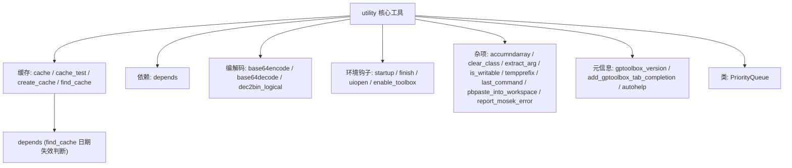

# 40.1 通用工具（核心） / Core Utilities

> 本章覆盖 `utility/` 目录下一组**与几何算法无关、但被全库共享的底层工具**：
> 缓存与依赖分析（`cache` / `cache_test` / `create_cache` / `find_cache` / `depends`）、
> Base64 编解码与二进制/十进制转换、工作区与图窗杂项（`clear_class` / `last_command` /
> `pbpaste_into_workspace` / `tempprefix` / `is_writable`）、MATLAB 环境钩子
> （`startup` / `finish` / `uiopen`），以及一个基于 Java 的优先队列类 `PriorityQueue`。
>
> This chapter covers a set of **geometry-agnostic, globally shared low-level helpers** in
> `utility/`: caching & dependency analysis, Base64/binary conversions, workspace & figure
> miscellany, MATLAB environment hooks, and the Java-backed `PriorityQueue` class.

- 语言 / Language：中英对照（中文为主）
- 相关章节 / See also：[40-utility/README.md](README.md)、
  [appendices/03-doc-template.md](../appendices/03-doc-template.md)、
  [00-overview/05-dependency-map.md](../00-overview/05-dependency-map.md)
- 说明 / Note：本文件仅覆盖 24 个"核心"工具文件；其余绘图/颜色类工具见
  [40-utility/02-plotting-and-colors.md](02-plotting-and-colors.md)。

---

## 本章概览 / Chapter Overview

**模块职责 / Module responsibility**

- `utility/` 中的这些函数不属于任何几何算法，而是"固化 MATLAB 使用体验"的胶水代码：
  用 MD5 校验和把昂贵函数的输出缓存到 `.mat`；用静态分析递归收集函数的**深层依赖**；
  在无内置支持时手写 Base64/二进制转换；提供 `startup`/`finish`/`uiopen` 这类
  **同名覆盖（overload）** MATLAB 内置钩子的脚本；以及若干路径/剪贴板/命令历史助手。
- These helpers are glue code: MD5-keyed result caching, recursive static dependency
  collection, hand-rolled Base64/binary conversion, MATLAB `startup`/`finish`/`uiopen`
  hook overrides, and assorted path/clipboard/history utilities.

**分类总览 / Categorization**

| 类别 / Category | 函数 / Functions |
|---|---|
| 缓存 / Caching | `cache`、`cache_test`、`create_cache`、`find_cache` |
| 依赖分析 / Dependency analysis | `depends` |
| 编解码与进制 / Base64 & radix | `base64decode`、`base64encode`、`dec2bin_logical` |
| 命令历史与剪贴板 / History & clipboard | `last_command`、`pbpaste_into_workspace` |
| 工作区杂项 / Workspace misc | `accumndarray`、`clear_class`、`extract_arg`、`is_writable`、`tempprefix` |
| 环境钩子 / Environment hooks | `startup`、`finish`、`uiopen`、`enable_toolbox` |
| 元信息 / Meta | `gptoolbox_version`、`add_gptoolbox_tab_completion`、`autohelp` |
| 数据结构 / Data structure | `PriorityQueue`（classdef） |
| 求解器助手 / Solver helper | `report_mosek_error` |

### 模块关系图 / Module relationship diagram



---

## 逐函数详解 / Per-function reference

### `accumndarray` — 广播式下标累加（accumarray 的广播版本）
- **文件 / File**: [utility/accumndarray.m](file:///c:/VSWork/gptoolbox-1/utility/accumndarray.m#L1-L44)
- **签名 / Signature**: `H = accumndarray(varargin)`
  实际调用：`H = accumndarray(I1,I2,...,IN,data,sz)`（最后两个参数依次为 `data` 与 `sz`，中间均为下标数组）
- **功能 / Purpose**: `EN: Subscripted and broadcasted version of accumarray: subscripts I1..IN and data may be nd-arrays of matching or broadcastable sizes.` / 中文：`accumarray` 的"下标 + 广播"版本——下标与数据可具有相同或可广播（单例维）尺寸。
- **输入 / Inputs**:

  | 参数 | 尺寸/类型 | 含义 (中 / EN) |
  |---|---|---|
  | `I1,...,IN` | nd-array，可广播 | N 组下标数组 / subscript arrays |
  | `data` | nd-array，可广播 | 累加数据 / values to accumulate |
  | `sz` | `1 by N` | 输出尺寸 / output size vector |

- **输出 / Outputs**:

  | 参数 | 尺寸/类型 | 含义 |
  |---|---|---|
  | `H` | `sz` 指定尺寸 | 累加结果 / accumulation result |

- **可选参数 / Optional**: 无 / None（参数按位置解析：`sz=varargin{end}`、`data=varargin{end-1}`、其余为下标）
- **变量流动 / Variable flow**: `varargin →(末项)→ sz →(倒数第二项)→ data →(中间项)→ subs →(广播尺寸 dsub = 各 subs 尺寸逐维 max)→(对每个 subs 与 data: repmat 到 dsub 后 vec 展平)→ subs{:},data →(accumarray)→ H`
- **算法步骤 / Algorithm**:
  1. 取 `sz = varargin{end}`、`subs = varargin(1:end-2)`、`data = varargin{end-1}`（L17–L18, L26）。
  2. 遍历所有下标数组求广播目标尺寸 `dsub`：逐维取最大（L20–L25）。
  3. 对每个下标数组与 `data`：断言其尺寸"要么为 1 要么等于 `dsub`"（`all(di==1 | di==dsub)`），再按 `ri`（需要广播的维）`repmat` 并展平为列向量（L27–L42）。
  4. `H = accumarray([subs{:}],data,sz)`（L43）。
- **流程图 / Flowchart**:

  ```mermaid
  flowchart TD
    A["输入 varargin"] --> B["sz=末项; data=倒数第二; subs=中间项"]
    B --> C["遍历 subs → 广播尺寸 dsub"]
    C --> D{"si = 1..N+1 循环?"}
    D -- 是 --> E["断言 di 为 1 或 dsub"]
    E --> F["repmat 到 dsub 并 vec 展平"]
    F --> D
    D -- 否 --> G["H = accumarray([subs{:}],data,sz)"]
    G --> Z["输出 H"]
  ```
- **依赖 / Dependencies**: 无本库依赖（`accumarray`、`repmat`、`reshape`、`assert` 均为 MATLAB 内置；`vec` 为局部匿名函数 L16）
- **See also**: `accumarray`, `sparse`

### `add_gptoolbox_tab_completion` — 注册 gptoolbox 函数参数补全
- **文件 / File**: [utility/add_gptoolbox_tab_completion.m](file:///c:/VSWork/gptoolbox-1/utility/add_gptoolbox_tab_completion.m#L1-L78)
- **签名 / Signature**: `[d,L] = add_gptoolbox_tab_completion()`
- **功能 / Purpose**: `EN: Register custom argument tab-completions for a hard-coded list of gptoolbox I/O and driver functions by calling tabcomplete.` / 中文：为一份硬编码的 gptoolbox 函数清单（多为 I/O 与驱动函数）注册自定义参数补全，内部逐条调用 `tabcomplete`。
- **输入 / Inputs**: 无 / None
- **输出 / Outputs**:

  | 参数 | 尺寸/类型 | 含义 |
  |---|---|---|
  | `d` | char | 全部注册完成后 `tabcomplete` 的返回值 |
  | `L` | cell | 被加入补全的 `{函数名, 参数说明}` 列表 |

- **可选参数 / Optional**: 无 / None
- **变量流动 / Variable flow**: `(硬编码 cell L)→(cellfun 对每条 x 调 tabcomplete(x{1},x{2}))→ d = tabcomplete()→(warning 提示需重启 MATLAB)`
- **算法步骤 / Algorithm**:
  1. 构造 `L`：一个 `{函数名, 参数串}`（如 `{'readOBJ','dir file'}`）的 cell 列表（L9–L74）。
  2. `cellfun(@(x) tabcomplete(x{1},x{2}),L,'UniformOutput',false)` 逐条注册（L75）。
  3. `d = tabcomplete()` 读回当前补全设置（L76）。
  4. `warning('You must restart MATLAB for new tab-completions to take effect')`（L77）。
- **流程图 / Flowchart**:

  ```mermaid
  flowchart TD
    A["开始"] --> B["构造硬编码列表 L"]
    B --> C{"遍历 L 中每条 x?"}
    C -- 是 --> D["tabcomplete(x{1},x{2})"]
    D --> C
    C -- 否 --> E["d = tabcomplete()"]
    E --> F["warning: 需重启 MATLAB"]
    F --> Z["输出 d,L"]
  ```
- **依赖 / Dependencies**: `tabcomplete` ([external/tabcomplete.m](file:///c:/VSWork/gptoolbox-1/external/tabcomplete.m#L1))（第三方，仓库内已 vendored）
- **See also**: `tabcomplete`, `autohelp`

### `autohelp` — 生成当前目录全部 .m 的帮助文档（脚本）
- **文件 / File**: [utility/autohelp.m](file:///c:/VSWork/gptoolbox-1/utility/autohelp.m#L1-L29)
- **签名 / Signature**: 脚本（无独立函数签名）/ script — 直接运行 `autohelp`
- **功能 / Purpose**: `EN: Script that concatenates the help documentation of all .m files in this directory (and 1 level deep) into Documentation.txt.` / 中文：脚本，把当前目录（及一层子目录）下所有 `.m` 文件的帮助文本拼接写入 `Documentation.txt`。
- **输入 / Inputs**: 无（通过 `find` 扫描当前工作目录）/ None
- **输出 / Outputs**: 无返回值；副作用为写出 `Documentation.txt` / writes file
- **可选参数 / Optional**: 无 / None
- **变量流动 / Variable flow**: `pwd →(system('find . -name "*.m" -depth 2'))→ r →(regexp 按换行切分)→ files →(滤除空串)→ files →(cellfun(@help,files))→ helps →(cat(1,files,helps))→ filesandhelps →(fopen 'Documentation.txt' 'w')→ output_handle →(fprintf 列表与帮助)→ fclose`
- **算法步骤 / Algorithm**:
  1. `[s,r] = system('find . -name "*.m" -depth 2')` 取文件路径（L5，**Unix-only**）。
  2. `files = regexp(r,'\n','split')`，再用 `~cellfun(@isempty,...)` 去掉空项（L7–L9）。
  3. `helps = cellfun(@help,files,'UniformOutput',false)` 逐文件取帮助（L11）。
  4. `filesandhelps = cat(1,files,helps)`（L13，注：该变量**此后未被使用**）。
  5. `output_handle = fopen('Documentation.txt','w')`；打印 `LIST OF FILES` 与文件列表（L17–L20）。
  6. `fprintf(output_handle,'%s\n%s\n\n',fh{:})` 打印帮助（L23，**引用未定义的 `fh`**，见"备注"）。
  7. `fprintf(...,date)`（L24）；若 `output_handle ~= 1` 则 `fclose`（L27–L29）。
- **流程图 / Flowchart**:

  ```mermaid
  flowchart TD
    A["运行脚本"] --> B["system: find *.m (深度2)"]
    B --> C["regexp 换行切分 → files"]
    C --> D["滤除空路径"]
    D --> E["cellfun(@help,files) → helps"]
    E --> F["cat(1,files,helps) → filesandhelps"]
    F --> G["fopen Documentation.txt 'w'"]
    G --> H["fprintf 文件列表与帮助(引用未定义 fh)"]
    H --> I{"output_handle ~= 1?"}
    I -- 是 --> J["fclose"]
    I -- 否 --> Z["结束"]
    J --> Z
  ```
- **依赖 / Dependencies**: `system`(`find`)、`regexp`、`cellfun`、`help`、`fopen`/`fprintf`/`fclose`（内置）
- **See also**: `help`, `add_gptoolbox_tab_completion`
- **备注 / Note**: 这是**脚本**（无 `function` 定义）。源码存在两处缺陷：① 第 23 行打印的是 `fh{:}`，但实际构造的变量名为 `filesandhelps`，`fh` **从未定义**，运行到此处会报 `Undefined function or variable 'fh'`；② 变量名拼写 `helps`（正确）却在 cat 时使用，`filesandhelps` 后续未用。`find` 命令依赖 Unix。

### `base64decode` — Base64 解码（手写加速版）
- **文件 / File**: [utility/base64decode.m](file:///c:/VSWork/gptoolbox-1/utility/base64decode.m#L1-L28)
- **签名 / Signature**: `V = base64decode(RES)`
- **功能 / Purpose**: `EN: Hand-optimized (faster) replacement for matlab.net.base64decode: decode a Base64 character vector into a byte vector.` / 中文：`matlab.net.base64decode` 的更快手写实现——把 Base64 字符向量解码为字节向量。
- **输入 / Inputs**:

  | 参数 | 尺寸/类型 | 含义 (中 / EN) |
  |---|---|---|
  | `RES` | `#RES` char | Base64 字符串 / Base64 character vector |

- **输出 / Outputs**:

  | 参数 | 尺寸/类型 | 含义 |
  |---|---|---|
  | `V` | `#V` double | 解码出的字节序列 / decoded bytes |

- **可选参数 / Optional**: 无 / None
- **变量流动 / Variable flow**: `RES →(定位 '=' → equ)→(ismember 到 64 字符表→ inds-1)→(dec2bin_logical(...,6))→ bin →(reshape 为 1×(6k))→(截断到 8 的整数倍)→(reshape 为 n×8)→(bin*(2.^(7:-1:0))')→ V`
- **算法步骤 / Algorithm**:
  1. 定义 64 字符表 `vals`（末位 `'='` 为填充）（L13）。
  2. 找填充位置 `equ = find(RES=='=')-1`；若无填充则 `equ = numel(RES)`（L14–L17）。
  3. `[~,inds] = ismember(RES(1:equ),vals)` 把字符映射为 0..63 序号（L18）。
  4. `bin = dec2bin_logical(inds-1,6)` 得到每字符 6 位的逻辑阵（L19）。
  5. 展平后截断到 8 的整数倍，再 `reshape(bin,8,[])'` 每 8 位一组（L22–L24）。
  6. `V = (bin)*(2.^(7:-1:0))'` 用权重向量一次性把 8 位转字节（L27，替代慢的 `bin2dec`）。
- **流程图 / Flowchart**:

  ```mermaid
  flowchart TD
    A["输入 RES"] --> B["找 '=' → equ"]
    B --> C{"存在填充?"}
    C -- 否 --> C1["equ = numel(RES)"]
    C -- 是 --> D
    C1 --> D["ismember → inds"]
    D --> E["dec2bin_logical(inds-1,6) → bin"]
    E --> F["展平 & 截断到 8 的倍数"]
    F --> G["reshape(8,[]) → 每 8 位一组"]
    G --> Z["V = bin * 2.^(7:-1:0)'"]
  ```
- **依赖 / Dependencies**: `dec2bin_logical` ([utility/dec2bin_logical.m](file:///c:/VSWork/gptoolbox-1/utility/dec2bin_logical.m#L1))、`ismember`/`find`/`reshape`（内置）
- **See also**: `base64encode`, `matlab.net.base64decode`, `unicode2native`

### `base64encode` — Base64 编码（手写加速版）
- **文件 / File**: [utility/base64encode.m](file:///c:/VSWork/gptoolbox-1/utility/base64encode.m#L1-L40)
- **签名 / Signature**: `RES = base64encode(V)`
- **功能 / Purpose**: `EN: Hand-optimized (faster) replacement for matlab.net.base64encode: encode a byte vector into a Base64 character vector (RFC 4648 §4).` / 中文：`matlab.net.base64encode` 的更快手写实现——把字节向量按 RFC 4648 §4 编码为 Base64 字符串。
- **输入 / Inputs**:

  | 参数 | 尺寸/类型 | 含义 (中 / EN) |
  |---|---|---|
  | `V` | `#V` double / char | 待编码字节或字符串 / bytes or string |

- **输出 / Outputs**:

  | 参数 | 尺寸/类型 | 含义 |
  |---|---|---|
  | `RES` | 1×n char | Base64 字符串 / encoded characters |

- **可选参数 / Optional**: 无 / None
- **变量流动 / Variable flow**: `V →(dec2bin_logical(V,8))→ bin →(reshape 1×()→ 补齐到 6 的倍数)→(inds = 2.^(5:-1:0)*reshape(bin,6,[]) + 1)→ Vstr = vals(inds)→(补齐 '=' 到 4 的倍数)→ RES`
- **算法步骤 / Algorithm**:
  1. 定义 64 字符表 `vals`（L26）。
  2. `bin = dec2bin_logical(V,8)` 每字节 8 位（L27）。
  3. 展平后用 `Vpad = mod(6-mod(numel(bin),6),6)` 补齐 `false` 到 6 的整数倍（L30–L32）。
  4. `inds = (2.^(5:-1:0))*(reshape(bin,6,[]))+1` 每 6 位得到字符表下标（L33），`Vstr = vals(inds)`（L34）。
  5. `Vstr_pad = mod(4-mod(numel(Vstr),4),4)`；`RES = [Vstr repmat('=',1,Vstr_pad)]` 补齐到 4 的倍数（L35–L36）。
- **流程图 / Flowchart**:

  ```mermaid
  flowchart TD
    A["输入 V"] --> B["dec2bin_logical(V,8) → bin"]
    B --> C["展平后补齐到 6 的倍数"]
    C --> D["inds = 2.^(5:-1:0)*reshape(bin,6,[])+1"]
    D --> E["Vstr = vals(inds)"]
    E --> F["补齐 '=' 到 4 的倍数"]
    F --> Z["输出 RES"]
  ```
- **依赖 / Dependencies**: `dec2bin_logical` ([utility/dec2bin_logical.m](file:///c:/VSWork/gptoolbox-1/utility/dec2bin_logical.m#L1))、`reshape`/`mod`（内置）
- **See also**: `base64decode`, `matlab.net.base64encode`, `unicode2native`

### `cache` — 基于 MD5 的函数结果缓存
- **文件 / File**: [utility/cache.m](file:///c:/VSWork/gptoolbox-1/utility/cache.m#L1-L42)
- **签名 / Signature**: `varargout = cache(fun,varargin)`
  用法：把 `[out1,out2,...] = myfun(in1,in2,...)` 换成 `[out1,out2,...] = cache(@myfun,in1,in2,...)`
- **功能 / Purpose**: `EN: Rather than calling an expensive function again, load its output from a .mat cache keyed by an md5 checksum of the (function handle + inputs + number of outputs).` / 中文：把昂贵函数"输入状态"的 MD5 校验和作为 `.mat` 缓存文件名；命中则直接 `load`，否则调用原函数并把输出存盘。
- **输入 / Inputs**:

  | 参数 | 尺寸/类型 | 含义 (中 / EN) |
  |---|---|---|
  | `fun` | function handle | 待缓存的原函数句柄 / function handle |
  | `varargin` | 任意 | 原函数输入参数 / original inputs |

- **输出 / Outputs**:

  | 参数 | 尺寸/类型 | 含义 |
  |---|---|---|
  | `varargout` | 任意 | 原函数的（缓存的）输出 / cached outputs |

- **可选参数 / Optional**: 无 / None（所有 `varargin` 均参与哈希）
- **缓存布局 / On-disk cache layout**: 当前工作目录下的 `cache.<md5>.mat` 文件（由 `awk '{printf "cache."$1".mat"}'` 拼出，L23–L25）。
- **哈希键 / Hash key**: 先把 `fun`、`varargin`、`NARGOUT` 存进临时 `.mat`（`save(tmpf,'fun','varargin','NARGOUT')`），再 `dd if=tmpf skip=128 bs=1`（跳过 128 字节头）后算 `md5sum`。**键中显式含输出个数 `NARGOUT`**，故输出数变化会生成新缓存（L18–L25）。
- **失效 / Invalidation**: 本函数**不做时间戳失效**——只要文件存在就直接复用；真正的"新近性"判断由 [find_cache](file:///c:/VSWork/gptoolbox-1/utility/find_cache.m#L1) 完成。
- **变量流动 / Variable flow**: `fun,varargin →(tempname + save fun/varargin/NARGOUT)→ tmpf →(dd skip=128 | md5sum | awk)→ cache_name →(delete tmpf)→(exist?)→ [load → varargout] 或 [eval fun(varargin{:}) → varargout → save(cache_name)]`
- **算法步骤 / Algorithm**:
  1. `tmpf = [tempname('.') '.mat']`；`NARGOUT = nargout`；`save(tmpf,'fun','varargin','NARGOUT')`（L19–L21）。
  2. `system('dd if=<tmpf> 2>/dev/null skip=128 bs=1 | /usr/local/bin/md5sum | awk ''{printf "cache."$1".mat"}''')` 得 `cache_name`（L23–L25）。
  3. `delete(tmpf)`、`clear s tmpf`（L27–L28）。
  4. 若 `exist(cache_name,'file')`：`warning('Loading %s...')` 后 `load(cache_name)`（L31–L34）。
  5. 否则：`eval(['[' sprintf('varargout{%d} ',1:nargout) '] = fun(varargin{:});'])` 动态匹配输出个数调用，再 `save(cache_name,'varargout')`（L39–L40）。
- **流程图 / Flowchart**:

  ```mermaid
  flowchart TD
    A["输入 fun,varargin"] --> B["tmpf=tempname.mat; save fun,varargin,NARGOUT"]
    B --> C["dd skip=128 | md5sum | awk → cache_name"]
    C --> D["delete(tmpf)"]
    D --> E{"exist(cache_name)?"}
    E -- 是 --> F["warning + load(cache_name)"]
    E -- 否 --> G["eval fun(varargin{:}) → varargout"]
    G --> H["save(cache_name,'varargout')"]
    F --> Z["输出 varargout"]
    H --> Z
  ```
- **依赖 / Dependencies**: 系统命令 `dd`、`/usr/local/bin/md5sum`、`awk`（**Unix 专用**）；`tempname`/`save`/`load`/`eval`/`exist`/`nargout`（内置）
- **See also**: `create_cache`, `find_cache`, `cache_test`
- **备注 / Note**: 依赖硬编码路径 `/usr/local/bin/md5sum` 与 `dd`，**在 Windows 上不可用**；头注释也提示"MD5 哈希碰撞概率极低"。

### `cache_test` — 演示 MD5 缓存的示例函数
- **文件 / File**: [utility/cache_test.m](file:///c:/VSWork/gptoolbox-1/utility/cache_test.m#L1-L47)
- **签名 / Signature**: `C = cache_test(A,B)`
- **功能 / Purpose**: `EN: Dummy function computing C=A+B that demonstrates the md5-caching pattern (check-cache / compute / store-cache) on input parameters.` / 中文：一个"计算 `C=A+B`"的示例函数，演示按输入参数做 MD5 缓存的编写范式（查缓存 / 计算 / 存缓存）。
- **输入 / Inputs**:

  | 参数 | 尺寸/类型 | 含义 (中 / EN) |
  |---|---|---|
  | `A` | scalar / array | 加数 / addend |
  | `B` | scalar / array | 加数 / addend |

- **输出 / Outputs**:

  | 参数 | 尺寸/类型 | 含义 |
  |---|---|---|
  | `C` | scalar / array | `A+B` |

- **可选参数 / Optional**: 无 / None
- **缓存布局 / On-disk cache layout**: 由 md5 校验和拼成的 `.<md5>.cache.mat`（`awk '{printf "."$1".cache.mat"}'`，L20）。
- **哈希键 / Hash key**: 用 `who` 取当前作用域所有变量名，`save(tmpf,'-regexp',sprintf('^%s$|',variables{:}),'-ascii')` 存为 ASCII 后算 `md5sum`（L13–L20）。
- **变量流动 / Variable flow**: `A,B →(who → variables)→(save ascii → tmpf)→(md5sum | awk)→ cache_name →(delete tmpf, clear)→(exist?)→ [load → C] 或 [C=A+B → who → save(cache_name)]`
- **算法步骤 / Algorithm**:
  1. `variables = who`；`tmpf = [tempname('.') '.mat']`（L13–L15）。
  2. `save(tmpf,'-regexp',sprintf('^%s$|',variables{:}),'-ascii')`（L17）。
  3. `system('md5sum <tmpf> | awk ''{printf "."$1".cache.mat"}''')` 得 `cache_name`（L20）。
  4. `delete(tmpf); clear s tmpf variables`（L22–L23）。
  5. 命中（`exist(cache_name,'file')`）：`fprintf('Cache exists...')` 后 `load(cache_name)`（L27–L30）。
  6. 未命中：`fprintf('First time...')`；执行用户代码 `C = A+B`（L34–L39）；`variables = who` 取输出状态并 `save(cache_name,'-regexp',...)`（L43–L45）。
- **流程图 / Flowchart**:

  ```mermaid
  flowchart TD
    A["输入 A,B"] --> B["who → variables"]
    B --> C["save ascii → tmpf"]
    C --> D["md5sum | awk → cache_name"]
    D --> E["delete tmpf; clear"]
    E --> F{"exist(cache_name)?"}
    F -- 是 --> G["fprintf 'Cache exists'; load → C"]
    F -- 否 --> H["fprintf 'First time'"]
    H --> I["C = A + B"]
    I --> J["who; save(cache_name)"]
    G --> Z["输出 C"]
    J --> Z
  ```
- **依赖 / Dependencies**: 系统命令 `md5sum`、`awk`（**Unix 专用**）；`who`/`save`/`load`/`exist`/`tempname`（内置）
- **See also**: `cache`, `create_cache`, `find_cache`

### `clear_class` — 清除工作区中某类型的所有变量
- **文件 / File**: [utility/clear_class.m](file:///c:/VSWork/gptoolbox-1/utility/clear_class.m#L1-L28)
- **签名 / Signature**: `clear_class(class_name)`
- **功能 / Purpose**: `EN: Clear all variables of a specific class from the caller's workspace.` / 中文：把调用者工作区中属于指定类型（class）的变量全部清除。
- **输入 / Inputs**:

  | 参数 | 尺寸/类型 | 含义 (中 / EN) |
  |---|---|---|
  | `class_name` | char | 目标类型名 / class name as string |

- **输出 / Outputs**: 无 / None（副作用为 `clear` 变量）
- **可选参数 / Optional**: 无 / None
- **变量流动 / Variable flow**: `class_name →(who → s_v)→(循环 ii: s_s=s_v{ii}; s_d=eval(s_s); class(s_d))→(strcmp(class(s_d),class_name)? clear(s_s))`
- **算法步骤 / Algorithm**:
  1. `s_v = who` 取变量名 cell（L13）。
  2. 循环 `ii=1:numel(s_v)`（L16）：取变量名 `s_s = s_v{ii}`，`s_d = eval(s_s)` 取值，`class(s_d)` 得类型（L18–L21）。
  3. 若 `strcmp(class(s_d),class_name)`：打印并 `clear(s_s)`（L22–L25）。
- **流程图 / Flowchart**:

  ```mermaid
  flowchart TD
    A["输入 class_name"] --> B["who → s_v"]
    B --> C{"ii <= numel(s_v)?"}
    C -- 是 --> D["s_s = s_v{ii}; s_d = eval(s_s)"]
    D --> E{"class(s_d) == class_name?"}
    E -- 是 --> F["clear(s_s)"]
    E -- 否 --> G["跳过"]
    F --> C
    G --> C
    C -- 否 --> Z["结束"]
  ```
- **依赖 / Dependencies**: `who`、`eval`、`class`、`clear`、`strcmp`（内置）
- **See also**: `clear`, `whos`, `clear_all_but`
- **备注 / Note**: 源码中 `s_v`（L14）、`s_s`（L19）、`class(s_d)`（L21）三行**无分号**，会在命令窗口回显调试信息（疑似遗留调试输出）；且 `clear(s_s)` 只能清当前函数作用域内变量，对调用者工作区无效。

### `create_cache` — 保存调用者工作区为缓存
- **文件 / File**: [utility/create_cache.m](file:///c:/VSWork/gptoolbox-1/utility/create_cache.m#L1-L19)
- **签名 / Signature**: `create_cache(cache_name)`
- **功能 / Purpose**: `EN: Save the workspace of the caller function into the provided .mat cache_name, possibly overwriting it (Unix only).` / 中文：把**调用者**函数的整个工作区保存到给定 `cache_name` 的 `.mat`（可覆盖）；仅在 Unix 下生效。
- **输入 / Inputs**:

  | 参数 | 尺寸/类型 | 含义 (中 / EN) |
  |---|---|---|
  | `cache_name` | char | `.mat` 缓存文件路径 / path to cache file |

- **输出 / Outputs**: 无 / None（写文件）
- **可选参数 / Optional**: 无 / None
- **缓存布局 / On-disk cache layout**: 由调用方命名的 `.mat` 文件（通常配合 [find_cache](file:///c:/VSWork/gptoolbox-1/utility/find_cache.m#L1) 给出的 `cache_name`）。
- **变量流动 / Variable flow**: `cache_name →(if isunix)→(evalin('caller','who') → variables)→(sprintf 构造 '^v1$|^v2$|...')→ save_cmd →(evalin('caller',save_cmd))→ .mat`
- **算法步骤 / Algorithm**:
  1. 仅当 `isunix` 时执行（L12）。
  2. `variables = evalin('caller','who')` 取调用者变量名（L14）。
  3. `variable_names = sprintf('^%s$|',variables{:})` 构造正则（L15）。
  4. `save_cmd = sprintf('save(''%s'',''-regexp'',''%s'');',cache_name,variable_names)`，`evalin('caller',save_cmd)` 在调用者作用域执行保存（L16–L17）。
- **流程图 / Flowchart**:

  ```mermaid
  flowchart TD
    A["输入 cache_name"] --> B{"isunix?"}
    B -- 否 --> Z["不执行"]
    B -- 是 --> C["evalin('caller','who') → variables"]
    C --> D["sprintf → variable_names 正则"]
    D --> E["构造 save_cmd"]
    E --> F["evalin('caller',save_cmd) 存 .mat"]
    F --> Z
  ```
- **依赖 / Dependencies**: `evalin`、`sprintf`、`save`（内置）；与 [find_cache](file:///c:/VSWork/gptoolbox-1/utility/find_cache.m#L1) 成对使用
- **See also**: `find_cache`, `cache`

### `dec2bin_logical` — 十进制转逻辑位数组（dec2bin 加速版）
- **文件 / File**: [utility/dec2bin_logical.m](file:///c:/VSWork/gptoolbox-1/utility/dec2bin_logical.m#L1-L38)
- **签名 / Signature**: `bin = dec2bin_logical(D,numBits)`
- **功能 / Purpose**: `EN: Slightly faster version of dec2bin that outputs a logical bit array directly (rather than a char matrix).` / 中文：`dec2bin` 的略快版本，直接输出**逻辑位数组**（每行 `numBits` 位），避免字符矩阵开销。
- **输入 / Inputs**:

  | 参数 | 尺寸/类型 | 含义 (中 / EN) |
  |---|---|---|
  | `D` | 整数数组 | 待转换整数 / decimal integers |
  | `numBits` | 正整数 | 每值位宽 / number of bits |

- **输出 / Outputs**:

  | 参数 | 尺寸/类型 | 含义 |
  |---|---|---|
  | `bin` | `numel(D) by numBits` logical | 二进制位 / logical bits |

- **可选参数 / Optional**: 无 / None
- **变量流动 / Variable flow**: `D,numBits →(reshape 列向量)→(assert all(D < 2^numBits))→(bin=false(n,numBits))→(循环 i=numBits:-1:1: m=2^(i-1); bin(:,k)=D>=m; D=D-bin*m)→ bin`
- **算法步骤 / Algorithm**:
  1. `D = reshape(D,[],1)`；`assert(all(D<2^numBits),'numBits not large enough')`（L28–L29）。
  2. `bin = false(numel(D),numBits)`（L31）。
  3. 由高位到低位循环 `i = numBits:-1:1`：`m = 2^(i-1)`；`bin(:,numBits-i+1) = D>=m`；`D = D - bin(:,numBits-i+1)*m`（L32–L36）。
- **流程图 / Flowchart**:

  ```mermaid
  flowchart TD
    A["输入 D,numBits"] --> B["D = reshape([],1)"]
    B --> C{"all(D < 2^numBits)?"}
    C -- 否 --> E["assert 失败"]
    C -- 是 --> D["bin = false(n,numBits)"]
    D --> F{"i = numBits..1 循环?"}
    F -- 是 --> G["m=2^(i-1); bin(:,k)=D>=m; D=D-bin*m"]
    G --> F
    F -- 否 --> Z["输出 bin"]
  ```
- **依赖 / Dependencies**: 无本库依赖（`reshape`/`assert`/`false` 内置）
- **See also**: `dec2bin`, `bin2dec`, `dec2hex`, `dec2base`

### `depends` — 递归收集函数的深层依赖（静态分析）
- **文件 / File**: [utility/depends.m](file:///c:/VSWork/gptoolbox-1/utility/depends.m#L1-L75)
- **签名 / Signature**: `[C,P] = depends(f,depth)`
- **功能 / Purpose**: `EN: Compute the (deep) dependency list for a given function f by recursively running MATLAB static analysis until a given depth, returning paths (C) and required products (P).` / 中文：给定函数 `f`，用 MATLAB 静态分析**逐层递归**收集其深层依赖，返回依赖文件路径 `C` 与所需产品 `P`。
- **输入 / Inputs**:

  | 参数 | 尺寸/类型 | 含义 (中 / EN) |
  |---|---|---|
  | `f` | char | 函数名或路径 / function name or path |
  | `depth` | 正整数 | 探索层数 / levels to explore {Inf} |

- **输出 / Outputs**:

  | 参数 | 尺寸/类型 | 含义 |
  |---|---|---|
  | `C` | cell | 依赖文件绝对路径列表 / dependency paths |
  | `P` | cell | 所需产品名列表 / required product names |

- **可选参数 / Optional**:

  | 名称 | 取值 | 默认 | 含义 |
  |---|---|---|---|
  | `depth` | 正整数 | `Inf` | 最大递归层数 / max recursion depth |

- **变量流动 / Variable flow**: `f,depth →(warning off depfun deprecation)→(exist(f,'dir')? arrayfun(dir('**/*.m')) : which(f))→ C → Q=C, level=0 →(while level<depth && ~isempty(Q))→(内层: p=Q{1}, requiredFilesAndProducts(p,'toponly') → new_deps, plist.Name → P=union)→(滤除 matlabroot)→ Q=setdiff(new_deps,C)→ C=cat(1,C,Q); level++ → C,P`
- **算法步骤 / Algorithm**:
  1. 关闭 `MATLAB:DEPFUN:DeprecatedAPI` 警告；`depth` 缺省 `Inf`（L29–L34）。
  2. `level = 0`。若 `f` 是目录：用 `arrayfun(@(d) fullfile(d.folder,d.name),dir(fullfile(f,'**/*.m')),...)` 递归列出所有 `.m`；否则 `C{end+1} = which(f)`（L36–L43）。
  3. `Q = C` 作为待处理队列；`while level < depth && ~isempty(Q)`（L45–L48）。
  4. 内层逐个出队 `p`：`progressbar(...)` 显示进度；`[flist,plist] = matlab.codetools.requiredFilesAndProducts(p,'toponly')`，累积 `new_deps = cat(1,new_deps,flist')`、`P = union(P,{plist.Name})`（L51–L62）。
  5. `new_deps = new_deps(cellfun(@isempty,strfind(new_deps,matlabroot)))` 剔除 MATLAB 自带文件（L65）。
  6. `Q = setdiff(new_deps,C)`；若非空则 `C = cat(1,C,Q)`；`level = level+1`（L66–L70）。
  7. 恢复先前警告状态 `warning(w)`（L73）。
- **流程图 / Flowchart**:

  ```mermaid
  flowchart TD
    A["输入 f,depth"] --> B{"exist(f,'dir')?"}
    B -- 是 --> B1["dir('**/*.m') 收集全部 .m"]
    B -- 否 --> B2["C = {which(f)}"]
    B1 --> C["Q = C; level = 0"]
    B2 --> C
    C --> D{"level < depth 且 Q 非空?"}
    D -- 否 --> Z["输出 C,P"]
    D -- 是 --> E["p = Q{1}; Q = Q(2:end)"]
    E --> E1["progressbar(nq-numel(Q),nq)"]
    E1 --> F["requiredFilesAndProducts(p,'toponly')"]
    F --> G["new_deps += flist; P = union(P,plist.Name)"]
    G --> H{"Q 仍非空?"}
    H -- 是 --> E
    H -- 否 --> I["滤除 matlabroot; Q = setdiff(new_deps,C)"]
    I --> J["C = cat(1,C,Q); level++"]
    J --> D
  ```
- **依赖 / Dependencies**: `progressbar` ([external/progressbar.m](file:///c:/VSWork/gptoolbox-1/external/progressbar.m#L1))、`matlab.codetools.requiredFilesAndProducts`、`which`/`dir`/`arrayfun`/`union`/`setdiff`/`strfind`/`matlabroot`（内置）；注释中提及旧接口 `depfun`（已弃用，L55）
- **See also**: `depfun`, `matlab.codetools.requiredFilesAndProducts`, `find_cache`
- **备注 / Note**: 头注释只描述输出 `C`，**未文档化 `P`（products）**；签名实际返回 `[C,P]`。

### `enable_toolbox` — 把内置工具箱复制到本地沙箱目录
- **文件 / File**: [utility/enable_toolbox.m](file:///c:/VSWork/gptoolbox-1/utility/enable_toolbox.m#L1-L16)
- **签名 / Signature**: `enable_toolbox(name)`
- **功能 / Purpose**: `EN: Copy a MATLAB toolbox's .m files (and its private/ folder) into a local './<name>' sandbox, add it to the path, so it can be inspected/edited (mac-specific hard-coded path).` / 中文：把某内置 MATLAB 工具箱的 `.m`（连同 `private/`）复制到本地 `./<name>` 沙箱并 `addpath`，便于查看/修改（含硬编码的 macOS 路径）。
- **输入 / Inputs**:

  | 参数 | 尺寸/类型 | 含义 (中 / EN) |
  |---|---|---|
  | `name` | char | 工具箱名 / toolbox name |

- **输出 / Outputs**: 无 / None（文件系统副作用）
- **可选参数 / Optional**: 无 / None
- **变量流动 / Variable flow**: `name → local_toolbox_dir='./'+name →(exist? rmdir 's')→ mkdir + mkdir private → addpath →(copyfile 从硬编码 matlabroot 复制 .m 与 private/*.m)`
- **算法步骤 / Algorithm**:
  1. `local_toolbox_dir = ['./' name]`；若已存在则 `rmdir(...,'s')`（L2–L5）。
  2. `mkdir(local_toolbox_dir)`、`mkdir([local_toolbox_dir '/private'])`（L6–L7）。
  3. `addpath(local_toolbox_dir)`（须在复制前，L8）。
  4. `matlabroot = '/Applications/MATLAB_R2018a.app/'`（**硬编码**，L9）。
  5. `copyfile` 复制 `toolbox/<name>/<name>/*.m` 与 `toolbox/<name>/<name>/private/*.m`（L10–L15）。
- **流程图 / Flowchart**:

  ```mermaid
  flowchart TD
    A["输入 name"] --> B["local_toolbox_dir = './'+name"]
    B --> C{"目录已存在?"}
    C -- 是 --> D["rmdir 's'"]
    C -- 否 --> E
    D --> E["mkdir + mkdir private"]
    E --> F["addpath(local_toolbox_dir)"]
    F --> G["copyfile 从硬编码 matlabroot 复制 .m"]
    G --> Z["完成"]
  ```
- **依赖 / Dependencies**: `rmdir`/`mkdir`/`addpath`/`copyfile`（内置）
- **See also**: `addpath`, `matlabroot`

### `extract_arg` — 取函数调用的第 j 个输出
- **文件 / File**: [utility/extract_arg.m](file:///c:/VSWork/gptoolbox-1/utility/extract_arg.m#L1-L28)
- **签名 / Signature**: `a = extract_arg(j,func,varargin)`
- **功能 / Purpose**: `EN: Call func(varargin{:}) requesting exactly j outputs and return the j-th one.` / 中文：调用 `func(varargin{:})`，请求恰好 `j` 个输出并返回第 `j` 个。
- **输入 / Inputs**:

  | 参数 | 尺寸/类型 | 含义 (中 / EN) |
  |---|---|---|
  | `j` | 1..7 | 要取的输出序号（1 基）/ output index |
  | `func` | function handle | 被调函数 / function handle |
  | `varargin` | 任意 | 透传给 `func` 的参数 / args for func |

- **输出 / Outputs**:

  | 参数 | 尺寸/类型 | 含义 |
  |---|---|---|
  | `a` | 任意 | `func` 的第 `j` 个输出 / j-th output of func |

- **可选参数 / Optional**: 无 / None
- **变量流动 / Variable flow**: `j,func,varargin →(switch j)→(case j: 用 j 个占位符 ~ 请求 j 个输出，末位接 a)→ a`
- **算法步骤 / Algorithm**:
  1. `switch j` 分支（L12）。
  2. `case 7`：`[~,~,~,~,~,~,a] = func(varargin{:})`（L13–L14）。
  3. `case 6`…`case 2` 依次用更少的 `~` 占位（L15–L24）。
  4. `case 1`：`a = func(varargin{:})`（L25–L26）。
- **流程图 / Flowchart**:

  ```mermaid
  flowchart TD
    A["输入 j,func,varargin"] --> B{"j = ?"}
    B -- 1 --> C1["a = func(...)"]
    B -- 2 --> C2["[~,a] = func(...)"]
    B -- 3 --> C3["[~,~,a] = func(...)"]
    B -- 4 --> C4["[~,~,~,a] = func(...)"]
    B -- 5 --> C5["[~,~,~,~,a] = func(...)"]
    B -- 6 --> C6["[~,~,~,~,~,a] = func(...)"]
    B -- 7 --> C7["[~,~,~,~,~,~,a] = func(...)"]
    C1 --> Z["输出 a"]
    C2 --> Z
    C3 --> Z
    C4 --> Z
    C5 --> Z
    C6 --> Z
    C7 --> Z
  ```
- **依赖 / Dependencies**: 无本库依赖
- **See also**: `feval`, `cellfun`, `nth_output`

### `find_cache` — 查找（并校验新近性）缓存文件
- **文件 / File**: [utility/find_cache.m](file:///c:/VSWork/gptoolbox-1/utility/find_cache.m#L1-L72)
- **签名 / Signature**: `[cache_exists,cache_name] = find_cache()`
- **功能 / Purpose**: `EN: Called at the start of an expensive caller: hash the caller's input "state" into a cache name and report whether a still-fresh cache file exists.` / 中文：在昂贵调用者函数开头调用——把调用者当前作用域"输入状态"哈希成缓存名，并判断该缓存是否**仍新于调用者及其所有依赖**。
- **输入 / Inputs**: 无（经 `dbstack`/`evalin('caller',...)` 读取调用者）/ None
- **输出 / Outputs**:

  | 参数 | 尺寸/类型 | 含义 |
  |---|---|---|
  | `cache_exists` | logical | 缓存是否存在且未过期 / cache validity |
  | `cache_name` | char | 缓存文件路径 / cache file path |

- **可选参数 / Optional**: 无 / None
- **缓存布局 / On-disk cache layout**: `.<caller_name>.cache.<md5>.mat`（L52），位于当前目录。
- **哈希键 / Hash key**: 在调用者作用域 `evalin('caller', save_cmd)` 把其全部变量以 `-regexp` 存为临时 `.mat`，再 `tail -c +117 <tmpf> | md5`（跳过 MATLAB 头后取 md5）（L45–L52）。
- **失效 / Invalidation**: 若缓存存在，则 `depends(caller_name)` 取调用者依赖，逐个与缓存的 `datenum(date)` 比较；**任一依赖比缓存新则判为失效**（`cache_exists = false`）（L59–L71）。
- **变量流动 / Variable flow**: `(isunix 检查)→ dbstack(1) → caller_name → evalin('caller','who') → variables →(save -regexp → tmpf)→(tail | md5)→ md5_res → cache_name →(exist?)→(depends 日期比较)→ cache_exists,cache_name`
- **算法步骤 / Algorithm**:
  1. 若 `~isunix`：置 `cache_exists=false`、`cache_name=''`（L19–L22，**注意未 `return`**）。
  2. `S = dbstack(1)`；`caller_name = S.name`（L24–L25）。
  3. `variables = evalin('caller','who')`；`save_cmd` 用正则存调用者状态到 `tmpf`（L27–L34）。
  4. 依 OS 选 md5 命令：`macOS → 'md5 -r'`、`unix → 'md5sum'`、否则 `assert(false,'What OS is this?')`（L38–L44）。
  5. `system('tail -c +117 <tmpf> | <md5_cmd>')`；若 `s~=0` 则返回 false/''（L45–L50）。
  6. `md5_res = sscanf(md5_res,'%s',1)`；`cache_name = sprintf('.%s.cache.%s.mat',caller_name,md5_res)`（L51–L52）。
  7. 清理后 `cache_exists = exist(cache_name,'file')~=0`（L55–L57）。
  8. 若存在，则对 `depends(caller_name)` 中每个依赖，`dir`/`datenum` 比较日期，缓存更旧则失效（L59–L71）。
- **流程图 / Flowchart**:

  ```mermaid
  flowchart TD
    A["调用 find_cache()"] --> B{"isunix?"}
    B -- 否 --> B1["cache_exists=false; cache_name=''"]
    B1 --> C
    B -- 是 --> C["dbstack(1) → caller_name"]
    C --> D["evalin('caller','who') → variables"]
    D --> E["save -regexp → tmpf"]
    E --> F{"OS?"}
    F -- mac --> F1["md5 -r"]
    F -- unix --> F2["md5sum"]
    F -- 其他 --> F3["assert(false)"]
    F1 --> G["tail -c +117 | md5"]
    F2 --> G
    G --> H{"system 成功?"}
    H -- 否 --> Z0["返回 false,'"]
    H -- 是 --> I["cache_name = '.'caller'.cache.'md5'.mat"]
    I --> J{"exist(cache_name)?"}
    J -- 否 --> Z["输出 false,cache_name"]
    J -- 是 --> K{"depends 中任一依赖比缓存新?"}
    K -- 是 --> Z1["cache_exists=false"]
    K -- 否 --> Z2["cache_exists=true"]
    Z1 --> Z
    Z2 --> Z
  ```
- **依赖 / Dependencies**: `depends` ([utility/depends.m](file:///c:/VSWork/gptoolbox-1/utility/depends.m#L1))、`dbstack`/`evalin`/`system`(`tail`,`md5`)/`exist`/`dir`/`datenum`/`which`（内置）
- **See also**: `create_cache`, `cache`, `depends`
- **备注 / Note**: `~isunix` 分支**只赋值不 `return`**，在 Windows 上会继续执行到 L43 的 `assert(false,'What OS is this?')` 而**报错**（与头注释"非 mac 直接返回假"的意图不符）。头注释声明缓存需"比调用者自身**或任一依赖**更新"，实现中实际比较对象是 `depends` 返回的**依赖**（未显式含调用者文件本身）。

### `finish` — MATLAB 退出钩子（脚本）
- **文件 / File**: [utility/finish.m](file:///c:/VSWork/gptoolbox-1/utility/finish.m#L1-L43)
- **签名 / Signature**: 脚本 / script（MATLAB 退出时自动调用自定义 `finish.m`）
- **功能 / Purpose**: `EN: Custom finish.m called on quit: save the workspace and last working directory, and preserve command history.` / 中文：自定义 `finish.m`，在退出 MATLAB 时保存工作区、上次工作目录，并保留命令历史。
- **输入 / Inputs**: 无 / None
- **输出 / Outputs**: 无 / None（文件与偏好副作用）
- **可选参数 / Optional**: 无 / None
- **变量流动 / Variable flow**: `→ lastworkspace='/var/tmp/lastworkspace.mat' →(is_writable?)→ save 或 warning →(usejava('desktop')? setpref LastWorkingDirectory; preserve_history 带 try/catch)`
- **算法步骤 / Algorithm**:
  1. `lastworkspace = '/var/tmp/lastworkspace.mat'`（L20）。
  2. 若 `is_writable(lastworkspace)`：`save(lastworkspace)`；否则 `warning('Workspace recovery location not writable')`（L21–L26）。
  3. 若有桌面：`setpref('my','LastWorkingDirectory',pwd)`（L28–L29）。
  4. `preserve_history_failed_` 缺省 `false`；`try preserve_history; catch → 置位并提示`（L31–L42）。
- **流程图 / Flowchart**:

  ```mermaid
  flowchart TD
    A["退出 MATLAB 触发 finish"] --> B{"is_writable(lastworkspace)?"}
    B -- 是 --> C["save(lastworkspace)"]
    B -- 否 --> D["warning 不可写"]
    C --> E{"usejava('desktop')?"}
    D --> E
    E -- 是 --> F["setpref LastWorkingDirectory"]
    F --> G{"preserve_history 成功?"}
    G -- 是 --> Z["结束"]
    G -- 否 --> H["置位并提示手动修复"]
    H --> Z
    E -- 否 --> Z
  ```
- **依赖 / Dependencies**: `is_writable` ([utility/is_writable.m](file:///c:/VSWork/gptoolbox-1/utility/is_writable.m#L1))、`preserve_history` ([external/preserve_history.m](file:///c:/VSWork/gptoolbox-1/external/preserve_history.m#L1))；`usejava`/`setpref`/`save`/`pwd`/`disp`（内置）
- **See also**: `startup`, `preserve_history`, `is_writable`
- **备注 / Note**: 这是**覆盖 MATLAB 内置 `finish` 钩子**的同名脚本；与 [startup](file:///c:/VSWork/gptoolbox-1/utility/startup.m#L1) 成对使用。`preserve_history` 定义于 `external/`。

### `gptoolbox_version` — 返回 gptoolbox 版本号
- **文件 / File**: [utility/gptoolbox_version.m](file:///c:/VSWork/gptoolbox-1/utility/gptoolbox_version.m#L1-L13)
- **签名 / Signature**: `v = gptoolbox_version()`
- **功能 / Purpose**: `EN: Return the current gptoolbox version string (World.Major.Minor).` / 中文：返回当前 gptoolbox 版本字符串（命名格式 `World.Major.Minor`）。
- **输入 / Inputs**: 无 / None
- **输出 / Outputs**:

  | 参数 | 尺寸/类型 | 含义 |
  |---|---|---|
  | `v` | char | 版本号 / version string |

- **可选参数 / Optional**: 无 / None
- **变量流动 / Variable flow**: `→ v = '0.1.2'`
- **算法步骤 / Algorithm**:
  1. 直接 `v = '0.1.2'` 返回（L12）；版本规则见文件注释（Minor 小改动、Major 大改动、World 发布级）。
- **流程图 / Flowchart**:

  ```mermaid
  flowchart TD
    A["调用"] --> B["v = '0.1.2'"]
    B --> Z["输出 v"]
  ```
- **依赖 / Dependencies**: 无 / None
- **See also**: `version`, `ver`

### `is_writable` — 判断路径是否可写
- **文件 / File**: [utility/is_writable.m](file:///c:/VSWork/gptoolbox-1/utility/is_writable.m#L1-L22)
- **签名 / Signature**: `flag = is_writable(name)`
- **功能 / Purpose**: `EN: Determine whether a path (or, if it does not exist, its parent directory) is writable by the user.` / 中文：判断某路径是否用户可写；若路径不存在，则退而检查其父目录。
- **输入 / Inputs**:

  | 参数 | 尺寸/类型 | 含义 (中 / EN) |
  |---|---|---|
  | `name` | char | 待检查路径 / path to check |

- **输出 / Outputs**:

  | 参数 | 尺寸/类型 | 含义 |
  |---|---|---|
  | `flag` | logical | 是否可写 / writable flag |

- **可选参数 / Optional**: 无 / None
- **变量流动 / Variable flow**: `name →(exist file? → fileattrib → attribs.UserWrite)→ flag`；否则 `dirname=fileparts(name) →(exist? → fileattrib UserWrite)→ flag`；均不满足则 `flag=false`
- **算法步骤 / Algorithm**:
  1. 若 `exist(name,'file')`：`[~,attribs] = fileattrib(name)`，`flag = attribs.UserWrite`，返回（L10–L14）。
  2. `dirname = fileparts(name)`；若 `exist(dirname,'file')`：`fileattrib(dirname)` 取 `UserWrite`（L15–L20）。
  3. 否则 `flag = false`（L21）。
- **流程图 / Flowchart**:

  ```mermaid
  flowchart TD
    A["输入 name"] --> B{"exist(name,'file')?"}
    B -- 是 --> C["fileattrib → flag=UserWrite; return"]
    B -- 否 --> D["dirname = fileparts(name)"]
    D --> E{"exist(dirname,'file')?"}
    E -- 是 --> F["fileattrib(dirname) → flag=UserWrite"]
    E -- 否 --> G["flag=false"]
    C --> Z["输出 flag"]
    F --> Z
    G --> Z
  ```
- **依赖 / Dependencies**: `exist`/`fileattrib`/`fileparts`（内置）
- **See also**: `fileattrib`, `finish`

### `last_command` — 返回最近执行的命令字符串
- **文件 / File**: [utility/last_command.m](file:///c:/VSWork/gptoolbox-1/utility/last_command.m#L1-L45)
- **签名 / Signature**: `S = last_command(varargin)`
- **功能 / Purpose**: `EN: Return the last issued command as a string, optionally offset back in history and optionally limited to the current session.` / 中文：返回最近执行的命令字符串；可选回退若干条、或仅查当前会话历史。
- **输入 / Inputs**: 无（无位置参数）
- **输出 / Outputs**:

  | 参数 | 尺寸/类型 | 含义 |
  |---|---|---|
  | `S` | char | 目标命令字符串 / command string |

- **可选参数 / Optional**:

  | 名称 | 取值 | 默认 | 含义 |
  |---|---|---|---|
  | `'Offset'` | 整数 | `0` | 回退条数（0=最后一条）/ history offset |
  | `'LimitToSession'` | logical | `true`（即查全部历史） | 仅查当前会话历史 / session-only |

- **变量流动 / Variable flow**: `varargin →(while 解析 offset, all_history)→(all_history? MLCommandHistoryServices.getAllHistory : getSessionHistory)→ history →(history(end-offset))→ S`
- **算法步骤 / Algorithm**:
  1. 初始化 `offset=0`、`all_history=true`（L15–L17）。
  2. `while ii<=nargin`：`case 'Offset'` 取下一参数为 `offset`；`case 'LimitToSession'` 若下一参数非 char 则取其为 `all_history`，否则 `all_history=false`；非法名 `error('Invalid parameter name')`（L19–L37）。
  3. 按 `all_history` 选择 `com.mathworks.mlservices.MLCommandHistoryServices.getAllHistory` / `getSessionHistory`（L39–L43）。
  4. `S = history(end-offset)`（L44）。
- **流程图 / Flowchart**:

  ```mermaid
  flowchart TD
    A["输入 varargin"] --> B["offset=0; all_history=true"]
    B --> C{"ii <= nargin?"}
    C -- 是 --> D{"参数名?"}
    D -- "'Offset'" --> E["offset = 下一参数"]
    D -- "'LimitToSession'" --> F["all_history = 下一参数(缺省 false)"]
    D -- 其他 --> G["error 非法参数"]
    E --> H["ii++"]
    F --> H
    H --> C
    C -- 否 --> I{"all_history?"}
    I -- 是 --> I1["getAllHistory"]
    I -- 否 --> I2["getSessionHistory"]
    I1 --> J["S = history(end-offset)"]
    I2 --> J
    J --> Z["输出 S"]
  ```
- **依赖 / Dependencies**: Java API `com.mathworks.mlservices.MLCommandHistoryServices`（MATLAB 内置 JVM 接口）
- **See also**: `history`, `commandhistory`

### `pbpaste_into_workspace` — 把剪贴板内容求值到工作区
- **文件 / File**: [utility/pbpaste_into_workspace.m](file:///c:/VSWork/gptoolbox-1/utility/pbpaste_into_workspace.m#L1-L31)
- **签名 / Signature**: `pbpaste_into_workspace(dryrun)`
- **功能 / Purpose**: `EN: Read the clipboard via the macOS pbpaste command and (unless dryrun) evaluate its contents in the base workspace.` / 中文：用 macOS 的 `pbpaste` 读取剪贴板，若非 dryrun 则在 base 工作区求值其中文本。
- **输入 / Inputs**: 无（无位置参数）
- **输出 / Outputs**: 无 / None（基工作区副作用）
- **可选参数 / Optional**:

  | 名称 | 取值 | 默认 | 含义 |
  |---|---|---|---|
  | `dryrun` | logical | `false` | 仅预览不求值 / preview only |

- **变量流动 / Variable flow**: `→ system('pbpaste') → status,txt →(strtrim)→(空? error)→(预览前 20 字符)→(dryrun? return : evalin('base',txt))`
- **算法步骤 / Algorithm**:
  1. `dryrun` 缺省 `false`（L2–L4）。
  2. `[status,txt] = system('pbpaste')`；`status~=0` 则 `error`（L6–L9）。
  3. `txt = strtrim(txt)`；空则 `error('Clipboard is empty.')`（L11–L14）。
  4. 打印字符数；截取前 20 字符作预览（L16–L23）。
  5. 若 `dryrun`：打印 `[DRY RUN]` 并返回；否则 `evalin('base',txt)`（L25–L30）。
- **流程图 / Flowchart**:

  ```mermaid
  flowchart TD
    A["输入 dryrun"] --> B{"nargin < 1?"}
    B -- 是 --> B1["dryrun = false"]
    B -- 否 --> C
    B1 --> C["system('pbpaste') → status,txt"]
    C --> D{"status ~= 0?"}
    D -- 是 --> E["error"]
    D -- 否 --> F["txt = strtrim(txt)"]
    F --> G{"txt 为空?"}
    G -- 是 --> H["error('Clipboard is empty.')"]
    G -- 否 --> I["打印长度与预览"]
    I --> J{"dryrun?"}
    J -- 是 --> K["打印 [DRY RUN]; return"]
    J -- 否 --> L["evalin('base',txt)"]
    K --> Z["结束"]
    L --> Z
  ```
- **依赖 / Dependencies**: 系统命令 `pbpaste`（**macOS 专用**）；`system`/`strtrim`/`evalin`/`strlength`/`extractBefore`（内置）
- **See also**: `evalin`, `clipboard`

### `PriorityQueue` — 基于 Java 的优先队列类（classdef）
- **文件 / File**: [utility/PriorityQueue.m](file:///c:/VSWork/gptoolbox-1/utility/PriorityQueue.m#L1-L36)
- **签名 / Signature**: `pQ = PriorityQueue()`（`classdef PriorityQueue < handle`）
- **功能 / Purpose**: `EN: Handle-class wrapper around java.util.PriorityQueue that pairs a non-negative numeric value (priority) with an integer index, encoding both into a single sortable string.` / 中文：对 `java.util.PriorityQueue` 的 `handle` 包装类，把"非负数值优先级 + 整数索引"编码成一个可比较字符串统一入队。
- **输入 / Inputs**: 构造无输入 / constructor takes none
- **输出 / Outputs**: 无（对象实例）/ object instance

- **属性 / Properties**:

  | 属性 | 类型 | 含义 (中 / EN) |
  |---|---|---|
  | `jQ` | java.util.PriorityQueue | 底层 Java 优先队列 / underlying Java queue |

- **构造与方法 / Constructor & methods**:

  | 成员 | 签名 | 含义 |
  |---|---|---|
  | 构造 | `pQ = PriorityQueue()` | 创建 `java.util.PriorityQueue` 存入 `jQ` |
  | `add` | `pQ = add(pQ,value,index)` | 编码后入队 / enqueue encoded pair |
  | `remove` | `[value,index] = remove(pQ)` | 出队并解码 / dequeue & decode |
  | `isempty` | `res = isempty(pQ)` | 队空判断 / emptiness test |
  | `peek` | `[value,index] = peek(pQ)` | 取队首（不出队）并解码 / peek & decode |

- **静态方法 / Static methods**:

  | 成员 | 签名 | 含义 |
  |---|---|---|
  | `encode` | `u = encode(value,index)` | `sprintf('%019d,%d',typecast(value,'uint64'),index)`；`value` 须非负、`index` 为整数 |
  | `decode` | `[value,index] = decode(u)` | `sscanf(u,'%lu,%lu',2)` 后 `typecast(value_index(1),'double')` 还原 |

- **可选参数 / Optional**: 无 / None
- **变量流动 / Variable flow**: `value,index →(encode: typecast→uint64, sprintf '%019d,%d')→ u →(jQ.add(u))→ jQ`；`jQ.remove()/peek() →(decode: sscanf '%lu,%lu' → typecast 'double')→ value,index`
- **算法步骤 / Algorithm**:
  1. 构造：`pQ.jQ = java.util.PriorityQueue`（L8–L10）。
  2. `add`：`pQ.jQ.add(PriorityQueue.encode(value,index))`（L11–L13）。
  3. `remove`：`[value,index] = PriorityQueue.decode(pQ.jQ.remove())`（L14–L16）。
  4. `isempty`：`res = pQ.jQ.isEmpty()`（L17–L19）。
  5. `peek`：`PriorityQueue.decode(pQ.jQ.peek())`（L20–L22）。
  6. `encode`：用 `typecast(value,'uint64')` 把数值位重解释为无符号整数，`sprintf('%019d,%d',...)` 生成按字典序即按优先级排序的字符串（L25–L29）。
  7. `decode`：`sscanf(u,'%lu,%lu',2)` 取出两数，`typecast(...,'double')` 还原数值（L30–L34）。
- **流程图 / Flowchart**:

  ```mermaid
  flowchart TD
    A["构造/输入"] --> B["jQ = java.util.PriorityQueue"]
    B --> C{"调用方法?"}
    C -- add --> C1["encode(value,index) → u; jQ.add(u)"]
    C -- remove --> C2["jQ.remove() → decode → value,index"]
    C -- peek --> C3["jQ.peek() → decode → value,index"]
    C -- isempty --> C4["res = jQ.isEmpty()"]
    C1 --> Z["返回对象/结果"]
    C2 --> Z
    C3 --> Z
    C4 --> Z
  ```
- **依赖 / Dependencies**: Java 类 `java.util.PriorityQueue`；`sprintf`/`sscanf`/`typecast`（内置）
- **See also**: `java.util.PriorityQueue`, `heap`
- **备注 / Note**: 这是仓库中少数 **MATLAB 类定义（classdef）** 文件。头注释提示："相比直接用 `java.util.PriorityQueue` 并自行编解码，本类会有一点额外开销。" `value` 必须**非负**，`index` 必须为整数，否则字符串排序会失效。

### `report_mosek_error` — 报告 MOSEK 求解器返回码
- **文件 / File**: [utility/report_mosek_error.m](file:///c:/VSWork/gptoolbox-1/utility/report_mosek_error.m#L1-L28)
- **签名 / Signature**: `report_mosek_error(r,res)`
- **功能 / Purpose**: `EN: Given the return code r and result struct res from mosekopt, emit a warning (r==4006, benign) or a fatal error (r~=0) with MOSEK's rcode/rcodestr/rmsg.` / 中文：根据 `mosekopt` 的返回码 `r` 与结果结构 `res`，对可容忍的 `r==4006` 发警告，对其它 `r~=0` 报致命错误。
- **输入 / Inputs**:

  | 参数 | 尺寸/类型 | 含义 (中 / EN) |
  |---|---|---|
  | `r` | 整数 | MOSEK 返回码 / MOSEK return code |
  | `res` | struct | 含 `rcode`/`rcodestr`/`rmsg` 的结果 / result struct |

- **输出 / Outputs**: 无 / None（发警告或报错）
- **可选参数 / Optional**: 无 / None
- **变量流动 / Variable flow**: `r,res →(r==4006? warning) : (r~=0? error)`
- **算法步骤 / Algorithm**:
  1. 若 `r == 4006`：`warning` 拼接 `res.rcode`、`res.rcodestr`、`res.rmsg`，并提示增大 `MSK_DPAR_INTPNT_CO_TOL_REL_GAP`（L13–L21）。
  2. 否则若 `r ~= 0`：`error(['FATAL MOSEK ERROR...'])` 拼接返回信息（L22–L26）。
  3. `r == 0` 时静默通过。
- **流程图 / Flowchart**:

  ```mermaid
  flowchart TD
    A["输入 r,res"] --> B{"r == 4006?"}
    B -- 是 --> C["warning: 可容忍, 建议增大 REL_GAP"]
    B -- 否 --> D{"r ~= 0?"}
    D -- 是 --> E["error: FATAL MOSEK ERROR"]
    D -- 否 --> Z["静默通过"]
    C --> Z
    E --> Z
  ```
- **依赖 / Dependencies**: `warning`/`error`/`num2str`（内置）；`mosekopt`（MOSEK 外部工具箱，仓库内无实现）
- **See also**: `mosekopt`
- **备注 / Note**: 头注释示例写作 `[r,res] = report_mosek_error(r,res)`，但**实际函数无任何输出**（`function report_mosek_error(r,res)`），文档示例与实际签名不一致。

### `startup` — MATLAB 启动钩子（脚本）
- **文件 / File**: [utility/startup.m](file:///c:/VSWork/gptoolbox-1/utility/startup.m#L1-L25)
- **签名 / Signature**: 脚本 / script（MATLAB 启动时自动调用自定义 `startup.m`）
- **功能 / Purpose**: `EN: Custom startup.m: restore the last saved workspace and working directory, restore the desktop layout, and set the display format.` / 中文：自定义 `startup.m`：恢复上次保存的工作区与工作目录，恢复桌面布局并设置显示格式。
- **输入 / Inputs**: 无 / None
- **输出 / Outputs**: 无 / None
- **可选参数 / Optional**: 无 / None
- **变量流动 / Variable flow**: `→ load('/var/tmp/lastworkspace.mat') (try/catch) →(ispref('my','LastWorkingDirectory')? cd(lwd))→ com.mathworks...restoreLayout → format short g`
- **算法步骤 / Algorithm**:
  1. `lastworkspace = '/var/tmp/lastworkspace.mat'`；`try load(lastworkspace); catch → disp 提示`（L5–L11）。
  2. 若 `ispref('my','LastWorkingDirectory')`：`lwd = getpref(...)`，`try cd(lwd) catch warning`（L13–L20）。
  3. `com.mathworks.mde.desk.MLDesktop.getInstance.restoreLayout('figure-command-history')`（L23）。
  4. `format short g`（L24）。
- **流程图 / Flowchart**:

  ```mermaid
  flowchart TD
    A["启动触发 startup"] --> B["try load(lastworkspace)"]
    B --> C{"加载成功?"}
    C -- 否 --> D["disp 提示无法加载"]
    C -- 是 --> E
    D --> E{"ispref LastWorkingDirectory?"}
    E -- 是 --> F["try cd(lwd)"]
    E -- 否 --> G
    F --> G["restoreLayout('figure-command-history')"]
    G --> H["format short g"]
    H --> Z["结束"]
  ```
- **依赖 / Dependencies**: Java API `com.mathworks.mde.desk.MLDesktop`；`load`/`ispref`/`getpref`/`cd`/`format`（内置）
- **See also**: `finish`
- **备注 / Note**: 这是**覆盖 MATLAB 内置 `startup` 钩子**的同名脚本，与 [finish](file:///c:/VSWork/gptoolbox-1/utility/finish.m#L1) 成对；`clear lwd` 出现两次（L21、L24）。

### `tempprefix` — 生成唯一临时文件名前缀
- **文件 / File**: [utility/tempprefix.m](file:///c:/VSWork/gptoolbox-1/utility/tempprefix.m#L1-L28)
- **签名 / Signature**: `T = tempprefix(D)`
- **功能 / Purpose**: `EN: Return a unique name prefix (starting with directory D, or the builtin tempdir if D omitted) suitable as a prefix for temporary files.` / 中文：返回一个唯一的临时文件名前缀（以目录 `D` 开头，缺省用内置 `tempdir`），可用作临时文件的公共前缀。
- **输入 / Inputs**: 无位置参数；可选 `D`（目录）
- **输出 / Outputs**:

  | 参数 | 尺寸/类型 | 含义 |
  |---|---|---|
  | `T` | char | 唯一临时前缀 / unique temp prefix |

- **可选参数 / Optional**:

  | 名称 | 取值 | 默认 | 含义 |
  |---|---|---|---|
  | `D` | char | `tempdir` | 基准目录 / base directory |

- **变量流动 / Variable flow**: `D →(while true: T=tempname(D) 或 tempname(); isempty(dir([T '*']))? break)→ T`
- **算法步骤 / Algorithm**:
  1. `while(true)`（L18）。
  2. 若 `exist('D','var')`：`T = tempname(D)`，否则 `T = tempname()`（L19–L23）。
  3. 若 `isempty(dir([T '*']))`（即该前缀下无已存在文件）：`break`（L24–L26）。
- **流程图 / Flowchart**:

  ```mermaid
  flowchart TD
    A["输入 D(可选)"] --> B["while true"]
    B --> C{"exist('D','var')?"}
    C -- 是 --> D["T = tempname(D)"]
    C -- 否 --> E["T = tempname()"]
    D --> F{"dir(T*) 为空?"}
    E --> F
    F -- 是 --> G["break"]
    F -- 否 --> B
    G --> Z["输出 T"]
  ```
- **依赖 / Dependencies**: `tempname`/`dir`/`exist`（内置）
- **See also**: `tempname`, `tempdir`, `make_tempdirname`

### `uiopen` — 覆盖 MATLAB 内置 uiopen 以支持自定义文件类型
- **文件 / File**: [utility/uiopen.m](file:///c:/VSWork/gptoolbox-1/utility/uiopen.m#L1-L28)
- **签名 / Signature**: `uiopen(type,direct)`
- **功能 / Purpose**: `EN: Overloaded uiopen for custom file types (.off/.obj/.mesh/.dmat/.ply/.stl/.wrl); if type is not one of these, delegate to the built-in uiopen.` / 中文：覆盖（overload）`uiopen` 以拦截自定义文件类型（`.off`/`.obj`/`.mesh`/`.dmat`/`.ply`/`.stl`/`.wrl`）；其它类型则转调内置 `uiopen`。
- **输入 / Inputs**:

  | 参数 | 尺寸/类型 | 含义 (中 / EN) |
  |---|---|---|
  | `type` | char | 文件类型标识串 / file type string |
  | `direct` | logical | 是否直接打开 / direct flag |

- **输出 / Outputs**: 无 / None
- **可选参数 / Optional**: 无 / None
- **变量流动 / Variable flow**: `type,direct →(if/elseif 逐类型 findstr 判断: .off/.obj/.mesh/.dmat/.ply/.stl/.wrl)→(命中: 空分支(自定义打开代码待填))→(else: cd 到 matlabroot/toolbox/matlab/uitools; eval 'uiopen(...)'; cd 回)`
- **算法步骤 / Algorithm**:
  1. `if`/`elseif` 链用 `findstr(type,'.off'/.obj/.mesh/.dmat/.ply/.stl/.wrl')` 匹配自定义类型（L7–L13），**各分支体为空**（留给用户填入打开逻辑）。
  2. `else`（未命中任何自定义类型）：`presentPWD = pwd`；`cd([matlabroot '/toolbox/matlab/uitools'])`；`eval(['uiopen(''' type ''',' num2str(direct) ')'])`；`cd(presentPWD)`（L19–L26）。
- **流程图 / Flowchart**:

  ```mermaid
  flowchart TD
    A["输入 type,direct"] --> B{"type 含 .off/.obj/.mesh/.dmat/.ply/.stl/.wrl 且 direct?"}
    B -- 是 --> C["自定义分支(当前为空, 不做任何事)"]
    B -- 否 --> D["pwd 暂存"]
    D --> E["cd matlabroot/toolbox/matlab/uitools"]
    E --> F["eval 'uiopen(type,direct)' 调用内置"]
    F --> G["cd 回原目录"]
    C --> Z["结束"]
    G --> Z
  ```
- **依赖 / Dependencies**: `findstr`/`eval`/`pwd`/`cd`/`matlabroot`（内置）
- **See Also**: `uiimport`, `uiopen`(内置)
- **备注 / Note**: 该文件**覆盖 MATLAB 内置 `uiopen`**（位于 `toolbox/matlab/uitools`），头注释明确要求"不要修改文件名"。当前自定义类型分支**体为空**，命中时不会打开任何文件（需用户自行填入 `readOFF`/`readOBJ` 等逻辑）；仅对非自定义类型转调内置实现。

---

## 函数清单核对表 / Coverage Checklist

| # | 函数 / Function | 锚点 / Anchor | 一句话用途 / One-line purpose |
|---|---|---|---|
| 1 | `accumndarray` | [utility/accumndarray.m](file:///c:/VSWork/gptoolbox-1/utility/accumndarray.m#L1-L44) | accumarray 的广播版本 |
| 2 | `add_gptoolbox_tab_completion` | [utility/add_gptoolbox_tab_completion.m](file:///c:/VSWork/gptoolbox-1/utility/add_gptoolbox_tab_completion.m#L1-L78) | 注册 gptoolbox 函数参数补全 |
| 3 | `autohelp` | [utility/autohelp.m](file:///c:/VSWork/gptoolbox-1/utility/autohelp.m#L1-L29) | 生成目录内全部 .m 的帮助文档 |
| 4 | `base64decode` | [utility/base64decode.m](file:///c:/VSWork/gptoolbox-1/utility/base64decode.m#L1-L28) | Base64 解码（手写加速版） |
| 5 | `base64encode` | [utility/base64encode.m](file:///c:/VSWork/gptoolbox-1/utility/base64encode.m#L1-L40) | Base64 编码（手写加速版） |
| 6 | `cache` | [utility/cache.m](file:///c:/VSWork/gptoolbox-1/utility/cache.m#L1-L42) | 基于 MD5 的函数结果缓存 |
| 7 | `cache_test` | [utility/cache_test.m](file:///c:/VSWork/gptoolbox-1/utility/cache_test.m#L1-L47) | 演示 MD5 缓存范式的示例函数 |
| 8 | `clear_class` | [utility/clear_class.m](file:///c:/VSWork/gptoolbox-1/utility/clear_class.m#L1-L28) | 清除某类型的所有变量 |
| 9 | `create_cache` | [utility/create_cache.m](file:///c:/VSWork/gptoolbox-1/utility/create_cache.m#L1-L19) | 把调用者工作区存为缓存 |
| 10 | `dec2bin_logical` | [utility/dec2bin_logical.m](file:///c:/VSWork/gptoolbox-1/utility/dec2bin_logical.m#L1-L38) | 十进制转逻辑位数组 |
| 11 | `depends` | [utility/depends.m](file:///c:/VSWork/gptoolbox-1/utility/depends.m#L1-L75) | 递归收集函数深层依赖 |
| 12 | `enable_toolbox` | [utility/enable_toolbox.m](file:///c:/VSWork/gptoolbox-1/utility/enable_toolbox.m#L1-L16) | 复制内置工具箱到本地沙箱 |
| 13 | `extract_arg` | [utility/extract_arg.m](file:///c:/VSWork/gptoolbox-1/utility/extract_arg.m#L1-L28) | 取函数调用的第 j 个输出 |
| 14 | `find_cache` | [utility/find_cache.m](file:///c:/VSWork/gptoolbox-1/utility/find_cache.m#L1-L72) | 查找并校验缓存新近性 |
| 15 | `finish` | [utility/finish.m](file:///c:/VSWork/gptoolbox-1/utility/finish.m#L1-L43) | MATLAB 退出钩子（脚本） |
| 16 | `gptoolbox_version` | [utility/gptoolbox_version.m](file:///c:/VSWork/gptoolbox-1/utility/gptoolbox_version.m#L1-L13) | 返回 gptoolbox 版本号 |
| 17 | `is_writable` | [utility/is_writable.m](file:///c:/VSWork/gptoolbox-1/utility/is_writable.m#L1-L22) | 判断路径是否可写 |
| 18 | `last_command` | [utility/last_command.m](file:///c:/VSWork/gptoolbox-1/utility/last_command.m#L1-L45) | 返回最近执行的命令字符串 |
| 19 | `pbpaste_into_workspace` | [utility/pbpaste_into_workspace.m](file:///c:/VSWork/gptoolbox-1/utility/pbpaste_into_workspace.m#L1-L31) | 把剪贴板内容求值到工作区 |
| 20 | `PriorityQueue` | [utility/PriorityQueue.m](file:///c:/VSWork/gptoolbox-1/utility/PriorityQueue.m#L1-L36) | Java 优先队列的 classdef 包装 |
| 21 | `report_mosek_error` | [utility/report_mosek_error.m](file:///c:/VSWork/gptoolbox-1/utility/report_mosek_error.m#L1-L28) | 报告 MOSEK 求解器返回码 |
| 22 | `startup` | [utility/startup.m](file:///c:/VSWork/gptoolbox-1/utility/startup.m#L1-L25) | MATLAB 启动钩子（脚本） |
| 23 | `tempprefix` | [utility/tempprefix.m](file:///c:/VSWork/gptoolbox-1/utility/tempprefix.m#L1-L28) | 生成唯一临时文件名前缀 |
| 24 | `uiopen` | [utility/uiopen.m](file:///c:/VSWork/gptoolbox-1/utility/uiopen.m#L1-L28) | 覆盖内置 uiopen 支持自定义类型 |

> 覆盖情况 / Coverage：本文件 24 个函数条目，与 `utility/` 中列出的 24 个文件一一对应。
> 其它绘图/颜色类 `utility/` 函数见 [40-utility/02-plotting-and-colors.md](02-plotting-and-colors.md)。

---

## 交叉引用 / Cross references

- 绘图、色图、图窗导出类工具：见 [40-utility/02-plotting-and-colors.md](02-plotting-and-colors.md)
- 全局函数索引：见 [appendices/01-global-function-index.md](../appendices/01-global-function-index.md)
- 依赖关系图：见 [00-overview/05-dependency-map.md](../00-overview/05-dependency-map.md)
- 文档写作规范：见 [appendices/03-doc-template.md](../appendices/03-doc-template.md)
