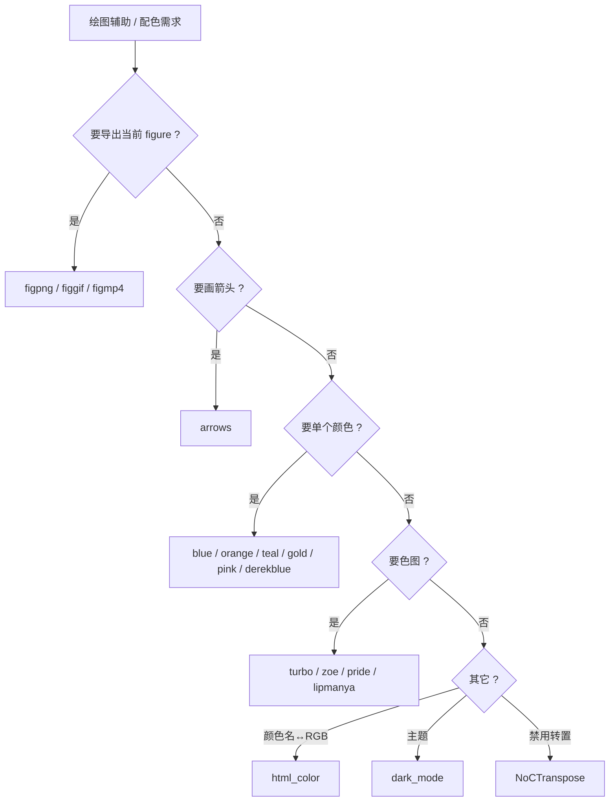

# 40.2 绘图辅助与配色 / Plotting Helpers and Colormaps

> 本章覆盖 `utility/` 下与**绘图辅助、图形导出、单色常量与色图**相关的函数：
> 用 annotation 画箭头的 `arrows`、把当前 figure 导出为 PNG/GIF/MP4 的
> `figpng`/`figgif`/`figmp4`、一组单色 RGB 常量（`blue`/`orange`/`teal`/`gold`/
> `pink`/`derekblue`）、若干色图生成器（`turbo`/`zoe`/`pride`/`lipmanya`）、
> 颜色名与 RGB 互转的 `html_color`、切换编辑器/图形暗色主题的 `dark_mode`，
> 以及用于禁用共轭转置的 `double` 子类 `NoCTranspose`。
>
> This chapter covers the **plotting helpers, figure export, single-color constants
> and colormaps** of `utility/`: `arrows` (annotation-based arrows),
> `figpng`/`figgif`/`figmp4` figure export, a set of single RGB color constants,
> several colormap generators (`turbo`/`zoe`/`pride`/`lipmanya`), the
> name↔RGB converter `html_color`, the dark-theme switcher `dark_mode`, and the
> `double` subclass `NoCTranspose` that forbids transpose.

- 语言 / Language：中英对照（中文为主）
- 相关章节 / See also：[40.1 通用工具](01-utilities-core.md)（本目录其余函数）、
  [appendices/03-doc-template.md](../appendices/03-doc-template.md)、
  [10.15 可视化与绘图](../10-mesh/15-visualization-and-plotting.md)
- 命名约定 / Notation：本章多为**无几何参数**的工具函数；`C`/`CM`/`map` 表示 `n by 3`
  的 RGB 或色图矩阵；`n` 表示色图采样数；`X`/`U` 表示箭头起点/位移。

---

## 本章概览 / Chapter Overview

| 分组 / Group | 函数 / Functions | 说明 |
|---|---|---|
| 箭头绘制 / Arrows | `arrows` | 用 `annotation('arrow',...)` 逐行画箭头（`quiver`/`qvr` 的替代） |
| 图形导出 / Figure export | `figpng`, `figgif`, `figmp4` | 把当前 figure 写出为 PNG / GIF / MPEG-4 |
| 单色常量 / Color constants | `blue`, `orange`, `teal`, `gold`, `pink`, `derekblue` | 返回 1×3 RGB 常量 |
| 色图 / Colormaps | `turbo`, `zoe`, `pride`, `lipmanya` | `n×3` 色图生成器（采样或固定调色板） |
| 颜色工具 / Color tools | `html_color` | HTML/CSS 颜色名 ↔ RGB 双向转换 |
| 主题 / Theme | `dark_mode` | 切换 MATLAB 编辑器/图形暗色主题 |
| 类型工具 / Type helper | `NoCTranspose` | `double` 子类，禁止 `'` 共轭转置 |

### 决策图 / Decision diagram — 按需求选择函数



---

## 逐函数详解 / Per-function reference

### `arrows` — 用 annotation 绘制箭头
- **文件 / File**: [utility/arrows.m](file:///c:/VSWork/gptoolbox-1/utility/arrows.m#L1-L12)
- **签名 / Signature**: `ar = arrows(X,U,varargin)`
- **功能 / Purpose**: `EN: Draw one annotation arrow per row from X to X+U and attach them to the current axes; a drop-in replacement for qvr(X,U,0).` / 中文：对每一行创建一条 `annotation('arrow')`（起点 `X(i,:)`、位移 `U(i,:)`），并挂到当前坐标轴，作为 `qvr(X,U,0)` 的替代。
- **输入 / Inputs**:

  | 参数 | 尺寸/类型 | 含义 (中 / EN) |
  |---|---|---|
  | `X` | `#n by 2` | 每条箭头起点（annotation 位置 `[x y]`）/ arrow tails |
  | `U` | `#n by 2` | 每条箭头位移（annotation 位置 `[dx dy]`）/ arrow vectors |
  | `varargin` | Name/Value 对 | 透传给 `annotation('arrow',...)`（见下）/ passthrough |

- **输出 / Outputs**:

  | 参数 | 尺寸/类型 | 含义 |
  |---|---|---|
  | `ar` | `#n by 1` cell | 每条箭头的 annotation 句柄数组 / cell of annotation handles |

- **可选参数 / Optional**（`varargin` 直接作为 `annotation('arrow', 'position', [X U], 'Name', Value, ...)` 的实参，**非** `containers.Map`；随后 `setfield` 强制 `'Parent',gca`）:

  | 名称 | 取值 | 默认 | 含义 |
  |---|---|---|---|
  | `'HeadStyle'` | 如 `'vback1'`/`'plain'`/`'cback2'` 等 | MATLAB 默认 | 箭头头部样式 |
  | `'HeadWidth'` | 标量 | MATLAB 默认 | 箭头头宽 |
  | `'HeadLength'` | 标量 | MATLAB 默认 | 箭头头长 |
  | `'LineWidth'` | 标量 | MATLAB 默认 | 线宽 |
  | `'Color'` | 颜色 | MATLAB 默认 | 箭头颜色（示例用 `'none'`） |
  | `'Parent'` | 句柄 | `gca`（被覆盖） | 父对象；函数最后统一设为 `gca` |

- **变量流动 / Variable flow**: `X,U,varargin →(arrayfun 逐行 i=1:#n)→ annotation('arrow','position',[X(i,:) U(i,:)],varargin{:}) →(setfield 'Parent'=gca)→ ar`
- **算法步骤 / Algorithm**:
  1. 用 `arrayfun` 遍历行索引 `(1:size(X,1))'`（L9–L11）。
  2. 每行调用 `annotation('arrow','position',[X(i,:) U(i,:)],varargin{:})` 创建箭头（L10）。
  3. 用 `setfield(..., 'Parent', gca)` 把箭头挂到当前坐标轴（L10）。
  4. 返回句柄数组 `ar`（L9）。
  5. 示例（L4–L8）：先用 `qvr(X,U,0,'Color','none')` 设定坐标轴，再叠加
     `arrows(X,U,'HeadStyle','vback1','LineWidth',1,'HeadWidth',4,'HeadLength',4)`。
- **流程图 / Flowchart**:

  ```mermaid
  flowchart TD
    A["输入 X,U,varargin"] --> B["i = 1"]
    B --> C{"i <= #n ?"}
    C -- 否 --> Z["输出 ar (句柄数组)"]
    C -- 是 --> D["annotation('arrow','position',[X(i,:) U(i,:)],varargin{:})"]
    D --> E["setfield 'Parent' = gca"]
    E --> F["i = i + 1"]
    F --> C
  ```

- **依赖 / Dependencies**: 无本库依赖；非本库依赖 `annotation`、`arrayfun`、`setfield`、`gca`（MATLAB 内置）
- **See also**: `quiver`, `qvr`, `arrow`, `figpng`

### `blue` — 单一蓝色常量
- **文件 / File**: [utility/blue.m](file:///c:/VSWork/gptoolbox-1/utility/blue.m#L1-L7)
- **签名 / Signature**: `C = blue()`
- **功能 / Purpose**: `EN: Return a nice blue color [0.2 0.3 0.8].` / 中文：返回一个约定的蓝色 RGB 常量。
- **输入 / Inputs**: 无 / None
- **输出 / Outputs**:

  | 参数 | 尺寸/类型 | 含义 |
  |---|---|---|
  | `C` | `1 by 3` | RGB `[0.2 0.3 0.8]` |

- **可选参数 / Optional**: 无 / None
- **变量流动 / Variable flow**: `→ C = [0.2 0.3 0.8]`
- **算法步骤 / Algorithm**:
  1. 直接返回常量 `[0.2 0.3 0.8]`（L6）。无参数、无分支、无外部依赖。
- **流程图 / Flowchart**:

  ```mermaid
  flowchart TD
    A["调用 blue()"] --> Z["C = [0.2 0.3 0.8]"]
  ```

- **依赖 / Dependencies**: 无 / None
- **See also**: `orange`, `teal`, `gold`, `pink`, `derekblue`

### `dark_mode` — 切换编辑器/图形暗色主题
- **文件 / File**: [utility/dark_mode.m](file:///c:/VSWork/gptoolbox-1/utility/dark_mode.m#L1-L99)
- **签名 / Signature**: `dark_mode(use_dark_mode)`
- **功能 / Purpose**: `EN: Switch the command/editor preference colors and the figure/axes/text colors to a dark (or back to the default light) theme.` / 中文：切换 MATLAB 编辑器颜色偏好与图形窗口（figure/坐标轴/文本）到暗色主题，或切回默认亮色。
- **输入 / Inputs**:

  | 参数 | 尺寸/类型 | 含义 (中 / EN) |
  |---|---|---|
  | `use_dark_mode` | `logical`（可选） | 是否进入暗色主题 / whether to use dark mode |

- **输出 / Outputs**: 无 / None
- **可选参数 / Optional**:

  | 名称 | 取值 | 默认 | 含义 |
  |---|---|---|---|
  | `use_dark_mode` | `logical` | 缺省视为 `true`（进入暗色） | **未传参即暗色**；`false` 时切回默认亮色 |

  > ⚠️ 与头注释不一致：L8–L9 写 "flag … {false} or back to default (true)"，但源码 L24
  > `if ~exist('use_dark_mode','var') || use_dark_mode` 表明**无参调用即进入暗色**、
  > `false` 才切回默认。头注释的默认值说明与本实现相反。

- **变量流动 / Variable flow**: `use_dark_mode →(分支: 暗色/亮色)→ 调色板变量 txc,bgc,fbg,alc,ac,str,ustr,hyp,cmt,scmd,errs,warn,kwd →(com.mathworks.services.Prefs.set*Pref + notifyColorListeners)→(set(0,'defaultfigurecolor')/set(groot,{'Default*Color'})/arrayfun set 已有 figure,axes,text)→ 无输出`
- **算法步骤 / Algorithm**:
  1. 判定分支：`~exist('use_dark_mode','var') || use_dark_mode` 为真走**暗色**（L24–L36，如
     `txc=[1 1 1]`、`bgc=[30 30 30]/255`、`cmt=[54 139 54]/255`）；否则走**亮色/默认**
     （L37–L50，`sys=true`、`alc='k'`、`ac='w'` 等）。
  2. `kwd = hyp`、`warn = ustr`（L51–L52）。
  3. 通过 Java API `com.mathworks.services.Prefs.setBooleanPref/setColorPref` 依次设置
     `ColorsUseSystem`、`ColorsText`、`ColorsBackground`、`Colors_M_Strings`、
     `Colors_M_UnterminatedStrings`、`Colors_M_Keywords`、`Colors_M_Comments`、
     `Colors_M_SystemCommands`、`Colors_M_Errors`、`Colors_HTML_HTMLLinks`、
     `Colors_M_Warnings`，每项随后 `ColorPrefs.notifyColorListeners(...)`（L55–L75）。
     L76–L87 为被注释掉的附加偏好（自动修复高亮、行号等）。
  4. 设置图形：`set(0,'defaultfigurecolor',fbg)`（L90）；对 `groot.Children` 逐 figure
     设 `'Color'`（L91）；对 `findall(0,'type','axes')` 设 `XColor/YColor/ZColor/Color`
     与 `findall(0,'type','text')` 设 `'Color'`（L93–L95）。
- **流程图 / Flowchart**:

  ```mermaid
  flowchart TD
    A["输入 use_dark_mode"] --> B{"未提供 或 为真 ?"}
    B -- 是 --> C1["暗色调色板 (txc,bgc,cmt,...)"]
    B -- 否 --> C2["亮色/默认调色板 (sys=true,alc='k',ac='w')"]
    C1 --> D["Prefs.set*Pref + notifyColorListeners"]
    C2 --> D
    D --> E["set 默认 figure 色 & 更新已有 figure/axes/text"]
    E --> Z["无输出"]
  ```

- **依赖 / Dependencies**: 无本库依赖；依赖 MATLAB 内部 Java API `com.mathworks.services.Prefs`、`com.mathworks.services.ColorPrefs`（非公开稳定接口）
- **See also**: `figpng`, `figgif`

### `derekblue` — Derek 的蓝色常量
- **文件 / File**: [utility/derekblue.m](file:///c:/VSWork/gptoolbox-1/utility/derekblue.m#L1-L3)
- **签名 / Signature**: `c = derekblue()`
- **功能 / Purpose**: `EN: Return Derek's blue color [144 210 236]/255 (no docstring in source).` / 中文：返回作者常用的一种浅蓝色（源码无注释）。
- **输入 / Inputs**: 无 / None
- **输出 / Outputs**:

  | 参数 | 尺寸/类型 | 含义 |
  |---|---|---|
  | `c` | `1 by 3` | RGB `[144 210 236]/255` |

- **可选参数 / Optional**: 无 / None
- **变量流动 / Variable flow**: `→ c = [144.0/255, 210.0/255, 236.0/255]`
- **算法步骤 / Algorithm**:
  1. 直接返回常量 `[144 210 236]/255`（L2）。无头注释、无参数、无分支。
- **流程图 / Flowchart**:

  ```mermaid
  flowchart TD
    A["调用 derekblue()"] --> Z["c = [144 210 236]/255"]
  ```

- **依赖 / Dependencies**: 无 / None
- **See also**: `blue`, `teal`, `gold`

### `figgif` — 把当前 figure 写入 GIF（可追加帧）
- **文件 / File**: [utility/figgif.m](file:///c:/VSWork/gptoolbox-1/utility/figgif.m#L1-L53)
- **签名 / Signature**: `f = figgif(filename,varargin)`
- **功能 / Purpose**: `EN: Write the current figure to a GIF file; if the file already exists, append the frame with zero delay (for building animations).` / 中文：把当前 figure 写出为 GIF；若文件已存在则以零延迟**追加**为新的一帧，用于生成动画。
- **输入 / Inputs**:

  | 参数 | 尺寸/类型 | 含义 (中 / EN) |
  |---|---|---|
  | `filename` | `char` | GIF 路径（为空则直接返回）/ path to gif; empty returns early |
  | `varargin` | Name/Value 对 | 见下 / see Optional |

- **输出 / Outputs**:

  | 参数 | 尺寸/类型 | 含义 |
  |---|---|---|
  | `f` | `logical` 或 `[]` | `exist(filename,'file')`：写入**前**文件是否已存在；`filename` 为空时为 `[]` |

- **可选参数 / Optional**（`containers.Map`，L20–L22）:

  | 名称 | 取值 | 默认 | 含义 |
  |---|---|---|---|
  | `'CData'` | 图像矩阵 | `[]` | 若给出则直接使用，跳过 `getframe`；单通道会复制为三通道并 `im2uint8` |
  | `'Delay'` | 标量（秒） | `0` | `imwrite` 的帧延迟 / frame delay |
  | `'rgb2ind'` | cell | `{}` | 透传给 `rgb2ind` 的额外参数 / extra args to rgb2ind |

- **变量流动 / Variable flow**: `filename,varargin →(containers.Map 解析)→ cdata,delay,rgb2ind_args →(cdata 空? getframe(gcf).cdata : 单通道→RGB + im2uint8)→ cdata →(rgb2ind(cdata,256,rgb2ind_args{:}))→ SIf,cm → f=exist(filename,'file') →(f==0? imwrite Loop=Inf,Delay : imwrite WriteMode=append,Delay)→ f`
- **算法步骤 / Algorithm**:
  1. `filename` 为空则 `f=[]` 并提前返回（L11–L14）。
  2. 解析 `varargin`：`params_to_variables` 映射 `CData→cdata`、`Delay→delay`、
     `rgb2ind→rgb2ind_args`；未知键报错（L16–L35）。
  3. 取帧：若 `cdata` 为空 → `getframe(gcf).cdata`；否则若第三维为 1 则复制为三通道，
     再 `im2uint8`（L37–L45）。
  4. 量化：`[SIf,cm] = rgb2ind(cdata,256,rgb2ind_args{:})`（L46）。
  5. `f = exist(filename,'file')`；若不存在 → `imwrite(SIf,cm,filename,'Loop',Inf,'Delay',delay)`；
     否则 → `imwrite(SIf,cm,filename,'WriteMode','append','Delay',delay)`（L47–L52）。
- **流程图 / Flowchart**:

  ```mermaid
  flowchart TD
    A["输入 filename,varargin"] --> B{"filename 为空 ?"}
    B -- 是 --> Z0["f = [] 返回"]
    B -- 否 --> C["解析 varargin (CData/Delay/rgb2ind)"]
    C --> D{"cdata 为空 ?"}
    D -- 是 --> D1["getframe(gcf).cdata"]
    D -- 否 --> D2["单通道→RGB; im2uint8"]
    D1 --> E["rgb2ind → SIf,cm (256 色)"]
    D2 --> E
    E --> F{"f = exist(filename) 为真 ?"}
    F -- 否 --> F1["imwrite Loop=Inf, Delay"]
    F -- 是 --> F2["imwrite WriteMode=append, Delay"]
    F1 --> Z["输出 f"]
    F2 --> Z
  ```

- **依赖 / Dependencies**: 无本库依赖；非本库依赖 `getframe`、`rgb2ind`、`imwrite`、`im2uint8`（MATLAB 内置 / 图像处理工具箱）
- **See also**: `figpng`, `figmp4`
- **备注 / Note**: 本实现全程使用 MATLAB 内置的 `rgb2ind` + `imwrite(...,'gif',...)`，**不调用任何外部 gif 二进制**，因此不存在"缺失二进制"分支（若系统缺少图像处理工具箱，`rgb2ind` 会报错）。

### `figmp4` — 把当前 figure 写入 MPEG-4 视频
- **文件 / File**: [utility/figmp4.m](file:///c:/VSWork/gptoolbox-1/utility/figmp4.m#L1-L39)
- **签名 / Signature**: `vobj = figmp4(name,vobj,nf)`
- **功能 / Purpose**: `EN: Append the current figure frame to an MPEG-4 video object (create it on the first call); the video is only finalized after vobj.close.` / 中文：把当前 figure 追加为 MPEG-4 视频的一帧（首次调用时创建），须调用 `vobj.close` 后视频才有效。
- **输入 / Inputs**:

  | 参数 | 尺寸/类型 | 含义 (中 / EN) |
  |---|---|---|
  | `name` | `char` | `.mp4` 文件路径 / path to mp4 |
  | `vobj` | `VideoWriter` 或 `[]` | 首次传 `[]`，之后用上次返回的对象 / `[]` then previous output |
  | `nf` | 整数（可选） | 当前帧重复写入次数 / number of times to write current frame |

- **输出 / Outputs**:

  | 参数 | 尺寸/类型 | 含义 |
  |---|---|---|
  | `vobj` | `VideoWriter` | 视频对象；`vobj.close` 后视频才最终写入 |

- **可选参数 / Optional**:

  | 名称 | 取值 | 默认 | 含义 |
  |---|---|---|---|
  | `nf` | 正整数 | `1` | 当前帧写入次数（L21–L23） |

- **变量流动 / Variable flow**: `name,vobj,nf →(nf 缺省=1)→(vobj 为空? VideoWriter(name,'MPEG-4'); Quality=100; open : 复用)→ vobj →(getframe(gcf).cdata)→ im →(sm=16 裁剪到 16 的倍数)→ im →(循环 f=1:nf writeVideo)→ vobj`
- **算法步骤 / Algorithm**:
  1. `nf` 缺省为 `1`（L21–L23）。
  2. 若 `vobj` 为空 → `vobj = VideoWriter(name,'MPEG-4')`、`vobj.Quality = 100`、`vobj.open`
     （L24–L29；L27 注释给出 `'Archival'` 备选构造）。
  3. `im = getfield(getframe(gcf),'cdata')`（L30）。
  4. 以 `sm=16` 裁剪使高宽为 16 的倍数：`sz = 16*floor(size(im)/16)`；`im = im(1:sz(1),1:sz(2),:)`
     （L32–L34）。
  5. `for f = 1:nf, vobj.writeVideo(im); end`（L36–L38）。
  6. 用法（L11–L19）：`vobj=[]; for …; drawnow; vobj=figmp4('myvideo.mp4',vobj); end; vobj.close;`。
- **流程图 / Flowchart**:

  ```mermaid
  flowchart TD
    A["输入 name,vobj,nf"] --> B{"nf 缺省 ?"}
    B -- 是 --> B1["nf = 1"]
    B -- 否 --> C
    B1 --> C{"vobj 为空 ?"}
    C -- 是 --> C1["VideoWriter(name,'MPEG-4'); Quality=100; open"]
    C -- 否 --> D
    C1 --> D["im = getframe(gcf).cdata"]
    D --> E["裁剪到 16 的倍数 (sm=16)"]
    E --> F["f = 1:nf 循环 writeVideo(im)"]
    F --> Z["输出 vobj"]
  ```

- **依赖 / Dependencies**: 无本库依赖；非本库依赖 `VideoWriter`、`getframe`（MATLAB 内置）
- **See also**: `figgif`, `figpng`
- **备注 / Note**: 本实现使用 MATLAB 内置 `VideoWriter(...,'MPEG-4')`，**不调用外部 ffmpeg**；能否写出 MP4 取决于本机 MATLAB 的 MPEG-4 编码器支持，与外部二进制无关。

### `figpng` — 把当前 figure 写入 PNG（可选 alpha）
- **文件 / File**: [utility/figpng.m](file:///c:/VSWork/gptoolbox-1/utility/figpng.m#L1-L50)
- **签名 / Signature**: `f = figpng(filename,varargin)`
- **功能 / Purpose**: `EN: Write (overwrite) the current figure to a PNG; optionally synthesize an alpha channel by differencing white- and black-background captures.` / 中文：把当前 figure 覆盖写出为 PNG；可选地通过"白底/黑底两次取帧差分"合成 alpha 通道。
- **输入 / Inputs**:

  | 参数 | 尺寸/类型 | 含义 (中 / EN) |
  |---|---|---|
  | `filename` | `char` | PNG 路径 / path to png |
  | `varargin` | Name/Value 对 | 见下 / see Optional |

- **输出 / Outputs**:

  | 参数 | 尺寸/类型 | 含义 |
  |---|---|---|
  | `f` | — | 头注释称"文件是否已存在"，但**源码未对 `f` 赋值**（见备注） |

- **可选参数 / Optional**（`containers.Map`，L12–L14）:

  | 名称 | 取值 | 默认 | 含义 |
  |---|---|---|---|
  | `'Alpha'` | `logical` | `false` | 是否合成并写出 alpha 通道 / synthesize alpha |

- **变量流动 / Variable flow**: `filename,varargin →(containers.Map 解析)→ alpha →(alpha 真: 白底取帧 IW → 黑底取帧 IK → A=mean((IK-IW)+1,3) → I=IK./A → 恢复背景 → imwrite(I,filename,'Alpha',A) : 假: getframe(gcf) → imwrite(frame.cdata,filename))→ 无返回值`
- **算法步骤 / Algorithm**:
  1. `alpha=false`；解析 `varargin`（映射 `Alpha→alpha`），未知键报错（L10–L27）。
  2. `alpha` 为真（L32–L45）：
     - 记录旧背景 `old_bg`；设白底取帧 `IW = im2double(getframe(gcf).cdata)`；
     - 设黑底取帧 `IK = im2double(getframe(gcf).cdata)`；
     - `A = mean((IK - IW) + 1, 3)`；`I = IK./A`（由两次取帧反解出不透明度）；
     - 恢复背景色 `set(gcf,'Color',old_bg)`；`imwrite(I,filename,'Alpha',A)`。
  3. `alpha` 为假（L46–L49）：`frame = getframe(gcf)`；`imwrite(frame.cdata,filename)`。
- **流程图 / Flowchart**:

  ```mermaid
  flowchart TD
    A["输入 filename,varargin"] --> B["解析 alpha (默认 false)"]
    B --> C{"alpha 为真 ?"}
    C -- 是 --> C1["白底取帧 → IW"]
    C1 --> C2["黑底取帧 → IK"]
    C2 --> C3["A = mean((IK-IW)+1,3); I = IK./A"]
    C3 --> C4["恢复背景; imwrite(I,filename,'Alpha',A)"]
    C -- 否 --> D["getframe(gcf); imwrite(frame.cdata,filename)"]
    C4 --> Z["返回 (f 未赋值, 见备注)"]
    D --> Z
  ```

- **依赖 / Dependencies**: 无本库依赖；非本库依赖 `getframe`、`im2double`、`imwrite`、`mean`（MATLAB 内置）
- **See also**: `figgif`, `figmp4`
- **备注 / Note**: 头注释声明输出 `f`（文件是否已存在），但函数体内**从未对 `f` 赋值**；因此带输出调用 `f = figpng(...)` 会触发 MATLAB 的 "Output argument 'f' … not assigned" 错误，只有省略输出调用才安全。属文档与实现不符。

### `gold` — 金色常量
- **文件 / File**: [utility/gold.m](file:///c:/VSWork/gptoolbox-1/utility/gold.m#L1-L12)
- **签名 / Signature**: `g = gold()`
- **功能 / Purpose**: `EN: Return a gold color [255 228 58]/255.` / 中文：返回一个约定的金色 RGB 常量。
- **输入 / Inputs**: 无 / None
- **输出 / Outputs**:

  | 参数 | 尺寸/类型 | 含义 |
  |---|---|---|
  | `g` | `1 by 3` | RGB `[255 228 58]/255` |

- **可选参数 / Optional**: 无 / None
- **变量流动 / Variable flow**: `→ g = [255 228 58]/255`
- **算法步骤 / Algorithm**:
  1. 返回常量 `[255 228 58]/255`（L10）。
- **流程图 / Flowchart**:

  ```mermaid
  flowchart TD
    A["调用 gold()"] --> Z["g = [255 228 58]/255"]
  ```

- **依赖 / Dependencies**: 无 / None
- **See also**: `orange`, `blue`, `teal`, `pink`
- **备注 / Note**: MATLAB 无内置 `gold` 色图，故此处不与内置同名；仅命名相近（内置有 `autumn`、`hot` 等）。

### `html_color` — HTML/CSS 颜色名 ↔ RGB 双向转换
- **文件 / File**: [utility/html_color.m](file:///c:/VSWork/gptoolbox-1/utility/html_color.m#L1-L45)
- **签名 / Signature**: `[Y,I] = html_color(X)`
- **功能 / Purpose**: `EN: Convert HTML/CSS color names to RGB values, and RGB values back to the nearest color name.` / 中文：把 HTML/CSS 颜色名转为 RGB，或把 RGB 反查为最接近的颜色名。
- **输入 / Inputs**:

  | 参数 | 尺寸/类型 | 含义 (中 / EN) |
  |---|---|---|
  | `X` | `char` / `cell` / `double` | 颜色名（字符串单元或字符矩阵）**或** RGB（`#x by 3`，值域 0–1）/ names or RGB |

- **输出 / Outputs**:

  | 参数 | 尺寸/类型 | 含义 |
  |---|---|---|
  | `Y` | `nx by 3` 或 `char`/`cell` | 输入为颜色名时：对应 RGB；输入为 RGB 时：最近颜色名（单行为 `char`） |
  | `I` | `#X by 1` | 匹配索引：名字分支为 `ismember` 的 `I`；RGB 分支为 `knnsearch` 的最近行号 |

- **可选参数 / Optional**: 无 / None
- **变量流动 / Variable flow**:
  - 名字分支：`X(cell/char) →(ismember(X,N)→ I,J)→ Y=nan(nx,3); Y(I,:)=C(J(I),:)→ Y,I`
  - RGB 分支：`X → im2double(X) →(knnsearch(C,X)→ I)→ Y=N(I) →(size(X,1)==1? Y=Y{1} : 保持 cell)→ Y`
- **算法步骤 / Algorithm**:
  1. 内置对照表：`N` 为 147 个 HTML/CSS 颜色名（`aqua`/`fuchsia` 被移到表尾），`C` 为对应的
     `147 by 3` RGB（0–1）（L19–L20；L7–L18 为生成用注释代码）。
  2. `switch class(X)`（L26）：
     - `'cell'`/`'char'`（L27–L36）：`nx = numel(X)`（char 视为 1）；`[I,J] = ismember(X,N)`；
       `Y = nan(nx,3)`；`Y(I,:) = C(J(I),:)`（未识别的名字保持 `NaN`）。
     - 其它（数值，L37–L44）：`X = im2double(X)`；`I = knnsearch(C,X)`；`Y = N(I)`；
       若 `size(X,1)==1` 则 `Y = Y{1}`（返回单个字符串）。
- **流程图 / Flowchart**:

  ```mermaid
  flowchart TD
    A["输入 X"] --> B{"class(X)"}
    B -- "cell / char" --> C["ismember(X,N) → I,J"]
    C --> D["Y = nan(nx,3); Y(I,:) = C(J(I),:)"]
    D --> Z["输出 Y,I"]
    B -- "数值" --> E["X = im2double(X)"]
    E --> F["knnsearch(C,X) → I"]
    F --> G["Y = N(I)"]
    G --> H{"size(X,1)==1 ?"}
    H -- 是 --> H1["Y = Y{1}"]
    H -- 否 --> Z
    H1 --> Z
  ```

- **依赖 / Dependencies**: 无本库依赖；非本库依赖 `ismember`、`im2double`（MATLAB 内置）、`knnsearch`（统计与机器学习工具箱）
- **See also**: `hex2rgb`, `rgb2hex`, `turbo`, `zoe`
- **备注 / Note**: 颜色名总数实测为 **147**（`N` 与 `C` 行数一致）；数值分支的"最近名"依赖
  `knnsearch` 的欧氏距离，`X` 需为 0–1 归一化 RGB 才能得到正确匹配。

### `lipmanya` — Yaron 的粉-青发散色图
- **文件 / File**: [utility/lipmanya.m](file:///c:/VSWork/gptoolbox-1/utility/lipmanya.m#L1-L25)
- **签名 / Signature**: `CM = yaron_colormap(n)`（**函数名与文件名不一致**，见备注）
- **功能 / Purpose**: `EN: A 18-anchor pink-to-teal diverging colormap, optionally resampled to n colors with spline interpolation.` / 中文：一条 18 锚点的"粉→青"发散色图，可选按 spline 重采样到 `n` 色。
- **输入 / Inputs**:

  | 参数 | 尺寸/类型 | 含义 (中 / EN) |
  |---|---|---|
  | `n` | 正整数（可选） | 输出颜色数 / number of colors |

- **输出 / Outputs**:

  | 参数 | 尺寸/类型 | 含义 |
  |---|---|---|
  | `CM` | `18 by 3` 或 `n by 3` | 色图矩阵（未给 `n` 时返回 18 行原始表）/ colormap |

- **可选参数 / Optional**:

  | 名称 | 取值 | 默认 | 含义 |
  |---|---|---|---|
  | `n` | 正整数 | 无（`nargin<1` 时返回原始 18 行） | 重采样后的颜色数（`spline` 插值） |

- **变量流动 / Variable flow**: `n →(hex2rgb 18 个锚点)→ CM(18 by 3) →(nargin>=1? interp1(linspace(0,1,18)',CM,linspace(0,1,n)','spline')→ n by 3)→ CM`
- **算法步骤 / Algorithm**:
  1. 内联 18 个 hex 锚点 → `hex2rgb` → `18 by 3` 的 `CM`（L2–L21）。
  2. 锚点色（按序，hex）：
     `ce517e`, `d16486`, `d47890`, `d88a95`, `dd9c9e`, `e0ada7`, `e5beaf`, `ead1ba`,
     `efe2c3`, `e6e6c4`, `cfd7bc`, `b9ccb5`, `a4c2af`, `8db7a8`, `77aca1`, `54a49e`,
     `309c96`, `159592`（由粉红经米白过渡到青绿）。
  3. 若 `nargin>=1`（L22–L24）：`CM = interp1(linspace(0,1,size(CM,1))', CM, linspace(0,1,n)', 'spline')`
     重采样到 `n` 行；否则原样返回 18 行。
- **流程图 / Flowchart**:

  ```mermaid
  flowchart TD
    A["输入 n (可选)"] --> B["18 个 hex 锚点 → hex2rgb"]
    B --> C["CM (18 by 3)"]
    C --> D{"nargin >= 1 ?"}
    D -- 是 --> E["interp1 spline → n by 3"]
    D -- 否 --> Z["输出 CM (18 by 3)"]
    E --> Z
  ```

- **依赖 / Dependencies**: `hex2rgb` ([external/hex2rgb.m](file:///c:/VSWork/gptoolbox-1/external/hex2rgb.m#L1-L111))、`interp1`（MATLAB 内置）
- **See also**: `zoe`, `turbo`, `pride`
- **备注 / Note**: 文件名 `lipmanya.m` 与内部函数名 `yaron_colormap` **不一致**（历史遗留）；
  按其内部注释系"Yaron Lipman"风格配色，但 `help lipmanya` 不会显示 `yaron_colormap` 的帮助。

### `NoCTranspose` — 禁止共轭转置的 double 子类
- **文件 / File**: [utility/NoCTranspose.m](file:///c:/VSWork/gptoolbox-1/utility/NoCTranspose.m#L1-L6)
- **签名 / Signature**: `classdef NoCTranspose < double`（重写方法 `obj = ctranspose(data)`）
- **功能 / Purpose**: `EN: A double subclass that throws an error whenever the ctranspose operator (') is applied, to catch accidental transposes.` / 中文：`double` 的子类，一旦对其使用共轭转置运算符 `'` 即抛错，用于捕获误用转置。
- **输入 / Inputs**:

  | 参数 | 尺寸/类型 | 含义 (中 / EN) |
  |---|---|---|
  | `data` | `double` | 构造/被转置的数值数据（构造继承自 `double`）/ underlying data |

- **输出 / Outputs**: 类实例（`NoCTranspose`）；无函数输出 / class instance
- **可选参数 / Optional**: 无 / None
- **变量流动 / Variable flow**: `data(double) → NoCTranspose 实例 →(使用 obj' 触发 ctranspose)→ error("You called ctranspose (') on a NoCTranspose object")`
- **算法步骤 / Algorithm**:
  1. `classdef NoCTranspose < double` 继承 `double` 的数值行为（L1）。
  2. 重写 `ctranspose`：无论输入为何，直接 `error(...)` 抛错（L3–L5）。
  3. 因此任何 `obj'`/`ctranspose(obj)` 调用都会失败；`. '`（普通转置）仍走 `double` 行为。
- **流程图 / Flowchart**:

  ```mermaid
  flowchart TD
    A["NoCTranspose 实例"] --> B{"使用 ' (ctranspose) ?"}
    B -- 是 --> C["error: You called ctranspose (')"]
    B -- 否 --> D["继承 double 的其余行为"]
  ```

- **依赖 / Dependencies**: 无 / None（继承 MATLAB 内置 `double`）
- **See also**: —
- **备注 / Note**: 本文件是 `classdef`（类定义）而非普通函数；类名 `NoCTranspose` 与文件名一致。

### `orange` — 橙色常量
- **文件 / File**: [utility/orange.m](file:///c:/VSWork/gptoolbox-1/utility/orange.m#L1-L8)
- **签名 / Signature**: `C = orange()`
- **功能 / Purpose**: `EN: Return a nice orange color [1.0 0.7 0.2].` / 中文：返回一个约定的橙色 RGB 常量。
- **输入 / Inputs**: 无 / None
- **输出 / Outputs**:

  | 参数 | 尺寸/类型 | 含义 |
  |---|---|---|
  | `C` | `1 by 3` | RGB `[1.0 0.7 0.2]` |

- **可选参数 / Optional**: 无 / None
- **变量流动 / Variable flow**: `→ C = [1.0 0.7 0.2]`
- **算法步骤 / Algorithm**:
  1. 返回常量 `[1.0 0.7 0.2]`（L7）。
- **流程图 / Flowchart**:

  ```mermaid
  flowchart TD
    A["调用 orange()"] --> Z["C = [1.0 0.7 0.2]"]
  ```

- **依赖 / Dependencies**: 无 / None
- **See also**: `gold`, `blue`, `teal`, `pink`

### `pink` — 粉色常量（与内置 `pink` 色图同名）
- **文件 / File**: [utility/pink.m](file:///c:/VSWork/gptoolbox-1/utility/pink.m#L1-L7)
- **签名 / Signature**: `C = pink()`
- **功能 / Purpose**: `EN: Return a nice pink color [254 194 194]/255. NOTE: shadows MATLAB's builtin pink colormap, but returns a single color, not an n-by-3 colormap.` / 中文：返回一个约定的粉色 RGB 常量；**与 MATLAB 内置 `pink` 色图同名但语义不同**——这里返回单个颜色而非 `n×3` 色图。
- **输入 / Inputs**: 无 / None
- **输出 / Outputs**:

  | 参数 | 尺寸/类型 | 含义 |
  |---|---|---|
  | `C` | `1 by 3` | RGB `[254 194 194]/255` |

- **可选参数 / Optional**: 无 / None
- **变量流动 / Variable flow**: `→ C = [254 194 194]/255`
- **算法步骤 / Algorithm**:
  1. 返回常量 `[254 194 194]/255`（L6，源码中该行有冗余的双分号 `;;`，无副作用）。
- **流程图 / Flowchart**:

  ```mermaid
  flowchart TD
    A["调用 pink()"] --> Z["C = [254 194 194]/255"]
  ```

- **依赖 / Dependencies**: 无 / None
- **See also**: `blue`, `orange`, `teal`, `gold`
- **备注 / Note**: **遮蔽 MATLAB 内置 `pink` 色图**：内置 `pink(n)` 生成 `n×3` 色图，而本函数无输入、
  返回单个颜色；调用 `pink(5)` 会因输入过多报错。若需内置雕色图应显式调用 `builtin('pink',n)`。

### `pride` — 彩虹骄傲旗 8 色调色板
- **文件 / File**: [utility/pride.m](file:///c:/VSWork/gptoolbox-1/utility/pride.m#L1-L17)
- **签名 / Signature**: `CM = pride(n)`
- **功能 / Purpose**: `EN: Return the first n colors of an 8-color pride-flag palette.` / 中文：返回 8 色骄傲旗调色板的前 `n` 色。
- **输入 / Inputs**:

  | 参数 | 尺寸/类型 | 含义 (中 / EN) |
  |---|---|---|
  | `n` | 正整数（可选） | 取前 `n` 色，须 `<= 8` / number of colors |

- **输出 / Outputs**:

  | 参数 | 尺寸/类型 | 含义 |
  |---|---|---|
  | `CM` | `n by 3`（`n<=8`） | 调色板前 `n` 行 / first n palette rows |

- **可选参数 / Optional**:

  | 名称 | 取值 | 默认 | 含义 |
  |---|---|---|---|
  | `n` | `1..8` | `8` | 返回的颜色数；`n>8` 触发断言失败 |

- **变量流动 / Variable flow**: `n →(nargin<1? n=8)→ 固定 8 by 3 颜色表 CM →(assert n<=8)→ CM(1:n,:)`
- **算法步骤 / Algorithm**:
  1. `nargin<1` 时取 `n=8`（L2–L4）。
  2. 硬编码 8 行颜色（L5–L14，按序为紫/靛/青/绿/黄/橙/红/品红的近似 RGB）：
     `[0.4745 0 0.4824]`, `[0.1882 0 0.5255]`, `[0.0902 0.7098 0.6980]`, `[0.0667 0.4980 0.0078]`,
     `[1 0.9961 0.0392]`, `[0.9882 0.4784 0.0314]`, `[0.9843 0 0.0275]`, `[0.9882 0.2980 0.6471]`。
  3. `assert(n<=8)`（L15），返回 `CM(1:n,:)`（L16）。
- **流程图 / Flowchart**:

  ```mermaid
  flowchart TD
    A["输入 n (可选)"] --> B{"nargin < 1 ?"}
    B -- 是 --> B1["n = 8"]
    B -- 否 --> C
    B1 --> C["固定 8 by 3 颜色表"]
    C --> D{"n <= 8 ?"}
    D -- 否 --> D1["assert 失败"]
    D -- 是 --> Z["输出 CM(1:n,:)"]
  ```

- **依赖 / Dependencies**: 无 / None
- **See also**: `turbo`, `zoe`, `lipmanya`

### `teal` — 青色常量
- **文件 / File**: [utility/teal.m](file:///c:/VSWork/gptoolbox-1/utility/teal.m#L1-L10)
- **签名 / Signature**: `C = teal()`
- **功能 / Purpose**: `EN: Return a nice teal color [144 216 196]/255.` / 中文：返回一个约定的青色 RGB 常量。
- **输入 / Inputs**: 无 / None
- **输出 / Outputs**:

  | 参数 | 尺寸/类型 | 含义 |
  |---|---|---|
  | `C` | `1 by 3` | RGB `[144 216 196]/255` |

- **可选参数 / Optional**: 无 / None
- **变量流动 / Variable flow**: `→ C = [144 216 196]/255`
- **算法步骤 / Algorithm**:
  1. 返回常量 `[144 216 196]/255`（L9）。头注释示例给出 `reshape(dec2hex(round(teal*255))',1,[])` 转 hex。
- **流程图 / Flowchart**:

  ```mermaid
  flowchart TD
    A["调用 teal()"] --> Z["C = [144 216 196]/255"]
  ```

- **依赖 / Dependencies**: 无 / None
- **See also**: `blue`, `orange`, `gold`, `derekblue`

### `turbo` — Google Turbo 彩虹色图（替代 jet）
- **文件 / File**: [utility/turbo.m](file:///c:/VSWork/gptoolbox-1/utility/turbo.m#L1-L22)
- **签名 / Signature**: `map = turbo(varargin)`
- **功能 / Purpose**: `EN: Google's Turbo rainbow colormap as a replacement for jet; returns the built-in 256-color table or a linear resample to n colors.` / 中文：Google Turbo 彩虹色图（`jet` 的替代），返回内置 256 色表或线性重采样到 `n` 色。
- **输入 / Inputs**:

  | 参数 | 尺寸/类型 | 含义 (中 / EN) |
  |---|---|---|
  | `n` | 正整数（可选，`varargin{1}`） | 输出颜色数 / number of colors |

- **输出 / Outputs**:

  | 参数 | 尺寸/类型 | 含义 |
  |---|---|---|
  | `map` | `n by 3` 或 `256 by 3` | 色图矩阵 / colormap |

- **可选参数 / Optional**:

  | 名称 | 取值 | 默认 | 含义 |
  |---|---|---|---|
  | `n`（`varargin{1}`） | 正整数 | 无（`nargin<1` 时返回完整 256 行） | 重采样后的颜色数（`interp1` 线性） |

- **变量流动 / Variable flow**: `n →(内置 256 by 3 参考表 map: 深紫 #30123B → 深红 #7A0403)→(nargin>=1? interp1(linspace(0,1,256),map,linspace(0,1,n))→ n by 3)→ map`
- **算法步骤 / Algorithm**:
  1. 硬编码 256 行 Turbo 采样表 `map`（L18），首色约 `[0.18995 0.07176 0.23217]`（≈ `#30123B`），
     末色约 `[0.47960 0.01583 0.01055]`（≈ `#7A0403`）。
  2. 若 `nargin>=1`（L19–L21）：`map = interp1(linspace(0,1,size(map,1)), map, linspace(0,1,varargin{1}))`
     线性重采样到 `varargin{1}` 行；否则原样返回 256 行。
  3. 出处（L12–L14）：Google AI Blog 的 Turbo 色图，改编自 Mikhailov 的 gist。
- **流程图 / Flowchart**:

  ```mermaid
  flowchart TD
    A["输入 n (可选)"] --> B["内置 256 by 3 Turbo 参考表"]
    B --> C{"nargin >= 1 ?"}
    C -- 是 --> D["interp1 线性 → n by 3"]
    C -- 否 --> Z["输出 map (256 by 3)"]
    D --> Z
  ```

- **依赖 / Dependencies**: 无本库依赖；非本库依赖 `interp1`（MATLAB 内置）
- **See also**: `jet`, `parula`, `viridis`, `colormap`, `zoe`, `pride`
- **备注 / Note**: **遮蔽 MATLAB 内置 `turbo` 色图**（R2020b+ 起内置）；本实现在无参时返回 256 行，
  与内置 `turbo(n)` 的行为对齐，但实现来源为硬编码表而非内置实现（同名函数谁在路径上优先决定行为）。

### `zoe` — 暖冷交替 alpha 条带色图
- **文件 / File**: [utility/zoe.m](file:///c:/VSWork/gptoolbox-1/utility/zoe.m#L1-L21)
- **签名 / Signature**: `[CM,CM0] = zoe(varargin)`
- **功能 / Purpose**: `EN: A white-blue-yellow-orange colormap whose odd rows are alpha-scaled to produce alternating bands; returns length-2n maps.` / 中文：白-蓝-淡黄-橙 的色图，其偶数行按 `alpha` 缩放形成交替条带；输出长度为 `2n`。
- **输入 / Inputs**:

  | 参数 | 尺寸/类型 | 含义 (中 / EN) |
  |---|---|---|
  | `n` | 正整数（可选，`varargin{1}`） | 基础采样数 / base sample count |
  | `alpha` | `[0,1]` 标量（可选，`varargin{2}`） | 交替行的缩放系数 / alpha scale |

- **输出 / Outputs**:

  | 参数 | 尺寸/类型 | 含义 |
  |---|---|---|
  | `CM` | `2n by 3` | 偶数行乘 `alpha` 后的色图 / alpha-scaled map |
  | `CM0` | `2n by 3` | 未做 alpha 缩放的原始色图 / raw map |

- **可选参数 / Optional**:

  | 名称 | 取值 | 默认 | 含义 |
  |---|---|---|---|
  | `n`（`varargin{1}`） | 正整数 | `128` | 输出行数为 `2n` |
  | `alpha`（`varargin{2}`） | `[0,1]` | `0.95` | 偶数行颜色上的乘法系数 |

- **变量流动 / Variable flow**: `n=128,alpha=0.95 → t=[0; 0.5-1e-5; 0.5+1e-5; 1], h={ffffff,489acc,fffae3,ff7424} → c=hex2rgb(h) → CM0=interp1(t,c,linspace(0,1,2n)','linear') → CM=CM0 → CM(2:2:end,:)=CM(2:2:end,:)*alpha → CM,CM0`
- **算法步骤 / Algorithm**:
  1. `nargin<1 → n=128`（L2–L6）；`nargin<2 → alpha=0.95`（L7–L11）。
  2. 关键点 `t = [0; 0.5-1e-5; 0.5+1e-5; 1]`，锚点色 `h = ['ffffff'; '489acc'; 'fffae3'; 'ff7424']`
     （白 `#ffffff` → 蓝 `#489acc` → 淡黄 `#fffae3` → 橙 `#ff7424`；中点的 1e-5 间隙形成硬过渡）
     （L13–L15）。
  3. `c = hex2rgb(h)`（4×3）（L15）。
  4. `CM0 = interp1(t,c,linspace(0,1,2*n)','linear')`（`2n×3`）（L18）。
  5. `CM = CM0`；`CM(2:2:end,:) = CM(2:2:end,:) * alpha`（偶数行乘 `alpha`，形成交替条带）（L19–L20）。
- **流程图 / Flowchart**:

  ```mermaid
  flowchart TD
    A["输入 n,alpha (可选)"] --> B["默认 n=128, alpha=0.95"]
    B --> C["t 4 锚点 + h 4 个 hex → hex2rgb → c"]
    C --> D["CM0 = interp1 linear → 2n by 3"]
    D --> E["CM = CM0; CM(2:2:end,:) *= alpha"]
    E --> Z["输出 CM, CM0"]
  ```

- **依赖 / Dependencies**: `hex2rgb` ([external/hex2rgb.m](file:///c:/VSWork/gptoolbox-1/external/hex2rgb.m#L1-L111))、`interp1`、`linspace`（MATLAB 内置）
- **See also**: `turbo`, `pride`, `lipmanya`
- **备注 / Note**: 输出长度为 `2*n`（而非常见的 `n`），且含两处输出 `CM`/`CM0`；直接用作 `colormap(zoe(n))`
  时需注意行数翻倍。

---

## 函数清单核对表 / Coverage Checklist

> 17 个文件逐一对应条目；锚点均可点击跳转至源码。

| # | 函数 / File | 锚点 / Anchor | 一句话用途 / One-line purpose |
|---|---|---|---|
| 1 | `arrows` | [utility/arrows.m](file:///c:/VSWork/gptoolbox-1/utility/arrows.m#L1-L12) | 用 `annotation('arrow')` 逐行画箭头 |
| 2 | `blue` | [utility/blue.m](file:///c:/VSWork/gptoolbox-1/utility/blue.m#L1-L7) | 蓝色常量 `[0.2 0.3 0.8]` |
| 3 | `dark_mode` | [utility/dark_mode.m](file:///c:/VSWork/gptoolbox-1/utility/dark_mode.m#L1-L99) | 切换编辑器/图形暗色主题 |
| 4 | `derekblue` | [utility/derekblue.m](file:///c:/VSWork/gptoolbox-1/utility/derekblue.m#L1-L3) | 浅蓝常量 `[144 210 236]/255` |
| 5 | `figgif` | [utility/figgif.m](file:///c:/VSWork/gptoolbox-1/utility/figgif.m#L1-L53) | 写出/追加当前 figure 为 GIF 帧 |
| 6 | `figmp4` | [utility/figmp4.m](file:///c:/VSWork/gptoolbox-1/utility/figmp4.m#L1-L39) | 写出当前 figure 为 MPEG-4 帧 |
| 7 | `figpng` | [utility/figpng.m](file:///c:/VSWork/gptoolbox-1/utility/figpng.m#L1-L50) | 写出当前 figure 为 PNG（可选 alpha） |
| 8 | `gold` | [utility/gold.m](file:///c:/VSWork/gptoolbox-1/utility/gold.m#L1-L12) | 金色常量 `[255 228 58]/255` |
| 9 | `html_color` | [utility/html_color.m](file:///c:/VSWork/gptoolbox-1/utility/html_color.m#L1-L45) | HTML 颜色名 ↔ RGB 双向转换 |
| 10 | `lipmanya`（`yaron_colormap`） | [utility/lipmanya.m](file:///c:/VSWork/gptoolbox-1/utility/lipmanya.m#L1-L25) | 18 锚点粉-青发散色图 |
| 11 | `NoCTranspose` | [utility/NoCTranspose.m](file:///c:/VSWork/gptoolbox-1/utility/NoCTranspose.m#L1-L6) | 禁止 `'` 转置的 double 子类 |
| 12 | `orange` | [utility/orange.m](file:///c:/VSWork/gptoolbox-1/utility/orange.m#L1-L8) | 橙色常量 `[1.0 0.7 0.2]` |
| 13 | `pink` | [utility/pink.m](file:///c:/VSWork/gptoolbox-1/utility/pink.m#L1-L7) | 粉色常量（与内置 `pink` 色图同名） |
| 14 | `pride` | [utility/pride.m](file:///c:/VSWork/gptoolbox-1/utility/pride.m#L1-L17) | 8 色骄傲旗调色板前 `n` 色 |
| 15 | `teal` | [utility/teal.m](file:///c:/VSWork/gptoolbox-1/utility/teal.m#L1-L10) | 青色常量 `[144 216 196]/255` |
| 16 | `turbo` | [utility/turbo.m](file:///c:/VSWork/gptoolbox-1/utility/turbo.m#L1-L22) | Google Turbo 彩虹色图（256 色/重采样） |
| 17 | `zoe` | [utility/zoe.m](file:///c:/VSWork/gptoolbox-1/utility/zoe.m#L1-L21) | 白-蓝-黄-橙交替 alpha 条带色图 |

---

## 交叉引用 / Cross references

- `utility/` 其余函数（缓存、路径等）：见 [40.1 通用工具](01-utilities-core.md)
- 网格可视化与绘图：见 [10.15 可视化与绘图](../10-mesh/15-visualization-and-plotting.md)
- 颜色名/RGB 转换底层实现：见 `external/hex2rgb.m`、`external/rgb2hex.m`；其它色图见 `external/viridis.m`
- 文档写作规范：见 [appendices/03-doc-template.md](../appendices/03-doc-template.md)
