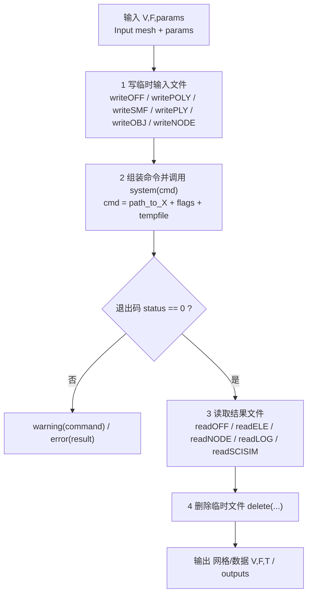

# 50 外部程序封装 / External Binary Wrappers

> 本模块覆盖 `wrappers/` 目录下**全部 19 个 `.m` 文件**：它们本身几乎不含几何算法，
> 而是作为「薄封装（thin wrapper）」把 gptoolbox 的 MATLAB 数据写到磁盘上的**临时文件**，
> 用 `system(...)` 调用外部**命令行二进制**处理，再把结果文件读回 MATLAB，最后清理临时文件。
> 此外还包含一组 `path_to_*` **定位函数**，用于跨平台解析每个二进制的可执行文件路径。
>
> This chapter covers **all 19 `.m` files** under `wrappers/`. They contain almost no geometry
> algorithm themselves — they are **thin wrappers** that (1) write MATLAB data to **temporary
> files**, (2) invoke an external **command-line binary** via `system(...)`, (3) read the result
> files back, and (4) clean up. A set of `path_to_*` **locator functions** resolves each binary's
> executable path per platform.

- 语言 / Language：中英对照（中文为主）
- 相关章节 / See also：[docs/README.md](../README.md)、[00-overview/02-architecture.md](../00-overview/02-architecture.md)、
  [10-mesh/04-cleanup-and-repair.md](../10-mesh/04-cleanup-and-repair.md)、[10-mesh/09-remeshing-and-simplification.md](../10-mesh/09-remeshing-and-simplification.md)、
  [appendices/03-doc-template.md](../appendices/03-doc-template.md)
- 命名约定 / Notation：`V` 顶点 `#V by 3`、`F` 三角面 `#F by 3`、`T` 四面体 `#T by 4`、
  `SV/SF` 表面网格、`TC` 纹理坐标、`prefix` 临时文件名前缀

---

## 本章概览 / Chapter Overview

### 统一模式 / The uniform pattern

所有「二进制调用型」封装都遵循同一四步模板：
**写临时输入文件 → 调用外部二进制 → 解析结果文件 → 删除临时文件**。

All binary-invocation wrappers follow the same four-step template:
**write temp input → run external binary → parse result files → delete temp files**.



### 二进制映射表 / Binary-to-wrapper map

| 外部二进制 / Binary | 封装函数 / Wrapper | 定位函数 / path_to locator | 外部依赖 / Requirement |
|---|---|---|---|
| `tetgen` | [`tetgen`](#tetgen--调用-tetgen-生成四面体网格) | [`path_to_tetgen`](file:///c:/VSWork/gptoolbox-1/wrappers/path_to_tetgen.m#L1-L25) | TetGen 可执行文件（`.poly`→`.1.ele/.1.node/.1.face`） |
| `triangle` | [`triangle`](#triangle--调用-triangle-二维三角化程序) | [`path_to_triangle`](file:///c:/VSWork/gptoolbox-1/wrappers/path_to_triangle.m#L1-L22) | Triangle 可执行文件（`.node/.poly/.ele` 家族） |
| `qslim` | [`qslim`](#qslim--调用-qslim-网格简化) | [`path_to_qslim`](file:///c:/VSWork/gptoolbox-1/wrappers/path_to_qslim.m#L1-L25) | QSlim 可执行文件（`.smf`→`.log`） |
| `meshfix` | [`meshfix`](#meshfix--调用-meshfix-修复网格) | [`path_to_meshfix`](file:///c:/VSWork/gptoolbox-1/wrappers/path_to_meshfix.m#L1-L24) | MeshFix 可执行文件（`.off`→`_fixed.off`） |
| `meshfix`（按连通分量）/ per-component | [`meshfix_components`](#meshfix_components--按连通分量调用-meshfix) | [`path_to_meshfix`](file:///c:/VSWork/gptoolbox-1/wrappers/path_to_meshfix.m#L1-L24) | 同上，逐分量调用 |
| `medit` | [`medit`](#medit--启动-medit-可视化四面体网格) | [`path_to_medit`](file:///c:/VSWork/gptoolbox-1/wrappers/path_to_medit.m#L1-L26) | medit 可视化程序（`.mesh` + `.medit` 配置） |
| `nested_cages` | [`nested_cages`](#nested_cages--调用-nested_cages-生成嵌套笼) | 内嵌硬编码路径（无 locator） | nested_cages 可执行文件（`.ply`→`_1.obj`） |
| ImplicitToolkit CLI | [`plane_drop`](#plane_drop--用-scisim-做刚体落地模拟) | 内嵌硬编码路径（无 locator） | `implicittoolkit_cli` + `rigidbody3d_cli`（SCISIM） |
| Python + `print_meshes.py` | [`readSCISIM`](#readscisim--解析-scisim-h5-输出) | 内嵌硬编码路径（无 locator） | `python` + scisim `print_meshes.py` |
| ImageMagick `convert` | [`texture_map`](#texture_map--把纹理贴回图像) | [`path_to_convert`](file:///c:/VSWork/gptoolbox-1/wrappers/path_to_convert.m#L1-L25)（局部变量遮蔽） | `convert` + libigl `TexMapPreview` |
| 通用路径查找 | [`find_first_path`](#find_first_path--在候选列表中找第一个存在的路径) | —（被所有 `path_to_*` 复用） | 无二进制作业，仅 `exist(...,'file')` |

> 注 / Note：`nested_cages`、`plane_drop`、`readSCISIM`、`texture_map` 的二进制路径是**源码内硬编码**
> （或局部变量），**没有**配套的 `path_to_*` 定位函数；它们的可移植性最差。
> `nested_cages`、`plane_drop`、`readSCISIM`、`texture_map` hard-code their binary paths inline
> and have **no** `path_to_*` locator; they are the least portable wrappers.

---

## 逐函数详解 / Per-function reference

### `tetgen` — 调用 TetGen 生成四面体网格
- **文件 / File**: [wrappers/tetgen.m](file:///c:/VSWork/gptoolbox-1/wrappers/tetgen.m#L1-L121)
- **签名 / Signature**: `[V,T,F] = tetgen(SV,SF,varargin)`
- **功能 / Purpose**: `EN: Call tetgen to construct a tetrahedral volume mesh inside a given triangle mesh, with optional internal constrained vertices/holes.` / 中文：在给定三角面网格内部调用外部 tetgen 生成四面体体积网格，并可选指定内部空腔（holes）。
- **输入 / Inputs**:

  | 参数 | 尺寸/类型 | 含义 (中 / EN) |
  |---|---|---|
  | `SV` | `#SV by 3` | 表面顶点位置 / surface vertex positions |
  | `SF` | `#SF by 3` | 表面三角面索引 / surface triangle indices |

- **输出 / Outputs**:

  | 参数 | 尺寸/类型 | 含义 |
  |---|---|---|
  | `V` | `#V by 3` | 四面体网格顶点 / tetrahedra vertices |
  | `T` | `#T by 4` | 四面体索引 / tetrahedra indices |
  | `F` | `#F by 3` | 体积网格的表面面片（列序已翻转）/ surface faces |

- **可选参数 / Optional**（`varargin` + `containers.Map`，L32–L47）:

  | 名称 | 取值 | 默认 | 含义 |
  |---|---|---|---|
  | `'Flags'` | 字符串 | `'-q2'`（L30；头注释写 `-q100`，见备注） | 传给 tetgen 的质量/细化标志 |
  | `'Verbose'` | `logical` | `false` | 是否打印命令行与结果 |
  | `'Holes'` | `#Holes by 3` | `[]`（变量名 `SH`） | 每个内部空腔内部的一点 |

- **变量流动 / Variable flow**: `SV,SF,varargin →(1 writePOLY_tetgen → [prefix '.poly'])→ poly_filename →(2 system([path_to_tetgen ' ' '-Cpg ' ' ' flags ' ' poly_filename]))→ [prefix '.1.ele' / '.1.face' / '.1.node'] →(3 readELE / readNODE / readFACE, F 再 fliplr)→ T,F,V →(4 delete 各临时文件)→ V,T,F`
- **算法步骤 / Algorithm**:
  1. 若 `varargin` 非空，断言首参为字符串（拒绝旧接口），L23–L26。
  2. 解析 `'Flags'`/`'Holes'`/`'Verbose'`，缺省 `flags='-q2'`、`SH=[]`、`verbose=false`，L28–L47。
  3. 取 `prefix = tempname`，用 `writePOLY_tetgen(poly_filename,SV,SF,SH,'BoundaryMarkers',...)` 写 `[prefix '.poly']`（刻面标记全为 1），L56–L58。
  4. 固定 `mesh_flags = '-Cpg '`，拼命令 `command = [path_to_tetgen ' ' mesh_flags ' ' flags ' ' poly_filename]`，L67–L75。
  5. `system(command)` 执行；`verbose` 时先打印命令；`status~=0` 时 `warning(command)` 后 `error(result)`，L76–L85。
  6. tetgen 固定写出 `[prefix '.1.ele']`（四面体）、`[prefix '.1.node']`（顶点）、`[prefix '.1.face']`（表面），L86–L92。
  7. 若 `.1.face` 存在则 `readFACE` 并 `fliplr`（tetgen 列序相反）；`T=readELE(ele)`、`V=readNODE(node)`，L94–L102。
  8. 索引修正分支：`min(T)==0 && max(T)<#V` 时 `T=T+1`，否则 `min(T)>=1` 时保持原样，L103–L109（**该分支的 `if/else` 结构疑似残缺，见备注**）。
  9. `delete` 删除 `.poly`、`.1.ele`、`.1.face`、`.1.node`，L111–L119。

- **流程图 / Flowchart**:

  ```mermaid
  flowchart TD
    A["输入 SV,SF,(Flags,Holes,Verbose)"] --> B["writePOLY_tetgen → prefix.poly"]
    B --> C["command = path_to_tetgen -Cpg flags prefix.poly"]
    C --> D["system(command)"]
    D --> E{"status ~= 0 ?"}
    E -- 是 --> E1["warning(command); error(result)"]
    E -- 否 --> F["tetgen 写 prefix.1.ele / .1.node / .1.face"]
    F --> G["readFACE → fliplr → F; readELE → T; readNODE → V"]
    G --> H{"min(T)==0 ?"}
    H -- 是 --> H1["T = T + 1"]
    H -- 否 --> I["保持 T"]
    H1 --> J["delete 临时文件"]
    I --> J
    J --> Z["输出 V,T,F"]
  ```

- **外部依赖 / External binary**: 需要 **TetGen** 可执行文件；由 [`path_to_tetgen.m`](file:///c:/VSWork/gptoolbox-1/wrappers/path_to_tetgen.m#L1-L25) 解析：Windows 下固定为 `c:/prg/lib/tetgen/Release/tetgen.exe`；mac/linux 下先用 `which tetgen`，失败再依次尝试 `/usr/local/bin/tetgen`、`/opt/local/bin/tetgen`、`/Users/ajx/Repos/tetgen/build/tetgen`、libigl 内置路径。
- **依赖 / Dependencies**: `writePOLY_tetgen` ([mesh/writePOLY_tetgen.m](file:///c:/VSWork/gptoolbox-1/mesh/writePOLY_tetgen.m#L1))、`readELE` ([mesh/readELE.m](file:///c:/VSWork/gptoolbox-1/mesh/readELE.m#L1))、`readNODE` ([mesh/readNODE.m](file:///c:/VSWork/gptoolbox-1/mesh/readNODE.m#L1))、`readFACE` ([mesh/readFACE.m](file:///c:/VSWork/gptoolbox-1/mesh/readFACE.m#L1))、`path_to_tetgen`、`tempname`（MATLAB 内置）
- **See also**: `path_to_tetgen`, `triangle`, `writePOLY_tetgen`, `readELE`
- **备注 / Note**: ①默认 flag 在源码为 `'-q2'`（L30），而头注释写 `'{'-q100'}'`（L12），**不一致**。②L103–L109 的 `if ... else if ... end` 缺少与外层 `if/else` 配对的 `end`，且 `error` 无参，属陈旧/残缺代码。

### `triangle` — 调用 Triangle 二维三角化程序
- **文件 / File**: [wrappers/triangle.m](file:///c:/VSWork/gptoolbox-1/wrappers/triangle.m#L1-L294)
- **签名 / Signature**: `[TV,TF,TN,VV,VE,VRP,VRD] = triangle(varargin)`
  典型调用：`[TV,TF,TN] = triangle(V,options)` 或 `[TV,TF,TN] = triangle(filename,options)`
- **功能 / Purpose**: `EN: Interface to Jonathan Shewchuk's "Triangle" program: triangulate points, refine an existing mesh, or triangulate a planar straight line graph (PSLG).` / 中文：封装 Triangle 程序，对点集做凸包三角化、对已有网格做细化，或对平面直线图（PSLG）做三角化。
- **输入 / Inputs**:

  | 参数 | 尺寸/类型 | 含义 (中 / EN) |
  |---|---|---|
  | `filename` | 字符串 | 已有 `.poly`/`.node` 文件名 / existing poly or node file |
  | `V` | `#V by 3` | 约束点（凸包三角化）/ constrained points |
  | `MF` / `F` | `#F by 3` | 待细化网格的面索引 / mesh to refine |
  | `PE` / `E` | `#E by 2` | 约束边索引 / constraint edges |
  | `PH` / `H` | `#H by 2` | 洞点 / hole points |
  | `options` | 名称-值对 | 见下表 / see below |

- **输出 / Outputs**:

  | 参数 | 尺寸/类型 | 含义 |
  |---|---|---|
  | `TV` | `#TV by 2` | 三角化顶点 / mesh vertices |
  | `TF` | `#TF by 3` | 三角面索引 / triangle indices |
  | `TN` | `#TN by 3` | 三角面邻接（`nargout>=3` 才计算）/ triangle neighbors |
  | `VV` | `#VV by 2` | Voronoi 顶点（`nargout>=4`）/ voronoi vertices |
  | `VE` | `#VE by 2` | Voronoi 内部边 / voronoi internal edges |
  | `VRP` | `#VRP by 1` | Voronoi 无穷射线起点 / infinite ray start points |
  | `VRD` | `#VRP by 2` | Voronoi 无穷方向单位向量 / infinite direction vectors |

- **可选参数 / Optional**（`switch` 解析，L99–L153）:

  | 名称 | 取值 | 默认 | 含义 |
  |---|---|---|---|
  | `'Quiet'` | `logical` | `true` | 是否静默（不打印命令/输出） |
  | `'Quality'` | 数值或占位 | `-1`（给出时默认 `20`） | 最小角约束，映射为 `q<value>` |
  | `'MaxArea'` | 数值 | `-1` | 最大三角面积，映射为 `a<value>` |
  | `'NoBoundarySteiners'` | 开关 | `false` | 禁止在边界插入 Steiner 点（`Y`） |
  | `'NoEdgeSteiners'` | 开关 | `false` | 禁止在任意线段插入 Steiner 点（`YY`） |
  | `'MaxSteiners'` | 整数 | `-1` | 最大 Steiner 点数（`S<n>`） |
  | `'Flags'` | 字符串 | `''` | 直接追加的原始 flag 字符串 |
  | `'ConstrainRefine'` | 开关/边表 | 关闭 | 细化时保持边不消去（仅 `refine_mesh` 时生效） |

- **变量流动 / Variable flow**: `varargin →(1 输入形态判定 & writeNODE/writePOLY_triangle/writeELE)→ prefix.node / prefix.poly / prefix.ele →(2 params 拼装 '-p/r/q/a/S/Y/v/n' + flags; command = [path_to_triangle ' ' params ' ' prefix])→ prefix.1.node / .1.ele / .1.neigh / .1.v.node / .1.v.edge →(3 readNODE/readELE/readEDGE)→ TV,TF,TN,VV,VE,VRP,VRD →(4 delete 临时文件)`
- **算法步骤 / Algorithm**:
  1. 初始化默认值 `quality=-1, max_area=-1, quiet=true, max_steiners=-1`，`neighbors= nargout>=3`、`voronoi= nargout>=4`，L51–L66。
  2. 依 `nargin`/类型判定输入形态：`filename`（`.poly` 设 `triangulate_poly`）、点集 `V`、细化 `(V,MF)`、PSLG `(V,PE,PH)`，L69–L96。
  3. `switch` 解析全部选项，`'ConstrainRefine'` 时构造 `PE=edges(MF)`，L99–L153；`quality>34` 发告警，L157–L160。
  4. 取 `prefix`（`tempprefix()`；从 `filename` 时剥离扩展名），L164–L166。
  5. 拼 `params`：`'p'`（poly）、`'r'`（refine）、`'q<val>'`、`'a<val>'`、`'S<n>'`、`'Y'/'YY'`、`'v'`（Voronoi）、`'n'`（neighbor），末尾追加 `flags`，L169–L215。
  6. 按需写输入文件：`writeNODE([prefix '.node'])`、`writePOLY_triangle([prefix '.poly'])`、`writeELE([prefix '.ele'])`，L171–L187。
  7. `command = [path_to_triangle ' ' params ' ' prefix]`，`system(command)`；`status~=0` 时 `error(result)`，L217–L224。
  8. 读输出：`[TV,I]=readNODE([prefix '.1.node'])`、`TF=readELE([prefix '.1.ele'])`（含 0/1 索引修正），L229–L245。
  9. 若 `nargout>2` 预置 `TN/VV/VE/VRP/VRD=[]`；`neighbors` 时 `readELE('.1.neigh')`；`voronoi` 时读 `.1.v.node` 与 `readEDGE('.1.v.edge')`，L247–L266。
  10. 删除 `.1.node`、`.1.ele`、`.1.poly`、`.1.v.node`、`.1.v.edge` 及临时输入文件，L268–L294。

- **流程图 / Flowchart**:

  ```mermaid
  flowchart TD
    A["输入 varargin"] --> B{"首参为 filename ?"}
    B -- .poly --> B1["prefix + triangulate_poly"]
    B -- 点集 V --> B2["prefix"]
    B1 --> C["解析 options (switch)"]
    B2 --> C
    C --> D["拼 params: p/r/q/a/S/Y/v/n + flags"]
    D --> E["按需写 prefix.node / prefix.poly / prefix.ele"]
    E --> F["command = path_to_triangle params prefix"]
    F --> G["system(command)"]
    G --> H{"status ~= 0 ?"}
    H -- 是 --> H1["error(result)"]
    H -- 否 --> I["readNODE/readELE → TV,TF"]
    I --> J{"nargout >= 3 ?"}
    J -- 是 --> J1["readELE .1.neigh → TN"]
    J -- 否 --> K
    J1 --> L{"nargout >= 4 ?"}
    L -- 是 --> L1["readNODE .1.v.node / readEDGE .1.v.edge → VV,VE,VRP,VRD"]
    L -- 否 --> K["delete 临时文件"]
    L1 --> K
    K --> Z["输出 TV,TF,TN,VV,VE,VRP,VRD"]
  ```

- **外部依赖 / External binary**: 需要 **Triangle** 可执行文件；由 [`path_to_triangle.m`](file:///c:/VSWork/gptoolbox-1/wrappers/path_to_triangle.m#L1-L22) 解析：Windows 固定 `c:/prg/lib/triangle/Release/triangle.exe`；unix/mac 先用 `which triangle`，失败再试 `/usr/local/bin/triangle`、`/opt/local/bin/triangle`。
- **依赖 / Dependencies**: `writeNODE` ([mesh/writeNODE.m](file:///c:/VSWork/gptoolbox-1/mesh/writeNODE.m#L1))、`writePOLY_triangle` ([mesh/writePOLY_triangle.m](file:///c:/VSWork/gptoolbox-1/mesh/writePOLY_triangle.m#L1))、`writeELE` ([mesh/writeELE.m](file:///c:/VSWork/gptoolbox-1/mesh/writeELE.m#L1))、`readNODE`、`readELE`、`readEDGE` ([mesh/readEDGE.m](file:///c:/VSWork/gptoolbox-1/mesh/readEDGE.m#L1))、`edges` ([mesh/edges.m](file:///c:/VSWork/gptoolbox-1/mesh/edges.m#L1))、`tempprefix` ([utility/tempprefix.m](file:///c:/VSWork/gptoolbox-1/utility/tempprefix.m#L1))、`path_to_triangle`
- **See also**: `path_to_triangle`, `tetgen`, `delaunay`, `DelaunayTri`
- **备注 / Note**: ①头注释里选项名为 `'MaxArea'`（L19），并非 `'Area'`。②L78 `prefix = file_name;` 引用了仓库中**不存在**的标识符 `file_name`（应为 `filename`），是一个潜在 bug。③L292 的 `else` 分支体为空、无实际逻辑。

### `qslim` — 调用 QSlim 网格简化
- **文件 / File**: [wrappers/qslim.m](file:///c:/VSWork/gptoolbox-1/wrappers/qslim.m#L1-L78)
- **签名 / Signature**: `[C,W,G,V2W] = qslim(V,F,t,varargin)`
- **功能 / Purpose**: `EN: Very simple wrapper for qslim: quadric-error mesh decimation, returning the edge-collapse sequence and the collapsed mesh.` / 中文：封装 QSlim 二次误差网格简化，返回边塌缩序列及简化后的网格。
- **输入 / Inputs**:

  | 参数 | 尺寸/类型 | 含义 (中 / EN) |
  |---|---|---|
  | `V` | `#V by 3` | 输入网格顶点 / input vertex positions |
  | `F` | `#F by 3` | 输入网格三角面（1-indexed）/ triangle indices |
  | `t` | 整数（可选） | 目标面数，`0` 表示塌缩到全部 / target face count |

- **输出 / Outputs**:

  | 参数 | 尺寸/类型 | 含义 |
  |---|---|---|
  | `C` | `#collapse by 1` | 边塌缩结构体列表（`.a,.b,.da,.rm,.mod`）/ collapse structs |
  | `W` | `#W by 3` | 塌缩后网格顶点 / collapsed vertices（`nargout>1`） |
  | `G` | `#G by 3` | 塌缩后三角面（1-indexed）/ collapsed faces（`nargout>1`） |
  | `V2W` | `#V by 1` | 原顶点到 `W` 的索引映射 / map into W（`nargout>1`） |

- **可选参数 / Optional**（`switch` 解析，L31–L42）:

  | 名称 | 取值 | 默认 | 含义 |
  |---|---|---|---|
  | `'QSlimFlags'` | 字符串 | `''` | 追加到 qslim 命令行的额外标志 |

- **变量流动 / Variable flow**: `V,F,t,varargin →(1 writeSMF → [prefix '.smf'])→ input →(2 command = sprintf('%s -t %d -M log -q %s %s >%s', path_to_qslim,t,qslim_flags,input,output))→ output=[prefix '.log'] →(3 readLOG(output)→ VV,FF,C)→ C →(4 delete input, output)→ (5 nargout>1 时 perform_edge_collapse(V,F,C,t))→ W,G,V2W`
- **算法步骤 / Algorithm**:
  1. `qslim_flags=''`；若 `nargin<3` 则 `t=0`，L26–L29。
  2. `switch` 解析 `'QSlimFlags'`，否则报错，L31–L42。
  3. `prefix = tempprefix()`；`input=[prefix '.smf']`、`output=[prefix '.log']`，L44–L46。
  4. `writeSMF(input,V,F)` 写输入网格，L49。
  5. 拼命令 `command = sprintf('%s -t %d -M log -q %s %s >%s', path_to_qslim,t,qslim_flags,input,output)`，用 `>` 重定向 qslim 的文本日志到 `output`，L52–L53。
  6. `system(command)`，`status~=0` 则 `error(result)`；`try/catch` 中失败会打印命令再 `rethrow`，L54–L71。
  7. `[VV,FF,C] = readLOG(output)`，并断言 `VV/FF` 与输入尺寸一致、`F==FF`，L60–L64。
  8. 删除 `input`、`output`，L66–L67。
  9. 若 `nargout>1`（代价高，按需执行）调用 `perform_edge_collapse(V,F,C,t)` 得 `W,G,V2W`，L73–L76。

- **流程图 / Flowchart**:

  ```mermaid
  flowchart TD
    A["输入 V,F,t,(QSlimFlags)"] --> B["writeSMF → prefix.smf"]
    B --> C["command = path_to_qslim -t t -M log -q flags prefix.smf > prefix.log"]
    C --> D["system(command)"]
    D --> E{"status ~= 0 ?"}
    E -- 是 --> E1["error(result) / rethrow"]
    E -- 否 --> F["readLOG(prefix.log) → VV,FF,C"]
    F --> G{"尺寸断言通过 ?"}
    G -- 否 --> G1["assert 失败"]
    G -- 是 --> H["delete prefix.smf, prefix.log"]
    H --> I{"nargout > 1 ?"}
    I -- 是 --> J["perform_edge_collapse → W,G,V2W"]
    I -- 否 --> Z["输出 C"]
    J --> Z
  ```

- **外部依赖 / External binary**: 需要 **QSlim** 可执行文件；由 [`path_to_qslim.m`](file:///c:/VSWork/gptoolbox-1/wrappers/path_to_qslim.m#L1-L25) 解析：Windows 固定 `c:/prg/lib/qslim/Release/qslim.exe`；unix/mac 先用 `which qslim`，失败再试 `/usr/local/bin/qslim`、`/opt/local/bin/qslim`。
- **依赖 / Dependencies**: `writeSMF` ([mesh/writeSMF.m](file:///c:/VSWork/gptoolbox-1/mesh/writeSMF.m#L1))、`readLOG` ([mesh/readLOG.m](file:///c:/VSWork/gptoolbox-1/mesh/readLOG.m#L1))、`perform_edge_collapse` ([mesh/perform_edge_collapse.m](file:///c:/VSWork/gptoolbox-1/mesh/perform_edge_collapse.m#L1))、`tempprefix`、`path_to_qslim`
- **See also**: `readLOG`, `perform_edge_collapse`, `path_to_qslim`, `decimate_lw`

### `meshfix` — 调用 MeshFix 修复网格
- **文件 / File**: [wrappers/meshfix.m](file:///c:/VSWork/gptoolbox-1/wrappers/meshfix.m#L1-L28)
- **签名 / Signature**: `[W,G] = meshfix(V,F)`
- **功能 / Purpose**: `EN: Call Marco Attene's MESHFIX on a mesh, returning the repaired mesh.` / 中文：调用 Marco Attene 的 MESHFIX 对输入网格做修复，返回修复后的网格。
- **输入 / Inputs**:

  | 参数 | 尺寸/类型 | 含义 (中 / EN) |
  |---|---|---|
  | `V` | `#V by 3` | 网格顶点位置 / vertex positions |
  | `F` | `#F by 3` | 三角面索引 / triangle indices |

- **输出 / Outputs**:

  | 参数 | 尺寸/类型 | 含义 |
  |---|---|---|
  | `W` | `#W by 3` | 修复后网格顶点 / output vertices |
  | `G` | `#G by 3` | 修复后三角面索引 / output triangle indices |

- **可选参数 / Optional**: 无 / None
- **变量流动 / Variable flow**: `V,F →(1 writeOFF → [prefix '.off'])→ off_filename →(2 command = [path_to_meshfix ' ' flags ' ' off_filename])→ [prefix '_fixed.off'] →(3 readOFF)→ W,G →(4 delete 两个 off 文件)`
- **算法步骤 / Algorithm**:
  1. `prefix = tempname`；`off_filename=[prefix '.off']`、`off_filename_fixed=[prefix '_fixed.off']`，L13–L15。
  2. `writeOFF(off_filename,V,F)` 写输入，L16。
  3. `flags=''`；`command = [path_to_meshfix ' ' flags ' ' off_filename]`，L17–L18。
  4. `system(command)`；`status~=0` 时 `fprintf(command)` 并 `error(result)`，L19–L23。
  5. `[W,G] = readOFF(off_filename_fixed)` 读回结果（MESHFIX 约定输出到 `*_fixed.off`），L24。
  6. `delete(off_filename)`、`delete(off_filename_fixed)`，L26–L27。

- **流程图 / Flowchart**:

  ```mermaid
  flowchart TD
    A["输入 V,F"] --> B["writeOFF → prefix.off"]
    B --> C["command = path_to_meshfix flags prefix.off"]
    C --> D["system(command)"]
    D --> E{"status ~= 0 ?"}
    E -- 是 --> E1["fprintf(command); error(result)"]
    E -- 否 --> F["readOFF(prefix_fixed.off) → W,G"]
    F --> G["delete prefix.off, prefix_fixed.off"]
    G --> Z["输出 W,G"]
  ```

- **外部依赖 / External binary**: 需要 **MeshFix** 可执行文件；由 [`path_to_meshfix.m`](file:///c:/VSWork/gptoolbox-1/wrappers/path_to_meshfix.m#L1-L24) 解析：Windows 固定 `c:/prg/lib/meshfix/Release/meshfix.exe`；unix/mac 先用 `which meshfix`，失败再试 `/usr/local/bin/meshfix`、`/opt/local/bin/meshfix`、libigl 内置 `/usr/local/igl/libigl/external/MeshFix/meshfix` 等。
- **依赖 / Dependencies**: `writeOFF` ([mesh/writeOFF.m](file:///c:/VSWork/gptoolbox-1/mesh/writeOFF.m#L1))、`readOFF` ([mesh/readOFF.m](file:///c:/VSWork/gptoolbox-1/mesh/readOFF.m#L1))、`path_to_meshfix`、`tempname`
- **See also**: `path_to_meshfix`, `meshfix_components`, `clean_mesh`

### `meshfix_components` — 按连通分量调用 MeshFix
- **文件 / File**: [wrappers/meshfix_components.m](file:///c:/VSWork/gptoolbox-1/wrappers/meshfix_components.m#L1-L33)
- **签名 / Signature**: `[mV,mF,VV,FF] = meshfix_components(V,F)`
- **功能 / Purpose**: `EN: Split a mesh into connected components, run meshfix on each component independently, and concatenate the repaired components.` / 中文：把网格拆成连通分量，对每个分量分别调用 `meshfix` 修复，再把结果拼接回去。
- **输入 / Inputs**:

  | 参数 | 尺寸/类型 | 含义 (中 / EN) |
  |---|---|---|
  | `V` | `#V by 3` | 表面网格顶点 / surface vertex positions |
  | `F` | `#F by 3` | 表面网格面索引 / face indices |

- **输出 / Outputs**:

  | 参数 | 尺寸/类型 | 含义 |
  |---|---|---|
  | `mV` | `#mV by 3` | 拼接后修复网格顶点 / repaired vertices |
  | `mF` | `#mF by 3` | 拼接后修复网格面索引 / repaired faces |
  | `VV` | `k by 1` cell | 每个分量的修复顶点（头注释未列出）/ per-component vertices |
  | `FF` | `k by 1` cell | 每个分量的修复面索引（头注释未列出）/ per-component faces |

- **可选参数 / Optional**: 无 / None
- **变量流动 / Variable flow**: `V,F →(connected_components(F) → C=C(F(:,1)) → k=max(C))→ C →(逐分量: remove_unreferenced(V,Fi) → Vi,Fi → meshfix(Vi,Fi) → VV{i},FF{i})→ VV,FF →(cell2mat + 顶点偏移累加)→ mV,mF`
- **算法步骤 / Algorithm**:
  1. `C = connected_components(F)`，再取 `C = C(F(:,1))` 得到每面所属分量；`k = max(C)`，L14–L15。
  2. 预分配单元数组 `VV,FF`（`k by 1`），L16–L17。
  3. 逐分量 `i`：取 `Fi = F(C==i,:)`，用 `remove_unreferenced(V,Fi)` 精简局部顶点得 `Vi,I`，并 `Fi = reshape(I(Fi),size(Fi))`，L20–L22。
  4. `try [VV{i},FF{i}] = meshfix(Vi,Fi)`；失败（`catch`）则该分量置空 `zeros(0,3)`，L23–L28。
  5. `mV = cell2mat(VV)`；用累计顶点数 `n = cumsum(...)` 对各分量面索引做平移后 `cell2mat` 得 `mF`，L30–L32。

- **流程图 / Flowchart**:

  ```mermaid
  flowchart TD
    A["输入 V,F"] --> B["connected_components → C；k = max(C)"]
    B --> C["for i = 1:k"]
    C --> D["Fi = F(C==i,:); remove_unreferenced → Vi,Fi"]
    D --> E["meshfix(Vi,Fi)"]
    E --> F{"调用成功 ?"}
    F -- 是 --> F1["VV{i},FF{i} = 结果"]
    F -- 否 --> F2["VV{i}=[], FF{i}=[]"]
    F1 --> G{"i < k ?"}
    F2 --> G
    G -- 是 --> C
    G -- 否 --> H["mV = cell2mat(VV); 面索引偏移累加 → mF"]
    H --> Z["输出 mV,mF,VV,FF"]
  ```

- **外部依赖 / External binary**: 间接依赖 **MeshFix** 可执行文件（每个分量各调用一次 [`meshfix`](file:///c:/VSWork/gptoolbox-1/wrappers/meshfix.m#L1-L28)）；路径由 [`path_to_meshfix.m`](file:///c:/VSWork/gptoolbox-1/wrappers/path_to_meshfix.m#L1-L24) 解析。
- **依赖 / Dependencies**: `connected_components` ([mesh/connected_components.m](file:///c:/VSWork/gptoolbox-1/mesh/connected_components.m#L1))、`remove_unreferenced` ([mesh/remove_unreferenced.m](file:///c:/VSWork/gptoolbox-1/mesh/remove_unreferenced.m#L1))、`meshfix`
- **See also**: `meshfix`, `connected_components`, `remove_unreferenced`
- **备注 / Note**: ①头注释（L9–L12）只列出 `mV,mF` 两个输出，实际函数还返回 `VV,FF`。②L18 `mV = cell2mat(VV)` 在循环前先对空 cell 调用一次（冗余），L30 又重新赋值。

### `medit` — 启动 medit 可视化四面体网格
- **文件 / File**: [wrappers/medit.m](file:///c:/VSWork/gptoolbox-1/wrappers/medit.m#L1-L174)
- **签名 / Signature**: `[s,r] = medit(varargin)`
- **功能 / Purpose**: `EN: Wrapper that writes a tet/face mesh plus optional data to temp files and launches the external medit viewer to visualize it.` / 中文：把四面体/面网格及可选数据写成临时文件，启动外部 medit 可视化程序进行显示。
- **输入 / Inputs**:

  | 参数 | 尺寸/类型 | 含义 (中 / EN) |
  |---|---|---|
  | `V` | `#V by 3` | 顶点位置（`varargin{1}`）/ vertex positions |
  | `T` | `#T by 4 或 5` | 四面体索引（第 5 列为颜色）/ tet indices |
  | `F` | `#F by 3 或 4` | 面索引（第 4 列为颜色，可选）/ face indices |
  | `options` | 名称-值对 | 见下表 / see below |

- **输出 / Outputs**:

  | 参数 | 尺寸/类型 | 含义 |
  |---|---|---|
  | `s` | 标量 | `system()` 返回的退出状态 / exit status |
  | `r` | 字符串 | `system()` 捕获的输出 / command output |

- **可选参数 / Optional**（`switch` 解析，L44–L71）:

  | 名称 | 取值 | 默认 | 含义 |
  |---|---|---|---|
  | `'Wait'` | `logical` | `true` | 是否等待 medit 退出（否则命令加 ` &`） |
  | `'Data'` | `#V 或 #F+#T` 向量 | `[]` | 顶点/面/体标量数据（写入 `.bb`） |
  | `'Edges'` | `#E by 2` | `[]` | 额外写出到 mesh 文件的边 |
  | `'Subplot'` | `[x y i]` | `[]` | 子图窗口布局（调用 `subplot` 语义） |
  | `'Palette'` | 最多 5 个等值 | `[]` | 最多 5 个等值面的调色板 |

- **变量流动 / Variable flow**: `V,T,F,varargin →(1 写 [\var\tmp\temp.medit] 配置 + 可选 [\var\tmp\temp.bb] 数据 + writeMESH [\var\tmp\temp.mesh])→ TEMP_MESH_FILE,TEMP_MEDIT_FILE →(2 command = [MEDIT_PATH ' ' TEMP_MESH_FILE ' ' TEMP_MEDIT_FILE]（不 wait 时加 ' &'）)→ (3 system)→ s,r`
- **算法步骤 / Algorithm**:
  1. 取 `V=varargin{1}`、`T=varargin{2}`，`F` 可选（`nargin<3` 时 `[]`），L31–L37；默认 `wait=true, D=[], E=[], subp=[], palette=[]`，L38–L42。
  2. `switch` 解析 `'Wait'/'Data'/'Edges'/'Subplot'/'Palette'`，L44–L71；断言 `numel(palette)<=5`，L73。
  3. 定义 `MEDIT_PATH = path_to_medit`，并硬编码临时路径 `TEMP_MESH_FILE='/var/tmp/temp.mesh'`、`TEMP_MEDIT_FILE='/var/tmp/temp.medit'`、`TEMP_BB_FILE='/var/tmp/temp.bb'`，L80–L83。
  4. 打开 `TEMP_MEDIT_FILE` 写 medit 选项：背景/线色、`RenderMode`（面色 `colorshadinglines` 或 `shading + lines`）、`WindowSize`/`WindowPosition`、`Palette`，L86–L121。
  5. 处理 `D`：按 `size(D,1)` 匹配 `#F`/`#T`/`#V`/`#F+#T` 之一决定 `type`，必要时补齐/重排（用 `on_boundary` 求四面体边界面），最后 `writeBB(TEMP_BB_FILE,D,type)`；`D` 为空时删除旧 `.bb`，L124–L160。
  6. `writeMESH(TEMP_MESH_FILE,V,T,F,E)` 写网格，L163。
  7. `command = [MEDIT_PATH ' ' TEMP_MESH_FILE ' ' TEMP_MEDIT_FILE]`；`~wait` 时追加 ` &` 后台运行；`[s,r]=system(command)`；`s~=0` 时 `error(r)`，L165–L173。

- **流程图 / Flowchart**:

  ```mermaid
  flowchart TD
    A["输入 V,T,F,(Wait,Data,Edges,Subplot,Palette)"] --> B["写 /var/tmp/temp.medit 配置"]
    B --> C{"Data 非空 ?"}
    C -- 是 --> C1["匹配 size(D,1) → type; writeBB temp.bb"]
    C -- 否 --> C2["删除旧 temp.bb"]
    C1 --> D["writeMESH /var/tmp/temp.mesh"]
    C2 --> D
    D --> E["command = MEDIT_PATH temp.mesh temp.medit"]
    E --> F{"Wait == false ?"}
    F -- 是 --> F1["command += ' &'"]
    F -- 否 --> G
    F1 --> G
    G["system(command)"] --> H{"s ~= 0 ?"}
    H -- 是 --> H1["error(r)"]
    H -- 否 --> Z["输出 s,r"]
  ```

- **外部依赖 / External binary**: 需要 **medit** 可视化程序；由 [`path_to_medit.m`](file:///c:/VSWork/gptoolbox-1/wrappers/path_to_medit.m#L1-L26) 解析：Windows 固定 `c:/prg/lib/medit/Release/medit.exe`；unix/mac 先用 `which medit`，失败再试 `/usr/local/bin/medit`、`/opt/local/bin/medit`。
- **依赖 / Dependencies**: `writeMESH` ([mesh/writeMESH.m](file:///c:/VSWork/gptoolbox-1/mesh/writeMESH.m#L1))、`writeBB` ([mesh/writeBB.m](file:///c:/VSWork/gptoolbox-1/mesh/writeBB.m#L1))、`on_boundary` ([mesh/on_boundary.m](file:///c:/VSWork/gptoolbox-1/mesh/on_boundary.m#L1))、`path_to_medit`
- **See also**: `tetramesh`, `path_to_medit`, `writeMESH`
- **备注 / Note**: ①临时文件写死在 `/var/tmp/`（L81–L83），**未使用** `tempname`/`tempprefix`，多进程并发会冲突。②L166 `command` 未加分号，会无条件打印命令。③`'Subplot'`/`'Edges'` 头注释拼写为 `follwed`（源码 typo）。

### `nested_cages` — 调用 nested_cages 生成嵌套笼
- **文件 / File**: [wrappers/nested_cages.m](file:///c:/VSWork/gptoolbox-1/wrappers/nested_cages.m#L1-L29)
- **签名 / Signature**: `[ncV,ncF] = nested_cages(V,F,dV,dF)`
- **功能 / Purpose**: `EN: Invoke an external "nested_cages" binary to compute a nested cage mesh enclosing a given mesh, writing .ply inputs and reading a .obj result.` / 中文：调用外部 `nested_cages` 二进制，为由 `(V,F)` 与内部笼 `(dV,dF)` 生成嵌套笼网格。
- **输入 / Inputs**:

  | 参数 | 尺寸/类型 | 含义 (中 / EN) |
  |---|---|---|
  | `V` | `#V by 3` | 外层网格顶点 / outer mesh vertices |
  | `F` | `#F by 3` | 外层网格面索引 / outer mesh faces |
  | `dV` | `#dV by 3` | 内层（起始）笼顶点 / inner cage vertices |
  | `dF` | `#dF by 3` | 内层（起始）笼面索引 / inner cage faces |

- **输出 / Outputs**:

  | 参数 | 尺寸/类型 | 含义 |
  |---|---|---|
  | `ncV` | `#ncV by 3` | 生成的嵌套笼顶点 / nested cage vertices |
  | `ncF` | `#ncF by 3` | 生成的嵌套笼面索引 / nested cage faces |

- **可选参数 / Optional**: 无 / None
- **变量流动 / Variable flow**: `V,F,dV,dF →(1 writePLY → [tmp 'nested_cages_input.ply'] 与 [tmp 'nested_cages_start.ply'])→ input_filename,start_filename →(2 cmd = sprintf('%s %s 2 %s None Volume %s', path_to_nested_cages,input,start,prefix))→ [prefix '_0.obj' / prefix '_1.obj'] →(3 load_mesh([prefix '_1.obj']))→ ncV,ncF →(4 delete 输出与输入 ply)`
- **算法步骤 / Algorithm**:
  1. 硬编码 `path_to_nested_cages = '/Users/alecjacobson/Repos/nested_cages/build/nested_cages'`（局部变量，非定位函数），L11。
  2. `tmp = tempname`；构造 `input_filename=[tmp 'nested_cages_input.ply']`、`start_filename=[tmp 'nested_cages_start.ply']`，L13–L15。
  3. `writePLY(input_filename,V,F)`、`writePLY(start_filename,dV,dF)`，L16–L17。
  4. `prefix=[tmp 'nested_cages_output']`；`cmd = sprintf('%s %s 2 %s None Volume %s', path_to_nested_cages,input_filename,start_filename,prefix)`，L18–L19。
  5. `system(cmd)`；`status~=0` 仅 `warning(result)`（不中断），L20–L23。
  6. `[ncV,ncF] = load_mesh([prefix '_1.obj'])` 读取结果，L24。
  7. `delete` 删除 `_1.obj`、`_0.obj` 与两个输入 ply，L25–L28。

- **流程图 / Flowchart**:

  ```mermaid
  flowchart TD
    A["输入 V,F,dV,dF"] --> B["writePLY → nested_cages_input.ply / nested_cages_start.ply"]
    B --> C["cmd = path_to_nested_cages input 2 start None Volume prefix"]
    C --> D["system(cmd)"]
    D --> E{"status ~= 0 ?"}
    E -- 是 --> E1["warning(result)"]
    E -- 否 --> F["load_mesh(prefix_1.obj) → ncV,ncF"]
    E1 --> F
    F --> G["delete _1.obj, _0.obj, 两个 ply"]
    G --> Z["输出 ncV,ncF"]
  ```

- **外部依赖 / External binary**: 需要 **nested_cages** 可执行文件，路径**硬编码**在函数内局部变量 `path_to_nested_cages`（L11，作者本机 macOS 路径），**没有**配套的 `path_to_nested_cages` 定位函数，可移植性差；`status~=0` 只发 `warning` 不报错。
- **依赖 / Dependencies**: `writePLY` ([mesh/writePLY.m](file:///c:/VSWork/gptoolbox-1/mesh/writePLY.m#L1))、`load_mesh` ([mesh/load_mesh.m](file:///c:/VSWork/gptoolbox-1/mesh/load_mesh.m#L1))、`tempname`
- **See also**: `load_mesh`, `writePLY`, `nested_cages`（外部程序）
- **备注 / Note**: `path_to_nested_cages` 为**函数内局部变量**，失败时静默只告警；输出文件命名约定为 `<prefix>_0.obj` 与 `<prefix>_1.obj`。

### `plane_drop` — 用 SCISIM 做刚体落地模拟
- **文件 / File**: [wrappers/plane_drop.m](file:///c:/VSWork/gptoolbox-1/wrappers/plane_drop.m#L1-L234)
- **签名 / Signature**: `[x,R,v,omega,M,I,dt,t] = plane_drop(VV,FF,geo_idx,x0,R0,v0,omega0,rho,fixed,varargin)`
- **功能 / Purpose**: `EN: Drop rigid bodies onto a static plane and simulate with SCISIM: build per-mesh signed-distance .h5 via implicittoolkit, write an XML scene, run rigidbody3d_cli, and parse the .h5 trajectory via readSCISIM.` / 中文：把若干刚体落到静态平面上并用 SCISIM 模拟：先用 implicittoolkit 为每个网格生成有符号距离场 `.h5`，撰写 XML 场景，运行 `rigidbody3d_cli`，再用 `readSCISIM` 解析轨迹。
- **输入 / Inputs**:

  | 参数 | 尺寸/类型 | 含义 (中 / EN) |
  |---|---|---|
  | `VV` | `ngeo` 元 cell，每项 `#VV{i} by 3` | 各几何网格顶点 / per-geometry vertices |
  | `FF` | `ngeo` 元 cell，每项 `#FF{i} by 3` | 各几何网格面索引 / per-geometry faces |
  | `geo_idx` | `k by 1` | 每个刚体所用几何的索引（1 起）/ geometry index per body |
  | `x0` | `k by 3` | 初始质心位置 / initial center of mass |
  | `R0` | `k by 3` | 初始旋转（欧拉角），`[]` 表示零 / initial rotations |
  | `v0` | `k by 3` | 初始速度，`[]` 表示零 / initial velocities |
  | `omega0` | `k by 3` | 初始角速度，`[]` 表示零 / initial angular velocities |
  | `rho` | `k by 1` | 密度，`[]` 表示全 1 / densities |
  | `fixed` | `k by 1` | 是否固定，`[]` 表示全 false / fixed flags |

- **输出 / Outputs**:

  | 参数 | 尺寸/类型 | 含义 |
  |---|---|---|
  | `x` | `k by 3 by #frames` | 质心位置序列 / center of mass over frames |
  | `R` | `k by 9 by #frames` | 旋转矩阵序列 / rotations |
  | `v` | `k by 3 by #frames` | 速度序列 / velocities |
  | `omega` | `k by 3 by #frames` | 角速度序列 / angular velocities |
  | `M` | `k by 1 by #frames` | 质量/矩序列 / moments |
  | `I` | `k by 9 by #frames` | 惯性张量序列 / moments |
  | `dt` | `#frames by 1` | 时间步序列 / timesteps |
  | `t` | `#frames by 1` | 时间序列 / times |

- **可选参数 / Optional**（`varargin` + `containers.Map`，L59–L75）:

  | 名称 | 取值 | 默认 | 含义 |
  |---|---|---|---|
  | `'CellWidth'` | 标量或 `ngeo` 向量 | `0.1*normrow(max(V)-min(V))`（L84–L86） | SDF 体素宽度 |
  | `'Duration'` | 标量 | `1` | 模拟时长（秒），变量 `end_time` |
  | `'FPS'` | 标量 | `30` | 输出帧率 |
  | `'GridPadding'` | 标量或 `ngeo` 向量 | `0.1*normrow(max(V)-min(V))`（L87–L89） | SDF 网格外扩 |

- **变量流动 / Variable flow**: `VV,FF,geo_idx,x0,...,varargin →(1 writeOBJ + implicittoolkit_cli → [pwd]/plane_drop-i.h5)→ h5 →(2 XML 场景 plane_drop.xml)→ (3 rigidbody3d_cli -o plane_drop-data/ -e end_time -f fps xml)→ plane_drop-data/*.h5 →(4 readSCISIM 逐帧)→ x,R,v,omega,M,I,dt,t`
- **算法步骤 / Algorithm**:
  1. 定义局部函数 `append_with_attributes`（写 XML 元素），L41–L52；解析 `'CellWidth'/'Duration'/'FPS'/'GridPadding'`，默认 `end_time=1, fps=30`，L54–L75。
  2. 把标量 `VV/FF` 包装成 cell，`ngeo=numel(VV)`；`cell_width`、`grid_padding` 缺省为各网格包围盒对角长的 `0.1`，L77–L89。
  3. 对每个几何 `i`：写 `plane_drop-<i-1>.obj`，用硬编码 `path_to_implicittoolkit_cli -w cell_width -p grid_padding obj h5{i}` 生成 `[pwd]/plane_drop-<i-1>.h5`，`status~=0` 报错，L92–L107。
  4. 缺省 `R0/v0/omega0` 为零、`rho=ones`、`fixed=false`；断言 `geo_idx` 合法，L109–L125。
  5. 用 `com.mathworks.xml.XMLUtils.createDocument('rigidbody3d_scene')` 建 XML：相机、积分器（`dmv`）、摩擦求解器、`near_earth_gravity`、`static_plane`、各几何（指向 h5）、每个刚体（`rigid_body_with_density`，`geo_idx-1` 转 0 起），L127–L178。
  6. `xmlwrite('plane_drop.xml',docNode)`；准备输出目录 `plane_drop-data/`（已存在则删除其中 `*.h5`），L180–L192。
  7. 硬编码 `path_to_rigidbody3d_qt4` 以 `&` 后台预览，`path_to_rigidbody3d_cli -o plane_drop-data/ -e end_time -f fps plane_drop.xml` 执行模拟；`status~=0` 报错，L194–L207。
  8. 枚举 `plane_drop-data/*.h5`（`m` 帧），预分配各输出，对每帧调用 `readSCISIM` 填 `x,R,v,omega,M,I,dt,t`，L211–L231。

- **流程图 / Flowchart**:

  ```mermaid
  flowchart TD
    A["输入 VV,FF,geo_idx,x0,...,(CellWidth,Duration,FPS,GridPadding)"] --> B["逐几何: writeOBJ + implicittoolkit_cli → plane_drop-i.h5"]
    B --> C{"status ~= 0 ?"}
    C -- 是 --> C1["error(cmd,r)"]
    C -- 否 --> D["构造 XML 场景 (相机/积分器/平面/几何/刚体)"]
    D --> E["xmlwrite plane_drop.xml"]
    E --> F["rigidbody3d_qt4 预览 & ; rigidbody3d_cli -o plane_drop-data/ -e Duration -f FPS"]
    F --> G{"status ~= 0 ?"}
    G -- 是 --> G1["error(cmd,r)"]
    G -- 否 --> H["枚举 plane_drop-data/*.h5"]
    H --> I["逐帧 readSCISIM 填充 x,R,v,omega,M,I,dt,t"]
    I --> Z["输出 x,R,v,omega,M,I,dt,t"]
  ```

- **外部依赖 / External binary**: 需要 **ImplicitToolkit CLI**（`implicittoolkit_cli`）与 **SCISIM**（`rigidbody3d_cli`、`rigidbody3d_qt4`）；三者路径均**硬编码**为作者本机 Dropbox 路径（L94、L182–L185），**没有** `path_to_*` 定位函数；并需借助 [`readSCISIM`](file:///c:/VSWork/gptoolbox-1/wrappers/readSCISIM.m#L1-L72) 解析 `.h5`。
- **依赖 / Dependencies**: `writeOBJ` ([mesh/writeOBJ.m](file:///c:/VSWork/gptoolbox-1/mesh/writeOBJ.m#L1))、`normrow` ([matrix/normrow.m](file:///c:/VSWork/gptoolbox-1/matrix/normrow.m#L1))、`readSCISIM`
- **See also**: `readSCISIM`, `writeOBJ`, SCISIM（外部程序）
- **备注 / Note**: ①`v` 变量被复用：先作 `varargin` 循环下标（L63），后作输出速度（L215），易混淆但合法。②`delete('plane_drop-data/*.h5')` 在源码中标注为「危险命令」（L190 注释）。③`readSCISIM` 返回的 `fixed` 会覆盖同名输入变量。

### `texture_map` — 把纹理贴回图像
- **文件 / File**: [wrappers/texture_map.m](file:///c:/VSWork/gptoolbox-1/wrappers/texture_map.m#L1-L117)
- **签名 / Signature**: `[im_out,alpha_out] = texture_map(V,F,TC,im_in,alpha_in)`
- **功能 / Purpose**: `EN: Texture-map a 2D mesh (V,F) with a texture (TC,im_in) and render it back to an image, using ImageMagick "convert" and libigl "TexMapPreview".` / 中文：用纹理 `(TC,im_in)` 对二维网格 `(V,F)` 做贴图并渲染回图像，内部调用 ImageMagick `convert` 与 libigl `TexMapPreview`。
- **输入 / Inputs**:

  | 参数 | 尺寸/类型 | 含义 (中 / EN) |
  |---|---|---|
  | `V` | `#V by 2`（或 `by 3`） | 网格顶点位置 / vertex positions |
  | `F` | `#F by 3` | 面索引 / face indices |
  | `TC` | `#V by 2` | 纹理坐标（自动归一化到 `[0,1]`）/ texture coords |
  | `im_in` | 图像 | 输入纹理图像 / input texture image |
  | `alpha_in` | 图像（可选） | 输入 alpha 通道，缺省全 1 / alpha channel |

- **输出 / Outputs**:

  | 参数 | 尺寸/类型 | 含义 |
  |---|---|---|
  | `im_out` | 图像 | 变形后的纹理图像 / deformed texture image |
  | `alpha_out` | 图像 | 输出的 alpha 通道（`nargout==2`）/ output alpha |

- **可选参数 / Optional**: 无 / None（`alpha_in` 作为第 5 个位置参数，L23–L25 缺省为全 1）
- **变量流动 / Variable flow**: `V,F,TC,im_in,alpha_in →(1 imwrite → [prefix '.png'])→ png →(2 convert png→tga)→ tga →(3 writeOBJ → [prefix '.obj'])→ obj →(4 TexMapPreview obj,tga → [prefix '-out.tga'])→ out.tga →(5 convert out.tga→out.png)→ out.png →(6 imread)→ im_out,alpha_out →(7 delete 中间文件)`
- **算法步骤 / Algorithm**:
  1. 缺省 `alpha_in=ones(...)`；若 `V` 为二维则补零到三维，L23–L28。
  2. 硬编码 `path_to_TexMapPreview`（libigl 应用）与 `path_to_convert='/usr/local/bin/convert'`（**局部变量遮蔽同名函数**），L30–L32。
  3. 取 `prefix=tempprefix()`，构造 `.png/.tga/.obj/-out.tga/-out.png` 各临时名，L36–L41。
  4. `imwrite(im_in,png_file_name,'Alpha',alpha_in)`，L44。
  5. 用内部嵌套函数 `issue` 执行 `export DYLD_LIBRARY_PATH=""` 与 `convert png tga`；`status~=0` 报错，L47–L56。
  6. `writeOBJ(obj_file_name,V,F,TC,F)` 写网格，L58。
  7. `issue(path_to_TexMapPreview,obj_file_name,tga_file_name,output_tga_file_name)` 做贴图渲染，L61–L70。
  8. 再 `convert` 把输出 `-out.tga` 转回 `-out.png`，L75–L84。
  9. `delete` 中间 `.tga/.png/.obj/-out.tga`，L87–L90。
  10. `nargout==1` 时 `im_out=imread(-out.png)`；`==2` 时 `[im_out,m,alpha_out]=imread(...)`；否则报错并删除输出 png；最后再删输出 png，L92–L102。

- **流程图 / Flowchart**:

  ```mermaid
  flowchart TD
    A["输入 V,F,TC,im_in,(alpha_in)"] --> B["imwrite → prefix.png"]
    B --> C["convert prefix.png → prefix.tga"]
    C --> D{"status ~= 0 ?"}
    D -- 是 --> D1["error(result)"]
    D -- 否 --> E["writeOBJ → prefix.obj"]
    E --> F["TexMapPreview obj,tga → prefix-out.tga"]
    F --> G{"status ~= 0 ?"}
    G -- 是 --> G1["error(result)"]
    G -- 否 --> H["convert prefix-out.tga → prefix-out.png"]
    H --> I["delete 中间 tga/png/obj"]
    I --> J["imread prefix-out.png → im_out,(alpha_out)"]
    J --> Z["输出 im_out,alpha_out"]
  ```

- **外部依赖 / External binary**: 需要 **ImageMagick `convert`**（源码用局部变量固定 `/usr/local/bin/convert`，未调用 [`path_to_convert`](file:///c:/VSWork/gptoolbox-1/wrappers/path_to_convert.m#L1-L25)）与 **libigl `TexMapPreview`**（硬编码 `/usr/local/igl/igl_apps/TexMapPreview/TexMapPreview`）；两者均无独立 locator。
- **依赖 / Dependencies**: `writeOBJ`、`tempprefix`；内部嵌套函数 `issue`（L105–L115，逐参拼命令后 `system`）
- **See also**: `texture_coords`, `path_to_convert`, `writeOBJ`
- **备注 / Note**: ①L32 局部变量 `path_to_convert` **遮蔽**了仓库中的 `path_to_convert.m` 函数（后者在 Windows 下会返回 `convert.exe`），此处固定 unix 路径。②头注释只列 `im_out`，实际还可返回 `alpha_out`。

### `readSCISIM` — 解析 SCISIM h5 输出
- **文件 / File**: [wrappers/readSCISIM.m](file:///c:/VSWork/gptoolbox-1/wrappers/readSCISIM.m#L1-L72)
- **签名 / Signature**: `[iter,dt,t,x,R,v,omega,M,I,fixed] = readSCISIM(h5_filename)`
- **功能 / Purpose**: `EN: Parse a SCISIM .h5 simulation snapshot by invoking an external Python print_meshes.py and scanning its text output into MATLAB arrays.` / 中文：调用外部 Python 脚本 `print_meshes.py` 把 SCISIM 的 `.h5` 快照转成文本，再逐行 `fscanf` 解析为 MATLAB 数组。
- **输入 / Inputs**:

  | 参数 | 尺寸/类型 | 含义 (中 / EN) |
  |---|---|---|
  | `h5_filename` | 字符串 | SCISIM 输出 `.h5` 文件名 / .h5 snapshot file |

- **输出 / Outputs**:

  | 参数 | 尺寸/类型 | 含义 |
  |---|---|---|
  | `iter` | 标量 | 迭代号 / iteration |
  | `dt` | 标量 | 时间步 / timestep |
  | `t` | 标量 | 时间 / time |
  | `x` | `count by 3` | 各刚体质心 / body positions |
  | `R` | `count by 9` | 各刚体旋转 / rotations |
  | `v` | `count by 3` | 速度 / velocities |
  | `omega` | `count by 3` | 角速度 / angular velocities |
  | `M` | `count by 1` | 质量/矩 / mass |
  | `I` | `count by 9` | 惯性 / moments |
  | `fixed` | `count by 1` | 是否固定 / fixed flags |

- **可选参数 / Optional**: 无 / None
- **变量流动 / Variable flow**: `h5_filename →(1 cmd = sprintf('%s %s %s >%s', path_to_python,path_to_print_meshes,h5_filename,out_filename))→ out_filename=tempname →(2 system(cmd))→ 文本 →(3 fopen + fscanf 逐行)→ iter,dt,t,x,R,v,omega,M,I,fixed →(4 fclose + delete)`
- **算法步骤 / Algorithm**:
  1. 硬编码 `path_to_print_meshes='/Users/ajx/Dropbox/scisim/post_processing/print_meshes.py'`、`path_to_python='/usr/local/bin/python'`，L3–L5。
  2. `out_filename=tempname`；`cmd = sprintf('%s %s %s >%s', path_to_python,path_to_print_meshes,h5_filename,out_filename)`（`>` 重定向），L6–L8。
  3. `system(cmd)`；`status~=0` 报错（含 cmd 与 r），L9–L12。
  4. `fopen(out_filename,'r')`，先 `fscanf` 读 `Git hash`、`Iteration`、`Timestep`、`Time`，L14–L18。
  5. 预分配 `100` 行缓冲（`x/R/v/omega/M/I/fixed/mesh_name`），L20–L27。
  6. 循环 `fscanf` 读 `Body: %d`，为空即结束；逐项读 `x/R(3x3)/v/omega/M/I(3x3)/fixed/mesh_name`；当 `count` 达当前容量时成倍扩增数组，L29–L61。
  7. 截断到 `count` 行，`fclose(fp)`，`delete(out_filename)`，L63–L71。

- **流程图 / Flowchart**:

  ```mermaid
  flowchart TD
    A["输入 h5_filename"] --> B["cmd = path_to_python print_meshes.py h5 > out_filename"]
    B --> C["system(cmd)"]
    C --> D{"status ~= 0 ?"}
    D -- 是 --> D1["error(cmd,r)"]
    D -- 否 --> E["fopen out_filename; fscanf Git hash/Iteration/Timestep/Time"]
    E --> F["预分配 100 行缓冲"]
    F --> G{"Body: 行可读 ?"}
    G -- 是 --> G1["fscanf x/R/v/omega/M/I/fixed/mesh_name; 必要时扩容"]
    G1 --> G
    G -- 否 --> H["截断到 count 行"]
    H --> I["fclose + delete out_filename"]
    I --> Z["输出 iter,dt,t,x,R,v,omega,M,I,fixed"]
  ```

- **外部依赖 / External binary**: 需要 **Python 解释器**（硬编码 `/usr/local/bin/python`）与 **SCISIM 的 `print_meshes.py`**（硬编码作者本机路径）；无 `path_to_*` 定位函数。
- **依赖 / Dependencies**: `tempname`（MATLAB 内置）；`fopen`/`fscanf`/`fclose`（MATLAB 内置）；无其他本库 `.m` 依赖
- **See also**: `plane_drop`, `print_meshes.py`（外部）
- **备注 / Note**: 数组预分配固定为 `100` 行并按需成倍扩增（L20–L27、L51–L60）；仅被 [`plane_drop`](file:///c:/VSWork/gptoolbox-1/wrappers/plane_drop.m#L1-L234) 调用。

### `find_first_path` — 在候选列表中找第一个存在的路径
- **文件 / File**: [wrappers/find_first_path.m](file:///c:/VSWork/gptoolbox-1/wrappers/find_first_path.m#L1-L13)
- **签名 / Signature**: `[s] = find_first_path(guesses,quiet)`
- **功能 / Purpose**: `EN: Return the first candidate path that actually exists on disk, optionally returning [] instead of erroring.` / 中文：在候选路径列表 `guesses` 中返回第一个真实存在的路径；可选地以 `[]` 代替报错。
- **输入 / Inputs**:

  | 参数 | 尺寸/类型 | 含义 (中 / EN) |
  |---|---|---|
  | `guesses` | 字符串 cell | 候选路径列表 / candidate paths |
  | `quiet` | `logical`（可选） | 未找到时是否静默返回 `[]` / quiet flag |

- **输出 / Outputs**:

  | 参数 | 尺寸/类型 | 含义 |
  |---|---|---|
  | `s` | 字符串或 `[]` | 第一个存在的路径 / first existing path |

- **可选参数 / Optional**:

  | 名称 | 取值 | 默认 | 含义 |
  |---|---|---|---|
  | `quiet` | `logical` | 未给出（等价 `false`） | 为真且均不存在时返回 `[]` 而非报错 |

- **变量流动 / Variable flow**: `guesses,quiet →(cellfun(@exist,'file') → find(...,1,'first'))→ si →(空? {quiet→ s=[] : error})→ s`
- **算法步骤 / Algorithm**:
  1. 用 `find(cellfun(@(guess) exist(guess,'file'),guesses),1,'first')` 求第一个存在项下标 `si`，L3。
  2. 若 `si` 为空：当 `nargin>1 && quiet` 时 `s=[]` 返回；否则 `error('Could not find path')`，L4–L11。
  3. 否则 `s = guesses{si}`，L12。

- **流程图 / Flowchart**:

  ```mermaid
  flowchart TD
    A["输入 guesses,(quiet)"] --> B["cellfun exist(guess,'file') → find 第一个"]
    B --> C{"si 为空 ?"}
    C -- 否 --> D["s = guesses{si}"]
    C -- 是 --> E{"quiet 为真 ?"}
    E -- 是 --> F["s = []"]
    E -- 否 --> G["error('Could not find path')"]
    D --> Z["输出 s"]
    F --> Z
  ```

- **外部依赖 / External binary**: 不调用任何二进制；是所有 [`path_to_*`](file:///c:/VSWork/gptoolbox-1/wrappers/path_to_convert.m#L1-L25) 定位函数共用的路径兜底工具。
- **依赖 / Dependencies**: `exist` / `cellfun` / `find`（MATLAB 内置）
- **See also**: `path_to_tetgen`, `path_to_triangle`, `path_to_qslim`, `path_to_meshfix`, `path_to_medit`, `path_to_convert`

### `path_to_convert` — 定位 ImageMagick convert
- **文件 / File**: [wrappers/path_to_convert.m](file:///c:/VSWork/gptoolbox-1/wrappers/path_to_convert.m#L1-L25)
- **签名 / Signature**: `s = path_to_convert()`
- **功能 / Purpose**: `EN: Return the platform-dependent absolute path to the ImageMagick "convert" executable.` / 中文：返回 ImageMagick `convert` 可执行文件的平台相关绝对路径。
- **输入 / Inputs**: 无 / None
- **输出 / Outputs**:

  | 参数 | 尺寸/类型 | 含义 |
  |---|---|---|
  | `s` | 字符串 | `convert` 可执行文件路径 / path to convert |

- **可选参数 / Optional**: 无 / None
- **变量流动 / Variable flow**: `(平台判定) → {ispc→ 固定 c:/prg/... ; else system('which convert') →(失败→ find_first_path({'/usr/local/bin/convert','/opt/local/bin/convert'}))} → s`
- **算法步骤 / Algorithm**:
  1. `ispc`：返回固定 `'c:/prg/lib/convert/Release/convert.exe'`（注释提示「replace this with path」），L12–L14。
  2. `isunix || ismac`：`system('which convert')` 取路径并 `strtrim`；`status~=0` 时用 `find_first_path` 尝试 `/usr/local/bin/convert`、`/opt/local/bin/convert`，L15–L23。

- **流程图 / Flowchart**:

  ```mermaid
  flowchart TD
    A["调用 path_to_convert"] --> B{"ispc ?"}
    B -- 是 --> B1["s = c:/prg/lib/convert/Release/convert.exe"]
    B -- 否 --> C["system('which convert')"]
    C --> D{"status ~= 0 ?"}
    D -- 是 --> D1["find_first_path({'/usr/local/bin/convert','/opt/local/bin/convert'}) → s"]
    D -- 否 --> E["s = strtrim(which 输出)"]
    B1 --> Z["输出 s"]
    D1 --> Z
    E --> Z
  ```

- **外部依赖 / External binary**: 定位 **ImageMagick `convert`**；Windows 固定路径，unix/mac 经 `which` 与候选列表解析。被 [`texture_map`](file:///c:/VSWork/gptoolbox-1/wrappers/texture_map.m#L1-L117) 的**同名局部变量**遮蔽，实际未被调用。
- **依赖 / Dependencies**: `find_first_path`、`ispc`/`isunix`/`ismac`/`system`（MATLAB 内置）
- **See also**: `find_first_path`, `path_to_qslim`, `texture_map`

### `path_to_eltopo` — 定位 eltopo 头文件目录
- **文件 / File**: [wrappers/path_to_eltopo.m](file:///c:/VSWork/gptoolbox-1/wrappers/path_to_eltopo.m#L1-L16)
- **签名 / Signature**: `s = path_to_eltopo()`
- **功能 / Purpose**: `EN: Return the platform-dependent absolute path to the El Topo base directory (headers/includes).` / 中文：返回 El Topo 基础目录（头文件/include 所在处）的平台相关绝对路径。
- **输入 / Inputs**: 无 / None
- **输出 / Outputs**:

  | 参数 | 尺寸/类型 | 含义 |
  |---|---|---|
  | `s` | 字符串 | eltopo 基础目录 / eltopo base directory |

- **可选参数 / Optional**: 无 / None
- **变量流动 / Variable flow**: `(平台判定) → {ispc→ 'c:/prg/lib/eltopo/' ; ismac→ find_first_path({'/usr/local/eltopo'})} → s`
- **算法步骤 / Algorithm**:
  1. `ispc`：`s = 'c:/prg/lib/eltopo/'`，L10–L11。
  2. `ismac`：`s = find_first_path({'/usr/local/eltopo'})`，L12–L13。

- **流程图 / Flowchart**:

  ```mermaid
  flowchart TD
    A["调用 path_to_eltopo"] --> B{"ispc ?"}
    B -- 是 --> B1["s = c:/prg/lib/eltopo/"]
    B -- 否 --> C{"ismac ?"}
    C -- 是 --> C1["find_first_path({'/usr/local/eltopo'}) → s"]
    C -- 否 --> D["(linux 无分支: s 未定义)"]
    B1 --> Z["输出 s"]
    C1 --> Z
  ```

- **外部依赖 / External binary**: 定位 **El Topo** 源码/头文件目录（非可执行文件）；Windows 固定、mac 用候选列表，**无 `isunix` 分支**，linux 下 `s` 不会被赋值。
- **依赖 / Dependencies**: `find_first_path`、`ispc`/`ismac`（MATLAB 内置）
- **See also**: `find_first_path`, `path_to_libigl`

### `path_to_libigl` — 定位 libigl 目录
- **文件 / File**: [wrappers/path_to_libigl.m](file:///c:/VSWork/gptoolbox-1/wrappers/path_to_libigl.m#L1-L9)
- **签名 / Signature**: `s = path_to_libigl()`
- **功能 / Purpose**: `EN: Return the absolute path to the vendored libigl directory.` / 中文：返回第三方 libigl 目录的绝对路径。
- **输入 / Inputs**: 无 / None
- **输出 / Outputs**:

  | 参数 | 尺寸/类型 | 含义 |
  |---|---|---|
  | `s` | 字符串 | libigl 目录 / libigl directory |

- **可选参数 / Optional**: 无 / None
- **变量流动 / Variable flow**: `(无平台分支) → find_first_path({'/usr/local/igl/libigl/','/usr/local/libigl/'}) → s`
- **算法步骤 / Algorithm**:
  1. 直接 `s = find_first_path({'/usr/local/igl/libigl/','/usr/local/libigl/'})`，L8。

- **流程图 / Flowchart**:

  ```mermaid
  flowchart TD
    A["调用 path_to_libigl"] --> B["find_first_path({'/usr/local/igl/libigl/','/usr/local/libigl/'})"]
    B --> C{"找到 ?"}
    C -- 是 --> D["s = 命中路径"]
    C -- 否 --> E["error('Could not find path')"]
    D --> Z["输出 s"]
  ```

- **外部依赖 / External binary**: 定位 **libigl** 安装目录；**无平台分支**（Windows 上会因候选路径不存在而报错），仅在可执行 `find_first_path` 的前提下工作。
- **依赖 / Dependencies**: `find_first_path`
- **See also**: `find_first_path`, `path_to_eltopo`

### `path_to_medit` — 定位 medit 可执行文件
- **文件 / File**: [wrappers/path_to_medit.m](file:///c:/VSWork/gptoolbox-1/wrappers/path_to_medit.m#L1-L26)
- **签名 / Signature**: `[s] = path_to_medit()`
- **功能 / Purpose**: `EN: Return the platform-dependent absolute path to the medit executable.` / 中文：返回 medit 可视化程序可执行文件的平台相关绝对路径。
- **输入 / Inputs**: 无 / None
- **输出 / Outputs**:

  | 参数 | 尺寸/类型 | 含义 |
  |---|---|---|
  | `s` | 字符串 | medit 可执行文件路径 / path to medit |

- **可选参数 / Optional**: 无 / None
- **变量流动 / Variable flow**: `(平台判定) → {ispc→ 'c:/prg/lib/medit/Release/medit.exe' ; else system('which medit') →(失败→ find_first_path({...}))} → s`
- **算法步骤 / Algorithm**:
  1. `ispc`：固定 `'c:/prg/lib/medit/Release/medit.exe'`，L13–L14。
  2. `isunix || ismac`：`system('which medit')` 取路径；失败则 `find_first_path` 尝试 `/usr/local/bin/medit`、`/opt/local/bin/medit`，L15–L24。

- **流程图 / Flowchart**:

  ```mermaid
  flowchart TD
    A["调用 path_to_medit"] --> B{"ispc ?"}
    B -- 是 --> B1["s = c:/prg/lib/medit/Release/medit.exe"]
    B -- 否 --> C["system('which medit')"]
    C --> D{"status ~= 0 ?"}
    D -- 是 --> D1["find_first_path({'/usr/local/bin/medit','/opt/local/bin/medit'}) → s"]
    D -- 否 --> E["s = strtrim(which 输出)"]
    B1 --> Z["输出 s"]
    D1 --> Z
    E --> Z
  ```

- **外部依赖 / External binary**: 定位 **medit** 可执行文件，被 [`medit`](file:///c:/VSWork/gptoolbox-1/wrappers/medit.m#L1-L174) 用作 `MEDIT_PATH`。
- **依赖 / Dependencies**: `find_first_path`、`ispc`/`isunix`/`ismac`/`system`（MATLAB 内置）
- **See also**: `medit`, `find_first_path`

### `path_to_meshfix` — 定位 meshfix 可执行文件
- **文件 / File**: [wrappers/path_to_meshfix.m](file:///c:/VSWork/gptoolbox-1/wrappers/path_to_meshfix.m#L1-L24)
- **签名 / Signature**: `s = path_to_meshfix()`
- **功能 / Purpose**: `EN: Return the platform-dependent absolute path to the MeshFix executable.` / 中文：返回 MeshFix 可执行文件的平台相关绝对路径。
- **输入 / Inputs**: 无 / None
- **输出 / Outputs**:

  | 参数 | 尺寸/类型 | 含义 |
  |---|---|---|
  | `s` | 字符串 | meshfix 可执行文件路径 / path to meshfix |

- **可选参数 / Optional**: 无 / None
- **变量流动 / Variable flow**: `(平台判定) → {ispc→ 'c:/prg/lib/meshfix/Release/meshfix.exe' ; else system('which meshfix') →(失败→ find_first_path({4 个候选}))} → s`
- **算法步骤 / Algorithm**:
  1. `ispc`：固定 `'c:/prg/lib/meshfix/Release/meshfix.exe'`，L9–L10。
  2. `isunix || ismac`：`system('which meshfix')`；失败则候选列表 `/usr/local/bin/meshfix`、`/opt/local/bin/meshfix`、`/usr/local/igl/libigl/external/MeshFix/meshfix`、`/usr/local/libigl/external/MeshFix/meshfix`，L11–L23。

- **流程图 / Flowchart**:

  ```mermaid
  flowchart TD
    A["调用 path_to_meshfix"] --> B{"ispc ?"}
    B -- 是 --> B1["s = c:/prg/lib/meshfix/Release/meshfix.exe"]
    B -- 否 --> C["system('which meshfix')"]
    C --> D{"status ~= 0 ?"}
    D -- 是 --> D1["find_first_path({bin, opt, libigl x2}) → s"]
    D -- 否 --> E["s = strtrim(which 输出)"]
    B1 --> Z["输出 s"]
    D1 --> Z
    E --> Z
  ```

- **外部依赖 / External binary**: 定位 **MeshFix** 可执行文件，被 [`meshfix`](file:///c:/VSWork/gptoolbox-1/wrappers/meshfix.m#L1-L28) 与 [`meshfix_components`](file:///c:/VSWork/gptoolbox-1/wrappers/meshfix_components.m#L1-L33)（间接）使用。
- **依赖 / Dependencies**: `find_first_path`、`ispc`/`isunix`/`ismac`/`system`（MATLAB 内置）
- **See also**: `meshfix`, `meshfix_components`, `find_first_path`

### `path_to_qslim` — 定位 qslim 可执行文件
- **文件 / File**: [wrappers/path_to_qslim.m](file:///c:/VSWork/gptoolbox-1/wrappers/path_to_qslim.m#L1-L25)
- **签名 / Signature**: `s = path_to_qslim()`
- **功能 / Purpose**: `EN: Return the platform-dependent absolute path to the qslim executable.` / 中文：返回 qslim 可执行文件的平台相关绝对路径。
- **输入 / Inputs**: 无 / None
- **输出 / Outputs**:

  | 参数 | 尺寸/类型 | 含义 |
  |---|---|---|
  | `s` | 字符串 | qslim 可执行文件路径 / path to qslim |

- **可选参数 / Optional**: 无 / None
- **变量流动 / Variable flow**: `(平台判定) → {ispc→ 'c:/prg/lib/qslim/Release/qslim.exe' ; else system('which qslim') →(失败→ find_first_path({'/usr/local/bin/qslim','/opt/local/bin/qslim'}))} → s`
- **算法步骤 / Algorithm**:
  1. `ispc`：固定 `'c:/prg/lib/qslim/Release/qslim.exe'`，L12–L13。
  2. `isunix || ismac`：`system('which qslim')`；失败则 `find_first_path` 尝试 `/usr/local/bin/qslim`、`/opt/local/bin/qslim`，L14–L24。

- **流程图 / Flowchart**:

  ```mermaid
  flowchart TD
    A["调用 path_to_qslim"] --> B{"ispc ?"}
    B -- 是 --> B1["s = c:/prg/lib/qslim/Release/qslim.exe"]
    B -- 否 --> C["system('which qslim')"]
    C --> D{"status ~= 0 ?"}
    D -- 是 --> D1["find_first_path({'/usr/local/bin/qslim','/opt/local/bin/qslim'}) → s"]
    D -- 否 --> E["s = strtrim(which 输出)"]
    B1 --> Z["输出 s"]
    D1 --> Z
    E --> Z
  ```

- **外部依赖 / External binary**: 定位 **QSlim** 可执行文件，被 [`qslim`](file:///c:/VSWork/gptoolbox-1/wrappers/qslim.m#L1-L78) 使用。
- **依赖 / Dependencies**: `find_first_path`、`ispc`/`isunix`/`ismac`/`system`（MATLAB 内置）
- **See also**: `qslim`, `find_first_path`

### `path_to_tetgen` — 定位 tetgen 可执行文件
- **文件 / File**: [wrappers/path_to_tetgen.m](file:///c:/VSWork/gptoolbox-1/wrappers/path_to_tetgen.m#L1-L25)
- **签名 / Signature**: `s = path_to_tetgen()`
- **功能 / Purpose**: `EN: Return the platform-dependent absolute path to the TetGen executable.` / 中文：返回 TetGen 可执行文件的平台相关绝对路径。
- **输入 / Inputs**: 无 / None
- **输出 / Outputs**:

  | 参数 | 尺寸/类型 | 含义 |
  |---|---|---|
  | `s` | 字符串 | tetgen 可执行文件路径 / path to tetgen |

- **可选参数 / Optional**: 无 / None
- **变量流动 / Variable flow**: `(平台判定) → {ispc→ 'c:/prg/lib/tetgen/Release/tetgen.exe' ; mac/unix→ system('which tetgen') →(失败→ find_first_path({5 个候选}))} → s`
- **算法步骤 / Algorithm**:
  1. `ispc`：固定 `'c:/prg/lib/tetgen/Release/tetgen.exe'`（注释提示「replace this with path」），L9–L11。
  2. `ismac || isunix`：`system('which tetgen')`；失败则候选 `/usr/local/bin/tetgen`、`/opt/local/bin/tetgen`、`/Users/ajx/Repos/tetgen/build/tetgen`、`/usr/local/igl/libigl/external/tetgen/tetgen`、`/usr/local/libigl/external/tetgen/tetgen`，L12–L23。

- **流程图 / Flowchart**:

  ```mermaid
  flowchart TD
    A["调用 path_to_tetgen"] --> B{"ispc ?"}
    B -- 是 --> B1["s = c:/prg/lib/tetgen/Release/tetgen.exe"]
    B -- 否 --> C["system('which tetgen')"]
    C --> D{"status ~= 0 ?"}
    D -- 是 --> D1["find_first_path({bin, opt, Repos, libigl x2}) → s"]
    D -- 否 --> E["s = strtrim(which 输出)"]
    B1 --> Z["输出 s"]
    D1 --> Z
    E --> Z
  ```

- **外部依赖 / External binary**: 定位 **TetGen** 可执行文件，被 [`tetgen`](file:///c:/VSWork/gptoolbox-1/wrappers/tetgen.m#L1-L121) 用于生成 `.1.ele/.1.node/.1.face`。
- **依赖 / Dependencies**: `find_first_path`、`ispc`/`isunix`/`ismac`/`system`（MATLAB 内置）
- **See also**: `tetgen`, `find_first_path`

### `path_to_triangle` — 定位 triangle 可执行文件
- **文件 / File**: [wrappers/path_to_triangle.m](file:///c:/VSWork/gptoolbox-1/wrappers/path_to_triangle.m#L1-L22)
- **签名 / Signature**: `s = path_to_triangle()`
- **功能 / Purpose**: `EN: Return the platform-dependent absolute path to the Triangle executable.` / 中文：返回 Triangle 可执行文件的平台相关绝对路径。
- **输入 / Inputs**: 无 / None
- **输出 / Outputs**:

  | 参数 | 尺寸/类型 | 含义 |
  |---|---|---|
  | `s` | 字符串 | triangle 可执行文件路径 / path to triangle |

- **可选参数 / Optional**: 无 / None
- **变量流动 / Variable flow**: `(平台判定) → {ispc→ 'c:/prg/lib/triangle/Release/triangle.exe' ; else system('which triangle') →(失败→ find_first_path({'/usr/local/bin/triangle','/opt/local/bin/triangle'}))} → s`
- **算法步骤 / Algorithm**:
  1. `ispc`：固定 `'c:/prg/lib/triangle/Release/triangle.exe'`，L10–L11。
  2. `isunix || ismac`：`system('which triangle')`；失败则 `find_first_path` 尝试 `/usr/local/bin/triangle`、`/opt/local/bin/triangle`，L12–L21。

- **流程图 / Flowchart**:

  ```mermaid
  flowchart TD
    A["调用 path_to_triangle"] --> B{"ispc ?"}
    B -- 是 --> B1["s = c:/prg/lib/triangle/Release/triangle.exe"]
    B -- 否 --> C["system('which triangle')"]
    C --> D{"status ~= 0 ?"}
    D -- 是 --> D1["find_first_path({'/usr/local/bin/triangle','/opt/local/bin/triangle'}) → s"]
    D -- 否 --> E["s = strtrim(which 输出)"]
    B1 --> Z["输出 s"]
    D1 --> Z
    E --> Z
  ```

- **外部依赖 / External binary**: 定位 **Triangle** 可执行文件，被 [`triangle`](file:///c:/VSWork/gptoolbox-1/wrappers/triangle.m#L1-L294) 使用。
- **依赖 / Dependencies**: `find_first_path`、`ispc`/`isunix`/`ismac`/`system`（MATLAB 内置）
- **See also**: `triangle`, `find_first_path`

---

## 函数清单核对表 / Coverage Checklist

| # | 函数 / Function | 文件锚点 / Anchor | 一句话目的 / One-line purpose |
|---|---|---|---|
| 1 | `tetgen` | [wrappers/tetgen.m](file:///c:/VSWork/gptoolbox-1/wrappers/tetgen.m#L1-L121) | 调用 TetGen 在三角面网格内生成四面体网格 |
| 2 | `triangle` | [wrappers/triangle.m](file:///c:/VSWork/gptoolbox-1/wrappers/triangle.m#L1-L294) | 调用 Triangle 做三角化/细化/PSLG |
| 3 | `qslim` | [wrappers/qslim.m](file:///c:/VSWork/gptoolbox-1/wrappers/qslim.m#L1-L78) | 调用 QSlim 做二次误差网格简化 |
| 4 | `meshfix` | [wrappers/meshfix.m](file:///c:/VSWork/gptoolbox-1/wrappers/meshfix.m#L1-L28) | 调用 MeshFix 修复网格 |
| 5 | `meshfix_components` | [wrappers/meshfix_components.m](file:///c:/VSWork/gptoolbox-1/wrappers/meshfix_components.m#L1-L33) | 按连通分量分别调用 MeshFix 并拼接 |
| 6 | `medit` | [wrappers/medit.m](file:///c:/VSWork/gptoolbox-1/wrappers/medit.m#L1-L174) | 写临时文件并启动 medit 可视化 |
| 7 | `nested_cages` | [wrappers/nested_cages.m](file:///c:/VSWork/gptoolbox-1/wrappers/nested_cages.m#L1-L29) | 调用外部 nested_cages 生成嵌套笼 |
| 8 | `plane_drop` | [wrappers/plane_drop.m](file:///c:/VSWork/gptoolbox-1/wrappers/plane_drop.m#L1-L234) | 用 SCISIM 做刚体落地模拟 |
| 9 | `texture_map` | [wrappers/texture_map.m](file:///c:/VSWork/gptoolbox-1/wrappers/texture_map.m#L1-L117) | 用 convert + TexMapPreview 把纹理贴回图像 |
| 10 | `readSCISIM` | [wrappers/readSCISIM.m](file:///c:/VSWork/gptoolbox-1/wrappers/readSCISIM.m#L1-L72) | 借 Python 解析 SCISIM h5 快照 |
| 11 | `find_first_path` | [wrappers/find_first_path.m](file:///c:/VSWork/gptoolbox-1/wrappers/find_first_path.m#L1-L13) | 返回候选路径中第一个存在者 |
| 12 | `path_to_convert` | [wrappers/path_to_convert.m](file:///c:/VSWork/gptoolbox-1/wrappers/path_to_convert.m#L1-L25) | 定位 ImageMagick convert |
| 13 | `path_to_eltopo` | [wrappers/path_to_eltopo.m](file:///c:/VSWork/gptoolbox-1/wrappers/path_to_eltopo.m#L1-L16) | 定位 eltopo 目录 |
| 14 | `path_to_libigl` | [wrappers/path_to_libigl.m](file:///c:/VSWork/gptoolbox-1/wrappers/path_to_libigl.m#L1-L9) | 定位 libigl 目录 |
| 15 | `path_to_medit` | [wrappers/path_to_medit.m](file:///c:/VSWork/gptoolbox-1/wrappers/path_to_medit.m#L1-L26) | 定位 medit 可执行文件 |
| 16 | `path_to_meshfix` | [wrappers/path_to_meshfix.m](file:///c:/VSWork/gptoolbox-1/wrappers/path_to_meshfix.m#L1-L24) | 定位 meshfix 可执行文件 |
| 17 | `path_to_qslim` | [wrappers/path_to_qslim.m](file:///c:/VSWork/gptoolbox-1/wrappers/path_to_qslim.m#L1-L25) | 定位 qslim 可执行文件 |
| 18 | `path_to_tetgen` | [wrappers/path_to_tetgen.m](file:///c:/VSWork/gptoolbox-1/wrappers/path_to_tetgen.m#L1-L25) | 定位 tetgen 可执行文件 |
| 19 | `path_to_triangle` | [wrappers/path_to_triangle.m](file:///c:/VSWork/gptoolbox-1/wrappers/path_to_triangle.m#L1-L22) | 定位 triangle 可执行文件 |

> 覆盖 `wrappers/` 下全部 19 个 `.m` 文件（与 [docs/README.md](../README.md) 中 `50-wrappers` 章节声明一致）。
> All 19 `.m` files under `wrappers/` are covered.

---

## 交叉引用 / Cross references

- I/O 读写函数（`readOFF/writeOFF`、`readELE/writeELE`、`readNODE/writeNODE` 等）：见 [10-mesh/01-io-read.md](../10-mesh/01-io-read.md)、[10-mesh/02-io-write.md](../10-mesh/02-io-write.md)
- 清理与修复（`meshfix` 的上层用途）：见 [10-mesh/04-cleanup-and-repair.md](../10-mesh/04-cleanup-and-repair.md)
- 简化与重网格（`qslim` 的上层用途）：见 [10-mesh/09-remeshing-and-simplification.md](../10-mesh/09-remeshing-and-simplification.md)
- MEX 编译与外部依赖（libigl/Eigen/CGAL/Embree）：见 [60-mex/README.md](../60-mex/README.md)
- 文档写作规范：见 [appendices/03-doc-template.md](../appendices/03-doc-template.md)
