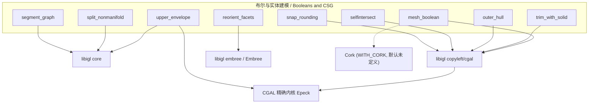

# 60.1 布尔运算与实体建模 / Booleans and CSG

> 本章覆盖 `mex/` 目录中**布尔运算（CSG）与实体建模 / 网格修复**相关的 9 个 C++ MEX 函数：
> 网格布尔 `mesh_boolean`、实体裁剪 `trim_with_solid`、外 Hull `outer_hull`、
> 上包络 `upper_envelope`、自交重网格 `selfintersect`、非流形拆分 `split_nonmanifold`、
> 朝向统一重定向 `reorient_facets`、整数格点舍入 `snap_rounding`、图分割 `segment_graph`。
>
> This chapter covers the nine C++ MEX functions of `mex/` that perform **solid
> boolean (CSG) operations and solid modeling / mesh repair**: `mesh_boolean`,
> `trim_with_solid`, `outer_hull`, `upper_envelope`, `selfintersect`,
> `split_nonmanifold`, `reorient_facets`, `snap_rounding` and `segment_graph`.
>
> 说明：`mex/<name>.m` 通常只是**注释桩（stub）**，仅含 `%` 注释头（无 `function` 行、无代码），
> 目的是让 `help <name>` 在编译前可用；真正实现在同名 `mex/<name>.cpp`。
> 本章 9 个函数的 `.m` **全部**为注释桩（其中 `split_nonmanifold.m` 的注释块整体缩进两格、
> 并含 `%Optional` 注释掉的行）。除 `reorient_facets`（Embree）与 `split_nonmanifold`、
> `segment_graph`（纯 libigl / 内联 C++）外，其余 6 个函数都依赖 **CGAL 精确内核**（经 libigl
> `copyleft/cgal` 封装或直接 `#include`）。

- 语言 / Language：中英对照（中文为主）
- 相关章节 / See also：[01b 四面体与三角网格化](01b-tet-and-tri-meshing.md)、
  [60.2 距离查询与相交](../60-mex/02-distance-queries-and-intersection.md)、
  [60.3 数值内核、I/O 与杂项](../60-mex/03-numerics-io-and-misc.md)、
  [00-overview/03-build-and-install.md](../00-overview/03-build-and-install.md)、
  [appendices/03-doc-template.md](../appendices/03-doc-template.md)
- 命名约定 / Notation：`V` 顶点 `#V by dim`、`F` 三角面 `#F by 3`、`E` 线段 `#E by 2`、
  `T` 四面体 `#T by 4`、`S` "高度场"值矩阵 `#V by m`、`BC` 重心权重稀疏矩阵、`J` 出生父面索引、
  `IF` 相交面对 `#IF by 2`、`#V` 顶点数

---

## 本章概览 / Chapter Overview

### 函数总览 / Function overview

| 函数 | 算法 / Algorithm | 库依赖 / Library | 一句话功能 / One-line purpose |
|---|---|---|---|
| `mesh_boolean` | libigl `copyleft/cgal` 布尔（CGAL 精确内核）+ 可选 Cork；按 `MeshBooleanType` 生成环绕数/保留谓词 | **libigl copyleft/cgal**、**Cork**（可选、默认未编译） | 对多组"实体"网格做并/交/差/对称差/求交线分解 |
| `trim_with_solid` | libigl `copyleft/cgal::trim_with_solid`（自交重网格 + 内外测试） | **libigl copyleft/cgal** | 细分 A 使其与实体 B 的交线落在边上，并标记每个 A 面在 B 内/外 |
| `outer_hull` | libigl `copyleft/cgal::outer_hull`（Attene 2014 §3.6 的可见性/射线判定），另有 `outer_hull_legacy` | **libigl copyleft/cgal** | 求已解交网格的"外 Hull"（对实体即其表面，保留薄翼片） |
| `upper_envelope` | 自实现：高度场三角汤 + CGAL 自交重网格 + `CGAL::orientation` 剔除被遮挡面 | **CGAL Epeck**、**libigl** | 计算 m 个分段线性函数之上的上包络（分段三角化 + 重心坐标） |
| `selfintersect` | libigl `copyleft/cgal::remesh_self_intersections` | **libigl copyleft/cgal** | 把自交网格重网格，使自交线落在边上（可选只检测） |
| `split_nonmanifold` | libigl `split_nonmanifold`（顶点副本分裂 + 定向传播） | **libigl** | 把非流形/不可定向网格拆成流形可定向网格（分量可能变多） |
| `reorient_facets` | libigl `embree::reorient_facets_raycast`（随机射线投票） | **libigl embree / Embree** | 统一面片朝向，使左手系法线一致朝外 |
| `snap_rounding` | libigl `copyleft/cgal::snap_rounding`（精确求交 + 整数格点舍入） | **libigl copyleft/cgal**、**CGAL Epeck** | 把可能相交的线段集舍入到整数格点，输出只看交于格点 |
| `segment_graph` | 内联 Felzenszwalb 2004 图分割（union-by-rank 并查集 + 贪心合并） | 内置 C++（GPL v2 代码）、libigl `unique` | 按边权把稀疏图节点贪心合并为连通子分量 |

### 依赖关系图 / Dependency graph



### 构建与依赖总览 / Build & dependency summary

所有 MEX 目标由 [mex/CMakeLists.txt](file:///c:/VSWork/gptoolbox-1/mex/CMakeLists.txt) 的
`compile_each(<sources> <libs>)` 辅助函数（[L162-L178](file:///c:/VSWork/gptoolbox-1/mex/CMakeLists.txt#L162-L178)）逐个产出
`mex/<name>.<Matlab_MEX_EXTENSION>`：

| 目标 / Target | 所在 CMake 分组 | 链接库 / Link libraries |
|---|---|---|
| `mesh_boolean`、`outer_hull`、`selfintersect`、`snap_rounding`、`trim_with_solid`、`upper_envelope` | `LIBIGL_COPYLEFT_CGAL`（[L329-L345](file:///c:/VSWork/gptoolbox-1/mex/CMakeLists.txt#L329-L345)，并附加 `-DWITH_CGAL`） | `${CORE_LIBS};igl::core;igl_restricted::matlab;igl_copyleft::cgal;${CORK_LIBS}` |
| `segment_graph`、`split_nonmanifold` | LIBIGL 主列表（[L210-L239](file:///c:/VSWork/gptoolbox-1/mex/CMakeLists.txt#L210-L239)） | `${CORE_LIBS};igl::core;igl_restricted::matlab` |
| `reorient_facets` | `LIBIGL_EMBREE`（[L302-L312](file:///c:/VSWork/gptoolbox-1/mex/CMakeLists.txt#L302-L312)，并附加 `-DWITH_EMBREE`） | `${CORE_LIBS};igl::core;igl_restricted::matlab;igl::embree` |

> 关键构建事实：`LIBIGL_COPYLEFT_CGAL`、`LIBIGL_EMBREE` 默认 `ON`
> （[L60-L61](file:///c:/VSWork/gptoolbox-1/mex/CMakeLists.txt#L60-L61)）；若关闭，
> 上表第一组（6 个函数）与 `reorient_facets` **不会**被编译。
> 另外 `${CORK_LIBS}` 在 `CMakeLists.txt` 中**从未被赋值**，且 CMake 侧**从不**定义 `WITH_CORK` 宏，
> 因此 `mesh_boolean.cpp` 中的 Cork 分支实际处于死代码状态（详见其条目备注）。
> 依赖下载：`cmake ..` 通过 vcpkg 把 Eigen/libigl/CGAL/Embree/ElTopo 下载到 `mex/external/`
> （见 [mex/README.md](file:///c:/VSWork/gptoolbox-1/mex/README.md)）。

---

## 逐函数详解 / Per-function reference

### `mesh_boolean` — 网格布尔运算（CSG）[MEX]
- **文件 / File**: [mex/mesh_boolean.m](file:///c:/VSWork/gptoolbox-1/mex/mesh_boolean.m#L1-L35) ·
  [mex/mesh_boolean.cpp](file:///c:/VSWork/gptoolbox-1/mex/mesh_boolean.cpp#L1-L273)
- **签名 / Signature**: 桩：`[W,H] = mesh_boolean(V,F,U,G,operation)`；亦可
  `[W,H] = mesh_boolean(V,F,U,G,operation,'ParameterName',parameter_value, ...)`；亦支持多网格 cell 形式
  `[W,H] = mesh_boolean({V1,V2,..,Vn},{F1,F2,...,Fn},operation,...)` /
  `mexFunction` 实参序：`prhs = {V,F,[U,G,]..., operation|'' , Name, Value, ...}`，
  `plhs = {W, H, J}`（最多 3 个输出）
- **功能 / Purpose**: `EN: Compute boolean CSG operations on "solid", consistently oriented meshes (union / intersection / difference / symmetric difference / resolve), using CGAL's exact arithmetic kernel by default.` /
  中文：对一致定向的"实体"网格做布尔 CSG 运算（并/交/差/对称差/求交分解），默认使用 CGAL 精确算术内核。
- **输入 / Inputs**:

  | 参数 | 尺寸/类型 | 含义 (中 / EN) |
  |---|---|---|
  | `V` | `#V by 3` 或 cell of double | 第一个网格顶点 / vertex positions of first mesh |
  | `F` | `#F by 3` 或 cell of index | 第一个网格三角面 / triangle indices into `V` |
  | `U` | `#U by 3` 或 cell | 第二个网格顶点 / vertex positions of second mesh |
  | `G` | `#G by 3` 或 cell | 第二个网格三角面 / triangle indices into `U` |
  | `operation` | 字符串 | 布尔操作类型 / boolean operation type |

  > 网格对可重复出现（`V,F,U,G,P,Q,...`），亦可整体用 cell 给出（每个 cell 元素一个网格）；
  > 解析循环以"遇到第一个 char 参数"作为网格列表结束（[L66-L96](file:///c:/VSWork/gptoolbox-1/mex/mesh_boolean.cpp#L66-L96)）。

- **输出 / Outputs**:

  | 参数 | 尺寸/类型 | 含义 |
  |---|---|---|
  | `W` | `#W by 3` | 结果网格顶点 / result vertex positions |
  | `H` | `#H by 3` | 结果网格三角面 / result triangle indices into `W` |
  | `J` | `#H by 1` | 每个结果面在 `[FA;FB;...]` 中的出生父面索引 / birth parents |

- **可选参数 / Optional**:

  | 名称 | 取值 | 默认 | 含义 |
  |---|---|---|---|
  | `operation`（位置参数） | `'union'` / `'intersection'` / `'difference'` / `'symmetric_difference'` / `'resolve'`（桩注释另列 `'intersect'`、`'minus'`、`'xor'` 别名） | 无（必须给，或用 `'WindingNumberFilter'` 代替） | 交 libigl `string_to_mesh_boolean_type` 解析；未识别报 `"<op> is not a known boolean operation"` |
  | `'BooleanLib'` | `'libigl'` 或 `'cork'` | `'libigl'` | 后端选择；`libigl` 用 CGAL 精确内核；`cork` 更快但可能不正确 |
  | `'WindingNumberFilter'` | MATLAB 函数句柄 | 未设 | 自定义抽取谓词：以 `1 by n` 环绕数行向量为入参回调，返回数值或逻辑 |
  | `'Debug'` | logical 标量 | `false` | 打印进度（`parsed input.`/`Computed boolean.`） |

  > 桩注释中的 `'libigl-try-cork-resolve'` 与 `'resolve'` 之外的别名**不在** `.cpp` 的显式
  > `strcmp` 分支中：`BooleanLib` 只识别 `"libigl"` 与（`WITH_CORK` 下）`"cork"`，
  > 其余一律 `Unknown BooleanLib: <name>`（[L114-L131](file:///c:/VSWork/gptoolbox-1/mex/mesh_boolean.cpp#L114-L131)）。

- **变量流动 / Variable flow**:
  `V,F,U,G,(...) / {Vlist},{Flist} →(1 逐对 parse_mesh：parse_rhs_double+parse_rhs_index，并校验 dim==3、simplex 维数一致)→ Vlist,Flist →
  operation →(2 string_to_mesh_boolean_type)→ type →(3 mesh_boolean_type_to_funcs 或 'WindingNumberFilter')→ wind_func,keep_func →
  (4 igl::copyleft::cgal::mesh_boolean(Vlist,Flist,wind_func,keep_func,...))→ VC,FC,J →(5 prepare_lhs_double/index)→ W,H,J`
- **算法步骤 / Algorithm**:
  1. 校验 `nrhs >= 3`，否则 `The number of input arguments must be >=3.`（L48）。
  2. **网格解析**（L50-L96）：以 `while(!mxIsChar(prhs[i]))` 逐对消费输入；cell 输入要求对侧也是 cell
     （`Cell input for vertices requires cell input for faces, too`）且长度相同（`Face cell input must be same length`）；
     非 cell 非 numeric 报 `Mesh inputs must be numeric`；每个网格经 `parse_mesh` 校验
     `Mesh vertex list must be #V by 3 list of vertex positions` 与
     `Mesh "face" simplex size must equal dimension`，再转成 `Eigen::MatrixXd/MatrixXi`。
  3. **操作类型**（L98-L106）：`std::string type_str = mxArrayToString(prhs[i])`；非空时交
     `igl::copyleft::cgal::string_to_mesh_boolean_type(type_str,type)`，失败报
     `<type_str> is not a known boolean operation`；成功则用
     `igl::copyleft::cgal::mesh_boolean_type_to_funcs(type,wind_func,keep_func)` 生成两个抽取谓词。
     `keep_func` 初值为 `igl::copyleft::cgal::KeepInside()`（L199-L200）。
  4. **可选参数循环**（L108-L175）：`'BooleanLib'`（`validate_arg_char`）、`'WindingNumberFilter'`
     （`validate_arg_function_handle`）、`'Debug'`（`validate_arg_logical`+`validate_arg_scalar`）；
     其余名报 `Unknown parameter`。
  5. `'WindingNumberFilter'` 回调实现（L132-L163）：用 `igl::matlab::prepare_lhs_double(w, fprhs+1)` 把环绕数
     行向量打包成 `mxArray`，`mexCallMATLAB(1,fplhs,2,fprhs,"feval")` 调用句柄；返回值须为 numeric 或 logical，
     否则 `WindingNumberFilter should return number or logical`；随后 `mxDestroyArray` 清理。
  6. 若既无操作类型又无 `wind_func`，报 `If no type provided, then must provided extraction function`（L176-L177）。
  7. **布尔求解**（L218-L241）：
     - `BOOLEAN_LIB_TYPE_LIBIGL`（默认）：`igl::copyleft::cgal::mesh_boolean(Vlist,Flist,wind_func,keep_func,VC,FC,J)`
       ——**CGAL 精确内核**（Epeck）的多网格布尔，返回是否成功；
     - `BOOLEAN_LIB_TYPE_CORK`（`#ifdef WITH_CORK`）：要求恰 2 个网格（`Must provide exactly two meshes for cork.`），
       且不得使用自定义抽取函数（`Cork does not support arbitrary extraction functions`），
       调 `igl::copyleft::cork::mesh_boolean`；
     - 其它：`Unknown boolean lib.`。
  8. `success==false` 报 `mesh_boolean failed.`（L242）。
  9. 依 `nlhs`（3→1）贯穿输出 `J,FC,VC`（`prepare_lhs_index`/`prepare_lhs_double`），`nlhs>3` 报
     `Too many output parameters.`（L247-L269）。最后恢复 `std::cout` 缓冲（`MexStream`）。
- **流程图 / Flowchart**:

  ```mermaid
  flowchart TD
    A["输入 V,F,U,G,... / cell 列表"] --> B{"nrhs>=3 ?"}
    B -- 否 --> E0["错误: The number of input arguments must be >=3."]
    B -- 是 --> C["逐对 parse_mesh: parse_rhs_double/index"]
    C --> D{"dim==3 且 simplex 维数一致 ?"}
    D -- 否 --> E1["错误: vertex list / simplex size 不符"]
    D -- 是 --> F["Vlist,Flist"]
    F --> G{"遇到 char 参数? operation"}
    G --> H{"string_to_mesh_boolean_type 成功 ?"}
    H -- 否 --> E2["错误: <op> is not a known boolean operation"]
    H -- 是 --> I["mesh_boolean_type_to_funcs → wind_func,keep_func"]
    G -- 无操作名 --> J{"给了 WindingNumberFilter ?"}
    J -- 否 --> E3["错误: must provided extraction function"]
    J -- 是 --> I
    I --> K{"BooleanLib"}
    K -- libigl --> L["igl::copyleft::cgal::mesh_boolean (CGAL Epeck)"]
    K -- cork --> M{"WITH_CORK 且恰 2 网格 ?"}
    M -- 否 --> E4["错误: Unknown boolean lib. / 网格数不符"]
    M -- 是 --> N["igl::copyleft::cork::mesh_boolean"]
    L --> O{"success ?"}
    N --> O
    O -- 否 --> E5["错误: mesh_boolean failed."]
    O -- 是 --> P["prepare_lhs J,FC,VC"]
    P --> Z["输出 W,H,J"]
  ```

- **依赖 / Dependencies**:
  - 打包 C++ 库：**libigl** `copyleft/cgal`（`#include <igl/copyleft/cgal/mesh_boolean.h>` L1、
    `remesh_self_intersections.h` L2、`mesh_boolean_type_to_funcs.h` L3、
    `BinaryWindingNumberOperations.h` L4、`string_to_mesh_boolean_type.h` L9）、`igl/remove_unreferenced.h` L5；
    **Cork**（`igl/copyleft/cork/mesh_boolean.h`，仅 `#ifdef WITH_CORK`）；**Eigen**（`Eigen/Dense`）；
    libigl MATLAB 胶水（`MexStream.h`、`mexErrMsgTxt.h`、`prepare_lhs.h`、`parse_rhs.h`、`validate_arg.h`、`igl/C_STR.h`）；
    `#include <mex.h>`、`<cstring>`。
  - 其他 gptoolbox 函数：无（本 MEX 不调用其它 gptoolbox 函数；但 `'WindingNumberFilter'` 会经
    `mexCallMATLAB` 回调**用户提供的** MATLAB 函数句柄）。
  - MATLAB 工具箱：无额外要求（仅 MEX API）。
  - 仓库内调用者（用于反向依赖）：[mesh/emboss.m#L82-L84](file:///c:/VSWork/gptoolbox-1/mesh/emboss.m#L82-L84)、
    [mesh/half_space_intersect.m#L80](file:///c:/VSWork/gptoolbox-1/mesh/half_space_intersect.m#L80)、
    [mesh/joints.m#L236](file:///c:/VSWork/gptoolbox-1/mesh/joints.m#L236)、
    [mesh/lazy_cage.m#L98](file:///c:/VSWork/gptoolbox-1/mesh/lazy_cage.m#L98)、
    [mesh/linear_sweep.m#L137](file:///c:/VSWork/gptoolbox-1/mesh/linear_sweep.m#L137)、
    [mesh/minkowski_sum.m#L46](file:///c:/VSWork/gptoolbox-1/mesh/minkowski_sum.m#L46)。
- **构建与安装 / Build note**: CMake 目标 `mesh_boolean` 位于 `LIBIGL_COPYLEFT_CGAL` 分支，链接
  `${CORE_LIBS};igl::core;igl_restricted::matlab;igl_copyleft::cgal;${CORK_LIBS}`
  （[mex/CMakeLists.txt#L329-L345](file:///c:/VSWork/gptoolbox-1/mex/CMakeLists.txt#L329-L345)），
  并附加编译宏 `-DWITH_CGAL`；因此**必须**开启 `LIBIGL_COPYLEFT_CGAL` 且构建系统能够找到 CGAL。
  `${CORK_LIBS}` 未在 CMakeLists 中定义（展开为空），且 `WITH_CORK` 从未被 `add_definitions`，
  故 Cork 后端在 CMake 构建下**不可用**（只有手工用 [mex/gptoolbox_mexopts.m](file:///c:/VSWork/gptoolbox-1/mex/gptoolbox_mexopts.m) 编译才可能启用）。
- **See also**: `mesh_boolean_winding_number`（纯 MATLAB 版）、`selfintersect`、`trim_with_solid`、
  `outer_hull`、`winding_number`(MEX)、`signed_distance_isosurface`(MEX)
- **备注 / Note（源码与文档差异）**:
  - 桩注释列出 `'BooleanLib'` 三值（`{libigl}`、`cork`、`libigl-try-cork-resolve`），
    但 `.cpp` **只**识别 `"libigl"` 与 `"cork"`；`'libigl-try-cork-resolve'` 会落到
    `Unknown BooleanLib: libigl-try-cork-resolve`。且 CMake 不定义 `WITH_CORK`，故 `"cork"` 在
    CMake 构建里同样不可达（否则报 `Unknown BooleanLib: cork`）。
  - 桩**未**记录 `'WindingNumberFilter'` 与 `'Debug'` 两个参数，也未说明操作名字符串由 libigl
    `string_to_mesh_boolean_type` 解析（其接受别名集合位于未 vendored 的 libigl 源码中）。
  - 桩的 `See also: self_intersect` 指向的名称与实际函数名 `selfintersect` 不一致。

### `trim_with_solid` — 用实体边界网格裁剪给定网格 [MEX]
- **文件 / File**: [mex/trim_with_solid.m](file:///c:/VSWork/gptoolbox-1/mex/trim_with_solid.m#L1-L18) ·
  [mex/trim_with_solid.cpp](file:///c:/VSWork/gptoolbox-1/mex/trim_with_solid.cpp#L1-L76)
- **签名 / Signature**: 桩**未给出原型行**（只有 Inputs/Outputs 列表），按桩与实现可写为
  `[V,F,D,J] = trim_with_solid(VA,FA,VB,FB)`；
  `mexFunction` 实参序：`prhs = {VA, FA, VB, FB}`（`nrhs>=4`），`plhs = {V, F, D, J}`
- **功能 / Purpose**: `EN: Given an arbitrary mesh (VA,FA) and the boundary mesh (VB,FB) of a solid B, resolve their intersections by subdividing faces of A so that intersections with B lie only along edges/vertices, then label each resulting face as inside or outside B (following [Zhou et al. 2016]).` /
  中文：给定任意网格 `(VA,FA)` 与实体 `B` 的边界网格 `(VB,FB)`，细分 `A` 的面使与 `B` 的交仅落在边/顶点上，
  再判定每个面在 `B` 内还是外（按 [Zhou et al. 2016] 的"solid"定义）。
- **输入 / Inputs**:

  | 参数 | 尺寸/类型 | 含义 (中 / EN) |
  |---|---|---|
  | `VA` | `#VA by 3` | 网格 A 顶点 / vertex positions of A |
  | `FA` | `#FA by 3` | 网格 A 三角面 / triangle indices into `VA` |
  | `VB` | `#VB by 3` | 实体 B 边界网格顶点 / vertex positions of B |
  | `FB` | `#FB by 3` | 实体 B 边界网格三角面 / triangle indices into `VB` |

- **输出 / Outputs**:

  | 参数 | 尺寸/类型 | 含义 |
  |---|---|---|
  | `V` | `#V by 3` | 细分后输出顶点 / output vertex positions |
  | `F` | `#F by 3` | 细分后输出面 / output triangle indices into `V` |
  | `D` | `#F by 1` logical | 每个面是否在 B 内 / whether each face is inside B |
  | `J` | `#F by 1` | 每个输出面在 `FA` 中的出生父面 / birth parent in `FA` |

- **可选参数 / Optional**: 无 / None（`nrhs<4` 直接报 `Must have four inputs`；源码**不解析**任何
  `Name,Value` 对，第 5 个及以后的输入被**静默忽略**）
- **变量流动 / Variable flow**:
  `VA,FA,VB,FB →(1 parse_mesh ×2：parse_rhs_double + parse_rhs_index，并校验 3 列)→ VA,FA,VB,FB(MatrixXd/MatrixXi) →
  (2 igl::copyleft::cgal::trim_with_solid)→ V,F,D,J →(3 prepare_lhs_double/index/logical)→ V(及 F,D,J)`
- **算法步骤 / Algorithm**:
  1. 校验 `nrhs>=4`，否则 `Must have four inputs`（L25）。
  2. 用 lambda `parse_mesh` 解析两对网格（L28-L39）：`parse_rhs_double` 取顶点、`parse_rhs_index` 取面，
     并要求 `V must be #V by 3`、`F must be #F by 3`。
  3. 调用 `igl::copyleft::cgal::trim_with_solid(VA,FA,VB,FB,V,F,D,J)`（L43）：该 libigl 例程基于**CGAL 精确内核**
     ——先把 A 与 B 的自交/互交在 A 上重网格（交点只落在边/顶点上，允许共面面），再用 B 的内外测试
     （广义绕数/射线奇偶）给每个输出面打 `D`，并用 `J` 记录出生父面。
  4. 依 `nlhs`（4→1）贯穿输出 `J,D,F,V`；`nlhs>4` 报 `Too many output parameters.`（L44-L72）。
- **流程图 / Flowchart**:

  ```mermaid
  flowchart TD
    A["输入 VA,FA,VB,FB"] --> B{"nrhs>=4 ?"}
    B -- 否 --> E0["错误: Must have four inputs"]
    B -- 是 --> C["parse_mesh ×2: parse_rhs_double/index"]
    C --> D{"V 为 3 列 且 F 为 3 列 ?"}
    D -- 否 --> E1["错误: V must be #V by 3 / F must be #F by 3"]
    D -- 是 --> F["igl::copyleft::cgal::trim_with_solid"]
    F --> G["细分 A: 与 B 的交落在边/顶点 (CGAL 精确)"]
    G --> H["内外测试 → D; 记录出生父面 J"]
    H --> I["依 nlhs 贯穿输出 J,D,F,V"]
    I --> Z["输出 V,F,D,J"]
  ```

- **依赖 / Dependencies**:
  - 打包 C++ 库：**libigl** `copyleft/cgal`（`#include <igl/copyleft/cgal/trim_with_solid.h>` L1；
    CGAL 由其头文件间接引入，本 `.cpp` 无直接 `CGAL/` include）；**Eigen**（`Eigen/Dense` L10）；
    libigl MATLAB 胶水（`MexStream.h`、`mexErrMsgTxt.h`、`prepare_lhs.h`、`parse_rhs.h`、`validate_arg.h`、`igl/C_STR.h`）；
    `#include <mex.h>`。
  - 其他 gptoolbox 函数：无。
  - MATLAB 工具箱：无额外要求。
  - 仓库内调用者：无（`.m` 文件仅存注释桩）。
- **构建与安装 / Build note**: 位于 `LIBIGL_COPYLEFT_CGAL` 分组（
  [mex/CMakeLists.txt#L341](file:///c:/VSWork/gptoolbox-1/mex/CMakeLists.txt#L341)），链接
  `${CORE_LIBS};igl::core;igl_restricted::matlab;igl_copyleft::cgal;${CORK_LIBS}`
  （[L329-L345](file:///c:/VSWork/gptoolbox-1/mex/CMakeLists.txt#L329-L345)），需 `-DWITH_CGAL`（同组统一下发）
  与可用的 **CGAL**；Embree 非必需。
- **See also**: `mesh_boolean`、`outer_hull`、`selfintersect`、`mesh_boolean_winding_number`、`winding_number`(MEX)
- **备注 / Note（源码与文档差异）**: 桩**没有原型行**（模板要求 `[out] = f(in)` 形式），只有
  `Inputs:`/`Outputs:` 列表，故签名需由 Outputs 顺序（`V,F,D,J`）与 `.cpp` 的 `switch(nlhs)` 反推；
  `.cpp` 中 `D` 的 C++ 类型是 `Eigen::VectorXi`，但以 `prepare_lhs_logical` 输出为 **logical** 数组，
  与桩注释 "list of bools" 一致，但**不是** double。

### `outer_hull` — 网格的"外 Hull" [MEX]
- **文件 / File**: [mex/outer_hull.m](file:///c:/VSWork/gptoolbox-1/mex/outer_hull.m#L1-L19) ·
  [mex/outer_hull.cpp](file:///c:/VSWork/gptoolbox-1/mex/outer_hull.cpp#L1-L131)
- **签名 / Signature**: 桩：`[G,J,flip] = outer_hull(V,F)`（对应 `'Legacy',true` 路径）；
  实现（默认非 legacy）：`mexFunction` 实参序 `prhs = {V, F, 'Legacy', val, ...}`，
  `plhs = {HV, G, J, flip}`（`HV` 在前；legacy 时 `plhs = {G, J, flip}`）
- **功能 / Purpose**: `EN: Compute the "outer hull" of a potentially non-manifold mesh whose intersections have been resolved: all facets reachable from infinity without intersecting other facets (the surface of a solid, plus thin wings/flaps), following Section 3.6 of "Direct repair of self-intersecting meshes" [Attene 2014].` /
  中文：对"交点已被分解"的（可能非流形）网格求外 Hull——所有可以从无穷远处无遮挡到达的面
  （实体即其表面，一般还含薄翼片），方法依 [Attene 2014] §3.6。
- **输入 / Inputs**:

  | 参数 | 尺寸/类型 | 含义 (中 / EN) |
  |---|---|---|
  | `V` | `#V by 3` | 顶点位置 / vertex positions |
  | `F` | `#F by 3` | 三角面索引 / triangle indices into `V` |

- **输出 / Outputs**:

  | 参数 | 尺寸/类型 | 含义 |
  |---|---|---|
  | `HV` | `#HV by 3` | **非 legacy 独占的输出**：输出顶点位置（含新顶点）/ output vertices |
  | `G` | `#G by 3` | 输出三角面索引（索引进 `HV` 或原 `V`）/ output triangles |
  | `J` | `#G by 1` | 每个输出面在 `F` 中的出生父面 / indices into `F` |
  | `flip` | `#F by 1` logical | 该面是否被加入 `G` **且**被翻转朝向（未加入者为 `false`）/ flip flags |

- **可选参数 / Optional**:

  | 名称 | 取值 | 默认 | 含义 |
  |---|---|---|---|
  | `'Legacy'` | logical 标量 | `false` | 使用旧实现 `igl::copyleft::cgal::outer_hull_legacy`（无 `HV` 输出） |

- **变量流动 / Variable flow**:
  `V,F,'Legacy' →(1 parse_mesh + 3 列校验)→ V,F(MatrixXd/MatrixXi),legacy →
  (2 分支) legacy? outer_hull_legacy(V,F,G,J,flip) : outer_hull(V,F,HV,G,J,flip) →
  (3 offset = legacy?0:1，依 nlhs-offset 贯穿输出)→ HV(仅非 legacy),G,J,flip`
- **算法步骤 / Algorithm**:
  1. `parse_rhs`：校验 `nrhs >= 2`，否则 `The number of input arguments must be >=2.`（L28）。
  2. `parse_mesh`（L30-L42）：要求 `Mesh vertex list must be #V by 3 list of vertex positions` 且
     `Mesh "face" simplex size must equal dimension`，再 `parse_rhs_double`/`parse_rhs_index`。
  3. 解析 `'Legacy'`（logical+scalar；`Parameter names should be strings` / `Unknown parameter`）（L44-L62）。
  4. 调用（L84-L90）：
     - `legacy=true` → `igl::copyleft::cgal::outer_hull_legacy(V,F,G,J,flip)`；
     - `legacy=false` → `igl::copyleft::cgal::outer_hull(V,F,HV,G,J,flip)`，其中 `HV` 为输出顶点表
       （新生成或保留的顶点）。
     两者都基于 **CGAL 精确内核**（经 libigl `copyleft/cgal` 头文件实现）：算法为 Attene 2014 §3.6 的
     面片可见性判定——对每个 facet（不分朝向）判定是否存在一条从无穷远到该面、不与任何其它 facet 相交的路径，
     据此保留/翻转面片并维护朝向一致性。
  5. 输出（L92-L127）：`offset = legacy?0:1`；`switch(nlhs-offset)` 贯穿输出：
     `case 3`→`flip`、`case 2`→`J`、`case 1`→`G`、`case 0`→（非 legacy 时）`HV` 写进 `plhs[0]`；
     `nlhs-offset>3` 报 `Too many output parameters.`；`nlhs-offset==-1`（即 `nlhs==0` 且非 legacy）走
     `assert(!legacy)` 后直接返回。
- **流程图 / Flowchart**:

  ```mermaid
  flowchart TD
    A["输入 V,F,'Legacy'"] --> B{"nrhs>=2 ?"}
    B -- 否 --> E0["错误: The number of input arguments must be >=2."]
    B -- 是 --> C["parse_mesh: 3 列校验 + parse_rhs_double/index"]
    C --> D{"参数名合法?"}
    D -- 否 --> E1["错误: Unknown parameter"]
    D -- 是 --> F{"legacy ?"}
    F -- 是 --> G1["outer_hull_legacy(V,F,G,J,flip)"]
    F -- 否 --> G2["outer_hull(V,F,HV,G,J,flip)"]
    G1 --> H["offset=0"]
    G2 --> I["offset=1"]
    H --> J{"nlhs-offset <= 3 ?"}
    I --> J
    J -- 否 --> E2["错误: Too many output parameters."]
    J -- 是 --> K["贯穿输出 G,J,flip (+ HV)"]
    K --> Z["输出 HV?,G,J,flip"]
  ```

- **依赖 / Dependencies**:
  - 打包 C++ 库：**libigl** `copyleft/cgal`（`#include <igl/copyleft/cgal/outer_hull.h>` L1、
    `outer_hull_legacy.h` L2）；**Eigen**（`Eigen/Dense`）；libigl MATLAB 胶水
    （`MexStream.h`、`mexErrMsgTxt.h`、`prepare_lhs.h`、`validate_arg.h`、`parse_rhs.h`、`igl/C_STR.h`）；
    `#include <mex.h>`、`<iostream>`、`<cstring>`。
  - 其他 gptoolbox 函数：无。
  - MATLAB 工具箱：无额外要求。
  - 仓库内调用者：[mesh/remesh_max.m#L31](file:///c:/VSWork/gptoolbox-1/mesh/remesh_max.m#L31)
    （`[VV,FF,J] = outer_hull(SV,SF)`，即按 legacy 形式只取 3 个输出）。
- **构建与安装 / Build note**: 位于 `LIBIGL_COPYLEFT_CGAL` 分组（
  [mex/CMakeLists.txt#L336](file:///c:/VSWork/gptoolbox-1/mex/CMakeLists.txt#L336)），链接
  `${CORE_LIBS};igl::core;igl_restricted::matlab;igl_copyleft::cgal;${CORK_LIBS}`
  （[L329-L345](file:///c:/VSWork/gptoolbox-1/mex/CMakeLists.txt#L329-L345)）；需 **CGAL** 与 `-DWITH_CGAL`。
- **See also**: `selfintersect`、`mesh_boolean`、`remove_unreferenced`、`remesh_max`、`clean_mesh`
- **备注 / Note（源码与文档差异）**:
  - 桩注释写 `[G,J,flip] = outer_hull(V,F)`（3 个输出），而**默认（非 legacy）路径实际是 4 个输出**
    `[HV,G,J,flip]`：`HV` 被强制写入 `plhs[0]`，`G,J,flip` 依次后移一位（
    [L92-L127](file:///c:/VSWork/gptoolbox-1/mex/outer_hull.cpp#L92-L127)）。若按桩的 3 输出调用，
    得到的是 `[HV,G,J]` 而不是 `[G,J,flip]`。桩描述的 3 输出形式只与 `'Legacy',true` 一致。
  - 桩**未**记录 `'Legacy'` 参数。

### `upper_envelope` — m 个分段线性函数的上包络 [MEX]
- **文件 / File**: [mex/upper_envelope.m](file:///c:/VSWork/gptoolbox-1/mex/upper_envelope.m#L1-L3) ·
  [mex/upper_envelope.cpp](file:///c:/VSWork/gptoolbox-1/mex/upper_envelope.cpp#L1-L466)
- **签名 / Signature**: 桩：`[VV,FF,J,FJ] = upper_envelope(V,F,Z)`（`Z` 即下文 `S`）；
  实现：`mexFunction` 实参序 `prhs = {V, F, S}`，`plhs = {VV, FF, J, FJ, BC, counts}`（最多 6 个输出）
- **功能 / Purpose**: `EN: Compute the upper envelope of m piecewise-linear functions over the domain of a simplex mesh (V,F): the piecewise-linear function equal to the pointwise maximum, returned as a triangulation plus barycentric weights into V.` /
  中文：在单纯形网格 `(V,F)` 的定义域上，计算 `m` 个分段线性函数的**上包络**（逐点取最大），
  返回其上包络的分片三角化与（相对 `V` 的）重心坐标。
- **输入 / Inputs**:

  | 参数 | 尺寸/类型 | 含义 (中 / EN) |
  |---|---|---|
  | `V` | `#V by 3` | 顶点位置（域）/ domain vertices |
  | `F` | `#F by 3` | 三角面索引 / simplex indices into `V`（`F.cols()` 即 simplex 尺寸，本实现按三角处理） |
  | `S` | `#V by m` | 每个顶点处 `m` 个函数的值（"高度场"）/ values of the m functions at each vertex |

- **输出 / Outputs**:

  | 参数 | 尺寸/类型 | 含义 |
  |---|---|---|
  | `VV` | `#VV by 3` | 上包络的顶点位置（`VV = BC*V`）/ envelope vertex positions |
  | `FF` | `#FF by 3` | 上包络三角面索引（进 `VV`）/ envelope triangles |
  | `J` | `#FF by 1` | 每个包络面来自哪个函数（`1..m`）/ which function each face belongs to |
  | `FJ` | `#FF by 1` | 每个包络面在输入 `F` 中的出生面 / birth parent in `F` |
  | `BC` | `#VV by #V` sparse | 重心权重：把输入顶点线性组合成包络顶点 / barycentric weights |
  | `counts` | `m by 1` | 各"重叠函数数"基例被触发的次数（性能统计）/ base-case counters |

- **可选参数 / Optional**: 无 / None（`stitch_all` 在源码中**硬编码** `false`；
  若为真会报 `Stitch all not yet supported`）
- **变量流动 / Variable flow**:
  `V,F,S →(1 parse_rhs_double/index/double，并校验 V.rows()==S.rows())→ V,F,S →
  (2 逐三角形取 Sf = S.row(F(f,:)) 得 3 by m 子问题) →
  (3 upper_envelope(Sf,...)：基例 1「某函数在三顶点同时取最大」/ 基例 2「仅两函数重叠，用 Epeck 精确求交」/
    一般情形 brute_force：高度场三角汤 → remesh_self_intersections → CGAL::orientation 剔除被遮挡面) →
  FFf,Jf,BCf →(4 重编号并 append)→ FF,J,FJ,BCIJV →(5 BC.setFromTriplets) →
  (6 VV = BC*V)→ prepare_lhs_double/index → VV,FF,J,FJ,(BC,counts)`
- **算法步骤 / Algorithm**:
  1. `mexUnlock()` 并接管 `std::cout`（`MexStream`），每次调用打印 `Compiled at <time> on <date>`（L409-L415）。
  2. 校验 `nrhs>=3`（`nrhs should be at least 3`），解析 `V,F,S`；再校验
     `V and S should have same # rows`（L422-L426）。
  3. 外层循环（L351-L392）对每个输入三角形 `f`：
     `Sf = [S.row(F(f,0)); S.row(F(f,1)); S.row(F(f,2))]`（`3 by m`），调用子过程
      `upper_envelope(Sf,FFf,Jf,BCf)`；随后把 `FFf` 中 `0..2` 重映射回 `F(f,·)`、`>=3` 的新顶点
      `+= n`（`n` 为当前输出顶点计数）；再 `append_bottom` 到 `FF/J/FJ`，并把 `BCf` 的权重作为三元组
     `(n, F(f,j), BCf(i,j))` 追加（L383-L391）。
  4. 子过程基本情形 A（L36-L65，性能优化）：若存在某函数 `j` 在三个角点上**同时**取到该角点的最大值
     （`S(i,j)==Smax(i)`），则该三角形本身就是包络面，直接输出 `FF=[0,1,2]`、`J=j`、
     `BC=I₃`，并 `counts(0)++`。
  5. 子过程基本情形 B（L67-L157）：取使 `S.maxCoeff` 最大的函数 `xj`，用 `S.col(xj).minCoeff()` 作下界
     筛出与之"重叠"的函数集合 `overlap`；若 `overlap.size()==2`，则把两线性函数之差 `Dxy` 转成
     **CGAL Epeck 精确标量** `ExactScalar`，解出两条交线上的两个交点参数 `s20,s01`，输出 3 个三角形
     （`FF` 5 顶点表的前 3 个为原角点），`counts(1)++`；结果用
     `igl::copyleft::cgal::assign_scalar` 写回 double 的 `BC`。
  6. 子过程一般情形 `brute_force`（L168-L300）：把 `m` 个线性函数当作"高度场三角汤"
     ——每个函数 `j` 的三个顶点取 `(i==1, i==2, S(i,j))`，构成 `HV (3m by 3)`、`HF (m by 3)`；
     调 `igl::copyleft::cgal::remesh_self_intersections(HV,HF,{false,false,true},SV,SF,_1,SJ,_2)`
     （**CGAL 精确内核**，第三参 `stitch_all=true`）得到重网格后的 `SV,SF,SJ`；
     用 `igl::barycenter(SV,SF,SC)` 求每个面重心 `cf`，对每个候选面遍历所有函数 `j≠SJ(f)`，
     用 `CGAL::orientation(HP[HF(j,0)],HP[HF(j,1)],HP[HF(j,2)],cf)` 判定 `cf` 是否在该函数平面**之下**
     （`NEGATIVE`，或共面 `COPLANAR` 且 `j<SJ(f)` 时按编号打破平手）→ 被遮挡则 `keep(f)=false`；
     再 `igl::slice_mask` 过滤、`igl::remove_unreferenced` 去冗余顶点，并重排使原三个角点排在最前
     （`BC` 第 2、3 列为重心坐标 `u,v`，第 1 列为 `α = 1-u-v`）。源码自述此路径为 **O(m³)**。
  7. 全部三角形处理完后 `BC.resize(n,S.rows())`、`BC.setFromTriplets(BCIJV)`（L394-L395），
     并 `conservativeResize` 裁剪 `FF/J/FJ`；`VV = BC*V`（L439）。
  8. 输出（L443-L459）：`switch(nlhs)` 贯穿输出 `VV,FF,J,FJ,BC,counts.cast<double>()`；
     `counts` 是**文件级全局** `Eigen::VectorXi`（L29），在 `upper_envelope(F,S,...)` 开头
     `counts.setZero(S.cols())`。
- **流程图 / Flowchart**:

  ```mermaid
  flowchart TD
    A["输入 V,F,S"] --> B{"nrhs>=3 且 V.rows()==S.rows() ?"}
    B -- 否 --> E0["错误: nrhs should be at least 3 / V and S 行数不符"]
    B -- 是 --> C["逐三角形 f: Sf = S.row(F(f,:))"]
    C --> D{"存在函数在三角点同时取最大 ?"}
    D -- 是 --> D1["基例A: FF=[0,1,2], BC=I; counts(0)++"]
    D -- 否 --> F{"overlap.size()==2 ?"}
    F -- 是 --> F1["基例B: Epeck 解两线性函数交线 → 3 个小三角形"]
    F -- 否 --> G["brute_force: 高度场三角汤 HV,HF"]
    G --> G1["remesh_self_intersections (CGAL Epeck, stitch_all)"]
    G1 --> G2["CGAL::orientation 剔除被遮挡面"]
    G2 --> G3["slice_mask + remove_unreferenced + 重排角点"]
    D1 --> H["重编号 + append 到 FF,J,FJ,BC"]
    F1 --> H
    G3 --> H
    H --> I{"还有三角形 ?"}
    I -- 是 --> C
    I -- 否 --> J["BC.setFromTriplets; VV = BC*V"]
    J --> Z["按 nlhs 输出 VV,FF,J,FJ,BC,counts"]
  ```

- **依赖 / Dependencies**:
  - 打包 C++ 库：**CGAL**（`#include <CGAL/Exact_predicates_exact_constructions_kernel.h>` L19，
    `typedef CGAL::Epeck Kernel` L97，直接使用 `CGAL::orientation`、`Kernel::Point_3/Plane_3`）；
    **libigl**（`igl/copyleft/cgal/remesh_self_intersections.h` L14、`igl/barycenter.h` L15、
    `igl/slice_mask.h` L16、`igl/slice.h` L17、`igl/remove_unreferenced.h` L18、
    `igl/copyleft/cgal/assign.h`/`assign_scalar.h` L20-L21、`igl/list_to_matrix.h` L11、
    `igl/matlab_format.h` L12）；**Eigen**；libigl MATLAB 胶水（`MexStream.h`、`mexErrMsgTxt.h`、
    `parse_rhs.h`、`prepare_lhs.h`、`validate_arg.h`）；`#include <mex.h>`。
  - 其他 gptoolbox 函数：无。
  - MATLAB 工具箱：无额外要求。
  - 仓库内调用者：无（`.m` 桩仅 3 行）。
- **构建与安装 / Build note**: 位于 `LIBIGL_COPYLEFT_CGAL` 分组（
  [mex/CMakeLists.txt#L342](file:///c:/VSWork/gptoolbox-1/mex/CMakeLists.txt#L342)），链接
  `${CORE_LIBS};igl::core;igl_restricted::matlab;igl_copyleft::cgal;${CORK_LIBS}`
  （[L329-L345](file:///c:/VSWork/gptoolbox-1/mex/CMakeLists.txt#L329-L345)）；需要 **CGAL（Epeck 精确内核）**
  与 `-DWITH_CGAL`。本函数是本章唯一**直接** `#include <CGAL/...>` 的布尔类目标（`snap_rounding` 亦直接包含 CGAL 头）。
- **See also**: `mesh_boolean`、`selfintersect`、`remove_unreferenced`、`slice`（libigl 对应）
- **备注 / Note（源码与文档差异）**:
  - `.m` 桩仅 3 行，**既无输入说明也无输出说明**，只列了 4 个输出
    （[mex/upper_envelope.m#L1-L3](file:///c:/VSWork/gptoolbox-1/mex/upper_envelope.m#L1-L3)）；
    实现实际支持 **6 个输出**（多出 `BC`、`counts`）。
  - 桩的第三参数名为 `Z`，语义是"每顶点的 m 个函数值"矩阵 `#V by m`（源码内部一律称 `S`）。
  - 源码自述一般情形 `brute_force` 复杂度为 O(m³)（注释 "Yikes!"），且每次调用都会
    `mexPrintf` 打印编译时间、调用 `mexUnlock()`。

### `selfintersect` — 自交检测与重网格 [MEX]
- **文件 / File**: [mex/selfintersect.m](file:///c:/VSWork/gptoolbox-1/mex/selfintersect.m#L1-L48) ·
  [mex/selfintersect.cpp](file:///c:/VSWork/gptoolbox-1/mex/selfintersect.cpp#L1-L192)
- **签名 / Signature**: 桩：`[VV,FF,IF] = selfintersect(V,F,'ParameterName',ParameterValue, ...)`
  （桩同时列出 `J`、`IM` 输出与示例）；
  `mexFunction` 实参序：`prhs = {V, F, Name, Value, ...}`，`plhs = {VV, FF, IF, J, IM}`
- **功能 / Purpose**: `EN: Given a triangle mesh (V,F), compute a new mesh (VV,FF) that is the same as (V,F) except that any self-intersecting triangles are subdivided so that the self-intersection contours lie exactly on edges (new vertices only inside original faces or on original edges).` /
  中文：对三角网格 `(V,F)` 重网格得到 `(VV,FF)`：把自交三角形细分，使自交轮廓**精确落在边上**；
  新顶点只出现在原面内或原边上，且沿原边只在共享该边的原面之间合并（闭合流形输入 ⇒ 闭合流形输出）。
- **输入 / Inputs**:

  | 参数 | 尺寸/类型 | 含义 (中 / EN) |
  |---|---|---|
  | `V` | `#V by 3` | 顶点位置 / vertex positions |
  | `F` | `#F by 3` | 三角面索引 / triangle indices into `V` |

- **输出 / Outputs**:

  | 参数 | 尺寸/类型 | 含义 |
  |---|---|---|
  | `VV` | `#VV by 3` | 输出顶点位置 / output vertex positions |
  | `FF` | `#FF by 3` | 输出三角面索引（进 `VV`）/ output triangles |
  | `IF` | `#IF by 2` | 相交面对，索引进 `F` / intersecting face pairs |
  | `J` | `#FF by 1` | 每个输出面在 `F` 中的出生父面 / birth parents |
  | `IM` | `#VV by 1` | 每个输出顶点到 `VV` 的唯一代表索引 / unique-vertex map |

- **可选参数 / Optional**:

  | 名称 | 取值 | 默认 | 含义 |
  |---|---|---|---|
  | `'DetectOnly'` | logical 标量 | `false` | 只检测相交面对（置 `IF`，不产生 `VV/FF`）/ detect only |
  | `'FirstOnly'` | logical 标量 | `false` | 只检测第一对相交 / only first intersection |
  | `'StitchAll'` | logical 标量 | `false` | 输出拼接**所有**顶点（此时 `IM == 1:size(VV,1)`）/ stitch all |

  > 三个选项分别写入 libigl 的 `RemeshSelfIntersectionsParam` 的 `detect_only` / `first_only` / `stitch_all`
  > 字段（[L65-L83](file:///c:/VSWork/gptoolbox-1/mex/selfintersect.cpp#L65-L83)）；结构体中其它字段
  > （如对退化面抛异常的开关）沿用 libigl 默认值。

- **变量流动 / Variable flow**:
  `V,F,'DetectOnly'/'FirstOnly'/'StitchAll' →(1 parse_rhs_double/index + 3 列校验)→ V,F(MatrixXd/MatrixXi),params →
  (2 F.rows()>0 时：doublearea 检查几何退化 + 列重复检查组合退化)→
  (3 remesh_self_intersections(V,F,params,tempV,tempF,IF,J,IM))→ V=tempV,F=tempF →
  (4 手写 mxCreateDoubleMatrix：索引 +1 后按 double 输出)→ VV,FF,IF,J,IM`
- **算法步骤 / Algorithm**:
  1. 接管 `std::cout`（`MexStream`）；`nrhs<2` 报 `nrhs < 2`（L45-L48）。
  2. 解析 `V,F`；要求 `V must be #V by 3`、`F must be #F by 3`（L49-L52）。
  3. 可选参数循环（L54-L89）：非 char 参数报 `Parameter names should be char strings`；
     未识别参数报 `Unsupported parameter: <name>`。
  4. **退化检查**（`F.rows()>0` 时，L92-L107）：
     - `igl::doublearea(V,F,A)`；`A.minCoeff()<=0` → `Geometrically degenerate face found.`；
     - 三列任一出现重复索引 → `Combinatorially degenerate face found.`。
  5. **重网格**（L109-L118）：`igl::copyleft::cgal::remesh_self_intersections(V,F,params,tempV,tempF,IF,J,IM)`
     ——使用 **CGAL 精确内核** 求交并细分，输出新网格与 `IF`（相交面对）、`J`（出生面）、
     `IM`（唯一顶点映射）；随后 `V=tempV; F=tempF;`。
  6. `#ifdef DEBUG` 下用 `igl::unique_simplices` 检查输出是否有组合重复面并打印 `REDRUM`/`GREENGIN` 信息（L122-L138；
     非 DEBUG 构建下这段被编译掉）。
  7. **输出**（L142-L188）：不经过 `prepare_lhs_*`，而是手写 `mxCreateDoubleMatrix`，
     并把内部 0 基索引 `+1` 后按 **double** 写出（注释 `Treat indices as reals`）：
     `case 5`→`IM`、`case 4`→`J`、`case 3`→`IF`、`case 2`→`FF`、`case 1`→`VV`；
     `default` 静默返回（`nlhs>5` 不报错但也不输出多余内容）。
- **流程图 / Flowchart**:

  ```mermaid
  flowchart TD
    A["输入 V,F, 选项"] --> B{"nrhs>=2 且 V/F 为 3 列 ?"}
    B -- 否 --> E0["错误: nrhs < 2 / V must be #V by 3"]
    B -- 是 --> C["解析 DetectOnly/FirstOnly/StitchAll → params"]
    C --> D{"参数名合法?"}
    D -- 否 --> E1["错误: Unsupported parameter"]
    D -- 是 --> F{"F.rows()>0 ?"}
    F -- 否 --> J
    F -- 是 --> G{"doublearea 全 >0 且无重复列 ?"}
    G -- 否 --> E2["错误: Geometrically / Combinatorially degenerate face found."]
    G -- 是 --> H["remesh_self_intersections(V,F,params,...)"]
    H --> I["V=tempV; F=tempF"]
    I --> J["手写 mxCreateDoubleMatrix, 索引 +1 转 double"]
    J --> Z["按 nlhs 输出 VV,FF,IF,J,IM"]
  ```

- **依赖 / Dependencies**:
  - 打包 C++ 库：**libigl** `copyleft/cgal`（`#include <igl/copyleft/cgal/remesh_self_intersections.h>` L18，
    CGAL 由此头文件间接引入）；libigl 工具（`igl/doublearea.h` L10、`igl/unique_simplices.h` L11（仅 DEBUG）、
    `igl/REDRUM.h` L13）；libigl MATLAB 胶水（`MexStream.h`、`mexErrMsgTxt.h`、`validate_arg.h`、`parse_rhs.h`、
    `igl/C_STR.h`）；`#include <mex.h>`、`<iostream>`、`<string>`。
  - 其它已被 include 但在本函数体内**未使用**的 libigl 头文件（源码遗留）：
    `igl/read_triangle_mesh.h` L5、`igl/pathinfo.h` L6、`igl/writeOFF.h` L7、`igl/writeOBJ.h` L8、
    `igl/writeDMAT.h` L9。
  - 其他 gptoolbox 函数：无。
  - MATLAB 工具箱：无额外要求。
  - 仓库内调用者（**硬依赖 MEX**，无纯 MATLAB 回退）：
    [mesh/clean_mesh.m#L157](file:///c:/VSWork/gptoolbox-1/mesh/clean_mesh.m#L157)、
    [mesh/conformalized_mean_curvature_flow.m#L83](file:///c:/VSWork/gptoolbox-1/mesh/conformalized_mean_curvature_flow.m#L83)、
    [mesh/input_medit.m#L34](file:///c:/VSWork/gptoolbox-1/mesh/input_medit.m#L34)、
    [mesh/jiggle_duplicates.m#L3](file:///c:/VSWork/gptoolbox-1/mesh/jiggle_duplicates.m#L3)、
    [mesh/mesh_boolean_winding_number.m#L31](file:///c:/VSWork/gptoolbox-1/mesh/mesh_boolean_winding_number.m#L31)、
    [mesh/remesh_max.m#L29](file:///c:/VSWork/gptoolbox-1/mesh/remesh_max.m#L29)、
    [mesh/statistics.m#L299](file:///c:/VSWork/gptoolbox-1/mesh/statistics.m#L299)、
    [mesh/untangle.m#L226](file:///c:/VSWork/gptoolbox-1/mesh/untangle.m#L226)。
- **构建与安装 / Build note**: 位于 `LIBIGL_COPYLEFT_CGAL` 分组（
  [mex/CMakeLists.txt#L338](file:///c:/VSWork/gptoolbox-1/mex/CMakeLists.txt#L338)），链接
  `${CORE_LIBS};igl::core;igl_restricted::matlab;igl_copyleft::cgal;${CORK_LIBS}`
  （[L329-L345](file:///c:/VSWork/gptoolbox-1/mex/CMakeLists.txt#L329-L345)）；需 **CGAL** 与 `-DWITH_CGAL`。
- **See also**: `mesh_boolean`、`outer_hull`、`clean_mesh`、`remesh_max`、`remove_unreferenced`、`jiggle_duplicates`
- **备注 / Note（源码与文档差异）**:
  - 桩末尾写 `See selfintersect.h, selfintersect.cpp for mex implementation`，但仓库 `mex/` 下**只有**
    `selfintersect.m` 与 `selfintersect.cpp`，**不存在** `selfintersect.h`。
  - 索引类输出（`FF/IF/J/IM`）在实现中一律以 **double** 返回（而非整型），因为源码直接
    `mxCreateDoubleMatrix` 并 `+1` 写出。

### `split_nonmanifold` — 非流形网格拆分 [MEX]
- **文件 / File**: [mex/split_nonmanifold.m](file:///c:/VSWork/gptoolbox-1/mex/split_nonmanifold.m#L1-L12) ·
  [mex/split_nonmanifold.cpp](file:///c:/VSWork/gptoolbox-1/mex/split_nonmanifold.cpp#L1-L37)
- **签名 / Signature**: 桩**未给出原型行**（注释块整体缩进两格，且 `%Optional: 'V'` 与 `%SV` 输出均被注释掉），
  按实现为 `[SF,SVI] = split_nonmanifold(F)`；
  `mexFunction` 实参序：`prhs = {F}`（`nrhs>=1`），`plhs = {SF, SVI}`
- **功能 / Purpose**: `EN: Split a non-manifold (or non-orientable) mesh into a manifold and orientable mesh, possibly with more connected components.` /
  中文：把非流形（或不可定向）网格拆分成流形可定向网格，连接分量可能因此变多。
- **输入 / Inputs**:

  | 参数 | 尺寸/类型 | 含义 (中 / EN) |
  |---|---|---|
  | `F` | `#F by 3` | 三角面索引（进某个顶点表 `V`）/ triangle indices into some `V` |

- **输出 / Outputs**:

  | 参数 | 尺寸/类型 | 含义 |
  |---|---|---|
  | `SF` | `#SF by 3`（`#SF >= #F`） | 输出三角面索引（进 `V(SVI,:)`）/ output triangles |
  | `SVI` | `#SV by 1` | 输出顶点在输入顶点表中的来源索引 / indices into `V`（使 `SV = V(SVI,:)`） |

- **可选参数 / Optional**: 无 / None。桩中 `%  'V' followed by #V by dim vertex list` 是**被注释掉**的
  可选参数，且实现中的 `igl::split_nonmanifold(F,SF,I)` **不接收** `V`
- **变量流动 / Variable flow**:
  `F →(1 parse_rhs_index)→ F(MatrixXi) →(2 F.cols()==3 校验) →
  (3 igl::split_nonmanifold(F,SF,I))→ SF,SVI →(4 prepare_lhs_index，贯穿输出)→ SF,SVI`
- **算法步骤 / Algorithm**:
  1. 接管 `std::cout`（`MexStream`）；校验 `nrhs>=1`，否则 `nrhs should be >= 1`（L20）。
  2. `parse_rhs_index(prhs,F)`，并校验 `F must be #F by 3`（L21-L22）——注意**只有 `F` 一个输入**，
     没有顶点表。
  3. 调 `igl::split_nonmanifold(F,SF,I)`（L24）：libigl 按"顶点处的面片扇区"分裂顶点，
     把非流形顶点按**边连通性 + 定向一致性**拆成多个副本（每个副本对应一个可定向的扇区），
     并传播朝向；输入不可定向或非流形时输出可能变成多个连通分量；输出顶点表用 `I` 指回输入顶点。
  4. 输出（L26-L33）：`case 2` 先写 `I`（`plhs+1`），贯穿到 `case 1` 写 `SF`（`plhs`）；
     `default` 静默返回（`nlhs>2` 无额外输出、也不报错）。
- **流程图 / Flowchart**:

  ```mermaid
  flowchart TD
    A["输入 F"] --> B{"nrhs>=1 ?"}
    B -- 否 --> E0["错误: nrhs should be >= 1"]
    B -- 是 --> C["parse_rhs_index → F"]
    C --> D{"F.cols()==3 ?"}
    D -- 否 --> E1["错误: F must be #F by 3"]
    D -- 是 --> F["igl::split_nonmanifold(F,SF,I)"]
    F --> G["顶点扇区分裂 + 定向传播 (输出可能多分量)"]
    G --> Z["按 nlhs 输出 SF,SVI(I)"]
  ```

- **依赖 / Dependencies**:
  - 打包 C++ 库：**libigl**（`#include <igl/split_nonmanifold.h>` L1）；libigl MATLAB 胶水
    （`mexErrMsgTxt.h`、`MexStream.h`、`parse_rhs.h`、`prepare_lhs.h`、`validate_arg.h`）；Eigen（经头文件）；
    `#include <mex.h>`（经胶水）。**不依赖 CGAL / Embree**。
  - 其他 gptoolbox 函数：无。
  - MATLAB 工具箱：无额外要求。
  - 仓库内调用者：无（`.m` 桩仅注释块，无调用点）。
- **构建与安装 / Build note**: 位于 LIBIGL 主 `compile_each` 列表（
  [mex/CMakeLists.txt#L236](file:///c:/VSWork/gptoolbox-1/mex/CMakeLists.txt#L236)），链接
  `${CORE_LIBS};igl::core;igl_restricted::matlab`（[L210-L239](file:///c:/VSWork/gptoolbox-1/mex/CMakeLists.txt#L210-L239)）；
  无需 CGAL/Embree，`LIBIGL_COPYLEFT_CGAL` 关闭也能编译。
- **See also**: `bfs_orient`、`remove_unreferenced`、`mesh_boolean`、`reorient_facets`
- **备注 / Note（源码与文档差异）**:
  - 桩中 `'V'` 可选参数与 `SV` 输出行**都被 `%` 注释掉**，且注释块整体缩进两格（写法更像函数体内注释）；
    实现只接受 `F`、只返回 `(SF, SVI)`。
  - 桩写输出 `SF` 为 `#F by 3`，但拆分后**行数会增加**（`#SF >= #F`），桩的尺寸描述不准确。
  - 桩有多处拼写错误（`tringle`、`%Output` 缩进），功能描述与实现一致。

### `reorient_facets` — 面片朝向统一（射线投票）[MEX]
- **文件 / File**: [mex/reorient_facets.m](file:///c:/VSWork/gptoolbox-1/mex/reorient_facets.m#L1-L20) ·
  [mex/reorient_facets.cpp](file:///c:/VSWork/gptoolbox-1/mex/reorient_facets.cpp#L1-L99)
- **签名 / Signature**: 桩：`[FF,I] = reorient_facets(V,F)` /
  `[FF,I] = reorient_facets(V,F,'ParameterName',ParameterValue, ...)`；
  `mexFunction` 实参序：`prhs = {V, F, Name, Value, ...}`（`nrhs>=2`），`plhs = {FF, I}`
- **功能 / Purpose**: `EN: Reorient the faces of a triangle mesh (V,F) so that the left-hand-rule normal of each face consistently points outward, using the Embree-backed random ray-casting vote (igl::embree::reorient_facets_raycast).` /
  中文：重定向三角网格面片朝向，使左手系法线一致朝**外**（基于 Embree 的随机射线投票法）。
- **输入 / Inputs**:

  | 参数 | 尺寸/类型 | 含义 (中 / EN) |
  |---|---|---|
  | `V` | `#V by 3` | 顶点位置 / vertex positions |
  | `F` | `#F by 3` | 三角面索引 / triangle indices into `V` |

- **输出 / Outputs**:

  | 参数 | 尺寸/类型 | 含义 |
  |---|---|---|
  | `FF` | `#F by 3` | 重定向后的面片（被翻转者交换后两列）/ reoriented facets |
  | `I` | `#F by 1` logical | 每个面是否被翻转 / whether each face was flipped |

- **可选参数 / Optional**:

  | 名称 | 取值 | 默认 | 含义 |
  |---|---|---|---|
  | `'NumRays'` | double 标量 | `#F*100` | 射线总数 / total number of rays |
  | `'MinRays'` | double 标量 | `10` | 每个 patch/面最少射线数 / minimum rays per patch |
  | `'Facetwise'` | logical | `false` | 每个面独立考虑（可能破坏流形相邻面朝向一致）/ facet-wise |
  | `'UseParity'` | logical | `false` | 是否使用奇偶（parity）判定 / use parity |

- **变量流动 / Variable flow**:
  `V,F,'NumRays'/'MinRays'/'Facetwise'/'UseParity' →(1 parse_rhs_double/index + 3 列校验)→ V,F(MatrixXd/MatrixXi),rays_total,rays_minimum,facet_wise,use_parity →
  (2 igl::embree::reorient_facets_raycast(V,F,rays_total,rays_minimum,facet_wise,use_parity,false,I,C))→ I(每面 bool),C(patch id) →
  (3 FF 逐行：I(i) 为真则 reverse(F.row(i)) 否则原样)→ prepare_lhs → FF,I`
- **算法步骤 / Algorithm**:
  1. 接管 `std::cout`（`MexStream`）；校验 `nrhs >= 2`，否则 `Must provide V and F`（L26）。
  2. 解析 `V,F`；`V must be #V by 3`、`F must be #F by 3`（空矩阵例外）（L27-L30）。
  3. 解析可选参数（L33-L68）：`'NumRays'`、`'MinRays'` 用 `validate_arg_double`；
     `'Facetwise'`、`'UseParity'` 用 `validate_arg_logical`（取 `mxGetLogicals`）；未知名报 `Unknown parameter`。
     注意 `rays_total`/`rays_minimum` 在 C++ 中声明为 `double`，实际作为 `int` 形参传入 libigl（隐式截断）。
  4. 调 `igl::embree::reorient_facets_raycast(V,F,rays_total,rays_minimum,facet_wise,use_parity,false,I,C)`
     （L71-L72）：libigl 用 **Embree** 射线求交，对每个面从若干随机方向射线统计"奇偶/patch"投票，
     决定该面是否翻转（第 7 个实参 `false` 对应 libigl 的 `is_verbose` 开关）；输出 `I`（每面翻转标志）
     与 `C`（patch 编号，本 MEX **不返回**）。
  5. 生成 `FF`（L75-L85）：`I(i)` 为真时 `FF.row(i) = F.row(i).reverse()`（交换后两列即翻转朝向），
     否则原样拷贝。
  6. 输出（L87-L96）：`nlhs>2` 报 `Too many output parameters`；`case 2` 写 `I`（`plhs+1`）并贯穿到
     `case 1` 写 `FF`（`plhs`）。
- **流程图 / Flowchart**:

  ```mermaid
  flowchart TD
    A["输入 V,F, 选项"] --> B{"nrhs>=2 ?"}
    B -- 否 --> E0["错误: Must provide V and F"]
    B -- 是 --> C["parse_rhs_double/index → V,F"]
    C --> D{"V/F 为 3 列?"}
    D -- 否 --> E1["错误: V must be #V by 3 / F must be #F by 3"]
    D -- 是 --> F["解析 NumRays/MinRays/Facetwise/UseParity"]
    F --> G{"参数名合法?"}
    G -- 否 --> E2["错误: Unknown parameter"]
    G -- 是 --> H["igl::embree::reorient_facets_raycast(...)"]
    H --> I["Embree 随机射线投票 → I(每面 bool), C(patch)"]
    I --> J{"I(i) 为真?"}
    J -- 是 --> J1["FF.row(i) = reverse(F.row(i))"]
    J -- 否 --> J2["FF.row(i) = F.row(i)"]
    J1 --> Z["输出 FF,I"]
    J2 --> Z
  ```

- **依赖 / Dependencies**:
  - 打包 C++ 库：**libigl embree**（`#include <igl/embree/reorient_facets_raycast.h>` L5）→ 依赖 **Embree**；
    libigl MATLAB 胶水（`MexStream.h`、`mexErrMsgTxt.h`、`parse_rhs.h`、`prepare_lhs.h`、`validate_arg.h`）；
    `#include <mex.h>`、`<iostream>`、`<string>`。**不依赖 CGAL**。
  - 其他 gptoolbox 函数：无。
  - MATLAB 工具箱：无额外要求。
  - 仓库内调用者：无（仓库内不存在 `mesh/reorient_facets.m`，只能调用 MEX）。
- **构建与安装 / Build note**: 位于 `LIBIGL_EMBREE` 分组（
  [mex/CMakeLists.txt#L309](file:///c:/VSWork/gptoolbox-1/mex/CMakeLists.txt#L309)），链接
  `${CORE_LIBS};igl::core;igl_restricted::matlab;igl::embree`
  （[L302-L312](file:///c:/VSWork/gptoolbox-1/mex/CMakeLists.txt#L302-L312)），并附加编译宏 `-DWITH_EMBREE`；
  需开启 `LIBIGL_EMBREE` 且构建系统能找到 **Embree**。
- **See also**: `bfs_orient`、`flip_edges`、`outer_hull`、`split_nonmanifold`
- **备注 / Note（源码与文档差异）**: 桩注释把 `'NumRays'`/`'MinRays'` 说明为"数量"，
  但代码用 `validate_arg_double` 读取（非整数校验）；`Facetwise`/`UseParity` 的语义在桩中带问号
  （`Whether to use parity(?)`），实现仅透传给 libigl。

### `snap_rounding` — 线段整数格点舍入 [MEX]
- **文件 / File**: [mex/snap_rounding.m](file:///c:/VSWork/gptoolbox-1/mex/snap_rounding.m#L1-L12) ·
  [mex/snap_rounding.cpp](file:///c:/VSWork/gptoolbox-1/mex/snap_rounding.cpp#L1-L70)
- **签名 / Signature**: 桩**未给出原型行**（仅有 Inputs/Outputs），按实现为
  `[VI,EI,J] = snap_rounding(V,E)`；
  `mexFunction` 实参序：`prhs = {V, E}`，`plhs = {VI, EI, J}`
- **功能 / Purpose**: `EN: Snap a list of possibly intersecting planar segments with endpoints in any precision to _the_ integer grid, so that the output segments intersect only at grid points.` /
  中文：把一组可能相交、端点可为任意精度的平面线段"吸附"到**唯一**的整数格点网格上，
  输出线段**只在格点处相交**。
- **输入 / Inputs**:

  | 参数 | 尺寸/类型 | 含义 (中 / EN) |
  |---|---|---|
  | `V` | `#V by 2` | 顶点位置（2D，可为任意精度）/ 2D vertex positions |
  | `E` | `#E by 2` | 线段索引（进 `V`）/ segment indices into `V` |

- **输出 / Outputs**:

  | 参数 | 尺寸/类型 | 含义 |
  |---|---|---|
  | `VI` | `#VI by 2` | 输出整数格点坐标；`V` 的舍入副本恒为**前 `#V` 个**顶点 / rounded integer vertices |
  | `EI` | `#EI by 2` | 输出线段索引（进 `VI`），`#EI >= #E` / output segments |
  | `J` | `#EI by 1` | 每条输出线段的"父线段"索引（进 `E`）/ parent segments |

- **可选参数 / Optional**: 无 / None（实现不解析任何 `Name,Value`）
- **变量流动 / Variable flow**:
  `V,E →(1 列数校验：V 为 2 列、E 为 2 列)→(2 parse_rhs_double/index)→ V(MatrixXd),E(MatrixXi) →
  (3 igl::copyleft::cgal::snap_rounding(V,E,VI,EI,I))→ VI,EI,J →
  (4 prepare_lhs_double/index，贯穿输出)→ VI,EI,J`
- **算法步骤 / Algorithm**:
  1. 接管 `std::cout`（`MexStream`）。
  2. 校验（L34-L37）：`Mesh vertex list must be #V by 2 list of vertex positions`（`V` 的列数为 0 或 2）、
     `E must segments`（`E` 的列数为 0 或 2）。**注意：源码没有 `nrhs` 校验**，直接访问 `prhs[0]`、`prhs[1]`。
  3. 解析 `V,E`（L38-L39），随后调用
     `igl::copyleft::cgal::snap_rounding(V,E,VI,EI,I)`（L41）：libigl 以 **CGAL 精确内核**
     先求所有线段两两交点（`resolve_intersections`），把交点/端点**四舍五入**到最近整数格点（hot pixel 语义），
     再用 `subdivide_segments` 把线段在交点处细分，最后去重（`igl::unique` / `igl::remove_unreferenced`），
     使输出线段仅在格点处相遇。
  4. 输出（L44-L66）：`switch(nlhs)` 贯穿 `case 3`→`J`、`case 2`→`EI`、`case 1`→`VI`；
     `nlhs>3` 报 `Too many output parameters.`；`case 0` 直接返回。
- **流程图 / Flowchart**:

  ```mermaid
  flowchart TD
    A["输入 V,E"] --> B{"V 为 2 列 且 E 为 2 列 ?"}
    B -- 否 --> E0["错误: Mesh vertex list must be #V by 2 / E must segments"]
    B -- 是 --> C["parse_rhs_double → V; parse_rhs_index → E"]
    C --> D["igl::copyleft::cgal::snap_rounding (CGAL Epeck)"]
    D --> F["精确求交 → 四舍五入到整数格点"]
    F --> G["细分线段 + 去重 → VI,EI,J"]
    G --> Z["按 nlhs 输出 VI,EI,J"]
  ```

- **依赖 / Dependencies**:
  - 打包 C++ 库：**libigl** `copyleft/cgal`（`#include <igl/copyleft/cgal/snap_rounding.h>` L3、
    `resolve_intersections.h` L4、`subdivide_segments.h` L5）；**CGAL** 直接包含
    （`CGAL/Segment_2.h` L6、`CGAL/Point_2.h` L7、`CGAL/Vector_2.h` L8、
    `CGAL/Exact_predicates_exact_constructions_kernel.h` L9）；libigl 工具
    （`igl/remove_unreferenced.h` L1、`igl/unique.h` L2）；libigl MATLAB 胶水
    （`MexStream.h`、`mexErrMsgTxt.h`、`prepare_lhs.h`、`parse_rhs.h`、`validate_arg.h`）；
    `#include <algorithm>`。
  - 其他 gptoolbox 函数：无。
  - MATLAB 工具箱：无额外要求。
  - 仓库内调用者：无。
- **构建与安装 / Build note**: 位于 `LIBIGL_COPYLEFT_CGAL` 分组（
  [mex/CMakeLists.txt#L340](file:///c:/VSWork/gptoolbox-1/mex/CMakeLists.txt#L340)），链接
  `${CORE_LIBS};igl::core;igl_restricted::matlab;igl_copyleft::cgal;${CORK_LIBS}`
  （[L329-L345](file:///c:/VSWork/gptoolbox-1/mex/CMakeLists.txt#L329-L345)）；需 **CGAL（Epeck）** 与 `-DWITH_CGAL`。
  与 `upper_envelope` 一样，本文件**直接**包含 CGAL 头（L6-L9）。
- **See also**: `selfintersect`、`mesh_boolean`、`remove_unreferenced`、`resolve_intersections`（libigl 对应）
- **备注 / Note（源码与文档差异）**:
  - 桩无原型行，签名需由 Outputs 顺序与 `.cpp` 反推。
  - 实现**缺少 `nrhs>=2` 校验**（直接 `mxGetN(prhs[1])`）：少参数调用存在越界访问风险，
    这是与其它 MEX 的显著不一致（对比 `trim_with_solid` 的 `Must have four inputs`）。

### `segment_graph` — 基于图的贪心图像分割 [MEX]
- **文件 / File**: [mex/segment_graph.m](file:///c:/VSWork/gptoolbox-1/mex/segment_graph.m#L1-L31) ·
  [mex/segment_graph.cpp](file:///c:/VSWork/gptoolbox-1/mex/segment_graph.cpp#L1-L282)
- **签名 / Signature**: 桩：`C = segment_graph(A)` /
  `C = segment_graph(A,'ParameterName',ParameterValue, ...)`；
  `mexFunction` 实参序：`prhs = {A, Name, Value, ...}`（`nrhs>0`），`plhs = {C}`（仅 1 个输出被处理）
- **功能 / Purpose**: `EN: Given a sparse square graph of edge weights, segment the nodes into connected sub-components using the greedy, merge-based method of "Graph Based Image Segmentation" [Felzenszwalb & Huttenlocher 2004].` /
  中文：给定稀疏方阵形式的边权图，用 [Felzenszwalb & Huttenlocher 2004]"基于图的图像分割"的贪心合并法
  把节点分成若干连通子分量。
- **输入 / Inputs**:

  | 参数 | 尺寸/类型 | 含义 (中 / EN) |
  |---|---|---|
  | `A` | `#A by #A` sparse double | 稀疏方阵边权 / sparse square matrix of edge weights |

- **输出 / Outputs**:

  | 参数 | 尺寸/类型 | 含义 |
  |---|---|---|
  | `C` | `#A by 1` | 分量编号（经 `igl::unique` 紧凑重编号后的 id）/ component ids |

- **可选参数 / Optional**:

  | 名称 | 取值 | 默认 | 含义 |
  |---|---|---|---|
  | `'Threshold'` | double 标量 | `sqrt(#A)`（写入 `int c`，故被截断） | 阈值函数 `THRESHOLD(size,c)=c/size` 里的 `c`；越大越倾向大分量 |
  | `'MinSize'` | double 标量（转 `int`） | `0` | 输出分量的最小规模；作为**后处理**强制合并小分量 |

  > 未识别的参数名**不会报错**：解析循环（L228-L250）用 `if/else if` 匹配 `Threshold`/`MinSize`，
  > **没有 `else` 分支**，因此其它字符串被静默忽略。

- **变量流动 / Variable flow**:
  `A(sparse) →(1 mxIsSparse + 方阵校验)→ mx_data →(2 拷 pr/ir/jc 到 `edge *edges` 数组，1 基→0 基)→ edges,num_edges →
  (3 解析 Threshold/MinSize)→ c,min_size →(4 segment_graph(n,num_edges,edges,c)：排序 + 并查集贪心合并)→ universe *u →
  (5 MinSize 后处理再合并)→ u →(6 C(i)=u->find(i); igl::unique(C,uC,I,J))→ J →(7 prepare_lhs_index)→ C`
- **算法步骤 / Algorithm**:
  1. 校验 `nrhs>0`（`Too few inputs`）、输入为稀疏（`Matrix should be sparse`）、且为方阵
     （`Matrix should be square`：比较 `n == mxGetM(prhs[0])`）（L192-L199）。
  2. 直接把稀疏矩阵的 `pr`（值）、`ir`（行）、`jc`（列指针）拷进 `edge *edges = new edge[num_edges]`
     （`num_edges = mxGetNzmax`），字段 `a=ir[k]`、`b=j`、`w=pr[k]`（1 基索引在此转 0 基）（L203-L222）。
  3. 解析可选参数（L224-L250）：默认 `min_size=0`、`c = sqrt((double)n)`；`'Threshold'` 与 `'MinSize'`
     经 `requires_arg` + `validate_arg_scalar` + `validate_arg_double` 校验后读取。
  4. 调 `segment_graph(n,num_edges,edges,c)`（**文件内联的 Felzenszwalb 实现**，L129-L162）：
     - `std::sort(edges, edges+num_edges)` 按权重升序排序（`operator<` 比较 `edge::w`）；
     - 建立并查集 `universe`（union-by-rank + 路径压缩，L45-L78）；
     - 初始阈值 `threshold[i] = THRESHOLD(1,c) = c`；
     - 顺序扫描每条边：若两端属不同分量且 `w <= threshold[a] && w <= threshold[b]`，则 `join(a,b)`
       并令 `threshold[find(a)] = w + THRESHOLD(size(a),c)`——即**按"分量内部最大边权 + 规模惩罚"贪心合并**。
  5. **`MinSize` 后处理**（L254-L260）：再扫一遍所有边，若两端属不同分量且任一分量 `size < min_size`，
     则强制 `join`（把小块并入邻块）。
  6. 输出（L262-L277）：仅处理 `case 1`——先建 `C(i) = u->find(i)`（每顶点的根），再
     `igl::unique(C,uC,I,J)` 做**紧凑重编号**，最终用 `prepare_lhs_index(J,plhs)` 返回 `J`
     （即 `C` 中各节点在唯一分量表里的序号，1 基）。
  7. `delete[] edges; delete u;`（`universe` 析构 `delete[] elts`）并恢复 `std::cout` 缓冲。
- **流程图 / Flowchart**:

  ```mermaid
  flowchart TD
    A["输入 A (sparse)"] --> B{"nrhs>0 且 sparse 且方阵 ?"}
    B -- 否 --> E0["错误: Too few inputs / Matrix should be sparse / square"]
    B -- 是 --> C["拷贝 pr/ir/jc → edge[] 数组 (idx-1)"]
    C --> D["解析 Threshold (默认 sqrt(n)) / MinSize (默认 0)"]
    D --> E["sort(edges) 按权重升序"]
    E --> F["universe 并查集 + threshold = c"]
    F --> G{"|遍历每条边| w<=threshold[a] 且 w<=threshold[b] ?"}
    G -- 是 --> G1["join(a,b); threshold[find(a)] = w + c/size"]
    G -- 否 --> G2["跳过"]
    G1 --> H{"还有边 ?"}
    G2 --> H
    H -- 是 --> G
    H -- 否 --> I["MinSize 后处理: 分量 size<min_size 则 join"]
    I --> J["C(i)=u.find(i); igl::unique → 紧凑重编号"]
    J --> Z["输出 C (分量 id)"]
  ```

- **依赖 / Dependencies**:
  - 内联第三方 C++ 代码：**Pedro Felzenszwalb 的 `disjoint-set.h` / `segment-graph.h`**
    （GPL v2 版权头完整保留，代码**直接内联**在本 `.cpp` 中：
    `uni_elt`/`class universe`/`universe *segment_graph(...)`，[L20-L164](file:///c:/VSWork/gptoolbox-1/mex/segment_graph.cpp#L20-L164)）。
  - 打包 C++ 库：**libigl**（`#include <igl/unique.h>` L176、`igl/C_STR.h` L169、
    `igl/matlab/mexErrMsgTxt.h`、`igl/matlab/parse_rhs.h`、`igl/matlab/prepare_lhs.h`、
    `igl/matlab/requires_arg.h`、`igl/matlab/validate_arg.h`、`igl/matlab/MexStream.h`）；
    **Eigen**（`#include <Eigen/Sparse>` L181，用于 `Eigen::VectorXi`）；`#include <mex.h>`；
    C++ 标准库 `<algorithm>`、`<cmath>`。
  - 其他 gptoolbox 函数：无（桩示例里用到 `adjacency_dihedral_angle_matrix`、`tsurf`、`cbrewer`，
    但那是**调用方**的示例代码，不是本 MEX 的依赖）。
  - MATLAB 工具箱：无额外要求（`cbrewer` 属 `external/` 内置代码）。
- **构建与安装 / Build note**: 位于 LIBIGL 主 `compile_each` 列表（
  [mex/CMakeLists.txt#L231](file:///c:/VSWork/gptoolbox-1/mex/CMakeLists.txt#L231)），链接
  `${CORE_LIBS};igl::core;igl_restricted::matlab`（[L210-L239](file:///c:/VSWork/gptoolbox-1/mex/CMakeLists.txt#L210-L239)）；
  无需 CGAL/Embree。文件末尾注释保留了一条手工编译命令
  （`// mexopts = gptoolbox_mexopts('Static',false,'Debug',true); mex('segment_graph.cpp',mexopts{:});`，
  [L166-L167](file:///c:/VSWork/gptoolbox-1/mex/segment_graph.cpp#L166-L167)）。
- **See also**: `adjacency_dihedral_angle_matrix`、`cotmatrix`、`cbrewer`、`tsurf`、`segment_graph`（`mex/` 桩示例）
- **备注 / Note（源码与文档差异）**:
  - 桩把 `'Threshold'` 的语义与"最小规模"混述（"paper writes that this roughly corresponds to minimum
    size..."），实现中它只是 `THRESHOLD(size,c)=c/size` 里的常数 `c`，默认 `sqrt(#A)` 且被存进 `int`（截断）。
  - 实现**未对未知参数报错**（`Threshold`/`MinSize` 之外的名字被静默忽略）；
    且 `case 1` 中先 `mxCreateDoubleMatrix(m,1,mxREAL)` 分配 `plhs[0]`，紧接着
    `prepare_lhs_index(J,plhs)` 又**覆盖** `plhs[0]`（一次冗余分配）。
  - 输出经 `igl::unique` 重编号，因此 `C` 是紧凑的 `1..K` 整数，而非并查集根编号。

---

## 函数清单核对表 / Coverage Checklist

> 下表列出本章全部 9 个函数，逐一给出 `.m`（注释桩）与 `.cpp`（真实实现）锚点及一句话功能。
> All 9 functions in this chapter, with `.m` (stub) and `.cpp` (real implementation) anchors.

| 函数 | `.m` 文件锚点 | `.cpp` 文件锚点 | 一句话功能 | 标记 |
|---|---|---|---|---|
| `mesh_boolean` | [mesh_boolean.m](file:///c:/VSWork/gptoolbox-1/mex/mesh_boolean.m#L1-L35) | [mesh_boolean.cpp](file:///c:/VSWork/gptoolbox-1/mex/mesh_boolean.cpp#L1-L273) | 多网格布尔 CSG（CGAL 精确内核，可选 Cork） | [MEX] |
| `trim_with_solid` | [trim_with_solid.m](file:///c:/VSWork/gptoolbox-1/mex/trim_with_solid.m#L1-L18) | [trim_with_solid.cpp](file:///c:/VSWork/gptoolbox-1/mex/trim_with_solid.cpp#L1-L76) | 用实体边界网格细分并标记 A 的内外面 | [MEX] |
| `outer_hull` | [outer_hull.m](file:///c:/VSWork/gptoolbox-1/mex/outer_hull.m#L1-L19) | [outer_hull.cpp](file:///c:/VSWork/gptoolbox-1/mex/outer_hull.cpp#L1-L131) | 已解交网格的外 Hull（含 legacy 版本） | [MEX] |
| `upper_envelope` | [upper_envelope.m](file:///c:/VSWork/gptoolbox-1/mex/upper_envelope.m#L1-L3) | [upper_envelope.cpp](file:///c:/VSWork/gptoolbox-1/mex/upper_envelope.cpp#L1-L466) | m 个分段线性函数的上包络三角化 | [MEX] |
| `selfintersect` | [selfintersect.m](file:///c:/VSWork/gptoolbox-1/mex/selfintersect.m#L1-L48) | [selfintersect.cpp](file:///c:/VSWork/gptoolbox-1/mex/selfintersect.cpp#L1-L192) | 自交检测与重网格（也可只检测） | [MEX] |
| `split_nonmanifold` | [split_nonmanifold.m](file:///c:/VSWork/gptoolbox-1/mex/split_nonmanifold.m#L1-L12) | [split_nonmanifold.cpp](file:///c:/VSWork/gptoolbox-1/mex/split_nonmanifold.cpp#L1-L37) | 非流形网格拆成流形可定向网格 | [MEX] |
| `reorient_facets` | [reorient_facets.m](file:///c:/VSWork/gptoolbox-1/mex/reorient_facets.m#L1-L20) | [reorient_facets.cpp](file:///c:/VSWork/gptoolbox-1/mex/reorient_facets.cpp#L1-L99) | 面片朝向统一（Embree 射线投票） | [MEX] |
| `snap_rounding` | [snap_rounding.m](file:///c:/VSWork/gptoolbox-1/mex/snap_rounding.m#L1-L12) | [snap_rounding.cpp](file:///c:/VSWork/gptoolbox-1/mex/snap_rounding.cpp#L1-L70) | 线段吸附到整数格点（只在格点相交） | [MEX] |
| `segment_graph` | [segment_graph.m](file:///c:/VSWork/gptoolbox-1/mex/segment_graph.m#L1-L31) | [segment_graph.cpp](file:///c:/VSWork/gptoolbox-1/mex/segment_graph.cpp#L1-L282) | 稀疏边权图的贪心图分割 | [MEX] |

> 统计 / Statistics：共 **9** 个函数条目，全部为 C++ MEX（标注 `[MEX]`）。
> 其中依赖 **CGAL 精确内核** 的 6 个（`mesh_boolean`、`trim_with_solid`、`outer_hull`、
> `upper_envelope`、`selfintersect`、`snap_rounding`），依赖 **Embree** 的 1 个（`reorient_facets`），
> 仅依赖 **libigl core / 内联 C++** 的 2 个（`split_nonmanifold`、`segment_graph`）。
> 每个条目含 1 张 Mermaid 流程图（加上本章依赖图，共 **10** 张 Mermaid 图）。

---

## 交叉引用 / Cross references

- 四面体与三角网格化 MEX：见 [01b-tet-and-tri-meshing.md](01b-tet-and-tri-meshing.md)
- 距离查询与相交 MEX：见 [60.2](../60-mex/02-distance-queries-and-intersection.md)
- 数值内核、I/O 与杂项 MEX：见 [60.3](../60-mex/03-numerics-io-and-misc.md)
- 构建与依赖（libigl/Eigen/CGAL/Embree/vcpkg）：见 [mex/README.md](file:///c:/VSWork/gptoolbox-1/mex/README.md)、
  [00-overview/03-build-and-install.md](../00-overview/03-build-and-install.md)
- 全局依赖地图：见 [00-overview/05-dependency-map.md](../00-overview/05-dependency-map.md)
- 文档写作规范：见 [appendices/03-doc-template.md](../appendices/03-doc-template.md)
