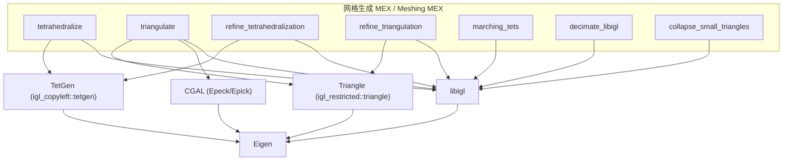

# 60.1b 四面体与三角形网格生成 / Tetrahedral and Triangle Meshing

> 本章覆盖 `mex/` 目录中**网格生成与重网格化**的 7 个 C++ MEX 函数：四面体化
> （`tetrahedralize`）、受限 Delaunay 三角化（`triangulate`）、四面体/三角剖分细分
> （`refine_tetrahedralization`、`refine_triangulation`）、四面体等值面提取
> （`marching_tets`）、网格简化（`decimate_libigl`）以及小三角形折叠
> （`collapse_small_triangles`）。
>
> This chapter covers the 7 C++ MEX functions of `mex/` that **generate and
> remesh** geometry: tetrahedralization (`tetrahedralize`), constrained Delaunay
> triangulation (`triangulate`), tetrahedral/triangle refinement
> (`refine_tetrahedralization`, `refine_triangulation`), marching-tetrahedra
> isosurface extraction (`marching_tets`), mesh decimation (`decimate_libigl`)
> and small-triangle collapsing (`collapse_small_triangles`).
>
> 说明：`mex/<name>.m` 通常只是**注释桩（stub）**，仅含 `%` 注释头（无 `function` 行、无代码），
> 目的是让 `help <name>` 在编译前可用；真正实现在同名 `mex/<name>.cpp`。
> 因此每一条目同时给出 `.m`（文档接口）与 `.cpp`（真实算法）两个锚点。

- 语言 / Language：中英对照（中文为主）
- 相关章节 / See also：[60-mex/README.md](README.md)、
  [appendices/03-doc-template.md](../appendices/03-doc-template.md)、
  [01 布尔运算与实体建模](01-booleans-and-csg.md)、
  [02 距离查询与相交](02-distance-queries-and-intersection.md)、
  [03 数值内核、I/O 与杂项](03-numerics-io-and-misc.md)
- 命名约定 / Notation：`V` 顶点 `#V by dim`、`F` 三角面 `#F by 3`、
  `T`/`TT` 四面体 `#T by 4`、`E` 边/线段 `#E by 2`、`S` 顶点标量 `#V by 1`、
  `SV/SF` 曲面顶点/面、`BC` 重心坐标稀疏矩阵、`#V` 顶点数

---

## 本章概览 / Chapter Overview

本模块的函数围绕三类任务：

- **(a) 从零生成 / Generation**：`tetrahedralize`（TetGen 四面体化）、
  `triangulate`（Triangle/CGAL 受限三角化）。
- **(b) 细分/重网格 / Refinement**：`refine_tetrahedralization`（TetGen `-r` 重建）、
  `refine_triangulation`（Triangle `-r` 重建）、`collapse_small_triangles`（边折叠删小面）。
- **(c) 提取/简化 / Extraction & simplification**：`marching_tets`（等值面提取）、
  `decimate_libigl`（抽稀）。

### 函数总览 / Function overview

| 函数 | 算法 / Algorithm | 库依赖 / Library | 一句话功能 / One-line purpose |
|---|---|---|---|
| `tetrahedralize` | TetGen Delaunay/受限四面体化（switches 字符串，默认 `-q2`） | **TetGen** (igl_copyleft::tetgen)、libigl、Eigen | 把闭合三角面网格转化为四面体网格 |
| `triangulate` | Shewchuk Triangle（`igl::triangle::triangulate`）/ CGAL 精确核 | **Triangle**、**CGAL(Epeck/Epick)**、libigl、Eigen | 二维点+约束边的受限 Delaunay 三角化 |
| `refine_tetrahedralization` | TetGen `-r` 重建+细化（直接调用 tetgen API） | **TetGen**、libigl、Eigen | 细分已有四面体网格并保留边界 |
| `refine_triangulation` | Triangle `-r` 重建细化（`igl::triangle::refine`） | **Triangle**、libigl、Eigen | 细分已有受限三角剖分 |
| `marching_tets` | Marching Tetrahedra（`igl::marching_tets`） | libigl、Eigen | 四面体标量场的等值面提取 |
| `decimate_libigl` | `igl::decimate` / `igl::qslim` / `progressive_hulls` | libigl、Eigen | 网格抽稀简化（可保边界/阻止自交） |
| `collapse_small_triangles` | 边折叠删除小面积三角形（`igl::collapse_small_triangles`） | libigl、Eigen | 折叠小于容差的小三角形 |

### 依赖关系图 / Dependency graph



### 构建与依赖总览 / Build & dependency summary

所有 MEX 目标由 [mex/CMakeLists.txt](file:///c:/VSWork/gptoolbox-1/mex/CMakeLists.txt) 定义，
使用 `compile_each(<sources> <libs>)` 辅助函数逐个产出 `mex/<name>.<Matlab_MEX_EXTENSION>`：

| 目标 / Target | 所在分组 / Option | 链接库 / Link libraries |
|---|---|---|
| `tetrahedralize`、`refine_tetrahedralization` | `LIBIGL_COPYLEFT_TETGEN` | `${CORE_LIBS};igl::core;igl_restricted::matlab;igl_copyleft::tetgen` |
| `triangulate` | `LIBIGL_RESTRICTED_TRIANGLE`（+ `LIBIGL_COPYLEFT_CGAL`） | `${CORE_LIBS};igl::core;igl_restricted::matlab;igl_restricted::triangle;igl_copyleft::cgal` |
| `refine_triangulation` | `LIBIGL_RESTRICTED_TRIANGLE` | `${CORE_LIBS};igl::core;igl_restricted::matlab;igl_restricted::triangle` |
| `marching_tets`、`decimate_libigl`、`collapse_small_triangles` | LIBIGL 主列表 | `${CORE_LIBS};igl::core;igl_restricted::matlab` |

> 依赖下载：`cmake ..` 通过 vcpkg 把 **Eigen/libigl/CGAL/TetGen/Triangle** 等下载到
> `gptoolbox/mex/external/`（见 [mex/README.md](file:///c:/VSWork/gptoolbox-1/mex/README.md)）。
> `LIBIGL_COPYLEFT_TETGEN`、`LIBIGL_RESTRICTED_TRIANGLE`、`LIBIGL_COPYLEFT_CGAL` 默认 `ON`；
> 关闭 `LIBIGL_COPYLEFT_CGAL` 时 `triangulate` 仍会生成，但**不使用 CGAL 分支**（见下）。
> 顶层 `CMAKE_CXX_STANDARD 14`，Windows 上强制 `/MT` 静态运行库。

---

## 逐函数详解 / Per-function reference

### `tetrahedralize` — TetGen 四面体网格化（Delaunay/受限）[MEX]
- **文件 / File**: [mex/tetrahedralize.m](file:///c:/VSWork/gptoolbox-1/mex/tetrahedralize.m#L1-L22) ·
  [mex/tetrahedralize.cpp](file:///c:/VSWork/gptoolbox-1/mex/tetrahedralize.cpp#L1-L93)
- **签名 / Signature**: 桩：`[TV,TT] = tetgen(SV,SF)` /
  `[TV,TT,TF,TR,TN,PT,FT] = tetgen(SV,SF,'Flags',flags)` ；
  真实 `mexFunction` 的 `plhs` 顺序（`nlhs=1..8`）为 `TV,TT,TF,TM,TR,TN,PT,FT`
- **功能 / Purpose**: `EN: Tetrahedralize a closed watertight triangle surface mesh (SV,SF) into a tetrahedral mesh using TetGen via libigl.` /
  中文：用 **TetGen**（经 libigl 封装）把闭合水密三角面网格 `(SV,SF)` 四面体化。
- **输入 / Inputs**:

  | 参数 | 尺寸/类型 | 含义 (中 / EN) |
  |---|---|---|
  | `SV` | `#SV by 3` | 输入顶点位置 / input vertex positions |
  | `SF` | `#SF by 3` | 输入三角面索引 / face indices into rows of SV |

- **输出 / Outputs**（`plhs` 顺序）:

  | 参数 | 尺寸/类型 | 含义 |
  |---|---|---|
  | `TV` | `#TV by 3` | 输出顶点（`SV` 应出现在前若干行）/ output vertices |
  | `TT` | `#TT by 4` | 输出四面体索引 / tet indices |
  | `TF` | `#TF by 3` | 输出边界三角面索引 / boundary trifaces |
  | `TM` | `#TT by 1` | 每个四面体的标记 / tet markers |
  | `TR` | `#TT by 1` | 每个四面体的区域 ID / region ID |
  | `TN` | `#TT by 4` | 每个四面体的邻居索引 / tet neighbors |
  | `PT` | `#TV by 1` | 每个顶点关联的一个四面体 / incident tet per vertex |
  | `FT` | `#TF by 2` | 共享同一 triface 的两个四面体 / tets sharing a triface |

- **可选参数 / Optional**:

  | 名称 | 取值 | 默认 | 含义 |
  |---|---|---|---|
  | `'Flags'` | 字符串 | `'-q2'` | 传给 TetGen 的 switches / TetGen switches |
  | `'Holes'` | `#H by 3` double | 空 | 空洞位置（标记需要挖空的区域）/ hole seed points |

  > 说明：`.cpp` 在选项循环中仅识别 `Flags`、`Holes`；其他名称触发 `mexErrMsgTxt(false,"Unknown parameter")`（L53）。
  > 参数名必须为字符串，否则报 `"Parameter names should be strings"`（L39）。

- **变量流动 / Variable flow**:
  `SV,SF,(Flags,Holes) →(parse_rhs_double / parse_rhs_index)→ SV,SF,SH(Eigen) →
  igl::copyleft::tetgen::tetrahedralize(SV,SF,SH,VM,FM,SR,flags,TV,TT,TF,TM,TR,TN,PT,FT,nr) →
  （依 `nlhs` 由多到少贯穿输出）→ TV,TT,TF,TM,TR,TN,PT,FT`
- **算法步骤 / Algorithm**:
  1. `nrhs>=2` 校验，否则 `"nrhs should be >= 2"`（L27）。
  2. `parse_rhs_double(prhs+0,SV)`、`parse_rhs_index(prhs+1,SF)`；默认 `flags="-q2"`、`SH` 空（L28–L32）。
  3. 逐对解析 `Name,Value`（L35–L57）：`Flags` 取字符串、`Holes` 解析为 `#H by 3`，其余报 `Unknown parameter`。
  4. 调用 **libigl 的 TetGen 封装** `tetrahedralize(...)`（内部运行 TetGen 的 Delaunay/受限四面体化与精化），
     得到 `TV,TT,TF,TM,TR,TN,PT,FT,nr`；`ret` 必须为 `0` 或 `2`，否则 `"Tetgen failed."`（L65–L67）。
  5. `switch(nlhs)` 贯穿输出：`case 1→TV`、`2→TT`、`3→TF`、`4→TM`、`5→TR`、`6→TN`、`7→PT`、`8→FT`（L69–L88）。
- **流程图 / Flowchart**:

  ```mermaid
  flowchart TD
    A["输入 SV,SF,(Flags,Holes)"] --> B{"nrhs>=2 ?"}
    B -- 否 --> E0["错误: nrhs should be >= 2"]
    B -- 是 --> C["parse_rhs → SV,SF; flags='-q2'"]
    C --> D["解析 Flags/Holes (否则 Unknown parameter)"]
    D --> F["tetrahedralize(SV,SF,SH,...,flags,...)"]
    F --> G{"ret==0 或 2 ?"}
    G -- 否 --> E1["错误: Tetgen failed."]
    G -- 是 --> H["依 nlhs 由多到少贯穿输出"]
    H --> Z["输出 TV,TT,TF,TM,TR,TN,PT,FT"]
  ```

- **依赖 / Dependencies**:
  - (a) 其他 gptoolbox 函数：无（纯 MEX）。
  - (b) 打包 C++ 库：**libigl**（`#include <igl/copyleft/tetgen/tetrahedralize.h>`，L7）、
    **TetGen**（由 `igl_copyleft::tetgen` 引入）、**Eigen**（`Eigen/Core`、`Eigen/Sparse`，L8–L9）；
    libigl MATLAB 胶水（`parse_rhs.h`、`prepare_lhs.h`、`validate_arg.h`、`mexErrMsgTxt.h`）。
  - (c) MATLAB 工具箱：无特殊要求（仅需 MEX 编译环境）。
- **构建与安装 / Build note**: CMake 目标 `tetrahedralize` 位于 `LIBIGL_COPYLEFT_TETGEN` 分支，
  链接 `${CORE_LIBS};igl::core;igl_restricted::matlab;igl_copyleft::tetgen`
  （[mex/CMakeLists.txt](file:///c:/VSWork/gptoolbox-1/mex/CMakeLists.txt#L258-L264)），额外需要 **TetGen** 支持。
- **See also**: `refine_tetrahedralization`、`marching_tets`、`triangulate`、`readMSH`(MEX)
- **备注 / Note（源码与文档差异）**:
  - `.m` 桩的例子把函数名写成 `tetgen(...)`（应为 `tetrahedralize`），易误用。
  - 桩列出 7 个输出 `TV,TT,TF,TR,TN,PT,FT`，而 `.cpp` 支持 **8 个**（多一个四面体标记 `TM`，
    实际顺序为 `TV,TT,TF,TM,TR,TN,PT,FT`）——桩遗漏 `TM` 且输出顺序不符。
  - 桩未记录 `'Holes'` 可选参数。
  - `.cpp` 的 `switch(nlhs)` 中 `case 8: prepare_lhs_index(FT,plhs+8)` 使用了**越界下标** `plhs+8`
    （`nlhs==8` 时合法下标仅 `0..7`），且 `plhs+7` 从未被赋值——疑似 off-by-one 缺陷（L71–L72）。

### `triangulate` — 受限 Delaunay 三角化（Triangle / CGAL）[MEX]
- **文件 / File**: [mex/triangulate.m](file:///c:/VSWork/gptoolbox-1/mex/triangulate.m#L1-L44) ·
  [mex/triangulate.cpp](file:///c:/VSWork/gptoolbox-1/mex/triangulate.cpp#L1-L160)
- **签名 / Signature**: 桩：`[TV,TF,TVM,TE,TEM] = triangulate(V,E)` /
  `[TV,TF,TVM,TE,TEM] = triangulate(V,E,'ParameterName',ParameterValue, ...)` ；
  真实 `mexFunction` 的 `plhs` 顺序（`nlhs=1..5`）为 `TV,TF,TVM,TE,TEM`
- **功能 / Purpose**: `EN: Compute a constrained Delaunay triangulation of 2D points V with segment constraints E, using Shewchuk's Triangle or CGAL.` /
  中文：对二维点集 `V` 与约束线段 `E` 计算**受限 Delaunay 三角化**，可选走 Shewchuk 的 **Triangle** 或 **CGAL** 精确核。
- **输入 / Inputs**:

  | 参数 | 尺寸/类型 | 含义 (中 / EN) |
  |---|---|---|
  | `V` | `#V by 2` | 待三角化的点 / points to triangulate |
  | `E` | `#E by 2` | 约束线段（索引到 `V` 行）/ segment indices |

- **输出 / Outputs**:

  | 参数 | 尺寸/类型 | 含义 |
  |---|---|---|
  | `TV` | `#TV by 2` | 输出点（`V` 应出现在前若干行）/ output points |
  | `TF` | `#TF by 3` | 输出三角形索引 / triangles into rows of TV |
  | `TVM` | `#TV by 1` | 输出顶点标记 / output vertex markers |
  | `TE` | `#TE by 2` | 输出线段（输入边+边界）/ output segments |
  | `TEM` | `#TE by 1` | 输出边标记；隐式边界（如 `-c` 生成）标为 `max(EM)+1` / edge markers |

- **可选参数 / Optional**:

  | 名称 | 取值 | 默认 | 含义 |
  |---|---|---|---|
  | `'Flags'` | 字符串 | `''` | 传给 Triangle 的 switches |
  | `'EdgeMarkers'` | `#E by 1` index | 空 | 输入边标记 |
  | `'Holes'` | `#H by 2` double | 空 | 空洞位置 |
  | `'VertexMarkers'` | `#V by 1` index | 空 | 输入顶点标记 |
  | `'Method'` | `'triangle'` / `'epeck'` / `'epick'` / `'cgal'` | `'triangle'` | 后端：Triangle 或 CGAL 精确核 |

  > 说明：`... epeck|epick|cgal` 需以 `-DWITH_CGAL` 编译，否则报 `"Recompile with cgal to enable."`（L78–L92）；
  > 未知 `Method` 值报 `C_STR("Unknown Method: "<<method_name)`；未知参数名报 `"Unknown parameter"`（L95, L99）。

- **变量流动 / Variable flow**:
  `V,E,(Flags,EdgeMarkers,Holes,VertexMarkers,Method) →(parse_rhs_double/index)→ V,E,H,VM,EM(Eigen) →
  （EM 整体平移 `shift=EM.minCoeff()+2`）→ 按 `method` 分派：
  `triangle → igl::triangle::triangulate(V,E,H,VM,EM,flags,TV,TF,TVM,TE,TEM)`；
  `cgal → igl::copyleft::cgal::triangulate<Epeck|Epick>(V,E,H,含'c',TV,TF) →
  （还原 TEM：`==1`→`max_EM+1`，否则 `-=shift`）→ TV,TF,TVM,TE,TEM`
- **算法步骤 / Algorithm**:
  1. `nrhs>=2` 校验，否则 `"nrhs should be >= 2"`（L32）；解析 `V`、`E`（L33–L34）。
  2. 默认 `flags=""`、`method=TRIANGLE`（L36–L43）。
  3. 逐对解析选项（L45–L103）：`Flags`/`EdgeMarkers`/`Holes`/`VertexMarkers`/`Method`，其余报 `Unknown parameter`。
  4. 若 `EM` 非空：`shift=EM.minCoeff()+2`、`max_EM=EM.maxCoeff()`，并 `EM += shift`，
     使所有输入标签下界推到 2（因 Triangle 的 `-c` 会把边界边标为 1）（L113–L119）。
  5. 分派（L120–L137）：`TRIANGLE` → **`igl::triangle::triangulate`**（Shewchuk Triangle，受限 Delaunay），
     捕获 `std::runtime_error` 报 `"triangle failed: "+e.what()`；
     `CGAL_EPECK` → `igl::copyleft::cgal::triangulate<CGAL::Epeck>`；
     `CGAL_EPICK` → `igl::copyleft::cgal::triangulate<CGAL::Epick>`，
     二者用 `flags.find('c')` 决定是否约束边界。
  6. 后处理 `TEM`：值为 1 者视为隐式边界，改标 `max_EM+1`；否则 `-= shift` 还原（L138–L142）。
  7. `switch(nlhs)` 贯穿输出 `TV,TF,TVM,TE,TEM`（L144–L157）。
- **流程图 / Flowchart**:

  ```mermaid
  flowchart TD
    A["输入 V,E,(Flags,EdgeMarkers,Holes,VertexMarkers,Method)"] --> B{"nrhs>=2 ?"}
    B -- 否 --> E0["错误: nrhs should be >= 2"]
    B -- 是 --> C["parse_rhs → V,E; 解析选项"]
    C --> D{"EM 非空 ?"}
    D -- 是 --> D1["平移 EM 使最小标签=2"]
    D -- 否 --> E["按 method 分派"]
    D1 --> E
    E -- triangle --> F1["igl::triangle::triangulate"]
    E -- "epeck / cgal" --> F2["igl::copyleft::cgal::triangulate<Epeck>"]
    E -- epick --> F3["igl::copyleft::cgal::triangulate<Epick>"]
    F1 --> G["还原 TEM (边界标 max_EM+1)"]
    F2 --> G
    F3 --> G
    G --> Z["依 nlhs 输出 TV,TF,TVM,TE,TEM"]
  ```

- **依赖 / Dependencies**:
  - (a) 其他 gptoolbox 函数：无（纯 MEX；`igl::triangle::triangulate` 由 libigl 提供）。
  - (b) 打包 C++ 库：**libigl**（`#include <igl/triangle/triangulate.h>`、`<igl/copyleft/cgal/triangulate.h>`，L8–L9）、
    **Triangle**（`igl_restricted::triangle`）、**CGAL**（`CGAL/Exact_predicates_exact_constructions_kernel.h`、
    `CGAL/Exact_predicates_inexact_constructions_kernel.h`，L10–L11）、**Eigen**（`Eigen/Core`、`Eigen/Sparse`）；
    libigl MATLAB 胶水。
  - (c) MATLAB 工具箱：无特殊要求。
- **构建与安装 / Build note**: 目标 `triangulate` 位于 `LIBIGL_RESTRICTED_TRIANGLE` 分支：
  当 `LIBIGL_COPYLEFT_CGAL` 开启时链接
  `${CORE_LIBS};igl::core;igl_restricted::matlab;igl_restricted::triangle;igl_copyleft::cgal` 并定义 `-DWITH_CGAL`；
  否则仅链接 `...;igl_restricted::triangle`（[mex/CMakeLists.txt](file:///c:/VSWork/gptoolbox-1/mex/CMakeLists.txt#L266-L283)）。
- **See also**: `refine_triangulation`、`tetrahedralize`、`remove_unreferenced`、`winding_number`(MEX)
- **备注 / Note（源码与文档差异）**:
  - 桩**未**记录 `'Method'` 可选参数（`triangle`/`epeck`/`epick`/`cgal`），也未说明 CGAL 分支需重编译。
  - `.cpp` 的 `switch(method)` 中 `case CGAL_EPECK:` 调用 `...<Epeck>(...)` 后**缺少 `break;`**，
    会**贯穿**到 `case CGAL_EPICK:` 再调用 `...<Epick>(...)` 覆盖 `TV,TF`（L132–L136）——疑似缺陷，
    选 `epeck`/`cgal` 实际会执行两次 CGAL 三角化并以 Epick 结果为准。

### `refine_tetrahedralization` — 四面体网格细分（TetGen 重建）[MEX]
- **文件 / File**: [mex/refine_tetrahedralization.m](file:///c:/VSWork/gptoolbox-1/mex/refine_tetrahedralization.m#L1-L23) ·
  [mex/refine_tetrahedralization.cpp](file:///c:/VSWork/gptoolbox-1/mex/refine_tetrahedralization.cpp#L1-L165)
- **签名 / Signature**: 桩：`[RV,RT,RF] = refine_tetrahedralization(TV,TT)` /
  `[RV,RT,RF] = refine_tetrahedralization(TV,TT,'ParameterName',ParameterValue, ...)` ；
  真实 `mexFunction` 的 `plhs` 顺序（`nlhs=1..3`）为 `RV,RT,RF`
- **功能 / Purpose**: `EN: Refine an existing tetrahedral mesh (TV,TT) via TetGen's "-r" reconstruction, preserving the input boundary.` /
  中文：用 **TetGen 的 `-r` 重建模式**细化已有四面体网格 `(TV,TT)`，并保留输入边界。
- **输入 / Inputs**:

  | 参数 | 尺寸/类型 | 含义 (中 / EN) |
  |---|---|---|
  | `TV` | `#TV by 3` | 输入顶点位置 / input vertex positions |
  | `TT` | `#TT by 4` | 输入四面体索引 / tet indices |

- **输出 / Outputs**:

  | 参数 | 尺寸/类型 | 含义 |
  |---|---|---|
  | `RV` | `#RV by 3` | 输出顶点（`TV` 应出现在前若干行）/ output vertices |
  | `RT` | `#RT by 4` | 输出四面体索引 / output tets |
  | `RF` | `#RF by 3` | 输出边界三角面索引 / output boundary trifaces |

- **可选参数 / Optional**:

  | 名称 | 取值 | 默认 | 含义 |
  |---|---|---|---|
  | `'Flags'` | 字符串 | `''` | 追加给 TetGen 的 flags（`r` 重建、`Q` 静默恒被加入）|
  | `'Boundary'` | `#TF by 3` index | 自动（`boundary_facets(TT)`）| 已知边界三角面，用于保留输入边界 |

  > 说明：`.cpp` 仅识别 `Flags`、`Boundary`；其他名称报 `"Unknown parameter"`（L57）。
  > `Boundary` 列数必须为 3，否则报 `"Boundary should be #TF by 3"`（L105）。

- **变量流动 / Variable flow**:
  `TV,TT,(Flags,Boundary) →(parse_rhs_double/index)→ TV,TT,TF(Eigen) →
  （填充 tetgenio in：pointlist / tetrahedronlist / trifacelist；`firstnumber=0`）→
  full_flags = flags+"rQ"（若无 `s` 再追加 `"s0/0"`）→ `::tetrahedralize(cflags,&in,&out)` →
  `igl::copyleft::tetgen::tetgenio_to_tetmesh(out,...)` → RV,RT,RF →
  （若无边界再 `igl::boundary_facets(RT,RF)`）→ 输出`
- **算法步骤 / Algorithm**:
  1. `nrhs>=2`；解析 `TV`、`TT`；校验 `TV.cols()==3`（`TV should be #TV by 3`）、`TT.cols()==4`（`TT should be #TT by 4`）（L32–L36）。
  2. 解析选项 `Flags`/`Boundary`（L39–L61）。
  3. 组装 `full_flags = flags + "rQ"`；**若用户 flags 不含 `s`，追加 `"s0/0"`** 关闭 TetGen 的后细分顶点平滑
     （注释说明该平滑（lawsonflip3d/move_vertex）在退化重建网格上会 segfault）（L63–L73）。
  4. 填充 `tetgenio in`：顶点数/坐标、四面体数（`numberofcorners=4`）/索引；`in.firstnumber=0`（L75–L97）。
  5. 若未给 `Boundary`，用 `igl::boundary_facets(TT,TF)` 自动计算边界（`-r` 重建显式给边界更鲁棒）（L99–L114）。
  6. 调 `::tetrahedralize(cflags,&in,&out)`，以 `try/catch(int e)` 捕获 TetGen 错误码并映射为原因字符串
     （1=out of memory、3=自交、4=过小特征（建议 `-T`）、5=两面过近（建议 `-Y`）、10=非法输入、其它=内部错误），
     汇总报 `"tetgen failed to refine tetrahedralization: <reason> (code <e>)."`（L116–L137）。
  7. `out.numberoftetrahedra>0` 否则 `"Tetgen failed to refine tetrahedralization."`（L137）。
  8. `tetgenio_to_tetmesh(out,RV,RT,RF,RM,RR,RN,PT,FT,num_regions)`，失败报 `"Failed to convert tetgen output."`（L139–L146）。
  9. 若 `RF` 为空再 `igl::boundary_facets(RT,RF)`（L147–L150）；`switch(nlhs)` 输出 `RV,RT,RF`（L152–L161）。
- **流程图 / Flowchart**:

  ```mermaid
  flowchart TD
    A["输入 TV,TT,(Flags,Boundary)"] --> B{"nrhs>=2 且 TV 3列, TT 4列 ?"}
    B -- 否 --> E0["错误: 参数/尺寸不符"]
    B -- 是 --> C["解析 Flags/Boundary"]
    C --> D["full_flags = flags+'rQ'"]
    D --> D1{"flags 含 's' ?"}
    D1 -- 否 --> D2["追加 's0/0' 关闭平滑"]
    D1 -- 是 --> E
    D2 --> E["填充 tetgenio in (points/tets/trifaces)"]
    E --> E3{"Boundary 为空 ?"}
    E3 -- 是 --> E4["boundary_facets(TT,TF)"]
    E3 -- 否 --> F
    E4 --> F["::tetrahedralize(cflags,&in,&out)"]
    F --> G{"抛 tetgen 异常 ?"}
    G -- 是 --> E1["错误: 映射错误码原因"]
    G -- 否 --> H{"out.#tet>0 ?"}
    H -- 否 --> E2["错误: failed to refine"]
    H -- 是 --> I["tetgenio_to_tetmesh → RV,RT,RF"]
    I --> J{"RF 为空 ?"}
    J -- 是 --> J1["boundary_facets(RT,RF)"]
    J -- 否 --> K
    J1 --> K["依 nlhs 输出"]
    K --> Z["输出 RV,RT,RF"]
  ```

- **依赖 / Dependencies**:
  - (a) 其他 gptoolbox 函数：无（纯 MEX）。
  - (b) 打包 C++ 库：**TetGen**（直接 `#include <tetgen.h>`，并 `#define TETLIBRARY`，L10–L13）、
    **libigl**（`#include <igl/copyleft/tetgen/tetgenio_to_tetmesh.h>`、`<igl/boundary_facets.h>`，L8–L9）、
    **Eigen**（`Eigen/Core`）；标准库 `<cstring>`；libigl MATLAB 胶水。
  - (c) MATLAB 工具箱：无特殊要求。
- **构建与安装 / Build note**: 目标 `refine_tetrahedralization` 位于 `LIBIGL_COPYLEFT_TETGEN` 分支，
  链接 `${CORE_LIBS};igl::core;igl_restricted::matlab;igl_copyleft::tetgen`
  （[mex/CMakeLists.txt](file:///c:/VSWork/gptoolbox-1/mex/CMakeLists.txt#L258-L264)），额外需要 **TetGen** 支持。
- **See also**: `tetrahedralize`、`refine_triangulation`、`boundary_facets`、`readMSH`(MEX)
- **备注 / Note（源码与文档差异）**:
  - 桩声明"`r` 重建与 `Q` 静默恒被加入"，与 `.cpp` 的 `flags+"rQ"` 一致；但 `.cpp` **额外**在用户未指定 `s` 时
    追加 `"s0/0"` 关闭平滑，**桩未记录**此行为。
  - 该 `.cpp` 直接调用底层 `::tetrahedralize(cflags,&in,&out)` 与 `tetgenio`，而非使用 libigl 的
    `igl::copyleft::tetgen::tetrahedralize` 高层封装（与 `tetrahedralize.cpp` 写法不同）。

### `refine_triangulation` — 三角剖分细分（Triangle 重建）[MEX]
- **文件 / File**: [mex/refine_triangulation.m](file:///c:/VSWork/gptoolbox-1/mex/refine_triangulation.m#L1-L19) ·
  [mex/refine_triangulation.cpp](file:///c:/VSWork/gptoolbox-1/mex/refine_triangulation.cpp#L1-L69)
- **签名 / Signature**: 桩：`[TV,TF] = refine_triangulation(V,E,F)` /
  `[TV,TF] = refine_triangulation(V,E,F,'ParameterName',ParameterValue, ...)` ；
  真实 `mexFunction` 的 `plhs` 顺序（`nlhs=1..2`）为 `TV,TF`
- **功能 / Purpose**: `EN: Refine an existing constrained Delaunay triangulation (V,E,F) via Triangle's "-r" reconstruction using libigl.` /
  中文：用 **Triangle 的 `-r` 重建**（经 libigl）细分已有受限三角剖分 `(V,E,F)`。
- **输入 / Inputs**:

  | 参数 | 尺寸/类型 | 含义 (中 / EN) |
  |---|---|---|
  | `V` | `#V by 2` | 输入顶点位置 / input vertex positions |
  | `E` | `#E by 2` | 构成约束的线段（可为空）/ segment indices |
  | `F` | `#F by 3` | 输入三角形索引 / input triangles |

- **输出 / Outputs**:

  | 参数 | 尺寸/类型 | 含义 |
  |---|---|---|
  | `TV` | `#TV by 2` | 输出顶点（`V` 应出现在前若干行）/ output vertices |
  | `TF` | `#TF by 3` | 输出三角形索引 / output triangles |

- **可选参数 / Optional**:

  | 名称 | 取值 | 默认 | 含义 |
  |---|---|---|---|
  | `'Flags'` | 字符串 | `''` | 追加给 Triangle 的 flags（`r` 重建、`z` 零基由 libigl 处理）|

  > 说明：`.cpp` 仅识别 `Flags`，其余报 `"Unknown parameter"`（L45）。

- **变量流动 / Variable flow**:
  `V,E,F,(Flags) →(parse_rhs_double/index)→ V,E,F(Eigen) →
  igl::triangle::refine(V,E,F,flags,TV,TF) →（捕获异常）→ TV,TF`
- **算法步骤 / Algorithm**:
  1. `nrhs>=3` 校验，否则 `"nrhs should be >= 3"`（L26）；解析 `V`、`E`、`F`（L27–L29）。
  2. 默认 `flags=""`；逐对解析 `Flags`，否则 `Unknown parameter`（L31–L49）。
  3. `try { igl::triangle::refine(V,E,F,flags,TV,TF); }`，捕获 `std::runtime_error` 报
     `"triangle failed: "+e.what()`（L54–L60）。
  4. `switch(nlhs)` 贯穿输出 `TV,TF`（L61–L68）。
- **流程图 / Flowchart**:

  ```mermaid
  flowchart TD
    A["输入 V,E,F,(Flags)"] --> B{"nrhs>=3 ?"}
    B -- 否 --> E0["错误: nrhs should be >= 3"]
    B -- 是 --> C["parse_rhs → V,E,F; 解析 Flags"]
    C --> D["igl::triangle::refine(V,E,F,flags,TV,TF)"]
    D --> F{"抛 runtime_error ?"}
    F -- 是 --> E1["错误: triangle failed: ..."]
    F -- 否 --> Z["依 nlhs 输出 TV,TF"]
  ```

- **依赖 / Dependencies**:
  - (a) 其他 gptoolbox 函数：无（纯 MEX）。
  - (b) 打包 C++ 库：**libigl**（`#include <igl/triangle/refine.h>`，L8）、
    **Triangle**（`igl_restricted::triangle`）、**Eigen**（`Eigen/Core`）；libigl MATLAB 胶水。
  - (c) MATLAB 工具箱：无特殊要求。
- **构建与安装 / Build note**: 目标 `refine_triangulation` 位于 `LIBIGL_RESTRICTED_TRIANGLE` 分支，
  链接 `${CORE_LIBS};igl::core;igl_restricted::matlab;igl_restricted::triangle`
  （[mex/CMakeLists.txt](file:///c:/VSWork/gptoolbox-1/mex/CMakeLists.txt#L279-L283)）。
  注意：该目标**不**使用 CGAL，即使 `LIBIGL_COPYLEFT_CGAL` 关闭也仍会生成。
- **See also**: `triangulate`、`refine_tetrahedralization`、`collapse_small_triangles`
- **备注 / Note（源码与文档差异）**: 桩说明 `r`（重建）与 `z`（零基）flags 恒被加入，而 `.cpp` 只是把用户
  `flags` 原样透传给 `igl::triangle::refine`——`r`/`z` 的拼接发生在 libigl 的 `refine` 内部，桩的描述与实际调用点不同。

### `marching_tets` — 四面体等值面提取（Marching Tetrahedra）[MEX]
- **文件 / File**: [mex/marching_tets.m](file:///c:/VSWork/gptoolbox-1/mex/marching_tets.m#L1-L22) ·
  [mex/marching_tets.cpp](file:///c:/VSWork/gptoolbox-1/mex/marching_tets.cpp#L1-L77)
- **签名 / Signature**: 桩：`[SV,SF,J,BC] = marching_tets(TV,TT,S)` /
  `[SV,SF,J,BC] = marching_tets(TV,TT,S,'ParameterName',ParameterValue, ...)` ；
  真实 `mexFunction` 的 `plhs` 顺序（`nlhs=1..4`）为 `SV,SF,J,BC`
- **功能 / Purpose**: `EN: Extract the isosurface of a scalar field S defined on the vertices of a tetrahedral mesh (TV,TT) via the marching-tetrahedra algorithm.` /
  中文：对定义在四面体网格顶点上的标量场 `S`，用 **Marching Tetrahedra** 算法提取等值面。
- **输入 / Inputs**:

  | 参数 | 尺寸/类型 | 含义 (中 / EN) |
  |---|---|---|
  | `TV` | `#TV by 3` | 四面体网格顶点位置 / tet mesh vertices |
  | `TT` | `#TT by 4` | 四面体索引 / tet indices |
  | `S` | `#TV by 1` | 每个顶点的标量值 / scalar per vertex |

- **输出 / Outputs**:

  | 参数 | 尺寸/类型 | 含义 |
  |---|---|---|
  | `SV` | `#SV by 3` | 等值面顶点位置 / level-surface vertices |
  | `SF` | `#SF by 3` | 等值面三角面索引（索引到 `SV`）/ surface triangles |
  | `J` | `#SF by 1` | 每个面来自哪个四面体（索引到 `TT`）/ source tet per face |
  | `BC` | `#SV by #TV` sparse | 重心坐标矩阵，使 `SV = BC*TV` / barycentric coords |

- **可选参数 / Optional**:

  | 名称 | 取值 | 默认 | 含义 |
  |---|---|---|---|
  | `'IsoValue'` | 标量 | `0` | 要提取的等值面阈值 / isovalue |

  > 说明：`.cpp` 仅识别 `IsoValue`（标量，`validate_arg_scalar` 校验），其余报 `"Unknown parameter"`（L49）。
  > 尺寸校验：`TV should be #TV by 3`、`TT should be #TT by 4`、`S should be #TV by 1`（L31–L33）。

- **变量流动 / Variable flow**:
  `TV,TT,S,(IsoValue) →(parse_rhs_double/index)→ TV,TT,S(Eigen),isovalue →
  igl::marching_tets(TV,TT,S,isovalue,SV,SF,J,BC) →（依 nlhs 贯穿输出）→ SV,SF,J,BC`
- **算法步骤 / Algorithm**:
  1. `nrhs>=3` 校验，否则 `"nrhs should be >= 3"`（L26）；解析 `TV`、`TT`、`S`（L27–L30）。
  2. 尺寸校验（L31–L33）。
  3. 默认 `isovalue=0`；逐对解析 `IsoValue`，否则 `Unknown parameter`（L35–L53）。
  4. 调用 **`igl::marching_tets(TV,TT,S,isovalue,SV,SF,J,BC)`**（逐四面体对 16 种符号配置做线性插值生成三角面片，
     输出 `BC` 为稀疏重心坐标）（L60）。
  5. `switch(nlhs)` 贯穿输出 `SV,SF,J,BC`（`BC` 用 `prepare_lhs_double` 输出稀疏阵）（L62–L73）。
- **流程图 / Flowchart**:

  ```mermaid
  flowchart TD
    A["输入 TV,TT,S,(IsoValue)"] --> B{"nrhs>=3 且 TV 3列, TT 4列, S=#TV ?"}
    B -- 否 --> E0["错误: 参数/尺寸不符"]
    B -- 是 --> C["解析 IsoValue (默认 0)"]
    C --> D["igl::marching_tets(TV,TT,S,isovalue,SV,SF,J,BC)"]
    D --> Z["依 nlhs 输出 SV,SF,J,BC (稀疏)"]
  ```

- **依赖 / Dependencies**:
  - (a) 其他 gptoolbox 函数：无（纯 MEX）。
  - (b) 打包 C++ 库：**libigl**（`#include <igl/marching_tets.h>`，L7）、
    **Eigen**（`Eigen/Core`、`Eigen/Sparse`）；libigl MATLAB 胶水。
  - (c) MATLAB 工具箱：无特殊要求。
- **构建与安装 / Build note**: 目标 `marching_tets` 位于 LIBIGL 主 `compile_each` 列表，
  链接 `${CORE_LIBS};igl::core;igl_restricted::matlab`
  （[mex/CMakeLists.txt](file:///c:/VSWork/gptoolbox-1/mex/CMakeLists.txt#L210-L239)）。
- **See also**: `isolines`(MEX)、`isolines_intrinsic`(MEX)、`signed_distance_isosurface`(MEX)、`tetrahedralize`

### `decimate_libigl` — 网格简化（decimate / qslim / progressive hulls）[MEX]
- **文件 / File**: [mex/decimate_libigl.m](file:///c:/VSWork/gptoolbox-1/mex/decimate_libigl.m#L1-L22) ·
  [mex/decimate_libigl.cpp](file:///c:/VSWork/gptoolbox-1/mex/decimate_libigl.cpp#L1-L131)
- **签名 / Signature**: 桩：`[W,G] = decimate_libigl(V,F,ratio)` /
  `[W,G,J,I] = decimate_libigl(V,F,ratio,'ParameterName',ParameterValue, ...)` ；
  真实 `mexFunction` 的 `plhs` 顺序（`nlhs=1..4`）为 `W,G,J,I`
- **功能 / Purpose**: `EN: Decimate a closed manifold triangle mesh (V,F) down to a target number of faces, using naive edge collapses, QSlim quadric error metrics, or progressive hulls.` /
  中文：把闭合流形三角网格 `(V,F)` 抽稀到目标面数，可选**朴素边折叠**、**QSlim 二次误差**或**渐进外壳**。
- **输入 / Inputs**:

  | 参数 | 尺寸/类型 | 含义 (中 / EN) |
  |---|---|---|
  | `V` | `#V by 3` | 顶点位置 / vertex positions |
  | `F` | `#F by 3` | 三角面索引 / triangle indices |
  | `ratio` | 标量 | `0<ratio<1` 视作目标面数占 `#F` 的比例；`1<=ratio<#F` 视作目标面数上限 / target |

- **输出 / Outputs**:

  | 参数 | 尺寸/类型 | 含义 |
  |---|---|---|
  | `W` | `#W by 3` | 输出顶点位置 / output vertices |
  | `G` | `#G by 3` | 输出三角面索引 / output triangles |
  | `J` | `#G by 1` | 每个输出面的"出生面"索引到 `F` / birth face |
  | `I` | `#U by 1` | 每个输出顶点的"出生顶点"索引到 `V` / birth vertex |

- **可选参数 / Optional**:

  | 名称 | 取值 | 默认 | 含义 |
  |---|---|---|---|
  | `'Method'` | `'naive'` / `'qslim'` / `'progressive-hulls'` | `'naive'` | 抽稀算法 |
  | `'BlockIntersections'` | logical | `false` | 是否阻止边折叠造成自交 |

  > 说明：未知 `Method` 名报 `C_STR("Unknown method: "<<method)`（打印的是**枚举整数值**而非名称，L81）；
  > 未知参数名报 `C_STR("Unknown parameter: "<<name)`（L90）。
  > `'progressive-hulls'` 与 `BlockIntersections` 不能同时用，否则报
  > `"Blocking intersections not supported with progressive hulls"`（L103）。

- **变量流动 / Variable flow**:
  `V,F,ratio,(Method,BlockIntersections) →(parse_rhs_double/index)→ V,F(Eigen) →
  校验 ratio 标量/范围 → max_m = (ratio<1 ? ratio*#F : ratio) → 按 method 分派：
  `naive → igl::decimate(V,F,max_m,bi,W,G,J,I)`；
  `qslim → igl::qslim(V,F,max_m,bi,W,G,J,I)`；
  `progressive-hulls → igl::copyleft::progressive_hulls(V,F,max_m,W,G,J)` →
  （依 nlhs 贯穿输出）→ W,G,J,I`
- **算法步骤 / Algorithm**:
  1. `nrhs>=3` 校验，否则 `"nrhs should be >= 3"`（L37）；解析 `V`、`F`（L38–L39）。
  2. `F.cols()==3` 校验（`"F must be #F by 3"`，L41）；**注意 `V.cols()==3` 的检查被注释掉**（L40）。
  3. `ratio` 必须为标量，否则 `"fraction to decimate should be scalar"`（L42–L44）；
     范围必须满足 `(0<ratio<1)` 或 `(1<=ratio<#F)`，否则 `"Ratio should be in (0,1) or [1,#F)"`（L46–L47）。
  4. `const size_t max_m = ratio<1 ? ratio*F.rows() : ratio;`（L48）。
  5. 默认 `method=DECIMATE_METHOD_NAIVE`、`block_intersections=false`；逐对解析选项（L51–L94）。
  6. `switch(method)`（L97–L113）：
     - `naive` → **`igl::decimate(V,F,max_m,block_intersections,W,G,J,I)`**；
     - `progressive-hulls` → 先拒绝 `BlockIntersections`，再
       **`igl::copyleft::progressive_hulls(V,F,max_m,W,G,J)`**（**无 `I` 输出**）；
     - `qslim` → **`igl::qslim(V,F,max_m,block_intersections,W,G,J,I)`**。
  7. `switch(nlhs)` 贯穿输出 `W,G,J,I`（L115–L126）。
- **流程图 / Flowchart**:

  ```mermaid
  flowchart TD
    A["输入 V,F,ratio,(Method,BlockIntersections)"] --> B{"nrhs>=3 且 F 3列 ?"}
    B -- 否 --> E0["错误: nrhs/F 列数"]
    B -- 是 --> C{"ratio 为标量且 0<r<1 或 1<=r<#F ?"}
    C -- 否 --> E1["错误: Ratio should be in (0,1) or [1,#F)"]
    C -- 是 --> D["max_m = ratio<1 ? ratio*#F : ratio"]
    D --> E["解析 Method / BlockIntersections"]
    E --> F{"Method"}
    F -- naive --> F1["igl::decimate(...)"]
    F -- qslim --> F2["igl::qslim(...)"]
    F -- "progressive-hulls" --> F3{"BlockIntersections ?"}
    F3 -- 是 --> E2["错误: 不支持"]
    F3 -- 否 --> F4["igl::copyleft::progressive_hulls(...)"]
    F1 --> Z
    F2 --> Z
    F4 --> Z["依 nlhs 输出 W,G,J,I"]
  ```

- **依赖 / Dependencies**:
  - (a) 其他 gptoolbox 函数：无（纯 MEX）。
  - (b) 打包 C++ 库：**libigl**（`#include <igl/decimate.h>`、`<igl/copyleft/progressive_hulls.h>`、`<igl/qslim.h>`，L1–L3）、
    **Eigen**（`Eigen/Core`）；标准库 `<iostream>`、`<set>`；libigl MATLAB 胶水。
    源码中重定义了 `assert` 以走 `mexErrMsgTxt`（L11–L12）。
  - (c) MATLAB 工具箱：无特殊要求。
- **构建与安装 / Build note**: 目标 `decimate_libigl` 位于 LIBIGL 主 `compile_each` 列表，
  链接 `${CORE_LIBS};igl::core;igl_restricted::matlab`
  （[mex/CMakeLists.txt](file:///c:/VSWork/gptoolbox-1/mex/CMakeLists.txt#L210-L239)）。
- **See also**: `collapse_small_triangles`、`qslim`(wrappers)、`simplify_polyhedron`(MEX)、`decimate`(libigl)
- **备注 / Note（源码与文档差异）**:
  - `.cpp` 中 `V.cols()==3` 的检查被**注释掉**（L40），仅校验 `F.cols()==3`，故 `V` 列数不合法时不会立即报错。
  - `progressive-hulls` 分支只调用 `progressive_hulls(V,F,max_m,W,G,J)`，**不产生 `I`**；若用户请求 4 个输出，
    `I` 将为未初始化的空 `VectorXi`。
  - 未知 `Method` 的报错信息 `C_STR("Unknown method: "<<method)` 打印的是枚举整数而非用户输入的名称。

### `collapse_small_triangles` — 折叠删除小三角形 [MEX]
- **文件 / File**: [mex/collapse_small_triangles.m](file:///c:/VSWork/gptoolbox-1/mex/collapse_small_triangles.m#L1-L17) ·
  [mex/collapse_small_triangles.cpp](file:///c:/VSWork/gptoolbox-1/mex/collapse_small_triangles.cpp#L1-L94)
- **签名 / Signature**: 桩：`[FF] = collapse_small_triangles(V,F,eps)` ；
  真实 `mexFunction` 仅 1 个输出（强制 `nlhs=1`），第 3 参数 `eps` 可选
- **功能 / Purpose**: `EN: Collapse tiny triangles (area below a tolerance) of a triangle mesh (V,F), returning a new face list FF into the same vertices V.` /
  中文：用边折叠删除面积小于容差的小三角形，返回索引到**同一批顶点 `V`** 的新面表 `FF`。
- **输入 / Inputs**:

  | 参数 | 尺寸/类型 | 含义 (中 / EN) |
  |---|---|---|
  | `V` | `#V by 3` | 顶点位置 / vertex positions |
  | `F` | `#F by 3` | 三角面索引 / triangle indices |
  | `eps` | 标量（可选） | 最小允许面积的容差，按**包围盒对角线平方的比例**解释 / area tolerance |

- **输出 / Outputs**:

  | 参数 | 尺寸/类型 | 含义 |
  |---|---|---|
  | `FF` | `#FF by 3` | 折叠后的三角面索引（1 基，`double` 存储）/ collapsed faces |

- **可选参数 / Optional**:

  | 名称 | 取值 | 默认 | 含义 |
  |---|---|---|---|
  | `eps` | 标量 | `FLOAT_EPS`（`igl/EPS.h`，约 `2.22e-16`）| 最小允许面积容差（按包围盒对角线平方的比例）|

  > 说明：`.cpp` 要求输入参数个数为 2 或 3，否则报 `"The number of input arguments must be 2 or 3."`（L28–L31）。
  > 第 3 参数必须为标量，否则报 `"3rd argument should be scalar"`（L54–L58）。
  > `.m` 桩把 `eps` 写成必填参数，而 `.cpp` 允许省略并回退为 `FLOAT_EPS`。

- **变量流动 / Variable flow**:
  `V,F,(eps) →(parse_rhs_double/index)→ V,F(Eigen),eps → 校验 V/F 列数 →
  igl::collapse_small_triangles(V,F,eps,tempF) → F=tempF →
  （`nlhs=1`；以 `mxCreateDoubleMatrix` 直接输出 `Fd = F+1`）→ FF`
- **算法步骤 / Algorithm**:
  1. 仅接受 `nrhs==2 || nrhs==3`，否则 `"The number of input arguments must be 2 or 3."`（L28–L31）。
  2. 默认 `eps=FLOAT_EPS`（来自 `igl/EPS.h`）；解析 `V`、`F`（L47–L50）。
  3. 校验 `V.cols()==3`（`"V must be #V by 3"`）、`F.cols()==3`（`"F must be #F by 3"`）（L51–L52）。
  4. 若 `nrhs==3`，读取标量 `eps`（L54–L61）。
  5. **`igl::collapse_small_triangles(V,F,eps,tempF)`**：内部迭代折叠小于容差边长的边，
     使相关小三角形退化并被移除，得到新面表 `tempF`；`F = tempF`（L64–L78）。
  6. 强制 `nlhs = 1`（L81）；用 `mxCreateDoubleMatrix` 建 `#F by 3` 输出，写 `Fd = F+1`（0 基→1 基）（L84–L87）。
- **流程图 / Flowchart**:

  ```mermaid
  flowchart TD
    A["输入 V,F,(eps)"] --> B{"nrhs==2 或 3 ?"}
    B -- 否 --> E0["错误: 输入参数须为 2 或 3 个"]
    B -- 是 --> C["parse_rhs → V,F; 校验列数"]
    C --> D{"nrhs==3 ?"}
    D -- 是 --> D1["读取标量 eps"]
    D -- 否 --> D2["eps = FLOAT_EPS"]
    D1 --> E["igl::collapse_small_triangles(V,F,eps,tempF)"]
    D2 --> E
    E --> F["F = tempF"]
    F --> Z["输出 FF (double, 1 基, 强制 nlhs=1)"]
  ```

- **依赖 / Dependencies**:
  - (a) 其他 gptoolbox 函数：无（纯 MEX）。
  - (b) 打包 C++ 库：**libigl**（`#include <igl/collapse_small_triangles.h>`、`<igl/EPS.h>`，L7–L9；
    另有 `read_triangle_mesh.h`、`pathinfo.h`、`writeOFF/writeOBJ/writeDMAT.h`、`REDRUM.h` 等**历史遗留/未使用**包含，L8–L15）、
    **Eigen**；libigl MATLAB 胶水（`parse_rhs.h`、`mexErrMsgTxt.h`）。
  - (c) MATLAB 工具箱：无特殊要求。
- **构建与安装 / Build note**: 目标 `collapse_small_triangles` 位于 LIBIGL 主 `compile_each` 列表，
  链接 `${CORE_LIBS};igl::core;igl_restricted::matlab`
  （[mex/CMakeLists.txt](file:///c:/VSWork/gptoolbox-1/mex/CMakeLists.txt#L210-L239)）。
- **See also**: `decimate_libigl`、`remove_unreferenced`、`clean_mesh`、`collapse_small_triangles`(libigl)
- **备注 / Note（源码与文档差异）**:
  - `.m` 桩把 `eps` 列为**必填**，而 `.cpp` 允许省略（默认 `FLOAT_EPS`）。
  - `.cpp` **强制 `nlhs=1`** 并绕过 `prepare_lhs_index`，直接用 `mxCreateDoubleMatrix` 把索引以 **`double`** 输出，
    且做 `+1` 转为 MATLAB 1 基；与其它函数用 `prepare_lhs_index` 输出整型索引的做法不同。
  - `.cpp` 头部保留了若干仅用于离线脚本的历史 `#include`（`read_triangle_mesh`、`writeOFF/OBJ/DMAT`、`REDRUM`），
    在本 MEX 路径中并未真正使用。

---

## 函数清单核对表 / Coverage Checklist

> 下表列出本章全部 7 个函数，逐一给出 `.m`（注释桩）与 `.cpp`（真实实现）锚点及一句话功能。
> All 7 functions in this chapter, with `.m` (stub) and `.cpp` (real implementation) anchors.

| 函数 | `.m` 文件锚点 | `.cpp` 文件锚点 | 一句话功能 | 标记 |
|---|---|---|---|---|
| `tetrahedralize` | [tetrahedralize.m](file:///c:/VSWork/gptoolbox-1/mex/tetrahedralize.m#L1-L22) | [tetrahedralize.cpp](file:///c:/VSWork/gptoolbox-1/mex/tetrahedralize.cpp#L1-L93) | TetGen 四面体化闭合三角面网格 | [MEX] |
| `triangulate` | [triangulate.m](file:///c:/VSWork/gptoolbox-1/mex/triangulate.m#L1-L44) | [triangulate.cpp](file:///c:/VSWork/gptoolbox-1/mex/triangulate.cpp#L1-L160) | Triangle/CGAL 受限 Delaunay 三角化 | [MEX] |
| `refine_tetrahedralization` | [refine_tetrahedralization.m](file:///c:/VSWork/gptoolbox-1/mex/refine_tetrahedralization.m#L1-L23) | [refine_tetrahedralization.cpp](file:///c:/VSWork/gptoolbox-1/mex/refine_tetrahedralization.cpp#L1-L165) | TetGen `-r` 细化已有四面体网格 | [MEX] |
| `refine_triangulation` | [refine_triangulation.m](file:///c:/VSWork/gptoolbox-1/mex/refine_triangulation.m#L1-L19) | [refine_triangulation.cpp](file:///c:/VSWork/gptoolbox-1/mex/refine_triangulation.cpp#L1-L69) | Triangle `-r` 细化已有三角剖分 | [MEX] |
| `marching_tets` | [marching_tets.m](file:///c:/VSWork/gptoolbox-1/mex/marching_tets.m#L1-L22) | [marching_tets.cpp](file:///c:/VSWork/gptoolbox-1/mex/marching_tets.cpp#L1-L77) | 四面体标量场等值面提取 | [MEX] |
| `decimate_libigl` | [decimate_libigl.m](file:///c:/VSWork/gptoolbox-1/mex/decimate_libigl.m#L1-L22) | [decimate_libigl.cpp](file:///c:/VSWork/gptoolbox-1/mex/decimate_libigl.cpp#L1-L131) | 网格抽稀（naive/qslim/progressive hulls） | [MEX] |
| `collapse_small_triangles` | [collapse_small_triangles.m](file:///c:/VSWork/gptoolbox-1/mex/collapse_small_triangles.m#L1-L17) | [collapse_small_triangles.cpp](file:///c:/VSWork/gptoolbox-1/mex/collapse_small_triangles.cpp#L1-L94) | 折叠删除小面积三角形 | [MEX] |

> 统计 / Statistics：共 **7** 个函数条目，均为 C++ MEX（标注 `[MEX]`）。
> 其中 `triangulate` 依赖 **CGAL**（可选分支），`tetrahedralize`、`refine_tetrahedralization` 依赖 **TetGen**，
> `triangulate`、`refine_triangulation` 依赖 **Triangle**，其余依赖 **libigl**。

---

## 交叉引用 / Cross references

- 布尔运算与实体建模 MEX：见 [60.1](01-booleans-and-csg.md)
- 距离查询与相交 MEX：见 [60.2](02-distance-queries-and-intersection.md)
- 数值内核、I/O 与杂项 MEX：见 [60.3](03-numerics-io-and-misc.md)
- 构建与依赖（libigl/Eigen/CGAL/Embree/ElTopo/vcpkg）：见 [mex/README.md](file:///c:/VSWork/gptoolbox-1/mex/README.md)、
  [00-overview/03-build-and-install.md](../00-overview/03-build-and-install.md)
- 全局函数索引：见 [appendices/01-global-function-index.md](../appendices/01-global-function-index.md)
- 文档写作规范：见 [appendices/03-doc-template.md](../appendices/03-doc-template.md)
