# 60.2 距离查询、相交测试与谓词 / Distance Queries, Intersection Tests and Predicates

> 本章覆盖 `mex/` 目录中与**几何距离、卷绕数、测地距离、射线/图元相交与定向谓词**
> 相关的 27 个编译型 C++ MEX 函数：
> 点到网格/曲线/样条/单纯形的平方距离与有符号距离、等值面提取、精确测地距离，
> 射线-网格相交、盒-盒相交、GJK/MPR 凸包相交与穿透、精确定向谓词
> （`orient2d`/`orient3d`）、点-单元包含判定、网格-网格相交，
> 以及环境光遮蔽、形状因子、等值线与线框网格等渲染/场辅助工具。
>
> This chapter covers the 27 compiled C++ MEX functions of `mex/` related to
> **geometric distances, winding numbers, geodesics, ray/primitive intersection
> and orientation predicates**: point-to-mesh/curve/spline/simplex squared and
> signed distances, isosurface extraction, exact geodesics, ray-mesh and
> box-box intersection, GJK/MPR convex-hull intersection and penetration,
> the exact orientation predicates (`orient2d`/`orient3d`), point-in-element
> location, mesh-mesh intersection, plus rendering/field helpers such as
> ambient occlusion, form factors, isolines and wire meshes.

- 说明 / Note：`mex/<name>.m` 通常是**注释桩（stub）**，只含 `%` 注释头（无 `function` 行、无代码），
  目的是让 `help <name>` 在编译前可用；真实实现在同名 `mex/<name>.cpp`。
  **例外**：`winding_number.m` 是**纯 MATLAB 回退实现**（含 `function` 行，调用 `solid_angle`）。
- 语言 / Language：中英对照（中文为主）
- 相关章节 / See also：[appendices/03-doc-template.md](../appendices/03-doc-template.md)、
  [10.13 距离与测地线](../10-mesh/13-distances-and-geodesics.md)、
  [01 布尔运算与实体建模](01-booleans-and-csg.md)、
  [01b 四面体与三角网格化](01b-tet-and-tri-meshing.md)、
  [03 数值内核、I/O 与杂项](03-numerics-io-and-misc.md)
- 命名约定 / Notation：`V` 顶点 `#V by dim`、`F` 三角面 `#F by 3`、`Ele` 单元索引、
  `P/Q/O` 查询点 `#P by dim`、`C` 三次 Bézier 控制点/索引、`S` 标量场/有符号距离、
  `sqrD` 平方距离、`AABB` 轴对齐包围盒树、`BC` 重心、`N` 法向

---

## 本章概览 / Chapter Overview

### (a) 分组 / Groups

- **(a1) 距离 / Distances**：`signed_distance`、`signed_distance_isosurface`、
  `point_mesh_squared_distance`、`point_cubic_squared_distance`、
  `point_spline_squared_distance`、`point_spline_signed_distance`、
  `simplex_simplex_squared_distance`、`exact_geodesic`。
- **(a2) 卷绕数 / Winding numbers**：`winding_number`、`cubic_winding_number`、
  `spline_winding_number`。
- **(a3) 相交与谓词 / Intersection & predicates**：`ray_mesh_intersect`、
  `ray_mesh_intersect_all`、`box_intersect`、`gjk_intersect`、`gjk_penetration`、
  `mpr_intersect`、`mpr_penetration`、`orient2d`、`orient3d`、`in_element_aabb`、
  `intersect_other`。
- **(a4) 渲染/场辅助 / Rendering & field helpers**：`ambient_occlusion`、`form_factor`、
  `isolines`、`isolines_intrinsic`、`wire_mesh`。

### (b) 函数总览 / Function overview

| 函数 | 算法 / Algorithm | 库依赖 / Library | 一句话功能 / One-line purpose |
|---|---|---|---|
| `signed_distance` | libigl 有符号距离（伪法向 / 卷绕数 / 快速卷绕数） | **libigl**、Eigen | 点到网格的有符号距离与最近点 |
| `signed_distance_isosurface` | 网格化 + marching cubes（或 CGAL 自适应等值面） | **libigl(copyleft.cgal)**、CGAL、Eigen | 提取有符号距离场的等值面 |
| `point_mesh_squared_distance` | libigl AABB 树最近点（或 CGAL 精确版） | **libigl(copyleft.cgal)**、CGAL、Eigen | 点到三角/边/点的平方距离与最近点 |
| `point_cubic_squared_distance` | cyCodeBase 单条三次 Bézier 最近点（四次方程求根） | **cyCodeBase**、Eigen | 点到单条三次 Bézier 的平方距离 |
| `point_spline_squared_distance` | cyCodeBase 样条 AABB 树 + 最近点 | **cyCodeBase**、Eigen | 点到样条集合的平方距离（含加速树） |
| `point_spline_signed_distance` | 上述平方距离 × 样条卷绕数符号 | **cyCodeBase + libigl.predicates** | 点到样条集合的有符号距离 |
| `simplex_simplex_squared_distance` | libigl 单纯形-单纯形平方距离（编译期分派） | **libigl**、Eigen | 两单纯形间最近点与平方距离 |
| `winding_number` | libigl 层次化立体角 / 快速卷绕数 / Embree 射线 | **libigl**、Embree（可选 CGAL） | 点相对网格/四面体网格的卷绕数 |
| `cubic_winding_number` | libigl 谓词版三次 Bézier 卷绕数 | **libigl.predicates** | 单条 2D 三次 Bézier 的卷绕数 |
| `spline_winding_number` | 样条 AABB 树 + 谓词版广义卷绕数 | **libigl.predicates + cyCodeBase** | 2D 三次 Bézier 样条集合的广义卷绕数 |
| `exact_geodesic` | MMP 精确测地算法 | **libigl** | 三角网格上顶点/面集之间的精确测地距离 |
| `ray_mesh_intersect` | Embree 射线求交（首命中） | **Embree**、libigl | 每条射线的首个命中三角形 |
| `ray_mesh_intersect_all` | Embree 射线求交（全部命中） | **Embree**、libigl | 每条射线的全部命中 |
| `box_intersect` | CGAL `box_intersection_d` 扫描-剪枝 | **CGAL**、libigl | 盒集合/自相交的成对重叠 |
| `gjk_intersect` | libccd `ccdGJKIntersect`（GJK） | **libccd**、Eigen | 两凸包是否相交 |
| `gjk_penetration` | libccd `ccdGJKPenetration`（GJK+EPA） | **libccd**、Eigen | 穿透深度、分离方向与接触点 |
| `mpr_intersect` | libccd `ccdMPRIntersect`（MPR） | **libccd**、Eigen | 两凸包是否相交（MPR） |
| `mpr_penetration` | libccd `ccdMPRPenetration`（MPR） | **libccd**、Eigen | 穿透深度、分离方向与接触点（MPR） |
| `orient2d` | Shewchuk 精确自适应定向谓词 | **libigl.predicates** | 2D 三点定向/共线判定 |
| `orient3d` | Shewchuk 精确自适应定向谓词 | **libigl.predicates** | 3D 四点定向/共面判定 |
| `in_element_aabb` | libigl AABB 树 + 点-单元包含 | **libigl**、Eigen | 点在哪个（四面体/三角形）单元内 |
| `intersect_other` | CGAL 精确网格-网格相交 | **libigl(copyleft.cgal)**、CGAL | 两网格的全部相交面对与重网格 |
| `ambient_occlusion` | Embree 半球射线采样 | **Embree**、libigl | 每点的环境光遮蔽（0–1） |
| `form_factor` | CGAL 盒相交可见性 + 解析形状因子 | **CGAL**、libigl | 2D 辐射度形状因子矩阵 |
| `isolines` | marching-triangles 等值线段 | **libigl** | 三角网格标量场的等值线（含位置） |
| `isolines_intrinsic` | 本质 marching-triangles（重心坐标） | **libigl** | 同上但不依顶点位置（返回重心坐标） |
| `wire_mesh` | CGAL 沿边挤出多边形棱柱 | **libigl(copyleft.cgal)**、CGAL | 由边网络构造线框/线束曲面 |

### 依赖关系图 / Dependency graph

```mermaid
flowchart TD
  subgraph MEX["mex/ 距离与相交函数"]
    SD["signed_distance"]
    SDI["signed_distance_isosurface"]
    PMSD["point_mesh_squared_distance"]
    PCSD["point_cubic_squared_distance"]
    PSSD["point_spline_squared_distance"]
    PSSiD["point_spline_signed_distance"]
    SS["simplex_simplex_squared_distance"]
    WN["winding_number"]
    CWN["cubic_winding_number"]
    SWN["spline_winding_number"]
    EG["exact_geodesic"]
    RMI["ray_mesh_intersect"]
    RMIA["ray_mesh_intersect_all"]
    BI["box_intersect"]
    GJK1["gjk_intersect"]
    GJK2["gjk_penetration"]
    MPR1["mpr_intersect"]
    MPR2["mpr_penetration"]
    O2["orient2d"]
    O3["orient3d"]
    IEA["in_element_aabb"]
    IO["intersect_other"]
    AO["ambient_occlusion"]
    FF["form_factor"]
    ISO["isolines"]
    ISOI["isolines_intrinsic"]
    WM["wire_mesh"]
  end
  LIBIGL["libigl (igl::core)"]
  CGAL["CGAL (Epeck/Epick)"]
  EMBREE["Embree"]
  CYC["cyCodeBase"]
  PRED["libigl.predicates (Shewchuk)"]
  CCD["libccd (ccd)"]
  EIG["Eigen"]
  SD --> LIBIGL
  PMSD --> LIBIGL
  PMSD --> CGAL
  SS --> LIBIGL
  EG --> LIBIGL
  IEA --> LIBIGL
  ISO --> LIBIGL
  ISOI --> LIBIGL
  SDI --> CGAL
  IO --> CGAL
  WM --> CGAL
  BI --> CGAL
  FF --> CGAL
  WN --> LIBIGL
  WN --> EMBREE
  WN --> CGAL
  RMI --> EMBREE
  RMIA --> EMBREE
  AO --> EMBREE
  PCSD --> CYC
  PSSD --> CYC
  PSSiD --> CYC
  PSSiD --> PRED
  SWN --> CYC
  SWN --> PRED
  CWN --> PRED
  O2 --> PRED
  O3 --> PRED
  GJK1 --> CCD
  GJK2 --> CCD
  MPR1 --> CCD
  MPR2 --> CCD
  SD -.-> EIG
  SS -.-> EIG
  CCD -.-> EIG
  LIBIGL -.-> EIG
```



---

## 逐函数详解 / Per-function reference

### `signed_distance` — 点到网格的有符号距离 [MEX]
- **文件 / File**: 桩 [mex/signed_distance.m](file:///c:/VSWork/gptoolbox-1/mex/signed_distance.m#L1-L24) ｜ 实现 [mex/signed_distance.cpp](file:///c:/VSWork/gptoolbox-1/mex/signed_distance.cpp#L1-L266)
- **签名 / Signature**: `[S,I,C,N] = signed_distance(P,V,F,'SignedDistanceType',type)`
  （`mexFunction` 按 `prhs[0]=P,prhs[1]=V,prhs[2]=F` 顺序解析，之后为名值对；最多 4 个输出）
- **功能 / Purpose**: `EN: Compute signed distance from query points P to a mesh (V,F).` / 中文：计算查询点 `P` 到网格 `(V,F)` 的有符号距离、最近点与最近法向。
- **输入 / Inputs**:

  | 参数 | 尺寸/类型 | 含义 (中 / EN) |
  |---|---|---|
  | `P` | `#P by 3` 或 `#P by 2` | 查询点 / query points |
  | `V` | `#V by 3` 或 `#V by 2` | 顶点 / vertex positions |
  | `F` | `#F by dim(V)` | 面索引（2D 时为边）/ triangle or edge indices |

- **输出 / Outputs**:

  | 参数 | 尺寸/类型 | 含义 |
  |---|---|---|
  | `S` | `#P by 1` | 最小有符号距离 `s*sqrt(sqrd)` |
  | `I` | `#P by 1` | 最近面索引 / facet index |
  | `C` | `#P by 3` | 最近点 / closest points |
  | `N` | `#P by 3` | 最近面法向（仅伪法向模式填充）/ closest normals |

- **可选参数 / Optional**:

  | 名称 | 取值 | 默认 | 含义 |
  |---|---|---|---|
  | `'SignedDistanceType'` | `'unsigned'` / `'pseudonormal'` / `'fwn'` / `'winding_number'` | `'pseudonormal'` | 符号判定方式 / sign type |

  错误信息（源码原文）：`"P must be #P by (3|2)"`、`"V must be #V by (3|2)"`、`"dim(V) must be dim(P)"`、
  `"F must be #F by dim(V)"`、`"Unknown SignedDistanceType: <name>"`、`"Unknown parameter"`。
- **变量流动 / Variable flow**: `P,V,F,type →(parse_rhs_double/index)→ 静态缓存 g_V,g_F,g_tree →(按 type 预计算 g_FN/g_VN/g_EN/g_hier/g_fwn_bvh)→(parallel_for 逐点 squared_distance)→ sqrd,i,c,s → S=s*sqrt(sqrd),I,C,N`
- **算法步骤 / Algorithm**:
  1. `parse_rhs` 解析 `P,V,F` 与 `'SignedDistanceType'`，默认 `SIGNED_DISTANCE_TYPE_PSEUDONORMAL`（L23–L84）。
  2. 若 `V,F,type` 与上一次调用的静态缓存不同（L141），重建 `igl::AABB` 树 `g_tree.init(V,F)`（L150），并按类型预计算：`pseudonormal` 用 `per_face_normals`+`per_vertex_normals(ANGLE)`+`per_edge_normals(UNIFORM)`（L169–L174，即 [Bærentzen & Aanæs 2005] 的角加权伪法向）；`winding_number` 用 `WindingNumberAABB` 层次结构（L163–L164）；`fwn` 用 `fast_winding_number`（L159）；`unsigned` 无需额外预计算（L155）。
  3. `parallel_for` 逐点查询（L190–L229）：`pseudonormal` 调 `signed_distance_pseudonormal`（L219–L221）得连续 `s` 与法向 `n`；`winding_number` 调 `signed_distance_winding_number`（L213）；`fwn` 用 `s = 1-2|w|`（L202–L204）；`unsigned` 固定 `s=1`（L207–L209）。
  4. `S(p)=s*sqrt(sqrd)`、`I(p)=i`、`C.row(p)=c`（L226–L228）；按 `nlhs` 顺序输出 `S,I,C,N`（L235–L262）。
- **流程图 / Flowchart**:

  ```mermaid
  flowchart TD
    A["输入 P,V,F,(type)"] --> B{"V/F/type 变化?"}
    B -- 是 --> C["g_tree.init(V,F)"]
    C --> D{"SignedDistanceType"}
    D -- pseudonormal --> D1["伪法向 FN/VN/EN"]
    D -- winding_number --> D2["WindingNumberAABB"]
    D -- fwn --> D3["fast_winding_number"]
    D -- unsigned --> D4["无额外预计算"]
    B -- 否 --> E
    D1 --> E["parallel_for 逐点查询"]
    D2 --> E
    D3 --> E
    D4 --> E
    E --> F["signed_distance_pseudonormal / winding_number / fwn"]
    F --> G["S=s*sqrt(sqrd), I=i, C=c"]
    G --> Z["输出 S,I,C,N"]
  ```

- **依赖 / Dependencies**: (a) libigl：`igl::signed_distance`、`igl::AABB`、`igl::per_face_normals`/`per_vertex_normals`/`per_edge_normals`、`igl::WindingNumberAABB`、`igl::fast_winding_number`（`#include <igl/signed_distance.h>` 等，L8–L18）；(b) Eigen（L20）；(c) 无 MATLAB 工具箱依赖。
- **构建与安装 / Build note**: CMake 目标 `signed_distance`，属于 **libigl** 组，链接 `${CORE_LIBS};igl::core;igl_restricted::matlab`（[mex/CMakeLists.txt](file:///c:/VSWork/gptoolbox-1/mex/CMakeLists.txt#L210-L239) 中 L232）。**不需要 CGAL/Embree**。
- **See also**: `winding_number`, `point_mesh_squared_distance`, `signed_distance_isosurface`, `signed_distance_direction`（见 [10.13](../10-mesh/13-distances-and-geodesics.md)）

### `signed_distance_isosurface` — 有符号距离场的等值面 [MEX]
- **文件 / File**: 桩 [mex/signed_distance_isosurface.m](file:///c:/VSWork/gptoolbox-1/mex/signed_distance_isosurface.m#L1-L35) ｜ 实现 [mex/signed_distance_isosurface.cpp](file:///c:/VSWork/gptoolbox-1/mex/signed_distance_isosurface.cpp#L1-L222)
- **签名 / Signature**: `[V,F] = signed_distance_isosurface(IV,IF,'Param',val,...)`
  （`prhs[0]=IV,prhs[1]=IF`；实现最多支持 5 个输出 `V,F,GV,side,S`）
- **功能 / Purpose**: `EN: Compute the contour of an iso-level of the signed distance field to a given mesh.` / 中文：计算输入网格 `(IV,IF)` 的有符号距离场在指定等值处的轮廓面。
- **输入 / Inputs**:

  | 参数 | 尺寸/类型 | 含义 (中 / EN) |
  |---|---|---|
  | `IV` | `#IV by 3` | 输入网格顶点 / input mesh vertices |
  | `IF` | `#IF by 3` | 输入三角面 / input triangle indices |

- **输出 / Outputs**:

  | 参数 | 尺寸/类型 | 含义 |
  |---|---|---|
  | `V` | `#V by 3` | 输出网格顶点 / output vertices |
  | `F` | `#F by 3` | 输出三角面 / output triangle indices |
  | `GV` | `#GV by 3`（可选） | 网格采样点（marching cubes 路径）/ grid vertices |
  | `side` | `1 by 3`（可选） | 网格分辨率 side / grid resolution |
  | `S` | `#GV by 1`（可选） | 采样点处标量值 / sampled scalar field |

- **可选参数 / Optional**:

  | 名称 | 取值 | 默认 | 含义 |
  |---|---|---|---|
  | `'Level'` | 标量 | `0` | 等值（负值为内部）/ iso-level |
  | `'AngleBound'` | 标量（度） | `28` | 三角最小角下界（CGAL 路径）/ lower bound on angles |
  | `'RadiusBound'` | 标量（bbox 对角比例） | `0.02` | 三角尺寸上界 / upper bound on size |
  | `'DistanceBound'` | 标量（bbox 对角比例） | `0.02` | CGAL 距离界 / distance bound |
  | `'SignedDistanceType'` | `'pseudonormal'` / `'fwn'` / `'winding_number'` / `'default'` / `'unsigned'` | `'default'` | 符号类型 / sign type |
  | `'ContouringMethod'` | `'cgal'` / `'marching_cubes'` | `'marching_cubes'` | 轮廓方法 / contouring method |
  | `'GridSize'` | 整数 | `40` | marching cubes 网格分辨率 / grid size |

  错误信息：`"Mesh vertex list must be #V by 3 list of vertex positions"`、`"Unknown SignedDistanceType: <name>"`、
  `"Unknown parameter"`、`"Mesh \"face\" simplex size must equal dimension"`（`type != unsigned` 时校验）。
- **变量流动 / Variable flow**: `IV,IF,level,grid_size,type →(marching_cubes: offset_surface)→ V,F,GV,side,S ｜ IV,IF,level,angle_bound,radius_bound,distance_bound,type →(cgal: signed_distance_isosurface)→ V,F`
- **算法步骤 / Algorithm**:
  1. `parse_rhs` 解析 `IV,IF` 与选项，默认 `level=0`、`angle_bound=28`、`radius_bound=distance_bound=0.02*bbd`（`bbd` 为包围盒对角长）、`type=SIGNED_DISTANCE_TYPE_DEFAULT`、`contouring_method=MARCHING_CUBES`、`grid_size=40`（L23–L143）。
  2. `'ContouringMethod','marching_cubes'`（默认）：调 `igl::offset_surface(IV,IF,level,grid_size,type,V,F,GV,side,S)`——规则网格采样 + marching cubes（L176–L179）。
  3. `'ContouringMethod','cgal'`：调 `igl::copyleft::cgal::signed_distance_isosurface(IV,IF,level,angle_bound,radius_bound,distance_bound,type,V,F)`——CGAL 自适应三角化等值面（L181–L184）。
  4. 按 `nlhs` 输出 `V,F,GV,side,S`（L186–L218）。
- **流程图 / Flowchart**:

  ```mermaid
  flowchart TD
    A["输入 IV,IF,(level,GridSize,type,...)"] --> B{"ContouringMethod"}
    B -- marching_cubes --> C["igl::offset_surface"]
    C --> C1["网格采样 + marching cubes"]
    B -- cgal --> D["igl::copyleft::cgal::signed_distance_isosurface"]
    D --> D1["CGAL 自适应三角化"]
    C1 --> Z["输出 V,F(,GV,side,S)"]
    D1 --> Z
  ```

- **依赖 / Dependencies**: (a) libigl：`igl::offset_surface`、`igl::copyleft::cgal::signed_distance_isosurface`（L1–L2）；(b) CGAL（通过 libigl copyleft.cgal，需 CGAL Epeck）；(c) Eigen；(d) 无 MATLAB 工具箱依赖。
- **构建与安装 / Build note**: CMake 目标 `signed_distance_isosurface`，属于 **CGAL** 组，链接 `${CORE_LIBS};igl::core;igl_restricted::matlab;igl_copyleft::cgal;${CORK_LIBS}`，编译时定义 `-DWITH_CGAL`（[mex/CMakeLists.txt](file:///c:/VSWork/gptoolbox-1/mex/CMakeLists.txt#L329-L351) 中 L339）。**必须启用 CGAL**（`LIBIGL_COPYLEFT_CGAL=ON`）。
- **See also**: `signed_distance`, `point_mesh_squared_distance`, `wire_mesh`

### `point_mesh_squared_distance` — 点到网格的平方距离 [MEX]
- **文件 / File**: 桩 [mex/point_mesh_squared_distance.m](file:///c:/VSWork/gptoolbox-1/mex/point_mesh_squared_distance.m#L1-L26) ｜ 实现 [mex/point_mesh_squared_distance.cpp](file:///c:/VSWork/gptoolbox-1/mex/point_mesh_squared_distance.cpp#L1-L118)
- **签名 / Signature**: `[sqrD,I,C] = point_mesh_squared_distance(P,V,F,'Method',method)`
  （`prhs[0]=P,prhs[1]=V,prhs[2]=F`；最多 3 个输出）
- **功能 / Purpose**: `EN: Compute distances from a set of points P to a triangle mesh (V,F).` / 中文：计算点集 `P` 到三角网格 `(V,F)` 的平方距离、最近元素索引与最近点。
- **输入 / Inputs**:

  | 参数 | 尺寸/类型 | 含义 (中 / EN) |
  |---|---|---|
  | `P` | `#P by 3` 或 `#P by 2` | 查询点 / query points |
  | `V` | `#V by 3` 或 `#V by 2` | 顶点 / vertex positions |
  | `F` | `#F by (3|2|1)` | 三角面/边/点索引 / triangle, edge or point indices |

- **输出 / Outputs**:

  | 参数 | 尺寸/类型 | 含义 |
  |---|---|---|
  | `sqrD` | `#P by 1` | 最小平方距离 / smallest squared distances |
  | `I` | `#P by 1` | 最近图元索引 / facet index |
  | `C` | `#P by 3` | 最近点 / closest points |

- **可选参数 / Optional**:

  | 名称 | 取值 | 默认 | 含义 |
  |---|---|---|---|
  | `'Method'` | `'libigl'` / `'cgal'` | `'libigl'` | 距离后端 / backend |

  错误信息：`"nrhs < 3"`、`"P must be #P by (3|2)"`、`"dim(V) must be dim(P)"`、
  `"F must be #F by (3|2|1)"`、`"'cgal' method only works for triangles"`、`"Unknown method: ..."`、`"Unknown parameter: <name>"`。
- **变量流动 / Variable flow**: `P,V,F →(libigl: point_mesh_squared_distance 建 AABB 树并分支限界)→ sqrD,I,C ｜ →(cgal: point_mesh_squared_distance<CGAL::Epeck> 精确)→ sqrD,I,C`
- **算法步骤 / Algorithm**:
  1. 解析 `P,V,F`，默认 `method=LIBIGL`（L29–L79）。
  2. `libigl`：`igl::point_mesh_squared_distance(P,V,F,sqrD,I,C)`——对每个点用 AABB 树做最近图元查询（L83–L84）。
  3. `cgal`：`igl::copyleft::cgal::point_mesh_squared_distance<CGAL::Epeck>(P,V,F,sqrD,I,C)`——精确谓词的三角网格距离（先校验 `F.cols()==3`，L68、L86–L87）。
  4. 按 `nlhs` 输出 `sqrD,I,C`（L95–L114）。
- **流程图 / Flowchart**:

  ```mermaid
  flowchart TD
    A["输入 P,V,F,(Method)"] --> B{"Method"}
    B -- libigl --> C["igl::point_mesh_squared_distance"]
    C --> C1["AABB 树 + 分支限界"]
    B -- cgal --> D{"F 是三角面?"}
    D -- 否 --> E["报错: 只支持三角面"]
    D -- 是 --> F["cgal::point_mesh_squared_distance<Epeck>"]
    F --> F1["精确距离"]
    C1 --> Z["输出 sqrD,I,C"]
    F1 --> Z
  ```

- **依赖 / Dependencies**: (a) libigl：`igl::point_mesh_squared_distance`、`igl::copyleft::cgal::point_mesh_squared_distance`（L10–L12）；(b) CGAL（cgal 后端，Epeck）；(c) Eigen；(d) 无 MATLAB 工具箱依赖。
- **构建与安装 / Build note**: CMake 目标 `point_mesh_squared_distance`，属于 **CGAL** 组，链接 `${CORE_LIBS};igl::core;igl_restricted::matlab;igl_copyleft::cgal;${CORK_LIBS}`，`-DWITH_CGAL`（[mex/CMakeLists.txt](file:///c:/VSWork/gptoolbox-1/mex/CMakeLists.txt#L329-L351) 中 L337）。**需要 CGAL**。
- **See also**: `signed_distance`, `simplex_simplex_squared_distance`, `in_element_aabb`

### `point_cubic_squared_distance` — 点到单条三次 Bézier 的平方距离 [MEX]
- **文件 / File**: 桩 [mex/point_cubic_squared_distance.m](file:///c:/VSWork/gptoolbox-1/mex/point_cubic_squared_distance.m#L1-L9) ｜ 实现 [mex/point_cubic_squared_distance.cpp](file:///c:/VSWork/gptoolbox-1/mex/point_cubic_squared_distance.cpp#L1-L72)
- **签名 / Signature**: `[sqrD,S,K] = point_cubic_squared_distance(Q,C)`
  （`prhs[0]=Q,prhs[1]=C`；`nrhs==2`）
- **功能 / Purpose**: `EN: Squared distance from query points to a single cubic Bezier curve.` / 中文：计算查询点到**单条**三次 Bézier 曲线的平方距离、参数值与最近点。
- **输入 / Inputs**:

  | 参数 | 尺寸/类型 | 含义 (中 / EN) |
  |---|---|---|
  | `Q` | `#Q by dim` | 查询点 / query points |
  | `C` | `4 by dim` | 单条三次 Bézier 的 4 个控制点 / control points |

- **输出 / Outputs**:

  | 参数 | 尺寸/类型 | 含义 |
  |---|---|---|
  | `sqrD` | `#Q by 1` | 平方距离 / squared distances |
  | `S` | `#Q by 1` | 曲线参数值 / parameter on the curve |
  | `K` | `#Q by dim` | 最近点 / closest points |

- **可选参数 / Optional**: 无 / None。错误信息：`"nrhs should be == 2"`、`"C should have 4 rows"`、`"C and Q should have the same number of columns"`、`"Too many output parameters."`。
- **变量流动 / Variable flow**: `Q,C →(igl::cycodebase::point_cubic_squared_distance)→ sqrD,S,K`
- **算法步骤 / Algorithm**:
  1. 校验 `C.rows()==4` 且 `C.cols()==Q.cols()`（L35–L36）。
  2. 调 `igl::cycodebase::point_cubic_squared_distance(Q,C,sqrD,S,K)`——对每条查询点解析求解三次 Bézier 上最近点（等价于求五次多项式的根，cyCodeBase 闭式/数值实现）（L42）。
  3. 按 `nlhs` 输出 `sqrD,S,K`（L44–L66）。
- **流程图 / Flowchart**:

  ```mermaid
  flowchart TD
    A["输入 Q,C(4×dim)"] --> B{"C.rows()==4 且 dim 一致?"}
    B -- 否 --> E["报错"]
    B -- 是 --> C["igl::cycodebase::point_cubic_squared_distance"]
    C --> D["最近点求根 → sqrD,S,K"]
    D --> Z["输出 sqrD,S,K"]
  ```

- **依赖 / Dependencies**: (a) cyCodeBase：`igl::cycodebase::point_cubic_squared_distance`（`#include <igl/cycodebase/point_cubic_squared_distance.h>`，L11）；(b) Eigen（L1）；(c) 无 MATLAB 工具箱依赖。
- **构建与安装 / Build note**: CMake 目标 `point_cubic_squared_distance`，属于 **cyCodeBase** 组，链接 `${CORE_LIBS};igl::core;igl_restricted::matlab;igl::cycodebase`（[mex/CMakeLists.txt](file:///c:/VSWork/gptoolbox-1/mex/CMakeLists.txt#L248-L256) 中 L252）。需要 `LIBIGL_CYCODEBASE=ON`；**不需要 CGAL/Embree**。
- **See also**: `point_spline_squared_distance`, `point_spline_signed_distance`, `cubic_winding_number`

### `point_spline_squared_distance` — 点到样条集合的平方距离 [MEX]
- **文件 / File**: 桩 [mex/point_spline_squared_distance.m](file:///c:/VSWork/gptoolbox-1/mex/point_spline_squared_distance.m#L1-L19) ｜ 实现 [mex/point_spline_squared_distance.cpp](file:///c:/VSWork/gptoolbox-1/mex/point_spline_squared_distance.cpp#L1-L124)
- **签名 / Signature**: `[sqrD,I,S,K,B1,B2,leaf] = point_spline_squared_distance(Q,P,C,'Acceleration',{B1,B2,leaf})`
  （`prhs[0]=Q,prhs[1]=P,prhs[2]=C`；实现最多 7 个输出：`sqrD,I,S,K,B1,B2,leaf`）
- **功能 / Purpose**: `EN: Squared distance from query points to a collection of cubic Bezier splines, with an optional eytzinger AABB tree for acceleration.` / 中文：计算查询点到一组三次 Bézier 样条的平方距离（可选 Eytzinger AABB 树加速）。
- **输入 / Inputs**:

  | 参数 | 尺寸/类型 | 含义 (中 / EN) |
  |---|---|---|
  | `Q` | `#Q by dim` | 查询点 / query points |
  | `P` | `#P by dim` | 控制点 / control points |
  | `C` | `#C by 4` | 指向 `P` 的三次样条索引 / spline indices into P |

- **输出 / Outputs**:

  | 参数 | 尺寸/类型 | 含义 |
  |---|---|---|
  | `sqrD` | `#Q by 1` | 平方距离 / squared distances |
  | `I` | `#Q by 1` | 最近样条索引（指向 `C`）/ closest spline index |
  | `S` | `#Q by 1` | 样条参数值 / parameter value |
  | `K` | `#Q by dim` | 最近点 / closest points |
  | `B1` | `#B by dim` | AABB 树 min 角 / min corners |
  | `B2` | `#B by dim` | AABB 树 max 角 / max corners |
  | `leaf` | `#B by 1` | 叶索引/标志 / leaf ids into C |

- **可选参数 / Optional**:

  | 名称 | 取值 | 默认 | 含义 |
  |---|---|---|---|
  | `'Acceleration'` | cell `{B1,B2,leaf}` | 由 `spline_eytzinger_aabb` 现建 | 复用序列化的 AABB 树 |

  错误信息：`"nrhs should be >= 3"`、`"P and Q should have the same number of columns"`、`"C should be #C x 4."`、
  `"Unknown parameter: <name>"`、`"Parameter 'Acceleration' requires Cell argument with 3 elements"`、`"leaf should have 1 column."`。
- **变量流动 / Variable flow**: `P,C →(spline_eytzinger_aabb)→ B1,B2,leaf →(point_spline_squared_distance：树加速逐点查询)→ sqrD,I,S,K`
- **算法步骤 / Algorithm**:
  1. 解析 `Q,P,C`，校验 `P.cols()==Q.cols()`、`C.cols()==4`（L29–L39）。
  2. 解析 `'Acceleration'`（cell 三元组）复用树，否则调 `igl::cycodebase::spline_eytzinger_aabb(P,C,B1,B2,leaf)` 建 Eytzinger 布局的层次 AABB 树（L41–L66，辅助 `parse_spline_eytzinger_aabb.h`）。
  3. 调 `igl::cycodebase::point_spline_squared_distance(Q,P,C,B1,B2,leaf,sqrD,I,S,K)`——利用树剪枝对每条样条做最近点求根（L73）。
  4. 按 `nlhs` 输出 `sqrD,I,S,K,B1,B2,leaf`（L75–L117）。
- **流程图 / Flowchart**:

  ```mermaid
  flowchart TD
    A["输入 Q,P,C,(Acceleration)"] --> B{"给了 Acceleration?"}
    B -- 是 --> C["复用 B1,B2,leaf"]
    B -- 否 --> D["spline_eytzinger_aabb(P,C)"]
    C --> E["point_spline_squared_distance"]
    D --> E
    E --> E1["Eytzinger 树剪枝 + 最近点求根"]
    E1 --> Z["输出 sqrD,I,S,K(,B1,B2,leaf)"]
  ```

- **依赖 / Dependencies**: (a) cyCodeBase：`igl::cycodebase::spline_eytzinger_aabb`、`igl::cycodebase::point_spline_squared_distance`（L12）；(b) Eigen；(c) 本地辅助头 `parse_spline_eytzinger_aabb.h`（L4）；(d) 无 MATLAB 工具箱依赖。
- **构建与安装 / Build note**: CMake 目标 `point_spline_squared_distance`，属于 **cyCodeBase** 组，链接 `${CORE_LIBS};igl::core;igl_restricted::matlab;igl::cycodebase`（[mex/CMakeLists.txt](file:///c:/VSWork/gptoolbox-1/mex/CMakeLists.txt#L248-L256) 中 L251）。需要 `LIBIGL_CYCODEBASE=ON`；不需要 CGAL/Embree。
- **See also**: `point_cubic_squared_distance`, `point_spline_signed_distance`, `spline_winding_number`
- **备注 / Note**: 桩文件把输出写成 `[sqrD,I,S,K,T,B1,B2,leaf]`（含切线 `T`），但 C++ 实现**没有** `T` 输出（仅 7 个输出）。

### `point_spline_signed_distance` — 点到样条集合的有符号距离 [MEX]
- **文件 / File**: 桩 [mex/point_spline_signed_distance.m](file:///c:/VSWork/gptoolbox-1/mex/point_spline_signed_distance.m#L1-L19) ｜ 实现 [mex/point_spline_signed_distance.cpp](file:///c:/VSWork/gptoolbox-1/mex/point_spline_signed_distance.cpp#L1-L134)
- **签名 / Signature**: `[signedD,I,S,K,B1,B2,leaf] = point_spline_signed_distance(Q,P,C,'Acceleration',{B1,B2,leaf})`
  （`prhs[0]=Q,prhs[1]=P,prhs[2]=C`；实现最多 7 个输出：`signedD,I,S,K,B1,B2,leaf`）
- **功能 / Purpose**: `EN: Signed distance from 2D query points to a collection of cubic Bezier splines = signed sqrt of squared distance scaled by spline winding number.` / 中文：以样条卷绕数作为符号，给出 2D 查询点到三次 Bézier 样条集合的有符号距离。
- **输入 / Inputs**:

  | 参数 | 尺寸/类型 | 含义 (中 / EN) |
  |---|---|---|
  | `Q` | `#Q by 2` | 查询点 / query points |
  | `P` | `#P by 2` | 控制点 / control points |
  | `C` | `#C by 4` | 样条索引 / spline indices into P |

- **输出 / Outputs**:

  | 参数 | 尺寸/类型 | 含义 |
  |---|---|---|
  | `signedD` | `#Q by 1` | 有符号距离 `sqrt(sqrD)*(1-2|W|)` |
  | `I` | `#Q by 1` | 最近样条索引 / closest spline index |
  | `S` | `#Q by 1` | 样条参数值 / parameter value |
  | `K` | `#Q by 2` | 最近点 / closest points |
  | `B1`,`B2`,`leaf` | 同 `point_spline_squared_distance` | AABB 树序列化数据 |

- **可选参数 / Optional**:

  | 名称 | 取值 | 默认 | 含义 |
  |---|---|---|---|
  | `'Acceleration'` | cell `{B1,B2,leaf}` | 现建 | 复用 AABB 树 |

  错误信息：`"nrhs should be >= 3"`、`"Q should have 2 columns."`、`"P should have 2 columns."`、`"C should be #C x 4."`、
  `"B1 should have 2 columns."`、`"B2 should have 2 columns."`、`"Unknown parameter: <name>"`。
- **变量流动 / Variable flow**: `P,C →(spline_eytzinger_aabb)→ B1,B2,leaf →(point_spline_squared_distance)→ sqrD,I,S,K ； (P,C,B1,B2,leaf,Q)→(spline_winding_number)→ W → signedD=sqrt(sqrD)*(0.5-|W|)*2`
- **算法步骤 / Algorithm**:
  1. 解析 `Q,P,C`（2D 校验），处理 `'Acceleration'`，否则建 `spline_eytzinger_aabb`（L30–L74）。
  2. 调 `igl::cycodebase::point_spline_squared_distance(...)` 得 `sqrD,I,S,K`（L78）。
  3. 调 `igl::predicates::spline_winding_number(P,C,B1,B2,leaf,Q,W)` 得卷绕数 `W`（L81）。
  4. `signedD = sqrt(sqrD) * (0.5 - |W|) * 2 = sqrt(sqrD)*(1-2|W|)`，即 `W=±0.5` 边界处为零、内外取反号（L83）。
  5. 按 `nlhs` 输出 `signedD,I,S,K,B1,B2,leaf`（L85–L127）。
- **流程图 / Flowchart**:

  ```mermaid
  flowchart TD
    A["输入 Q,P,C,(Acceleration)"] --> B["spline_eytzinger_aabb → B1,B2,leaf"]
    B --> C["point_spline_squared_distance → sqrD,I,S,K"]
    B --> D["spline_winding_number → W"]
    C --> E["signedD = sqrt(sqrD)*(0.5-|W|)*2"]
    D --> E
    E --> Z["输出 signedD,I,S,K(,B1,B2,leaf)"]
  ```

- **依赖 / Dependencies**: (a) cyCodeBase：`spline_eytzinger_aabb`、`point_spline_squared_distance`（L12）；(b) libigl.predicates：`spline_winding_number`（L13）；(c) Eigen；(d) 辅助头 `parse_spline_eytzinger_aabb.h`；(e) 无 MATLAB 工具箱依赖。
- **构建与安装 / Build note**: CMake 在 **PREDICATES + cyCodeBase** 组编译，链接 `${CORE_LIBS};igl::core;igl_restricted::matlab;igl::predicates;igl::cycodebase`，定义 `-DWITH_PREDICATES`（[mex/CMakeLists.txt](file:///c:/VSWork/gptoolbox-1/mex/CMakeLists.txt#L285-L300) 中 L295）。需要 `LIBIGL_PREDICATES=ON` 与 `LIBIGL_CYCODEBASE=ON`。
- **See also**: `point_spline_squared_distance`, `spline_winding_number`, `point_spline_signed_distance_off`（见 [10.13](../10-mesh/13-distances-and-geodesics.md)）
- **备注 / Note**: 桩文件同样把输出写成含 `T` 的 8 个，但实现只有 7 个输出（无 `T`）。

### `simplex_simplex_squared_distance` — 两单纯形间的平方距离 [MEX]
- **文件 / File**: 桩 [mex/simplex_simplex_squared_distance.m](file:///c:/VSWork/gptoolbox-1/mex/simplex_simplex_squared_distance.m#L1-L25) ｜ 实现 [mex/simplex_simplex_squared_distance.cpp](file:///c:/VSWork/gptoolbox-1/mex/simplex_simplex_squared_distance.cpp#L1-L114)
- **签名 / Signature**: `[sqrd,C1,C2,B1,B2] = simplex_simplex_squared_distance(V1,V2)`
  （`prhs[0]=V1,prhs[1]=V2`；`nrhs==2`、`nlhs<=5`）
- **功能 / Purpose**: `EN: Squared distance between two simplices of possibly different dimensions, returning closest points and barycentric coordinates.` / 中文：计算两个（顶点数可不同的）单纯形间的平方距离、最近点及重心坐标。
- **输入 / Inputs**:

  | 参数 | 尺寸/类型 | 含义 (中 / EN) |
  |---|---|---|
  | `V1` | `#V1 by dim` | 第一个 `(#V1-1)`-单纯形顶点 / simplex 1 corners |
  | `V2` | `#V2 by dim` | 第二个 `(#V2-1)`-单纯形顶点 / simplex 2 corners |

- **输出 / Outputs**:

  | 参数 | 尺寸/类型 | 含义 |
  |---|---|---|
  | `sqrd` | 标量 | 平方距离 / squared distance |
  | `C1` | `1 by dim` | `V1` 上最近点（`B1*V1`）/ closest point on 1 |
  | `C2` | `1 by dim` | `V2` 上最近点（`B2*V2`）/ closest point on 2 |
  | `B1` | `1 by #V1` | `C1` 的重心坐标 / barycentric of C1 |
  | `B2` | `1 by #V2` | `C2` 的重心坐标 / barycentric of C2 |

- **可选参数 / Optional**: 无 / None。错误信息：`"nrhs should be == 2"`、`"nlhs should be <= 5"`、`"V1 must not be empty"`、`"V2 must not be empty"`、`"V1 and V2 must have the same number of columns"`、`"V1 has too many corners"`、`"V2 has too many corners"`。
- **变量流动 / Variable flow**: `V1,V2 →(按 dim 分派 ssd_dispatch<Dim>)→(按 (n1,n2) 编译期实例化 ssd<N1,N2,Dim>)→ igl::simplex_simplex_squared_distance → sqrd,W1,W2 → C1=B1*V1,C2=B2*V2`
- **算法步骤 / Algorithm**:
  1. 校验：非空、同维、顶点数 ≤ 62（libigl 用 64 位掩码索引面）（L82–L95）。
  2. 按 `V1.cols()`（维度 2/3/动态）调用 `ssd_dispatch<Dim>`（L99–L104）。
  3. `ssd_dispatch` 以编译期常量 `N1,N2 ∈ [1,4]` 模板实例化 `ssd<N1,N2,Dim>`，使 libigl 递归在**栈上固定尺寸块**上运行（点/线段/三角/四面体全覆盖），顶点数超出时回退到 `Eigen::Dynamic` 动态版本（L14–L67）。
  4. 调 `igl::simplex_simplex_squared_distance(A,B,sqrd,W1,W2)` 得平方距离与重心坐标（L26）。
  5. 由重心坐标重建最近点：`C1=B1*V1`、`C2=B2*V2`；按 `nlhs` 输出 `sqrd,C1,C2,B1,B2`（L106–L111）。
- **流程图 / Flowchart**:

  ```mermaid
  flowchart TD
    A["输入 V1,V2"] --> B{"非空/同维/顶点数≤62?"}
    B -- 否 --> E["报错"]
    B -- 是 --> C{"dim = V1.cols()"}
    C -- 2/3 --> D["ssd_dispatch<br/>按 (n1,n2) 实例化"]
    C -- 其它 --> D2["ssd_dispatchDynamic"]
    D --> F["igl::simplex_simplex_squared_distance"]
    D2 --> F
    F --> G["sqrd,B1,B2"]
    G --> H["C1=B1*V1, C2=B2*V2"]
    H --> Z["输出 sqrd,C1,C2,B1,B2"]
  ```

- **依赖 / Dependencies**: (a) libigl：`igl::simplex_simplex_squared_distance`（`#include <igl/simplex_simplex_squared_distance.h>`，L6）；(b) Eigen（L8）；(c) 无 MATLAB 工具箱依赖。与纯 MATLAB 版 `mesh/simplex_simplex_squared_distance.m` 对应（见 [10.13](../10-mesh/13-distances-and-geodesics.md)）。
- **构建与安装 / Build note**: CMake 目标 `simplex_simplex_squared_distance`，属于 **libigl** 组，链接 `${CORE_LIBS};igl::core;igl_restricted::matlab`（[mex/CMakeLists.txt](file:///c:/VSWork/gptoolbox-1/mex/CMakeLists.txt#L210-L239) 中 L233）。不需要 CGAL/Embree。
- **See also**: `point_mesh_squared_distance`, `aabb_aabb_squared_distance`, `mesh_mesh_squared_distance`（见 [10.13](../10-mesh/13-distances-and-geodesics.md)）

### `winding_number` — 点相对网格的广义卷绕数 [MEX]
- **文件 / File**: 回退实现 [mex/winding_number.m](file:///c:/VSWork/gptoolbox-1/mex/winding_number.m#L1-L34) ｜ 实现 [mex/winding_number.cpp](file:///c:/VSWork/gptoolbox-1/mex/winding_number.cpp#L1-L266)
- **签名 / Signature**: `[W] = winding_number(V,F,O)` ｜ `[W] = winding_number(V,F,O,'ParameterName',ParameterValue,...)`
  （`prhs[0]=V,prhs[1]=F,prhs[2]=O`；`nrhs>=3`；桩为 `function [W] = winding_number(V,F,O,varargin)`，非注释桩）
- **功能 / Purpose**: `EN: Compute the sum of solid angles of a triangle (tetrahedron) described by points (vectors) V — i.e. the generalized winding number of origins O with respect to mesh (V,F).` / 中文：计算原点 `O` 相对三角/四面体网格 `(V,F)` 的卷绕数（立体角之和除以 `2π` 或 `4π`）。
- **备注 / Note**: `winding_number.m` 是**纯 MATLAB 回退实现**（`warning('not mex...')` 后调 `solid_angle`，L24–L32），非注释桩；MEX 路径在 `.cpp`。
- **输入 / Inputs**:

  | 参数 | 尺寸/类型 | 含义 (中 / EN) |
  |---|---|---|
  | `V` | `#V by 2 or 3` | 顶点位置 / vertex positions |
  | `F` | `#F by 3 or 4` | 三角面或四面体索引 / triangle or tetrahedron indices |
  | `O` | `#O by 2 or 3` | 查询原点 / origin positions |

- **输出 / Outputs**:

  | 参数 | 尺寸/类型 | 含义 |
  |---|---|---|
  | `W` | `#O by 1` | 卷绕数（`dim==3` 时 1 表示在网格内部）/ winding numbers |

- **可选参数 / Optional**:

  | 名称 | 默认 | 含义 |
  |---|---|---|
  | `'Hierarchical'` | `true` | 层次化（AABB）评估，仅 `dim==3` |
  | `'Fast'` | `false` | libigl 快速卷绕数，仅 `dim==3` |
  | `'RayCast'` | `false` | 射线近似（需 Embree），仅 `dim==3` |
  | `'RayParity'` | `false` | 射线奇偶（取模 2）版本，仅 `dim==3` |
  | `'TwoDRays'` | `false` | 只用 2D 射线 |
  | `'NumRays'` | `32` | 每个原点发射的射线数 |
  | `'FastOrder'` | `2` | 快速卷绕数阶数 |
  | `'FastAccuracyScale'` | `2.0` | 快速卷绕数精度缩放 |

  错误信息（`mexErrMsgTxt`）：`"The number of input arguments must be >=3."`、`"Mesh vertex list must be #V by 2 or 3 list of vertex positions"`、`"Mesh \"face\" simplex size must equal dimension"`、`"Origin list dimension must match vertex list dimension"`、`"Fast only supported for dim = 3"`、`"Hierarchical only supported for dim = 3"`、`"RayParity  only supported for dim = 3"`、`"Recompile with WITH_EMBREE defined"`、`C_STR("Un-supported parameter: "<<name)`。
- **变量流动 / Variable flow**: `V,F,O,params →(parse_rhs)→ hierarchical,ray_cast,ray_parity,num_rays,twod_rays,fast,fast_order,fast_accuracy_scale →(分支)→ {RayCast: FF=[F;flip(F)]、N=per_face_normals、EmbreeIntersector ei，逐原点累加 winding_number_ray[|_parity]} / {Fast: FastWindingNumberBVH → fast_winding_number} / {Hierarchical: WindingNumberAABB hier.grow() → parallel_for hier.winding_number} / {否则: igl::winding_number} → Eigen::VectorXd W → prepare_lhs_double`
- **算法步骤 / Algorithm**:
  1. `parse_rhs` 解析 3 个必需参数与后续字符串-值对，校验 `dim∈{2,3}` 与维度一致（L60–L147）。
  2. 若 `RayCast`：把面复制为双向 `FF=[F;F.rowwise().reverse()]` 并算逐面法向 `N`，初始化 `EmbreeIntersector ei`；对每个原点发射 `num_rays` 条随机方向射线，累加 `winding_number_ray`（或 `winding_number_ray_parity`），取平均得 `W(o)`（L178–L220，需 `WITH_EMBREE`）。
  3. 否则若 `fast`（`dim==3`）：构建 `FastWindingNumberBVH fwn_bvh` 并调 `igl::fast_winding_number(fwn_bvh,fast_accuracy_scale,O,W)`（L228–L232）。
  4. 否则若 `hierarchical`（`dim==3`）：构建 `WindingNumberAABB<double,int> hier` 并 `grow()`，用 `igl::parallel_for` 并行求每个原点的 `hier.winding_number`（L233–L246）。
  5. 否则调精确 `igl::winding_number(V,F,O,W)`（L247–L250）。
  6. `prepare_lhs_double(W,plhs+0)` 输出 `W`（L254–L262）。
- **流程图 / Flowchart**:

  ```mermaid
  flowchart TD
    A["输入 V,F,O + 选项"] --> B["parse_rhs 校验/解析"]
    B --> C{"RayCast?"}
    C -- 是 --> D["Embree: 逐原点 NumRays 条射线<br/>winding_number_ray(_parity) 取平均"]
    C -- 否 --> E{"fast?"}
    E -- 是 --> F["FastWindingNumberBVH<br/>fast_winding_number"]
    E -- 否 --> G{"hierarchical?"}
    G -- 是 --> H["WindingNumberAABB.grow()<br/>parallel_for hier.winding_number"]
    G -- 否 --> I["igl::winding_number (精确立体角)"]
    D --> Z["W (#O by 1)"]
    F --> Z
    H --> Z
    I --> Z
  ```

- **依赖 / Dependencies**: (a) libigl：`igl/winding_number.h`、`igl/fast_winding_number.h`、`igl/WindingNumberAABB.h`、`igl/per_face_normals.h`、`igl/random_dir.h`、`igl/parallel_for.h`（`#include` L5–L18）；(b) Embree：`igl/embree/EmbreeIntersector.h`（条件 `WITH_EMBREE`，L16）；(c) 本地辅助头 `winding_number_ray.h`（L2）；(d) MATLAB 回退实现依赖 `solid_angle`；(e) 无外部 MATLAB 工具箱。
- **构建与安装 / Build note**: `winding_number.cpp` 在 CMake 中有**独立条件块**（[mex/CMakeLists.txt](file:///c:/VSWork/gptoolbox-1/mex/CMakeLists.txt#L314-L325)）：`LIBIGL_EMBREE && LIBIGL_COPYLEFT_CGAL` → 链接 `${CORE_LIBS};igl::core;igl_restricted::matlab;igl::embree;igl_copyleft::cgal` 且定义 `-DWITH_EMBREE`；仅 `LIBIGL_EMBREE` → 上述去掉 `igl_copyleft::cgal`；两者都关 → 仅 `${CORE_LIBS};igl::core;igl_restricted::matlab`。
- **See also**: `fast_winding_number`, `solid_angle`, `signed_distance`, `in_element_aabb`

### `cubic_winding_number` — 单条三次 Bézier 曲线的卷绕数 [MEX]
- **文件 / File**: 桩 [mex/cubic_winding_number.m](file:///c:/VSWork/gptoolbox-1/mex/cubic_winding_number.m#L1-L12) ｜ 实现 [mex/cubic_winding_number.cpp](file:///c:/VSWork/gptoolbox-1/mex/cubic_winding_number.cpp#L1-L58)
- **签名 / Signature**: `W = cubic_winding_number(C,q)`
  （`prhs[0]=C,prhs[1]=q`；`nrhs==2`）
- **功能 / Purpose**: `EN: Compute generalized winding numbers for a query point O with respect to a given cubic Bezier curve.` / 中文：计算查询点 `q` 相对单条三次 Bézier 曲线（控制点 `C`）的广义卷绕数。
- **输入 / Inputs**:

  | 参数 | 尺寸/类型 | 含义 (中 / EN) |
  |---|---|---|
  | `C` | `4 by 2` | 单条三次 Bézier 的 4 个控制点 / control points of one cubic Bézier |
  | `q` | `1 by 2` | 单个查询点 / one query point |

- **输出 / Outputs**:

  | 参数 | 尺寸/类型 | 含义 |
  |---|---|---|
  | `W` | 标量 | 卷绕数 / winding number value |

- **可选参数 / Optional**: 无 / None。错误信息：`"nrhs should be == 2"`、`"C should be 4 x 2."`、`"Q should have 2 columns."`、`"Too many output parameters."`。
- **变量流动 / Variable flow**: `C,q → parse_rhs_double → igl::predicates::cubic_winding_number(C,q) → double wn → prepare_lhs_double`
- **算法步骤 / Algorithm**:
  1. 校验 `nrhs==2`，解析 `C`（`4×2`）与 `q`（`1×2`）（L28–L35）。
  2. 调 `igl::predicates::cubic_winding_number(C,q)` 求精确卷绕数 `wn`（L37）。
  3. `prepare_lhs_double(wn,plhs+0)` 输出（L39–L51）。
- **流程图 / Flowchart**:

  ```mermaid
  flowchart TD
    A["输入 C (4x2), q (1x2)"] --> B["parse_rhs_double"]
    B --> C["igl::predicates::cubic_winding_number"]
    C --> Z["W (标量)"]
  ```

- **依赖 / Dependencies**: (a) libigl.predicates：`igl/predicates/cubic_winding_number.h`（L11）；(b) Eigen；(c) 无 MATLAB 工具箱依赖。
- **构建与安装 / Build note**: **注意**：`cubic_winding_number.cpp` **未出现在 `mex/CMakeLists.txt`** 的编译列表中（与源码树不一致），但因其依赖 `igl/predicates`，应归属 **PREDICATES** 组并按 `${CORE_LIBS};igl::core;igl_restricted::matlab;igl::predicates` 链接、定义 `-DWITH_PREDICATES`（参照 [mex/CMakeLists.txt](file:///c:/VSWork/gptoolbox-1/mex/CMakeLists.txt#L285-L291)）。
- **See also**: `spline_winding_number`, `winding_number`

### `spline_winding_number` — 三次 Bézier 样条集合的广义卷绕数 [MEX]
- **文件 / File**: 桩 [mex/spline_winding_number.m](file:///c:/VSWork/gptoolbox-1/mex/spline_winding_number.m#L1-L18) ｜ 实现 [mex/spline_winding_number.cpp](file:///c:/VSWork/gptoolbox-1/mex/spline_winding_number.cpp#L1-L114)
- **签名 / Signature**: `W = spline_winding_number(P,C,O)` ｜ `[W,B1,B2,leaf] = spline_winding_number(P,C,O,'Acceleration',{B1,B2,leaf})`
  （`prhs[0]=P,prhs[1]=C,prhs[2]=Q`；`nrhs>=3`）
- **功能 / Purpose**: `EN: Compute generalized winding numbers for query points O with respect to a cubic Bezier spline (P,C), accelerating with an Eytzinger AABB tree over the curve control boxes.` / 中文：计算查询点 `Q` 相对三次 Bézier 样条（控制点 `P` 与曲线索引 `C`）的广义卷绕数，可用 Eytzinger AABB 树加速。
- **输入 / Inputs**:

  | 参数 | 尺寸/类型 | 含义 (中 / EN) |
  |---|---|---|
  | `P` | `#P by 2` | 控制点位置 / control point locations |
  | `C` | `#C by 4` | 三次 Bézier 曲线索引（into `P`）/ cubic Bezier indices |
  | `Q` | `#Q by 2` | 查询点 / query points |

- **输出 / Outputs**:

  | 参数 | 尺寸/类型 | 含义 |
  |---|---|---|
  | `W` | `#Q by 1` | 卷绕数 / winding number values |
  | `B1` | `#B by 2` | Eytzinger AABB 树盒最小角 / min corners |
  | `B2` | `#B by 2` | Eytzinger AABB 树盒最大角 / max corners |
  | `leaf` | `#B by 1` | 叶节点索引/标志（into `C`）/ leaf flags |

- **可选参数 / Optional**:

  | 名称 | 默认 | 含义 |
  |---|---|---|
  | `'Acceleration'` | — | 后跟 cell `{B1,B2,leaf}`，复用已建好的 Eytzinger AABB 树 |

  错误信息：`"nrhs should be >= 3"`、`"P should have 2 columns."`、`"C should be #C x 4."`、`"Q should have 2 columns."`、`"Parameter names should be strings"`、`C_STR("Unknown parameter: "<<name)`、`C_STR("B1 should have 2 columns.")`、`"Too many output parameters."`。
- **变量流动 / Variable flow**: `Q,P,C,(Acceleration) → spline_eytzinger_aabb(P,C,B1,B2,leaf) → igl::predicates::spline_winding_number(P,C,B1,B2,leaf,Q,W) → W(,B1,B2,leaf) → prepare_lhs_*`
- **算法步骤 / Algorithm**:
  1. 校验 `nrhs>=3`，解析 `P`（2 列）、`C`（4 列）、`Q`（2 列）（L32–L44）。
  2. 若提供 `'Acceleration'` 则解析 `B1,B2,leaf`，否则调 `igl::cycodebase::spline_eytzinger_aabb(P,C,B1,B2,leaf)` 构建 Eytzinger AABB 树（L49–L72）。
  3. 调 `igl::predicates::spline_winding_number(P,C,B1,B2,leaf,Q,W)` 求卷绕数（L76–L77）。
  4. 按 `nlhs` 输出 `W,B1,B2,leaf`（L80–L107）。
- **流程图 / Flowchart**:

  ```mermaid
  flowchart TD
    A["输入 Q,P,C,(Acceleration)"] --> B{"提供 Acceleration?"}
    B -- 否 --> C["spline_eytzinger_aabb → B1,B2,leaf"]
    B -- 是 --> D["使用给定 B1,B2,leaf"]
    C --> E["spline_winding_number → W"]
    D --> E
    E --> Z["输出 W(,B1,B2,leaf)"]
  ```

- **依赖 / Dependencies**: (a) cyCodeBase：`igl/cycodebase/spline_eytzinger_aabb.h`（L15）；(b) libigl.predicates：`igl/predicates/spline_winding_number.h`（L14）；(c) Eigen；(d) 辅助头 `parse_spline_eytzinger_aabb.h`（L4）；(e) 无 MATLAB 工具箱依赖。
- **构建与安装 / Build note**: CMake 在 **PREDICATES + cyCodeBase** 嵌套块编译，链接 `${CORE_LIBS};igl::core;igl_restricted::matlab;igl::predicates;igl::cycodebase`，定义 `-DWITH_PREDICATES`（[mex/CMakeLists.txt](file:///c:/VSWork/gptoolbox-1/mex/CMakeLists.txt#L292-L299)）。需 `LIBIGL_PREDICATES=ON` 与 `LIBIGL_CYCODEBASE=ON`。
- **See also**: `cubic_winding_number`, `point_spline_signed_distance`, `point_spline_squared_distance`

### `exact_geodesic` — 三角网格上的精确测地距离 [MEX]
- **文件 / File**: 桩 [mex/exact_geodesic.m](file:///c:/VSWork/gptoolbox-1/mex/exact_geodesic.m#L1-L13) ｜ 实现 [mex/exact_geodesic.cpp](file:///c:/VSWork/gptoolbox-1/mex/exact_geodesic.cpp#L1-L44)
- **签名 / Signature**: `D = exact_geodesic(V,F,VS,FS,VT,FT)`
  （`prhs[0]=V,prhs[1]=F,prhs[2]=VS,prhs[3]=FS,prhs[4]=VT,prhs[5]=FT`；`nrhs>=6`）
- **功能 / Purpose**: `EN: Exact geodesic distances on a triangle mesh using the Mitchell-Mount-Papadimitriou (MMP) algorithm.` / 中文：用 MMP 精确测地算法计算三角网格上源集（顶点/面）到目标集（顶点/面）的最短测地距离。
- **输入 / Inputs**:

  | 参数 | 尺寸/类型 | 含义 (中 / EN) |
  |---|---|---|
  | `V` | `#V by 2 or 3` | 顶点位置 / vertex positions |
  | `F` | `#F by 3` | 三角面索引 / triangle indices |
  | `VS` | `#VS by 1` | 源顶点索引 / source vertex indices |
  | `FS` | `#FS by 1` | 源面索引 / source face indices |
  | `VT` | `#VT by 1` | 目标顶点索引 / target vertex indices |
  | `FT` | `#FT by 1` | 目标面索引 / target face indices |

- **输出 / Outputs**:

  | 参数 | 尺寸/类型 | 含义 |
  |---|---|---|
  | `D` | `#VT+#FT by 1` | 各目标的测地距离（相对源集最近者）/ geodesic distances |

- **可选参数 / Optional**: 无 / None。错误信息：`"nrhs should be >= 6"`、`"V must be #V by 2|3"`、`"F must be #F by 3"`。
- **变量流动 / Variable flow**: `V,F,VS,FS,VT,FT → igl::exact_geodesic(V,F,VS,FS,VT,FT,D) → Eigen::VectorXd D → prepare_lhs_double`
- **算法步骤 / Algorithm**:
  1. 校验 `nrhs>=6`，解析 `V,F,VS,FS,VT,FT` 并校验 `V.cols()∈{2,3}`、`F.cols()==3`（L22–L30）。
  2. 调 `igl::exact_geodesic(V,F,VS,FS,VT,FT,D)`（MMP 连续 Dijkstra 窗口传播，L33）。
  3. `prepare_lhs_double(D,plhs+0)` 输出（L35–L40）。
- **流程图 / Flowchart**:

  ```mermaid
  flowchart TD
    A["输入 V,F,VS,FS,VT,FT"] --> B["parse_rhs + 维度校验"]
    B --> C["igl::exact_geodesic (MMP)"]
    C --> Z["D (#VT+#FT by 1)"]
  ```

- **依赖 / Dependencies**: (a) libigl：`igl/exact_geodesic.h`（L1）；(b) Eigen；(c) 无 MATLAB 工具箱依赖。对应纯 MATLAB 版 `exact_geodesic.m`（见 [10.13](../10-mesh/13-distances-and-geodesics.md)）。
- **构建与安装 / Build note**: CMake 目标 `exact_geodesic`，属于 **libigl** 组，链接 `${CORE_LIBS};igl::core;igl_restricted::matlab`（[mex/CMakeLists.txt](file:///c:/VSWork/gptoolbox-1/mex/CMakeLists.txt#L210-L239) 中 L218）。不需要 CGAL/Embree。
- **See also**: `signed_distance`, `point_mesh_squared_distance`（见 [10.13](../10-mesh/13-distances-and-geodesics.md)）

### `ray_mesh_intersect` — 射线-网格首个命中 [MEX]
- **文件 / File**: 桩 [mex/ray_mesh_intersect.m](file:///c:/VSWork/gptoolbox-1/mex/ray_mesh_intersect.m#L1-L14) ｜ 实现 [mex/ray_mesh_intersect.cpp](file:///c:/VSWork/gptoolbox-1/mex/ray_mesh_intersect.cpp#L1-L100)
- **签名 / Signature**: `[id, t, lambda] = ray_mesh_intersect(src, dir, V, F)`
  （`prhs[0]=src,prhs[1]=dir,prhs[2]=V,prhs[3]=F`；`nrhs==4`）
- **功能 / Purpose**: `EN: Find first hit (if it exists) for each ray using Embree, returning the hit triangle index, distance and barycentric coordinates.` / 中文：用 Embree 对每条射线求最近（首个）命中三角形，返回三角形索引、距离与重心坐标。
- **输入 / Inputs**:

  | 参数 | 尺寸/类型 | 含义 (中 / EN) |
  |---|---|---|
  | `src` | `#rays by 3` | 射线起点 / ray origins |
  | `dir` | `#rays by 3` | 射线方向 / ray directions |
  | `V` | `#V by 3` | 顶点位置 / vertex positions |
  | `F` | `#F by 3` | 三角面索引 / triangle indices |

- **输出 / Outputs**:

  | 参数 | 尺寸/类型 | 含义 |
  |---|---|---|
  | `id` | `#rays by 1` | 命中面索引（**无命中为 `-1`**）/ indices into F |
  | `t` | `#rays by 1` | 沿射线的距离（无命中为 `inf`）/ distance from origin |
  | `lambda` | `#rays by 3` | 命中点重心坐标 `[1-u-v, u, v]` / barycentric coordinate |

- **可选参数 / Optional**: 无 / None。错误信息：`"nrhs should == 4"`、`"source must be #source by 3"`、`"dir must be #dir by 3"`、`"#source must equal #dir"`、`"V must be #V by 3"`、`"F must be #F by 3"`、`"Too many output parameters."`。
- **变量流动 / Variable flow**: `src,dir,V,F → EmbreeIntersector ei.init(V,F,true) → igl::parallel_for 逐射线 ei.intersectRay(s,d,hit,tnear=1e-4f) → id,t,lambda → prepare_lhs_*`
- **算法步骤 / Algorithm**:
  1. 校验 `nrhs==4`，解析 `src,dir,V,F`（`float` 存储）并校验列数与行数一致（L31–L41）。
  2. `EmbreeIntersector ei; ei.init(V,F,true)`（L48–L49）。
  3. `igl::parallel_for` 并行逐射线调 `ei.intersectRay(s,d,hit,tnear=1e-4f)`；命中则记 `id=hit.id, t=hit.t, lambda=[1-u-v,u,v]`，否则 `id=-1, t=inf, lambda=0`（L51–L71）。
  4. 按 `nlhs` 输出 `id,t,lambda`（L74–L96）。
- **流程图 / Flowchart**:

  ```mermaid
  flowchart TD
    A["输入 src,dir,V,F"] --> B["EmbreeIntersector.init(V,F,true)"]
    B --> C["parallel_for 逐射线 intersectRay (tnear=1e-4)"]
    C --> D{"命中?"}
    D -- 是 --> E["id=hit.id, t=hit.t, lambda=[1-u-v,u,v]"]
    D -- 否 --> F["id=-1, t=inf, lambda=0"]
    E --> Z["输出 id,t,lambda"]
    F --> Z
  ```

- **依赖 / Dependencies**: (a) libigl：`igl/embree/EmbreeIntersector.h`、`igl/Hit.h`、`igl/parallel_for.h`（L1、L2、L9）；(b) Embree（`WITH_EMBREE` 下编译）；(c) Eigen；(d) 无 MATLAB 工具箱依赖。
- **构建与安装 / Build note**: CMake 在 **Embree** 组编译，链接 `${CORE_LIBS};igl::core;igl_restricted::matlab;igl::embree`，定义 `-DWITH_EMBREE`（[mex/CMakeLists.txt](file:///c:/VSWork/gptoolbox-1/mex/CMakeLists.txt#L302-L312) 中 L307）。需 `LIBIGL_EMBREE=ON`。
- **See also**: `ray_mesh_intersect_all`, `ambient_occlusion`, `bone_visible`

### `ray_mesh_intersect_all` — 射线-网格全部命中 [MEX]
- **文件 / File**: 桩 [mex/ray_mesh_intersect_all.m](file:///c:/VSWork/gptoolbox-1/mex/ray_mesh_intersect_all.m#L1-L16) ｜ 实现 [mex/ray_mesh_intersect_all.cpp](file:///c:/VSWork/gptoolbox-1/mex/ray_mesh_intersect_all.cpp#L1-L120)
- **签名 / Signature**: `[I, J, T, lambda] = ray_mesh_intersect_all(source, dir, V, F)`
  （`prhs[0]=source,prhs[1]=dir,prhs[2]=V,prhs[3]=F`；`nrhs==4`）
- **功能 / Purpose**: `EN: Find all hits for each ray using Embree, returning flattened hit lists.` / 中文：用 Embree 对每条射线求**全部**命中，输出扁平化的命中列表（射线索引、面索引、距离、重心坐标）。
- **输入 / Inputs**:

  | 参数 | 尺寸/类型 | 含义 (中 / EN) |
  |---|---|---|
  | `source` | `#rays by 3` | 射线起点 / ray origins |
  | `dir` | `#rays by 3` | 射线方向 / ray directions |
  | `V` | `#V by 3` | 顶点位置 / vertex positions |
  | `F` | `#F by 3` | 三角面索引 / triangle indices |

- **输出 / Outputs**:

  | 参数 | 尺寸/类型 | 含义 |
  |---|---|---|
  | `I` | `#hits by 1` | 命中射线索引（into `1:#rays`）/ ray index |
  | `J` | `#hits by 1` | 命中面索引（into `1:#F`）/ face index |
  | `T` | `#hits by 1` | 沿射线参数距离 / parametric distance |
  | `lambda` | `#hits by 3` | 命中点重心坐标 / barycentric coordinates |

- **可选参数 / Optional**: 无 / None。错误信息：`"nrhs should == 4"`、`"source must be #source by 3"`、`"dir must be #dir by 3"`、`"#source must equal #dir"`、`"V must be #V by 3"`、`"F must be #F by 3"`、`"Too many output parameters."`。
- **变量流动 / Variable flow**: `source,dir,V,F → EmbreeIntersector ei.init(V,F,true) → parallel_for 逐射线 ei.intersectRay(s,d,hits[si],num_rays_shot,tnear) → 汇总 total_hits → 展开为 I,J,T,lambda → prepare_lhs_*`
- **算法步骤 / Algorithm**:
  1. 校验 `nrhs==4`，解析输入并校验维度（L31–L41）。
  2. `EmbreeIntersector ei; ei.init(V,F,true)`，为每条射线准备 `std::vector<std::vector<igl::Hit<float>>> hits(n)`（L45–L47）。
  3. `igl::parallel_for` 并行逐射线调 `ei.intersectRay(s,d,hits[si],num_rays_shot,tnear=1e-4f)`（多命中重载，L49–L58）。
  4. 统计 `total_hits`，分配 `I,J,T,lambda`，按射线顺序展开每条命中（L60–L84）。
  5. 按 `nlhs` 输出 `I,J,T,lambda`（L89–L115）。
- **流程图 / Flowchart**:

  ```mermaid
  flowchart TD
    A["输入 source,dir,V,F"] --> B["EmbreeIntersector.init(V,F,true)"]
    B --> C["parallel_for 逐射线 intersectRay → hits[si]"]
    C --> D["汇总 total_hits"]
    D --> E["展开为 I,J,T,lambda"]
    E --> Z["输出 I,J,T,lambda"]
  ```

- **依赖 / Dependencies**: (a) libigl：`igl/embree/EmbreeIntersector.h`、`igl/Hit.h`、`igl/parallel_for.h`（L1、L2、L9）；(b) Embree；(c) Eigen；(d) 无 MATLAB 工具箱依赖。
- **构建与安装 / Build note**: CMake 在 **Embree** 组编译，链接 `${CORE_LIBS};igl::core;igl_restricted::matlab;igl::embree`（[mex/CMakeLists.txt](file:///c:/VSWork/gptoolbox-1/mex/CMakeLists.txt#L302-L312) 中 L308）。
- **See also**: `ray_mesh_intersect`, `ambient_occlusion`

### `box_intersect` — 轴对齐包围盒两两/自相交检测 [MEX]
- **文件 / File**: 桩 [mex/box_intersect.m](file:///c:/VSWork/gptoolbox-1/mex/box_intersect.m#L1-L32) ｜ 实现 [mex/box_intersect.cpp](file:///c:/VSWork/gptoolbox-1/mex/box_intersect.cpp#L1-L146)
- **签名 / Signature**: `I = box_intersect(A1,A2)` ｜ `I = box_intersect(A1,A2,B1,B2)`
  （`prhs[0]=A1,prhs[1]=A2`（`nrhs==2`）或 `prhs[2]=B1,prhs[3]=B2`（`nrhs>=4`）；`dim=mxGetN(prhs[0])`）
- **功能 / Purpose**: `EN: Given sets of axis-aligned boxes determine which pairs overlap, using CGAL box_intersection_d / box_self_intersection_d.` / 中文：给定若干轴对齐包围盒，判定哪些盒对相交（两组之间相交或同一组自相交），用 CGAL 的区间盒相交算法。
- **输入 / Inputs**:

  | 参数 | 尺寸/类型 | 含义 (中 / EN) |
  |---|---|---|
  | `A1` | `#A by dim` | A 组盒最小角 / min corners of set A |
  | `A2` | `#A by dim` | A 组盒最大角 / max corners of set A |
  | `B1` | `#B by dim` | B 组盒最小角（可选，4 参数时提供）/ min corners of set B |
  | `B2` | `#B by dim` | B 组盒最大角（可选）/ max corners of set B |

- **输出 / Outputs**:

  | 参数 | 尺寸/类型 | 含义 |
  |---|---|---|
  | `I` | `#I by 2` | 相交盒对索引（`I(i,1)`∈A、`I(i,2)`∈A 或 B）/ intersecting box pairs |

- **可选参数 / Optional**: 无命名参数；通过**参数个数**切换模式（`nrhs==2` 自相交、`nrhs>=4` 两组相交）。错误信息：`"nrhs should be == 2 or >= 4"`、`"A2 must be #A by dim"`、`"B2 must be #B by dim"`、`"B1 must be #B by dim"`、`"Unsupported dimension."`。
- **变量流动 / Variable flow**: `A1,A2(,B1,B2) → box_up 构造 std::vector<Box>(Box_with_handle_d<double,dim,ListIterator>) → CGAL::box_self_intersection_d / box_intersection_d + 回调 cb → std::vector<std::vector<int>> vI → igl::list_to_matrix → MatrixXi I → prepare_lhs_index`
- **算法步骤 / Algorithm**:
  1. 校验参数个数（`==2` 或 `>=4`），按 `mxGetN(prhs[0])`（`dim∈{1,2,3,4}`）分派模板 `helper<dim>`（L125–L140）。
  2. 解析 `A1,A2`，校验同维（L33–L37）。
  3. `box_up` 把每组盒对打包为 `CGAL::Box_intersection_d::Box_with_handle_d<double,dim,ListIterator>`（句柄指向索引），同时把 `A1(i,:)`/`A2(i,:)` 作为 min/max 角（L44–L72）。
  4. `nrhs==2` 时调 `CGAL::box_self_intersection_d`；否则解析 `B1,B2` 并调 `CGAL::box_intersection_d`；回调 `cb` 记录命中索引对到 `vI`（L76–L101）。
  5. `igl::list_to_matrix(vI,I)` 并 `prepare_lhs_index` 输出 `I`（L102–L108）。
- **流程图 / Flowchart**:

  ```mermaid
  flowchart TD
    A["输入 A1,A2(,B1,B2)"] --> B["dim = size(A1,2) → helper<dim>"]
    B --> C["box_up → CGAL Box_with_handle_d"]
    C --> D{"nrhs==2?"}
    D -- 是 --> E["box_self_intersection_d"]
    D -- 否 --> F["box_intersection_d (A vs B)"]
    E --> G["回调 cb → vI"]
    F --> G
    G --> H["list_to_matrix → I"]
    H --> Z["输出 I (#I by 2)"]
  ```

- **依赖 / Dependencies**: (a) CGAL：`CGAL/Bbox_3.h`、`CGAL/box_intersection_d.h`（L13–L14）；(b) libigl：`igl/list_to_matrix.h`（L11）；(c) Eigen；(d) 无 MATLAB 工具箱依赖。
- **构建与安装 / Build note**: CMake 在 **CGAL** 组编译，链接 `${CORE_LIBS};igl::core;igl_restricted::matlab;igl_copyleft::cgal;${CORK_LIBS}`，定义 `-DWITH_CGAL`（[mex/CMakeLists.txt](file:///c:/VSWork/gptoolbox-1/mex/CMakeLists.txt#L329-L345) 中 L332）。需 `LIBIGL_COPYLEFT_CGAL=ON`（CGAL）。
- **See also**: `box_each_element`, `intersect_other`, `gjk_intersect`

### `gjk_intersect` — GJK 凸包相交测试 [MEX]
- **文件 / File**: 桩 [mex/gjk_intersect.m](file:///c:/VSWork/gptoolbox-1/mex/gjk_intersect.m#L1-L14) ｜ 实现 [mex/gjk_intersect.cpp](file:///c:/VSWork/gptoolbox-1/mex/gjk_intersect.cpp#L1-L43)
- **签名 / Signature**: `I = gjk_intersect(V1,F1,V2,F2)`
  （`prhs[0]=V1,prhs[1]=F1,prhs[2]=V2,prhs[3]=F2`；`nrhs==4`，`nlhs<=1`）
- **功能 / Purpose**: `EN: Test whether two convex hulls intersect using the Gilbert-Johnson-Keerthi (GJK) algorithm.` / 中文：用 GJK（Gilbert-Johnson-Keerthi）算法判定两个凸包是否相交（基于 libccd）。
- **输入 / Inputs**:

  | 参数 | 尺寸/类型 | 含义 (中 / EN) |
  |---|---|---|
  | `V1` | `#V1 by 3` | 第一个凸包顶点 / vertices of hull 1 |
  | `F1` | `#F1 by 3` | 第一个凸包三角面 / faces of hull 1 |
  | `V2` | `#V2 by 3` | 第二个凸包顶点 / vertices of hull 2 |
  | `F2` | `#F2 by 3` | 第二个凸包三角面 / faces of hull 2 |

- **输出 / Outputs**:

  | 参数 | 尺寸/类型 | 含义 |
  |---|---|---|
  | `I` | 标量 logical | 两凸包是否相交 / true if intersecting |

- **可选参数 / Optional**: 无 / None。错误信息：`"Expected 4 inputs: V1,F1,V2,F2"`、`"Expected at most 1 output"`、`"V1 must be #V1 by 3"`、`"V2 must be #V2 by 3"`。
- **变量流动 / Variable flow**: `V1,F1,V2,F2 → CcdConvexHull h1{&V1},h2{&V2} → make_ccd(false) → ccdGJKIntersect(&h1,&h2,&ccd) → int result → mxCreateLogicalScalar`
- **算法步骤 / Algorithm**:
  1. 校验 `nrhs==4`、`nlhs<=1`，解析 `V1,F1,V2,F2` 并校验 3 列（L20–L30）。
  2. 用顶点集合构造 `CcdConvexHull h1,h2`，并设 `ccd_t ccd = make_ccd(false)`（GJK 不需要 center 回调，L32–L33）。
  3. 调 libccd 的 `ccdGJKIntersect(&h1,&h2,&ccd)`（L35）。
  4. `mxCreateLogicalScalar(result!=0)` 输出（L37–L40）。
- **流程图 / Flowchart**:

  ```mermaid
  flowchart TD
    A["输入 V1,F1,V2,F2"] --> B["CcdConvexHull h1,h2"]
    B --> C["make_ccd(false)"]
    C --> D["ccdGJKIntersect"]
    D --> Z["I (logical)"]
  ```

- **依赖 / Dependencies**: (a) 本地辅助头 `ccd_convex_hull.h`（L9，内含 `#include <ccd/ccd.h>`）；(b) libccd（`ccd` 库）；(c) Eigen；(d) 无 MATLAB 工具箱依赖。`F1,F2` 仅做索引解析，GJK 实际只用顶点集（support 函数遍历 `V`）。
- **构建与安装 / Build note**: CMake 在 **libccd** 组编译（`FetchContent` 拉取 `libccd v2.1`），链接 `${CORE_LIBS};igl::core;igl_restricted::matlab;ccd`（[mex/CMakeLists.txt](file:///c:/VSWork/gptoolbox-1/mex/CMakeLists.txt#L190-L205) 中 L200）。
- **See also**: `gjk_penetration`, `mpr_intersect`, `mpr_penetration`

### `gjk_penetration` — GJK+EPA 穿透深度/分离方向/接触点 [MEX]
- **文件 / File**: 桩 [mex/gjk_penetration.m](file:///c:/VSWork/gptoolbox-1/mex/gjk_penetration.m#L1-L19) ｜ 实现 [mex/gjk_penetration.cpp](file:///c:/VSWork/gptoolbox-1/mex/gjk_penetration.cpp#L1-L66)
- **签名 / Signature**: `[depth,dir,pos] = gjk_penetration(V1,F1,V2,F2)`
  （`prhs[0]=V1,prhs[1]=F1,prhs[2]=V2,prhs[3]=F2`；`nrhs==4`，`nlhs<=3`）
- **功能 / Purpose**: `EN: Compute penetration depth, separation direction and contact position between two intersecting convex hulls using GJK + EPA (Expanding Polytope Algorithm).` / 中文：用 GJK + EPA（扩展多面体算法）计算两相交凸包的穿透深度、分离方向与接触点位置（基于 libccd）。
- **输入 / Inputs**:

  | 参数 | 尺寸/类型 | 含义 (中 / EN) |
  |---|---|---|
  | `V1` | `#V1 by 3` | 第一个凸包顶点 / vertices of hull 1 |
  | `F1` | `#F1 by 3` | 第一个凸包三角面 / faces of hull 1 |
  | `V2` | `#V2 by 3` | 第二个凸包顶点 / vertices of hull 2 |
  | `F2` | `#F2 by 3` | 第二个凸包三角面 / faces of hull 2 |

- **输出 / Outputs**:

  | 参数 | 尺寸/类型 | 含义 |
  |---|---|---|
  | `depth` | 标量 | 穿透深度（不相交时为 `[]`）/ penetration depth |
  | `dir` | `1 by 3` | 移动 `V2` 以解除穿透的单位方向（不相交时 `[]`）/ separation direction |
  | `pos` | `1 by 3` | 世界坐标下的接触点（不相交时 `[]`）/ contact position |

- **可选参数 / Optional**: 无 / None。错误信息：`"Expected 4 inputs: V1,F1,V2,F2"`、`"Expected at most 3 outputs: depth, dir, pos"`、`"V1 must be #V1 by 3"`、`"V2 must be #V2 by 3"`。
- **变量流动 / Variable flow**: `V1,F1,V2,F2 → CcdConvexHull h1,h2 → make_ccd(false) → ccdGJKPenetration(&h1,&h2,&ccd,&depth,&dir,&pos) → result!=0 ? 空输出 : depth/dir/pos → plhs`
- **算法步骤 / Algorithm**:
  1. 校验 `nrhs==4`、`nlhs<=3`，解析并校验输入（L20–L30）。
  2. 构造 `CcdConvexHull h1,h2` 与 `make_ccd(false)`（L32–L33）。
  3. 调 `ccdGJKPenetration(&h1,&h2,&ccd,&depth,&dir,&pos)`（L37）。
  4. 若返回非 0（不相交），所有输出置空矩阵 `0×0`；否则输出 `depth` 标量、`dir`/`pos` 为 `1×3`（L39–L63，取 `dir.v[*]`/`pos.v[*]`）。
- **流程图 / Flowchart**:

  ```mermaid
  flowchart TD
    A["输入 V1,F1,V2,F2"] --> B["CcdConvexHull + make_ccd(false)"]
    B --> C["ccdGJKPenetration"]
    C --> D{"result!=0 (不相交)?"}
    D -- 是 --> E["输出 []/[]/[]"]
    D -- 否 --> F["depth, dir(1x3), pos(1x3)"]
    E --> Z["输出"]
    F --> Z
  ```

- **依赖 / Dependencies**: (a) 本地辅助头 `ccd_convex_hull.h`（L9）；(b) libccd（GJK+EPA）；(c) Eigen；(d) 无 MATLAB 工具箱依赖。
- **构建与安装 / Build note**: CMake 在 **libccd** 组编译，链接 `${CORE_LIBS};igl::core;igl_restricted::matlab;ccd`（[mex/CMakeLists.txt](file:///c:/VSWork/gptoolbox-1/mex/CMakeLists.txt#L190-L205) 中 L201）。
- **See also**: `gjk_intersect`, `mpr_intersect`, `mpr_penetration`

### `mpr_intersect` — MPR 凸包相交测试 [MEX]
- **文件 / File**: 桩 [mex/mpr_intersect.m](file:///c:/VSWork/gptoolbox-1/mex/mpr_intersect.m#L1-L14) ｜ 实现 [mex/mpr_intersect.cpp](file:///c:/VSWork/gptoolbox-1/mex/mpr_intersect.cpp#L1-L43)
- **签名 / Signature**: `I = mpr_intersect(V1,F1,V2,F2)`
  （`prhs[0]=V1,prhs[1]=F1,prhs[2]=V2,prhs[3]=F2`；`nrhs==4`，`nlhs<=1`）
- **功能 / Purpose**: `EN: Test whether two convex hulls intersect using the Minkowski Portal Refinement (MPR) algorithm.` / 中文：用 MPR（Minkowski 门廊精化）算法判定两个凸包是否相交（基于 libccd）。
- **输入 / Inputs**:

  | 参数 | 尺寸/类型 | 含义 (中 / EN) |
  |---|---|---|
  | `V1` | `#V1 by 3` | 第一个凸包顶点 / vertices of hull 1 |
  | `F1` | `#F1 by 3` | 第一个凸包三角面 / faces of hull 1 |
  | `V2` | `#V2 by 3` | 第二个凸包顶点 / vertices of hull 2 |
  | `F2` | `#F2 by 3` | 第二个凸包三角面 / faces of hull 2 |

- **输出 / Outputs**:

  | 参数 | 尺寸/类型 | 含义 |
  |---|---|---|
  | `I` | 标量 logical | 两凸包是否相交 / true if intersecting |

- **可选参数 / Optional**: 无 / None。错误信息：`"Expected 4 inputs: V1,F1,V2,F2"`、`"Expected at most 1 output"`、`"V1 must be #V1 by 3"`、`"V2 must be #V2 by 3"`。
- **变量流动 / Variable flow**: `V1,F1,V2,F2 → CcdConvexHull h1{&V1},h2{&V2} → make_ccd(true) → ccdMPRIntersect(&h1,&h2,&ccd) → int result → mxCreateLogicalScalar`
- **算法步骤 / Algorithm**:
  1. 校验 `nrhs==4`、`nlhs<=1`，解析并校验输入（L20–L30）。
  2. 构造 `CcdConvexHull h1,h2` 与 `make_ccd(true)`（MPR 需要 center 回调，L32–L33）。
  3. 调 libccd 的 `ccdMPRIntersect(&h1,&h2,&ccd)`（L35）。
  4. `mxCreateLogicalScalar(result!=0)` 输出（L37–L40）。
- **流程图 / Flowchart**:

  ```mermaid
  flowchart TD
    A["输入 V1,F1,V2,F2"] --> B["CcdConvexHull h1,h2"]
    B --> C["make_ccd(true) (含 center 回调)"]
    C --> D["ccdMPRIntersect"]
    D --> Z["I (logical)"]
  ```

- **依赖 / Dependencies**: (a) 本地辅助头 `ccd_convex_hull.h`（L9）；(b) libccd（MPR）；(c) Eigen；(d) 无 MATLAB 工具箱依赖。与 `gjk_intersect` 的差异仅在 `make_ccd(true)`（启用 center 回调）与调用 `ccdMPRIntersect`。
- **构建与安装 / Build note**: CMake 在 **libccd** 组编译，链接 `${CORE_LIBS};igl::core;igl_restricted::matlab;ccd`（[mex/CMakeLists.txt](file:///c:/VSWork/gptoolbox-1/mex/CMakeLists.txt#L190-L205) 中 L202）。
- **See also**: `mpr_penetration`, `gjk_intersect`, `gjk_penetration`

### `mpr_penetration` — MPR 穿透深度/分离方向/接触点 [MEX]
- **文件 / File**: 桩 [mex/mpr_penetration.m](file:///c:/VSWork/gptoolbox-1/mex/mpr_penetration.m#L1-L19) ｜ 实现 [mex/mpr_penetration.cpp](file:///c:/VSWork/gptoolbox-1/mex/mpr_penetration.cpp#L1-L65)
- **签名 / Signature**: `[depth,dir,pos] = mpr_penetration(V1,F1,V2,F2)`
  （`prhs[0]=V1,prhs[1]=F1,prhs[2]=V2,prhs[3]=F2`；`nrhs==4`，`nlhs<=3`）
- **功能 / Purpose**: `EN: Compute penetration depth, separation direction and contact position between two intersecting convex hulls using the Minkowski Portal Refinement (MPR) algorithm.` / 中文：用 MPR（Minkowski 门廊精化）计算两相交凸包的穿透深度、分离方向与接触点位置（基于 libccd）。
- **输入 / Inputs**:

  | 参数 | 尺寸/类型 | 含义 (中 / EN) |
  |---|---|---|
  | `V1` | `#V1 by 3` | 第一个凸包顶点 / vertices of hull 1 |
  | `F1` | `#F1 by 3` | 第一个凸包三角面 / faces of hull 1 |
  | `V2` | `#V2 by 3` | 第二个凸包顶点 / vertices of hull 2 |
  | `F2` | `#F2 by 3` | 第二个凸包三角面 / faces of hull 2 |

- **输出 / Outputs**:

  | 参数 | 尺寸/类型 | 含义 |
  |---|---|---|
  | `depth` | 标量 | 穿透深度（不相交时为 `[]`）/ penetration depth |
  | `dir` | `1 by 3` | 移动 `V2` 以解除穿透的单位方向（不相交时 `[]`）/ separation direction |
  | `pos` | `1 by 3` | 世界坐标下的接触点（不相交时 `[]`）/ contact position |

- **可选参数 / Optional**: 无 / None。错误信息：`"Expected 4 inputs: V1,F1,V2,F2"`、`"Expected at most 3 outputs: depth, dir, pos"`、`"V1 must be #V1 by 3"`、`"V2 must be #V2 by 3"`。
- **变量流动 / Variable flow**: `V1,F1,V2,F2 → CcdConvexHull h1,h2 → make_ccd(true) → ccdMPRPenetration(&h1,&h2,&ccd,&depth,&dir,&pos) → result!=0 ? 空输出 : depth/dir/pos → plhs`
- **算法步骤 / Algorithm**:
  1. 校验 `nrhs==4`、`nlhs<=3`，解析并校验输入（L20–L30）。
  2. 构造 `CcdConvexHull h1,h2` 与 `make_ccd(true)`（L32–L33）。
  3. 调 `ccdMPRPenetration(&h1,&h2,&ccd,&depth,&dir,&pos)`（L37）。
  4. 若返回非 0 则全部输出置空；否则输出 `depth` 与 `1×3` 的 `dir`/`pos`（L39–L62）。
- **流程图 / Flowchart**:

  ```mermaid
  flowchart TD
    A["输入 V1,F1,V2,F2"] --> B["CcdConvexHull + make_ccd(true)"]
    B --> C["ccdMPRPenetration"]
    C --> D{"result!=0 (不相交)?"}
    D -- 是 --> E["输出 []/[]/[]"]
    D -- 否 --> F["depth, dir(1x3), pos(1x3)"]
    E --> Z["输出"]
    F --> Z
  ```

- **依赖 / Dependencies**: (a) 本地辅助头 `ccd_convex_hull.h`（L9）；(b) libccd（MPR）；(c) Eigen；(d) 无 MATLAB 工具箱依赖。
- **构建与安装 / Build note**: CMake 在 **libccd** 组编译，链接 `${CORE_LIBS};igl::core;igl_restricted::matlab;ccd`（[mex/CMakeLists.txt](file:///c:/VSWork/gptoolbox-1/mex/CMakeLists.txt#L190-L205) 中 L203）。
- **See also**: `mpr_intersect`, `gjk_intersect`, `gjk_penetration`

### `orient2d` — 2D 精确定向谓词 [MEX]
- **文件 / File**: 桩 [mex/orient2d.m](file:///c:/VSWork/gptoolbox-1/mex/orient2d.m#L1-L10) ｜ 实现 [mex/orient2d.cpp](file:///c:/VSWork/gptoolbox-1/mex/orient2d.cpp#L1-L40)
- **签名 / Signature**: `R = orient2d(A,B,C)`
  （`prhs[0]=A,prhs[1]=B,prhs[2]=C`；`nrhs>=1`）
- **功能 / Purpose**: `EN: Exact 2D orientation predicate (Shewchuk) via libigl predicates: sign of the (signed) area of triangle ABC.` / 中文：2D 精确定向谓词（Shewchuk 自适应精度），返回三角形 `ABC` 的定向符号（正/零/负）。
- **输入 / Inputs**:

  | 参数 | 尺寸/类型 | 含义 (中 / EN) |
  |---|---|---|
  | `A` | `#P or 1 by 2` | 2D 点 / 2D points |
  | `B` | `#P or 1 by 2` | 2D 点 / 2D points |
  | `C` | `#P or 1 by 2` | 2D 点 / 2D points |

- **输出 / Outputs**:

  | 参数 | 尺寸/类型 | 含义 |
  |---|---|---|
  | `R` | `#P or 1 by 1` | 定向值（`-1`/`0`/`+1`）/ orientation sign |

- **可选参数 / Optional**: 无 / None。错误信息：`"nrhs should be == 1"`（实为打字错误，实际允许 `>=1`）。
- **变量流动 / Variable flow**: `A,B,C → parse_rhs_double → igl::predicates::orient2d(A,B,C,R) → Eigen::VectorXi R → prepare_lhs_double`
- **算法步骤 / Algorithm**:
  1. 解析 `A,B,C` 三个 2D 点集（L26–L28）。
  2. 调 `igl::predicates::orient2d(A,B,C,R)`（Shewchuk 精确谓词，L29）。
  3. `prepare_lhs_double(R,plhs+0)` 输出（L31–L36）。
- **流程图 / Flowchart**:

  ```mermaid
  flowchart TD
    A["输入 A,B,C"] --> B["parse_rhs_double"]
    B --> C["igl::predicates::orient2d"]
    C --> Z["R (#P or 1 by 1)"]
  ```

- **依赖 / Dependencies**: (a) libigl.predicates：`igl/predicates/orient2d.h`（L4）；(b) Eigen；(c) 无 MATLAB 工具箱依赖。
- **构建与安装 / Build note**: CMake 在 **PREDICATES** 组编译，链接 `${CORE_LIBS};igl::core;igl_restricted::matlab;igl::predicates`，定义 `-DWITH_PREDICATES`（[mex/CMakeLists.txt](file:///c:/VSWork/gptoolbox-1/mex/CMakeLists.txt#L285-L291) 中 L288）。需 `LIBIGL_PREDICATES=ON`。
- **See also**: `orient3d`, `cubic_winding_number`

### `orient3d` — 3D 精确定向谓词 [MEX]
- **文件 / File**: 桩 [mex/orient3d.m](file:///c:/VSWork/gptoolbox-1/mex/orient3d.m#L1-L11) ｜ 实现 [mex/orient3d.cpp](file:///c:/VSWork/gptoolbox-1/mex/orient3d.cpp#L1-L41)
- **签名 / Signature**: `R = orient3d(A,B,C,D)`
  （`prhs[0]=A,prhs[1]=B,prhs[2]=C,prhs[3]=D`；`nrhs>=1`）
- **功能 / Purpose**: `EN: Exact 3D orientation predicate (Shewchuk) via libigl predicates: sign of the (signed) volume of tetrahedron ABCD.` / 中文：3D 精确定向谓词（Shewchuk 自适应精度），返回四面体 `ABCD` 的定向符号（正/零/负体积）。
- **输入 / Inputs**:

  | 参数 | 尺寸/类型 | 含义 (中 / EN) |
  |---|---|---|
  | `A` | `#P or 1 by 3` | 3D 点 / 3D points |
  | `B` | `#P or 1 by 3` | 3D 点 / 3D points |
  | `C` | `#P or 1 by 3` | 3D 点 / 3D points |
  | `D` | `#P or 1 by 3` | 3D 点 / 3D points |

- **输出 / Outputs**:

  | 参数 | 尺寸/类型 | 含义 |
  |---|---|---|
  | `R` | `#P or 1 by 1` | 定向值（`-1`/`0`/`+1`）/ orientation sign |

- **可选参数 / Optional**: 无 / None。错误信息：`"nrhs should be == 1"`（实为打字错误，实际允许 `>=1`）。
- **变量流动 / Variable flow**: `A,B,C,D → parse_rhs_double → igl::predicates::orient3d(A,B,C,D,R) → Eigen::VectorXi R → prepare_lhs_double`
- **算法步骤 / Algorithm**:
  1. 解析 `A,B,C,D` 四个 3D 点集（L26–L29）。
  2. 调 `igl::predicates::orient3d(A,B,C,D,R)`（L30）。
  3. `prepare_lhs_double(R,plhs+0)` 输出（L32–L37）。
- **流程图 / Flowchart**:

  ```mermaid
  flowchart TD
    A["输入 A,B,C,D"] --> B["parse_rhs_double"]
    B --> C["igl::predicates::orient3d"]
    C --> Z["R (#P or 1 by 1)"]
  ```

- **依赖 / Dependencies**: (a) libigl.predicates：`igl/predicates/orient3d.h`（L4）；(b) Eigen；(c) 无 MATLAB 工具箱依赖。
- **构建与安装 / Build note**: CMake 在 **PREDICATES** 组编译，链接 `${CORE_LIBS};igl::core;igl_restricted::matlab;igl::predicates`（[mex/CMakeLists.txt](file:///c:/VSWork/gptoolbox-1/mex/CMakeLists.txt#L285-L291) 中 L289）。需 `LIBIGL_PREDICATES=ON`。
- **See also**: `orient2d`, `in_element_aabb`

### `in_element_aabb` — AABB 树点-单元包含判定 [MEX]
- **文件 / File**: 桩 [mex/in_element_aabb.m](file:///c:/VSWork/gptoolbox-1/mex/in_element_aabb.m#L1-L46) ｜ 实现 [mex/in_element_aabb.cpp](file:///c:/VSWork/gptoolbox-1/mex/in_element_aabb.cpp#L1-L146)
- **签名 / Signature**: `I = in_element_aabb(V,Ele,Q)` ｜ `[I,bb_mins,bb_maxs,elements] = in_element_aabb(V,Ele,Q,bb_mins,bb_maxs,elements)`
  （`prhs[0]=V,prhs[1]=Ele,prhs[2]=Q`（`nrhs==3`）或追加 `prhs[3..5]=bb_mins,bb_maxs,elements`（`nrhs>=6`））
- **功能 / Purpose**: `EN: Use an axis-aligned bounding box tree to determine if a set of points appears inside the elements of a mesh.` / 中文：用 AABB 树判定查询点是否落在网格单元（`dim+1` 单纯形）内部，并支持序列化/复用包围盒层次结构。
- **输入 / Inputs**:

  | 参数 | 尺寸/类型 | 含义 (中 / EN) |
  |---|---|---|
  | `V` | `#V by 2 or 3` | 网格顶点 / mesh vertex positions |
  | `Ele` | `#Ele by dim+1` | 单元索引（into `V`）/ element indices |
  | `Q` | `#Q by dim` | 查询点 / query points |
  | `bb_mins` | `max_tree by dim` | （可选）AABB 盒最小角（序列化输入）/ serialized min corners |
  | `bb_maxs` | `max_tree by dim` | （可选）AABB 盒最大角 / serialized max corners |
  | `elements` | `max_tree by 1` | （可选）单元或非叶 id 索引 / element indices |

- **输出 / Outputs**:

  | 参数 | 尺寸/类型 | 含义 |
  |---|---|---|
  | `I` | `#Q by 1` | 首个包含单元索引（**0 表示不包含**）/ containing element index |
  | `bb_mins` | `max_tree by dim` | 序列化 AABB 最小角（可回传复用）/ min corners |
  | `bb_maxs` | `max_tree by dim` | 序列化 AABB 最大角 / max corners |
  | `elements` | `max_tree by 1` | 序列化单元索引 / element indices |

- **可选参数 / Optional**: 无命名参数；可选**尾部三个矩阵**用于复用序列化 AABB（`bb_mins` 非空即视为已序列化）。错误信息：`"The number of input arguments must be >=3."`、`"Mesh vertex list must be #V by 2 or 3 list of vertex positions"`、`"Mesh \"face\" simplex size must equal dimension+1"`、`"Dimension of Q should match V"`、`"The number of input arguments must be 3 or >=6."`、`"|bb_mins| should be > |Ele|"`、`"Un-supported dimension."`。
- **变量流动 / Variable flow**: `V,Ele,Q,(bb_mins,bb_maxs,elements) → igl::AABB<MatrixXd,3 或 2> aabb.init(...) → igl::in_element(V,Ele,Q,aabb,I) → aabb.serialize(bb_mins,bb_maxs,elements) → I(,bb_mins,bb_maxs,elements) → prepare_lhs_*`
- **算法步骤 / Algorithm**:
  1. `parse_rhs` 校验 `nrhs>=3`、`dim∈{2,3}`、`Ele.cols()==dim+1`；若 `nrhs>3` 则要求 `nrhs>=6` 并解析可选序列化参数（L14–L65）。
  2. 记录 `was_serialized = bb_mins.size()>0`（L85）。
  3. 按 `V.cols()` 分派：`dim==3` 用 `AABB<MatrixXd,3>`，`dim==2` 用 `AABB<MatrixXd,2>`；`aabb.init(V,Ele,bb_mins,bb_maxs,elements)` 后调 `in_element(V,Ele,Q,aabb,I)`（L87–L114）。
  4. 若 `nlhs>1 && !was_serialized`，调 `aabb.serialize(bb_mins,bb_maxs,elements)` 输出可复用的树（L97–L111）。
  5. 按 `nlhs` 输出 `I,bb_mins,bb_maxs,elements`（L116–L143）。
- **流程图 / Flowchart**:

  ```mermaid
  flowchart TD
    A["输入 V,Ele,Q(,bb_mins,bb_maxs,elements)"] --> B["parse_rhs + 维度校验"]
    B --> C{"dim = V.cols()"}
    C -- 3 --> D["AABB<MatrixXd,3>.init"]
    C -- 2 --> E["AABB<MatrixXd,2>.init"]
    D --> F["igl::in_element → I"]
    E --> F
    F --> G{"nlhs>1 且未序列化?"}
    G -- 是 --> H["aabb.serialize → bb_mins,bb_maxs,elements"]
    G -- 否 --> I["复用输入"]
    H --> Z["输出 I(,bb_mins,bb_maxs,elements)"]
    I --> Z
  ```

- **依赖 / Dependencies**: (a) libigl：`igl/AABB.h`、`igl/in_element.h`（L1–L2）；(b) Eigen；(c) 无 MATLAB 工具箱依赖。
- **构建与安装 / Build note**: CMake 目标 `in_element_aabb`，属于 **libigl** 组，链接 `${CORE_LIBS};igl::core;igl_restricted::matlab`（[mex/CMakeLists.txt](file:///c:/VSWork/gptoolbox-1/mex/CMakeLists.txt#L210-L239) 中 L225）。不需要 CGAL/Embree。
- **See also**: `point_mesh_squared_distance`, `winding_number`, `barycentric_coordinates`

### `intersect_other` — 两网格之间的相交面对检测 [MEX]
- **文件 / File**: 桩 [mex/intersect_other.m](file:///c:/VSWork/gptoolbox-1/mex/intersect_other.m#L1-L27) ｜ 实现 [mex/intersect_other.cpp](file:///c:/VSWork/gptoolbox-1/mex/intersect_other.cpp#L1-L168)
- **签名 / Signature**: `[IF] = intersect_other(V,F,U,G,'ParameterName',ParameterValue,...)` ｜ `[IF,VVAB,FFAB,JAB,IMAB] = intersect_other(V,F,U,G,...)`
  （`prhs[0]=V,prhs[1]=F,prhs[2]=U,prhs[3]=G`；`nrhs>=4`）
- **功能 / Purpose**: `EN: Given a triangle mesh (V,F) and another mesh (U,G) find all pairs of intersecting faces (self-intersections ignored), using CGAL exact predicates.` / 中文：给定两个三角网格，找出所有相交面对（忽略各自自交），基于 CGAL 精确谓词。
- **输入 / Inputs**:

  | 参数 | 尺寸/类型 | 含义 (中 / EN) |
  |---|---|---|
  | `V` | `#V by 3` | 网格 A 顶点 / vertices of mesh A |
  | `F` | `#F by 3` | 网格 A 三角面 / faces of mesh A |
  | `U` | `#U by 3` | 网格 B 顶点 / vertices of mesh B |
  | `G` | `#G by 3` | 网格 B 三角面 / faces of mesh B |

- **输出 / Outputs**:

  | 参数 | 尺寸/类型 | 含义 |
  |---|---|---|
  | `IF` | `#IF by 2` | 相交面对索引（into `F` 与 `G`）/ intersecting face pairs |
  | `VVAB` | `#VVAB by 3` | 重建后顶点位置 / output vertices |
  | `FFAB` | `#FFAB by 3` | 重建后三角面（into `VVAB`）/ output faces |
  | `JAB` | `#FFAB by 1` | 出生三角（into `[FA;FB]`）/ birth triangle |
  | `IMAB` | `#VVAB by 1` | 缝合重复顶点的索引映射 / duplicate-stitching map |

- **可选参数 / Optional**:

  | 名称 | 默认 | 含义 |
  |---|---|---|
  | `'FirstOnly'` | `false` | 仅检测第一处相交（配合 `detect_only = nlhs<=1`） |

  错误信息：`C_STR("nrhs < "<<NUM_REQ)`、`"V must be #V by 3"`、`"F must be #F by 3"`、`"Parameter names should be char strings"`、`C_STR("Unsupported parameter: "<<name)`、`"Geometrically degenerate face found."`、`"Combinatorially degenerate face found."`、`"Too many output parameters."`。
- **变量流动 / Variable flow**: `V,F,U,G,options → parse_mesh×2 → RemeshSelfIntersectionsParam{nlhs<=1,false}（detect_only=nlhs<=1，FirstOnly 可覆盖）→ 校验退化面（doublearea、相邻索引差）→ igl::copyleft::cgal::intersect_other(VA,FA,VB,FB,params,IF,VVAB,FFAB,JAB,IMAB) → prepare_lhs_*`
- **算法步骤 / Algorithm**:
  1. 校验 `nrhs>=4`，用 `parse_mesh` 解析 `V,F` 与 `U,G` 并校验 3 列（L49–L65）。
  2. 设 `params.detect_only = nlhs<=1`；解析可选 `'FirstOnly'` 写入 `params.first_only`（L42、L66–L91）。
  3. 用 `validate` 检查几何退化（`igl::doublearea` 最小 `>0`）与组合退化（面内相邻索引差非零），否则报错（L92–L119）。
  4. 调 `igl::copyleft::cgal::intersect_other(VA,FA,VB,FB,params,IF,VVAB,FFAB,JAB,IMAB)`（L122–L128）。
  5. 按 `nlhs` 输出 `IF,VVAB,FFAB,JAB,IMAB`（L129–L163）。
- **流程图 / Flowchart**:

  ```mermaid
  flowchart TD
    A["输入 V,F,U,G(,FirstOnly)"] --> B["parse_mesh ×2 + 维度校验"]
    B --> C["params.detect_only = nlhs<=1"]
    C --> D{"几何/组合退化?"}
    D -- 是 --> E["mexErrMsgTxt 报错"]
    D -- 否 --> F["igl::copyleft::cgal::intersect_other"]
    F --> G["IF,VVAB,FFAB,JAB,IMAB"]
    G --> Z["按 nlhs 输出"]
  ```

- **依赖 / Dependencies**: (a) libigl.copyleft.cgal：`igl/copyleft/cgal/intersect_other.h`、`.../RemeshSelfIntersectionsParam.h`（L17–L18）；(b) libigl：`igl/doublearea.h`（L6）；(c) CGAL；(d) Eigen；(e) 无外部 MATLAB 工具箱依赖。相关纯 MATLAB 版：`selfintersect`。
- **构建与安装 / Build note**: CMake 在 **CGAL** 组编译，链接 `${CORE_LIBS};igl::core;igl_restricted::matlab;igl_copyleft::cgal;${CORK_LIBS}`，定义 `-DWITH_CGAL`（[mex/CMakeLists.txt](file:///c:/VSWork/gptoolbox-1/mex/CMakeLists.txt#L329-L345) 中 L334）。需 `LIBIGL_COPYLEFT_CGAL=ON`。
- **See also**: `box_intersect`, `mesh_boolean`, `selfintersect`

### `ambient_occlusion` — 逐点环境光遮蔽 [MEX]
- **文件 / File**: 桩 [mex/ambient_occlusion.m](file:///c:/VSWork/gptoolbox-1/mex/ambient_occlusion.m#L1-L22) ｜ 实现 [mex/ambient_occlusion.cpp](file:///c:/VSWork/gptoolbox-1/mex/ambient_occlusion.cpp#L1-L100)
- **签名 / Signature**: `S = ambient_occlusion(V,F,P,N,num_samples)`
  （`prhs[0]=V,prhs[1]=F,prhs[2]=P,prhs[3]=N,prhs[4]=num_samples`；`nrhs>=5`）
- **功能 / Purpose**: `EN: Compute per-point ambient occlusion by shooting num_samples rays hemisphere-about each origin normal, using Embree.` / 中文：用 Embree 对每个点沿法向半球发射 `num_samples` 条射线，计算逐点环境光遮蔽（AO）值。
- **输入 / Inputs**:

  | 参数 | 尺寸/类型 | 含义 (中 / EN) |
  |---|---|---|
  | `V` | `#V by 3` | 顶点位置 / vertex positions |
  | `F` | `#F by 3` | 三角面索引（1-based）/ triangle indices |
  | `P` | `#P by 3` | 查询点 / origin points |
  | `N` | `#P by 3` | 查询点法向 / origin normals |
  | `num_samples` | 标量 | 采样射线数 / number of samples |

- **输出 / Outputs**:

  | 参数 | 尺寸/类型 | 含义 |
  |---|---|---|
  | `S` | `#P by 1` | AO 值（1 = 全遮蔽，0 = 无遮蔽）/ ambient occlusion |

- **可选参数 / Optional**: 无 / None。错误信息：`"nrhs < 5"`、`"Mesh vertex list must be #V by 3 list of vertex positions"`、`"Mesh facet size must be 3"`、`"Point list must be #P by 3 list of origin locations"`、`"Normal list must be #P by 3 list of origin normals"`、`"Number of samples must be scalar."`、`"Number of samples should be non negative integer."`。
- **变量流动 / Variable flow**: `V,F,P,N,num_samples → parse_rhs（F 减 1 转 0-based）→ igl::embree::ambient_occlusion(V,F,P,N,num_samples,S) → Eigen::VectorXd S → mxCreateDoubleMatrix + copy`
- **算法步骤 / Algorithm**:
  1. 校验 `nrhs>=5`，解析 `V,F,P,N` 并校验 `dim==3`、`F` 三列、`P/N` 与 `V` 同维、`num_samples` 为标量非负整数；`F` 转 0-based（L24–L76）。
  2. 强制 `nlhs=1`，调 `igl::embree::ambient_occlusion(V,F,P,N,num_samples,S)`（L94–L95）。
  3. `mxCreateDoubleMatrix` 输出 `S`（L96–L97）。
- **流程图 / Flowchart**:

  ```mermaid
  flowchart TD
    A["输入 V,F,P,N,num_samples"] --> B["parse_rhs: F-1 (0-based) + 校验"]
    B --> C["igl::embree::ambient_occlusion (半球采样射线)"]
    C --> Z["S (#P by 1)"]
  ```

- **依赖 / Dependencies**: (a) libigl：`igl/embree/ambient_occlusion.h`（L3）；(b) Embree；(c) Eigen；(d) 无 MATLAB 工具箱依赖。
- **构建与安装 / Build note**: CMake 在 **Embree** 组编译，链接 `${CORE_LIBS};igl::core;igl_restricted::matlab;igl::embree`，定义 `-DWITH_EMBREE`（[mex/CMakeLists.txt](file:///c:/VSWork/gptoolbox-1/mex/CMakeLists.txt#L302-L312) 中 L305）。需 `LIBIGL_EMBREE=ON`。
- **See also**: `ray_mesh_intersect`, `bone_visible`, `form_factor`

### `form_factor` — 辐射度形状因子计算 [MEX]
- **文件 / File**: 桩 [mex/form_factor.m](file:///c:/VSWork/gptoolbox-1/mex/form_factor.m#L1-L12) ｜ 实现 [mex/form_factor.cpp](file:///c:/VSWork/gptoolbox-1/mex/form_factor.cpp#L1-L202)
- **签名 / Signature**: `[F,V,BC,N] = form_factor(P,E)`
  （`prhs[0]=P,prhs[1]=E`；`nrhs>=2`）
- **功能 / Purpose**: `EN: Compute form factors for radiosity on a 2D segment scene: integrated form factor matrix, visibility matrix, edge barycenters and length-weighted normals.` / 中文：在 2D 线段场景上计算辐射度（radiosity）用的形状因子矩阵、可见性矩阵，以及线段重心与长度加权法向。
- **输入 / Inputs**:

  | 参数 | 尺寸/类型 | 含义 (中 / EN) |
  |---|---|---|
  | `P` | `#P by 2` | 2D 顶点 / 2D vertices |
  | `E` | `#E by 2` | 线段索引（into `P`）/ edge indices |

- **输出 / Outputs**:

  | 参数 | 尺寸/类型 | 含义 |
  |---|---|---|
  | `F` | `#E by #E` | 积分形状因子矩阵 / integrated form factors |
  | `V` | `#E by #E` | 可见性矩阵 / visibility values |
  | `BC` | `#E by 2` | 线段重心 / edge barycenters |
  | `N` | `#E by 2` | 长度加权法向 / length-weighted normals |

- **可选参数 / Optional**: 无 / None。错误信息：`"nrhs should be >= 2"`、`"P must be #P by 2"`、`"E must be #E by 2"`。
- **变量流动 / Variable flow**: `P,E → igl::barycenter(P,E,BC) → 计算 length-weighted 法向 N 与单位法向 U → segment_list(P,E,scene_segments) + box_up → 以重心两两连成 ray_segments + box_up → CGAL::box_intersection_d + cb → 可见性矩阵 V → 解析积分得形状因子 F → prepare_lhs_*`
- **算法步骤 / Algorithm**:
  1. 校验 `nrhs>=2`，解析 `P`（2 列）、`E`（2 列）（L177–L181）。
  2. `igl::barycenter(P,E,BC)` 求线段重心，并计算长度加权法向 `N` 与单位法向 `U`（L56–L66）。
  3. 用 `igl::copyleft::cgal::segment_list`/`box_up` 把场景线段打包为 `Box_with_handle_d<double,2,SegmentsIterator>`（L86–L90）。
  4. 把所有重心两两连成候选射线段（上三角 `m*(m-1)/2` 条），同样 `box_up`；`CGAL::box_intersection_d` + 回调 `cb` 判定遮挡，填充可见性矩阵 `V`（L92–L134）。
  5. 对每对 `(i,j)`，若两端法向点积均正且可见，则按 `F(i,j) = (rij·ui)(rij·uj)/(π·‖rij‖^3)` 计算形状因子并对称填充（L135–L155）。
  6. 按 `nlhs` 输出 `F,V,BC,N`（L186–L197）。
- **流程图 / Flowchart**:

  ```mermaid
  flowchart TD
    A["输入 P,E"] --> B["igl::barycenter → BC"]
    B --> C["计算 N (长度加权法向), U (单位法向)"]
    C --> D["segment_list + box_up → scene_boxes"]
    D --> E["重心两两连成 ray_segments + box_up"]
    E --> F["CGAL::box_intersection_d + cb → 可见性 V"]
    F --> G["按 1/(π‖r‖^3) 积分 → 形状因子 F"]
    G --> Z["输出 F,V,BC,N"]
  ```

- **依赖 / Dependencies**: (a) 本地辅助头 `segment_list.h`、`box_up.h`（L2–L3）；(b) CGAL：`CGAL/Exact_predicates_inexact_constructions_kernel.h`（`Epick`）、`CGAL/Bbox_3.h`、`CGAL/box_intersection_d.h`（L16–L18）；(c) libigl：`igl/barycenter.h`、`igl/PI.h`（L11、L20）；(d) Eigen；(e) 无 MATLAB 工具箱依赖。形状因子实现在 `igl::form_factor`（模板，L36–L156）。
- **构建与安装 / Build note**: CMake 在 **CGAL** 组编译，链接 `${CORE_LIBS};igl::core;igl_restricted::matlab;igl_copyleft::cgal;${CORK_LIBS}`，定义 `-DWITH_CGAL`（[mex/CMakeLists.txt](file:///c:/VSWork/gptoolbox-1/mex/CMakeLists.txt#L329-L345) 中 L333）。需 `LIBIGL_COPYLEFT_CGAL=ON`。
- **See also**: `ambient_occlusion`, `segment_list`, `box_intersect`

### `isolines` — 三角网格标量场等值线 [MEX]
- **文件 / File**: 桩 [mex/isolines.m](file:///c:/VSWork/gptoolbox-1/mex/isolines.m#L1-L23) ｜ 实现 [mex/isolines.cpp](file:///c:/VSWork/gptoolbox-1/mex/isolines.cpp#L1-L52)
- **签名 / Signature**: `[iV,iE,I] = isolines(V,F,S,vals)`
  （`prhs[0]=V,prhs[1]=F,prhs[2]=S,prhs[3]=vals`；`nrhs>=4`）
- **功能 / Purpose**: `EN: Compute isolines of a scalar field on a triangle mesh (oriented so they curl counter-clockwise around local maxima).` / 中文：计算三角网格上标量场的等值线（线段有向，绕局部极大值逆时针弯曲）。
- **输入 / Inputs**:

  | 参数 | 尺寸/类型 | 含义 (中 / EN) |
  |---|---|---|
  | `V` | `#V by dim` | 网格顶点 / mesh vertex positions |
  | `F` | `#F by 3` | 三角面索引 / triangle indices |
  | `S` | `#S by 1` | 逐顶点标量值 / per-vertex scalar values |
  | `vals` | `#vals by 1` | 待计算等值线的值 / values to compute isolines for |

- **输出 / Outputs**:

  | 参数 | 尺寸/类型 | 含义 |
  |---|---|---|
  | `iV` | `#iV by dim` | 等值线顶点位置 / isoline vertex positions |
  | `iE` | `#iE by 2` | 等值线边索引（into `iV`）/ edge indices |
  | `I` | `#iE by 1` | 每段所属的 `vals` 索引 / which value each segment belongs to |

- **可选参数 / Optional**: 无 / None。错误信息：`"nrhs should be >= 4"`。
- **变量流动 / Variable flow**: `V,F,S,vals → igl::isolines(V,F,S,vals,iV,iE,I) → prepare_lhs_*`
- **算法步骤 / Algorithm**:
  1. 解析 `V`（double）、`F`（index）、`S`、`vals`（L26–L32）。
  2. 调 `igl::isolines(V,F,S,vals,iV,iE,I)`（marching-triangles 求交，L38）。
  3. 按 `nlhs` 输出 `iV,iE,I`（L40–L49）。
- **流程图 / Flowchart**:

  ```mermaid
  flowchart TD
    A["输入 V,F,S,vals"] --> B["parse_rhs_double/index"]
    B --> C["igl::isolines (marching triangles)"]
    C --> Z["iV,iE,I"]
  ```

- **依赖 / Dependencies**: (a) libigl：`igl/isolines.h`（L7）；(b) Eigen；(c) 无 MATLAB 工具箱依赖。
- **构建与安装 / Build note**: CMake 目标 `isolines`，属于 **libigl** 组，链接 `${CORE_LIBS};igl::core;igl_restricted::matlab`（[mex/CMakeLists.txt](file:///c:/VSWork/gptoolbox-1/mex/CMakeLists.txt#L210-L239) 中 L223）。不需要 CGAL/Embree。
- **See also**: `isolines_intrinsic`, `signed_distance_isosurface`, `marching_tets`

### `isolines_intrinsic` — 固有（无坐标）等值线 [MEX]
- **文件 / File**: 桩 [mex/isolines_intrinsic.m](file:///c:/VSWork/gptoolbox-1/mex/isolines_intrinsic.m#L1-L22) ｜ 实现 [mex/isolines_intrinsic.cpp](file:///c:/VSWork/gptoolbox-1/mex/isolines_intrinsic.cpp#L1-L53)
- **签名 / Signature**: `[iB,iFI,iE,I] = isolines_intrinsic(F,S,vals)`
  （`prhs[0]=F,prhs[1]=S,prhs[2]=vals`；`nrhs>=3`）
- **功能 / Purpose**: `EN: Compute isolines of a scalar field on a triangle mesh intrinsically (without reference to vertex positions), returning barycentric coordinates.` / 中文：不依赖顶点位置，固有地计算三角网格标量场等值线，输出重心坐标表示。
- **输入 / Inputs**:

  | 参数 | 尺寸/类型 | 含义 (中 / EN) |
  |---|---|---|
  | `F` | `#F by 3` | 三角面索引（into 某 `V`）/ triangle indices |
  | `S` | `#S by 1` | 逐顶点标量值 / per-vertex scalar values |
  | `vals` | `#vals by 1` | 待计算等值线的值 / values to compute isolines for |

- **输出 / Outputs**:

  | 参数 | 尺寸/类型 | 含义 |
  |---|---|---|
  | `iB` | `#iB by 3` | 等值点重心坐标 / barycentric coordinates |
  | `iFI` | `#iB by 1` | 每个 `iB` 行所属三角面 / triangle index per row |
  | `iE` | `#iE by 2` | 边索引（into `iB`）/ edge indices |
  | `I` | `#iE by 1` | 每段所属的 `vals` 索引 / which value each segment belongs to |

- **可选参数 / Optional**: 无 / None。错误信息：`"nrhs should be >= 3"`。
- **变量流动 / Variable flow**: `F,S,vals → igl::isolines_intrinsic(F,S,vals,iB,iFI,iE,I) → prepare_lhs_*`
- **算法步骤 / Algorithm**:
  1. 解析 `F`（index）、`S`、`vals`（L24–L29）。
  2. 调 `igl::isolines_intrinsic(F,S,vals,iB,iFI,iE,I)`（L36）。
  3. 按 `nlhs` 输出 `iB,iFI,iE,I`（L38–L49）。
- **流程图 / Flowchart**:

  ```mermaid
  flowchart TD
    A["输入 F,S,vals"] --> B["parse_rhs_index/double"]
    B --> C["igl::isolines_intrinsic"]
    C --> Z["iB,iFI,iE,I"]
  ```

- **依赖 / Dependencies**: (a) libigl：`igl/isolines_intrinsic.h`（L7）；(b) Eigen；(c) 无 MATLAB 工具箱依赖。
- **构建与安装 / Build note**: CMake 目标 `isolines_intrinsic`，属于 **libigl** 组，链接 `${CORE_LIBS};igl::core;igl_restricted::matlab`（[mex/CMakeLists.txt](file:///c:/VSWork/gptoolbox-1/mex/CMakeLists.txt#L210-L239) 中 L224）。不需要 CGAL/Embree。
- **See also**: `isolines`, `barycentric_coordinates`

### `wire_mesh` — 由线网生成线框/支柱曲面 [MEX]
- **文件 / File**: 桩 [mex/wire_mesh.m](file:///c:/VSWork/gptoolbox-1/mex/wire_mesh.m#L1-L21) ｜ 实现 [mex/wire_mesh.cpp](file:///c:/VSWork/gptoolbox-1/mex/wire_mesh.cpp#L1-L135)
- **签名 / Signature**: `[V,F] = wire_mesh(WV,WE)` ｜ `[V,F,J] = wire_mesh(WV,WE,'ParameterName',ParameterValue,...)`
  （`prhs[0]=WV,prhs[1]=WE`；`nrhs>=2`）
- **功能 / Purpose**: `EN: Construct a "wire"/"wireframe"/"strut" surface mesh, given a one-dimensional network of straight edges, by extruding a polygonal cross-section along each edge (CGAL).` / 中文：给定一维直线边网络，沿每条边挤出多边形截面，构造线框/支柱曲面网格（基于 CGAL）。
- **输入 / Inputs**:

  | 参数 | 尺寸/类型 | 含义 (中 / EN) |
  |---|---|---|
  | `WV` | `#WV by 3` | 输入线网顶点 / wire vertex positions |
  | `WE` | `#WE by 2` | 边索引（into `WV`）/ wire edge indices |

- **输出 / Outputs**:

  | 参数 | 尺寸/类型 | 含义 |
  |---|---|---|
  | `V` | `#V by 3` | 输出顶点 / output vertices |
  | `F` | `#F by 3` | 输出三角面（into `V`）/ output faces |
  | `J` | `#F by 1` | 每面的"出生单纯形"（`<#WV` 为顶点、`>=#WV` 为边）/ birth simplex |

- **可选参数 / Optional**:

  | 名称 | 默认 | 含义 |
  |---|---|---|
  | `'Thickness'` | `0.1*avg_edge_length` | 线直径厚度（可标量或长度 `#WE`） |
  | `'PolySize'` | `4` | 每条线的挤出边数（4 即矩形棱柱） |
  | `'Solid'` | `true` | 是否生成闭合实体（实现支持，桩未列出） |

  错误信息：`"The number of input arguments must be >=2."`、`"Mesh vertex list must be #V by 3 list of vertex positions"`、`"Parameter names should be strings"`、`"th should be scalar or size of WE"`、`"Unknown parameter"`、`"Too many output parameters."`。
- **变量流动 / Variable flow**: `WV,WE,options → parse_rhs（WE 多于 2 列时 igl::edges 规约；默认 th=0.1*avg_edge_length、poly_size=4、solid=true）→ igl::copyleft::cgal::wire_mesh(WV,WE,th,poly_size,solid,V,F,J) → prepare_lhs_*`
- **算法步骤 / Algorithm**:
  1. `parse_rhs` 校验 `nrhs>=2`、`WV` 三列；若 `WE.cols()>2` 则用 `igl::edges` 规约为 2 列边集（L30–L41）。
  2. 设默认 `th = 0.1*igl::avg_edge_length(WV,WE)`、`poly_size=4`、`solid=true`；解析 `'Thickness'`、`'PolySize'`、`'Solid'`（L43–L81）。
  3. 调 `igl::copyleft::cgal::wire_mesh(WV,WE,th,poly_size,solid,V,F,J)`（L108）。
  4. 按 `nlhs` 输出 `V,F,J`（L109–L131）。
- **流程图 / Flowchart**:

  ```mermaid
  flowchart TD
    A["输入 WV,WE(,Thickness,PolySize,Solid)"] --> B["parse_rhs + 默认值, 可选 edges 规约"]
    B --> C["igl::copyleft::cgal::wire_mesh (沿边挤出多边形)"]
    C --> Z["V,F(,J)"]
  ```

- **依赖 / Dependencies**: (a) libigl.copyleft.cgal：`igl/copyleft/cgal/wire_mesh.h`（L3）；(b) libigl：`igl/avg_edge_length.h`、`igl/edges.h`（L1–L2）；(c) CGAL；(d) Eigen；(e) 无外部 MATLAB 工具箱依赖。
- **构建与安装 / Build note**: CMake 在 **CGAL** 组编译，链接 `${CORE_LIBS};igl::core;igl_restricted::matlab;igl_copyleft::cgal;${CORK_LIBS}`，定义 `-DWITH_CGAL`（[mex/CMakeLists.txt](file:///c:/VSWork/gptoolbox-1/mex/CMakeLists.txt#L329-L345) 中 L343）。需 `LIBIGL_COPYLEFT_CGAL=ON`。
- **See also**: `intersect_other`, `mesh_boolean`

---

## 函数清单核对表 / Coverage Checklist

| # | 函数 | 桩 `.m` | 实现 `.cpp` | 算法 / 库依赖 |
|---|---|---|---|---|
| 1 | `signed_distance` | [.m#L1-L24](file:///c:/VSWork/gptoolbox-1/mex/signed_distance.m#L1-L24) | [.cpp#L1-L266](file:///c:/VSWork/gptoolbox-1/mex/signed_distance.cpp#L1-L266) | 有符号距离（伪法向/卷绕数/快速卷绕数）；libigl + Embree(可选) |
| 2 | `signed_distance_isosurface` | [.m#L1-L35](file:///c:/VSWork/gptoolbox-1/mex/signed_distance_isosurface.m#L1-L35) | [.cpp#L1-L222](file:///c:/VSWork/gptoolbox-1/mex/signed_distance_isosurface.cpp#L1-L222) | 网格化 + marching cubes/CGAL 等值面；libigl.copyleft.cgal |
| 3 | `point_mesh_squared_distance` | [.m#L1-L26](file:///c:/VSWork/gptoolbox-1/mex/point_mesh_squared_distance.m#L1-L26) | [.cpp#L1-L118](file:///c:/VSWork/gptoolbox-1/mex/point_mesh_squared_distance.cpp#L1-L118) | AABB 树最近点/CGAL 精确；libigl.copyleft.cgal |
| 4 | `point_cubic_squared_distance` | [.m#L1-L9](file:///c:/VSWork/gptoolbox-1/mex/point_cubic_squared_distance.m#L1-L9) | [.cpp#L1-L72](file:///c:/VSWork/gptoolbox-1/mex/point_cubic_squared_distance.cpp#L1-L72) | 单条三次 Bézier 最近点（四次求根）；cyCodeBase |
| 5 | `point_spline_squared_distance` | [.m#L1-L19](file:///c:/VSWork/gptoolbox-1/mex/point_spline_squared_distance.m#L1-L19) | [.cpp#L1-L124](file:///c:/VSWork/gptoolbox-1/mex/point_spline_squared_distance.cpp#L1-L124) | 样条 Eytzinger AABB 树 + 最近点；cyCodeBase |
| 6 | `point_spline_signed_distance` | [.m#L1-L19](file:///c:/VSWork/gptoolbox-1/mex/point_spline_signed_distance.m#L1-L19) | [.cpp#L1-L134](file:///c:/VSWork/gptoolbox-1/mex/point_spline_signed_distance.cpp#L1-L134) | 平方距离 × 样条卷绕数符号；cyCodeBase + libigl.predicates |
| 7 | `simplex_simplex_squared_distance` | [.m#L1-L25](file:///c:/VSWork/gptoolbox-1/mex/simplex_simplex_squared_distance.m#L1-L25) | [.cpp#L1-L114](file:///c:/VSWork/gptoolbox-1/mex/simplex_simplex_squared_distance.cpp#L1-L114) | 单纯形-单纯形平方距离（编译期分派）；libigl |
| 8 | `winding_number` | [.m#L1-L34](file:///c:/VSWork/gptoolbox-1/mex/winding_number.m#L1-L34) | [.cpp#L1-L266](file:///c:/VSWork/gptoolbox-1/mex/winding_number.cpp#L1-L266) | 卷绕数（层次/快速/Embree 射线）；libigl + Embree(可选) |
| 9 | `cubic_winding_number` | [.m#L1-L12](file:///c:/VSWork/gptoolbox-1/mex/cubic_winding_number.m#L1-L12) | [.cpp#L1-L58](file:///c:/VSWork/gptoolbox-1/mex/cubic_winding_number.cpp#L1-L58) | 单条 2D 三次 Bézier 卷绕数；libigl.predicates |
| 10 | `spline_winding_number` | [.m#L1-L18](file:///c:/VSWork/gptoolbox-1/mex/spline_winding_number.m#L1-L18) | [.cpp#L1-L114](file:///c:/VSWork/gptoolbox-1/mex/spline_winding_number.cpp#L1-L114) | 样条集广义卷绕数；cyCodeBase + libigl.predicates |
| 11 | `exact_geodesic` | [.m#L1-L13](file:///c:/VSWork/gptoolbox-1/mex/exact_geodesic.m#L1-L13) | [.cpp#L1-L44](file:///c:/VSWork/gptoolbox-1/mex/exact_geodesic.cpp#L1-L44) | MMP 精确测地；libigl |
| 12 | `ray_mesh_intersect` | [.m#L1-L14](file:///c:/VSWork/gptoolbox-1/mex/ray_mesh_intersect.m#L1-L14) | [.cpp#L1-L100](file:///c:/VSWork/gptoolbox-1/mex/ray_mesh_intersect.cpp#L1-L100) | Embree 首命中射线求交；Embree |
| 13 | `ray_mesh_intersect_all` | [.m#L1-L16](file:///c:/VSWork/gptoolbox-1/mex/ray_mesh_intersect_all.m#L1-L16) | [.cpp#L1-L120](file:///c:/VSWork/gptoolbox-1/mex/ray_mesh_intersect_all.cpp#L1-L120) | Embree 全部命中射线求交；Embree |
| 14 | `box_intersect` | [.m#L1-L32](file:///c:/VSWork/gptoolbox-1/mex/box_intersect.m#L1-L32) | [.cpp#L1-L146](file:///c:/VSWork/gptoolbox-1/mex/box_intersect.cpp#L1-L146) | AABB 两两/自相交；CGAL |
| 15 | `gjk_intersect` | [.m#L1-L14](file:///c:/VSWork/gptoolbox-1/mex/gjk_intersect.m#L1-L14) | [.cpp#L1-L43](file:///c:/VSWork/gptoolbox-1/mex/gjk_intersect.cpp#L1-L43) | GJK 凸包相交；libccd |
| 16 | `gjk_penetration` | [.m#L1-L19](file:///c:/VSWork/gptoolbox-1/mex/gjk_penetration.m#L1-L19) | [.cpp#L1-L66](file:///c:/VSWork/gptoolbox-1/mex/gjk_penetration.cpp#L1-L66) | GJK+EPA 穿透；libccd |
| 17 | `mpr_intersect` | [.m#L1-L14](file:///c:/VSWork/gptoolbox-1/mex/mpr_intersect.m#L1-L14) | [.cpp#L1-L43](file:///c:/VSWork/gptoolbox-1/mex/mpr_intersect.cpp#L1-L43) | MPR 凸包相交；libccd |
| 18 | `mpr_penetration` | [.m#L1-L19](file:///c:/VSWork/gptoolbox-1/mex/mpr_penetration.m#L1-L19) | [.cpp#L1-L65](file:///c:/VSWork/gptoolbox-1/mex/mpr_penetration.cpp#L1-L65) | MPR 穿透；libccd |
| 19 | `orient2d` | [.m#L1-L10](file:///c:/VSWork/gptoolbox-1/mex/orient2d.m#L1-L10) | [.cpp#L1-L40](file:///c:/VSWork/gptoolbox-1/mex/orient2d.cpp#L1-L40) | Shewchuk 精确 2D 定向；libigl.predicates |
| 20 | `orient3d` | [.m#L1-L11](file:///c:/VSWork/gptoolbox-1/mex/orient3d.m#L1-L11) | [.cpp#L1-L41](file:///c:/VSWork/gptoolbox-1/mex/orient3d.cpp#L1-L41) | Shewchuk 精确 3D 定向；libigl.predicates |
| 21 | `in_element_aabb` | [.m#L1-L46](file:///c:/VSWork/gptoolbox-1/mex/in_element_aabb.m#L1-L46) | [.cpp#L1-L146](file:///c:/VSWork/gptoolbox-1/mex/in_element_aabb.cpp#L1-L146) | AABB 树点-单元包含；libigl |
| 22 | `intersect_other` | [.m#L1-L27](file:///c:/VSWork/gptoolbox-1/mex/intersect_other.m#L1-L27) | [.cpp#L1-L168](file:///c:/VSWork/gptoolbox-1/mex/intersect_other.cpp#L1-L168) | 网格-网格相交面对；libigl.copyleft.cgal |
| 23 | `ambient_occlusion` | [.m#L1-L22](file:///c:/VSWork/gptoolbox-1/mex/ambient_occlusion.m#L1-L22) | [.cpp#L1-L100](file:///c:/VSWork/gptoolbox-1/mex/ambient_occlusion.cpp#L1-L100) | 半球采样环境光遮蔽；Embree |
| 24 | `form_factor` | [.m#L1-L12](file:///c:/VSWork/gptoolbox-1/mex/form_factor.m#L1-L12) | [.cpp#L1-L202](file:///c:/VSWork/gptoolbox-1/mex/form_factor.cpp#L1-L202) | 2D 辐射度形状因子；CGAL |
| 25 | `isolines` | [.m#L1-L23](file:///c:/VSWork/gptoolbox-1/mex/isolines.m#L1-L23) | [.cpp#L1-L52](file:///c:/VSWork/gptoolbox-1/mex/isolines.cpp#L1-L52) | 网格标量场等值线；libigl |
| 26 | `isolines_intrinsic` | [.m#L1-L22](file:///c:/VSWork/gptoolbox-1/mex/isolines_intrinsic.m#L1-L22) | [.cpp#L1-L53](file:///c:/VSWork/gptoolbox-1/mex/isolines_intrinsic.cpp#L1-L53) | 固有等值线（重心坐标）；libigl |
| 27 | `wire_mesh` | [.m#L1-L21](file:///c:/VSWork/gptoolbox-1/mex/wire_mesh.m#L1-L21) | [.cpp#L1-L135](file:///c:/VSWork/gptoolbox-1/mex/wire_mesh.cpp#L1-L135) | 线网挤出线框网格；libigl.copyleft.cgal |

> 核对结论 / Summary：本章 27 个函数**全部**拥有 `.m` 桩/回退与 `.cpp` 实现，共 **27 个函数条目**、**27 个 `flowchart` 流程图**（本页共 28 个 mermaid 图，含"本章概览"中的章节依赖图）。
> 已知源码-文档差异 / Discrepancies：
> 1. `point_spline_squared_distance.m`、`point_spline_signed_distance.m` 桩文件把输出写成含 `T` 的 8 个，但 `.cpp` 实现仅提供 7 个输出（无 `T`）。
> 2. `cubic_winding_number.cpp` **未列入** `mex/CMakeLists.txt` 的编译目标（源码树与构建脚本不一致，疑似遗漏）。
> 3. `wire_mesh.cpp` 实际支持 `'Solid'` 参数，但 `wire_mesh.m` 桩只记录了 `'Thickness'`、`'PolySize'`。
> 4. `winding_number.m` 为**纯 MATLAB 回退实现**（非注释桩），其功能集（无 `RayParity`/`FastOrder`/`FastAccuracyScale`）小于 `.cpp`。