# 60.3 数值内核、I/O 与杂项 MEX / Numeric Kernels, I/O and Misc MEX

> 本章覆盖 `mex/` 目录中**数值求解内核**（快速求根、稀疏装配、PSD 投影、旋转拟合、
> 三次 Bézier 拟合、主曲率、SLIM 参数化、对偶拉普拉斯、El Topo 重网格）以及
> **I/O 与平台杂项**（gmsh `.msh` 读取、XML 网格读取、剪贴板粘贴、蓝噪声采样）
> 共 13 个 C++ MEX 函数，外加 1 个普通 MATLAB 辅助函数 `gptoolbox_mexopts`。
>
> This chapter covers the **numeric kernels** (fast polynomial roots, fast sparse
> assembly, PSD row projection, rotation fitting, cubic Bézier fitting, principal
> curvature, SLIM parameterization, dual Laplacian, El Topo remeshing) and the
> **I/O / platform misc** functions (gmsh `.msh` reader, XML mesh reader,
> clipboard paste, blue-noise sampling) of `mex/` — 13 C++ MEX functions plus one
> ordinary MATLAB helper (`gptoolbox_mexopts`).
>
> 说明：`mex/<name>.m` 通常只是**注释桩（stub）**，仅含 `%` 注释头（无 `function` 行、无代码），
> 目的是让 `help <name>` 在编译前可用；真正实现在同名 `mex/<name>.cpp`。
> 个别文件例外：`psd_project_rows.m`、`readMSH.m` 是**纯 MATLAB 回退实现**（有 `function` 行），
> `fit_rotations_mex.m` 是**存在性探测辅助函数**，`gptoolbox_mexopts.m` 是**普通 MATLAB 函数**。

- 语言 / Language：中英对照（中文为主）
- 相关章节 / See also：[60-mex/README.md](README.md)、
  [appendices/03-doc-template.md](../appendices/03-doc-template.md)、
  [01 布尔运算与实体建模](01-booleans-and-csg.md)、
  [01b 四面体与三角网格化](01b-tet-and-tri-meshing.md)、
  [02 距离查询与相交](02-distance-queries-and-intersection.md)
- 命名约定 / Notation：`V` 顶点 `#V by dim`、`F` 三角面 `#F by 3`、
  `T` 四面体 `#T by 4`、`I,J,V` 稀疏三元组、`S` 堆叠旋转块、`H` 行向量化矩阵、
  `L` 拉普拉斯矩阵、`M` 质量矩阵、`#V` 顶点数

---

## 本章概览 / Chapter Overview

本模块由两大部分组成：

- **(a) 数值内核 / Numeric kernels**：`fast_roots`、`fast_sparse`、`psd_project_rows`、
  `fit_rotations_mex`、`fit_cubic_bezier`、`principal_curvature`、`slim`、
  `dual_laplacian`、`eltopo`。
- **(b) I/O 与杂项 / I/O & misc**：`readMSH`、`read_mesh_from_xml`、`impaste`、
  `blue_noise`，以及构建辅助 `gptoolbox_mexopts`。

### 函数总览 / Function overview

| 函数 | 算法 / Algorithm | 库依赖 / Library | 一句话功能 / One-line purpose |
|---|---|---|---|
| `fast_roots` | cyCodeBase `PolynomialRoots<N>`（低次闭式/高次数值，区间过滤） | **cyCodeBase**、Eigen、libigl | 向量化的 `roots`，可按 `[Xmin,Xmax]` 区间取根 |
| `fast_sparse` | Eigen 三元组装配 + `setFromTriplets` | **Eigen(Sparse)**、libigl | 比 MATLAB `sparse` 更快的稀疏矩阵构造 |
| `psd_project_rows` | 逐行打包对称阵 + 特征值截断（PSD 投影） | **Eigen(SelfAdjointEigenSolver)** | 把每行的 `m×m` 对称阵投影到最近半正定阵 |
| `fit_rotations_mex` | libigl `fit_rotations`（SVD 极分解 / Procrustes） | **libigl** | 对堆叠的 2×2/3×3 块拟合最近旋转 |
| `fit_cubic_bezier` | libigl `fit_cubic_bezier`（最小二乘 Bernstein 拟合+递归分割） | **libigl** | 按 Schneider 1990 拟合 G1 连续三次 Bézier |
| `principal_curvature` | libigl 二次曲面拟合 | **libigl** | 计算顶点处主曲率方向与数值 |
| `slim` | 对称 Dirichlet 局部-全局（SLIM） | **libigl** | Scalable Locally Injective Maps 参数化 |
| `dual_laplacian` | 对偶 Voronoi/外心权重装配（Alexa 2020） | **Eigen** | 四面体网格的对偶拉普拉斯与质量矩阵 |
| `eltopo` | El Topo 碰撞感知积分/重网格 | **ElTopo + BLAS**、libigl | 消除自交、修复隧穿后的新顶点位置 |
| `readMSH` | libigl `readMSH` | **libigl** | 读取 gmsh `.msh` 四面体网格 |
| `read_mesh_from_xml` | libigl `deserialize_xml` + CGAL 精确标量转 double | **libigl(xml)**、CGAL、tinyxml2 | 读取 XML 中的 `<vertices>/<faces>` |
| `impaste` | 平台剪贴板 API（macOS paste.mm） | **macOS Foundation/AppKit** | 从剪贴板粘贴图像 |
| `blue_noise` | Bridson 快速 Poisson-disk（2D）/ libigl `blue_noise`（3D） | **libigl** | 生成蓝噪声（Poisson 盘）采样点 |
| `gptoolbox_mexopts` | 选项拼接（非 MEX，普通 `.m`） | — | 生成编译 MEX 用的 `mex` 选项目录 |

### 依赖关系图 / Dependency graph

```mermaid
flowchart TD
  subgraph K["数值内核 / Numeric kernels"]
    FR["fast_roots"]
    FS["fast_sparse"]
    PP["psd_project_rows"]
    FM["fit_rotations_mex"]
    FB["fit_cubic_bezier"]
    PC["principal_curvature"]
    SL["slim"]
    DL["dual_laplacian"]
    EL["eltopo"]
  end
  subgraph IO["I/O 与杂项 / I/O and misc"]
    RM["readMSH"]
    RX["read_mesh_from_xml"]
    IP["impaste"]
    BN["blue_noise"]
    MO["gptoolbox_mexopts (普通 .m)"]
  end
  EIG["Eigen"]
  IGL["libigl"]
  CYC["cyCodeBase"]
  CGAL["CGAL (Epeck)"]
  XML["libigl xml / tinyxml2"]
  ET["ElTopo + BLAS"]
  NAT["macOS Foundation/AppKit"]
  FR --> CYC
  FR --> IGL
  FS --> EIG
  FS --> IGL
  PP --> EIG
  FM --> IGL
  FB --> IGL
  PC --> IGL
  SL --> IGL
  DL --> EIG
  EL --> ET
  EL --> IGL
  RM --> IGL
  RX --> IGL
  RX --> CGAL
  RX --> XML
  IP --> NAT
  BN --> IGL
  MO -.-> IGL
  MO -.-> CGAL
  MO -.-> ET
  MO -.-> NAT
```



### 构建与依赖总览 / Build & dependency summary

所有 MEX 目标由 [mex/CMakeLists.txt](file:///c:/VSWork/gptoolbox-1/mex/CMakeLists.txt) 定义，
使用 `compile_each(<sources> <libs>)` 辅助函数逐个产出 `mex/<name>.<Matlab_MEX_EXTENSION>`：

| 目标 / Target | 所在分组 | 链接库 / Link libraries |
|---|---|---|
| `fast_roots` | `LIBIGL_CYCODEBASE` | `${CORE_LIBS};igl::core;igl_restricted::matlab;igl::cycodebase` |
| `fast_sparse`、`dual_laplacian`、`fit_cubic_bezier`、`principal_curvature`、`slim`、`readMSH`、`blue_noise` | LIBIGL 主列表 | `${CORE_LIBS};igl::core;igl_restricted::matlab` |
| `fit_rotations_mex` | LIBIGL 主列表 | `${CORE_LIBS};igl::core;igl_restricted::matlab` |
| `eltopo` | `WITH_ELTOPO` | `${CORE_LIBS};igl::core;igl_restricted::matlab;libeltopo;${BLAS_LIBRARIES}` |
| `read_mesh_from_xml` | `LIBIGL_COPYLEFT_CGAL && LIBIGL_XML` | `${CORE_LIBS};igl::core;igl_restricted::matlab;igl_copyleft::cgal;igl::xml` |
| `impaste` | `APPLE` | `${CORE_LIBS} ${FOUNDATION_LIBRARY} ${APPKIT_LIBRARY}` |

> 依赖下载：`cmake ..` 通过 vcpkg 把 **Eigen/libigl/CGAL/Embree/ElTopo** 等下载到
> `gptoolbox/mex/external/`（见 [mex/README.md](file:///c:/VSWork/gptoolbox-1/mex/README.md)）。
> `LIBIGL_COPYLEFT_CGAL`、`LIBIGL_EMBREE`、`WITH_ELTOPO` 等默认 `ON`，关闭会改变上表某些目标是否生成。

---

## 逐函数详解 / Per-function reference

### `fast_roots` — 向量化多项式求根（可按区间过滤）[MEX]
- **文件 / File**: [mex/fast_roots.m](file:///c:/VSWork/gptoolbox-1/mex/fast_roots.m#L1-L13) ·
  [mex/fast_roots.cpp](file:///c:/VSWork/gptoolbox-1/mex/fast_roots.cpp#L1-L111)
- **签名 / Signature**: `X = fast_roots(P,Xmin,Xmax)` ；亦接受 `X = fast_roots(P)`（缺省全区间）
- **功能 / Purpose**: `EN: Vectorized drop-in replacement for MATLAB's roots that can restrict the search to a user-specified x-range.` /
  中文：`roots` 的向量化替代品，并可对每个多项式仅在 `[Xmin,Xmax]` 区间内取根。
- **输入 / Inputs**:

  | 参数 | 尺寸/类型 | 含义 (中 / EN) |
  |---|---|---|
  | `P` | `#P by deg+1` | 多项式系数，按高次在前排列 / coefficients, highest degree first |
  | `Xmin` | `#P by 1` 或标量（可选） | 每行最小 x / per-polynomial min x |
  | `Xmax` | `#P by 1` 或标量（可选） | 每行最大 x / per-polynomial max x |

- **输出 / Outputs**:

  | 参数 | 尺寸/类型 | 含义 |
  |---|---|---|
  | `X` | `#P by deg` | 每行的 `deg` 个根，缺失处填 `NaN` / roots with `NaN` padding |

- **可选参数 / Optional**:

  | 名称 | 取值 | 默认 | 含义 |
  |---|---|---|---|
  | `Xmin` | 标量或 `#P 向量` | `-realmax`（`lowest()`) | 未给时取全实数轴 / unbounded below |
  | `Xmax` | 标量或 `#P 向量` | `+realmax`（`max()`) | 未给时取全实数轴 / unbounded above |

- **变量流动 / Variable flow**:
  `P,Xmin,Xmax →(parse_rhs_double)→ P(Eigen `MatrixXd`) → 逐行 `row.reverse()` 得 `coef` →(
  `roots(coef,xmin,xmax)` 以 `call_PolynomialRoots<MAX_DEG=16>` 模板递归分派到 `cy::PolynomialRoots<N>`)→
  行向量 `R` → 写入 `X`(`n by deg`) →(prepare_lhs_double)→ `X`
- **算法步骤 / Algorithm**:
  1. `nrhs==1 || nrhs==3` 校验；否则 `nrhs should be == 1 | 3`（L71）。
  2. 解析 `P`；`Xmin/Xmax` 缺省取 `std::numeric_limits<double>::lowest()/max()`（L72–L75）。
  3. 校验 `Xmin/Xmax` 长度为 1 或 `#P`（L81–L82）。
  4. 逐行：`coef = P.row(i).reverse()` 转成低次在前的 cyCodeBase 约定（L88）；
     取该行区间 `xmin/xmax`（L89–L90）。
  5. `roots(coef,...)`：以**编译期模板递归** `call_PolynomialRoots<16>→…→<1>` 找到匹配次数
     `deg==N` 的分支，调用 `cy::PolynomialRoots<N>(r,coef,xmin,xmax)`（**cyCodeBase 的多项式求根**，
     低次为闭式解、高次为数值迭代/伴随矩阵类方法），结果写入定长数组后补 `NaN`（L13–L54）。
  6. `deg<1 || deg>MAX_DEG(16)` 抛 `Polynomial degree out of range`（L46–L47）。
  7. 结果由 `prepare_lhs_double` 输出（L94–L106）。
- **流程图 / Flowchart**:

  ```mermaid
  flowchart TD
    A["输入 P,Xmin,Xmax"] --> B{"nrhs==1 或 3 ?"}
    B -- 否 --> E0["错误: nrhs should be == 1|3"]
    B -- 是 --> C["parse_rhs_double → P"]
    C --> D["缺省 Xmin=-max, Xmax=+max"]
    D --> E["逐行 coef = reverse(P.row(i))"]
    E --> F["call_PolynomialRoots<16> 模板分派"]
    F --> G{"deg==N ?"}
    G -- 是 --> H["cy::PolynomialRoots<N> 求根"]
    G -- 否 --> F
    H --> I["写入 X, 缺根补 NaN"]
    I --> Z["输出 X"]
  ```

- **依赖 / Dependencies**:
  - 打包 C++ 库：**cyCodeBase**（`#include <cyPolynomial.h>`，L11）、**Eigen**（`Eigen/Core`）；
    libigl MATLAB 胶水（`parse_rhs.h`/`prepare_lhs.h`/`mexErrMsgTxt.h`）。
  - 其他 gptoolbox 函数：无。
- **构建与安装 / Build note**: CMake 目标 `fast_roots` 位于 `LIBIGL_CYCODEBASE` 分支，链接
  `${CORE_LIBS};igl::core;igl_restricted::matlab;igl::cycodebase`（[mex/CMakeLists.txt](file:///c:/VSWork/gptoolbox-1/mex/CMakeLists.txt#L248-L256)），
  即额外需要 **cyCodeBase** 静态/头文件支持。
- **See also**: `roots`（MATLAB 内置）、`fast_sparse`

### `fast_sparse` — 更快的稀疏矩阵构造 [MEX]
- **文件 / File**: [mex/fast_sparse.m](file:///c:/VSWork/gptoolbox-1/mex/fast_sparse.m#L1-L10) ·
  [mex/fast_sparse.cpp](file:///c:/VSWork/gptoolbox-1/mex/fast_sparse.cpp#L1-L62)
- **签名 / Signature**: `S = fast_sparse(I,J,V,m,n)`
- **功能 / Purpose**: `EN: Construct a sparse matrix from (I,J,V) triplets, behaving like sparse(I,J,V,m,n) but faster.` /
  中文：由三元组 `(I,J,V)` 构造 `m by n` 稀疏矩阵，等价于 `sparse(I,J,V,m,n)` 但更快。
- **输入 / Inputs**:

  | 参数 | 尺寸/类型 | 含义 (中 / EN) |
  |---|---|---|
  | `I` | `#nnz`（与 `J,V` 同尺寸） | 行索引（1 基）/ row indices |
  | `J` | `#nnz` | 列索引（1 基）/ column indices |
  | `V` | `#nnz` | 数值 / values |
  | `m` | 标量 | 行数 / number of rows |
  | `n` | 标量 | 列数 / number of columns |

- **输出 / Outputs**:

  | 参数 | 尺寸/类型 | 含义 |
  |---|---|---|
  | `S` | `m by n` sparse double | 装配后的稀疏矩阵 / assembled sparse matrix |

- **可选参数 / Optional**: 无 / None（固定 `nrhs==5`）
- **变量流动 / Variable flow**:
  `I,J,V,m,n →(校验行列数一致)→ 逐元素构造 `std::vector<Eigen::Triplet<double>>`（1 基转 0 基）→
  `Eigen::SparseMatrix<double> S(m,n)` →(`S.setFromTriplets`)→ `S` →(prepare_lhs_double)→ `S`
- **算法步骤 / Algorithm**:
  1. 断言 `nrhs==5`，否则 `nrhs should be == 5`（L27）。
  2. 读取 `m,n`（L29–L31）。
  3. 校验 `I,J,V` 的行数、列数两两一致（否则 `I J V must be same #rows` / `#cols`）（L32–L33）。
  4. 遍历所有元素，把 `mxGetPr(...)[i+nr*j]-1` 作为 0 基索引压入 `Triplet` 列表（L36–L47）。
  5. `Eigen::SparseMatrix<double> S(m,n); S.setFromTriplets(...)` 完成**快速稀疏装配**（L48–L50）。
  6. `prepare_lhs_double(S,...)` 转回 MATLAB 稀疏矩阵（L53–L58）。
- **流程图 / Flowchart**:

  ```mermaid
  flowchart TD
    A["输入 I,J,V,m,n"] --> B{"nrhs==5 ?"}
    B -- 否 --> E0["错误: nrhs should be == 5"]
    B -- 是 --> C{"I/J/V 行列一致 ?"}
    C -- 否 --> E1["错误: I J V must be same"]
    C -- 是 --> D["Triplet 列表 (idx-1)"]
    D --> F["Eigen::SparseMatrix S(m,n)"]
    F --> G["S.setFromTriplets(...)"]
    G --> Z["输出 S (prepare_lhs_double)"]
  ```

- **依赖 / Dependencies**:
  - 打包 C++ 库：**Eigen**（`Eigen/Core`、`Eigen/Sparse`）；libigl MATLAB 胶水。
  - 其他 gptoolbox 函数：无（其 `.m` 桩注释调侃"为何更快请报 MathWorks bug"）。
- **构建与安装 / Build note**: 位于 LIBIGL 主 `compile_each` 列表，链接
  `${CORE_LIBS};igl::core;igl_restricted::matlab`（[mex/CMakeLists.txt](file:///c:/VSWork/gptoolbox-1/mex/CMakeLists.txt#L210-L239)）。
  稀疏装配完全依赖 Eigen，无需额外第三方库。
- **See also**: `sparse`（MATLAB 内置）、`sparse_to_faces`、`psd_project_rows`

### `psd_project_rows` — 逐行半正定投影 [MEX]
- **文件 / File**: [mex/psd_project_rows.m](file:///c:/VSWork/gptoolbox-1/mex/psd_project_rows.m#L1-L18) ·
  [mex/psd_project_rows.cpp](file:///c:/VSWork/gptoolbox-1/mex/psd_project_rows.cpp#L1-L100)
- **签名 / Signature**: `H = psd_project_rows(H,tol)`（`.m` 回退版，支持 `tol`）/
  `H = psd_project_rows(H)`（`.cpp` 实现的 MEX 版本，`mexFunction`）
- **功能 / Purpose**: `EN: Project each row of H (a stack of column-major-vectorized symmetric matrices) onto the set of positive-semidefinite matrices by eigenvalue clamping.` /
  中文：把 `H` 的每一行（其被解释为一个按列优先向量化的对称矩阵）通过**特征值截断**投影到最近半正定（PSD）矩阵。
- **输入 / Inputs**:

  | 参数 | 尺寸/类型 | 含义 (中 / EN) |
  |---|---|---|
  | `H` | `#rows by m*m` | 每行是一个 `m by m` 对称阵的列优先展开 / row-wise symmetric matrices |
  | `tol` | 标量（可选，仅 `.m` 回退） | 特征值下界 / eigenvalue floor |

- **输出 / Outputs**:

  | 参数 | 尺寸/类型 | 含义 |
  |---|---|---|
  | `H` | `#rows by m*m` | 每行已投影为 PSD 的对称阵（原地更新）/ projected rows |

- **可选参数 / Optional**:

  | 名称 | 取值 | 默认 | 含义 |
  |---|---|---|---|
  | `tol` | 标量 | `0` | `.m` 回退版的截断下界；`mexErrMsgTxt` 版（`.cpp`）**忽略**该参数，恒按 0 截断 |

- **变量流动 / Variable flow**:
  `H →(m=round(sqrt(#cols))，校验 `m*m==#cols`)→ 逐行：从**上三角**回填对称阵 `Hr(N,N)` →
  `Eigen::SelfAdjointEigenSolver<Matrix> es(Hr)` →(`es.eigenvectors()*max(0,λ).asDiagonal()*es.eigenvectors()ᵀ`)→
  回写上下三角 → `H` →(prepare_lhs_double)→ `H`
- **算法步骤 / Algorithm**（`.cpp`）:
  1. 断言 `nrhs>=1`，解析 `H`（L66–L68）。
  2. `is_perfect_square(H.cols())` 校验，否则 `size(H,2) must be perfect square`（L44–L49, L70）。
  3. `N=round(sqrt(H.cols()))`，用 `static_assert` 分派到模板 `psd_project_rows<N>`：`N=2..12` 走定长
     `Matrix`，否则 `Eigen::Dynamic`（L72–L89）。
  4. 每行：由 `H(r,i+N*j)` 与 `H(r,j+N*i)` 回填对称阵 `Hr`（L14–L25）。
  5. `Eigen::SelfAdjointEigenSolver` 求特征分解，取 `eigenvalues().cwiseMax(0)`（**逐特征值截断**）重构（L26–L30）。
  6. 结果回写 `H`（L31–L38）。
  7. `prepare_lhs_double(H,...)` 输出（L92–L97）。
- **流程图 / Flowchart**:

  ```mermaid
  flowchart TD
    A["输入 H"] --> B{"#cols 是完全平方数 ?"}
    B -- 否 --> E0["错误: size(H,2) must be perfect square"]
    B -- 是 --> C["N = round(sqrt(#cols))"]
    C --> D{"N in 2..12 ?"}
    D -- 是 --> D1["模板 psd_project_rows<N>"]
    D -- 否 --> D2["模板 psd_project_rows<Dynamic>"]
    D1 --> F["逐行: 回填对称阵 Hr"]
    D2 --> F
    F --> G["SelfAdjointEigenSolver"]
    G --> H["λ = max(0,λ); 重构"]
    H --> I["回写 H"]
    I --> Z["输出 H"]
  ```

- **依赖 / Dependencies**:
  - 打包 C++ 库：**Eigen**（`Eigen/Core`、`SelfAdjointEigenSolver`）；libigl MATLAB 胶水。
  - 其他 gptoolbox 函数：无。
- **构建与安装 / Build note**: 位于 LIBIGL 主列表，链接 `${CORE_LIBS};igl::core;igl_restricted::matlab`
  （[mex/CMakeLists.txt](file:///c:/VSWork/gptoolbox-1/mex/CMakeLists.txt#L210-L239)）；仅依赖 Eigen。
- **See also**: `fast_sparse`、`fit_rotations_mex`
- **备注 / Note（源码与文档差异）**:
  - 该函数的 `.m` 文件**不是注释桩**，而是一段可运行的纯 MATLAB 回退实现
    （`function H = psd_project_rows(H,tol)`，[L1-L18](file:///c:/VSWork/gptoolbox-1/mex/psd_project_rows.m#L1-L18)）。
  - `.m` 回退版支持第 2 参数 `tol`（`max(D,tol)`）且内部含调试用 `keyboard`；而 `.cpp` **不接受** `tol`、恒按 0 截断，
    且用 `is_perfect_square` 精确校验，两者行为在边界（负特征值下限）上不一致。

### `fit_rotations_mex` — 堆叠旋转块的拟合 [MEX]
- **文件 / File**: [mex/fit_rotations_mex.m](file:///c:/VSWork/gptoolbox-1/mex/fit_rotations_mex.m#L1-L3) ·
  [mex/fit_rotations_mex.cpp](file:///c:/VSWork/gptoolbox-1/mex/fit_rotations_mex.cpp#L1-L130)
- **签名 / Signature**: `R = fit_rotations_mex(S,'AllowFlips',af,'SinglePrecision',sp,'Mex',m)` ；
  特殊用法 `mex_exists = fit_rotations_mex()`（`nrhs==0` 时返回存在标志 `true`）
- **功能 / Purpose**: `EN: Fit a rotation matrix for each dim-by-dim block stacked in S, closest in Frobenius norm, via SVD-based polar decomposition (Procrustes/Kabsch).` /
  中文：对 `S` 中堆叠的每个 `dim by dim` 块，用 **SVD 极分解 / Procrustes** 拟合最接近的旋转矩阵。
- **输入 / Inputs**:

  | 参数 | 尺寸/类型 | 含义 (中 / EN) |
  |---|---|---|
  | `S` | `#R*dim by dim` | 行方向堆叠的 `#R` 个 `dim by dim` 块 / stacked blocks |

- **输出 / Outputs**:

  | 参数 | 尺寸/类型 | 含义 |
  |---|---|---|
  | `R` | `#R*dim by dim` | 每块的最近旋转 / fitted rotations |
  | `mex_exists` | `1 by 1` logical | 仅 `nrhs==0` 时返回 `true`（探测用）/ existence flag |

- **可选参数 / Optional**:

  | 名称 | 取值 | 默认 | 含义 |
  |---|---|---|---|
  | `'AllowFlips'` | logical | `false` | **未实现**；为真时触发 `allow_flips not supported` |
  | `'SinglePrecision'` | logical | `false` | 用单精度 SSE 版本 `fit_rotations_SSE`（仅在 `__SSE__` 下） |
  | `'Mex'` | logical | `true` | 占位参数；传 `false` 触发 `Oops, we're already in the mex` |
  | `'dim'`（维度） | `2` 或 `3` | 由 `S.cols()` 推出 | 二维走 `fit_rotations_planar`，三维走 `igl::fit_rotations` |

- **变量流动 / Variable flow**:
  `S →(parse_rhs_double)→ S(MatrixXd) → dim=S.cols() 校验 → #R=S.rows()/dim →
  `dim==2 → `igl::fit_rotations_planar(S,R)` ；`dim==3 → (sp ? fit_rotations_SSE : igl::fit_rotations(S,false,R))`
  → `R` →(`copy(...)`)→ `mxCreateDoubleMatrix` → `R`
- **算法步骤 / Algorithm**:
  1. `nrhs==0`：直接返回 `true`（存在性探测，L29–L36）。
  2. 解析 `S`，`dim=S.cols()`；`dim must be 2 or 3`（L40–L42）；`S must be #R*dim by dim`（L44）。
  3. 解析字符串参数（L49–L88）：`AllowFlips`（解析但随后 `mexErrMsgTxt(!allow_flips,...)` 拒绝，L90）、
     `SinglePrecision`、`Mex`（传 `false` 报错）、其余 → `Unsupported parameter: ...`。
  4. `dim==2` 调 `igl::fit_rotations_planar`（平面极分解，L94）。
  5. `dim==3`：若 `SinglePrecision` 且有 SSE 则 `fit_rotations_SSE`，否则 `igl::fit_rotations(S,false,R)`
     （**SVD 极分解 / Procrustes**，逐块求最近旋转，L96–L111）。
  6. 结果 `copy` 到输出矩阵（L114–L124）。
- **流程图 / Flowchart**:

  ```mermaid
  flowchart TD
    A["输入 (S,...)"] --> B{"nrhs==0 ?"}
    B -- 是 --> Z0["返回 true (存在性探测)"]
    B -- 否 --> C["parse_rhs_double → S"]
    C --> D{"dim = S.cols() 为 2/3 ?"}
    D -- 否 --> E0["错误: dim must be 2 or 3"]
    D -- 是 --> E["解析 AllowFlips/SinglePrecision/Mex"]
    E --> F{"allow_flips ?"}
    F -- 是 --> E1["错误: allow_flips not supported"]
    F -- 否 --> G{"dim"}
    G -- 2 --> G1["fit_rotations_planar"]
    G -- 3 --> G2{"single_precision && SSE ?"}
    G2 -- 是 --> G2a["fit_rotations_SSE"]
    G2 -- 否 --> G2b["igl::fit_rotations(S,false,R)"]
    G1 --> H["写入 R"]
    G2a --> H
    G2b --> H
    H --> Z["输出 R"]
  ```

- **依赖 / Dependencies**:
  - 打包 C++ 库：**libigl**（`#include <igl/fit_rotations.h>`，L10）；Eigen；libigl MATLAB 胶水
    （`validate_arg.h`/`parse_rhs.h`）。
  - 其他 gptoolbox 函数：无（`.m` 桩被同名 MATLAB 包装 `fit_rotations.m` 用于探测 MEX 是否可用）。
- **构建与安装 / Build note**: 位于 LIBIGL 主列表，链接 `${CORE_LIBS};igl::core;igl_restricted::matlab`
  （[mex/CMakeLists.txt](file:///c:/VSWork/gptoolbox-1/mex/CMakeLists.txt#L210-L239)）。
- **See also**: `fit_rotations`（MATLAB 包装）、`fit_rigid`、`icp`(MEX)
- **备注 / Note（源码与文档差异）**:
  - `mex/fit_rotations_mex.m` 只有 3 行，`mex_exists = fit_rotations_mex(); mex_exists = false;`，
    即**只有 `.m` 存在时返回 `false`**、编译出 `.mex*` 后由 C++ 覆盖并返回 `true`——这是典型的"MEX 可用性探测"惯例。
    该 `.m` 并非接口桩，不含签名文档。

### `fit_cubic_bezier` — G1 连续三次 Bézier 拟合 [MEX]
- **文件 / File**: [mex/fit_cubic_bezier.m](file:///c:/VSWork/gptoolbox-1/mex/fit_cubic_bezier.m#L1-L15) ·
  [mex/fit_cubic_bezier.cpp](file:///c:/VSWork/gptoolbox-1/mex/fit_cubic_bezier.cpp#L1-L50)
- **签名 / Signature**: `cubics = fit_cubic_bezier(d,error)`
- **功能 / Purpose**: `EN: Fit a G1-continuous cubic Bézier spline to an ordered list of points, following "An algorithm for automatically fitting digitized curves" [Schneider 1990].` /
  中文：按 Schneider 1990 算法，对有序点列拟合一条 G1 连续的三次 Bézier 样条。
- **输入 / Inputs**:

  | 参数 | 尺寸/类型 | 含义 (中 / EN) |
  |---|---|---|
  | `d` | `#d by dim` | 沿曲线的有序点（宜近似均匀分布）；若 `d(1)==d(end)` 视为闭合曲线 / ordered curve samples |
  | `error` | 标量 | 允许的最大平方距离 / maximum squared distance |

- **输出 / Outputs**:

  | 参数 | 尺寸/类型 | 含义 |
  |---|---|---|
  | `cubics` | cell 数组，每元素 `4 by dim` | 各段三次 Bézier 控制点 / cubic control points per segment |

- **可选参数 / Optional**: 无 / None（固定 `nrhs==2`）
- **变量流动 / Variable flow**:
  `d,error →(parse_rhs_double)→ d(MatrixXd) → `igl::fit_cubic_bezier(d,error,cubics)`（
  最小二乘 Bernstein 拟合 + 递归分割）→ `std::vector<Eigen::MatrixXd> cubics` →(prepare_lhs_double)→ `cubics`
- **算法步骤 / Algorithm**:
  1. 断言 `nrhs==2`，否则 `nrhs should be == 2`（L26）。
  2. 解析 `d` 与标量 `error`（L27–L29）。
  3. 调用 `igl::fit_cubic_bezier(d,error,cubics)`：libigl 的 **Schneider 算法**——先用最小二乘拟合
     单段三次 Bézier（Bernstein 基下的最小二乘），若最大平方距超 `error` 则在误差最大处**递归分割**并
     施加 G1 切线约束，直至满足容差（L31）。
  4. 各段控制点以 `std::vector<MatrixXd>` 形式经 `prepare_lhs_double` 输出为 cell 数组（L33–L45）。
- **流程图 / Flowchart**:

  ```mermaid
  flowchart TD
    A["输入 d,error"] --> B{"nrhs==2 ?"}
    B -- 否 --> E0["错误: nrhs should be == 2"]
    B -- 是 --> C["parse_rhs_double → d"]
    C --> D["igl::fit_cubic_bezier(d,error,cubics)"]
    D --> F["最小二乘 Bernstein 拟合单段"]
    F --> G{"最大平方距 ≤ error ?"}
    G -- 是 --> H["接受该段"]
    G -- 否 --> I["误差最大处分割 + G1 约束"]
    I --> F
    H --> J["收集 4 by dim 控制点"]
    J --> Z["输出 cubics (cell)"]
  ```

- **依赖 / Dependencies**:
  - 打包 C++ 库：**libigl**（`#include <igl/fit_cubic_bezier.h>` L9、`igl/writeDMAT.h` L10）；Eigen；libigl MATLAB 胶水。
  - 其他 gptoolbox 函数：`remove_duplicate_vertices`（`.m` 桩示例中与 `cell2mat` 配合使用，非 C++ 依赖）。
- **构建与安装 / Build note**: 位于 LIBIGL 主列表，链接 `${CORE_LIBS};igl::core;igl_restricted::matlab`
  （[mex/CMakeLists.txt](file:///c:/VSWork/gptoolbox-1/mex/CMakeLists.txt#L210-L239)）。
- **See also**: `remove_duplicate_vertices`、`cubic_winding_number`(MEX)、`point_cubic_squared_distance`(MEX)
- **备注 / Note（源码与文档差异）**:
  - `.m` 桩注释给出示例 `[P,~,C] = remove_duplicate_vertices(cell2mat(fit_cubic_bezier(X,1)),0);` 暗示
    3 个输出，但 `.cpp` 的 `mexFunction` 在 `nlhs>1` 时直接报 `Too many output parameters.`——**实际只有 1 个输出**。

### `principal_curvature` — 顶点主曲率 [MEX]
- **文件 / File**: [mex/principal_curvature.m](file:///c:/VSWork/gptoolbox-1/mex/principal_curvature.m#L1-L13) ·
  [mex/principal_curvature.cpp](file:///c:/VSWork/gptoolbox-1/mex/principal_curvature.cpp#L1-L68)
- **签名 / Signature**: `[PD1,PD2,PV1,PV2] = principal_curvature(V,F,'Radius',r)`
- **功能 / Purpose**: `EN: Compute principal curvature directions and values at the vertices of a triangle mesh via per-vertex quadric surface fitting.` /
  中文：对三角网格每个顶点做**二次曲面（quadric）拟合**，得到主曲率方向与曲率值。
- **输入 / Inputs**:

  | 参数 | 尺寸/类型 | 含义 (中 / EN) |
  |---|---|---|
  | `V` | `#V by 3` | 顶点位置 / vertex positions |
  | `F` | `#F by 3` | 三角面索引 / triangle indices |

- **输出 / Outputs**:

  | 参数 | 尺寸/类型 | 含义 |
  |---|---|---|
  | `PD1`,`PD2` | `#V by 3` | 第一/第二主曲率方向 / principal directions |
  | `PV1`,`PV2` | `#V by 1` | 第一/第二主曲率值 / principal values |

- **可选参数 / Optional**:

  | 名称 | 取值 | 默认 | 含义 |
  |---|---|---|---|
  | `'Radius'` | 整数 | `2` | 二次拟合邻域半径（k-ring 层数）/ neighborhood radius |

- **变量流动 / Variable flow**:
  `V,F,'Radius' →(parse_rhs_double/parse_rhs_index)→ V,F(Eigen) → 校验列数 →
  `igl::principal_curvature(V,F,PD1,PD2,PV1,PV2,radius,useKring=true)`（二次曲面拟合）→
  `prepare_lhs_double` 按 nlhs 依次输出 `PD1,PD2,PV1,PV2`
- **算法步骤 / Algorithm**:
  1. 断言 `nrhs>=2`（`nrhs should be >= 2`），解析 `V,F`（L24–L26）。
  2. 校验 `V must be #V by 3`、`F must be #F by 3`（L27–L28）。
  3. 解析字符串参数：仅支持 `Radius`（`Unknown parameter: ...` 报错），默认 2（L30–L48）。
  4. 调 `igl::principal_curvature(V,F,PD1,PD2,PV1,PV2,radius,useKring)`，
     `useKring` 在 `.cpp` 中硬编码为 `true`（L19, L51）。
  5. 依 `nlhs`（1→4）从少到多"贯穿输出"方向/值（L53–L64）。
- **流程图 / Flowchart**:

  ```mermaid
  flowchart TD
    A["输入 V,F,'Radius'"] --> B{"nrhs>=2 ?"}
    B -- 否 --> E0["错误: nrhs should be >= 2"]
    B -- 是 --> C["parse_rhs → V,F"]
    C --> D{"V 为 #V by 3 且 F 为 #F by 3 ?"}
    D -- 否 --> E1["错误: V/F 列数不符"]
    D -- 是 --> E["解析 Radius (默认 2)"]
    E --> F["igl::principal_curvature(...,useKring=true)"]
    F --> Z["按 nlhs 输出 PD1,PD2,PV1,PV2"]
  ```

- **依赖 / Dependencies**:
  - 打包 C++ 库：**libigl**（`#include <igl/principal_curvature.h>`，L1）；Eigen；libigl MATLAB 胶水。
  - 其他 gptoolbox 函数：无（`mesh/principal_curvature.m` 若存在为纯 MATLAB 对应，本 MEX 为加速版本）。
- **构建与安装 / Build note**: 位于 LIBIGL 主列表，链接 `${CORE_LIBS};igl::core;igl_restricted::matlab`
  （[mex/CMakeLists.txt](file:///c:/VSWork/gptoolbox-1/mex/CMakeLists.txt#L210-L239)）。
- **See also**: `principal_curvature`（`mesh/` 纯 MATLAB 版，若存在）、`gaussian_curvature`、`fit_cubic_bezier`
- **备注 / Note（源码与文档差异）**: `.m` 桩**未**记录 `'Radius'` 可选参数，也未说明 `useKring` 被硬编码为 `true`。

### `slim` — Scalable Locally Injective Maps 参数化 [MEX]
- **文件 / File**: [mex/slim.m](file:///c:/VSWork/gptoolbox-1/mex/slim.m#L1-L19) ·
  [mex/slim.cpp](file:///c:/VSWork/gptoolbox-1/mex/slim.cpp#L1-L158)
- **签名 / Signature**: `[U,U0] = slim(V,F,b,bc,'P',p,'Iters',iters,'AlignGuess',flag)`
- **功能 / Purpose**: `EN: Compute a locally injective parameterization using Scalable Locally Injective Maps (SLIM) [Rabinovich et al. 2016], i.e. the symmetric-Dirichlet local-global solver.` /
  中文：用 **SLIM（对称 Dirichlet 局部-全局）** 求解器 [Rabinovich et al. 2016] 计算局部单射的 2D 参数化。
- **输入 / Inputs**:

  | 参数 | 尺寸/类型 | 含义 (中 / EN) |
  |---|---|---|
  | `V` | `#V by 3` | 3D 网格顶点 / 3D mesh coordinates |
  | `F` | `#F by 3` | 三角面索引 / triangle indices |
  | `b` | `#b by 1` | 边界（约束）顶点索引 / boundary indices |
  | `bc` | `#b by 2` | 边界条件（目标 2D 坐标）/ boundary conditions |

- **输出 / Outputs**:

  | 参数 | 尺寸/类型 | 含义 |
  |---|---|---|
  | `U` | `#V by 2` | 最终 2D 参数化坐标 / output 2D coordinates |
  | `U0` | `#V by 2` | 初始可行猜测（Tutte/+对齐后）/ initial feasible guess |

- **可选参数 / Optional**:

  | 名称 | 取值 | 默认 | 含义 |
  |---|---|---|---|
  | `'P'` | 标量 | `1e5` | 边界条件的权重：0 表示忽略，越大越强制 |
  | `'Iters'` | 整数 | `100` | 局部-全局迭代次数 |
  | `'AlignGuess'` | logical | `true` | 是否用最小二乘（Procrustes）把初始猜测对齐到 `bc` |

  > 说明：本 `.cpp` **不存在** `'Energy'` / `'Regularization'` 之类的选项；能量类型在源码中**硬编码**为
  > `igl::SYMMETRIC_DIRICHLET`（L133–L134）。可选项仅 `P` / `Iters` / `AlignGuess` 三个。

- **变量流动 / Variable flow**:
  `V,F,b,bc,(P,Iters,AlignGuess) →(解析)→ V,F(Eigen),b,bc →(拓扑校验: vertex_components/euler_characteristic/is_edge_manifold/doublearea)
  →(boundary_loop+map_vertices_to_circle+harmonic)→ U0(圆盘 Tutte 初值) →(AlignGuess: 最小二乘刚性对齐到 bc)→ U0
  →(flipped_triangles 检查，必要时整体反转 F)→ `igl::SLIMData` →(slim_precompute(V,F,U0,SYMMETRIC_DIRICHLET,b,bc,p))→
  (slim_solve(slim,iters))→ `U = slim.V_o` → 输出 `U,U0`
- **算法步骤 / Algorithm**:
  1. 断言 `nrhs>=4`（`Four arguments expected`），解析 `V,F,b,bc`（L30–L41）。
  2. 解析可选参数 `P`/`AlignGuess`/`Iters`（L43–L71）。
  3. **拓扑校验**（L74–L92）：`vertex_components` 要求恰 1 个连通分量；`euler_characteristic==1` 要求圆盘拓扑；
     `is_edge_manifold`；`doublearea` 要求无零面积面。
  4. **初始猜测**：`boundary_loop` 取边界环，`map_vertices_to_circle` 映射到圆，`harmonic`（余切）解 Tutte 嵌入；
     若出现翻转三角形则改用均匀拉普拉斯 `igl::harmonic(F,...)`（L95–L105）。
  5. **可选对齐**：`AlignGuess` 时用最小二乘 `T=(X0ᵀX0+I)⁻¹X0ᵀY0` 求线性映射并把 `U0` 平移-缩放对齐到 `bc`（L107–L121）。
  6. 若 `U0` 的所有面都翻转则整体反转 `F` 方向；仍失败报 `Failed to initialize to feasible guess`（L123–L130）。
  7. 构造 `igl::SLIMData`，设 `energy=SYMMETRIC_DIRICHLET`，`slim_precompute(V,F,U0,...,b,bc,p)` 预计算，
     `slim_solve(slim,iters)` 迭代求解，取 `U=slim.V_o`（L132–L136）。
  8. 依 `nlhs` 输出 `U`（及 `U0`）（L138–L155）。
- **流程图 / Flowchart**:

  ```mermaid
  flowchart TD
    A["输入 V,F,b,bc,(P,Iters,AlignGuess)"] --> B{"nrhs>=4 ?"}
    B -- 否 --> E0["错误: Four arguments expected"]
    B -- 是 --> C["解析 V,F,b,bc & 选项参数"]
    C --> D{"拓扑校验: 1 分量/圆盘/边流形/非零面积 ?"}
    D -- 否 --> E1["mexErrMsgTxt 拓扑错误"]
    D -- 是 --> F["boundary_loop + map_vertices_to_circle"]
    F --> G["harmonic → U0 (Tutte 初值)"]
    G --> H{"有翻转三角形 ?"}
    H -- 是 --> H1["改用均匀拉普拉斯 harmonic(F,...)"]
    H -- 否 --> I
    H1 --> I{"AlignGuess ?"}
    I -- 是 --> J["最小二乘刚性对齐 U0 到 bc"]
    I -- 否 --> K
    J --> K{"全部面翻转 ?"}
    K -- 是 --> K1["反转 F 朝向"]
    K -- 否 --> L
    K1 --> L{"U0 仍翻转 ?"}
    L -- 是 --> E2["错误: Failed to initialize to feasible guess"]
    L -- 否 --> M["SLIMData + slim_precompute(SYMMETRIC_DIRICHLET)"]
    M --> N["|循环 iters 次| slim_solve"]
    N --> O["U = slim.V_o"]
    O --> Z["输出 U,U0"]
  ```

- **依赖 / Dependencies**:
  - 打包 C++ 库：**libigl**（`igl/slim.h`、`igl/harmonic.h`、`igl/boundary_loop.h`、
    `igl/map_vertices_to_circle.h`、`igl/vertex_components.h`、`igl/euler_characteristic.h`、
    `igl/is_edge_manifold.h`、`igl/doublearea.h`、`igl/flipped_triangles.h`、`igl/slice.h`、`igl/EPS.h`，L2–L18）；
    Eigen；libigl MATLAB 胶水。
  - 其他 gptoolbox 函数：无（`mesh/slim.m` 若存在为纯 MATLAB 对应实现）。
- **构建与安装 / Build note**: 位于 LIBIGL 主列表，链接 `${CORE_LIBS};igl::core;igl_restricted::matlab`
  （[mex/CMakeLists.txt](file:///c:/VSWork/gptoolbox-1/mex/CMakeLists.txt#L210-L239)）。
- **See also**: `harmonic`、`map_vertices_to_circle`、`boundary_loop`、`flipped_triangles`

### `dual_laplacian` — 四面体网格对偶拉普拉斯 [MEX]
- **文件 / File**: [mex/dual_laplacian.m](file:///c:/VSWork/gptoolbox-1/mex/dual_laplacian.m#L1-L11) ·
  [mex/dual_laplacian.cpp](file:///c:/VSWork/gptoolbox-1/mex/dual_laplacian.cpp#L1-L148)
- **签名 / Signature**: `[L,M] = dual_laplacian(V,T)`
- **功能 / Purpose**: `EN: Build the dual Laplacian and mass matrix for a tetrahedral mesh, from "Laplace Operators for Tetrahedral Meshes" [Alexa et al. 2020].` /
  中文：按 [Alexa et al. 2020] 构造四面体网格的对偶（Voronoi）拉普拉斯矩阵与质量矩阵。
- **输入 / Inputs**:

  | 参数 | 尺寸/类型 | 含义 (中 / EN) |
  |---|---|---|
  | `V` | `#V by 3` | 顶点位置 / vertex positions |
  | `T` | `#T by 4` | 四面体索引 / tetrahedron indices |

- **输出 / Outputs**:

  | 参数 | 尺寸/类型 | 含义 |
  |---|---|---|
  | `L` | `#V by #V` sparse | 对偶拉普拉斯矩阵 / dual Laplacian |
  | `M` | `#V by #V` sparse | 质量矩阵 / mass matrix |

- **可选参数 / Optional**: 无 / None
- **变量流动 / Variable flow**:
  `V,T →(parse_rhs_double/parse_rhs_index)→ V,T(Eigen) → 校验 T 列数=4 →
  `dualLaplace(V,T,L,M)`：逐四面体 `city`(外心) + 逐面外心 → 由体积/边长算权重 `wij` →
  Triplet 累加 → `L.setFromTriplets`/`M.setFromTriplets` → `prepare_lhs_double` → `L,M`
- **算法步骤 / Algorithm**:
  1. 断言 `nrhs>=2`（`nrhs should be == 2`），解析 `V,T`（L130–L134）。
  2. 校验 `T should be indices into a tet-mesh`（`T.cols()==4`，L136）。
  3. `dualLaplace`：对每个四面体 `k`（L77）：取四顶点 `t`，用 4×3 线性系统求**外心** `cc`（L80）；
     对每对有序顶点 `(i,j)`（`i≠j`），用 `turn[4][4]` 表取对面顶点求面外心 `cf`、边中点 `ce`（L82–L91）。
  4. 计算体积 `vol = volume(t_i, ce, cf, cc)`，权重 `wij = 6*vol / ‖t_i - t_j‖²`（L93–L94）。
  5. 向 `tripL` 累加对称项 `(i,j),(j,i)=wij` 与对角 `(i,i),(j,j) -= wij`；向 `tripM` 累加对角 `vol`（L96–L103）。
  6. `L,M` 由 `setFromTriplets` 装配（L109–L113）。
  7. `prepare_lhs_double` 输出（L139–L146）。
- **流程图 / Flowchart**:

  ```mermaid
  flowchart TD
    A["输入 V,T"] --> B{"nrhs>=2 ?"}
    B -- 否 --> E0["错误: nrhs should be == 2"]
    B -- 是 --> C["parse_rhs → V,T"]
    C --> D{"T.cols()==4 ?"}
    D -- 否 --> E1["错误: T should be tet-mesh"]
    D -- 是 --> F["|对每个四面体| 求外心 cc"]
    F --> G["|对每对 i≠j| 面外心 cf, 边中点 ce"]
    G --> H["vol = volume(...); wij = 6*vol/|vi-vj|^2"]
    H --> I["累加 L 对称项 & M 对角 vol"]
    I --> J["L/M.setFromTriplets"]
    J --> Z["输出 L,M"]
  ```

- **依赖 / Dependencies**:
  - 打包 C++ 库：**Eigen**（`Eigen/Core`、`Eigen/Sparse`、`fullPivHouseholderQr`、`determinant()`）；libigl MATLAB 胶水。
    源码注释引用了 ETH 的参考实现 `https://igl.ethz.ch/projects/LB3D/dualLaplace.cpp`（L1）。
  - 其他 gptoolbox 函数：无。
- **构建与安装 / Build note**: 位于 LIBIGL 主列表，链接 `${CORE_LIBS};igl::core;igl_restricted::matlab`
  （[mex/CMakeLists.txt](file:///c:/VSWork/gptoolbox-1/mex/CMakeLists.txt#L210-L239)）；仅依赖 Eigen。
- **See also**: `cotmatrix`、`massmatrix`、`dual_laplacian`（若 `mesh/` 有纯 MATLAB 对应）

### `eltopo` — El Topo 碰撞感知重网格 [MEX]
- **文件 / File**: [mex/eltopo.m](file:///c:/VSWork/gptoolbox-1/mex/eltopo.m#L1-L18) ·
  [mex/eltopo.cpp](file:///c:/VSWork/gptoolbox-1/mex/eltopo.cpp#L1-L124)
- **签名 / Signature**: `[U,G,t] = eltopo(V0,F,V1)`
- **功能 / Purpose**: `EN: Given a (possibly self-intersecting) surface mesh (V0,F) and desired new vertex positions V1, use El Topo's robust topological operations [Brochu & Bridson 2009] to return collision-free positions U and combinatorics G.` /
  中文：给定（可能自交的）曲面网格 `(V0,F)` 与期望的新顶点位置 `V1`，用 El Topo 的鲁棒拓扑操作
  [Brochu & Bridson 2009] 求无自交的新顶点位置 `U` 与（可能变化的）拓扑 `G`。
- **输入 / Inputs**:

  | 参数 | 尺寸/类型 | 含义 (中 / EN) |
  |---|---|---|
  | `V0` | `#V by 3` | `t=0` 时刻顶点位置 / input positions |
  | `F` | `#F by 3` | 三角面索引 / triangle indices |
  | `V1` | `#V by 3` | `t=1` 时刻期望顶点位置 / desired positions |

- **输出 / Outputs**:

  | 参数 | 尺寸/类型 | 含义 |
  |---|---|---|
  | `U` | `#U by 3` | 无自交的新顶点位置 / collision-free positions |
  | `G` | `#G by 3` | 新拓扑（本实现恒 `=F`）/ output combinatorics |
  | `t` | 标量 | 实际完成的时间步（成功=1，失败=0）/ achieved time step |

- **可选参数 / Optional**: 无 / None（参数在源码中硬编码：`m_collision_safety=1`、
  `m_proximity_epsilon=1e-4`、`m_dt=1.0`、`m_friction_coefficient=0.0`、`tol_dt=1e-1`）
- **变量流动 / Variable flow**:
  `V0,F,V1 →(自定义 parse_rhs)→ V0,F,V1(MatrixX3d/MatrixX3i) → `massmatrix(...,MM)` → `M=MM.diagonal()`
  → 组装 `ElTopoMesh`（顶点/面/质量） → `ElTopoGeneralOptions`/`ElTopoIntegrationOptions` →
  `|循环| el_topo_integrate(...)`（返回新位置指针 `Up` 与 `out_dt`，按需缩小子步）→ `U` ← `Up` → 输出 `U,G,t`
- **算法步骤 / Algorithm**:
  1. `parse_rhs`：断言 `nrhs>=3`，校验 `V0/V1` 均为 3 列，解析 `V0,F,V1`（L14–L36, L54）。
  2. `massmatrix(V0,F,MASSMATRIX_TYPE_DEFAULT,MM)` 取对角得顶点质量 `M`（L55–L59）。
  3. 组装 `ElTopoMesh`：顶点数/位置、三角形数/索引、顶点质量（L61–L66）。
  4. 设 `ElTopoGeneralOptions`（`m_verbose=0`、`m_collision_safety=1`、`m_proximity_epsilon=eps_prox`）
     与 `ElTopoIntegrationOptions`（`m_dt=1.0`、`m_friction_coefficient=0.0`）（L67–L75）。
  5. 拓扑优化暂不支持，`G=F`（L77–L78）。
  6. **积分循环**（L81–L102）：以 `rest_dt` 累计剩余步长，反复调用 `el_topo_integrate(&eltopo,V1,...,&Up,&out_dt)`；
     若 `out_dt<tol_dt` 则判定失败（`Up=V0`）并跳出；否则按剩余比例压缩 `rest_dt` 继续，直到 `rest_dt<=tol_dt`。
  7. 把 `Up` 拷入 `U`（L100–L101）。
  8. 依 `nlhs` 输出 `U,G,t`（L104–L119）。
- **流程图 / Flowchart**:

  ```mermaid
  flowchart TD
    A["输入 V0,F,V1"] --> B{"nrhs>=3 且 V0/V1 为 3 列 ?"}
    B -- 否 --> E0["错误: 参数/尺寸不符"]
    B -- 是 --> C["massmatrix → M = MM.diagonal()"]
    C --> D["组装 ElTopoMesh(V0,F,M)"]
    D --> E["设置 general / integration options"]
    E --> F["G = F (拓扑优化暂不支持)"]
    F --> G{"rest_dt > tol_dt ?"}
    G -- 否 --> Z
    G -- 是 --> H["el_topo_integrate → Up,out_dt"]
    H --> I["eltopo.vertex_locations = Up"]
    I --> J["rest_dt = (1-out_dt)*rest_dt"]
    J --> K{"out_dt < tol_dt ?"}
    K -- 是 --> K1["失败: Up = V0, break"]
    K -- 否 --> G
    K1 --> L["U ← Up"]
    G --> L
    L --> Z["输出 U,G,t"]
  ```

- **依赖 / Dependencies**:
  - 打包 C++ 库：**ElTopo**（`#include <eltopo.h>`，L8，由 `WITH_ELTOPO` 经 FetchContent 拉取
    `alecjacobson/eltopo`）；**libigl**（`igl/massmatrix.h`）；Eigen；libigl MATLAB 胶水。
  - 其他 gptoolbox 函数：无。
- **构建与安装 / Build note**: 单列目标 `eltopo`，仅当 `WITH_ELTOPO` 开启时生成，链接
  `${CORE_LIBS};igl::core;igl_restricted::matlab;libeltopo;${BLAS_LIBRARIES}`
  （[mex/CMakeLists.txt](file:///c:/VSWork/gptoolbox-1/mex/CMakeLists.txt#L241-L246)），
  额外需要 **BLAS**（`find_package(BLAS REQUIRED)`）。
- **See also**: `eltopo`（`mesh/` 包装）、`collapse_small_triangles`、`remesh_*`
- **备注 / Note（源码与文档差异）**: `.m` 桩头注释称"可能产生新组合 G"，但 `.cpp` 明确
  `G = F`（**拓扑优化尚未支持**），故输出 `G` 恒等于输入 `F`。

### `readMSH` — 读取 gmsh `.msh` 四面体网格 [MEX]
- **文件 / File**: [mex/readMSH.m](file:///c:/VSWork/gptoolbox-1/mex/readMSH.m#L1-L45) ·
  [mex/readMSH.cpp](file:///c:/VSWork/gptoolbox-1/mex/readMSH.cpp#L1-L62)
- **签名 / Signature**: `[V,F,T,Ftag,Ttag] = readMSH(filename)`
- **功能 / Purpose**: `EN: Read a gmsh .msh tetrahedral mesh into vertex positions, face/tet indices and their tag vectors.` /
  中文：读取 gmsh `.msh` 文件，返回顶点、三角面、四面体索引及其标签向量。
- **输入 / Inputs**:

  | 参数 | 尺寸/类型 | 含义 (中 / EN) |
  |---|---|---|
  | `filename` | 字符串 | `.msh` 文件路径 / path to gmsh file |

- **输出 / Outputs**:

  | 参数 | 尺寸/类型 | 含义 |
  |---|---|---|
  | `V` | `#V by 3` | 顶点位置 / vertex positions |
  | `F` | `#F by 3` | 三角面索引 / face indices |
  | `T` | `#T by 4` | 四面体索引 / tet indices |
  | `Ftag` | `#F by 1` | 面的标签 / face tags |
  | `Ttag` | `#T by 1` | 四面体的标签 / tet tags |

- **可选参数 / Optional**: 无 / None
- **变量流动 / Variable flow**:
  `filename →(mxGetString/mxArrayToString)→ `char*`（unix 下 `wordexp` 展开）→
  `igl::readMSH(file_path,V,F,T,Ftag,Ttag)` → 依 `nlhs` 用 `prepare_lhs_double/index` 输出 `V,F,T,Ftag,Ttag`
- **算法步骤 / Algorithm**（`.cpp`）:
  1. 检查 `nrhs==1`，否则 `readMSH requires 1 input arguments, the path of the file to open`（L20–L24）。
  2. 取文件路径字符串；类 Unix 平台用 `wordexp` 做 shell 展开（L26–L32）。
  3. `igl::readMSH(file_path,V,F,T,Ftag,Ttag)`；失败则 `igl::readMSH failed.`（L34–L42）。
  4. 依 `nlhs`（1→5）逐级输出（L44–L57）。
- **流程图 / Flowchart**:

  ```mermaid
  flowchart TD
    A["输入 filename"] --> B{"nrhs==1 ?"}
    B -- 否 --> E0["错误: readMSH requires 1 input"]
    B -- 是 --> C["mxArrayToString → path"]
    C --> D["unix: wordexp 展开路径"]
    D --> E["igl::readMSH(path,V,F,T,Ftag,Ttag)"]
    E --> F{"读取成功 ?"}
    F -- 否 --> E1["错误: igl::readMSH failed."]
    F -- 是 --> Z["按 nlhs 输出 V,F,T,Ftag,Ttag"]
  ```

- **依赖 / Dependencies**:
  - 打包 C++ 库：**libigl**（`#include <igl/readMSH.h>`，L3）；Eigen；libigl MATLAB 胶水（`prepare_lhs.h`）。
  - 其他 gptoolbox 函数：无（`mesh/readMSH.m` 若存在为回退，见下）。
- **构建与安装 / Build note**: 位于 LIBIGL 主列表，链接 `${CORE_LIBS};igl::core;igl_restricted::matlab`
  （[mex/CMakeLists.txt](file:///c:/VSWork/gptoolbox-1/mex/CMakeLists.txt#L210-L239)）。
- **See also**: `readOBJ`、`readPLY`、`read_mesh_from_xml`、`read_triangle_mesh`
- **备注 / Note（源码与文档差异）**:
  - `mex/readMSH.m` **不是**注释桩，而是带 `function` 行的文件；但其**函数体整体被注释掉**
    （`fopen`/`fread` 等代码全在 `%` 注释中，[L9-L44](file:///c:/VSWork/gptoolbox-1/mex/readMSH.m#L9-L44)），
    实际调用时不返回任何结果——它是**未完成的纯 MATLAB 回退骨架**，真正生效的是编译后的 `readMSH.cpp`。
  - `.m` 头注释仅列出 `V,F,T` 三个输出，而签名与 `.cpp` 均为 **5 个输出**（`V,F,T,Ftag,Ttag`）。

### `read_mesh_from_xml` — 读取 XML 中的网格 [MEX]
- **文件 / File**: [mex/read_mesh_from_xml.m](file:///c:/VSWork/gptoolbox-1/mex/read_mesh_from_xml.m#L1-L13) ·
  [mex/read_mesh_from_xml.cpp](file:///c:/VSWork/gptoolbox-1/mex/read_mesh_from_xml.cpp#L1-L125)
- **签名 / Signature**: `[V,F] = read_mesh_from_xml(filename)`
- **功能 / Purpose**: `EN: Read a mesh written by igl::serialize_xml — V from the <vertices> tag and F from the <faces> tag; vertices may be stored as CGAL::Epeck exact numbers and are converted to double.` /
  中文：读取用 `igl::serialize_xml` 写出的 XML 网格（`<vertices>`→`V`、`<faces>`→`F`）；
  顶点可能以 CGAL Epeck 精确数存储，读取时统一转为 `double`。
- **输入 / Inputs**:

  | 参数 | 尺寸/类型 | 含义 (中 / EN) |
  |---|---|---|
  | `filename` | 字符串 | `.xml` 文件路径 / path to xml file |

- **输出 / Outputs**:

  | 参数 | 尺寸/类型 | 含义 |
  |---|---|---|
  | `V` | `#V by 3` | 顶点位置 / vertex positions |
  | `F` | `#F by 3` | 三角面索引 / face indices |

- **可选参数 / Optional**: 无 / None
- **变量流动 / Variable flow**:
  `filename →(mxIsChar 校验)→ string（unix: wordexp）→
  `igl::xml::deserialize_xml(V,"vertices",filename)`（标量类型为 `CGAL::Epeck::FT` 的 `MatrixXE`）→
  `igl::xml::deserialize_xml(F,"faces",filename)` → 逐元素 `CGAL::to_double(V(i,j))` 写入 `mxCreateDoubleMatrix` → 输出 `V,F`
- **算法步骤 / Algorithm**:
  1. 强制头文件模式：`#undef IGL_STATIC_LIBRARY`（L2–L4）。
  2. 断言 `nrhs>=1`；`File name should be string`（L74–L76）。
  3. 文件名经 `wordexp`（unix）处理（L77–L83）。
  4. **自定义序列化**（L23–L61）：为 `MatrixXE`（标量为 `CGAL::Epeck::FT`）特化 `serialize/deserialize`——
     写出时用 `CGAL::exact(v)`，读入时用 `stringstream >> v`。
  5. `igl::xml::deserialize_xml(V,"vertices",filename)`、`deserialize_xml(F,"faces",filename)`（L91–L92）。
  6. 把 `V` 各元素 `CGAL::to_double` 后写入输出矩阵；`F` 用 `prepare_lhs_index`（L94–L123）。
- **流程图 / Flowchart**:

  ```mermaid
  flowchart TD
    A["输入 filename"] --> B{"nrhs>=1 且 filename 为字符串 ?"}
    B -- 否 --> E0["错误: File name should be string"]
    B -- 是 --> C["unix: wordexp 展开"]
    C --> D["定义 MatrixXE(Epeck) 序列化"]
    D --> E["deserialize_xml(V,'vertices')"]
    E --> F["deserialize_xml(F,'faces')"]
    F --> G["CGAL::to_double 逐元素 → V"]
    G --> Z["输出 V,F"]
  ```

- **依赖 / Dependencies**:
  - 打包 C++ 库：**libigl**（`igl/xml/serialize_xml.h`、`igl/STR.h`）、**CGAL**（`CGAL/Exact_predicates_exact_constructions_kernel.h`，Epeck）、
    **tinyxml2**（由 libigl xml 引入）；Eigen；libigl MATLAB 胶水。
  - 其他 gptoolbox 函数：无。
- **构建与安装 / Build note**: 仅当 `LIBIGL_COPYLEFT_CGAL && LIBIGL_XML` 时生成，链接
  `${CORE_LIBS};igl::core;igl_restricted::matlab;igl_copyleft::cgal;igl::xml`
  （[mex/CMakeLists.txt](file:///c:/VSWork/gptoolbox-1/mex/CMakeLists.txt#L346-L350)）；
  需同时启用 **CGAL** 与 **libigl xml**。
- **See also**: `readMSH`、`write_mesh_to_xml`（若存在）、`readOBJ`

### `impaste` — 从剪贴板粘贴图像 [MEX]
- **文件 / File**: [mex/impaste.m](file:///c:/VSWork/gptoolbox-1/mex/impaste.m#L1-L7) ·
  [mex/impaste.cpp](file:///c:/VSWork/gptoolbox-1/mex/impaste.cpp#L1-L70)
- **签名 / Signature**: `[IM,A] = impaste()`
- **功能 / Purpose**: `EN: Paste an image from the current system clipboard as a uint8 array (RGB, with optional alpha).` /
  中文：把当前系统剪贴板中的图像拷贝为 `uint8` 数组（RGB，可选 alpha 通道）。
- **输入 / Inputs**: 无 / None
- **输出 / Outputs**:

  | 参数 | 尺寸/类型 | 含义 |
  |---|---|---|
  | `IM` | `h by w by 3` uint8 | RGB 图像 / RGB image |
  | `A` | `h by w` uint8（可选） | alpha 通道；剪贴板无 alpha 时返回空 / alpha channel or empty |

- **可选参数 / Optional**: 无 / None
- **变量流动 / Variable flow**:
  `→(平台 `paste(IM,h,w,c)` 取剪贴板)→ IM(uChar 缓冲),h,w,c →(`c==4` 时拆分为 RGB=`I` 与 alpha=`A`)→
  `mxCreateNumericArray` 建 `uint8` 多维数组 → 输出 `IM`（及 `A`）
- **算法步骤 / Algorithm**:
  1. 调用 `paste(IM,h,w,c)`（由 `paste.h` 声明、macOS 上 `paste.mm` 实现）；失败则
     `Clipboard doesn't contain image.`（L11–L14）。
  2. 若 `c==4`（含 alpha）：新建 RGB 缓冲 `I` 与 alpha `A`，把 RGBA 逐像素拆分（L19–L35）。
  3. `plhs[0]` 建 `h by w by ceff` 的 `uint8` 数组并拷入 RGB；`nlhs>=2` 时输出 alpha（无 alpha 则空矩阵）（L37–L66）。
- **流程图 / Flowchart**:

  ```mermaid
  flowchart TD
    A["调用 impaste()"] --> B["平台 paste(IM,h,w,c)"]
    B --> C{"剪贴板含图像 ?"}
    C -- 否 --> E0["错误: Clipboard doesn't contain image."]
    C -- 是 --> D{"c == 4 (含 alpha) ?"}
    D -- 是 --> D1["拆分为 RGB=I 与 alpha=A"]
    D -- 否 --> E["ceff = c"]
    D1 --> F["建 uint8 数组, 拷入 IM"]
    E --> F
    F --> G{"nlhs>=2 ?"}
    G -- 是 --> G1["输出 A (无 alpha 则空)"]
    G -- 否 --> Z
    G1 --> Z["输出 IM(,A)"]
  ```

- **依赖 / Dependencies**:
  - 平台原生依赖：`paste.h`/`paste.mm`（Objective-C++，macOS **Foundation + AppKit**）；`#include <mex.h>`。
  - 其他 gptoolbox 函数：无。
- **构建与安装 / Build note**: **仅在 `APPLE`（macOS）** 上定义，使用自定义 `add_library(impaste SHARED "impaste.cpp" "paste.mm")`
  而非 `compile_each`，链接 `${CORE_LIBS} ${FOUNDATION_LIBRARY} ${APPKIT_LIBRARY}`
  （[mex/CMakeLists.txt](file:///c:/VSWork/gptoolbox-1/mex/CMakeLists.txt#L353-L363)）。
  在 Windows/Linux 上**不会编译**该目标。
- **See also**: `imread`（MATLAB 内置）、`imwrite`
- **备注 / Note（源码与文档差异）**:
  - `.m` 桩只记录 1 个输出 `IM`，而 `.cpp` 支持 **2 个输出**（含 alpha `A`）；桩未提及 alpha。
  - 该函数**跨平台可用性受限**：仅 macOS 构建（依赖 `paste.mm`）。

### `blue_noise` — 蓝噪声（Poisson 盘）采样 [MEX]
- **文件 / File**: [mex/blue_noise.m](file:///c:/VSWork/gptoolbox-1/mex/blue_noise.m#L1-L7) ·
  [mex/blue_noise.cpp](file:///c:/VSWork/gptoolbox-1/mex/blue_noise.cpp#L1-L256)
- **签名 / Signature**: `[P,FI,B] = blue_noise(V,F,r)`（3D 网格）/ `[P,FI,B] = blue_noise(V,r)`（2D，`V` 视为包围盒/点集）
- **功能 / Purpose**: `EN: Generate a blue-noise (Poisson-disk) sampling of a mesh (3D, libigl) or of a 2D bounding box/point set (Bridson's fast Poisson-disk sampling).` /
  中文：对三维网格（走 libigl）或二维包围盒/点集（走 Bridson 快速 Poisson 盘采样）生成蓝噪声采样点。
- **输入 / Inputs**:

  | 参数 | 尺寸/类型 | 含义 (中 / EN) |
  |---|---|---|
  | `V` | `#V by 2`（2D）或 `#V by 3`（3D） | 顶点位置 / vertex positions |
  | `F` | `#F by 3`（仅 3D） | 三角面索引 / triangle indices |
  | `r` | 标量 | Poisson 盘半径（最小间距）/ Poisson disk radius |

- **输出 / Outputs**:

  | 参数 | 尺寸/类型 | 含义 |
  |---|---|---|
  | `P` | `#P by dim` | 采样点 / sample points |
  | `FI` | `#P by 1` | 每个采样点所在的面索引 / face indices |
  | `B` | `#P by dim` | 采样点的重心坐标（3D）/ barycentric weights |

- **可选参数 / Optional**（仅 2D 分支解析）:

  | 名称 | 取值 | 默认 | 含义 |
  |---|---|---|---|
  | `'K'` | 整数 | `30` | 候选拒绝采样尝试次数 / rejection attempts |
  | `'Seed'` | 标量 | 随机（`random_device`） | 随机种子 / RNG seed |
  | `'Periodic'` | `2` logical | `[false false]` | x/y 方向是否周期化 / periodic in x,y |

- **变量流动 / Variable flow**:
  - **2D 分支**（`prhs[1]` 为标量）：`V,(r, K/Seed/Periodic) → minV/maxV → `blue_noise(bw,bh,r,k,periodic_x,periodic_y,seed,P)`
    →（Bridson：`grid` 加速 + 环带拒绝采样 `random_point_in_annulus`）→ `P` 平移到 `minV` 偏移 → 输出。
  - **3D 分支**：`V,F,r →(2D 补 z=0)→ `igl::blue_noise(V,F,r,B,FI,P)` → `P` 截回 `dim` 列 → 输出 `P,FI,B`。
- **算法步骤 / Algorithm**:
  1. 判定分支：`box2d = (size(prhs[1])==1)`（L155）。
  2. **2D**（L156–L209）：断言 `nlhs<=1`、`dim==2`；解析 `K`/`Seed`/`Periodic`；
     取 `minV/maxV` 求包围盒 `bw,bh`；调用内部 `blue_noise(...)`——即 **[Bridson 2007] 快速 Poisson 盘采样**：
     以边长 `h=r/√2` 的背景网格加速，从随机初始点出发生成候选点（环带内拒绝采样 `random_point_in_annulus`），
     逐个检查 2 环邻域最小距 `≥r`，用 `active` 列表维护前沿（L47–L136）。最后把结果平移到 `minV`。
  3. **3D**（L210–L226）：断言 `dim==2|3`；若 2D 则补零列再调 `igl::blue_noise(V,F,r,B,FI,P)`；输出前把 `P` 截到 `dim` 列。
  4. 依 `nlhs`（1→3）输出 `P,FI,B`（L228–L250）。
- **流程图 / Flowchart**:

  ```mermaid
  flowchart TD
    A["输入 V,F,r,(K,Seed,Periodic)"] --> B{"size(prhs[1])==1 (2D 分支) ?"}
    B -- 是 --> C["解析 K/Seed/Periodic; dim==2"]
    C --> D["bw,bh = 包围盒尺寸"]
    D --> E["Bridson: 网格加速 + 环带拒绝采样"]
    E --> F{"|循环| 生成候选并检查 2 环邻域 ?"}
    F -- 找到新样本 --> G["加入 P, active"]
    F -- 否则 --> H["从 active 移除"]
    G --> F
    H --> F
    F --> I["平移到 minV"]
    B -- 否 --> J["dim==2|3; 2D 补零列"]
    J --> K["igl::blue_noise(V,F,r,B,FI,P)"]
    I --> Z["按 nlhs 输出 P,FI,B"]
    K --> Z
  ```

- **依赖 / Dependencies**:
  - 打包 C++ 库：**libigl**（`#include <igl/blue_noise.h>`，L12；`igl/matlab_format.h`）；Eigen；libigl MATLAB 胶水。
    C++ 标准库 `<random>`（`std::mt19937`、`std::uniform_real_distribution`）。
  - 其他 gptoolbox 函数：无（`mesh/blue_noise.m` 若存在为纯 MATLAB 回退）。
- **构建与安装 / Build note**: 位于 LIBIGL 主列表，链接 `${CORE_LIBS};igl::core;igl_restricted::matlab`
  （[mex/CMakeLists.txt](file:///c:/VSWork/gptoolbox-1/mex/CMakeLists.txt#L213)）。
- **See also**: `random_points_on_mesh`、`sample_blue_noise`（若存在）、`random_points`
- **备注 / Note（源码与文档差异）**:
  - `.m` 桩极简，**未**记录 2D 分支的 `'K'`/`'Seed'`/`'Periodic'` 三个可选参数，也未说明 2D/3D 两种调用形态的差别。

### `gptoolbox_mexopts` — 生成 `mex` 编译选项（普通 MATLAB 函数）
- **文件 / File**: [mex/gptoolbox_mexopts.m](file:///c:/VSWork/gptoolbox-1/mex/gptoolbox_mexopts.m#L1-L142)
- **签名 / Signature**: `[all_opts,use_libigl_static_library] = gptoolbox_mexopts(varargin)`
- **功能 / Purpose**: `EN: Assemble the cell array of compiler/linker options passed to MATLAB's mex to build the gptoolbox MEX functions (locating Eigen, libigl, CGAL, Embree, ElTopo, Cork, tinyxml2).` /
  中文：拼接供 MATLAB `mex` 使用的编译/链接选项目录（定位 Eigen、libigl、CGAL、Embree、ElTopo、Cork、tinyxml2 等）。
  > 说明：这是**普通 MATLAB 函数**（含 `function` 行与完整代码），**不是** MEX 注释桩，故不加 `[MEX]` 标记。
- **输入 / Inputs**: 均为 `Name,Value` 可选参数（`containers.Map` 解析，L6–L21）：

  | 参数 | 尺寸/类型 | 含义 (中 / EN) |
  |---|---|---|
  | `'Static'` | logical | 是否使用预编译 libigl 静态库（映射到 `use_libigl_static_library`）|
  | `'Debug'` | logical | 是否加 `-g` 调试选项（映射到 `debug`）|

- **输出 / Outputs**:

  | 参数 | 尺寸/类型 | 含义 |
  |---|---|---|
  | `all_opts` | cell of char | `mex` 选项列表 / mex options |
  | `use_libigl_static_library` | logical 或 `[]` | 是否使用 libigl 静态库 / static-lib flag |

- **可选参数 / Optional**:

  | 名称 | 取值 | 默认 | 含义 |
  |---|---|---|---|
  | `'Static'` | logical | `[]`（未给时自动探测 `lib/libigl.a` 是否存在，L50–L52） | 使用 libigl 静态库 |
  | `'Debug'` | logical | `false` | 追加 `-g` |

- **变量流动 / Variable flow**:
  `varargin →(containers.Map 解析 Static/Debug)→ use_libigl_static_library,debug →
  MEXOPTS(`-largeArrayDims -DMEX`[,`-v`,`-g`]) →
  `path_to_eltopo`(→ ELTOPO_INC/LIB)、`path_to_libigl`(→ LIBIGL_INC/LIB/BASE)、
  EIGEN_INC、EMBREE_INC/LIB、CORK_INC/LIB、TINYXML2、CGAL、BOOST →
  `all_opts = {MEXOPTS{:}, MSSE42, STDCPP11, EIGEN_INC, ELTOPO_..., FRAMEWORK_LDFLAGS, LIBIGL_BASE{:}, ...}`
- **算法步骤 / Algorithm**:
  1. 用 `containers.Map` 解析 `'Static'`/`'Debug'`，未知参数 `error('Unsupported parameter: %s')`（L6–L21）。
  2. 组装基础 `MEXOPTS={'-largeArrayDims','-DMEX'}`；`Debug` 时前置 `-g`（L24, L40–L42）。
  3. 通过 `path_to_eltopo`（若失败则回退 `-DELTOPO_NOT_FOUND`，L30–L36）与 `path_to_libigl` 定位外部依赖。
  4. 判定是否使用 libigl 静态库（`exist([path_to_libigl '/lib/libigl.a'])`），并可调用 cmake/make 预编译（L44–L68）。
  5. 生成各依赖的 `-I`/`-L`/`-l` 选项：Eigen、Embree、Cork、tinyxml2、CGAL、Boost（L71–L122）。
  6. 汇总为 `all_opts` cell 返回（L124–L141）。
- **流程图 / Flowchart**:

  ```mermaid
  flowchart TD
    A["输入 varargin (Static,Debug)"] --> B["containers.Map 解析参数"]
    B --> C["MEXOPTS = {-largeArrayDims,-DMEX}"]
    C --> D{"Debug ?"}
    D -- 是 --> D1["前置 -g"]
    D -- 否 --> E
    D1 --> E["path_to_eltopo → ELTOPO_INC/LIB"]
    E --> F["path_to_libigl → LIBIGL_INC/LIB"]
    F --> G{"使用 libigl 静态库 ?"}
    G -- 是 --> G1["可调用 cmake/make 预编译"]
    G -- 否 --> H
    G1 --> H["生成 Eigen/Embree/Cork/tinyxml2/CGAL/Boost 选项"]
    H --> Z["输出 all_opts, use_libigl_static_library"]
  ```

- **依赖 / Dependencies**:
  - 其他 gptoolbox 函数：`path_to_eltopo`、`path_to_libigl`（路径解析工具，`utility/`）。
  - MATLAB 内置：`containers.Map`、`java.lang.System`、`system`、`exist`、`sprintf`。
  - 非库依赖（作为编译目标）：Eigen、libigl、CGAL、Embree、ElTopo、Cork、tinyxml2、Boost。
- **构建与安装 / Build note**: 本函数是**旧的 `mex` 直接编译路径**（源自 libigl 的 `mexopts` 惯例），
  与当前 CMake 构建（见 [mex/CMakeLists.txt](file:///c:/VSWork/gptoolbox-1/mex/CMakeLists.txt)）**并行存在**：
  CMake 走 `compile_each`，而本函数供希望用 `mex -largeArrayDims ...` 手动编译的用户使用。它**不是** CMake 目标。
- **See also**: `path_to_libigl`、`path_to_eltopo`、`mex`（MATLAB 内置）

---

## 函数清单核对表 / Coverage Checklist

> 下表列出本章全部 14 个函数，逐一给出 `.m`（注释桩或普通实现）与 `.cpp`（真实实现）锚点及一句话功能。
> All 14 functions in this chapter, with `.m` (stub or plain implementation) and `.cpp` (real implementation) anchors.

| 函数 | `.m` 文件锚点 | `.cpp` 文件锚点 | 一句话功能 | 标记 |
|---|---|---|---|---|
| `fast_roots` | [fast_roots.m](file:///c:/VSWork/gptoolbox-1/mex/fast_roots.m#L1-L13) | [fast_roots.cpp](file:///c:/VSWork/gptoolbox-1/mex/fast_roots.cpp#L1-L111) | 向量化多项式求根，可按区间过滤 | [MEX] |
| `fast_sparse` | [fast_sparse.m](file:///c:/VSWork/gptoolbox-1/mex/fast_sparse.m#L1-L10) | [fast_sparse.cpp](file:///c:/VSWork/gptoolbox-1/mex/fast_sparse.cpp#L1-L62) | 更快的稀疏矩阵装配 | [MEX] |
| `psd_project_rows` | [psd_project_rows.m](file:///c:/VSWork/gptoolbox-1/mex/psd_project_rows.m#L1-L18) | [psd_project_rows.cpp](file:///c:/VSWork/gptoolbox-1/mex/psd_project_rows.cpp#L1-L100) | 逐行对称阵的特征值截断（PSD 投影） | [MEX] |
| `fit_rotations_mex` | [fit_rotations_mex.m](file:///c:/VSWork/gptoolbox-1/mex/fit_rotations_mex.m#L1-L3) | [fit_rotations_mex.cpp](file:///c:/VSWork/gptoolbox-1/mex/fit_rotations_mex.cpp#L1-L130) | 堆叠块的最接近旋转拟合（SVD 极分解） | [MEX] |
| `fit_cubic_bezier` | [fit_cubic_bezier.m](file:///c:/VSWork/gptoolbox-1/mex/fit_cubic_bezier.m#L1-L15) | [fit_cubic_bezier.cpp](file:///c:/VSWork/gptoolbox-1/mex/fit_cubic_bezier.cpp#L1-L50) | G1 连续三次 Bézier 拟合（Schneider 1990） | [MEX] |
| `principal_curvature` | [principal_curvature.m](file:///c:/VSWork/gptoolbox-1/mex/principal_curvature.m#L1-L13) | [principal_curvature.cpp](file:///c:/VSWork/gptoolbox-1/mex/principal_curvature.cpp#L1-L68) | 顶点主曲率方向与数值（二次曲面拟合） | [MEX] |
| `slim` | [slim.m](file:///c:/VSWork/gptoolbox-1/mex/slim.m#L1-L19) | [slim.cpp](file:///c:/VSWork/gptoolbox-1/mex/slim.cpp#L1-L158) | 对称 Dirichlet 局部-全局参数化（SLIM） | [MEX] |
| `dual_laplacian` | [dual_laplacian.m](file:///c:/VSWork/gptoolbox-1/mex/dual_laplacian.m#L1-L11) | [dual_laplacian.cpp](file:///c:/VSWork/gptoolbox-1/mex/dual_laplacian.cpp#L1-L148) | 四面体网格对偶拉普拉斯与质量矩阵 | [MEX] |
| `eltopo` | [eltopo.m](file:///c:/VSWork/gptoolbox-1/mex/eltopo.m#L1-L18) | [eltopo.cpp](file:///c:/VSWork/gptoolbox-1/mex/eltopo.cpp#L1-L124) | El Topo 碰撞感知重网格 | [MEX] |
| `readMSH` | [readMSH.m](file:///c:/VSWork/gptoolbox-1/mex/readMSH.m#L1-L45) | [readMSH.cpp](file:///c:/VSWork/gptoolbox-1/mex/readMSH.cpp#L1-L62) | 读取 gmsh `.msh` 四面体网格 | [MEX] |
| `read_mesh_from_xml` | [read_mesh_from_xml.m](file:///c:/VSWork/gptoolbox-1/mex/read_mesh_from_xml.m#L1-L13) | [read_mesh_from_xml.cpp](file:///c:/VSWork/gptoolbox-1/mex/read_mesh_from_xml.cpp#L1-L125) | 读取 XML 中的 `<vertices>/<faces>` | [MEX] |
| `impaste` | [impaste.m](file:///c:/VSWork/gptoolbox-1/mex/impaste.m#L1-L7) | [impaste.cpp](file:///c:/VSWork/gptoolbox-1/mex/impaste.cpp#L1-L70) | 从剪贴板粘贴图像（macOS） | [MEX] |
| `blue_noise` | [blue_noise.m](file:///c:/VSWork/gptoolbox-1/mex/blue_noise.m#L1-L7) | [blue_noise.cpp](file:///c:/VSWork/gptoolbox-1/mex/blue_noise.cpp#L1-L256) | 蓝噪声（Poisson 盘）采样 | [MEX] |
| `gptoolbox_mexopts` | [gptoolbox_mexopts.m](file:///c:/VSWork/gptoolbox-1/mex/gptoolbox_mexopts.m#L1-L142) | —（普通 MATLAB 函数，无 `.cpp`） | 生成 `mex` 编译选项目录 | — |

> 统计 / Statistics：共 **14** 个函数条目；其中 **13** 个为 C++ MEX（标注 `[MEX]`），
> **1** 个（`gptoolbox_mexopts`）为普通 MATLAB 函数。`impaste` 仅在 macOS 构建。

---

## 交叉引用 / Cross references

- 布尔运算与实体建模 MEX：见 [60.1](01-booleans-and-csg.md)、[60.1b](01b-tet-and-tri-meshing.md)
- 距离查询与相交 MEX：见 [60.2](02-distance-queries-and-intersection.md)
- 构建与依赖（libigl/Eigen/CGAL/Embree/ElTopo/vcpkg）：见 [mex/README.md](file:///c:/VSWork/gptoolbox-1/mex/README.md)、
  [00-overview/03-build-and-install.md](../00-overview/03-build-and-install.md)
- 全局函数索引：见 [appendices/01-global-function-index.md](../appendices/01-global-function-index.md)
- 文档写作规范：见 [appendices/03-doc-template.md](../appendices/03-doc-template.md)
