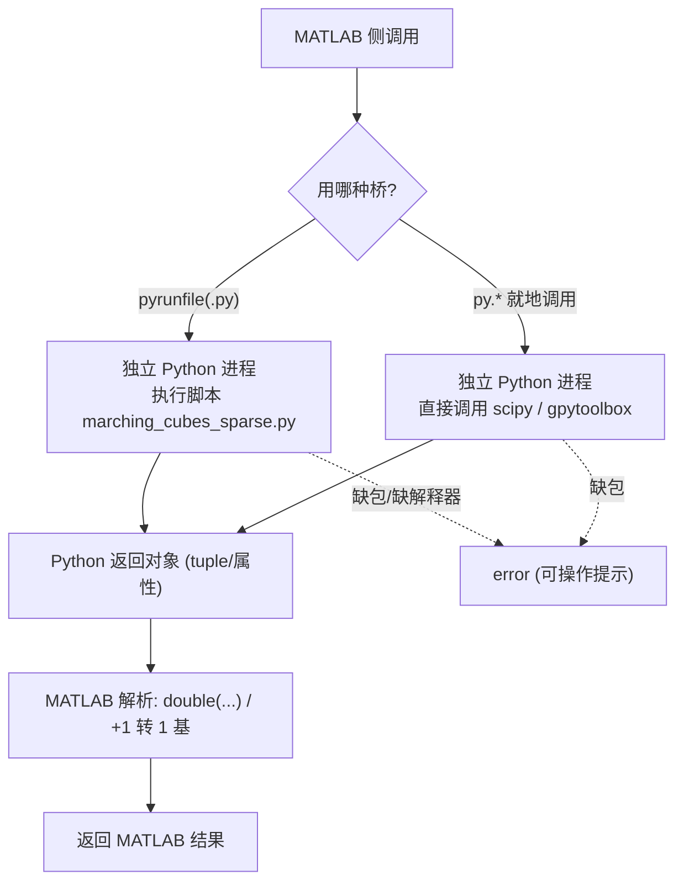

# 80 Python 接口 / Python Bindings

> 本章覆盖 `python/` 目录下的 **3 个 MATLAB 侧文件**，它们通过 **MATLAB 的 Python 互操作（`py.*` / `pyrunfile`）**
> 把几何算法委托给 Python：调用 MATLAB 自带的 **独立 Python 解释器进程**（out-of-process），而非 shell 出 `python` 命令行。
> `python/` 目录同时内含被调用的 Python 脚本 `marching_cubes_sparse.py`。
>
> This chapter covers the **three MATLAB-side files** in `python/`. They delegate geometry work to Python through
> **MATLAB's Python interoperability (`py.*` / `pyrunfile`)**, which drives MATLAB's own **out-of-process Python
> interpreter** — they do **not** shell out to a `python` command line. The directory also ships the called script
> `marching_cubes_sparse.py`.

- 语言 / Language：中英对照（中文为主）
- 相关章节 / See also：[80 Python 桥接模块索引](README.md)、[00-overview/03-build-and-install.md](../00-overview/03-build-and-install.md)、
  [10-mesh/09 重网格与简化](../10-mesh/09-remeshing-and-simplification.md)、
  [appendices/03-doc-template.md](../appendices/03-doc-template.md)
- 命名约定 / Notation：`V` 顶点 `#V by 3`、`F` 面 `#F by 3`、`S` 标量场、`GV/GI` 网格几何/索引

---

## 本章概览 / Chapter overview

### (a) 三种桥接模式 / Three bridging patterns

| 函数 (Function) | 桥接方式 / Mechanism | 方向 / Direction | 进程模型 / Process | 关键外部依赖 / Key externals |
|---|---|---|---|---|
| `marching_cubes_sparse` | `pyrunfile('marching_cubes_sparse.py',...)` | MATLAB → Python 脚本 → MATLAB | **独立 Python 进程**（解释器由 `pyenv` 指定） | `python`, `numpy`, `igl`；脚本须可被解析到 |
| `pysparse` | `py.scipy.sparse.*`（`py.*` 就地调用） | **双向**（MATLAB⇄Python） | 同上（同一解释器进程） | `python`, `scipy` |
| `remesh_botsch` | `py.gpytoolbox.remesh_botsch(...)` | MATLAB → Python 包 → MATLAB | 同上 | `python`, `numpy`, `gpytoolbox`（含 C++ 绑定） |

### (b) 数据交换 / Data interchange

- **无临时文件**：三者均**不做磁盘临时文件交换**，而是通过 MATLAB 的 Python 桥做**内存编排（marshalling）**：
  - MATLAB 裸矩阵 → Python 视为 `memoryview`；MATLAB 裸向量 → `array.array`；用 `py.numpy.array(...)` 转成形状正确的 `ndarray`（`remesh_botsch` 注释 L59-L63）。
  - 类型**必须显式**：C++ 绑定要求 **位置为 `float64`、索引为 `int32` 且 0 基**（`remesh_botsch` L62-L66）。
  - Python 返回值用 MATLAB 的 **`{}` 索引取元组元素**（如 `out{1}`、`res.V`），再转 `double` 并 **+1** 回 1 基索引。
- `marching_cubes_sparse` 是**唯一**通过磁盘脚本（`.py` 文件）驱动的一例（`pyrunfile`）。
- ⚠️ **环境假设 / Assumptions**：三者都要求 MATLAB 已用 `pyenv('Version', '<python>')` 指定一个装有相应包的
  Python 解释器；`marching_cubes_sparse` 还要求 `python/marching_cubes_sparse.py` 能被 `pyrunfile` 解析到
  （仓库 README/CLAUDE.md 的 `addpath` 示例**未包含 `python` 目录**，见下文"跨函数说明"）。

### (c) 桥接流程总览 / Bridge overview



---

## 逐函数条目 / Per-function entries

### `marching_cubes_sparse` — 稀疏网格上的 Marching Cubes（委托给 libigl Python）
- **文件 / File**: [python/marching_cubes_sparse.m](file:///c:/VSWork/gptoolbox-1/python/marching_cubes_sparse.m#L1-L14)
- **被调脚本 / Called script**: [python/marching_cubes_sparse.py](file:///c:/VSWork/gptoolbox-1/python/marching_cubes_sparse.py#L1-L14)
- **签名 / Signature**: `[V,F] = marching_cubes_sparse(S,GV,GI,isovalue)`
- **功能 / Purpose**: `EN: Extract an isosurface from a sparse scalar volume by calling igl.marching_cubes through pyrunfile.` / 中文：对**稀疏标量体数据**（顶点值 `S` + 几何 `GV` + 单元索引 `GI`）抽取等值面，内部通过 `pyrunfile` 调用 Python 的 `igl.marching_cubes`。
- **输入 / Inputs**:

  | 参数 | 尺寸/类型 | 含义 (中 / EN) |
  |---|---|---|
  | `S` | 3D 数组（体网格标量场） | 稀疏网格上的标量值，内部按 `permute(S,[2 1 3])` 展平 / scalar field |
  | `GV` | `#GV by 3` | 体网格顶点几何坐标 / grid vertex positions |
  | `GI` | `#GI by 8` | 每个（六面体/单元）的 8 个顶点索引，**1 基** / cell indices (1-based) |
  | `isovalue` | 标量（可选） | 等值面阈值；缺省 `0` / isovalue |

- **输出 / Outputs**:

  | 参数 | 尺寸/类型 | 含义 |
  |---|---|---|
  | `V` | `#V by 3` `double` | 等值面顶点坐标（`double(res.V)`）/ isosurface vertices |
  | `F` | `#F by 3` `double` | 三角面索引，**1 基**（`double(res.F)+1`）/ triangle indices |

- **可选参数 / Optional**:

  | 名称 | 取值 | 默认 | 含义 |
  |---|---|---|---|
  | `isovalue`（第 4 个位置参数） | 标量 | `0` | 等值面阈值（`nargin<4` 时置 0）/ isovalue |

- **变量流动 / Variable flow**:
  `S,GV,GI,isovalue →(GI−1 转 0 基)→ GI_minus_1 →(S: reshape(permute(S,[2 1 3]),[],1) 展平)→ Svec →`
  `(pyrunfile('marching_cubes_sparse.py','res', S=Svec, GV=GV, GI=GI_minus_1, isovalue=isovalue))→ res (Python 对象) →`
  `(res.V → double)→ V ; (res.F → double + 1 转 1 基)→ F`
- **算法步骤 / Algorithm**:
  1. `nargin<4` 时 `isovalue = 0`（L3-L5）。
  2. 断言 `size(GV,2) == 3`、`size(GI,2) == 8`（L7-L8）。
  3. `GI_minus_1 = GI - 1`：把单元索引转为 **0 基**（Python/igl 约定）（L9）。
  4. `Svec = reshape(permute(S,[2 1 3]),[],1)`：交换前两维后按列主序展平为列向量（L10）。
  5. `res = pyrunfile('marching_cubes_sparse.py', 'res', S=Svec, GV=GV, GI=GI_minus_1, isovalue=isovalue)`：
     在**独立 Python 进程**中执行脚本，脚本内 `igl.marching_cubes(S,GV,GI,isovalue)`，并把结果打包进
     一个带 `V`、`F` 属性的对象 `res` 返回（L11；脚本 L4-L14）。
  6. `V = double(res.V)`；`F = double(res.F)+1`（Python 0 基 → MATLAB 1 基）（L12-L13）。
- **流程图 / Flowchart**:

  ```mermaid
  flowchart TD
    A["输入 S, GV, GI, (isovalue)"] --> B{"nargin < 4 ?"}
    B -- 是 --> B1["isovalue = 0"]
    B -- 否 --> C
    B1 --> C["assert size(GV,2)==3 且 size(GI,2)==8"]
    C --> D["GI_minus_1 = GI − 1 (0 基)"]
    D --> E["Svec = reshape(permute(S,[2 1 3]),[],1)"]
    E --> F["pyrunfile('marching_cubes_sparse.py','res', ...)"]
    F --> G["独立 Python 进程: np.array(...) 还原形状"]
    G --> H["igl.marching_cubes(S,GV,GI,isovalue)"]
    H --> I["打包为 res (V,F) 返回 MATLAB"]
    I --> J["V = double(res.V)"]
    I --> K["F = double(res.F) + 1"]
    J --> Z["输出 V, F"]
    K --> Z
  ```
- **依赖 / Dependencies**:
  - 被调脚本：[python/marching_cubes_sparse.py](file:///c:/VSWork/gptoolbox-1/python/marching_cubes_sparse.py#L1-L14)（须能被 `pyrunfile` 解析到）。
  - MATLAB 内置：`pyrunfile`（R2021b 起）、`assert`、`reshape`、`permute`。
  - **外部工具/包**：`python` 解释器（经 `pyenv` 配置）、`numpy`、**`igl`**（libigl 的 Python 绑定）。
    ⚠️ 缺少 `igl` 或未配置 Python 会在脚本执行阶段抛异常（本函数**没有**对缺包的友好回退，与 `remesh_botsch` 不同）。
  - 同库依赖：无。
- **See also**: `signed_distance_isosurface`（MEX，[mex/signed_distance_isosurface.m](file:///c:/VSWork/gptoolbox-1/mex/signed_distance_isosurface.m#L1)，
  仓库中 `'ContouringMethod','marching_cubes'` 的 MATLAB 侧入口）、`marching_tets`（MEX，
  [mex/marching_tets.m](file:///c:/VSWork/gptoolbox-1/mex/marching_tets.m#L1)）、`pysparse`、`remesh_botsch`
- **备注 / Note**:
  - ⚠️ **头注与签名不一致（陈旧注释）**：头注写 `% [V,F] = marching_cubes(X,Y,Z,S)`（L2），
    但实际签名为 `marching_cubes_sparse(S,GV,GI,isovalue)`，头注的参数名/顺序均与实现不符。
  - ⚠️ **仓库中不存在 `mesh/marching_cubes.m`**：MATLAB 侧的 marching-cubes 由 MEX `signed_distance_isosurface`
    （`closing.m` 中用 `'ContouringMethod','marching_cubes'` 触发）提供；本函数则是"稀疏体数据"路径的 Python 委托版。
  - 该函数是 `pyrunfile` 驱动**磁盘脚本**的唯一一例；脚本中 `S = np.array(S).reshape(-1)` 与 MATLAB 侧展平互为配套。

### `pysparse` — MATLAB 与 Python（SciPy）稀疏矩阵互转
- **文件 / File**: [python/pysparse.m](file:///c:/VSWork/gptoolbox-1/python/pysparse.m#L1-L25)
- **签名 / Signature**: `outA = pysparse(inA)`
- **功能 / Purpose**: `EN: Convert between MATLAB sparse and Python (SciPy) sparse matrix formats, in both directions.` / 中文：在 MATLAB 稀疏矩阵与 Python（SciPy）稀疏矩阵之间**双向**转换。
- **输入 / Inputs**:

  | 参数 | 尺寸/类型 | 含义 (中 / EN) |
  |---|---|---|
  | `inA` | MATLAB `sparse`（`double`）**或** `py.scipy.sparse.*` 对象 | 待转换的稀疏矩阵（任一方向）/ MATLAB or Python sparse matrix |

- **输出 / Outputs**:

  | 参数 | 尺寸/类型 | 含义 |
  |---|---|---|
  | `outA` | Python `py.scipy.sparse.csc_matrix`（输入为 MATLAB 时）**或** MATLAB `sparse`（输入为 Python 时） | 转换结果 / converted matrix |

- **可选参数 / Optional**: 无 / none
- **变量流动 / Variable flow**:
  - **MATLAB → Python**：`inA(double & sparse) → find → AI,AJ,AV →(AI−1, AJ−1 转 0 基；尺寸转 uint64)→`
    `py.scipy.sparse.csc_matrix({AV,{row,col}}, {m,n}) → outA`
  - **Python → MATLAB**：`inA(py.scipy.sparse.*) →(py.hasattr(inA,'tocoo') 判定)→ coo = inA.tocoo →`
    `sparse(double(coo.row+1), double(coo.col+1), double(coo.data), coo.shape{1}, coo.shape{2}) → outA`
- **算法步骤 / Algorithm**:
  1. **MATLAB → Python 分支**：若 `isa(inA,'double') && issparse(inA)`（L12）：
     用 `[AI,AJ,AV] = find(inA)` 取三元组（L13），构造 `py.scipy.sparse.csc_matrix`，
     传入 `{AV, {uint64(AI-1), uint64(AJ-1)}}`（数据 + **0 基**行/列索引）与 `{uint64(m), uint64(n)}`（形状）（L14-L16），
     随即 `return`（L17）。
  2. **Python → MATLAB 分支**：若 `startsWith(class(inA),'py.scipy.sparse') && py.hasattr(inA,'tocoo')`（L19）：
     取 `coo = inA.tocoo`（L20），再用 `sparse(double(coo.row+1), double(coo.col+1), double(coo.data), double(coo.shape{1}), double(coo.shape{2}))`
     重建 MATLAB 稀疏矩阵（**+1 转 1 基**）（L21），随即 `return`（L22）。
  3. 两种类型均不匹配时 `error('inA is unknown/non-sparse type (%s)',class(inA))`（L24）。
- **流程图 / Flowchart**:

  ```mermaid
  flowchart TD
    A["输入 inA"] --> B{"isa double && issparse ?"}
    B -- 是 --> C["[AI,AJ,AV] = find(inA)"]
    C --> D["AI−1, AJ−1 (0 基); uint64 尺寸"]
    D --> E["Python 进程: scipy.sparse.csc_matrix(数据, 形状)"]
    E --> F["返回 py.scipy.sparse.csc_matrix"]
    F --> Z["输出 outA (Python sparse)"]
    B -- 否 --> G{"class 以 py.scipy.sparse 开头 && hasattr tocoo ?"}
    G -- 是 --> H["coo = inA.tocoo (Python 进程)"]
    H --> I["sparse(row+1, col+1, data, shape) (1 基)"]
    I --> Z2["输出 outA (MATLAB sparse)"]
    G -- 否 --> E2["error: unknown/non-sparse type"]
  ```
- **依赖 / Dependencies**:
  - MATLAB 内置：`isa`、`issparse`、`find`、`sparse`、`double`、`startsWith`、`class`、`error`。
  - **外部工具/包**：`python` 解释器（经 `pyenv` 配置）、**`scipy`**（提供 `scipy.sparse`）。
    ⚠️ 未安装 `scipy` 时，MATLAB → Python 分支会在构造 `py.scipy.sparse.csc_matrix` 时报错；
    本函数**无**缺包检测/友好提示。
  - 同库依赖：无。
- **See also**: `remesh_botsch`、`marching_cubes_sparse`
- **备注 / Note**:
  - 两个分支都用**早退 `return`**，因此 `outA` 的类型取决于输入类型的**首个匹配**；两者皆不匹配才报错。
  - 索引基转换是本函数核心：MATLAB 1 基 → Python 0 基（`−1`），Python 0 基 → MATLAB 1 基（`+1`）。

### `remesh_botsch` — Botsch-Kobbelt 三角网格重网格（委托给 gpytoolbox Python 包）
- **文件 / File**: [python/remesh_botsch.m](file:///c:/VSWork/gptoolbox-1/python/remesh_botsch.m#L1-L106)
- **签名 / Signature**: `[U,G] = remesh_botsch(V,F,varargin)`
- **功能 / Purpose**: `EN: Remesh a triangle mesh to a desired edge length by calling gpytoolbox.remesh_botsch through MATLAB's python interface (Botsch & Kobbelt 2004).` / 中文：通过 MATLAB 的 Python 接口调用 `gpytoolbox.remesh_botsch`，按 Botsch & Kobbelt 2004 的"细分/坍缩/翻边/切向平滑"交替迭代，把三角网格重网格到目标边长。
- **输入 / Inputs**:

  | 参数 | 尺寸/类型 | 含义 (中 / EN) |
  |---|---|---|
  | `V` | `#V by 3` | 输入顶点坐标 / vertex positions |
  | `F` | `#F by 3` | 输入三角面索引（指向 `V` 行）/ triangle indices |

- **输出 / Outputs**:

  | 参数 | 尺寸/类型 | 含义 |
  |---|---|---|
  | `U` | `#U by 3` `double` | 输出顶点坐标 / output vertex positions |
  | `G` | `#G by 3` `double` | 输出三角面索引（**1 基**，指向 `U` 行）/ output triangle indices |

- **可选参数 / Optional**（`containers.Map` 解析，L40-L54）:

  | 名称 | 取值 | 默认 | 含义 |
  |---|---|---|---|
  | `'Iters'` | 整数 | `10` | 重网格迭代次数 / number of remeshing iterations |
  | `'EdgeLength'` | 标量 | `[]` → Python `None`（用输入**平均边长**） | 目标边长 / desired edge length |
  | `'Project'` | `logical` | `true` | 是否重投影回输入曲面（否则迭代中整体平滑）/ reproject onto input |
  | `'Feature'` | `#feat` 索引向量 | `[]` | 不允许移动的顶点索引（在 `U` 中**按序排在最前**）；边界顶点**总被** gpytoolbox 视为特征 / fixed feature vertices |

- **变量流动 / Variable flow**:
  `V,F,varargin →(默认值 & containers.Map 解析)→ iters,h,project,feature →(断言 3D/三角)→`
  `pyV = py.numpy.atleast_2d(py.numpy.array(double(V))) ; pyF = py.numpy.atleast_2d(py.numpy.array(int32(F)-1)) ;`
  `pyfeature = py.numpy.atleast_1d(py.numpy.array(int32(feature(:)')-1)) ; pyh = py.None 或 double(h) →`
  `(py.gpytoolbox.remesh_botsch(pyV,pyF,int32(iters),pyh,logical(project),pyfeature))→ out (Python tuple) →`
  `(out{1} → double)→ U ; (out{2} → double + 1)→ G ； 失败时 → assert_gpytoolbox() → rethrow`
- **算法步骤 / Algorithm**:
  1. 默认 `iters=10`、`h=[]`、`project=true`、`feature=[]`（L36-L39）。
  2. 用 `containers.Map({'Iters','EdgeLength','Project','Feature'}, {'iters','h','project','feature'})` 逐项解析 `varargin`，经 `assignin('caller', ...)` 回写；未知参数 `error('Unsupported parameter: %s',...)`（L40-L54）。
  3. 断言 `size(V,2)==3`（仅 3D）与 `size(F,2)==3`（仅三角网格）（L56-L57）。
  4. 构造 Python 输入（L59-L72）：`pyV = py.numpy.atleast_2d(py.numpy.array(double(V)))`、
     `pyF = py.numpy.atleast_2d(py.numpy.array(int32(F)-1))`（**0 基** `int32`）、
     `pyfeature = py.numpy.atleast_1d(py.numpy.array(int32(feature(:)')-1))`（**0 基** `int32`，空则为空数组）；
     `h` 为空则 `pyh = py.None`（让 gpytoolbox 用输入平均边长），否则 `pyh = double(h)`。
  5. **Python 调用**：`out = py.gpytoolbox.remesh_botsch(pyV, pyF, int32(iters), pyh, logical(project), pyfeature)`（L75）。
  6. **异常处理**：若上句抛异常 `ME`（L76-L79）：先 `assert_gpytoolbox()` 给出可操作提示，再 `rethrow(ME)`。
  7. 结果解析：`U = double(out{1})`；`G = double(out{2})+1`（Python 0 基 → MATLAB 1 基）（L81-L82）。
  8. 内嵌函数 `assert_gpytoolbox()`（L85-L106）：`py.importlib.import_module('gpytoolbox')` 成功则静默返回；
     否则读 `pe = pyenv`，`Version` 为空 → `error('remesh_botsch:no_python',...)`（提示用 `pyenv('Version',...)` 指定解释器）；
     否则 → `error('remesh_botsch:no_gpytoolbox',...)`（提示 `pip_install('gpytoolbox')` 并打印 `pe.Executable`）。
- **流程图 / Flowchart**:

  ```mermaid
  flowchart TD
    A["输入 V,F, varargin"] --> B["默认: iters=10, h=[], project=true, feature=[]"]
    B --> C["containers.Map 解析 4 个名值对"]
    C --> D{"尺寸合法 (V 3列, F 3列) ?"}
    D -- 否 --> E0["assert 报错"]
    D -- 是 --> E["构造 pyV/pyF (float64 / int32 0 基)"]
    E --> F["pyfeature (int32 0 基); pyh = py.None 或 double(h)"]
    F --> G["py.gpytoolbox.remesh_botsch(pyV,pyF,iters,pyh,project,pyfeature)"]
    G --> H["独立 Python 进程: numpy ndarray → C++ 绑定"]
    H --> I{"调用成功?"}
    I -- 否 --> J["assert_gpytoolbox()"]
    J --> J1{"import gpytoolbox 成功?"}
    J1 -- 是 --> J2["rethrow(ME)"]
    J1 -- 否 --> J3{"pyenv.Version 为空?"}
    J3 -- 是 --> J4["error no_python"]
    J3 -- 否 --> J5["error no_gpytoolbox"]
    I -- 是 --> K["out = (U_py, F_py) 元组"]
    K --> L["U = double(out{1})"]
    K --> M["G = double(out{2}) + 1"]
    L --> Z["输出 U, G"]
    M --> Z
  ```
- **依赖 / Dependencies**:
  - MATLAB 内置：`containers.Map`、`assignin`、`feval`、`assert`、`pyenv`、`strlength`、`error`、`try/catch`。
  - Python 桥：`py.numpy`（`array`、`atleast_2d`、`atleast_1d`）、`py.None`、`py.gpytoolbox`、`py.importlib.import_module`。
  - **外部工具/包**：`python` 解释器（经 `pyenv` 配置）、`numpy`、**`gpytoolbox`**（Python 包 + C++ 绑定；
    要求位置 `float64`、索引 `int32` 0 基）。
  - 同库依赖：无；内嵌函数 `assert_gpytoolbox`（L85-L106）。
  - ⚠️ **未定义依赖（头注 See also）**：头注列出 `pip_install`（L33），但 **`pip_install.m` 在仓库中不存在**
    （`error` 提示里也引用了它），调用者需自行准备该安装助手。`remesh_planar_patches` 存在
    （[mesh/remesh_planar_patches.m](file:///c:/VSWork/gptoolbox-1/mesh/remesh_planar_patches.m#L1)）。
- **See also**: `remesh_planar_patches`、`pysparse`、`pip_install`（**仓库缺失**）、
  `mesh/remesh_botsch` 的 MATLAB 原生替代见 [10-mesh/09 重网格与简化](../10-mesh/09-remeshing-and-simplification.md)
- **备注 / Note**:
  - 这是仓库中**唯一**提供**可操作错误提示**的 Python 桥函数（`assert_gpytoolbox`），可作为其它桥的写法范例。
  - 名称 `remesh_botsch` **同时**是仓库中其它重网格函数的命名系列；本函数（`python/`）依赖外部 `gpytoolbox`，
    与纯 MATLAB 实现不同源。

---

## 跨函数说明 / Cross-cutting notes

- **进程模型**：MATLAB 的 Python 互操作把 Python 解释器作为**独立进程**启动并通过其协议通信；
  因此三者均属于 MATLAB →（Python 进程）→ MATLAB 的委托模式，**不是** `system('python ...')` 式的 shell 调用。
- **`python/` 是否在搜索路径**：仓库 `CLAUDE.md` 给出的 `addpath(...)` 示例包含
  `external,imageprocessing,images,matrix,mesh,mex,quat,utility,wrappers`，**未包含 `python`**。
  对于 `pysparse`/`remesh_botsch`（依赖 `py.*` 包，不依赖脚本文件）影响较小；
  但 `marching_cubes_sparse` 依赖 `pyrunfile` 解析 `marching_cubes_sparse.py`，需确保该脚本所在目录可被解析。
- **索引基转换**：三者在 MATLAB（1 基）与 Python（0 基）之间转换时统一采用 `−1`（下行）/`+1`（上行）。
- **类型约束**：跨语言边界的位置/坐标用 `float64`，索引用 `int32`；MATLAB 端需显式 `double`/`int32` 转换。

## 交叉引用 / Cross references

- 安装与环境（`pyenv`、Python 包）：见 [00-overview/03-build-and-install.md](../00-overview/03-build-and-install.md)
- 重网格与简化（MATLAB 原生实现）：见 [10-mesh/09 重网格与简化](../10-mesh/09-remeshing-and-simplification.md)
- 全局模块依赖图：见 [00-overview/05-dependency-map.md](../00-overview/05-dependency-map.md)
- 文档写作规范：见 [appendices/03-doc-template.md](../appendices/03-doc-template.md)

---

## 函数清单核对表 / Coverage Checklist

| 函数 (anchor) | 一句话用途 |
|---|---|
| [`marching_cubes_sparse`](file:///c:/VSWork/gptoolbox-1/python/marching_cubes_sparse.m#L1-L14) | 用 `pyrunfile` 调 `igl.marching_cubes` 从稀疏体数据抽取等值面 |
| [`pysparse`](file:///c:/VSWork/gptoolbox-1/python/pysparse.m#L1-L25) | MATLAB 稀疏矩阵 ⇄ SciPy 稀疏矩阵双向转换 |
| [`remesh_botsch`](file:///c:/VSWork/gptoolbox-1/python/remesh_botsch.m#L1-L106) | 调 `gpytoolbox.remesh_botsch` 做 Botsch-Kobbelt 重网格 |
