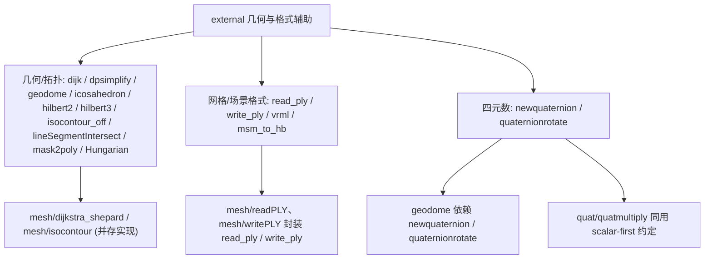

# 90.2b 几何与格式辅助（第三方） / Geometry and Format Helpers (Vendored)

> 本章覆盖 `external/` 目录下一组**几何/拓扑算法**与**网格/场景文件格式**的 vendored 第三方代码：
> 最短路径（`dijk`）、折线简化（`dpsimplify`）、测地穹顶（`geodome`/`icosahedron`）、
> Hilbert 空间填充曲线（`hilbert2`/`hilbert3`）、隐式图像等值线（`isocontour_off`）、
> 线段求交（`lineSegmentIntersect`）、掩膜边界追踪（`mask2poly`）、二部图指派（`Hungarian`）、
> PLY 读写（`read_ply`/`write_ply`）、VRML 场景导出（`vrml`）、
> MATLAB 稀疏矩阵→Harwell–Boeing 转换（`msm_to_hb`），以及四元数构造与应用
> （`newquaternion`/`quaternionrotate`）。共 **16** 个文件，全部为普通 `function` 文件（本节**无 `classdef`**）。
>
> This chapter covers a set of **geometry/topology algorithms** and **mesh/scene file formats**
> vendored under `external/`: shortest paths (`dijk`), polyline simplification (`dpsimplify`),
> geodesic dome (`geodome`/`icosahedron`), Hilbert space-filling curves (`hilbert2`/`hilbert3`),
> implicit-grid iso-contouring (`isocontour_off`), line-segment intersection
> (`lineSegmentIntersect`), mask boundary tracing (`mask2poly`), bipartite assignment
> (`Hungarian`), PLY I/O (`read_ply`/`write_ply`), VRML scene export (`vrml`),
> MATLAB-sparse→Harwell–Boeing conversion (`msm_to_hb`), and quaternion construction/application
> (`newquaternion`/`quaternionrotate`). **16** files in total, all plain `function` files
> (**no `classdef`** in this chapter).

- 语言 / Language：中英对照（中文为主）
- 相关章节 / See also：[90-external/README.md](README.md)、
  [90.1 色图与颜色](01-colormaps-and-color.md)、[90.2 数值线性代数助手](02-numeric-linear-algebra.md)、
  [90.3 MATLAB 环境与绘图辅助](03-matlab-environment-and-plotting.md)、
  [appendices/03-doc-template.md](../appendices/03-doc-template.md)
- 命名约定 / Notation：沿用库内约定 `V`（`#V by 3` 顶点）、`F`（`#F by 3` 三角面）、
  `A`（邻接矩阵）、`Q`（四元数 `[w x y z]`）；此外 `I` 表示 2-D 图像/掩膜，`Perf` 表示代价矩阵。
- 重要声明 / Disclaimer：`external/` 为**第三方 vendored 代码**，其作者/许可由**文件头**决定；
  本节忠实记录文件头署名，并在发现**遮蔽 MATLAB 内置**、**与库内其它模块功能重叠**或
  **文件头与常见说法不一致**时明确标注（见各条目"备注"与文末核对表）。

---

## 本章概览 / Chapter Overview

**模块职责 / Module responsibility**

- `external/` 收录由**其它作者**编写、gptoolbox 直接附带（vendored）的 MATLAB 代码。本章 16 个文件
  分三类：(a) **几何/拓扑算法**——图最短路、折线简化、测地球、Hilbert 曲线、等值线、线段求交、
  边界追踪、指派问题；(b) **网格/场景格式**——PLY 读写、VRML 导出、稀疏矩阵格式转换；
  (c) **四元数工具**——构造与旋转应用。
- 这些文件**均非 gptoolbox 原创**，命名/许可参见各自文件头；其中 `geodome` 依赖同目录的
  `icosahedron`/`newquaternion`/`quaternionrotate`，`mesh/readPLY`、`mesh/writePLY` 则是对
  `read_ply`/`write_ply` 的薄封装。

### 函数总表 / Function overview

| 函数 / Function | 类型 / Type | 来源 / 署名 (Attribution) | 一句话功能 / One-line purpose |
|---|---|---|---|
| `dijk` | `function` | Michael G. Kay（Matlog 1.3，1998-2000） | 邻接矩阵加权图上的 Dijkstra 最短路 |
| `dpsimplify` | `function` | Wolfgang Schwanghart（2010，BSD） | Ramer–Douglas–Peucker 折线简化 |
| `geodome` | `function` | Peter Kovesi（2009，UWA） | 二十面体细分的测地穹顶 |
| `icosahedron` | `function` | Peter Gagarinov（2011-2016） | 解析构造正二十面体网格 |
| `hilbert2` | `function` | Ivan Martynov / Federico Forte（2009） | 2-D Hilbert 曲线点坐标 |
| `hilbert3` | `function` | Ivan Martynov（2009，BSD） | 3-D Hilbert 曲线点坐标 |
| `isocontour_off` | `function` | D. Kroon（Univ. Twente，2011） | Marching Squares 求 2-D 等值线 |
| `lineSegmentIntersect` | `function` | U. Murat Erdem（File Exchange，2010） | 向量化 2-D 线段求交 |
| `mask2poly` | `function` | Nikolay S.（2011，BSD） | 掩膜→ROI 多边形边界追踪 |
| `Hungarian` | `function` | Alex Melin（2006） | Kuhn–Munkres 最小权指派 |
| `read_ply` | `function` | Gabriel Peyré（2003）/ 内嵌 plyread Pascal Getreuer（2004） | 读 PLY（ASCII/二进制） |
| `write_ply` | `function` | Gabriel Peyré（2004）/ 内嵌 plywrite Pascal Getreuer（2004） | 写 PLY（ASCII/二进制） |
| `vrml` | `function` | HUMUSOFT s.r.o. 与 The MathWorks（1997-2014） | 把图窗导出为 VRML97 场景 |
| `msm_to_hb` | `function` | Xiaoye Li（UC Berkeley，2004，LGPLv3） | MATLAB 稀疏矩阵→Harwell–Boeing |
| `newquaternion` | `function` | Peter Kovesi（2008，UWA） | 由轴角构造单位四元数 |
| `quaternionrotate` | `function` | Peter Kovesi（2008，UWA） | 用四元数旋转 3-D 向量 |

### 模块关系图 / Module relationship diagram



---

## 逐函数详解 / Per-function reference

### `dijk` — 邻接矩阵加权图最短路（Dijkstra）
- **文件 / File**: [external/dijk.m](file:///c:/VSWork/gptoolbox-1/external/dijk.m#L1-L109)
- **署名 / Attribution**: **Michael G. Kay**（`Copyright (c) 1998-2000 by Michael G. Kay`，Matlog Version 1.3，29-Aug-2000）；JBT 于 Dec 2000 修改以删除路径回溯输出。算法取自 Ahuja, Magnanti, Orlin《Network Flows》Fig. 4.6。
- **类型 / Type**: 普通 `function` 文件（非 `classdef`）。
- **签名 / Signature**: `[D,P] = dijk(A,s,t)`
- **功能 / Purpose**: `EN: Shortest-path distances (and predecessor matrix) from source nodes s to target nodes t on a weighted graph given by an adjacency matrix; exploits triangular (acyclic) matrices for speed.` / 中文：在邻接矩阵表示的加权图上，求源点集 `s` 到目标点集 `t` 的最短路距离 `D`（及前驱矩阵 `P`）；三角（无环）矩阵可加速。
- **输入 / Inputs**:

  | 参数 | 尺寸/类型 | 含义 (中 / EN) |
  |---|---|---|
  | `A` | `n by n` 数值 | 弧长邻接矩阵；`A(i,j)=0` 表示无弧，`=NaN` 表示权为 0 的弧 / weighted adjacency |
  | `s` | 整数向量 | 源点索引，`[]` 默认全部节点 / source nodes |
  | `t` | 整数向量 | 目标点索引，`[]` 默认全部节点 / target nodes |

- **输出 / Outputs**:

  | 参数 | 尺寸/类型 | 含义 |
  |---|---|---|
  | `D` | `numel(s) by numel(t)` | 最短路距离矩阵 / shortest-path distances |
  | `P` | `numel(s) by n` | 前驱（后继）节点矩阵 / predecessor matrix |

- **可选参数 / Optional**: 无 Name/Value 接口；`s`、`t` 可省略（默认 `1:n`）。

- **变量流动 / Variable flow**: `A,s,t →(转置 A=A' 加速 find)→ isAcyclic → 对每个 s(i)：Di=Inf 且 Di(j)=0 →(while 松弛)→ P(i,·)、Di → D(i,:)=Di(t)`
- **算法步骤 / Algorithm**（Dijkstra 最短路，节点选择用**线性扫描** `min(Di(isUnLab))`，非二叉堆）:
  1. 参数校验并判定 `A` 的上/下三角性 → `isAcyclic=1/2/0`（L31–L55）。
  2. `A=A'`，使稀疏 `find(A(:,j))` 可直接取列（L57）。
  3. 对每个源点 `j=s(i)`：`Di=Inf`、`Di(j)=0`，初始化未标记集合 `UnLab`/`isUnLab`（L62–L76）。
  4. `while nLab<n & ~all(isLab)`：取 `Di` 最小的未标记节点 `j`（无环时按索引步进），标记；`find(A(:,j))` 松弛其邻接节点，更新 `P` 与 `Di=min(Di,Dj+Aj)`（L78–L104）。
  5. 该源点收敛后 `D(i,:)=Di(t)'`（L107）。
- **流程图 / Flowchart**:

  ```mermaid
  flowchart TD
    A["输入 A,s,t"] --> B["判定三角性 isAcyclic"]
    B --> C["A=A'; 对每个源 s(i) 初始化 Di"]
    C --> D{"nLab < n 且 未全标记?"}
    D -- 是 --> E["选取 Di 最小的未标记节点 j"]
    E --> F["松弛 j 的出弧: 更新 P 与 Di"]
    F --> G["nLab = nLab + 1"]
    G --> D
    D -- 否 --> H["D(i,:) = Di(t)"]
    H --> Z["输出 D,P"]
  ```

- **依赖 / Dependencies**: 无外部依赖（仅内置 `find`/`min`/`size`）。
- **See also**: `mesh/dijkstra_shepard`、MATLAB `shortestpath`、`graphshortestpath`。
- **备注 / Note**: ③ 与 `mesh/dijkstra_shepard` **功能相关但互不调用**（后者自带内部 Dijkstra 实现），二者为并存实现，注意 `path` 不可用；如 `numel(s) >> numel(t)`，作者建议改用 `dijk(A',t,s)`（返回转置）。

### `dpsimplify` — Ramer–Douglas–Peucker 折线简化
- **文件 / File**: [external/dpsimplify.m](file:///c:/VSWork/gptoolbox-1/external/dpsimplify.m#L1-L279)
- **署名 / Attribution**: **Wolfgang Schwanghart**（`w.schwanghart[at]unibas.ch`，13. July 2010）；许可 **BSD 2-clause**（`Copyright (c) 2009, Wolfgang Schwanghart`）。Alec Jacobson 在文内加入性能/写法评论。
- **类型 / Type**: 普通 `function` 文件（含递归子函数 `simplifyrec`，非 `classdef`）。
- **签名 / Signature**: `[ps,ix] = dpsimplify(p,tol)`
- **功能 / Purpose**: `EN: Reduce a piecewise-linear curve/polyline to fewer vertices using the recursive Douglas–Peucker algorithm (a.k.a. Iterative Endpoint Fit); NaN rows separate sub-polylines.` / 中文：用递归 Douglas–Peucker（迭代端点拟合）算法按容差减少折线/多边形顶点；`NaN` 行用于分隔子折线。
- **输入 / Inputs**:

  | 参数 | 尺寸/类型 | 含义 (中 / EN) |
  |---|---|---|
  | `p` | `n by d` | 折线顶点（`d` 维）/ polyline vertices |
  | `tol` | 非负标量 | 允许的最大欧氏偏差 / tolerance |

- **输出 / Outputs**:

  | 参数 | 尺寸/类型 | 含义 |
  |---|---|---|
  | `ps` | `m by d` | 简化后的顶点 / simplified polyline |
  | `ix` | `m by 1` | 保留顶点在 `p` 中的线性索引（`ps=p(ix)`）/ retained indices |

- **可选参数 / Optional**: 无；`nargin==0` 时打印 `help` 返回；参数数须恰为 2。
- **变量流动 / Variable flow**: `p,tol →(isnan → Inan/Inanp)→ 分情形(单点/两点/含 NaN 分段/一般)→(simplifyrec 递归, 侧写逻辑掩码 I)→ ps=p(I,:) → ix=find(I)`
- **算法步骤 / Algorithm**（Douglas–Peucker，递归）:
  1. `nargin==0` → `help dpsimplify`；否则 `error(nargchk(2,2,nargin))`，校验 `tol`（L78–L88）。
  2. 顶点数≤1 直接返回；两点时按距离与 `tol` 决定保留或取中点（L110–L131）。
  3. 含 `NaN`：以 `strfind` 切出连续段 → `mat2cell` → `cellfun` 递归调用并合并（L133–L170）。
  4. 一般情形：`I=logical(true(ixe,1))`，调用 `simplifyrec(p,tol,ixs,ixe)`，其中计算各点到首末连线的距离，`dmax<=tol` 则删去中间点（`I=false`），否则以最远点 `ixc` 为界递归两段（L176–L253）。
  5. 需要 `ix` 时 `ix=find(I)`（L189–L191）。
- **流程图 / Flowchart**:

  ```mermaid
  flowchart TD
    A["输入 p,tol"] --> B{"nargin == 0 ?"}
    B -- 是 --> B1["help 并 return"]
    B -- 否 --> C{"顶点数?"}
    C -- "=1" --> C1["ps=p; ix=1"]
    C -- "=2" --> C2["按距离决定保留或取中点"]
    C -- "含NaN" --> C3["分段后 cellfun 递归"]
    C -- 其他 --> D["simplifyrec: 求 dmax"]
    D --> E{"dmax <= tol ?"}
    E -- 是 --> E1["删除 ixs+1:ixe-1 的 I"]
    E -- 否 --> E2["对 (ixs,ixc) 与 (ixc,ixe) 递归"]
    E2 --> D
    E1 --> Z["ps=p(I,:); ix=find(I)"]
    C1 --> Z
    C2 --> Z
    C3 --> Z
  ```

- **依赖 / Dependencies**: 内部 `simplifyrec`；无外部依赖。
- **See also**: MATLAB `reducepoly`、`interparc`、`contour`。
- **备注 / Note**: 作者/Alec 均提示该实现大量使用 cell/匿名函数，性能有较大优化空间（L72–L74、L95–L100）。

### `geodome` — 二十面体细分测地穹顶
- **文件 / File**: [external/geodome.m](file:///c:/VSWork/gptoolbox-1/external/geodome.m#L1-L208)
- **署名 / Attribution**: **Peter Kovesi**（Centre for Exploration Targeting, The University of Western Australia，`Copyright (c) 2009 Peter Kovesi`）；MIT 式许可（保留版权声明即可）。2014-04 修正半径缩放（致谢 Brad Keserich）。
- **类型 / Type**: 普通 `function` 文件（含子函数 `divideEdgeOld`/`divideEdge`/`adjacency`/`faces`，非 `classdef`）。
- **签名 / Signature**: `[xyz, A, F] = geodome(frequency, radius)`
- **功能 / Purpose**: `EN: Generate a geodesic sphere by subdividing each face of an icosahedron "frequency" times; returns vertices, adjacency and faces.` / 中文：对正二十面体各面做 `frequency` 次细分生成测地穹顶，返回顶点、邻接矩阵与面表。
- **输入 / Inputs**:

  | 参数 | 尺寸/类型 | 含义 (中 / EN) |
  |---|---|---|
  | `frequency` | 正整数 | 每条边细分数（1 即二十面体）/ subdivisions per edge，默认 `2` |
  | `radius` | 标量 | 球半径 / radius，默认 `1` |

- **输出 / Outputs**:

  | 参数 | 尺寸/类型 | 含义 |
  |---|---|---|
  | `xyz` | `#V by 3` | 球面顶点 / vertex positions |
  | `A` | `#V by #V` | 邻接矩阵 / adjacency |
  | `F` | `#F by 3` | 三角面 / faces |
- **可选参数 / Optional**: `frequency` 默认 `2`、`radius` 默认 `1`；`frequency<1` 报错。
- **变量流动 / Variable flow**: `frequency,radius → icosahedron → icosXYZ,icosA,icosF → nVert 预算 → xyz(1:12) →(边细分, 面细分, 用 newquaternion/quaternionrotate 的 divideEdge)→ xyz*radius → adjacency(xyz)=A → faces(A)=F`
- **算法步骤 / Algorithm**（二十面体细分测地穹顶）:
  1. 缺省 `frequency=2`、`radius=1`，校验 `frequency>=1`（L51–L61）。
  2. `icosahedron` 得基础顶点/邻接/面（L64）。
  3. 预算顶点数 `nVert=12+30*(f-1)+20*(f-2)*(f-1)/2`（L70–L74）。
  4. `frequency==1` 直接返回二十面体；否则在 30 条边（`find(triu(icosA))`）与 20 个面的内部用 `divideEdge` **按角度**插入顶点（`divideEdge` 内部用 `newquaternion`+`quaternionrotate` 旋转，L76–L112，L140–L152）。
  5. `xyz=xyz*radius`；`A=adjacency(xyz)`（按最短边 1.5 倍阈值连边）；`F=faces(A)`（搜索长度为 3 的环并去重）（L114–L116，L159–L208）。
- **流程图 / Flowchart**:

  ```mermaid
  flowchart TD
    A["输入 frequency,radius"] --> B{"frequency < 1 ?"}
    B -- 是 --> B1["报错"]
    B -- 否 --> C["icosahedron → icosXYZ,icosA,icosF"]
    C --> D{"frequency == 1 ?"}
    D -- 是 --> Z1["xyz=icosXYZ; A=icosA; F=icosF"]
    D -- 否 --> E["复制 12 个基础顶点"]
    E --> F["遍历每条边: divideEdge 插点"]
    F --> G["遍历每个面: 内部插点"]
    G --> H["xyz = xyz * radius"]
    H --> I["A = adjacency(xyz); F = faces(A)"]
    I --> Z["输出 xyz,A,F"]
  ```

- **依赖 / Dependencies**: `icosahedron`、`newquaternion`、`quaternionrotate`（同目录）。
- **See also**: `mesh/subdivided_sphere`、`icosahedron`、`gplot3d`、`drawfaces`。
- **备注 / Note**: ⚠️ **兼容性隐患**：`geodome` 第 64 行调用 `icosahedron(1)`，但本库 [external/icosahedron.m](file:///c:/VSWork/gptoolbox-1/external/icosahedron.m#L1-L33) 的签名 `icosahedron()` **无输入参数**，运行时将报"Too many input arguments"——疑为不同来源版本混用所致，接入前需核对。

### `icosahedron` — 解析构造正二十面体
- **文件 / File**: [external/icosahedron.m](file:///c:/VSWork/gptoolbox-1/external/icosahedron.m#L1-L33)
- **署名 / Attribution**: **Peter Gagarinov, PhD**（`pgagarinov@gmail.com`，Moscow State University，`$Copyright: ... 2011-2016 $`）。
- **类型 / Type**: 普通 `function` 文件（非 `classdef`）。
- **签名 / Signature**: `[vMat,fMat] = icosahedron()`
- **功能 / Purpose**: `EN: Construct the 12 vertices and 20 triangular faces of a regular icosahedron analytically, using the golden ratio.` / 中文：用黄金比例解析地给出正二十面体的 12 个顶点与 20 个三角面。
- **输入 / Inputs**: 无 / none。
- **输出 / Outputs**:

  | 参数 | 尺寸/类型 | 含义 |
  |---|---|---|
  | `vMat` | `12 by 3` | 顶点坐标 / icosahedron vertices |
  | `fMat` | `20 by 3` | 面索引 / face indices |

- **可选参数 / Optional**: 无。
- **变量流动 / Variable flow**: `tau=(sqrt5+1)/2, r=tau-0.5, alphaVec → vMat(2:6 与 7:11) 圆周点 + 上下极点 → fMat 常表 → 输出 vMat,fMat`
- **算法步骤 / Algorithm**（解析法，无迭代）:
  1. `tau=(realsqrt(5)+1)/2`，`r=tau-0.5`（L21–L22）。
  2. 上下极点 `vMat([1,12],:)`（L23）。
  3. 用 `alphaVec=-pi/5+IND_VEC*pi/2.5` 生成两圈共 10 个顶点（L25–L29）。
  4. 直接以常量表给出 20 个三角面 `fMat`（L31–L33）。
- **流程图 / Flowchart**:

  ```mermaid
  flowchart TD
    A["无输入"] --> B["tau=(sqrt(5)+1)/2; r=tau-0.5"]
    B --> C["生成上下极点与两圈圆周顶点"]
    C --> D["填常量 20 三角形面表"]
    D --> Z["输出 vMat,fMat"]
  ```

- **依赖 / Dependencies**: 无。
- **See also**: `geodome`、`mesh/subdivided_sphere`。

### `hilbert2` — 二维 Hilbert 曲线坐标
- **文件 / File**: [external/hilbert2.m](file:///c:/VSWork/gptoolbox-1/external/hilbert2.m#L1-L38)
- **署名 / Attribution**: **Ivan Martynov**（2009）与 **Federico Forte**（2000/10/06，`hilbert.m` 原作者）。
- **类型 / Type**: 普通 `function` 文件（自递归，非 `classdef`）。
- **签名 / Signature**: `[x,y] = hilbert2(n)`
- **功能 / Purpose**: `EN: Return the point coordinates of the n-th order Hilbert space-filling curve of unit area (recursive coordinate mapping).` / 中文：递归给出 n 阶单位面积 Hilbert 空间填充曲线的点坐标。
- **输入 / Inputs**:

  | 参数 | 尺寸/类型 | 含义 (中 / EN) |
  |---|---|---|
  | `n` | 整数 | 细分阶数 / order，`nargin~=1` 时默认 `2` |

- **输出 / Outputs**: | `x` | 向量 | x 坐标列表 / x coords | | `y` | 向量 | y 坐标列表 / y coords |
- **可选参数 / Optional**: 仅 1 个参数；`nargin~=1` → `n=2`。
- **变量流动 / Variable flow**: `n →(n<=0: x=0,y=0; else 递归 hilbert2(n-1)→xo,yo → 4 段仿射变换)→ x,y`
- **算法步骤 / Algorithm**（Hilbert 曲线坐标↔索引的递归映射）:
  1. `nargin~=1` → `n=2`（L27–L29）。
  2. 递归基：`n<=0` 时 `x=y=0`（L31–L33）。
  3. 否则递归得 `xo,yo`，按 4 段固定仿射式映射为 `x=.5*[-.5+yo -.5+xo .5+xo .5-yo]`、`y=.5*[-.5+xo .5+yo .5+yo -.5-xo]`（L35–L37）。
- **流程图 / Flowchart**:

  ```mermaid
  flowchart TD
    A["输入 n"] --> B{"nargin ~= 1 ?"}
    B -- 是 --> B1["n = 2"]
    B -- 否 --> C
    B1 --> C{"n <= 0 ?"}
    C -- 是 --> Z0["x=0; y=0"]
    C -- 否 --> D["递归 [xo,yo] = hilbert2(n-1)"]
    D --> E["4 段仿射映射 → x,y"]
    E --> Z["输出 x,y"]
  ```

- **依赖 / Dependencies**: 自递归。
- **See also**: `hilbert3`。
- **备注 / Note**: 文件头示例使用 `upsample`、`surf2patch`、`tsurf`（gptoolbox 绘图链），但函数本身仅需内置算子。

### `hilbert3` — 三维 Hilbert 曲线坐标
- **文件 / File**: [external/hilbert3.m](file:///c:/VSWork/gptoolbox-1/external/hilbert3.m#L1-L73)
- **署名 / Attribution**: **Ivan Martynov**（2009，`Copyright (c) 2009, Ivan Martynov`）；**BSD 2-clause**（文末 `%{ ... %}` 块）。
- **类型 / Type**: 普通 `function` 文件（自递归，非 `classdef`）。
- **签名 / Signature**: `[x,y,z] = hilbert3(n)`
- **功能 / Purpose**: `EN: Return the point coordinates of the n-th order 3-D Hilbert space-filling curve of unit volume (recursive, 8-way mapping).` / 中文：递归给出 n 阶三维 Hilbert 空间填充曲线的点坐标（8 路映射）。
- **输入 / Inputs**: | `n` | 整数 | 细分迭代次数 / iterations，默认 `2` |
- **输出 / Outputs**: | `x` `y` `z` | 向量 | 各维坐标列表 / coords |
- **可选参数 / Optional**: `nargin~=1` → `n=2`。
- **变量流动 / Variable flow**: `n →(n<=0: x=y=z=0; else 递归 hilbert3(n-1)→xo,yo,zo → 8 段仿射映射)→ x,y,z`
- **算法步骤 / Algorithm**（3-D Hilbert 曲线递归映射）:
  1. `nargin~=1` → `n=2`（L33–L35）。
  2. 递归基：`n<=0` 时 `x=y=z=0`（L37–L40）。
  3. 否则递归得 `xo,yo,zo`，用文件内 3 行 8 段常量式映射为 `x,y,z`（L42–L45）。
- **流程图 / Flowchart**:

  ```mermaid
  flowchart TD
    A["输入 n"] --> B{"nargin ~= 1 ?"}
    B -- 是 --> B1["n = 2"]
    B -- 否 --> C
    B1 --> C{"n <= 0 ?"}
    C -- 是 --> Z0["x=y=z=0"]
    C -- 否 --> D["递归 [xo,yo,zo] = hilbert3(n-1)"]
    D --> E["8 段仿射映射 → x,y,z"]
    E --> Z["输出 x,y,z"]
  ```

- **依赖 / Dependencies**: 自递归。
- **See also**: `hilbert2`、`wire_mesh`、`loop`（示例绘图链）。

### `isocontour_off` — 二维图像等值线（Marching Squares）
- **文件 / File**: [external/isocontour_off.m](file:///c:/VSWork/gptoolbox-1/external/isocontour_off.m#L1-L207)
- **署名 / Attribution**: **D. Kroon**（University of Twente，`This function is written by D.Kroon University of Twente (March 2011)`，L55）；无可考明确许可声明。
- **类型 / Type**: 普通 `function` 文件（主函数名 `isocontour`，文件名 `isocontour_off.m`；含子函数 `SortLines2Objects`/`LookupDB`，非 `classdef`）。
- **签名 / Signature**: `[Lines,Vertices,Objects]=isocontour(I,isovalue)`
- **功能 / Purpose**: `EN: Compute 2-D iso-contours of a grey-scale image with Marching Squares + linear interpolation, then chain segments into ordered objects.` / 中文：对灰度图像用 Marching Squares + 线性插值求等值线，并把线段按连通关系串成有序对象。
- **输入 / Inputs**: | `I` | 2-D 数值（非 RGB） | 灰度图像 / grey image | | `isovalue` | 标量 | 等值 / iso-value，`nargin==1` 默认 `0.5` |
- **输出 / Outputs**:

  | 参数 | 尺寸/类型 | 含义 |
  |---|---|---|
  | `Lines` | `N by 2` | 线段端点索引 / segment endpoints |
  | `Vertices` | `M by 2` | 顶点 X,Y 坐标 / vertices |
  | `Objects` | `1 by K` cell | 每条连通等值线的索引列表（闭合时首尾相同）/ connected contours |

- **可选参数 / Optional**: `isovalue` 默认 `0.5`；`nargout==0` 时直接 `imshow` 并画线（不返回）。
- **变量流动 / Variable flow**: `I,isovalue → B=Img>=isovalue → 4 邻域位掩码 V=B0+2B1+4B2+8B3+1 → 查表 IE 得边 J → 线性插值 alpha=V2/(V1+V2) → V=[Vx Vy] → Lines →(SortLines2Objects)→ Objects`
- **算法步骤 / Algorithm**（Marching Squares + 线性插值）:
  1. 输入校验：非空、2-D、非 RGB；`nargin==1` → `isovalue=0.5`（L59–L62）。
  2. `LookupDB(I,isovalue)`：二值化 `B=Img>=isovalue`，取四角位组成单元码 `V=B0+2B1+4B2+8B3+1`，用查表 `IE`（16 情形含两处 ambiguous）得到基础边（L128–L192）。
  3. 由边坐标构造 `Vertices`，并按与等值线交叉处做**线性插值**得到真实交点（`alpha`，L193–L202）。
  4. `SortLines2Objects`：以贪心链式搜索把无序线段排序成连通对象，处理反向/闭合，输出 cell `Objects`（L82–L126）。
- **流程图 / Flowchart**:

  ```mermaid
  flowchart TD
    A["输入 I,isovalue"] --> B["校验: 2-D 非 RGB; 默认 isovalue=0.5"]
    B --> C["B = I >= isovalue"]
    C --> D["单元码 V = B0+2B1+4B2+8B3+1"]
    D --> E["查表 IE 得边 → 线性插值 Vertices"]
    E --> F["Lines"]
    F --> G{"nargout==3 或 ==0 ?"}
    G -- 是 --> H["SortLines2Objects → Objects"]
    G -- 否 --> I
    H --> I{"nargout==0 ?"}
    I -- 是 --> I1["figure, imshow, 画等值线"]
    I -- 否 --> Z["输出 Lines,Vertices,Objects"]
  ```

- **依赖 / Dependencies**: 内部 `LookupDB`、`SortLines2Objects`。
- **See also**: `mesh/isocontour`、`mesh/tricontour`、`contourc`、`imcontour`。
- **备注 / Note**: ⚠️ **功能重叠**：本库另有 [mesh/isocontour.m](file:///c:/VSWork/gptoolbox-1/mesh/isocontour.m)（三角网格等值线），二者用途相邻但接口不同（本文件为**图像像素网格**上的 Marching Squares）。文件头无明确许可声明，接入注意来源。

### `lineSegmentIntersect` — 向量化二维线段求交
- **文件 / File**: [external/lineSegmentIntersect.m](file:///c:/VSWork/gptoolbox-1/external/lineSegmentIntersect.m#L1-L127)
- **署名 / Attribution**: **U. Murat Erdem**（`Version: 1.10, April 10, 2010`，MATLAB File Exchange）；无可考明确许可声明。
- **类型 / Type**: 普通 `function` 文件（非 `classdef`）。
- **签名 / Signature**: `out = lineSegmentIntersect(XY1,XY2)`
- **功能 / Purpose**: `EN: Vectorised 2-D segment-vs-segment intersection between two sets of segments; returns adjacency matrices, intersection points and normalized distances.` / 中文：对两组二维线段做**全对**求交（向量化），返回邻接矩阵、交点坐标、归一化距离及平行/重合标志。
- **输入 / Inputs**:

  | 参数 | 尺寸/类型 | 含义 (中 / EN) |
  |---|---|---|
  | `XY1` | `N1 by 4` | 线段集 1，每行 `[x1 y1 x2 y2]` / segment set 1 |
  | `XY2` | `N2 by 4` | 线段集 2，每行 `[x1 y1 x2 y2]` / segment set 2 |

- **输出 / Outputs**（结构体 `out`）:

  | 字段 | 尺寸 | 含义 |
  |---|---|---|
  | `intAdjacencyMatrix` | `N1 by N2` | (i,j) 相交指示 / intersect indicator |
  | `intMatrixX` / `intMatrixY` | `N1 by N2` | 交点 X / Y 坐标 / intersection points |
  | `intNormalizedDistance1To2` | `N1 by N2` | XY1 起点到交点的归一化距离 / normalized distance |
  | `intNormalizedDistance2To1` | `N1 by N2` | XY2 起点到交点的归一化距离 |
  | `parAdjacencyMatrix` | `N1 by N2` | 平行指示 / parallel |
  | `coincAdjacencyMatrix` | `N1 by N2` | 重合指示 / coincident |

- **可选参数 / Optional**: 无（两参数须为 `N by 4` 数值矩阵，否则报错）。
- **变量流动 / Variable flow**: `XY1,XY2 →(repmat 广播)→ X1..Y4 → X4_X3,… 差分 → numerator_a,numerator_b,denominator → u_a,u_b →(0<=u<=1 判定)→ INT_B,INT_X,INT_Y,PAR_B,COINC_B → out`
- **算法步骤 / Algorithm**（向量化 2-D 线线相交，Bourke 公式）:
  1. `validateattributes` 校验两输入为有限二维数值；列数必须为 4（L71–L79）。
  2. 用 `repmat` 把点坐标广播为 `N1 by N2` 矩阵（L83–L93）。
  3. 计算 `numerator_a = X4_X3*Y1_Y3 - Y4_Y3*X1_X3`、`numerator_b`、`denominator`（L95–L104）。
  4. `u_a = numerator_a./denominator`、`u_b = numerator_b./denominator`；`0<=u_a,u_b<=1` → 相交；`denominator==0` → 平行；`numerator_a==0 & numerator_b==0 & PAR_B` → 重合（L106–L114）。
  5. 组装结构体各字段输出（L117–L124）。
- **流程图 / Flowchart**:

  ```mermaid
  flowchart TD
    A["输入 XY1,XY2"] --> B["validateattributes 校验 Nx4"]
    B --> C["repmat 广播坐标 → X1..Y4"]
    C --> D["算 numerator_a, numerator_b, denominator"]
    D --> E["u_a = num_a/den; u_b = num_b/den"]
    E --> F{"0 <= u_a,u_b <= 1 ?"}
    F -- 是 --> G["INT_B=1; 交点 INT_X,INT_Y"]
    F -- 否 --> H["不相交"]
    E --> I{"denominator == 0 ?"}
    I -- 是 --> J["平行; 视分子判重合"]
    G --> Z["输出结构体 out"]
    H --> Z
    J --> Z
  ```

- **依赖 / Dependencies**: 无（仅内置 `validateattributes`/`repmat`）。
- **See also**: `mesh/cubic_cubic_intersect`、`mesh/in_element`。

### `mask2poly` — 掩膜→ROI 多边形边界追踪
- **文件 / File**: [external/mask2poly.m](file:///c:/VSWork/gptoolbox-1/external/mask2poly.m#L1-L151)
- **署名 / Attribution**: **Nikolay S.**（`Copyright (c) 2011, Nikolay S.`）；许可 **BSD 2-clause**（文末）。文件首行注明来源 `http://ltfat.sourceforge.net/`（LTFAT）。
- **类型 / Type**: 普通 `function` 文件（含嵌套子函数 `chainSeg`，非 `classdef`）。
- **签名 / Signature**: `[poly] = mask2poly(mask, indTime, indFreq)`
- **功能 / Purpose**: `EN: Convert a binary region mask into ROI boundary polygon(s) by tracing the boundary segments between foreground and background.` / 中文：把二值区域掩膜转换为 ROI 边界多边形（沿前景/背景间的边界段链式追踪）。
- **输入 / Inputs**:

  | 参数 | 尺寸/类型 | 含义 (中 / EN) |
  |---|---|---|
  | `mask` | `m by n` 逻辑/数值 | 二值区域掩膜 / binary mask |
  | `indTime` | — | **未使用**（历史签名残留）/ unused |
  | `indFreq` | — | **未使用**（历史签名残留）/ unused |

- **输出 / Outputs**:

  | 参数 | 尺寸/类型 | 含义 |
  |---|---|---|
  | `poly` | `1 by K` 结构体数组 | `poly(k).x`、`.y` 顶点坐标，`.hole` 是否内洞 / polygons |

- **可选参数 / Optional**: 无；第三、四参数被忽略。
- **变量流动 / Variable flow**: `mask →(四周补零边框)→ find 前景 → 生成 seg1(m+1 by n)、seg2(m by n+1) 边界稀疏段 → while nnz(seg1)>1: chainSeg → curve → poly(k)`
- **算法步骤 / Algorithm**（Moore 邻域边界段链式追踪 / boundary segment chaining）:
  1. 校验非空；在掩膜外扩一圈零（L7–L11）。
  2. `find(mask)` 取前景像素；对每个前景像素检查四邻，在前景/背景交界处置 `seg1`（水平向）与 `seg2`（垂直向）边段（L13–L33）。
  3. `while nnz(seg1)>1`：调用嵌套函数 `chainSeg` 追踪出一条闭合曲线，写入 `poly(ind)`（`x=curve(:,2)`、`y=curve(:,1)`、`hole=true`）（L37–L45）。
  4. `chainSeg`：任取起始段，依"上一步来自 seg1 还是 seg2"交替向 `pos` 方向前进并消去已用段，直到无后续；坐标减 `1.5` 回到像素中心；若仅 2 段则视为无多边形返回空（L49–L125）。
  5. `poly(1).hole=false`（L47）。
- **流程图 / Flowchart**:

  ```mermaid
  flowchart TD
    A["输入 mask"] --> B["四周补零; find 前景"]
    B --> C["构造边界段 seg1, seg2"]
    C --> D{"nnz(seg1) > 1 ?"}
    D -- 是 --> E["chainSeg: 取起始段并按 pos 追踪"]
    E --> F{"还有相邻段?"}
    F -- 是 --> E
    F -- 否 --> G["curve 存为 poly(ind); hole=true"]
    G --> D
    D -- 否 --> Z["poly(1).hole=false; 输出 poly"]
  ```

- **依赖 / Dependencies**: 内部 `chainSeg`；无外部依赖。
- **See also**: `bwboundaries`（Image Processing Toolbox）、`inpolygon`、`mask2poly` 使用方 `png2poly`。
- **备注 / Note**: 文件头自述 `!!! I'm not shure that this algorithm works in every case`（L5）；`indTime`/`indFreq` 未使用；`poly(1).hole` 被强制置 `false`，内洞标志依赖追踪顺序。

### `Hungarian` — Kuhn–Munkres 最小权指派
- **文件 / File**: [external/Hungarian.m](file:///c:/VSWork/gptoolbox-1/external/Hungarian.m#L1-L280)
- **署名 / Attribution**: **Alex Melin**（`Written by: Alex Melin 30 June 2006`）。⚠️ 与常见说法"Niclas Borlin"不符，**以文件头为准为 Alex Melin**。
- **类型 / Type**: 普通 `function` 文件（含子函数 `step1`…`step6`、`min_line_cover`；**不是 `classdef`**）。
- **签名 / Signature**: `[Matching,Cost] = Hungarian(Perf)`
- **功能 / Purpose**: `EN: Find a minimum-weight matching for a bipartite graph given an M-by-N edge-weight matrix, using the Hungarian (Kuhn–Munkres) algorithm; Inf marks non-edges.` / 中文：给定 `M by N` 边权矩阵，用匈牙利（Kuhn–Munkres）算法求最小权匹配；`Inf` 表示无相邻边。
- **输入 / Inputs**:

  | 参数 | 尺寸/类型 | 含义 (中 / EN) |
  |---|---|---|
  | `Perf` | `M by N` 数值 | 边权/代价矩阵；`Inf` 表示无弧 / weight matrix |

- **输出 / Outputs**:

  | 参数 | 尺寸/类型 | 含义 |
  |---|---|---|
  | `Matching` | `M by N` | 匹配指示矩阵（1 表匹配）/ matching indicator |
  | `Cost` | 标量 | 最小匹配总代价 / min cost |

- **可选参数 / Optional**: 无（本文件无构造选项/方法；任务中"构造选项与 solve 形态"不适用——它**不是 classdef**）。
- **变量流动 / Variable flow**: `Perf → 紧缩孤立节点 x_con,y_con → P_cond → 补虚拟点(使完美匹配) → while stepnum∈{1..6} 循环 → 掩码 M → Matching(x_con,y_con)=M(1:|x_con|,1:|y_con|); Cost=sum(sum(Perf(Matching==1)))`
- **算法步骤 / Algorithm**（Hungarian / Kuhn–Munkres，经典 6 步 + 虚拟点补全）:
  1. 初始化 `Matching=zeros(size(Perf))`；按 `~isinf` 求连通行/列，紧缩出 `P_cond`，若空则 `Cost=0` 返回（L19–L41）。
  2. 用 `min_line_cover`（内部依次调用 step2/3/4）估缺额 `cnum`，补 `cnum` 行/列虚拟点（值 `Pmax`）使存在完美匹配（L43–L55）。
  3. 主循环 `while exit_flag` + `switch stepnum`（L60–L79）。
  4. `step1` 各行减最小；`step2` 星标零；`step3` 覆盖列，若全覆转 `step7`；`step4` 补零/覆盖（内层 `while zflag` 搜索未覆盖零）；`step5` 交替链增广（`while zflag` 沿星/补零回溯）；`step6` 覆盖行加、未覆盖列减最小值，回 `step4`（L91–L269）。
  5. `step7` 收集 `M`，展开回原尺寸并算 `Cost`（L83–L84）。
- **流程图 / Flowchart**:

  ```mermaid
  flowchart TD
    A["输入 Perf"] --> B["紧缩孤立节点 → P_cond"]
    B --> C{"P_cond 空 ?"}
    C -- 是 --> C1["Cost=0 返回"]
    C -- 否 --> D["补虚拟点; stepnum=1"]
    D --> E{"stepnum ?"}
    E -- 1 --> S1["step1 行减最小"] --> E
    E -- 2 --> S2["step2 星标零"] --> E
    E -- 3 --> S3["step3 覆盖列"] --> E
    E -- 4 --> S4["step4 补零/覆盖"] --> E
    E -- 5 --> S5["step5 交替链增广"] --> E
    E -- 6 --> S6["step6 加减最小值"] --> E
    E -- 7 --> Z["展开 Matching; Cost=sum(Perf==1)"]
  ```

- **依赖 / Dependencies**: 内部 `step1`…`step6`、`min_line_cover`；无外部依赖。
- **See also**: MATLAB `matchpairs`（R2019a+）、`Hungarian` 使用方相关匹配/配准代码。
- **备注 / Note**: 任务要求核实"构造选项/方法"——经查文件为**普通函数而非 `classdef`**，故无属性/方法/构造函数；输出为 `Matching` 指示矩阵 + `Cost` 标量。

### `read_ply` — 读取 PLY 网格/点云
- **文件 / File**: [external/read_ply.m](file:///c:/VSWork/gptoolbox-1/external/read_ply.m#L1-L496)
- **署名 / Attribution**: 外层 **Gabriel Peyré**（`Copyright (c) 2003 Gabriel Peyr?`，L11）；内嵌 `plyread` **Pascal Getreuer**（2004），Markus Leuthold 2017-09-21 增补以兼容 InstantMeshes 输出。
- **类型 / Type**: 普通 `function` 文件（外层 `read_ply` + 内嵌 `plyread`，非 `classdef`）。
- **签名 / Signature**: `[vertex,face,d,c] = read_ply(filename)`
- **功能 / Purpose**: `EN: Read a PLY file into vertex/face arrays (0-based lists converted to 1-based), plus the raw element struct and comments; supports ASCII and binary little/big endian.` / 中文：读取 PLY 文件得到顶点/面数组（下标由 0 基转为 1 基）、原始元素结构体与注释；支持 ASCII 与二进制大小端。
- **输入 / Inputs**: | `filename` | `char` | PLY 文件路径 / path |
- **输出 / Outputs**:

  | 参数 | 尺寸/类型 | 含义 |
  |---|---|---|
  | `vertex` | `#V by 3` | 顶点坐标 / vertices |
  | `face` | `#F by 3`（变长面用 `-1` 补齐）/ faces |
  | `d` | struct | 原始元素/属性 / raw elements |
  | `c` | cellstr | 文件注释 / comments |

- **可选参数 / Optional**: 无（`plyread` 有内部 `'tri'` 兼容模式）。
- **变量流动 / Variable flow**: `filename → plyread → d,c → face = cell2mat(d.face.vertex_indices)+1 → vertex=[d.vertex.x, d.vertex.y, d.vertex.z]`
- **算法步骤 / Algorithm**（PLY 头解析 + ASCII/二进制元素列表）:
  1. 外层调用 `plyread(filename)` 得 `d,c`；取 `d.face.vertex_indices`（L13–L15）。
  2. 按变长列表长度决定：等长时 `cell2mat(vi)+1`；否则对短行补 `-ones` 到 `maxLength` 再 `cell2mat`（L16–L29）。
  3. `vertex=[d.vertex.x d.vertex.y d.vertex.z]`（L30）。
  4. 内层 `plyread`：`fopen`→校验 magic `ply`→逐行解析 `format`/`comment`/`element`/`property`（`strtok` 分词，`setfield` 建结构），遇 `end_header` 结束（L63–L175）。
  5. 依 `Format` 分支：ASCII 用 `fscanf`，二进制按 `ieee-le/be` 重开文件并定位到 `end_header` 之后读取列表；最后按元素/属性装回 `Elements`（L179–L428）。
- **流程图 / Flowchart**:

  ```mermaid
  flowchart TD
    A["输入 filename"] --> B["plyread: fopen"]
    B --> C{"magic == ply ?"}
    C -- 否 --> C1["报错 Not a PLY file"]
    C -- 是 --> D["解析 header: format/comment/element/property"]
    D --> E{"遇到 end_header ?"}
    E -- 否 --> D
    E -- 是 --> F{"Format ?"}
    F -- "ascii" --> F1["fscanf 读数值"]
    F -- "binary" --> F2["重开 ieee-le/be 定位后读取"]
    F1 --> G["按元素/属性装回 Elements"]
    F2 --> G
    G --> H["face=cell2mat(vi)+1; vertex=[x y z]"]
    H --> Z["输出 vertex,face,d,c"]
  ```

- **依赖 / Dependencies**: 内部 `plyread`。
- **See also**: `mesh/readPLY`、`write_ply`、`mesh/writePLY`。
- **备注 / Note**: ⚠️ **封装/重叠**：[mesh/readPLY.m](file:///c:/VSWork/gptoolbox-1/mesh/readPLY.m) 是本函数的**薄封装**（`[V,F]=read_ply(filename)`），二者非遮蔽关系而是调用关系；大文件（>50K 面）读取较慢（见头注释）。

### `write_ply` — 写出 PLY 网格
- **文件 / File**: [external/write_ply.m](file:///c:/VSWork/gptoolbox-1/external/write_ply.m#L1-L308)
- **署名 / Attribution**: 外层 **Gabriel Peyré**（`Copyright (c) 2004 Gabriel Peyré`，L12）；内嵌 `plywrite` **Pascal Getreuer**（2004）。
- **类型 / Type**: 普通 `function` 文件（外层 `write_ply` + 内嵌 `plywrite`，非 `classdef`）。
- **签名 / Signature**: `function write_ply(vertex,face,filename, mode)`（**无输出**）
- **功能 / Purpose**: `EN: Write a triangular mesh (vertices + faces) to a PLY file, choosing the smallest suitable data type; supports ASCII and binary little/big endian.` / 中文：把三角网格（顶点 + 面）写为 PLY 文件，自动选择合适数据类型；支持 ASCII 与二进制大小端。
- **输入 / Inputs**:

  | 参数 | 尺寸/类型 | 含义 (中 / EN) |
  |---|---|---|
  | `vertex` | `#V by 3` | 顶点坐标 / vertices |
  | `face` | `#F by 3` | 三角面索引 / faces |
  | `filename` | `char` | 输出路径 / path |
  | `mode` | `char` | 数据格式（见 Optional）/ format |

- **输出 / Outputs**: 无（写入文件）/ none。

- **可选参数 / Optional**: | `mode` | `'ascii'` / `'binary_little_endian'` / `'binary_big_endian'` | 默认 `'ascii'` | 数据格式 |

- **变量流动 / Variable flow**: `vertex,face,mode → 校正列数为 3 → Data.(vertex.x/y/z) 与 Data.face.vertex_indices=mat2cell(face-1,...) → plywrite(Data,filename,mode,'double') → 写文件`
- **算法步骤 / Algorithm**（PLY 头生成 + 类型推断 + ASCII/二进制写出）:
  1. `nargin<4` → `mode='ascii'`；校正 `vertex`/`face` 列为 3，否则报错（L14–L31）。
  2. 组装 `Data`：`Data.face.vertex_indices = mat2cell(face-1, ones(#F,1), 3)`（0 基，L34–L45）。
  3. `plywrite(Data,filename,mode,'double')`（L47）。
  4. `plywrite`：写 `ply`/`format`/`comment` 头，遍历元素/属性推断类型并把可整数化的浮点降为最小整型，写 `element`/`property`（含 `list`）（L127–L229）。
  5. 依 `Format` 分支写数据体：ASCII 用 `fprintf`，二进制用 `fwrite`（含列表类型快/慢路径）（L233–L308）。
- **流程图 / Flowchart**:

  ```mermaid
  flowchart TD
    A["输入 vertex,face,filename,mode"] --> B{"nargin < 4 ?"}
    B -- 是 --> B1["mode = 'ascii'"]
    B -- 否 --> C
    B1 --> C["校正列为 3"]
    C --> D["组装 Data (face-1, mat2cell)"]
    D --> E["plywrite: 写 header 并推断类型"]
    E --> F{"Format ?"}
    F -- "ascii" --> F1["fprintf 写数据"]
    F -- "binary" --> F2["fwrite 写数据(含 list)"]
    F1 --> Z["文件写出完成"]
    F2 --> Z
  ```

- **依赖 / Dependencies**: 内部 `plywrite`。
- **See also**: `mesh/writePLY`、`read_ply`、`mesh/readPLY`。
- **备注 / Note**: ⚠️ **封装/重叠**：[mesh/writePLY.m](file:///c:/VSWork/gptoolbox-1/mesh/writePLY.m) 封装本函数；头注释提示**仅支持三角网格**（L10）。

### `vrml` — 图窗导出为 VRML97 场景
- **文件 / File**: [external/vrml.m](file:///c:/VSWork/gptoolbox-1/external/vrml.m#L1-L725)
- **署名 / Attribution**: 文件头 `Copyright 1997-2014 HUMUSOFT s.r.o. and The MathWorks, Inc.`（L37）；尾部另附 `license.txt` 块 `Copyright (c) 2014, Jan`（L697）。⚠️ 与常见说法"Pascal Getreuer"不符，**以文件头为准为 HUMUSOFT + The MathWorks**（许可见尾部 BSD 式条款）。
- **类型 / Type**: 普通 `function` 文件（含大量嵌套子函数 `ProcessObject`/`Handle*`/`BeginShape` 等；**不是 `classdef`**）。
- **签名 / Signature**: `vrml(h, filename, opts)`（**无输出**）
- **功能 / Purpose**: `EN: Save a MATLAB graphics object (handle h) and its descendants as a VRML 97 (.wrl) file by walking the HG tree and emitting VRML nodes.` / 中文：把 MATLAB 图形对象 `h` 及其子对象导出为 VRML97（`.wrl`）文件（遍历 HG 对象树并输出 VRML 节点）。
- **输入 / Inputs**:

  | 参数 | 尺寸/类型 | 含义 (中 / EN) |
  |---|---|---|
  | `h` | 图形句柄 | 待导出的对象 / object handle |
  | `filename` | `char` | 输出文件；无扩展名则补 `.wrl`，默认 `'matlab.wrl'` |
  | `opts` | `char` | `[]` 或 `'noedgelines'` / option string |

- **输出 / Outputs**: 无（写文件）/ none。
- **可选参数 / Optional**: | `opts` | `''` / `'noedgelines'` | `[]` | 是否省略 Patch/Surface 的边线 |
- **变量流动 / Variable flow**: `h,filename,opts → fopen(filename,'w') → global VRML_OUTPUT_FILE → WriteFileHeaderAndInfo(#VRML V2.0) → ProcessObject(递归分派 figure/axes/light/patch/surface/line/image/text) → fclose`
- **算法步骤 / Algorithm**（VRML 1.0/2.0 场景写出器）:
  1. 解析参数：无参报错；1 参默认 `matlab.wrl`；2 参补 `.wrl`；≥3 参仅接受 `'noedgelines'`；校验句柄（L41–L65）。
  2. 打开全局输出文件 `VRML_OUTPUT_FILE`，`try` 中：`WriteFileHeaderAndInfo`（写 `#VRML V2.0 utf8`、`WorldInfo`、`NavigationInfo`）→ `ProcessObject(h,opts)`（L67–L78，L80–L86）。
  3. `ProcessObject` 按对象 `Type` 分派到 `HandleFigure`/`HandleAxes`/`HandlePatch`/`HandleSurface`/`HandleLine`/`HandleImage`/`HandleLight`/`HandleText`，**递归**处理 `Children`（L88–L99）。
  4. 面/线用 `IndexedFaceSet`/`IndexedLineSet` + `coord`/`coordIndex`/`color` 节点输出；坐标、颜色由 `patchCoord`/`surfCoord`/`colorMapping` 等按 `CData`/`Clim`/`Colormap` 折算（L214–L532，L634–L651）。
  5. 出错时 `fclose`+删除半成品文件并 `rethrow`（L73–L78）。
- **流程图 / Flowchart**:

  ```mermaid
  flowchart TD
    A["输入 h,filename,opts"] --> B{"nargin ?"}
    B -- "1" --> B1["filename='matlab.wrl'"]
    B -- "2" --> B2["补 .wrl 扩展名"]
    B -- ">=3" --> B3["校验 opts='noedgelines'"]
    B1 --> C["打开 VRML_OUTPUT_FILE"]
    B2 --> C
    B3 --> C
    C --> D["写 header: #VRML V2.0 utf8"]
    D --> E["ProcessObject(h): 按 Type 分派"]
    E --> F{"有 Children ?"}
    F -- 是 --> E
    F -- 否 --> G["fclose; clear global"]
    G --> Z["生成 .wrl 文件"]
  ```

- **依赖 / Dependencies**: 无外部函数依赖（大量 MATLAB HG 内置属性访问）。
- **See also**: `patcht`、`mesh/plot_mesh`、MATLAB 旧版 VRML 工具箱同名 `vrml`。
- **备注 / Note**: 输出为 `#VRML V2.0 utf8`（`WriteFileHeaderAndInfo`），与头注释"VRML 97"一致；不支持纹理贴图/Axes 刻度/马赛克等（见头注释 L23–L35）。⚠️ **潜在遮蔽**：MATLAB 旧版本自带 `vrml`（VRML 工具箱），同目录 `external/` 若在路径中会遮蔽内置，使用需注意。

### `msm_to_hb` — MATLAB 稀疏矩阵→Harwell–Boeing
- **文件 / File**: [external/msm_to_hb.m](file:///c:/VSWork/gptoolbox-1/external/msm_to_hb.m#L1-L444)
- **署名 / Attribution**: **Xiaoye Li, UC Berkeley**（`28 April 2004`）；许可见文末 `GNU LESSER GENERAL PUBLIC LICENSE Version 3`（LGPLv3，L279–L444）。
- **类型 / Type**: 普通 `function` 文件（非 `classdef`）。
- **签名 / Signature**: `function msm_to_hb ( output_filename, A, rhs, title, key, type, ifmt, job )`（**无输出**）
- **功能 / Purpose**: `EN: Write a MATLAB sparse matrix (and optional right-hand sides) to a Harwell–Boeing sparse-matrix file.` / 中文：把 MATLAB 稀疏矩阵 A（及可选右端项）写为 Harwell–Boeing 稀疏矩阵文件。
- **输入 / Inputs**:

  | 参数 | 尺寸/类型 | 含义 (中 / EN) |
  |---|---|---|
  | `output_filename` | `char` | 输出路径 / path |
  | `A` | `nrow by ncol` 稀疏 | 待写矩阵 / sparse matrix |
  | `rhs` | `nrhs by nrow` | 右端项（仅 `job>2` 使用）/ RHS |
  | `title` | `char` | 标题（≤72 字符）/ title，默认 `'Title'` |
  | `key` | `char` | 键（≤8 字符）/ key，默认 `'Key'` |
  | `type` | `char` | 3 字符 HB 类型 / type，默认 `'RUA'` |
  | `ifmt` | 整数 | 数值输出格式 / numeric format，默认 `8` |
  | `job` | 整数 | 输出内容级别 / job，默认 `2` |

- **输出 / Outputs**: 无（写文件）；内容随 `job`（1=仅结构；2=结构+矩阵；3=再加 1 个 RHS；K+2=K 个 RHS）。
- **可选参数 / Optional**: `title='Title'`、`key='Key'`、`type='RUA'`、`ifmt=8`、`job=2`（按 `nargin` 逐项取默认，L91–L109）。
- **变量流动 / Variable flow**: `A → [nrow,ncol],nnzeros → 逐列 find 组装 CSC: ja,ia,a → 计算 ptrfmt/indfmt/valfmt 与各 crd 计数 → 写 4 行头 + ja + ia + a(+rhs)`
- **算法步骤 / Algorithm**（MATLAB sparse → Harwell–Boeing 文本转换）:
  1. 取 `[nrow,ncol]`、`nnzeros`（L61–L62）。
  2. 按列扫描 `find(A(:,j))`，把 MATLAB 的 CSC 直接摊平成 HB 的列指针 `ja` 与行号 `ia`、值 `a`（L67–L78）。
  3. `fopen(...,'wt+')` 并处理缺省参数（L80–L109）。
  4. 依据 `nnzeros`/`ifmt` 推导 FORTRAN 格式串 `ptrfmt`/`indfmt`/`valfmt` 与 `ptrcrd/indcrd/valcrd/rhscrd`（L111–L173）。
  5. 依次写头 4 行（title/key、计数行、type+维数、格式）+ 列指针 `ja` + 行号 `ia` + 数值 `a`（`job>=2`）与 `rhs`（`job>2`），最后 `fclose`（L177–L274）。
- **流程图 / Flowchart**:

  ```mermaid
  flowchart TD
    A["输入 output_filename,A,..."] --> B["取 nrow,ncol,nnzeros"]
    B --> C["逐列 find → CSC: ja,ia,a"]
    C --> D["fopen 输出文件; 处理默认参数"]
    D --> E["计算 FORTRAN 格式 ptrfmt/indfmt/valfmt"]
    E --> F["写 header 4 行"]
    F --> G["写 ja (列指针) 与 ia (行号)"]
    G --> H{"job >= 2 ?"}
    H -- 是 --> I["写数值 a"]
    I --> J{"job > 2 ?"}
    J -- 是 --> J1["写 rhs"]
    J -- 否 --> K["换行 fclose"]
    J1 --> K
    H -- 否 --> K
    K --> Z["生成 .hb 文件"]
  ```

- **依赖 / Dependencies**: 无外部依赖。
- **See also**: SuiteSparse `hb`、`mmread`（Matrix Market 读）。
- **备注 / Note**: ⚠️ **命名澄清**：`MSM` 指 **MATLAB Sparse Matrix**（文件头 L5 明确），**不是** Matrix Market；本例是"MATLAB 稀疏矩阵→Harwell–Boeing"，与 Matrix Market→HB 的 `mm_to_hb` 不同。

### `newquaternion` — 由轴角构造四元数
- **文件 / File**: [external/newquaternion.m](file:///c:/VSWork/gptoolbox-1/external/newquaternion.m#L1-L24)
- **署名 / Attribution**: **Peter Kovesi**（School of Computer Science & Software Engineering, The University of Western Australia，`Copyright (c) 2008 Peter Kovesi`）；无可考明确许可声明（同族 `quaternionrotate` 为 MIT 式）。
- **类型 / Type**: 普通 `function` 文件（**不是 `classdef`**）。
- **签名 / Signature**: `Q = newquaternion(theta, axis)`
- **功能 / Purpose**: `EN: Construct the unit quaternion [w xi yj zk] representing a rotation of angle theta about a 3-vector axis.` / 中文：构造表示"绕轴 `axis` 旋转 `theta` 角"的单位四元数 `[w xi yj zk]`。
- **输入 / Inputs**:

  | 参数 | 尺寸/类型 | 含义 (中 / EN) |
  |---|---|---|
  | `theta` | 标量 | 旋转角（弧度）/ rotation angle |
  | `axis` | `3 by 1` | 旋转轴 / axis |

- **输出 / Outputs**: | `Q` | `4 by 1` | 单位四元数 `[w; x; y; z]`（scalar-first）/ quaternion |
- **可选参数 / Optional**: 无。
- **变量流动 / Variable flow**: `theta,axis → axis=axis(:)/norm(axis(:)) → Q(1)=cos(theta/2); Q(2:4)=sin(theta/2)*axis`
- **算法步骤 / Algorithm**（四元数构造，scalar-first）:
  1. 归一化轴 `axis=axis(:)/norm(axis(:))`（L19）。
  2. `Q=zeros(4,1)`；标量部 `Q(1)=cos(theta/2)`；向量部 `Q(2:4)=sin(theta/2)*axis`（L20–L22）。
- **流程图 / Flowchart**:

  ```mermaid
  flowchart TD
    A["输入 theta,axis"] --> B["axis = axis/max(norm)"]
    B --> C["Q(1) = cos(theta/2)"]
    C --> D["Q(2:4) = sin(theta/2)*axis"]
    D --> Z["输出 4x1 四元数 Q"]
  ```

- **依赖 / Dependencies**: 无。
- **See also**: `quaternionrotate`、`quaternion2matrix`、`matrix2quaternion`、`quat/quatmultiply`。
- **备注 / Note**: ✅ **约定核对**：输出为 **scalar-first `[w x y z]`**，与 [quat/quatmultiply.m](file:///c:/VSWork/gptoolbox-1/quat/quatmultiply.m)（头注释明示"scalar number as the first column"）**一致**；区别在于本函数返回**列向量 `4 by 1`**，而 `quatmultiply` 期望 `M by 4` 行式（调用前需转置）。

### `quaternionrotate` — 用四元数旋转向量
- **文件 / File**: [external/quaternionrotate.m](file:///c:/VSWork/gptoolbox-1/external/quaternionrotate.m#L1-L60)
- **署名 / Attribution**: **Peter Kovesi**（The University of Western Australia，`Copyright (c) 2008 Peter Kovesi`）；MIT 式许可（保留版权声明即可）。
- **类型 / Type**: 普通 `function` 文件（**不是 `classdef`**）。
- **签名 / Signature**: `vnew = quaternionrotate(Q, v)`
- **功能 / Purpose**: `EN: Rotate a 3-vector (or a homogeneous 4-vector) by the quaternion Q [w xi yj zk] by forming the equivalent 3x3 rotation matrix.` / 中文：由四元数 `Q` 构造等价 3x3 旋转矩阵，旋转 3 维（或齐次 4 维）向量。
- **输入 / Inputs**:

  | 参数 | 尺寸/类型 | 含义 (中 / EN) |
  |---|---|---|
  | `Q` | `4 by 1` | 单位四元数 `[w xi yj zk]` / quaternion |
  | `v` | `3 by 1` 或 `4 by 1` | 待旋转向量（齐次 4 维时第 4 分量为尺度）/ vector |

- **输出 / Outputs**: | `vnew` | 同 `v` 尺寸 | 旋转后向量 / rotated vector |
- **可选参数 / Optional**: 无。
- **变量流动 / Variable flow**: `Q → Qw,Qi,Qj,Qk → 预乘项 t2..t10 → vnew(1:3)=2*(旋转矩阵列·v) + v(1:3)`
- **算法步骤 / Algorithm**（由四元数构造旋转矩阵并作用）:
  1. 复制 `v` 到 `vnew`（齐次时保留第 4 分量作为尺度，L43）。
  2. 拆出 `Qw,Qi,Qj,Qk`（L45）。
  3. 计算 10 个乘积项 `t2..t10`（L47–L55）。
  4. 由优化后的旋转矩阵（用 `Qw^2+Qi^2+Qj^2+Qk^2=1` 化简对角元）作用：`vnew(1:3) = 2*(...)+v(1:3)`（L56–L58）。
- **流程图 / Flowchart**:

  ```mermaid
  flowchart TD
    A["输入 Q,v"] --> B["vnew = v (分配空间/尺度)"]
    B --> C["拆出 Qw,Qi,Qj,Qk"]
    C --> D["计算 t2..t10 乘积项"]
    D --> E["旋转矩阵(优化) 作用 v(1:3)"]
    E --> Z["输出 vnew"]
  ```

- **依赖 / Dependencies**: 无。
- **See also**: `newquaternion`、`quaternion2matrix`、`matrix2quaternion`、`quat/quatrotate`。
- **备注 / Note**: ✅ **约定核对**：以四元数 **scalar-first `[w x y z]`** 解释（`Qw=Q(1)`），与 [quat/quatmultiply.m](file:///c:/VSWork/gptoolbox-1/quat/quatmultiply.m) 的 scalar-first 约定**一致**；`geodome` 内 `divideEdge` 即用 `newquaternion`+`quaternionrotate` 沿角度插点。

---

## 函数清单核对表 / Coverage Checklist

| # | 文件 / File | 类型 | 条目 | 说明 / Notes |
|---|---|---|---|---|
| 1 | [external/dijk.m](file:///c:/VSWork/gptoolbox-1/external/dijk.m#L1-L109) | `function` | ✅ | 与 `mesh/dijkstra_shepard` 功能相关但互不调用 |
| 2 | [external/dpsimplify.m](file:///c:/VSWork/gptoolbox-1/external/dpsimplify.m#L1-L279) | `function` | ✅ | Ramer–Douglas–Peucker（含递归 `simplifyrec`） |
| 3 | [external/geodome.m](file:///c:/VSWork/gptoolbox-1/external/geodome.m#L1-L208) | `function` | ✅ | ⚠️ 调 `icosahedron(1)` 与无参签名不符 |
| 4 | [external/icosahedron.m](file:///c:/VSWork/gptoolbox-1/external/icosahedron.m#L1-L33) | `function` | ✅ | 无参；解析构造 |
| 5 | [external/hilbert2.m](file:///c:/VSWork/gptoolbox-1/external/hilbert2.m#L1-L38) | `function` | ✅ | 自递归 |
| 6 | [external/hilbert3.m](file:///c:/VSWork/gptoolbox-1/external/hilbert3.m#L1-L73) | `function` | ✅ | 自递归 |
| 7 | [external/isocontour_off.m](file:///c:/VSWork/gptoolbox-1/external/isocontour_off.m#L1-L207) | `function` | ✅ | 与 `mesh/isocontour`/**MATLAB `contour`** 功能重叠 |
| 8 | [external/lineSegmentIntersect.m](file:///c:/VSWork/gptoolbox-1/external/lineSegmentIntersect.m#L1-L127) | `function` | ✅ | 向量化全对求交 |
| 9 | [external/mask2poly.m](file:///c:/VSWork/gptoolbox-1/external/mask2poly.m#L1-L151) | `function` | ✅ | `indTime`/`indFreq` 未使用 |
| 10 | [external/Hungarian.m](file:///c:/VSWork/gptoolbox-1/external/Hungarian.m#L1-L280) | `function` | ✅ | 非 classdef；签名为 Alex Melin |
| 11 | [external/read_ply.m](file:///c:/VSWork/gptoolbox-1/external/read_ply.m#L1-L496) | `function` | ✅ | `mesh/readPLY` 为其薄封装 |
| 12 | [external/write_ply.m](file:///c:/VSWork/gptoolbox-1/external/write_ply.m#L1-L308) | `function` | ✅ | `mesh/writePLY` 为其封装 |
| 13 | [external/vrml.m](file:///c:/VSWork/gptoolbox-1/external/vrml.m#L1-L725) | `function` | ✅ | ⚠️ 或遮蔽 MATLAB 旧版内置 `vrml` |
| 14 | [external/msm_to_hb.m](file:///c:/VSWork/gptoolbox-1/external/msm_to_hb.m#L1-L444) | `function` | ✅ | MSM = MATLAB Sparse Matrix（非 Matrix Market） |
| 15 | [external/newquaternion.m](file:///c:/VSWork/gptoolbox-1/external/newquaternion.m#L1-L24) | `function` | ✅ | scalar-first；与 `quat/quatmultiply` 约定一致 |
| 16 | [external/quaternionrotate.m](file:///c:/VSWork/gptoolbox-1/external/quaternionrotate.m#L1-L60) | `function` | ✅ | scalar-first；与 `quat/quatmultiply` 约定一致 |

- 条目总数 / Entry count：**16**（与 scope 一致，无缺漏）。
- `classdef` 文件数 / **0**（本节 16 个文件全部为普通 `function`）。
- Mermaid 流程图数 / **17**（16 条目 + 1 本章模块关系图）。
- 署名要点 / Attribution highlights：`dijk` = Michael G. Kay；`dpsimplify` = Wolfgang Schwanghart；`geodome` = Peter Kovesi；`icosahedron` = Peter Gagarinov；`hilbert2/3` = Ivan Martynov / Federico Forte；`isocontour_off` = D. Kroon；`lineSegmentIntersect` = U. Murat Erdem；`mask2poly` = Nikolay S.；`Hungarian` = **Alex Melin**（非 Niclas Borlin）；`read_ply` = Gabriel Peyré + plyread Pascal Getreuer；`write_ply` = Gabriel Peyré + plywrite Pascal Getreuer；`vrml` = **HUMUSOFT s.r.o. / The MathWorks**（非 Pascal Getreuer）；`msm_to_hb` = Xiaoye Li；`newquaternion`/`quaternionrotate` = Peter Kovesi。
- **重复/遮蔽发现**：`external/read_ply`+`write_ply` 与 `mesh/readPLY`+`mesh/writePLY` 为**调用式封装**（非遮蔽）；`external/isocontour_off` 与 `mesh/isocontour`、MATLAB `contour` 功能重叠（前者作用于图像像素网格）；`external/dijk` 与 `mesh/dijkstra_shepard` 为**并存实现、互不调用**；`external/vrml` 或遮蔽 MATLAB 旧版 `vrml` 内置。
