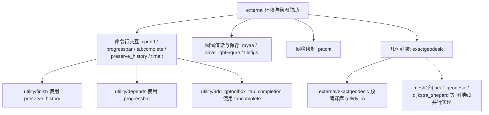

# 90.3 MATLAB 环境与绘图辅助（第三方） / MATLAB Environment and Plotting Helpers (Vendored)

> 本章覆盖 `external/` 目录下一组**与几何算法无关、面向 MATLAB 运行环境与图形窗口**的第三方
> vendored 代码：命令行彩色输出（`cprintf`）、路径规范化（`GetFullPath`）、命令行进度条
> （`progressbar`）、命令窗 Tab 补全设置（`tabcomplete`）、命令历史归档（`preserve_history`）、
> 函数计时基准（`timeit`）、图窗抗锯齿渲染（`myaa`）、去白边保存图窗（`saveTightFigure`）、
> 图窗平铺（`tilefigs`）、逐面纹理贴图绘制（`patcht`），以及精确测地距离封装（`exactgeodesic`）。
>
> This chapter covers a set of **geometry-agnostic, MATLAB-environment & figure-window oriented**
> vendored third-party files in `external/`: colored command-window output (`cprintf`), path
> canonicalization (`GetFullPath`), an inline progress bar (`progressbar`), Command-Window
> tab-completion setup (`tabcomplete`), command-history archiving (`preserve_history`), function
> benchmarking (`timeit`), anti-aliased figure rendering (`myaa`), margin-free figure saving
> (`saveTightFigure`), figure tiling (`tilefigs`), per-face textured drawing (`patcht`) and an
> exact-geodesic wrapper (`exactgeodesic`).

- 语言 / Language：中英对照（中文为主）
- 相关章节 / See also：[90-external/README.md](README.md)、
  [90.1 色图与颜色](01-colormaps-and-color.md)、[90.2 数值线性代数助手](02-numeric-linear-algebra.md)、
  [90.2b 几何与格式助手](02b-geometry-and-format-helpers.md)、
  [appendices/03-doc-template.md](../appendices/03-doc-template.md)、
  [00-overview/05-dependency-map.md](../00-overview/05-dependency-map.md)
- 命名约定 / Notation：本章函数多**无几何参数**或仅受 `V`/`F` 尺寸约定约束；
  `handles` 表示图窗句柄数组，`p` 表示进度百分比，`K` 表示超采样倍率，`w` 表示进度条宽度。
- 重要声明 / Disclaimer：`external/` 为**第三方 vendored 代码**，其函数名/作者/许可由**文件头**决定；
  本节忠实记录文件头所述署名，并在发现**遮蔽 MATLAB 内置**或**与本库其它模块功能重叠**时明确标注。

---

## 本章概览 / Chapter Overview

**模块职责 / Module responsibility**

- `external/` 收录由**其它作者**编写、gptoolbox 直接附带（vendored）的 MATLAB 代码。本章 11 个文件
  覆盖"让 MATLAB 用起来更顺手"的一类工具：彩色/补全/进度条/计时/历史、图形窗口的渲染、保存、
  平铺与纹理贴图，以及一个依赖预编译动态库的精确测地计算封装。
- 这些文件**大多不是 gptoolbox 原创**，命名/许可参见各自文件头；少数（如 `patcht`、`exactgeodesic`）
  被 gptoolbox 作者 Alec Jacobson 小幅改编以接入本库。

### 函数总表 / Function overview

| 函数 / Function | 来源 / 署名 (Attribution) | 是否遮蔽内置 / Shadows builtin | 一句话功能 / One-line purpose |
|---|---|---|---|
| `cprintf` | Yair Altman（File Exchange，2009，BSD 式"保留署名即可自由使用"） | 否（新增） | 用语法高亮样式输出彩色格式化文本 |
| `GetFullPath` | Jan Simon（MathWorks File Exchange，BSD） | 否（无同名内置） | 求文件/目录的绝对规范路径 |
| `progressbar` | Gabriel Peyre（BSD，2009） | 否（`external/` 内另有同名副本） | 命令行内联进度条 |
| `tabcomplete` | Yair Altman（File Exchange，2010） | 否（新增） | 改 `TC.xml` 设置函数参数 Tab 补全 |
| `preserve_history` | Bogdan Roman（Univ. of Cambridge，2014） | 否（新增） | 把命令历史无限期归档到 `history_saved.m` |
| `timeit` | Steve Eddins / The MathWorks（BSD） | **是**（遮蔽 MATLAB 内置 `timeit`） | 鲁棒函数计时基准 |
| `myaa` | Anders Brun（BSD，2009；Alec Jacobson 改编） | 否（新增） | 超采样渲染 + 降采样抗锯齿 |
| `saveTightFigure` | Emre Akbas（BSD，2011，头部署"a grad student"） | 否（新增） | 去白边保存图窗 |
| `tilefigs` | Charles Plum（Nichols Research Corp.） | 否（新增） | 平铺排列所有打开的图窗 |
| `patcht` | D.-J. Kroon（Univ. Twente，2010；Alec Jacobson 改编） | 否（与 `mesh/` 纹理贴图重叠） | 逐三角面 `surface` 绘制带纹理网格 |
| `exactgeodesic` | 无可考署名 / no attribution in header（封装 Danil Kirsanov 的 `exactgeodesic` 库） | 否（与 `mex/exact_geodesic`、`mesh/` 测地线重叠） | 精确测地距离与梯度 |

### 模块关系图 / Module relationship diagram



---

## 逐函数详解 / Per-function reference

### `cprintf` — 命令行彩色/样式化格式化输出
- **文件 / File**: [external/cprintf.m](file:///c:/VSWork/gptoolbox-1/external/cprintf.m#L1-L579)
- **署名 / Attribution**: 作者 **Yair Altman**（`altmany(at)gmail.com`，UndocumentedMatlab，`$Revision: 1.08$ 2012/10/17`）；许可：文件头声明"保留原作者署名即可自由使用与修改"，文末附 **BSD 式**条款（`Copyright (c) 2009, Yair Altman`）。
- **签名 / Signature**: `count = cprintf(style,format,varargin)`
- **功能 / Purpose**: `EN: Display text in the Command Window using MATLAB's syntax-highlighting styles (or a user color/underline/bold), via undocumented Java APIs; delegates to plain fprintf when not on the desktop.` / 中文：用 MATLAB 语法高亮样式（或自定义颜色/下划线/加粗）在命令窗显示格式化文本；非桌面/编译环境自动退化为普通 `fprintf`。
- **输入 / Inputs**:

  | 参数 | 尺寸/类型 | 含义 (中 / EN) |
  |---|---|---|
  | `style` | `char` / `1 by 3` 数值 / `double` 句柄 | 样式名（大小写不敏感、可唯一前缀），或 RGB 向量 / style name or RGB |
  | `format` | `char` | 与 `sprintf`/`fprintf` 完全一致的格式串 / format string |
  | `varargin` | 任意 | 透传为 `format` 的占位参数 / format arguments |

- **输出 / Outputs**:

  | 参数 | 尺寸/类型 | 含义 |
  |---|---|---|
  | `count` | `double` | 仅在 `nargout>0` 时返回 `fprintf` 写入的字符数 / chars written |

- **可选参数 / Optional**（`cprintf` 非 Name/Value 接口；以下为 `style` 的约定形式）:

  | 名称 | 取值 | 默认 | 含义 |
  |---|---|---|---|
  | 预定义样式 | `'Text'`/`'Keywords'`/`'Comments'`/`'Strings'`/`'UnterminatedStrings'`/`'SystemCommands'`/`'Errors'`/`'Hyperlinks'` 及 `'Black'..'White'` | `'Text'` | 语法高亮/颜色名 / highlight or color name |
  | 下划线前缀 | 以 `-` 或 `_` 开头，如 `'-Blue'`、`'_Comments'` | 无 | 下划线样式 / underlined |
  | 加粗前缀 | 以 `*` 开头，如 `'*Blue'`（R2011b+） | 无 | 加粗样式 / bold |
  | RGB 向量 | `[r g b]`（0–1），可带 `-`/`*`，如 `-[1,0,1]` | 无 | 自定义颜色 / custom RGB |
  | 无参调用 | `cprintf` | — | 打印内置 **demo** 并返回 / shows demo |
  | 单参调用 | `cprintf('string')` | `style='text'` | 等价于 `fprintf('string')` |

- **变量流动 / Variable flow**: `style,format,varargin →(nargin<1? showDemo 并 return)→(nargin<2? format=style; style='text')→(isdeployed | ~usejava('desktop')? count1=fprintf(format,varargin{:})) : (processStyleInfo(style)→underlineFlag,boldFlag,styleName → 若 underline 包 '<a href="">…</a>'、若 bold 包 '<strong>…</strong>' → cmdWinDoc= CmdWinDocument.getInstance; lastPos=getLength → count1=fprintf(2,format,varargin{:}) → drawnow → while docElement.getStartOffset<getLength: setElementStyle(docElement,styleName,specialFlag,…))→(nargout? count=count1)`
- **算法步骤 / Algorithm**:
  1. 取版本号（`persistent majorVersion/minorVersion`，由 `sscanf(version,'%d.',2)` 得到分/主版本，L117–L126）。
  2. `nargin<1` → 调用子函数 `showDemo` 打印并 `return`；`style` 为空 → 直接返回（L131–L132）。
  3. `nargin<2` → `format=style; style='text'`（L139）。
  4. `isdeployed | ~usejava('desktop')` → 走**纯 `fprintf`** 分支（无样式），否则走桌面分支（L144–L151）。
  5. 桌面分支：`processStyleInfo` 解析下划线/加粗标记并归一化样式名（数字 RGB → `getColorStyle` 生成 `'[r,g,b]'` 样式名并 `Prefs.setColorPref`；样式名走 `strncmpi` 前缀匹配 + 唯一性检查；`Hyperlinks` → 下划线）（L154–L337）。
  6. 取命令窗文档对象 `CmdWinDocument.getInstance` 的当前位置 `lastPos`；`fprintf(2,format,varargin{:})` 把文本打到**标准错误流**（命令窗以红色捕获再改样式），`drawnow`（L177–L211）。
  7. `while docElement.getStartOffset < cmdWinDoc.getLength`：循环调用 `setElementStyle` 对**新生成的文档元素**逐个套用颜色（L229–L239），最后 `xCmdWndView.repaint` 重绘（L243）。
  8. 若 `nargout` 非零则 `count=count1`（L252–L254）。
- **流程图 / Flowchart**:

  ```mermaid
  flowchart TD
    A["输入 style,format,varargin"] --> B{"nargin < 1 ?"}
    B -- 是 --> B1["showDemo 并 return"]
    B -- 否 --> C{"nargin < 2 ?"}
    C -- 是 --> C1["format=style; style='text'"]
    C -- 否 --> D
    C1 --> D{"isdeployed 或 ~usejava('desktop') ?"}
    D -- 是 --> E["count1 = fprintf(format,varargin{:})"]
    D -- 否 --> F["processStyleInfo → underlineFlag,boldFlag,styleName"]
    F --> G{"下划线?"}
    G -- 是 --> G1["format 包 <a href=''>…</a>"]
    G -- 否 --> H
    G1 --> H{"加粗?"}
    H -- 是 --> H1["format 包 <strong>…</strong>"]
    H -- 否 --> I
    H1 --> I["取 CmdWinDocument.lastPos; fprintf(2,format,…); drawnow"]
    I --> J{"docElement.getStartOffset < cmdWinDoc.getLength ?"}
    J -- 是 --> J1["setElementStyle(docElement,styleName,…); 取下一段"]
    J1 --> J
    J -- 否 --> K["xCmdWndView.repaint"]
    K --> Z{"nargout ?"}
    Z -- 是 --> Z1["count = count1"]
    Z -- 否 --> Z2["无输出"]
    E --> Z2
    Z1 --> Z3["输出 count"]
  ```
- **依赖 / Dependencies**: Java 内部 API `com.mathworks.mde.cmdwin.CmdWinDocument`、`com.mathworks.mde.desk.MLDesktop`、`com.mathworks.services.Prefs`、`java.awt.Color`；`usejava`/`isdeployed`/`fprintf`/`sprintf`/`strncmpi`/`sscanf`（内置）。**要求 MATLAB 桌面（JVM + Command Window）**，否则退化为普通 `fprintf`。
- **See also**: `sprintf`, `fprintf`, `tabcomplete`
- **备注 / Note**: 依赖**未公开、不受支持**的 Java 内部接口（作者自述"use at your own risk"）；在 R2011a 及更早版本有多处渲染 bug（见文件头 Limitations）；`external/` 内**未见其它函数调用** `cprintf`。**不遮蔽任何内置**（`cprintf` 非 MATLAB 内置）。

### `GetFullPath` — 求绝对规范路径
- **文件 / File**: [external/GetFullPath.m](file:///c:/VSWork/gptoolbox-1/external/GetFullPath.m#L1-L331)
- **署名 / Attribution**: 作者 **Jan Simon**（`matlab.2010(a)n(MINUS)simon.de`，Heidelberg，`(C) 2009-2019`）；许可：**BSD**（`$License: BSD (use/copy/change/redistribute on own risk, mention the author) $`，L65）。同源另有更快的 MEX 版 `GetFullPath.c`（需自行编译，**仓库内未附**）。
- **签名 / Signature**: `File = GetFullPath(File, Style)`
- **功能 / Purpose**: `EN: Return the absolute canonical path of a (possibly non-existing, possibly relative, possibly long/UNC) file or folder, adding the Windows magic prefix '\\?\' on demand.` / 中文：返回文件/目录的**绝对规范路径**（可不存在、可为相对路径、支持 Unicode/UNC/超长名），并在 Windows 下按需追加 `\\?\` 长路径魔法前缀。
- **输入 / Inputs**:

  | 参数 | 尺寸/类型 | 含义 (中 / EN) |
  |---|---|---|
  | `File` | `char` / cell of char / `[]` | 绝对或相对路径，**无需存在**；`[]` 视为当前目录 / name or `[]`→cwd |
  | `Style` | `char` | 长名处理策略 / long-name style (optional) |

- **输出 / Outputs**:

  | 参数 | 尺寸/类型 | 含义 |
  |---|---|---|
  | `File` | `char` / cell of char | 规范化后的绝对路径（`\\?\` 或 `\\?\UNC` 按需添加）/ canonical absolute path |

- **可选参数 / Optional**:

  | 名称 | 取值 | 默认 | 含义 |
  |---|---|---|---|
  | `Style` | `'auto'` | `'auto'` | 仅当路径 ≥ `MAX_PATH`(260) 时加 `\\?\` / add magic prefix on demand |
  | `Style` | `'lean'` | — | 从不加魔法前缀 / never add |
  | `Style` | `'fat'` | — | 短名也强制加前缀 / always add |

  > 非 Windows（Linux/macOS）下 `Style` 被忽略。

- **变量流动 / Variable flow**: `File,Style →(nargin<2? Style='auto')→(isa cell? 逐元素递归 GetFullPath 后 return)→ isWIN=strncmpi(computer,'PC',2); MAX_PATH=260 →(isempty(File)? File=cd; return)→ ischar 检查 →【Windows】File=strrep('/','\') → 去掉已有 `\\?\`/`\\?\UNC\` → isUNC=strncmp(File,'\\',2) → 非 UNC 时按 cd 盘符/当前目录补全（含 `C:` 特例走 cd(cd(File))）→【Linux/Mac】File=strrep('\','/') → `~`→getenv('HOME')；相对则拼 cd →（若含 `[FSep '.']`）切分 C（`dataread` 或 `regexp`）→ 去 `'.'`、对 `'..'` 递归消解 → 重组 Drive+C{R} →（isWIN 且 (auto&len≥260 或 fat)) 追加 `\\?\` / `\\?\UNC` → File
- **算法步骤 / Algorithm**:
  1. `nargin<2` → `Style='auto'`；`isa(File,'cell')` 时对每个元素递归调用后 `return`（L100–L112）。
  2. `isWIN=strncmpi(computer,'PC',2)`；`MAX_PATH=260`；`persistent hasDataRead` 仅探测一次 `which('dataread')`（决定用 `dataread` 还是 `regexp` 切分）（L115–L134）。
  3. `isempty(File)` 且为 char/数值 → `File=cd; return`；非空非 char → 报错（L136–L149）。
  4. **Windows 分支**：`'/'`→`'\'`；剥离已有魔法前缀（`\\?\UNC\` 变双反斜杠，`\\?\` 直接去掉）；判断 `isUNC`；非 UNC 时用 `cd` 结果（盘符/UNC 当前目录）与 `File` 拼接，`"C:"` 盘特例用 `cd(cd(File))` 求盘上当前目录（L151–L215）。
  5. **Unix/Mac 分支**：`'\'`→`'/'`；`~`/`~/` 展开为 `HOME`；相对路径前缀当前目录（L217–L237）。
  6. 若路径含 `[FSep '.']`（即含 `\.` 或 `\.\.`）：按分隔符切分为 `C`，删除 `'.'`，再从前往后对每个 `'..'` 执行"删除自身 + 删除前一个"消解（`R` 索引法），最后按 `Drive`+`C{R}` 重组（Windows 用 `\\` 连接，Unix 用 `/`）（L239–L310）。
  7. Windows 下按 `Style` 与长度决定是否加 `\\?\` / `\\?\UNC`（L312–L329）。
- **流程图 / Flowchart**:

  ```mermaid
  flowchart TD
    A["输入 File,Style"] --> B{"isa(File,'cell') ?"}
    B -- 是 --> B1["逐元素递归 → 返回 cell"]
    B -- 否 --> C{"isempty(File) ?"}
    C -- 是 --> C1["File = cd; 返回"]
    C -- 否 --> D{"ischar(File) ?"}
    D -- 否 --> D1["error 类型错误"]
    D -- 是 --> E{"isWIN (computer 以 PC 开头) ?"}
    E -- 是 --> F["'/'→'\\'; 剥离已有前缀; isUNC 判断; 补全 cd 盘符"]
    E -- 否 --> G["'\\'→'/'; 展开 ~ ; 相对路径拼接 cd"]
    F --> H{"路径含 '\\ .' 或 '\\ ..' ?"}
    G --> H
    H -- 否 --> K
    H -- 是 --> I["切分 C; 去 '.'; 对 '..' 递归消解"]
    I --> J["Drive + C{R} 重组"]
    J --> K{"isWIN 且 (auto&len>=260 或 fat) ?"}
    K -- 是 --> K1["加 '\\\\?\\' 或 '\\\\?\\UNC'"]
    K -- 否 --> Z["输出 File"]
    K1 --> Z
  ```
- **依赖 / Dependencies**: `dataread`（旧版可用）**或** `regexp(...,'split')`；`which`、`cd`、`computer`、`strncmpi`、`strfind`、`sprintf`、`getenv`、`ischar`、`isnumeric`（内置）。**不使用 Java**（`java.io.File` 出现在 MEX 版/其它实现中，本 `.m` 版仅用 `cd` + 字符串运算）。配套 MEX `GetFullPath.c` 可加速但**未随仓库提供**。
- **See also**: `cd`, `fullfile`, `fileparts`, `tempprefix`
- **⚠️ 重叠 / 冲突标注**: 本库 `utility/` 中**没有同名 `GetFullPath`**（`Glob` 全库仅此一份 `.m`），故不与本库函数重名；但从职责看，`utility/` 的路径/工作区助手 [`tempprefix`](file:///c:/VSWork/gptoolbox-1/utility/tempprefix.m#L1)、[`is_writable`](file:///c:/VSWork/gptoolbox-1/utility/is_writable.m#L1) 与之同属"路径杂项"，功能上互补。仓库内实际调用点：[`mesh/load_mesh.m`](file:///c:/VSWork/gptoolbox-1/mesh/load_mesh.m#L39) 用 `read_triangle_mesh(GetFullPath(filename))` 把相对路径转绝对后再读。**不遮蔽 MATLAB 内置**（无内置 `GetFullPath`）。

### `progressbar` — 命令行内联进度条
- **文件 / File**: [external/progressbar.m](file:///c:/VSWork/gptoolbox-1/external/progressbar.m#L1-L73)
- **署名 / Attribution**: 文件头版权声明为 **Gabriel Peyre**（`Copyright (c) 2009, Gabriel Peyre`，**BSD**，L50–L73）。**注意**：常见同名 FEX 工具由 Steve Hoelzer 编写，但**本文件头部署名为 Gabriel Peyre**，此处以文件头为准。
- **签名 / Signature**: `progressbar(n,N,w)`
- **功能 / Purpose**: `EN: Delete the current line and redraw a fixed-width progress bar showing n out of N, using carriage-return-style backspaces; reprint only when the filled width changes.` / 中文：删除当前行并以固定宽度重绘"n / N"进度条；仅在填充宽度变化时重绘（用退格 `\b` 覆盖）。
- **输入 / Inputs**:

  | 参数 | 尺寸/类型 | 含义 (中 / EN) |
  |---|---|---|
  | `n` | 整数 | 已完成量，**应从 1 开始** / partial amount, start at 1 |
  | `N` | 整数 | 总量 / total amount |
  | `w` | 整数 | 进度条宽度 / bar width (optional) |

- **输出 / Outputs**: 无 / None（向命令窗打印，副作用为 `global pprev` 状态更新）
- **可选参数 / Optional**:

  | 名称 | 取值 | 默认 | 含义 |
  |---|---|---|---|
  | `w` | 正整数 | `80` | 进度条字符宽度 / bar width |

- **变量流动 / Variable flow**: `n,N,w →(nargin<3? w=80)→ p=min(floor(n/N*(w+1)),w) →(global pprev, isempty→-1)→(p~=pprev? ps=repmat(cprog,[1 w]); ps(1:p)=cprog1; ps=[cbeg ps cend]; n>1? fprintf(repmat('\\b',[1 length(ps)])); fprintf(ps))→ pprev=p →(n==N? fprintf('\\n'))`
- **算法步骤 / Algorithm**:
  1. `nargin<3` → `w=80`（L16–L18）。
  2. 定义字符：`cprog='□'`（未完成）、`cprog1='■'`（已完成）、`cbeg=''`、`cend=''`（L21–L26）。
  3. `p=min(floor(n/N*(w+1)),w)` 计算应填充的字符数（L28）。
  4. `global pprev`（**状态机核心**）：仅首次初始化为 `-1`（L30–L33）。
  5. 若 `p ~= pprev`（宽度有变化才重绘）：拼出 `ps`，若 `n>1` 先 `fprintf(repmat('\b',[1 length(ps)]))` 退格清行，再 `fprintf(ps)`（L35–L44）。
  6. `pprev=p`；`n==N` 时 `fprintf('\n')` 收尾换行（L45–L48）。
- **流程图 / Flowchart**:

  ```mermaid
  flowchart TD
    A["输入 n,N,w"] --> B{"nargin < 3 ?"}
    B -- 是 --> B1["w = 80"]
    B -- 否 --> C
    B1 --> C["p = min(floor(n/N*(w+1)), w)"]
    C --> D["global pprev (首次置 -1)"]
    D --> E{"p ~= pprev ?"}
    E -- 否 --> H
    E -- 是 --> F["ps = cprog 重复 w 次; ps(1:p)=cprog1; 加首尾字符"]
    F --> G{"n > 1 ?"}
    G -- 是 --> G1["fprintf 退格 \\b × length(ps) 清行"]
    G -- 否 --> G2
    G1 --> G2["fprintf(ps)"]
    G2 --> H["pprev = p"]
    H --> I{"n == N ?"}
    I -- 是 --> I1["fprintf('\\n')"]
    I -- 否 --> Z["结束"]
    I1 --> Z
  ```
- **依赖 / Dependencies**: `fprintf`/`repmat`/`isempty`（内置）；全局变量 `pprev`（跨调用状态）。**无 Java 依赖**；但 Unicode 方块字符 `□`/`■` 需命令窗字体支持。
- **See also**: `waitbar`, `depends`
- **⚠️ 重叠 / 冲突标注**: `external/` 内**另有一份同名 `progressbar`**：[`external/toolbox_fast_marching/toolbox/progressbar.m`](file:///c:/VSWork/gptoolbox-1/external/toolbox_fast_marching/toolbox/progressbar.m#L1)（同为 Gabriel Peyre，**旧版**：`w=20`、字符用 `'.'`/`'*'`、首尾 `[`/`]`）。两者同名会造成**路径顺序相关的歧义**。仓库内调用点：[`utility/depends.m`](file:///c:/VSWork/gptoolbox-1/utility/depends.m#L1) 用 `progressbar(nq-numel(Q),nq)` 显示依赖收集进度（见 [40.1 通用工具](file:///c:/VSWork/gptoolbox-1/docs/40-utility/01-utilities-core.md)）。**不遮蔽 MATLAB 内置**（无内置 `progressbar`）。

### `tabcomplete` — 设置函数参数的 Tab 补全
- **文件 / File**: [external/tabcomplete.m](file:///c:/VSWork/gptoolbox-1/external/tabcomplete.m#L1-L363)
- **署名 / Attribution**: 作者 **Yair Altman**（`altmany(at)gmail.com`，`$Revision: 1.02$ 2012/02/04`）；许可："保留原作者署名即可自由使用与修改"（L99–L103），文末附 **BSD 式**条款（`Copyright (c) 2010, Yair Altman`）。
- **签名 / Signature**: `definitions = tabcomplete(funcName, varargin)`
- **功能 / Purpose**: `EN: Set/unset/query the Command-Window argument tab-completions of a function by editing the MATLAB installation file [matlabroot '/toolbox/local/TC.xml'] (changes take effect after restart).` / 中文：通过改写 MATLAB 安装目录的 `[matlabroot '/toolbox/local/TC.xml']`，为指定函数**设置/清除/查询**命令行 Tab 参数补全（改动需重启 MATLAB 生效）。
- **输入 / Inputs**:

  | 参数 | 尺寸/类型 | 含义 (中 / EN) |
  |---|---|---|
  | `funcName` | `char` | 目标函数名（**仅支持小写**）/ function name (lowercase only) |
  | `varargin` | `char`/cell | 每个参数的补全类型 / arg types per argument |

- **输出 / Outputs**:

  | 参数 | 尺寸/类型 | 含义 |
  |---|---|---|
  | `definitions` | struct array | 全部（或指定函数的）补全定义 / current tab-completion definitions |

- **可选参数 / Optional**（`varargin` 中每个元素为预定义关键字或额外字符串值）:

  | 名称 | 取值 | 默认 | 含义 |
  |---|---|---|---|
  | `argType` | `'var'`/`'fun'`/`'subfun'`/`'dir'`/`'file'`/`'mfile'`/`'matfile'`/`'figfile'`/`'mdlfile'`/`'mcospkg'`/`'mcosclass'`/`'messageid'` | 未指定时自动取 `'subfun'` | 参数补全类型 / arg type keyword |
  | 额外值 | 任意字符串 / cell（如 `{'var','on','off'}` 或 `'var file on off'`） | 无 | 追加到弹出列表的字面值 / extra values |
  | `''`（末位） | 空串 | 无 | 表示后续参数不再补全（`tabcomplete(funcName,'')` 即**清空**）/ terminator |

- **变量流动 / Variable flow**: `funcName,varargin →(getCurrentXmlDefs→ defs,tcXmlFilename=[matlabroot '/toolbox/local/TC.xml'])→(nargin>1? 备份 .xml→.bak（copyfile）→ funcIdx=find(strcmpi({defs.functionName},funcName))（有 <arg> 子节点则取负）→ nodeXmlStr=getXmlStr(funcName,varargin{:}) → fullXmlStr=getFullXmlStr(...) → updateXmlFile(...))→(nargin==1? definitions=defs(匹配项) : definitions=defs)`
- **算法步骤 / Algorithm**:
  1. `getCurrentXmlDefs` 用 `xmlread` 解析 `TC.xml`，遍历所有 `binding` 与 `arg` 节点，填充 `defs(k).functionName/defaultType/extraValues/platform/functionArgs(previousArg,argType,extraValues)`（L165–L220）。
  2. 若 `nargin>1`：确保 `.bak` 备份（`questdlg` 询问，`copyfile`；用户可选"不再询问"以 `setpref(mfilename,'dontBackup',1)`）（L111–L128）。
  3. `funcIdx=find(strcmpi({defs.functionName},funcName))`；重复则报错；已存在且带 `functionArgs` 时取负（表示替换 `<arg>` 子节点）（L131–L136）。
  4. `getXmlStr` 把 `varargin` 转成 XML `<binding>`/`<arg argn ctype value/>` 文本；`getCtypeExtra` 用 `ismember(upper(values),argTypes)` 分离标准类型与额外值（无标准类型时警告并回退 `'SUBFUN'`；对 R2010a–R2011b 的额外值 bug 用 `questdlg` 询问）（L228–L305）。
  5. `getFullXmlStr` 用 `urlread('file:///…TC.xml')` 读全文，`regexprep` 定位并替换/追加节点（L308–L323）。
  6. `updateXmlFile`：`fileattrib('+w')` 尝试可写 → `fopen(...,'wb')` → `fprintf` → `fclose`（L326–L338）。
  7. 返回 `definitions`：`nargin==1` 时只返回该函数的定义，否则返回全部 `defs`（L147–L153）。
- **流程图 / Flowchart**:

  ```mermaid
  flowchart TD
    A["输入 funcName,varargin"] --> B["getCurrentXmlDefs: xmlread 解析 TC.xml → defs,path"]
    B --> C{"nargin > 1 ?"}
    C -- 否 --> H
    C -- 是 --> D{"存在 .bak 备份?"}
    D -- 否 --> D1["questdlg 询问 → copyfile 备份 / setpref 不再询问"]
    D -- 是 --> E
    D1 --> E["funcIdx = find(strcmpi(defs.functionName, funcName))"]
    E --> F["getXmlStr → nodeXmlStr (ctype/extra)"]
    F --> G["getFullXmlStr (urlread+regexprep) → updateXmlFile (fopen/fprintf)"]
    G --> H{"nargin == 1 ?"}
    H -- 是 --> H1["definitions = 该函数定义"]
    H -- 否 --> H2["definitions = 全部 defs"]
    H1 --> Z["输出 definitions"]
    H2 --> Z
  ```
- **依赖 / Dependencies**: `xmlread`、`urlread`、`questdlg`（**需桌面**）、`copyfile`、`setpref`/`ispref`、`regexprep`/`regexp`、`textscan`、`fopen`/`fprintf`/`fclose`、`fileattrib`（内置）；改写目标 `[matlabroot '/toolbox/local/TC.xml']`。
- **See also**: `cprintf`, `add_gptoolbox_tab_completion`
- **备注 / Note**: 依赖**未公开**的 `TC.xml`/`TC.xsd` 格式；只支持小写函数名（受 `TC.xsd` 第 20 行 pattern 限制）；R2010a–R2011b 的额外值有 100% CPU 死循环 bug（有交互提示）。仓库内调用点：[`utility/add_gptoolbox_tab_completion.m`](file:///c:/VSWork/gptoolbox-1/utility/add_gptoolbox_tab_completion.m#L1)。**不遮蔽 MATLAB 内置**（无内置 `tabcomplete`）。

### `preserve_history` — 命令历史永久归档
- **文件 / File**: [external/preserve_history.m](file:///c:/VSWork/gptoolbox-1/external/preserve_history.m#L1-L70)
- **署名 / Attribution**: 作者 **Bogdan Roman**（`abr28@cam.ac.uk`，University of Cambridge，2014）（L9）。文件内**未声明许可证**。
- **签名 / Signature**: `preserve_history ()`（无输入、无输出）
- **功能 / Purpose**: `EN: Merge the current Command-Window history into a user preference file history_saved.m so the history is kept indefinitely despite MATLAB truncating history.m; handles both the legacy format and the R2014a+ XML format.` / 中文：把当前命令历史**增量合并**到用户偏好目录下的 `history_saved.m`，从而突破 MATLAB 对 `history.m` 的定长截断限制；兼容 R2014a+ 的 XML 历史格式。
- **输入 / Inputs**: 无 / None（经 `prefdir` 自动定位历史文件）
- **输出 / Outputs**: 无 / None（文件系统副作用 + `fprintf`/`disp` 提示）
- **可选参数 / Optional**: 无 / None
- **变量流动 / Variable flow**: `→ savpath=fullfile(prefdir,'history_saved.m') →(hpath=fullfile(prefdir,'History.xml') 存在? mathist=fileread(hpath); regexprep 去 XML 标签; strrep 还原 &gt;/&lt; : mathist=fileread(fullfile(prefdir,'history.m')))→ mathist →(regexprep 把 \r 归一为 \n)→(exist(savpath)? 【合并】: 【首次全量写】)→(合并: 找 savhist 内 '^%-- \\d.*?$' 最后日期 savlastdate → 在 mathist 中定位 → 未找到则 append 全量，找到则 fopen 'r+' + fseek 到该日期处 + fwrite 覆盖)→ disp('Done')`
- **算法步骤 / Algorithm**:
  1. `savpath=fullfile(prefdir,'history_saved.m')`（L11）。
  2. 若 `History.xml`（R2014a+）存在：`fileread` 后 `regexprep(mathist,'(<[^>]+>\s*)+','\n','lineanchors')` 去标签，再 `strrep` 还原 `&gt;`/`&lt;`；否则读 `history.m`（L13–L25）。
  3. `regexprep(mathist,'\r(\n)?','\n')` 把 CR/CRLF 归一为 LF，保证跨 OS 安全（L28）。
  4. 若 `history_saved.m` **不存在**：直接 `fopen('w')`+`fwrite` 全量写入并 `return`（L33–L38）。
  5. 否则 `fileread` 整个 `savhist`，用 `regexp(savhist,'^%-- \d.*?$','lineanchors')` 找**最后保存日期**（`\d` 用于排除 `Unknown date`）；找不到则整段 `append`（L44–L52）。
  6. 找到时：取 `savlastdate`，在 `mathist` 中用 `regexp(['^' savlastdate],'lineanchors')` 定位；未命中则整段 `append`；命中则 `fopen('r+')` + `fseek(savstart(end)-1,'bof')` + `fwrite` **从该日期起覆盖**，实现增量合并（L53–L69），最后 `disp('Done')`（L70）。
- **流程图 / Flowchart**:

  ```mermaid
  flowchart TD
    A["调用 preserve_history()"] --> B["savpath = prefdir/history_saved.m"]
    B --> C{"History.xml 存在 ?"}
    C -- 是 --> C1["fileread + regexprep 去标签 + strrep 还原实体"]
    C -- 否 --> C2["fileread prefdir/history.m"]
    C1 --> D["mathist: 归一 CR/CRLF → LF"]
    C2 --> D
    D --> E{"history_saved.m 存在 ?"}
    E -- 否 --> E1["fopen 'w' + fwrite 全量写入; return"]
    E -- 是 --> F["fileread savhist; 找最后 '^%-- \\d' 日期"]
    F --> G{"找到日期 ?"}
    G -- 否 --> G1["fopen 'a' + fwrite 整段追加"]
    G -- 是 --> H{"mathist 中含该日期 ?"}
    H -- 否 --> G1
    H -- 是 --> H1["fopen 'r+' + fseek 到日期 + fwrite 覆盖"]
    E1 --> Z["disp('Done')"]
    G1 --> Z
    H1 --> Z
  ```
- **依赖 / Dependencies**: `prefdir`、`fileread`、`regexprep`、`regexp`、`strrep`、`fopen`/`fwrite`/`fseek`/`fclose`、`exist`、`fullfile`、`disp`（内置）。**无 Java**。
- **See also**: `finish`, `last_command`
- **备注 / Note**: 仓库内调用点：[`utility/finish.m`](file:///c:/VSWork/gptoolbox-1/utility/finish.m#L1) 在退出 MATLAB 时于 `try/catch` 中调用本函数（见 [40.1 通用工具](file:///c:/VSWork/gptoolbox-1/docs/40-utility/01-utilities-core.md)）。**不遮蔽 MATLAB 内置**（无内置 `preserve_history`）。

### `timeit` — 鲁棒函数计时
- **文件 / File**: [external/timeit.m](file:///c:/VSWork/gptoolbox-1/external/timeit.m#L1-L1201)
- **署名 / Attribution**: 作者 **Steve Eddins**，`Copyright 2008-2010 The MathWorks, Inc.`（L40–L41；文末另有 `Copyright (c) 2010, The MathWorks, Inc.` 的 **BSD** 条款），即 MathWorks 官方 `timeit` 的**早期版本**。
- **签名 / Signature**: `[t, measurement_overhead, measurement_details] = timeit(f, num_outputs)`
- **功能 / Purpose**: `EN: Measure the time to run function handle f robustly: warm up, estimate rough cost, run an inner timing loop repeated in an outer loop, take the median, and subtract the estimated tic/toc + function-handle measurement overhead.` / 中文：鲁棒测量函数句柄 `f` 的运行时间——先预热、粗略估计耗时、按估算选择内/外层循环次数、取中位数，再**扣除** `tic/toc` 与函数句柄调用的测量开销。
- **输入 / Inputs**:

  | 参数 | 尺寸/类型 | 含义 (中 / EN) |
  |---|---|---|
  | `f` | function handle | 待计时函数 / function to time |
  | `num_outputs` | 整数 0..7 | `f` 的输出个数 / number of outputs (optional) |

- **输出 / Outputs**:

  | 参数 | 尺寸/类型 | 含义 |
  |---|---|---|
  | `t` | `double` | 扣除开销后的单次耗时（秒）/ corrected time |
  | `measurement_overhead` | `double` | 估计的测量开销（秒）/ estimated overhead |
  | `measurement_details` | struct | 各成分开销明细 / overhead breakdown |

- **可选参数 / Optional**:

  | 名称 | 取值 | 默认 | 含义 |
  |---|---|---|---|
  | `num_outputs` | `0..7` | `min(numOutputs(f),1)` | `f` 的输出个数；>7 时警告并按 7 调用 / outputs count |

- **变量流动 / Variable flow**: `f,num_outputs →(nargin<2? num_outputs=min(numOutputs(f),1))→ t_rough=roughEstimate(f,num_outputs) → num_inner_iterations=max(ceil(0.001/t_rough),1) → num_outer_iterations=11（若 est=11×inner×t_rough>15s 则缩减但≥3）→ times(num_outer_iterations) →(for k: switch num_outputs → tic; for p=1:inner: f(); toc)→ t=median(times)/num_inner_iterations → measurement_details.{EmptyFunctionCallTime,SimpleFunctionHandleCallTime,AnonymousFunctionHandleCallTime,TicTocCallTime} → measurement_overhead=tictocCallTime()/inner+functionHandleCallOverhead(f) → t=max(t-overhead,0) →(t<5×overhead? warning)`
- **算法步骤 / Algorithm**:
  1. `nargin<2` → `num_outputs=min(numOutputs(f),1)`（`numOutputs` 用 `nargout(f)`；为 -1 时 `try f()` 判定）（L43–L50, L232–L258）。
  2. `roughEstimate`：先两次空 `tic/toc` **预热**；循环调用 `f` 直到累计 ≥ 1ms，丢弃第一次计时，取中位数（L52, L156–L230）。
  3. 由 `t_rough` 定内层次数 `num_inner_iterations=max(ceil(0.001/t_rough),1)`；外层固定 `num_outer_iterations=11`，若预计总时长 > `long_time=15`s 则缩减（下限 3）（L54–L70）。
  4. **外层循环** `k=1:num_outer_iterations`：按 `num_outputs` 用**硬编码的 `switch` 分支**（`tic` → 内层 `f()` 循环 → `toc`），避免逗号分隔输出带来的额外开销（L74–L139）。
  5. `t=median(times)/num_inner_iterations`（L141）。
  6. 计算 `measurement_details`（空函数、简单句柄、匿名句柄、`tic/toc` 各自开销，均带 `persistent` 缓存）与 `measurement_overhead`（L143–L148）。
  7. `t=max(t-measurement_overhead,0)`；若 `t<5×overhead` 发 `MATLAB:timeit:HighOverhead` 警告（L150–L154）。
- **流程图 / Flowchart**:

  ```mermaid
  flowchart TD
    A["输入 f,num_outputs"] --> B{"nargin < 2 ?"}
    B -- 是 --> B1["num_outputs = min(numOutputs(f),1)"]
    B -- 否 --> C
    B1 --> C["t_rough = roughEstimate(f,num_outputs)（含预热）"]
    C --> D["num_inner = max(ceil(0.001/t_rough),1)"]
    D --> E{"estimated_running_time > 15s ?"}
    E -- 是 --> E1["num_outer = max(ceil(15/(inner*t_rough)),3)"]
    E -- 否 --> E2["num_outer = 11"]
    E1 --> F
    E2 --> F["k = 1:num_outer"]
    F --> G{"k <= num_outer ?"}
    G -- 是 --> G1["switch num_outputs: tic; for p=1:num_inner f(); toc → times(k)"]
    G1 --> G
    G -- 否 --> H["t = median(times)/num_inner"]
    H --> I["measurement_details.*; measurement_overhead = tictoc/inner + handleOverhead"]
    I --> J["t = max(t - overhead, 0)"]
    J --> K{"t < 5×overhead ?"}
    K -- 是 --> K1["warning HighOverhead"]
    K -- 否 --> Z["输出 t, overhead, details"]
    K1 --> Z
  ```
- **依赖 / Dependencies**: 内部子函数 `roughEstimate`、`numOutputs`、`tictocCallTime`、`tictocTimeExperiment`、`functionHandleCallOverhead`、`simpleFunctionHandleCallTime`、`anonFunctionHandleCallTime`、`functionHandleTimeExperiment`、`emptyFunctionCallTime`、`emptyFunctionTimeExperiment`、`emptyFunction`；`tic`/`toc`、`nargout`、`functions`、`median`、`warning`（内置）。**无需任何工具箱**。
- **See also**: `tic`, `toc`, `cputime`, `bench`
- **⚠️ 遮蔽 / 冲突标注**: **本文件遮蔽 MATLAB 内置 `timeit`**（R2013b 起 MATLAB 自带内置 `timeit`）。当 `external/` 在搜索路径上且优先于内置时，`timeit` 会解析到此 vendored 版本。两者接口相近（内置签名 `t = timeit(f)`，此处额外返回 `measurement_overhead`/`measurement_details`），但**实现来源为 MathWorks 旧版源码**而非内置实现。若不希望遮蔽，应避免 `addpath('external')` 或改用 `builtin('timeit',f)`。此外其内部还**定义了子函数 `numOutputs`**（非本库函数，仅局部）。

### `myaa` — 超采样渲染 + 降采样抗锯齿（"My Anti-Aliasing"）
- **文件 / File**: [external/myaa.m](file:///c:/VSWork/gptoolbox-1/external/myaa.m#L1-L393)
- **署名 / Attribution**: 作者 **Anders Brun**（`anders@cb.uu.se`，Uppsala，`Copyright (c) 2009, Anders Brun`，**BSD**，L370–L393；版本 1.1, 2008-08-21）。**Alec Jacobson 改编**：文件内注明"adapted to produce an output image according to http://www.alecjacobson.com/weblog/?p=2662"（L109–L111），并引入 `'raw'` 模式（`[FIG,RAW] = MYAA(K,AAMETHOD,FIGMODE)`）。
- **签名 / Signature**: `[varargout] = myaa(varargin)`
- **功能 / Purpose**: `EN: Render the current figure at K× supersampling resolution, apply a low-pass (Butterworth) filter or imresize, downsample by factor D, and display the anti-aliased bitmap in a new figure (or return the raw image).` / 中文：以 `K` 倍超采样分辨率离屏渲染当前图窗，经 Butterworth 低通滤波（或 `imresize`）后按 `D` 倍降采样，得到抗锯齿位图并在新图窗展示（或直接返回原始图像）。
- **输入 / Inputs**:

  | 参数 | 尺寸/类型 | 含义 (中 / EN) |
  |---|---|---|
  | `varargin{1}` | `K` / `[K D]` / `'publish'`/`'update'`/`'lazyupdate'`/`'raw'`/`{'raw',scale}` | 超采样倍率或模式串 / supersampling factor or mode |
  | `varargin{2}` | `char` | 降采样方法 `'standard'`/`'imresize'`/`'noshrink'` / aamethod |
  | `varargin{3}` | `char` | 显示模式 `'figure'`/`'update'`/`'publish'` / figmode |

- **输出 / Outputs**:

  | 参数 | 尺寸/类型 | 含义 |
  |---|---|---|
  | `varargout{1}` | figure handle 或图像 | `nargout==1`：新图窗句柄；`'raw'` 模式：位图 / figure handle or raw image |
  | `varargout{2}` | `H by W by 3` double | `nargout==2` 时同时返回原始位图 / raw image |

- **可选参数 / Optional**:

  | 名称 | 取值 | 默认 | 含义 |
  |---|---|---|---|
  | `K` | 标量或 `[K D]`，`K ≤ 16` | `[4 4]` | 超采样与降采样倍率 / supersampling & downsampling |
  | `AAMETHOD` | `'standard'`/`'imresize'`/`'noshrink'` | 自动（有 `imresize` 则 `'imresize'`，否则 `'standard'`） | 降采样方法 / downsampling method |
  | `FIGMODE` | `'figure'`/`'update'`/`'publish'`/`'lazyupdate'`/`'raw'` | `'figure'` | 显示模式 / display mode |

- **变量流动 / Variable flow**: `varargin →(解析 self.K/self.aamethod/self.figmode)→(screen_DPI=get(0,'ScreenPixelsPerInch'); self.scale=1)→(myconv=@imfilter 或 @conv2)→ print(source_fig,['-r',num2str(scale*DPI*K(1))],'-dpng',tempfile) → raw_hires=imread(tempfile); delete(tempfile) →(aamethod: 'standard'/'noshrink': kk=lpfilter(K(2)*3,K(2)*0.9,2); 对每通道 myconv(...,kk,'same') 归一化后按 K(2) 抽稀; 'imresize': imresize(raw_hires,1/K(2),'bilinear')/255)→ raw_lowres →(figmode 分支: figure/publish/update/lazyupdate/raw → 建/更新图窗并 image(raw_lowres))→ set(gcf,'userdata',self); set(gcf,'KeyPressFcn',@keypress) →(raw? varargout{1}=raw_lowres : fig[/raw_lowres])`
- **算法步骤 / Algorithm**:
  1. `drawnow` 强制刷新图形；`screen_DPI=get(0,'ScreenPixelsPerInch')`；选卷积核 `myconv`（有 `imfilter` 用之，否则 `conv2`）（L113–L131）。
  2. 解析参数：无参 → `K=[4 4]`、自动选 `aamethod`、`figmode='figure'`；`'publish'`/`'update'`/`'lazyupdate'`/`'raw'` 各设对应模式；单数值参数 `K`（>16 报错）；两/三参数分别补 `aamethod`/`figmode`（L133–L197）。
  3. **超采样渲染**（非 `lazyupdate`）：临时保存/设置 `PaperPositionMode='auto'`、`InvertHardcopy='off'`，`print(fig,['-r',num2str(scale*DPI*K(1))],'-dpng',tempfile)`，`imread` 得 `raw_hires`，`delete` 临时文件并恢复属性（L199–L216）。
  4. **降采样抗锯齿**：`'standard'`/`'noshrink'` 用 `lpfilter` 生成 Butterworth 核 `kk`，对每个色彩通道 `myconv(...,kk,'same')` 并归一化；`'standard'` 再按 `K(2)` 采样抽稀；`'imresize'` 直接用 `imresize(...,1/K(2),'bilinear')/255`（L217–L241）。
  5. **放置图像**：按 `figmode` 建新图窗（`figure`/`publish`）、原地更新（`update`/`lazyupdate`）或仅返回（`raw`），在坐标轴上 `image(raw_lowres)` 并 `axis off`（L243–L307）。
  6. 存状态：`set(gcf,'userdata',self)`、`set(gcf,'KeyPressFcn',@keypress)`、`Interruptible off`（L309–L313）。
  7. 输出：`raw` 模式返回 `raw_lowres`；否则按 `nargout` 返回图窗句柄 `fig`（及可选的 `raw_lowres`）（L315–L325）。
  8. 子函数 `lpfilter` 构造 Butterworth 低通核；子函数 `keypress` 实现 `+`/`-`（缩放）、空格/`r`（重渲染）、`q`（关闭）、`1..9`（改 `K`）交互（L327–L367）。
- **流程图 / Flowchart**:

  ```mermaid
  flowchart TD
    A["输入 varargin"] --> B["drawnow; screen_DPI; 选 myconv (@imfilter/@conv2)"]
    B --> C["解析 self.K / self.aamethod / self.figmode"]
    C --> D{"figmode == 'lazyupdate' ?"}
    D -- 是 --> I
    D -- 否 --> E["print -dpng @ r = scale*DPI*K(1) → raw_hires=imread(tempfile); delete"]
    E --> I{"aamethod ?"}
    I -- "'imresize'" --> I1["imresize(raw_hires,1/K(2),'bilinear')/255"]
    I -- "'standard'/'noshrink'" --> I2["kk=lpfilter; 每通道 myconv+归一化; standard 再抽稀"]
    I1 --> J["raw_lowres"]
    I2 --> J
    J --> K{"figmode ?"}
    K -- "figure/publish" --> K1["新建图窗; image(raw_lowres); axis off"]
    K -- "update/lazyupdate" --> K2["就地更新图窗; image(raw_lowres)"]
    K -- "raw" --> K3["不建图窗"]
    K1 --> L["set userdata=self; KeyPressFcn=@keypress"]
    K2 --> L
    K3 --> L
    L --> M{"figmode == 'raw' ?"}
    M -- 是 --> M1["varargout{1} = raw_lowres"]
    M -- 否 --> M2["按 nargout 返回 fig [/ raw_lowres]"]
    M1 --> Z["输出"]
    M2 --> Z
  ```
- **依赖 / Dependencies**: 子函数 `lpfilter`（Butterworth 核）、`keypress`；`print`、`imread`、`delete`、`get`/`set`、`figure`、`image`、`axes`、`axis`、`clf`、`ndgrid`、`fftshift`/`ifft2`/`real`、`isempty`/`strcmp`/`iscell`（内置）；**可选依赖图像处理工具箱**的 `imresize`（有则更快）与 `imfilter`（有则卷积更快），缺失时回退 `conv2` + `'standard'` 核。
- **See also**: `publish`, `print`, `saveTightFigure`, `figpng`
- **备注 / Note**: 交互式函数：运行后可用键盘 `+`/`-`/`1..9`/空格/`q` 调整与重渲染；`K>16` 会报错以限制内存。文件头自述已知缺陷：点线/虚线渲染不正确、OpenGL 渲染器可能给出不够大的图像（建议 `zbuffer`）。**不遮蔽 MATLAB 内置**（无内置 `myaa`）。

### `saveTightFigure` — 去白边保存图窗
- **文件 / File**: [external/saveTightFigure.m](file:///c:/VSWork/gptoolbox-1/external/saveTightFigure.m#L1-L50)
- **署名 / Attribution**: 头部署 **"by ``a grad student""**（博客 tipstricks，L5–L6），文末版权为 **`Copyright (c) 2011, Emre Akbas`**（**BSD**，L27–L50）。即作者为 Emre Akbas。
- **签名 / Signature**: `saveTightFigure(h,outfilename)`
- **功能 / Purpose**: `EN: Save figure h to outfilename with no surrounding white margin: set the current axes Position to the tight inset and adjust the figure PaperSize/PaperPosition accordingly before saveas.` / 中文：把图窗 `h` 保存到 `outfilename` 且**不带四周白边**——将当前坐标轴 `Position` 设为紧贴内容（`TightInset`），并相应调整纸张尺寸/位置后再 `saveas`。
- **输入 / Inputs**:

  | 参数 | 尺寸/类型 | 含义 (中 / EN) |
  |---|---|---|
  | `h` | figure handle | 目标图窗 / target figure |
  | `outfilename` | `char` | 输出文件名 / output file name |

- **输出 / Outputs**: 无 / None（写出文件）
- **可选参数 / Optional**: 无 / None
- **变量流动 / Variable flow**: `h,outfilename → ax=get(h,'CurrentAxes') → ti=get(ax,'TightInset') → set(ax,'Position',[ti(1) ti(2) 1-ti(3)-ti(1) 1-ti(4)-ti(2)]) → set(ax,'units','centimeters'); pos=get(ax,'Position'); ti=get(ax,'TightInset') → set(h,'PaperUnits','centimeters'); set(h,'PaperSize',[pos(3)+ti(1)+ti(3) pos(4)+ti(2)+ti(4)]); PaperPositionMode='manual'; PaperPosition=[0 0 同尺寸] → saveas(h,outfilename)`
- **算法步骤 / Algorithm**:
  1. `ax=get(h,'CurrentAxes')` 取当前坐标轴（L9）。
  2. 用坐标轴 `TightInset` **把坐标轴拉伸到占据除紧贴边框外的全部归一化区域**（L12–L13）。
  3. 切到厘米单位，`pos=get(ax,'Position')` 与 `ti=get(ax,'TightInset')`（L16–L18）。
  4. 设图窗 `PaperUnits='centimeters'`、`PaperSize` 与 `PaperPosition` 均为"坐标轴尺寸 + 四周紧贴边框"，并固定 `PaperPositionMode='manual'`（L19–L22）。
  5. `saveas(h,outfilename)` 保存（L25）。
- **流程图 / Flowchart**:

  ```mermaid
  flowchart TD
    A["输入 h,outfilename"] --> B["ax = get(h,'CurrentAxes')"]
    B --> C["ti = get(ax,'TightInset')"]
    C --> D["set(ax,'Position',[ti1 ti2 1-ti3-ti1 1-ti4-ti2])"]
    D --> E["切厘米单位：pos, ti"]
    E --> F["set(h, PaperUnits/PaperSize/PaperPositionMode/PaperPosition)"]
    F --> G["saveas(h, outfilename)"]
    G --> Z["写出文件"]
  ```
- **依赖 / Dependencies**: `get`/`set`/`saveas`（内置）。
- **See also**: `saveas`, `export_fig`, `myaa`, `figpng`
- **⚠️ 重叠 / 冲突标注**: 与 [40.2 绘图辅助与配色](file:///c:/VSWork/gptoolbox-1/docs/40-utility/02-plotting-and-colors.md) 中的 `figpng`/`figgif`/`figmp4`（图窗导出）职责相近，均属"图窗导出"；`saveTightFigure` 关注**去白边**，`figpng` 关注 **alpha 通道**。**不遮蔽 MATLAB 内置**（无内置 `saveTightFigure`）。

### `tilefigs` — 平铺排列图窗
- **文件 / File**: [external/tilefigs.m](file:///c:/VSWork/gptoolbox-1/external/tilefigs.m#L1-L89)
- **署名 / Attribution**: 头部署 **Charles Plum**（Nichols Research Corp.，`cplum@nichols.com`，Lexington, MA）（L9–L12）。文件内**未声明许可证**。
- **签名 / Signature**: `tilefigs(tile,border)`
- **功能 / Purpose**: `EN: Arrange all open figure windows in a grid of nrows-by-ncols tiles (auto-computed when tile is omitted or nonpositive/inf), leaving an optional pixel border between them.` / 中文：把所有打开的图窗按 `nrows × ncols` 网格平铺（`tile` 缺省或非正/inf 时自动算最接近的方阵），可留边距（像素）。
- **输入 / Inputs**:

  | 参数 | 尺寸/类型 | 含义 (中 / EN) |
  |---|---|---|
  | `tile` | `1 by 2`：`[nrows ncols]` | 行/列数；非正或 `inf` 表示自动计算 / rows & cols (optional) |
  | `border` | 整数（像素） | 图窗间边距 / border in pixels (optional) |

- **输出 / Outputs**: 无 / None（移动图窗）
- **可选参数 / Optional**:

  | 名称 | 取值 | 默认 | 含义 |
  |---|---|---|---|
  | `tile` | `[nrows ncols]`，允许 `<=0`/`inf` | 自动：最接近 `numfigs` 的方阵 | 平铺网格 / tiling grid |
  | `border` | 像素数 | `0` | 边距 / pixel border |

- **变量流动 / Variable flow**: `tile,border → maxpos=get(0,'screensize'); maxpos(4)-=25 → hands=sort(get(0,'Children')); numfigs=size(hands,1) →(numfigs>100? disp 提示并 return)→(nargin>0? nrows=tile(1); ncols=tile(2); 若某维 <=0/inf 则由另一维 ceil(numfigs/…) 推算；both_inf 标记 →(numfigs>nrows*ncols? disp 提示并 return))→(nargin==0||both_inf? sq=[2:sqrt(100)].^2; gridsize=sq(1)>=numfigs; nrows=ncols=sqrt(gridsize))→(nargin<2? border=0 : maxpos(3:4)-=2*border)→ xlen=fix(maxpos(3)/ncols)-30; ylen=fix(maxpos(4)/nrows)-45 →(for iy=1:nrows: ypos=…; for ix=1:ncols: xpos=…; pnum++; pnum>numfigs? break : figure(hands(pnum)); set(hands(pnum),'Position',[xpos ypos xlen ylen]))`
- **算法步骤 / Algorithm**:
  1. `maxpos=get(0,'screensize')` 并预留 25 像素；取所有 figure 句柄 `hands=sort(get(0,'Children'))`（L15–L18）。
  2. `maxfigs=100`；`numfigs>100` 时提示并 `return`（L22–L28）。
  3. 若给了 `tile`：取 `nrows/ncols`；对非正/`inf` 的一维由另一维 `ceil(numfigs/…)` 推算；两维都无效则 `both_inf=true`；若 `numfigs>nrows*ncols` 提示并 `return`（L31–L49）。
  4. 若 `nargin==0` 或 `both_inf`：从 `sq=[2:10].^2` 中取第一个 `≥numfigs` 的平方数作为网格，`nrows=ncols=sqrt(gridsize)`（L51–L58）。
  5. `nargin<2` → `border=0`；否则从 `maxpos` 减去 `2*border`（L60–L65）。
  6. `xlen=fix(maxpos(3)/ncols)-30`、`ylen=fix(maxpos(4)/nrows)-45` 求每个图窗尺寸（L66–L67）。
  7. 双重 `for` 遍历网格位，`pnum` 计数超过 `numfigs` 时 `break`；否则 `figure(hands(pnum))` 并 `set(...,'Position',[xpos ypos xlen ylen])`（L72–L86），最后 `return`。
- **流程图 / Flowchart**:

  ```mermaid
  flowchart TD
    A["输入 tile,border"] --> B["maxpos=screensize; hands=sort(Children); numfigs"]
    B --> C{"numfigs > 100 ?"}
    C -- 是 --> C1["disp 提示; return"]
    C -- 否 --> D{"nargin > 0 ?"}
    D -- 是 --> D1["取 nrows/ncols; 非正/inf 由另一维推算; both_inf 标记"]
    D1 --> D2{"numfigs > nrows*ncols ?"}
    D2 -- 是 --> D2a["disp 提示 'too small'; return"]
    D2 -- 否 --> E
    D -- 否 --> E{"nargin==0 或 both_inf ?"}
    E -- 是 --> E1["取最接近的平方网格 nrows=ncols=sqrt(gridsize)"]
    E -- 否 --> F
    E1 --> F{"nargin < 2 ?"}
    F -- 是 --> F1["border = 0"]
    F -- 否 --> F2["maxpos -= 2*border"]
    F1 --> G["xlen,ylen = fix(maxpos./[ncols nrows]) - [30 45]"]
    F2 --> G
    G --> H{"pnum <= numfigs ?"}
    H -- 是 --> H1["figure(hands(pnum)); set Position=[xpos ypos xlen ylen]"]
    H1 --> H
    H -- 否 --> Z["return"]
  ```
- **依赖 / Dependencies**: `get`/`set`/`figure`/`sort`/`fix`/`ceil`/`sqrt`/`num2str`/`disp`/`size`（内置）。**无 Java**。
- **See also**: `figure`, `subplot`, `tiledlayout`
- **备注 / Note**: **最多支持 100 个图窗**；网格位置以左下角为 `(1,1)`；`-30`/`-45`/`+7`/`+25` 等为硬编码的窗口装饰偏移（跨平台/主题下可能不准）。**不遮蔽 MATLAB 内置**（无内置 `tilefigs`）。

### `patcht` — 逐三角面纹理贴图绘制
- **文件 / File**: [external/patcht.m](file:///c:/VSWork/gptoolbox-1/external/patcht.m#L1-L174)
- **署名 / Attribution**: 作者 **D.-J. Kroon, University of Twente**（`Function is written by D.Kroon University of Twente (July 2010)`，L57）；**Alec Jacobson 改编**（文件头注明"Essentially this calls surface for each triangle…"，L5–L6）；文件内**未声明许可证**。
- **签名 / Signature**: `patcht(FF,VV,TF,VT,I,Options)`
- **功能 / Purpose**: `EN: Display a triangulated mesh with a texture like MATLAB's patch, by calling surface once per triangle with the triangle's texture coordinates and a per-triangle interpolated texture bitmap.` / 中文：像 `patch` 一样显示带纹理的三角网格——**对每个三角面调用一次 `surface`**，并传入该面的纹理坐标与逐面插值出的纹理位图。
- **输入 / Inputs**:

  | 参数 | 尺寸/类型 | 含义 (中 / EN) |
  |---|---|---|
  | `FF` | `#F by 3` | 面顶点索引 / face vertex indices |
  | `VV` | `#V by 2` 或 `#V by 3` | 顶点坐标（二维时补 `z=0`）/ vertex positions |
  | `TF` | `#F by 3` | 面纹理顶点索引 / texture vertex indices |
  | `VT` | `#VT by 2`（或 `2 by #VT`） | 纹理坐标，值域 `[0,1]` 或真实像素坐标 / texture coordinates |
  | `I` | `O by P by 3` 或 `O by P` | 纹理图像（RGB 或灰度）/ texture image |
  | `Options` | struct | `surface` 属性 + 特殊项 `PSize` / surface options |

- **输出 / Outputs**: 无 / None（在当前坐标轴绘制）
- **可选参数 / Optional**（`Options` 结构体，非 Name/Value）:

  | 名称 | 取值 | 默认 | 含义 |
  |---|---|---|---|
  | `Options.PSize` | 正整数 | `64` | 每面纹理贴图边长（低值更"块状"）/ per-triangle texture size |
  | `Options.EdgeColor` | 颜色（**被强制覆盖为** `'none'`）/ 其它 surface 属性如 `EdgeAlpha` | `'none'` | 透传给 `surface` / surface properties |
  | `Options.FaceColor` | 任意（**被强制覆盖为** `'texturemap'`） | `'texturemap'` | 固定为纹理映射 / forced texturemap |

- **变量流动 / Variable flow**: `FF,VV,TF,VT,I,Options →(Options.FaceColor='texturemap'; Options.EdgeColor='none')→(isfield PSize? sizep=round(PSize(1)); rmfield : sizep=64)→(size(FF,2)~=size(TF,2)? error)→(ndims(I)∉{2,3}? error)→ iscolor=size(I,3)==3 →(max(VT(:))<2? VT2(:,1)=(size(I,1)-1)*VT(:,1)+1; VT2(:,2)=(size(I,2)-1)*VT(:,2)+1 : VT2=VT)→ [lambda1 lambda2 lambda3 jind]=calculateBarycentricInterpolationValues(sizep) → Ir/Ig/Ib=I(:,:,1..3) → Jr/Jg/Jb=zeros(sizep+1,sizep+1) →(size(VV,2)<3? VV=[VV zeros])→(for i=1:size(FF,1): V=VV(FF(i,:),:); Vt=VT2(TF(i,:),:); 组装 x,y,z; tx,ty,xy; pos=Σ lambda*xy; pos=round+clamp; posind=(pos1-1)+(pos2-1)*size(I,1)+1; Jr(jind)=Ir(posind); J(:,:,1)=Jr; …; surface(x,y,z,J,Options))`
- **算法步骤 / Algorithm**:
  1. 强制 `Options.FaceColor='texturemap'`、`Options.EdgeColor='none'`；取 `sizep`（`Options.PSize`，缺省 64）并从结构体中移除该项（L60–L70）。
  2. 尺寸校验：`size(FF,2)==size(TF,2)`；`ndims(I)` 为 2/3；`size(I,3)` 为 1（灰度）或 3（彩色），否则 `error`（L73–L89）。
  3. 若 `max(VT(:))<2`（即坐标在 `[0,1]`），按图像尺寸把纹理坐标映射为**像素坐标** `VT2`；否则视为已是像素坐标（L92–L98）。
  4. `calculateBarycentricInterpolationValues(sizep)` 预计算"单位直角三角形"上的重心插值系数 `lambda1..3` 与展平的 1D 图像下标 `jind`（L101, L156–L169）。
  5. 预分配每面纹理图 `Jr/Jg/Jb`（`(sizep+1)²`）；若 `VV` 只有两列则补零 `z`（L104–L116）。
  6. `hold on` 后**逐面循环** `i=1:#F`：取当前面的顶点 `V` 与纹理顶点 `Vt`，组装退化四边形 `(x,y,z)` 与纹理坐标 `xy`；由 `lambda` 插值出各纹理采样点，`round` 并 `clamp` 到图像范围，用 1D 下标 `posind` 采样 `Ir/Ig/Ib` 填进 `J`；最后 `surface(x,y,z,J,Options)` 绘制该面（L118–L153）。
  7. `hold off`（L154）。
- **流程图 / Flowchart**:

  ```mermaid
  flowchart TD
    A["输入 FF,VV,TF,VT,I,Options"] --> B["强制 FaceColor='texturemap'; EdgeColor='none'"]
    B --> C{"有 Options.PSize ?"}
    C -- 是 --> C1["sizep=round(PSize(1)); rmfield"]
    C -- 否 --> C2["sizep = 64"]
    C1 --> D{"size(FF,2)==size(TF,2) 且 ndims(I) 有效 ?"}
    C2 --> D
    D -- 否 --> D1["error 输入不合法"]
    D -- 是 --> E{"max(VT(:)) < 2 ?"}
    E -- 是 --> E1["VT2 = 像素坐标重映射"]
    E -- 否 --> E2["VT2 = VT"]
    E1 --> F["calculateBarycentricInterpolationValues → lambda1..3, jind"]
    E2 --> F
    F --> G["预分配 Jr/Jg/Jb; VV 补 z"]
    G --> H{"i <= #F ?"}
    H -- 是 --> H1["取 V,Vt; 组装 x,y,z,xy; pos=Σλ·xy; posind; 采样填 J"]
    H1 --> H2["surface(x,y,z,J,Options)"]
    H2 --> H
    H -- 否 --> Z["hold off; 绘制完成"]
  ```
- **依赖 / Dependencies**: 子函数 `calculateBarycentricInterpolationValues`；`surface`、`ndgrid`、`hold`、`rmfield`、`isfield`、`zeros`、`round`、`max`/`min`、`ndims`、`class`（内置）。注释中提及 `mouse3d`、`png2mesh`、`over`（**部分不在本库**，仅为示例）。
- **See also**: `surface`, `texture_coords`, `apply_texture_map`, `tsurf`
- **⚠️ 重叠 / 冲突标注**: 与 `mesh/` 的纹理贴图/显示函数**功能重叠**：[`mesh/texture_coords`](file:///c:/VSWork/gptoolbox-1/mesh/texture_coords.m#L1)（归一化纹理坐标）、[`mesh/apply_texture_map`](file:///c:/VSWork/gptoolbox-1/mesh/apply_texture_map.m#L1)（把纹理颜色烘焙到 `trisurf` 渲出的图像）。注意：任务描述称其与 "`mesh/pathtrace` 式绘制"重叠，但**本库不存在 `mesh/pathtrace.m`**（全库无 `pathtrace`）；实际相近者为上述纹理坐标/贴图函数族。**不遮蔽 MATLAB 内置**（无内置 `patcht`）。

### `exactgeodesic` — 精确测地距离（Kirsanov 库封装）
- **文件 / File**: [external/exactgeodesic.m](file:///c:/VSWork/gptoolbox-1/external/exactgeodesic.m#L1-L73)
- **署名 / Attribution**: **无可考署名 / no attribution in header**（本 `.m` 为封装，无作者/许可声明）。其依赖的底层 C++ 库 **`external/exactgeodesic/`** 由 **Danil Kirsanov** 编写（`Copyright (c) 2008, Danil Kirsanov`，**MIT**，见 [external/exactgeodesic/src/geodesic_algorithm_base.h](file:///c:/VSWork/gptoolbox-1/external/exactgeodesic/src/geodesic_algorithm_base.h#L1) 与 `license.txt`）。该 `.m` 头注释仅说明"(depends on igl_external/exactgeodesic)"。
- **签名 / Signature**: `[D,G] = exactgeodesic(V,F,id,w)`
- **功能 / Purpose**: `EN: Compute exact geodesic distances (and, optionally, their gradients) from a single source vertex — or a barycentric point on a face — to all vertices, by driving the vendored Kirsanov exact-geodesic library through its MATLAB wrapper functions.` / 中文：对单个源顶点（或某面上由重心权重 `w` 给定的点），借助 vendored 的 Kirsanov 精确测地库，计算到**所有顶点**的精确测地距离（可选地还有梯度）。
- **输入 / Inputs**:

  | 参数 | 尺寸/类型 | 含义 (中 / EN) |
  |---|---|---|
  | `V` | `#V by dim` | 顶点位置 / vertex positions |
  | `F` | `#F by 3` | 三角面索引 / face indices |
  | `id` | 标量 | 源顶点索引（或面索引）/ source vertex (or face) index |
  | `w` | `1 by dim` | 面内重心权重，给出时为**面源** / barycentric weights (optional) |

- **输出 / Outputs**:

  | 参数 | 尺寸/类型 | 含义 |
  |---|---|---|
  | `D` | `#V by 1` | 到源点的测地距离 / geodesic distances |
  | `G` | `#V by 3` | 梯度（方向 × 距离大小）/ geodesic gradients |

- **可选参数 / Optional**:

  | 名称 | 取值 | 默认 | 含义 |
  |---|---|---|---|
  | `w` | `1 by dim`，`size(w,2)==size(V,2)` | 无（缺省即**顶点源**） | 面内重心权重 → 面源 / barycentric weights for a face source |

- **变量流动 / Variable flow**: `V,F,id,w → global geodesic_library →(§w 缺省: type='vertex'; point=V(id,:); index=id : type='face'; index=id; point=w*V(F(index,:),:))→ geodesic_library='geodesic_release' → mesh=geodesic_new_mesh(V,F) → algorithm=geodesic_new_algorithm(mesh,'exact') → source_points={geodesic_create_surface_point(type,index,point)} → geodesic_propagate(algorithm,source_points) → [~,D]=geodesic_distance_and_source(algorithm) →(nargout>1: for i=1:#V: destination=geodesic_create_surface_point('vertex',i,V(i,:)); path=geodesic_trace_back(algorithm,destination); size(path,1)>=2? a,b=path{1,2}.{x,y,z}; G(i,:)=a-b → G=normalizerow(G); G=repmat(D,1,3).*G; type=='vertex'? G(id,:)=0)→ geodesic_delete → D,G`
- **算法步骤 / Algorithm**:
  1. 声明 `global geodesic_library`（选择底层动态库名）（L16）。
  2. 若 `w` 缺省/为空：断言 `id` 为标量，`type='vertex'`、`point=V(id,:)`、`index=id`；否则断言尺寸后 `type='face'`、`index=id`、`point=w*V(F(index,:),:)`（L18–L29）。
  3. 设 `geodesic_library='geodesic_release'`（发布版更快，`debug` 版有额外检查）（L31）。
  4. `mesh=geodesic_new_mesh(V,F)`；`algorithm=geodesic_new_algorithm(mesh,'exact')`；构造 `source_points`（经 `geodesic_create_surface_point`）（L33–L39）。
  5. `geodesic_propagate(algorithm,source_points)` 做**传播**（最耗时）；再由 `geodesic_distance_and_source` 读取 `D`（不计算具体路径）（L42–L44）。
  6. 若 `nargout>1`：对每个顶点 `i` 用 `geodesic_trace_back` 回溯最短路径，取前两点之差 `G(i,:)=a-b` 作为梯度方向；`normalizerow` 归一后再乘 `D` 得梯度大小，并把源点 `G(id,:)` 置零（L46–L67）。
  7. `geodesic_delete` 释放所有网格与算法对象（L70）。
- **流程图 / Flowchart**:

  ```mermaid
  flowchart TD
    A["输入 V,F,id,w"] --> B{"w 缺省或为空 ?"}
    B -- 是 --> B1["type='vertex'; point=V(id,:); index=id"]
    B -- 否 --> B2["type='face'; index=id; point=w*V(F(index,:),:)"]
    B1 --> C["geodesic_library='geodesic_release'"]
    B2 --> C
    C --> D["mesh=geodesic_new_mesh(V,F); algorithm=geodesic_new_algorithm(mesh,'exact')"]
    D --> E["source_points={geodesic_create_surface_point(...)}"]
    E --> F["geodesic_propagate(algorithm, source_points)"]
    F --> G["[~,D]=geodesic_distance_and_source(algorithm)"]
    G --> H{"nargout > 1 ?"}
    H -- 是 --> I["for i=1:#V: trace_back → G(i,:)=a-b"]
    I --> I1["G=normalizerow(G); G=repmat(D,1,3).*G; G(id,:)=0"]
    I1 --> J
    H -- 否 --> J["geodesic_delete"]
    J --> Z["输出 D,G"]
  ```
- **依赖 / Dependencies**: 底层库 `external/exactgeodesic/` 的 MATLAB 封装：`geodesic_new_mesh`、`geodesic_new_algorithm`、`geodesic_create_surface_point`、`geodesic_propagate`、`geodesic_distance_and_source`、`geodesic_trace_back`、`geodesic_delete`（均调用预编译 `geodesic_release` 动态库）；本库函数 `normalizerow`（[mesh/normalizerow.m](file:///c:/VSWork/gptoolbox-1/mesh/normalizerow.m#L1)）；全局变量 `geodesic_library`；内置 `assert`/`zeros`/`repmat`/`size`。
- **平台要求 / Platform**: 需要 `external/exactgeodesic/` 下预编译的 `geodesic_release` 动态库（仓库内**同时存在** `geodesic_release.dll`（Windows）与 `geodesic_release.dylib`（macOS））。**无需 MATLAB 工具箱**；但受 `global geodesic_library` 全局状态影响，且必须与库加载路径匹配。
- **See also**: `heat_geodesic`, `dijkstra_shepard`, `biharmonic_distance`, `geodesic_trace_back`, `exact_geodesic`(mex stub)
- **⚠️ 重叠 / 冲突标注**: 与 **MEX 版精确测地** [`mex/exact_geodesic`](file:///c:/VSWork/gptoolbox-1/mex/exact_geodesic.m#L1)（C++/libigl 实现，签名面向 **多源集合** `VS/FS/VT/FT`，返回 `#VT+#FT by 1` 的距离）**功能重叠但接口不同**：本 `external/exactgeodesic` 面向**单一源**（顶点或面上点）、额外可返回**梯度 `G`**。同时与 `mesh/` 的测地线函数族 [`heat_geodesic`](file:///c:/VSWork/gptoolbox-1/mesh/heat_geodesic.m#L1)（热方法）、`dijkstra_shepard`（图最短路）、`biharmonic_distance`（谱嵌入）在**用途上重叠**，参见 [10.13 距离与测地线](file:///c:/VSWork/gptoolbox-1/docs/10-mesh/13-distances-and-geodesics.md)；另与 `external/toolbox_fast_marching` 的测地实现也是同类。注意：本函数实现的是**精确测地（Kirsanov 算法）**，并非热方法。**不遮蔽 MATLAB 内置**（无内置 `exactgeodesic`）。

---

## 函数清单核对表 / Coverage Checklist

> 11 个文件逐一对应 11 个条目；锚点均可点击跳转至源码。

| # | 函数 / File | 锚点 / Anchor | 来源 / 署名 | 一句话用途 / One-line purpose |
|---|---|---|---|---|
| 1 | `cprintf` | [external/cprintf.m](file:///c:/VSWork/gptoolbox-1/external/cprintf.m#L1-L579) | Yair Altman (2009) | 命令窗彩色/样式化格式化输出 |
| 2 | `GetFullPath` | [external/GetFullPath.m](file:///c:/VSWork/gptoolbox-1/external/GetFullPath.m#L1-L331) | Jan Simon (BSD) | 求文件/目录绝对规范路径 |
| 3 | `progressbar` | [external/progressbar.m](file:///c:/VSWork/gptoolbox-1/external/progressbar.m#L1-L73) | Gabriel Peyre (BSD) | 命令行内联进度条 |
| 4 | `tabcomplete` | [external/tabcomplete.m](file:///c:/VSWork/gptoolbox-1/external/tabcomplete.m#L1-L363) | Yair Altman (2010) | 设置函数参数 Tab 补全 |
| 5 | `preserve_history` | [external/preserve_history.m](file:///c:/VSWork/gptoolbox-1/external/preserve_history.m#L1-L70) | Bogdan Roman (2014) | 命令历史永久归档 |
| 6 | `timeit` | [external/timeit.m](file:///c:/VSWork/gptoolbox-1/external/timeit.m#L1-L1201) | Steve Eddins / MathWorks | 鲁棒函数计时（**遮蔽内置**） |
| 7 | `myaa` | [external/myaa.m](file:///c:/VSWork/gptoolbox-1/external/myaa.m#L1-L393) | Anders Brun (BSD, 2009) | 超采样渲染 + 降采样抗锯齿 |
| 8 | `saveTightFigure` | [external/saveTightFigure.m](file:///c:/VSWork/gptoolbox-1/external/saveTightFigure.m#L1-L50) | Emre Akbas (BSD, 2011) | 去白边保存图窗 |
| 9 | `tilefigs` | [external/tilefigs.m](file:///c:/VSWork/gptoolbox-1/external/tilefigs.m#L1-L89) | Charles Plum | 平铺排列所有打开图窗 |
| 10 | `patcht` | [external/patcht.m](file:///c:/VSWork/gptoolbox-1/external/patcht.m#L1-L174) | D.-J. Kroon (2010) | 逐三角面纹理贴图绘制 |
| 11 | `exactgeodesic` | [external/exactgeodesic.m](file:///c:/VSWork/gptoolbox-1/external/exactgeodesic.m#L1-L73) | 无可考署名（封装 Kirsanov 库） | 精确测地距离与梯度 |

---

## 遮蔽与重叠汇总 / Shadowing & Overlap Summary

| 类型 / Type | 函数 | 说明 |
|---|---|---|
| **遮蔽内置 / Shadows builtin** | `timeit` | 遮蔽 R2013b+ 的 MATLAB 内置 `timeit`；本文件为 MathWorks 早期源码 |
| **`external/` 内重名 / Duplicate in external** | `progressbar` | 另存在 [external/toolbox_fast_marching/toolbox/progressbar.m](file:///c:/VSWork/gptoolbox-1/external/toolbox_fast_marching/toolbox/progressbar.m#L1)（同为 Gabriel Peyre，旧版 `w=20`） |
| **与本库模块重叠 / Overlaps other module** | `patcht` | 与 [mesh/texture_coords](file:///c:/VSWork/gptoolbox-1/mesh/texture_coords.m#L1)、[mesh/apply_texture_map](file:///c:/VSWork/gptoolbox-1/mesh/apply_texture_map.m#L1) 的纹理显示职责重叠（本库**无** `mesh/pathtrace`） |
| **与本库模块重叠 / Overlaps other module** | `exactgeodesic` | 与 [mex/exact_geodesic](file:///c:/VSWork/gptoolbox-1/mex/exact_geodesic.m#L1)、[mesh/heat_geodesic](file:///c:/VSWork/gptoolbox-1/mesh/heat_geodesic.m#L1)、`dijkstra_shepard`、`biharmonic_distance` 及 `external/toolbox_fast_marching` 测地实现重叠 |
| **路径助手相关 / Path helpers** | `GetFullPath` | `utility/` 无同名函数；与 [utility/tempprefix](file:///c:/VSWork/gptoolbox-1/utility/tempprefix.m#L1)、[utility/is_writable](file:///c:/VSWork/gptoolbox-1/utility/is_writable.m#L1) 同属路径杂项 |
| **图窗导出相关 / Figure export** | `saveTightFigure` | 与 [40.2](file:///c:/VSWork/gptoolbox-1/docs/40-utility/02-plotting-and-colors.md) 的 `figpng`/`figgif`/`figmp4` 职责相近 |

---

## 交叉引用 / Cross references

- 本目录其它第三方文档：[90.1 色图与颜色](01-colormaps-and-color.md)、[90.2 数值线性代数助手](02-numeric-linear-algebra.md)、[90.2b 几何与格式助手](02b-geometry-and-format-helpers.md)、[90-external/README.md](README.md)
- gptoolbox 自有工具与绘图：[40.1 通用工具](../40-utility/01-utilities-core.md)、[40.2 绘图辅助与配色](../40-utility/02-plotting-and-colors.md)
- 测地线与距离算法：[10.13 距离与测地线](../10-mesh/13-distances-and-geodesics.md)
- 网格可视化与绘图：[10.15 可视化与绘图](../10-mesh/15-visualization-and-plotting.md)
- 全局依赖图：[00-overview/05-dependency-map.md](../00-overview/05-dependency-map.md)
- 文档写作规范：[appendices/03-doc-template.md](../appendices/03-doc-template.md)
