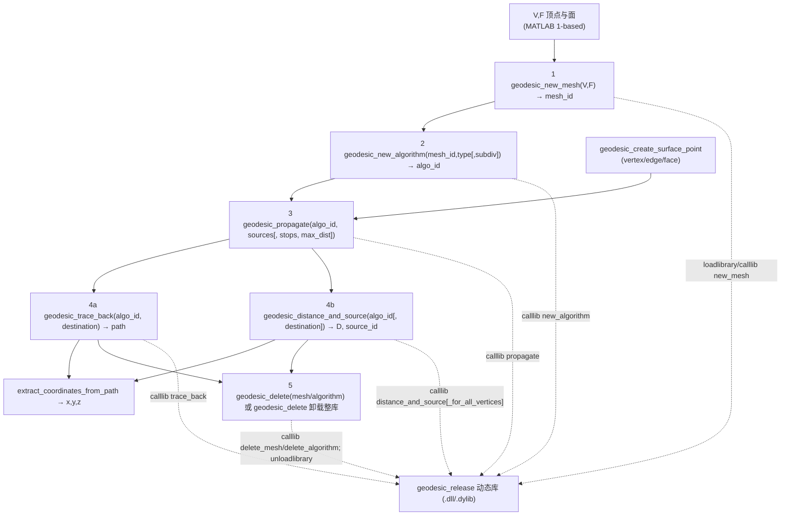

# 90.4 精确测地线工具箱（Danil Kirsanov，第三方） / Exact Geodesics Toolbox (Vendored)

> 本章逐文件覆盖 `external/exactgeodesic/` —— Danil Kirsanov 的 **Exact Geodesics on
> Triangulated Surfaces**（`GeodesicLib`）MATLAB 封装。该目录**不是** gptoolbox 原创，而是
> 直接把 Kirsanov 的算法库（预编译动态库 + MATLAB 包装 + 示例 + 源码）vendored 进本仓库。
> 其核心是一组 **`geodesic_*` 有状态（stateful）包装函数**：它们通过 `loadlibrary`/`calllib`
> 调用预编译的 `geodesic_matlab_api` 库（Windows `.dll` / macOS `.dylib`），并围绕一个**整数
> 对象句柄**（object handle）完成 **新建网格 → 新建算法 → 传播距离场 → 回溯路径 / 查询距离 →
> 删除对象** 的完整生命周期。
>
> This chapter covers, file by file, the vendored Kirsanov **Exact Geodesics on Triangulated
> Surfaces** (`GeodesicLib`) MATLAB wrapper in `external/exactgeodesic/`. The core is a set of
> **stateful `geodesic_*` wrappers** that drive the prebuilt `geodesic_matlab_api` shared library
> (Windows `.dll` / macOS `.dylib`) through `loadlibrary`/`calllib`, threading an **integer object
> handle** across a fixed lifecycle: new-mesh → new-algorithm → propagate → trace-back / query →
> delete.

- 语言 / Language：中英对照（中文为主）
- 相关章节 / See also：[90-external/README.md](README.md)、
  [90.3 MATLAB 环境与绘图辅助](03-matlab-environment-and-plotting.md)（其中 `exactgeodesic` 条目记录
  的是 gptoolbox **侧**封装 [external/exactgeodesic.m](file:///c:/VSWork/gptoolbox-1/external/exactgeodesic.m#L1-L73)，
  **本文件记录的是该封装所依赖的同名子目录**）、
  [10.13 距离与测地线](../10-mesh/13-distances-and-geodesics.md)、
  [appendices/03-doc-template.md](../appendices/03-doc-template.md)、
  [00-overview/05-dependency-map.md](../00-overview/05-dependency-map.md)
- 命名约定 / Notation：本目录函数以 **SurfacePoint**（`type ∈ {vertex,edge,face}` + `id` + `x,y,z`）
  描述面上点；`mesh.id`/`algorithm.id` 为 **C++ 对象句柄**（MATLAB 侧为 1-based，传给 mex 时转
  0-based）；`path` 为 SurfacePoint 的 **cell 数组**；`sources`/`stops` 为 SurfacePoint 的 cell 数组。
- 重要声明 / Disclaimer：`external/` 为**第三方 vendored 代码**。本目录由 **Danil Kirsanov** 编写
  （文件头多处标注 `Copyright (C) 2008 Danil Kirsanov, MIT License`；仓库另附
  [license.txt](file:///c:/VSWork/gptoolbox-1/external/exactgeodesic/license.txt#L1-L24)，
  为 BSD 二条款式文本，见下文"许可"说明）。本节忠实记录文件头署名；**未发现任何遮蔽 MATLAB 内置**，
  但与 gptoolbox 自有的测地线实现（`mex/exact_geodesic`、`mesh/heat_geodesic` 等）**功能重叠而接口完全不同**，
  在"与 gptoolbox 接口差异"一节集中说明。

---

## 本章概览 / Chapter Overview

### 模块职责 / Module responsibility

`external/exactgeodesic/` 把 Mitchell–Mount–Papadimitriou（MMP, 1987）三角网格**精确测地线**算法
（Kirsanov 加入若干改进/简化）封装为可在 MATLAB 里调用的动态库。与其它模块最大的不同：

1. **不是 mex**：它用 `loadlibrary` + `calllib` 直接调用一个导出 `new_mesh`/`propagate`/… 的 **C 风格
   动态库**，而不是编译为 MATLAB mex 入口；
2. **有状态、句柄化**：所有几何数据与距离场都保存在库内部的 `std::vector<mesh_shared_pointer>` /
   `std::vector<algorithm_shared_pointer>` 里（见
   [src/geodesic_matlab_api.cpp#L16-L23](file:///c:/VSWork/gptoolbox-1/external/exactgeodesic/src/geodesic_matlab_api.cpp#L16-L23)），
   MATLAB 侧只持有一个整数句柄（`mesh.id`、`algorithm.id`），**必须显式释放**；
3. **预编译库随仓库分发**：Windows 与 macOS 的动态库已附带（见下文构建说明），无需编译即可用。

> **许可 / Licence**：C++ 源码文件头声明 **MIT License**（如
> [src/geodesic_algorithm_base.h#L1](file:///c:/VSWork/gptoolbox-1/external/exactgeodesic/src/geodesic_algorithm_base.h#L1)
> `//Copyright (C) 2008 Danil Kirsanov, MIT License`）；仓库另附的
> [license.txt](file:///c:/VSWork/gptoolbox-1/external/exactgeodesic/license.txt#L1-L24) 文本实为 **BSD 二条款式**。
> 两者并存，本节同时记录。

### 句柄式调用流水线 / Handle-based call pipeline



### 函数总表 / Function overview

| 函数 / Function | 类别 / Category | 一句话功能 / One-line purpose |
|---|---|---|
| `geodesic_new_mesh` | 生命周期·上传 | 把三角网格上传进库，返回 `mesh_id` 句柄与边信息 |
| `geodesic_new_algorithm` | 生命周期·配置 | 为 `mesh_id` 建算法对象（`exact`/`subdivision`/`dijkstra`），返回 `algo_id` |
| `geodesic_propagate` | 计算核心 | 从源点集传播距离场（MMP 窗口传播，最坏 `O(n^2 log n)`） |
| `geodesic_trace_back` | 查询·回溯 | 由目标点回溯到最近源的最短路径（`O(n)`） |
| `geodesic_distance_and_source` | 查询·提取 | 取单点或**全部顶点**的距离与最近源索引 |
| `geodesic_create_surface_point` | 数据构造 | 构造 SurfacePoint 结构（vertex/edge/face） |
| `geodesic_convert_surface_points` | 数据转换（内部） | MATLAB ↔ C++ 的 SurfacePoint 编码互转 |
| `geodesic_delete` | 生命周期·释放 | 删除 mesh/algorithm 句柄；无参时卸载整库 |
| `create_flat_triangular_mesh` | 测试数据 | 生成规则平面三角网格 |
| `create_hedgehog_mesh` | 测试数据 | 生成带噪声"刺猬"球面网格 |
| `create_subdivision_pattern` | 测试数据 | 生成三角形规则细分模式（用于等距线） |
| `extract_coordinates_from_path` | 辅助 | 从路径 cell 提取 `x,y,z` 坐标 |
| `example1` | 示例 | 单源/单目标、`exact` 算法最小闭环 |
| `example2` | 示例 | 多网格 × 多算法（exact/subdivision/dijkstra）对比 |
| `example3` | 示例 | 源/目标放在面上任意位置（vertex/face/edge） |
| `example4` | 示例 | 高级调优：`stop_points` + 距离阈值限定传播 |
| `example5` | 示例 | 用细分模式绘制近似等距线（isolines） |

### 构建与平台总述 / Build & platform

**构建 / Build note**：本目录**不含** `compile_mex.m`、也不含 `geodesic_compile.m`（这两个名字在仓库中
均不存在——[external/toolbox_fast_marching/compile_mex.m](file:///c:/VSWork/gptoolbox-1/external/toolbox_fast_marching/compile_mex.m#L1-L40)
只服务于 fast marching，与本节无关）。因此它**不是通过 MATLAB `mex` 机制构建的**，而是一个导出 C 函数
的普通动态库：唯一需要编译的源文件是
[src/geodesic_matlab_api.cpp](file:///c:/VSWork/gptoolbox-1/external/exactgeodesic/src/geodesic_matlab_api.cpp#L1-L23)，
它 `#include` 了 `geodesic_mesh.h`、`geodesic_algorithm_exact.h` 等头文件（
[src/geodesic_algorithm_exact.h](file:///c:/VSWork/gptoolbox-1/external/exactgeodesic/src/geodesic_algorithm_exact.h#L1)、
[src/geodesic_algorithm_dijkstra.h](file:///c:/VSWork/gptoolbox-1/external/exactgeodesic/src/geodesic_algorithm_dijkstra.h#L1)、
[src/geodesic_algorithm_subdivision.h](file:///c:/VSWork/gptoolbox-1/external/exactgeodesic/src/geodesic_algorithm_subdivision.h#L1)），
并依赖 **Boost**（`boost::shared_ptr` 与 `/opt/local/include`）。仓库内给出的构建脚本是 macOS 专用的
[src/compileMacOSX.sh#L1](file:///c:/VSWork/gptoolbox-1/external/exactgeodesic/src/compileMacOSX.sh#L1)：

```
g++ -dynamiclib -I/opt/local/include/ geodesic_matlab_api.cpp -O3 -DNDEBUG -o geodesic.dylib
```

即 `g++ -dynamiclib` 把单个 `.cpp` 编成 `geodesic.dylib`。库作者 readme 亦说明
（[src/readme.txt#L23-L27](file:///c:/VSWork/gptoolbox-1/external/exactgeodesic/src/readme.txt#L23-L27)）：
"you do not have to compile anything … the header of the library is `geodesic_matlab_api.h`；all the
functions are instantiated in `geodesic_matlab_api.c`（this is the only file you have to compile）"。

**平台注意 / Platform caveat**：仓库**随附预编译库**，因此多数平台**无需编译**——Windows 提供
[geodesic_release.dll](file:///c:/VSWork/gptoolbox-1/external/exactgeodesic/geodesic_release.dll) 与
[geodesic_debug.dll](file:///c:/VSWork/gptoolbox-1/external/exactgeodesic/geodesic_debug.dll)，macOS 提供
[geodesic_release.dylib](file:///c:/VSWork/gptoolbox-1/external/exactgeodesic/geodesic_release.dylib) 与
[src/geodesic.dylib](file:///c:/VSWork/gptoolbox-1/external/exactgeodesic/src/geodesic.dylib)。加载逻辑
（[geodesic_new_mesh.m#L4-L11](file:///c:/VSWork/gptoolbox-1/external/exactgeodesic/geodesic_new_mesh.m#L4-L11)）
只覆盖 `ispc`（`.dll`）与 `ismac`（`.dylib`）两支——**Linux 无预编译库、且无加载分支**；此外源码首行
`#define GEODESIC_DLL_IMPORT __declspec(dllexport)`（
[src/geodesic_matlab_api.cpp#L1](file:///c:/VSWork/gptoolbox-1/external/exactgeodesic/src/geodesic_matlab_api.cpp#L1)）
是 MSVC 专用导出宏，直接移植到 gcc/Linux 需先改写。全局变量 `geodesic_library` 需要**调用前自行设置**
（示例里设为 `'geodesic_release'`），其值决定加载哪个库名。

---

## 逐函数详解 / Per-function reference

### `geodesic_new_mesh` — 上传网格、取得 mesh 句柄
- **文件 / File**: [external/exactgeodesic/geodesic_new_mesh.m](file:///c:/VSWork/gptoolbox-1/external/exactgeodesic/geodesic_new_mesh.m#L1-L36)
- **署名 / Attribution**: **无可考署名 / no attribution in header**（文件无作者/版权注释）。所属库 `GeodesicLib` 由 **Danil Kirsanov** 编写（MIT / BSD，见 [license.txt#L1-L24](file:///c:/VSWork/gptoolbox-1/external/exactgeodesic/license.txt#L1-L24)）。
- **签名 / Signature**: `[mesh, edge_to_vertex, edge_to_face] = geodesic_new_mesh(points, tri)`
- **功能 / Purpose**: `EN: Upload a triangle mesh (as vertices + faces) into the C++ library and return a mesh handle (plus edge→vertex / edge→face tables); loads the shared library on first use.` / 中文：把三角网格（顶点 + 面）上传进 C++ 库，返回 **mesh 句柄** 及 边→顶点 / 边→面 索引表；首次调用时按平台 `loadlibrary` 加载动态库。
- **输入 / Inputs**:

  | 参数 | 尺寸/类型 | 含义 (中 / EN) |
  |---|---|---|
  | `points` | `#V by 3` 或 `3 by #V` | 顶点坐标 / vertex positions（自动判列优先展平） |
  | `tri` | `#F by 3` 或 `3 by #F` | 面索引（MATLAB 1-based，内部转 0-based）/ face indices |

- **输出 / Outputs**:

  | 参数 | 尺寸/类型 | 含义 |
  |---|---|---|
  | `mesh` | `struct` | `mesh.id`（**整数句柄**）、`mesh.object_type='mesh'` / mesh handle |
  | `edge_to_vertex` | `#E by 2` | 每条边的两个端点顶点索引（1-based）/ edge→vertices |
  | `edge_to_face` | `#E by 2` | 每条边相邻的两个面索引（1-based）/ edge→faces |

- **可选参数 / Optional**: 无（无 `varargin`；全局量 `geodesic_library` 须在调用前置好）。
- **变量流动 / Variable flow**: `points,tri → global geodesic_library →(库未加载? ispc→loadlibrary('<lib>.dll','geodesic_matlab_api.h')；ismac→loadlibrary('<lib>.dylib',…)）→ dim=find(size(points)==3) → p=列优先展平坐标 → t=列优先展平面索引, t=t-1（转 0-based）→ tmp=libpointer('doublePtrPtr') →[id,tmp1,tmp2,num_edges,edges]=calllib(lib,'new_mesh',#P,p,#T,t,1,tmp) → setdatatype(edges,'doublePtr',4,num_edges) → mesh.id=id; mesh.object_type='mesh' → mesh, edge_to_vertex=(edges(1:2,:)+1)', edge_to_face=(edges(3:4,:)+1)'`
- **算法步骤 / Algorithm**:
  1. `global geodesic_library`；若库未 `libisloaded`，按平台 `loadlibrary`（Windows `.dll` / macOS `.dylib`），头文件 `geodesic_matlab_api.h`（L3–L11）。
  2. `dim=find(size(points)==3)`：判坐标是"行=顶点"还是"列=顶点"，统一展平为列向量 `p`（L13–L19）。
  3. 同样处理 `tri` 得到 `t`，并把 1-based 面索引整体 **减 1** 转成 C++ 的 0-based（L21–L27）。
  4. `tmp=libpointer('doublePtrPtr')` 作为输出边数组的二级指针；`calllib(lib,'new_mesh',#V,p,#F,t,1,tmp)`（第 5 个参数 `1` 表示需要返回边表）（L29–L30）。
  5. `setdatatype(edges,'doublePtr',4,num_edges)` 把返回指针解释为 `4 by #E`；组装 `mesh` 结构，`edge_to_vertex`/`edge_to_face` 各取两行并 **加 1** 转回 1-based（L31–L36）。
- **流程图 / Flowchart**:

  ```mermaid
  flowchart TD
    A["输入 points, tri"] --> B{"libisloaded ?"}
    B -- 否 --> B1{"ispc ?"}
    B1 -- 是 --> B2["loadlibrary('<lib>.dll', header)"]
    B1 -- 否 --> B3{"ismac ?"}
    B3 -- 是 --> B4["loadlibrary('<lib>.dylib', header)"]
    B3 -- 否 --> B5["无加载分支（Linux 不支持）"]
    B -- 是 --> C
    B2 --> C
    B4 --> C
    C["展平 p（列优先）；t=tri(:)-1（0-based）"] --> D["tmp=libpointer('doublePtrPtr')"]
    D --> E["[id,…,num_edges,edges]=calllib('new_mesh',…)"]
    E --> F["setdatatype(edges,4,num_edges)"]
    F --> Z["输出 mesh(mesh.id), edge_to_vertex, edge_to_face"]
  ```
- **依赖 / Dependencies**: 库导出函数 `new_mesh`（[geodesic_matlab_api.h#L8-L13](file:///c:/VSWork/gptoolbox-1/external/exactgeodesic/geodesic_matlab_api.h#L8-L13)）；内置 `loadlibrary`/`libisloaded`/`calllib`/`libpointer`/`setdatatype`/`find`/`length`；全局 `geodesic_library`。
- **See also**: `geodesic_new_algorithm`, `geodesic_delete`, `exactgeodesic`, `exact_geodesic`
- **构建 / Build note**: 本函数本身是纯 MATLAB，无需编译；其服务的动态库构建见本章"构建与平台总述"（源 `geodesic_matlab_api.cpp`，脚本 [src/compileMacOSX.sh#L1](file:///c:/VSWork/gptoolbox-1/external/exactgeodesic/src/compileMacOSX.sh#L1)）。
- **平台注意 / Platform caveat**: 预编译库仅覆盖 Windows/macOS；Linux 无加载分支，须自编译并改 `__declspec` 导出宏。

### `geodesic_new_algorithm` — 创建测地算法句柄
- **文件 / File**: [external/exactgeodesic/geodesic_new_algorithm.m](file:///c:/VSWork/gptoolbox-1/external/exactgeodesic/geodesic_new_algorithm.m#L1-L29)
- **署名 / Attribution**: **无可考署名 / no attribution in header**（库属 Danil Kirsanov，MIT/BSD）。
- **签名 / Signature**: `algorithm = geodesic_new_algorithm(mesh, type, subdivision)`
- **功能 / Purpose**: `EN: Instantiate a geodesic algorithm ('exact' MMP, 'subdivision', or 'dijkstra') bound to a given mesh handle, returning an algorithm handle.` / 中文：为给定 `mesh` 句柄实例化一个测地算法对象（`exact` MMP / `subdivision` / `dijkstra`），返回 **algorithm 句柄**。
- **输入 / Inputs**:

  | 参数 | 尺寸/类型 | 含义 (中 / EN) |
  |---|---|---|
  | `mesh` | `struct` | `geodesic_new_mesh` 返回的网格句柄 / mesh handle |
  | `type` | `char` | 算法类型名 / one of `'exact'`,`'subdivision'`,`'dijkstra'` |
  | `subdivision` | 标量 | 细分算法每条边附加点数 / points per edge |

- **输出 / Outputs**:

  | 参数 | 尺寸/类型 | 含义 |
  |---|---|---|
  | `algorithm` | `struct` 或 `[]` | `algorithm.id`（**整数句柄**）、`algorithm.type`、`algorithm.object_type='algorithm'`；失败时为空 / algorithm handle |

- **可选参数 / Optional**:

  | 名称 | 取值 | 默认 | 含义 |
  |---|---|---|---|
  | `subdivision` | 非负整数 | `0`（`nargin==2` 时） | 细分算法的每条边附加点数；`0` 时 `subdivision` 退化为 `dijkstra` |

- **变量流动 / Variable flow**: `mesh,type,subdivision → global geodesic_library →(库未加载? disp('error: …not loaded'); return algorithm=[]）→(nargin==2? subdivision=0）→(strcmp(type,'subdivision') & subdivision==0? type='dijkstra'）→ algorithm_types={'exact','subdivision','dijkstra'} → type_id=find(strcmp(type,algorithm_types)) →(空? disp('error: algorithm type is incorrect'); return）→ type_id=type_id-1 → algorithm.id=calllib(lib,'new_algorithm',mesh.id,type_id,subdivision) → algorithm.type=type; algorithm.object_type='algorithm' → algorithm`
- **算法步骤 / Algorithm**:
  1. 取全局库名；若库未加载则报错并返回空 `algorithm`（L3–L9）。
  2. `nargin==2` 时 `subdivision=0`（默认）（L11–L13）。
  3. 若 `type='subdivision'` 且 `subdivision==0`，自动改判为 `'dijkstra'`（细分点数为 0 即退化为图 Dijkstra）（L15–L17）。
  4. 在 `{'exact','subdivision','dijkstra'}` 中按名查表得 1-based 序号，非法则报错返回；`type_id = type_id-1` 转 0-based 供 mex 使用（L19–L25）。
  5. `calllib(lib,'new_algorithm',mesh.id,type_id,subdivision)` 取回算法句柄，附上 `type` 与 `object_type`（L27–L29）。
- **流程图 / Flowchart**:

  ```mermaid
  flowchart TD
    A["输入 mesh, type, subdivision"] --> B{"libisloaded ?"}
    B -- 否 --> B1["disp error; return []"]
    B -- 是 --> C{"nargin == 2 ?"}
    C -- 是 --> C1["subdivision = 0"]
    C -- 否 --> D
    C1 --> D{"type=='subdivision' & subdiv==0 ?"}
    D -- 是 --> D1["type = 'dijkstra'"]
    D -- 否 --> E
    D1 --> E["type_id = find(strcmp(type,{'exact','subdivision','dijkstra'}))"]
    E --> F{"type_id 空 ?"}
    F -- 是 --> F1["disp error; return []"]
    F -- 否 --> G["type_id = type_id - 1"]
    G --> Z["algorithm.id = calllib('new_algorithm', mesh.id, type_id, subdivision)"]
  ```
- **依赖 / Dependencies**: 库导出函数 `new_algorithm`（[geodesic_matlab_api.h#L15-L17](file:///c:/VSWork/gptoolbox-1/external/exactgeodesic/geodesic_matlab_api.h#L15-L17)）；内置 `strcmp`/`find`/`calllib`/`libisloaded`/`disp`；全局 `geodesic_library`。
- **See also**: `geodesic_new_mesh`, `geodesic_propagate`, `geodesic_delete`
- **构建 / Build note**: 纯 MATLAB，无需编译；服务库构建见本章总述（`geodesic_matlab_api.cpp`）。
- **平台注意 / Platform caveat**: 库必须已加载（先调用过 `geodesic_new_mesh` 或手动 `loadlibrary`），否则直接报错返回空。

### `geodesic_propagate` — 距离场传播（MMP 核心）
- **文件 / File**: [external/exactgeodesic/geodesic_propagate.m](file:///c:/VSWork/gptoolbox-1/external/exactgeodesic/geodesic_propagate.m#L1-L22)
- **署名 / Attribution**: **无可考署名 / no attribution in header**（库属 Danil Kirsanov，MIT/BSD）。
- **签名 / Signature**: `geodesic_propagate(algorithm, source_points, stop_points, max_distance)`
- **功能 / Purpose**: `EN: Build the geodesic distance field over the whole surface by propagating from a set of source SurfacePoints (the expensive dijstra-like window expansion), optionally bounded by stop points / a max distance.` / 中文：从一组源 SurfacePoint **在整张曲面上传播**得到测地距离场（最耗时的类 Dijkstra 窗口扩展），可选由停止点 / 最大距离加以限制。
- **输入 / Inputs**:

  | 参数 | 尺寸/类型 | 含义 (中 / EN) |
  |---|---|---|
  | `algorithm` | `struct` | 算法句柄 / algorithm handle |
  | `source_points` | cell of SurfacePoint | 源点集 / source points |
  | `stop_points` | cell of SurfacePoint | 停止点集（传播覆盖它们后即停）/ stop points |
  | `max_distance` | 标量 | 传播距离上限 / max propagation distance |

- **输出 / Outputs**: 无（`nargout==0`）；副作用是把距离场写入库内 `algorithm` 对象。
- **可选参数 / Optional**:

  | 名称 | 取值 | 默认 | 含义 |
  |---|---|---|---|
  | `stop_points` | cell of SurfacePoint | `[]`（`nargin<3` 时） | 传播需覆盖的停止点 |
  | `max_distance` | 标量 | `1e100`（`nargin<4` 时） | 传播距离上限（近似"无穷"） |

- **变量流动 / Variable flow**: `algorithm, source_points, stop_points, max_distance →(nargin<4? max_distance=1e100）→(nargin<3? stop_points=[]）→ global geodesic_library →(库未加载? disp error; return）→ sources=geodesic_convert_surface_points(source_points) → stops=geodesic_convert_surface_points(stop_points) → calllib(lib,'propagate',algorithm.id, sources, #sources, stops, #stops, max_distance) →（库内 algorithm 距离场已更新）`
- **算法步骤 / Algorithm**:
  1. `nargin<4` → `max_distance=1e100`；`nargin<3` → `stop_points=[]`（L5–L11）。
  2. 检查库是否加载，未加载则报错返回（L13–L16）。
  3. 用 `geodesic_convert_surface_points` 把 MATLAB 的 SurfacePoint cell **编码为 C++ 的 `5×#P` 扁平数组**（每点 5 个 double：`x,y,z,type_id,id-1`）（L18–L19）。
  4. 调 `calllib(lib,'propagate', algorithm.id, sources, #sources, stops, #stops, max_distance)`（L21–L22）。
  5. **底层算法（MMP）**：库内部以源点为中心在三角面上生成"窗口（window，即伪源 pseudosource）"，按距离优先队列依次展开/合并窗口，沿"边-面"邻接把**精确**测地距离场覆盖到全曲面；`stop_points`/`max_distance` 用于**提前终止**以省时间与内存。最坏时间复杂度 `O(n^2 log n)`（见 [readme.txt#L1](file:///c:/VSWork/gptoolbox-1/external/exactgeodesic/readme.txt#L1)）。
- **流程图 / Flowchart**:

  ```mermaid
  flowchart TD
    A["输入 algorithm, source_points[, stop_points, max_distance]"] --> B{"nargin < 4 ?"}
    B -- 是 --> B1["max_distance = 1e100"]
    B -- 否 --> C
    B1 --> C{"nargin < 3 ?"}
    C -- 是 --> C1["stop_points = []"]
    C -- 否 --> D
    C1 --> D{"libisloaded ?"}
    D -- 否 --> D1["disp error; return"]
    D -- 是 --> E["sources = geodesic_convert_surface_points(source_points)"]
    E --> F["stops = geodesic_convert_surface_points(stop_points)"]
    F --> G["calllib('propagate', algorithm.id, sources, #sources, stops, #stops, max_distance)"]
    G --> Z["库内 distance field 就绪"]
  ```
- **依赖 / Dependencies**: `geodesic_convert_surface_points`；库导出函数 `propagate`（[geodesic_matlab_api.h#L23-L28](file:///c:/VSWork/gptoolbox-1/external/exactgeodesic/geodesic_matlab_api.h#L23-L28)）；内置 `calllib`/`libisloaded`/`disp`；全局 `geodesic_library`。
- **See also**: `geodesic_new_algorithm`, `geodesic_trace_back`, `geodesic_distance_and_source`, `geodesic_delete`
- **构建 / Build note**: 纯 MATLAB，无需编译；实际计算在预编译库内（源 `geodesic_algorithm_exact.h` 等）。
- **平台注意 / Platform caveat**: 大网格下**内存是瓶颈**（[readme.txt#L33-L35](file:///c:/VSWork/gptoolbox-1/external/exactgeodesic/readme.txt#L33-L35)）；网格须边连通、无孤立顶点。传播后结果由同一个 `algorithm.id` 保存，多个算法可共用同一网格。

### `geodesic_trace_back` — 回溯最短路径
- **文件 / File**: [external/exactgeodesic/geodesic_trace_back.m](file:///c:/VSWork/gptoolbox-1/external/exactgeodesic/geodesic_trace_back.m#L1-L12)
- **署名 / Attribution**: **无可考署名 / no attribution in header**（库属 Danil Kirsanov，MIT/BSD）。
- **签名 / Signature**: `path = geodesic_trace_back(algorithm, destination)`
- **功能 / Purpose**: `EN: Using the precomputed distance field, trace the shortest path from a destination point back to its nearest source, returning the path as a cell of SurfacePoints.` / 中文：利用已算好的距离场，从目标点**回溯**到其最近源的最短路径，路径以 SurfacePoint 的 cell 数组返回。
- **输入 / Inputs**:

  | 参数 | 尺寸/类型 | 含义 (中 / EN) |
  |---|---|---|
  | `algorithm` | `struct` | 已完成 `geodesic_propagate` 的算法句柄 / propagated algorithm handle |
  | `destination` | SurfacePoint | 目标点 / destination SurfacePoint |

- **输出 / Outputs**:

  | 参数 | 尺寸/类型 | 含义 |
  |---|---|---|
  | `path` | cell of SurfacePoint | 从目标到最近源的路径点序列 / path points（含 `x,y,z,type,id`） |

- **变量流动 / Variable flow**: `algorithm, destination → tmp{1}=destination → d=geodesic_convert_surface_points(tmp)（编码成 1×5）→ tmp=libpointer('doublePtrPtr') →[path_length,~,path_double]=calllib(lib,'trace_back',algorithm.id,d,tmp) → setdatatype(path_double,'doublePtr',path_length*5) → path=geodesic_convert_surface_points(path_double.Value)（解码成 SurfacePoint cell）→ path`
- **算法步骤 / Algorithm**:
  1. 把单个 `destination` 包成 cell 再编码为 C++ 数组 `d`（L5–L6）。
  2. `tmp=libpointer('doublePtrPtr')` 接收路径缓冲；`calllib(lib,'trace_back',algorithm.id,d,tmp)` 返回路径点数 `path_length` 与指针 `path_double`（L8–L9）。
  3. `setdatatype(path_double,'doublePtr',path_length*5)` 解释为 `1 × 5*path_length`（L11）。
  4. **底层算法（回溯穿过窗口）**：从目标所在的窗口出发，沿其伪源（pseudosource）关系**逐窗口回退**，直到抵达某个源点；复杂度 `O(n)`（[readme.txt#L19](file:///c:/VSWork/gptoolbox-1/external/exactgeodesic/readme.txt#L19)）。最后 `geodesic_convert_surface_points` 把扁平数组解码为 SurfacePoint cell `path`（L12）。
- **流程图 / Flowchart**:

  ```mermaid
  flowchart TD
    A["输入 algorithm, destination"] --> B["tmp{1} = destination"]
    B --> C["d = geodesic_convert_surface_points(tmp)"]
    C --> D["tmp = libpointer('doublePtrPtr')"]
    D --> E["[path_length,~,path_double] = calllib('trace_back', algorithm.id, d, tmp)"]
    E --> F["setdatatype(path_double, 'doublePtr', path_length*5)"]
    F --> G["path = geodesic_convert_surface_points(path_double.Value)"]
    G --> Z["输出 path（SurfacePoint cell）"]
  ```
- **依赖 / Dependencies**: `geodesic_convert_surface_points`；库导出函数 `trace_back`（[geodesic_matlab_api.h#L30-L32](file:///c:/VSWork/gptoolbox-1/external/exactgeodesic/geodesic_matlab_api.h#L30-L32)）；内置 `calllib`/`libpointer`/`setdatatype`；全局 `geodesic_library`。
- **See also**: `geodesic_propagate`, `geodesic_distance_and_source`, `extract_coordinates_from_path`, `geodesic_delete`
- **构建 / Build note**: 纯 MATLAB，无需编译；回溯在预编译库内完成（`GeodesicAlgorithmBase::trace_back`）。
- **平台注意 / Platform caveat**: 若传播被 `stop_points`/`max_distance` 提前终止，目标点可能"无源可达"，此时路径结果不完整，应配合 `geodesic_distance_and_source` 的负距离判断（见 example4）。

### `geodesic_distance_and_source` — 查询距离与最近源（文件内函数名实为 `geodesic_best_source`）
- **文件 / File**: [external/exactgeodesic/geodesic_distance_and_source.m](file:///c:/VSWork/gptoolbox-1/external/exactgeodesic/geodesic_distance_and_source.m#L1-L25)
- **署名 / Attribution**: 文件头注释 **`Danil Kirsanov, 09/2007`**（[geodesic_distance_and_source.m#L3](file:///c:/VSWork/gptoolbox-1/external/exactgeodesic/geodesic_distance_and_source.m#L3)）；许可 MIT/BSD（同库）。
- **签名 / Signature**: `[source_id, distance] = geodesic_best_source(algorithm, destination)`
- **⚠️ 文件名与函数名不一致 / Name mismatch**: **文件名为 `geodesic_distance_and_source.m`，但文件中定义的函数名是 `geodesic_best_source`**（[#L5](file:///c:/VSWork/gptoolbox-1/external/exactgeodesic/geodesic_distance_and_source.m#L5)）。各 `example*.m` 却都以 `geodesic_distance_and_source(...)` 调用（如 [example1.m#L26](file:///c:/VSWork/gptoolbox-1/external/exactgeodesic/example1.m#L26)、[example3.m#L30](file:///c:/VSWork/gptoolbox-1/external/exactgeodesic/example3.m#L30)、[example5.m#L56](file:///c:/VSWork/gptoolbox-1/external/exactgeodesic/example5.m#L56)）。在标准 MATLAB 中按**文件名**解析函数，这一不匹配会导致示例调用失败（除非自行改名/另存）。本节如实记录，调用时请以文件内真实函数名 `geodesic_best_source` 为准。
- **功能 / Purpose**: `EN: Query the closest source and distance for one destination point (O(1)), or the distance/source for ALL mesh vertices at once.` / 中文：查询**单个**目标点的最近源与距离（`O(1)`），或一次性取出**全部顶点**的距离与最近源。
- **输入 / Inputs**:

  | 参数 | 尺寸/类型 | 含义 (中 / EN) |
  |---|---|---|
  | `algorithm` | `struct` | 已完成传播的算法句柄 / propagated algorithm handle |
  | `destination` | SurfacePoint | 目标点（仅当 `nargin==2`）/ destination point |

- **输出 / Outputs**:

  | 参数 | 尺寸/类型 | 含义 |
  |---|---|---|
  | `source_id` | 标量 或 `#V by 1` | 最近源索引（1-based）；全顶点模式为向量 / nearest source index |
  | `distance` | 标量 或 `#V by 1` | 到最近源的距离；**负值表示找不到源**（传播被提前终止）/ distance (negative ⇒ undefined) |

- **可选参数 / Optional**:

  | 名称 | 取值 | 默认 | 含义 |
  |---|---|---|---|
  | `destination` | SurfacePoint | 无（缺省即"全顶点"模式） | 给出时查询单点；缺省时返回全顶点结果 |

  > 两种模式的分派依据是 `nargin`（`==2` 走单点，否则走全顶点）。

- **变量流动 / Variable flow**: `algorithm[, destination] → global geodesic_library →(nargin==2: d=geodesic_convert_surface_points({destination}); [source_id,~,distance]=calllib(lib,'distance_and_source',algorithm.id,d,1); source_id=source_id+1) : (tmp=libpointer('doublePtrPtr'); tmp1=libpointer('longPtrPtr'); [num_vertices,d,s]=calllib(lib,'distance_and_source_for_all_vertices',algorithm.id,tmp,tmp1); distance=d.Value; source_id=s.Value+1) → source_id, distance`
- **算法步骤 / Algorithm**:
  1. 单点模式（`nargin==2`）：把 `destination` 编码后调 `calllib(lib,'distance_and_source', algorithm.id, d, 1)`，`tmp=1` 为占位；返回的 0-based 源索引 `+1` 转 1-based（L8–L14）。
  2. 全顶点模式：`tmp`/`tmp1` 作为距离数组与源数组的二级指针；调 `calllib(lib,'distance_and_source_for_all_vertices', algorithm.id, tmp, tmp1)` 得到顶点数 `num_vertices`（L15–L19）。
  3. `setdatatype(d,'doublePtr',num_vertices)` 取距离 `distance`；`setdatatype(s,'int32Ptr',num_vertices)` 取源索引并 `+1` 得 `source_id`（L21–L24）。
  4. **底层算法（提取）**：这只做"窗口/顶点查询"——在已建好的距离场中直接读出该点的最近源与距离，`best_source` 复杂度 `O(1)`（[readme.txt#L20](file:///c:/VSWork/gptoolbox-1/external/exactgeodesic/readme.txt#L20)）。负距离表示传播未覆盖该点。
- **流程图 / Flowchart**:

  ```mermaid
  flowchart TD
    A["输入 algorithm[, destination]"] --> B{"nargin == 2 ?"}
    B -- 是 --> C["d = geodesic_convert_surface_points({destination})"]
    C --> C1["[source_id,~,distance] = calllib('distance_and_source', algorithm.id, d, 1)"]
    C1 --> C2["source_id = source_id + 1"]
    B -- 否 --> D["tmp=libpointer('doublePtrPtr'); tmp1=libpointer('longPtrPtr')"]
    D --> D1["[num_vertices,d,s] = calllib('distance_and_source_for_all_vertices', …)"]
    D1 --> D2["distance = d.Value; source_id = s.Value + 1"]
    C2 --> Z["输出 source_id, distance"]
    D2 --> Z
  ```
- **依赖 / Dependencies**: `geodesic_convert_surface_points`；库导出函数 `distance_and_source`（[geodesic_matlab_api.h#L34-L36](file:///c:/VSWork/gptoolbox-1/external/exactgeodesic/geodesic_matlab_api.h#L34-L36)）与 `distance_and_source_for_all_vertices`（[#L38-L40](file:///c:/VSWork/gptoolbox-1/external/exactgeodesic/geodesic_matlab_api.h#L38-L40)）；内置 `calllib`/`libpointer`/`setdatatype`；全局 `geodesic_library`。
- **See also**: `geodesic_propagate`, `geodesic_trace_back`, `exactgeodesic`, `exact_geodesic`
- **构建 / Build note**: 纯 MATLAB，无需编译；查询在预编译库内完成。
- **平台注意 / Platform caveat**: 与 `geodesic_propagate` 限制相关——被截断的传播会返回负距离，务必先判负再用（example4 即如此）。

### `geodesic_create_surface_point` — 构造 SurfacePoint
- **文件 / File**: [external/exactgeodesic/geodesic_create_surface_point.m](file:///c:/VSWork/gptoolbox-1/external/exactgeodesic/geodesic_create_surface_point.m#L1-L13)
- **署名 / Attribution**: **无可考署名 / no attribution in header**（库属 Danil Kirsanov，MIT/BSD）。
- **签名 / Signature**: `p = geodesic_create_surface_point(type,id,x,y,z)`
- **功能 / Purpose**: `EN: Build a SurfacePoint struct (type + mesh-element id + coordinates) describing a point anywhere on the surface, in a form the other geodesic_* functions accept.` / 中文：构造一个描述面上任意点的 **SurfacePoint 结构**（类型 + 网格元素 id + 坐标），供其余 `geodesic_*` 函数使用。
- **输入 / Inputs**:

  | 参数 | 尺寸/类型 | 含义 (中 / EN) |
  |---|---|---|
  | `type` | `char` | `'vertex'`/`'edge'`/`'face'` / element kind |
  | `id` | 标量 | 对应元素索引（1-based）/ element index |
  | `x` | `1 by 3` 或标量 | 3-向量坐标（三参调用）或 x 坐标 / coords |
  | `y` | 标量 | y 坐标（五参调用）/ y |
  | `z` | 标量 | z 坐标（五参调用）/ z |

- **输出 / Outputs**:

  | 参数 | 尺寸/类型 | 含义 |
  |---|---|---|
  | `p` | `struct` | 含 `type`,`id`,`x`,`y`,`z` 的 SurfacePoint / SurfacePoint struct |

- **可选参数 / Optional**:

  | 名称 | 取值 | 默认 | 含义 |
  |---|---|---|---|
  | `y`,`z` | 标量 | 无 | 省略时表示 `x` 已是一个 `1 by 3` 坐标向量 / omitted ⇒ 3-vector form |

- **变量流动 / Variable flow**: `type,id,x[,y,z] → p.type=type; p.id=id →(nargin==3? p.x=x(1); p.y=x(2); p.z=x(3) : p.x=x; p.y=y; p.z=z) → p`
- **算法步骤 / Algorithm**:
  1. 写入 `p.type=type`、`p.id=id`（L3–L4）。
  2. 若 `nargin==3`（只给了 `x`），则 `x` 被当作**长度 3 的坐标向量**，拆成 `p.x/p.y/p.z`（L6–L9）。
  3. 否则按 `x,y,z` 三个标量分别写入（L10–L12）。
- **流程图 / Flowchart**:

  ```mermaid
  flowchart TD
    A["输入 type, id, x[, y, z]"] --> B["p.type=type; p.id=id"]
    B --> C{"nargin == 3 ?"}
    C -- 是 --> C1["p.x=x(1); p.y=x(2); p.z=x(3)"]
    C -- 否 --> C2["p.x=x; p.y=y; p.z=z"]
    C1 --> Z["输出 p（SurfacePoint）"]
    C2 --> Z
  ```
- **依赖 / Dependencies**: 无（纯结构组装）。
- **See also**: `geodesic_convert_surface_points`, `geodesic_propagate`, `geodesic_trace_back`
- **构建 / Build note**: 纯 MATLAB，无需编译。
- **平台注意 / Platform caveat**: `id` 为 **1-based**；编码进 C++ 时由 `geodesic_convert_surface_points` 统一 `-1`。

### `geodesic_convert_surface_points` — SurfacePoint 双向编码（内部）
- **文件 / File**: [external/exactgeodesic/geodesic_convert_surface_points.m](file:///c:/VSWork/gptoolbox-1/external/exactgeodesic/geodesic_convert_surface_points.m#L1-L46)
- **署名 / Attribution**: 文件头注释 **`Danil Kirsanov, 09/2007`**（[#L3](file:///c:/VSWork/gptoolbox-1/external/exactgeodesic/geodesic_convert_surface_points.m#L3)）；许可 MIT/BSD（同库）。
- **签名 / Signature**: `q = geodesic_convert_surface_points(p)`
- **功能 / Purpose**: `EN: Internal bidirectional converter between the MATLAB SurfacePoint representation (cell of structs) and the C++ flat 5-per-point encoding (x,y,z,type_id,id-1).` / 中文：**内部**双向转换器——在 MATLAB 的 SurfacePoint（struct cell）与 C++ 的"每点 5 个 double"扁平编码（`x,y,z,type_id,id-1`）之间互转。
- **输入 / Inputs**:

  | 参数 | 尺寸/类型 | 含义 (中 / EN) |
  |---|---|---|
  | `p` | cell of SurfacePoint **或** `numeric` | 输入：cell ⇒ 转 C++；数值 ⇒ 转 MATLAB / input |

- **输出 / Outputs**:

  | 参数 | 尺寸/类型 | 含义 |
  |---|---|---|
  | `q` | `5*#P by 1` **或** cell of SurfacePoint | 与输入相反方向的表示 / converted representation |

- **可选参数 / Optional**: 无。
- **变量流动 / Variable flow**: `p →(isempty? q=[]; return）→ point_types={'vertex','edge','face'} →(~isa(p,'numeric')? [MATLAB→C++]: q=zeros(5*#P,1); for i: q(shift+[1 2 3])=p{i}.x/y/z; q(shift+5)=p{i}.id-1; type_id=find(strcmp(point_types,p{i}.type)); (空? disp error; q=[]; return) q(shift+4)=type_id-1) : [C++→MATLAB]: num=#P/5; q=cell(num,1); for i: point.{x,y,z}=p(shift+[1 2 3]); point.type=point_types(p(shift+4)+1); point.id=p(shift+5)+1; q{i}=point → q)`
- **算法步骤 / Algorithm**:
  1. 空输入直接返回空（L7–L10）。
  2. `point_types={'vertex','edge','face'}` 定义类型到 `0/1/2` 的映射表（L12）。
  3. 非数值输入（MATLAB→C++）：分配 `5×#P` 长度向量，逐点写入 `x,y,z`、`id-1`，并用 `strcmp` 查表把 `type` 写成 `type_id-1`；类型非法则报错返回空（L14–L32）。
  4. 数值输入（C++→MATLAB）：按每 5 个一组切分，重建 `struct`（`type` 由 `type_id+1` 查表回溯，`id` 由 `id-1` 还原为 1-based），装入 cell（L33–L45）。
- **流程图 / Flowchart**:

  ```mermaid
  flowchart TD
    A["输入 p"] --> B{"isempty(p) ?"}
    B -- 是 --> B1["q = []; return"]
    B -- 否 --> C["point_types = {'vertex','edge','face'}"]
    C --> D{"~isa(p,'numeric') ?"}
    D -- 是 --> E["q = zeros(5*#P,1)"]
    E --> E1["逐点写 x,y,z,id-1；type_id-1 写 type"]
    E1 --> E2{"type 合法 ?"}
    E2 -- 否 --> E3["disp error; q = []"]
    E2 -- 是 --> Z
    D -- 否 --> F["num = #P/5; q = cell(num,1)"]
    F --> F1["逐点重建 struct(x,y,z,type,id+1)"]
    F1 --> Z["输出 q（与输入相反方向）"]
  ```
- **依赖 / Dependencies**: 内置 `isempty`/`isa`/`zeros`/`cell`/`strcmp`/`find`/`length`/`disp`。
- **See also**: `geodesic_create_surface_point`, `geodesic_propagate`, `geodesic_trace_back`, `geodesic_distance_and_source`
- **构建 / Build note**: 纯 MATLAB，无需编译。
- **平台注意 / Platform caveat**: `id` 的 off-by-one 是本库所有 `geodesic_*` 转换的**统一约定**（MATLAB 1-based ↔ C++ 0-based）。

### `geodesic_delete` — 释放句柄 / 卸载整库
- **文件 / File**: [external/exactgeodesic/geodesic_delete.m](file:///c:/VSWork/gptoolbox-1/external/exactgeodesic/geodesic_delete.m#L1-L23)
- **署名 / Attribution**: 文件头注释 **`Danil Kirsanov, 09/2007`**（[#L2](file:///c:/VSWork/gptoolbox-1/external/exactgeodesic/geodesic_delete.m#L2)）；许可 MIT/BSD（同库）。
- **签名 / Signature**: `object = geodesic_delete(object)`
- **功能 / Purpose**: `EN: Delete a mesh or algorithm object handle inside the library; with no argument, unload the whole library (releasing everything at once).` / 中文：删除库内的 mesh 或 algorithm **对象句柄**；**无参**调用则直接卸载整库（一次性释放所有对象）。
- **输入 / Inputs**:

  | 参数 | 尺寸/类型 | 含义 (中 / EN) |
  |---|---|---|
  | `object` | `struct`（可缺省） | 待删除的 mesh 或 algorithm 句柄 / object handle (optional) |

- **输出 / Outputs**:

  | 参数 | 尺寸/类型 | 含义 |
  |---|---|---|
  | `object` | `[]` | 恒为空（句柄已失效）/ always empty |

- **可选参数 / Optional**:

  | 名称 | 取值 | 默认 | 含义 |
  |---|---|---|---|
  | `object` | 缺省 | — | 无参 ⇒ 卸载整库 / no arg ⇒ unload library |

- **变量流动 / Variable flow**: `object → global geodesic_library →(库未加载? object=[]; return）→(nargin==0? unloadlibrary(lib) : (strcmp(object.object_type,'mesh')? calllib(lib,'delete_mesh',object.id) : calllib(lib,'delete_algorithm',object.id))) → object=[]`
- **算法步骤 / Algorithm**:
  1. 若库已卸载，说明对象已随之清空，直接返回 `[]`（L7–L10）。
  2. `nargin==0`（无参）：`unloadlibrary(geodesic_library)` —— **最省事的"删除一切"方式**（L12–L13）。
  3. 否则按 `object.object_type` 分派：`'mesh'` 调 `calllib(lib,'delete_mesh',object.id)`（**会连带删除该网格下所有算法**）；否则视为算法，调 `calllib(lib,'delete_algorithm',object.id)`（L15–L21）。
  4. 返回空 `object`（L22）。
- **流程图 / Flowchart**:

  ```mermaid
  flowchart TD
    A["输入 object（可缺省）"] --> B{"libisloaded ?"}
    B -- 否 --> B1["object = []; return"]
    B -- 是 --> C{"nargin == 0 ?"}
    C -- 是 --> C1["unloadlibrary(geodesic_library)"]
    C -- 否 --> D{"object_type == 'mesh' ?"}
    D -- 是 --> D1["calllib('delete_mesh', object.id)"]
    D -- 否 --> D2["calllib('delete_algorithm', object.id)"]
    C1 --> Z["object = []"]
    D1 --> Z
    D2 --> Z
  ```
- **依赖 / Dependencies**: 库导出函数 `delete_mesh`（[geodesic_matlab_api.h#L21](file:///c:/VSWork/gptoolbox-1/external/exactgeodesic/geodesic_matlab_api.h#L21)）与 `delete_algorithm`（[#L19](file:///c:/VSWork/gptoolbox-1/external/exactgeodesic/geodesic_matlab_api.h#L19)）；内置 `libisloaded`/`unloadlibrary`/`calllib`/`strcmp`；全局 `geodesic_library`。
- **See also**: `geodesic_new_mesh`, `geodesic_new_algorithm`
- **构建 / Build note**: 纯 MATLAB，无需编译。
- **平台注意 / Platform caveat**: `delete_mesh` 会级联删除该网格下的算法句柄；重复使用同一 `mesh.id`/`algorithm.id` 会造成悬垂引用。示例多以无参 `geodesic_delete;` 收尾。

### `create_flat_triangular_mesh` — 生成规则平面三角网格
- **文件 / File**: [external/exactgeodesic/create_flat_triangular_mesh.m](file:///c:/VSWork/gptoolbox-1/external/exactgeodesic/create_flat_triangular_mesh.m#L1-L33)
- **署名 / Attribution**: 文件头 **`Copyright (c) 2007 Danil Kirsanov`**（[#L2](file:///c:/VSWork/gptoolbox-1/external/exactgeodesic/create_flat_triangular_mesh.m#L2)）；许可 MIT/BSD（同库）。
- **签名 / Signature**: `[p, tri] = create_flat_triangular_mesh(step, smoothness)`
- **功能 / Purpose**: `EN: Build a regular planar triangular grid on [-1,1]^2 (with optional out-of-plane noise) — a "good mesh to catch possible bugs in geodesic algorithms".` / 中文：在 `[-1,1]^2` 上生成**规则平面三角网格**（可选平面外噪声），作者称其为"用于捕捉测地算法 bug 的好网格"。
- **输入 / Inputs**:

  | 参数 | 尺寸/类型 | 含义 (中 / EN) |
  |---|---|---|
  | `step` | 标量 | 网格步长（`x=-1:step:1`）/ grid step |
  | `smoothness` | 标量 | 平面外噪声幅度 / out-of-plane noise |

- **输出 / Outputs**:

  | 参数 | 尺寸/类型 | 含义 |
  |---|---|---|
  | `p` | `#V by 3` | 顶点坐标 / vertices |
  | `tri` | `#F by 3` | 三角面索引（1-based）/ faces |

- **可选参数 / Optional**:

  | 名称 | 取值 | 默认 | 含义 |
  |---|---|---|---|
  | `smoothness` | 非负标量 | `0`（`nargin<2` 时） | 第三列 `z` 的随机噪声幅度 |

- **变量流动 / Variable flow**: `step[,smoothness] → x=-1:step:1; y=x → N_p=#x*#y; p=zeros(N_p,3) → N_t=2*(#x-1)*(#y-1); tri=zeros → 双层循环：填 p(n_p,:)=[x(i),y(j),0]，每个单位方格写入两个三角 →(nargin<2? smoothness=0）→ p(:,3)=smoothness*(0.5-rand(#V,1)) → p, tri`
- **算法步骤 / Algorithm**:
  1. 生成一维坐标 `x=-1:step:1`，`y=x`；按网格规模预分配 `p`（顶点）与 `tri`（每方格两三角 = `2*(#x-1)*(#y-1)`）（L5–L12）。
  2. 双层循环按行优先编号填充顶点坐标 `[x(i) y(j) 0]`；对每个非边界顶点位置写入两个三角（`[n_p, n_p+1, n_p+len(y)]` 与 `[n_p+1, n_p+len(y), n_p+len(y)+1]`）（L15–L28）。
  3. `nargin<2` → `smoothness=0`（L30–L32）。
  4. `p(:,end)=smoothness*(0.5-rand(size(p,1),1))` 给 z 列加随机扰动（L33）。
- **流程图 / Flowchart**:

  ```mermaid
  flowchart TD
    A["输入 step[, smoothness]"] --> B["x=-1:step:1; y=x"]
    B --> C["预分配 p (N_p×3), tri (N_t×3)"]
    C --> D["双层循环：填顶点，每方格两三角"]
    D --> E{"nargin < 2 ?"}
    E -- 是 --> E1["smoothness = 0"]
    E -- 否 --> F
    E1 --> F["p(:,3) = smoothness*(0.5-rand)"]
    F --> Z["输出 p, tri"]
  ```
- **依赖 / Dependencies**: 内置 `rand`/`zeros`/`length`（纯 MATLAB）。
- **See also**: `create_hedgehog_mesh`, `create_subdivision_pattern`, `example4`, `example5`
- **构建 / Build note**: 纯 MATLAB，无需编译。
- **平台注意 / Platform caveat**: 生成网格为**平面**（`z≈0`），是验证平面最短路径的正则测试面；random 依赖全局随机状态，示例中常配 `rand('state',0)`。

### `create_hedgehog_mesh` — 生成"刺猬"噪声球面
- **文件 / File**: [external/exactgeodesic/create_hedgehog_mesh.m](file:///c:/VSWork/gptoolbox-1/external/exactgeodesic/create_hedgehog_mesh.m#L1-L29)
- **署名 / Attribution**: **无可考署名 / no attribution in header**（文件仅描述参数含义，无版权行）。所属库由 **Danil Kirsanov** 编写（MIT/BSD）。
- **签名 / Signature**: `[p, tri] = create_hedgehog_mesh(N, smoothness, waist)`
- **功能 / Purpose**: `EN: Generate a randomly perturbed sphere ("hedgehog") mesh by projecting N random points to the unit sphere, taking their convex hull, then adding radial noise and an x-axis "waist".` / 中文：把 `N` 个随机点投影到单位球、取其凸包，再叠加径向噪声与 x 轴"腰身"，生成带尖锐特征的**噪声球面**测试网格。
- **输入 / Inputs**:

  | 参数 | 尺寸/类型 | 含义 (中 / EN) |
  |---|---|---|
  | `N` | 标量 | 点数 / number of points |
  | `smoothness` | 标量 | 0=光滑凸球 … 1=多尖刺 / noise amount |
  | `waist` | 标量 | 0…1，0 表示球 / waist factor |

- **输出 / Outputs**:

  | 参数 | 尺寸/类型 | 含义 |
  |---|---|---|
  | `p` | `N by 3` | 顶点坐标 / vertices |
  | `tri` | `#F by 3` | 凸包三角面（1-based）/ convex-hull faces |

- **可选参数 / Optional**:

  | 名称 | 取值 | 默认 | 含义 |
  |---|---|---|---|
  | `smoothness` | 非负标量 | `0`（`nargin<2` 时） | 径向噪声幅度 |
  | `waist` | 非负标量 | `0`（`nargin<3` 时） | x 轴方向收腰量 |

- **变量流动 / Variable flow**: `N[,smoothness,waist] → p=rand(N,3)-0.5 → 逐行归一化到单位球 → tri=convhulln(p) →(nargin<2? smoothness=0）→(nargin<3? waist=0）→ for i: scale=1+smoothness*(0.5-rand); p(i,:).*=scale; (max(abs)>1? p(i,:)/=max(abs))；scale=abs(p(i,1))*waist+(1-waist); p(i,2:3).*=scale → p, tri`
- **算法步骤 / Algorithm**:
  1. `p=rand(N,3)-0.5`，逐行除以自身范数投影到单位球（L5–L8）。
  2. `tri=convhulln(p)` 取凸包三角剖分（L10）。
  3. `nargin<2`→`smoothness=0`；`nargin<3`→`waist=0`（L12–L18）。
  4. 逐点叠加径向噪声 `scale=1+smoothness*(0.5-rand)`，若超出单位立方体则归一；再按 `abs(x)` 施加腰部缩放 `scale=abs(p(i,1))*waist+(1-waist)`（L20–L28）。
- **流程图 / Flowchart**:

  ```mermaid
  flowchart TD
    A["输入 N[, smoothness, waist]"] --> B["p = rand(N,3)-0.5"]
    B --> C["逐行归一化到单位球"]
    C --> D["tri = convhulln(p)"]
    D --> E{"nargin < 2 ?"}
    E -- 是 --> E1["smoothness = 0"]
    E -- 否 --> F
    E1 --> F{"nargin < 3 ?"}
    F -- 是 --> F1["waist = 0"]
    F -- 否 --> G
    F1 --> G["逐点：径向噪声 + x 轴 waist 缩放"]
    G --> Z["输出 p, tri"]
  ```
- **依赖 / Dependencies**: 内置 `rand`/`norm`/`convhulln`/`max`/`abs`（纯 MATLAB）。
- **See also**: `create_flat_triangular_mesh`, `example1`, `example2`, `example3`
- **构建 / Build note**: 纯 MATLAB，无需编译。
- **平台注意 / Platform caveat**: 依赖 `convhulln`（MATLAB 计算几何）；网格由凸包生成，天然边连通、无孤立顶点，符合库对输入的要求。

### `create_subdivision_pattern` — 三角形规则细分模式
- **文件 / File**: [external/exactgeodesic/create_subdivision_pattern.m](file:///c:/VSWork/gptoolbox-1/external/exactgeodesic/create_subdivision_pattern.m#L1-L33)
- **署名 / Attribution**: 文件头 **`Copyright (c) 2007 Danil Kirsanov`**（[#L3](file:///c:/VSWork/gptoolbox-1/external/exactgeodesic/create_subdivision_pattern.m#L3)）；许可 MIT/BSD（同库）。
- **签名 / Signature**: `[weights, tri] = create_subdivision_pattern(level)`
- **功能 / Purpose**: `EN: Produce a regular subdivision of a reference triangle: barycentric weights of subdivision vertices and the connectivity of the sub-triangles (used to draw approximate isodistance lines).` / 中文：生成参考三角形的**规则细分模式**：细分顶点的重心权重 + 子三角连接关系（用于绘制近似等距线，见 example5）。
- **输入 / Inputs**:

  | 参数 | 尺寸/类型 | 含义 (中 / EN) |
  |---|---|---|
  | `level` | 标量 | 每边附加点数 / extra vertices per edge |

- **输出 / Outputs**:

  | 参数 | 尺寸/类型 | 含义 |
  |---|---|---|
  | `weights` | `#S by 3` | 细分顶点相对三角的重心坐标 / barycentric weights |
  | `tri` | `#St by 3` | 子三角连接（1-based）/ sub-triangle indices |

- **可选参数 / Optional**: 无。
- **变量流动 / Variable flow**: `level → step=1/(level+1); N=level+2 → N_p=(N^2+N)/2; weights=zeros(N_p,3) → N_t=(N-1)^2; tri=zeros(N_t,3) → 三角索引循环（i=1..N, j=1..N-i+1）：c=step*[j-1,i-1]; weights(n_p,:)=[c,1-sum(c)]；连接相邻点为子三角 → weights, tri`
- **算法步骤 / Algorithm**:
  1. `step=1/(level+1)`，`N=level+2` 为每边点数；顶点数 `N_p=(N^2+N)/2`，子三角数 `N_t=(N-1)^2`（L6–L12）。
  2. 双重循环按重心坐标枚举细分顶点：`c=step*[j-1,i-1]`，`weights(n_p,:)=[c, 1-sum(c)]`（L16–L21）。
  3. 对满足 `i<N & j<K` 的位置连接相邻顶点为两个子三角（边界处只连一个）（L22–L29）。
- **流程图 / Flowchart**:

  ```mermaid
  flowchart TD
    A["输入 level"] --> B["step=1/(level+1); N=level+2"]
    B --> C["N_p=(N^2+N)/2; N_t=(N-1)^2"]
    C --> D["预分配 weights (N_p×3), tri (N_t×3)"]
    D --> E["循环 i=1..N, j=1..N-i+1"]
    E --> F["weights(n_p,:) = [step*(j-1), step*(i-1), 1-sum]"]
    F --> G["连接相邻点为子三角"]
    G --> Z["输出 weights, tri"]
  ```
- **依赖 / Dependencies**: 内置 `zeros`（纯 MATLAB）。
- **See also**: `example5`, `create_flat_triangular_mesh`
- **构建 / Build note**: 纯 MATLAB，无需编译。
- **平台注意 / Platform caveat**: 输出的 `weights` 是**重心坐标**（每行和为 1），example5 用 `weights*vertices(faces(face_id,:),:)` 得到细分顶点坐标。

### `extract_coordinates_from_path` — 从路径提取坐标
- **文件 / File**: [external/exactgeodesic/extract_coordinates_from_path.m](file:///c:/VSWork/gptoolbox-1/external/exactgeodesic/extract_coordinates_from_path.m#L1-L16)
- **署名 / Attribution**: **无可考署名 / no attribution in header**（库属 Danil Kirsanov，MIT/BSD）。
- **签名 / Signature**: `[x, y, z] = extract_coordinates_from_path(path)`
- **功能 / Purpose**: `EN: Split a SurfacePoint path cell array into three coordinate vectors (x, y, z) for plotting; uses an explicit loop for compatibility with older MATLAB.` / 中文：把 SurfacePoint 路径 cell 拆成三个坐标向量 `x,y,z` 便于绘图；为兼容旧版 MATLAB 使用显式 for 循环（而非 `cellfun`）。
- **输入 / Inputs**:

  | 参数 | 尺寸/类型 | 含义 (中 / EN) |
  |---|---|---|
  | `path` | cell of SurfacePoint | 由 `geodesic_trace_back` 返回的路径 / path points |

- **输出 / Outputs**:

  | 参数 | 尺寸/类型 | 含义 |
  |---|---|---|
  | `x`,`y`,`z` | `#path by 1` | 各点坐标 / coordinate vectors |

- **可选参数 / Optional**: 无。
- **变量流动 / Variable flow**: `path → x=zeros(#path,1); y=x; z=y → for i=1:#path: x(i)=path{i}.x; y(i)=path{i}.y; z(i)=path{i}.z → x, y, z`
- **算法步骤 / Algorithm**:
  1. 预分配三个长度 `#path` 的列向量（L8–L10）。
  2. 逐点把 `path{i}.x/.y/.z` 写入对应向量（L12–L14）。文件顶部注释说明亦可等价地用 `cellfun`，但显式循环兼容更旧的 MATLAB（L3–L6）。
- **流程图 / Flowchart**:

  ```mermaid
  flowchart TD
    A["输入 path（SurfacePoint cell）"] --> B["x=zeros(#path,1); y=x; z=y"]
    B --> C["for i=1..#path"]
    C --> D["x(i)=path{i}.x; y(i)=path{i}.y; z(i)=path{i}.z"]
    D --> Z["输出 x, y, z"]
  ```
- **依赖 / Dependencies**: 内置 `zeros`/`length`（纯 MATLAB）。
- **See also**: `geodesic_trace_back`, `example1`, `example2`
- **构建 / Build note**: 纯 MATLAB，无需编译。
- **平台注意 / Platform caveat**: 仅为绘图辅助；`path` 为空时返回三个空向量。

### `example1` — 最小闭环（单源/单目标，exact）
- **文件 / File**: [external/exactgeodesic/example1.m](file:///c:/VSWork/gptoolbox-1/external/exactgeodesic/example1.m#L1-L42)
- **署名 / Attribution**: 文件头 **`Danil Kirsanov, 09/2007`**（[#L2](file:///c:/VSWork/gptoolbox-1/external/exactgeodesic/example1.m#L2)）；许可 MIT/BSD（同库）。
- **签名 / Signature**: 脚本（无输入输出参数）。
- **功能 / Purpose**: `EN: Minimal end-to-end demo: build a mesh, run the exact algorithm from one vertex source, trace back to one destination, read all distances, then clean up.` / 中文：最小完整示例——建网格、以单顶点为源跑 `exact` 算法、回溯到单目标、读取全部距离并清理。
- **输入 / Outputs**: 无（脚本）；运行后产生一个图窗（网格着色 + 源/目标标记 + 测地曲线）。
- **可选参数 / Optional**: 脚本内可调常量 `N`（网格点数，默认 `300`）、`vertex_id`（源/目标顶点）。
- **变量流动 / Variable flow**: `geodesic_library='geodesic_release' → (vertices,faces)=create_hedgehog_mesh(N,0.1) → mesh=geodesic_new_mesh(vertices,faces) → algorithm=geodesic_new_algorithm(mesh,'exact') → source_points={geodesic_create_surface_point('vertex',1,vertices(1,:))} → geodesic_propagate(algorithm,source_points) → destination=geodesic_create_surface_point('vertex',N,vertices(N,:)) → path=geodesic_trace_back(algorithm,destination) → [source_id,distances]=geodesic_distance_and_source(algorithm) → geodesic_delete →(绘图：trisurf 着色 distances；plot3 源/目标；extract_coordinates_from_path 后 plot3 曲线）`
- **算法步骤 / Algorithm**:
  1. 设全局 `geodesic_library='geodesic_release'`，固定随机种子 `rand('state',0)`（L4–L6）。
  2. `N=300`，`[vertices,faces]=create_hedgehog_mesh(N,0.1)` 生成噪声球面（L8–L9）。
  3. `mesh=geodesic_new_mesh(vertices,faces)`；`algorithm=geodesic_new_algorithm(mesh,'exact')`（L12–L13）。
  4. 在顶点 `#1` 建源 SurfacePoint，`geodesic_propagate` 传播（L15–L18）。
  5. 在顶点 `#N` 建目标，`geodesic_trace_back` 得最短路径（L20–L22）。
  6. `[source_id,distances]=geodesic_distance_and_source(algorithm)` 取全顶点距离（单源时 `source_id≡1`）（L24–L26）。
  7. `geodesic_delete` 释放全部对象，随后 `trisurf` 着色 + 绘制源/目标/曲线（L28–L42）。
- **流程图 / Flowchart**:

  ```mermaid
  flowchart TD
    A["geodesic_library='geodesic_release'; rand('state',0)"] --> B["create_hedgehog_mesh(N,0.1)"]
    B --> C["mesh = geodesic_new_mesh(V,F)"]
    C --> D["algorithm = geodesic_new_algorithm(mesh,'exact')"]
    D --> E["source_points = {create_surface_point('vertex',1,…)}"]
    E --> F["geodesic_propagate(algorithm, source_points)"]
    F --> G["path = geodesic_trace_back(algorithm, destination)"]
    G --> H["[source_id,distances] = geodesic_distance_and_source(algorithm)"]
    H --> I["geodesic_delete"]
    I --> Z["trisurf 着色 + 绘制源/目标/曲线"]
  ```
- **依赖 / Dependencies**: `create_hedgehog_mesh`、`create_flat_triangular_mesh`（注释备选）、`geodesic_new_mesh`、`geodesic_new_algorithm`、`geodesic_create_surface_point`、`geodesic_propagate`、`geodesic_trace_back`、`geodesic_distance_and_source`、`geodesic_delete`、`extract_coordinates_from_path`；内置 `trisurf`/`plot3`/`colormap`/`daspect`/`legend`。
- **See also**: `example2`, `example3`, `example4`, `example5`, `exactgeodesic`
- **构建 / Build note**: 脚本本身无需编译；运行前须确保 `geodesic_release` 动态库存在且 `geodesic_library` 已设，构建见本章总述。
- **平台注意 / Platform caveat**: 需能加载对应平台动态库；否则 `geodesic_new_mesh` 的 `loadlibrary` 会失败。

### `example2` — 多网格 × 多算法对比
- **文件 / File**: [external/exactgeodesic/example2.m](file:///c:/VSWork/gptoolbox-1/external/exactgeodesic/example2.m#L1-L63)
- **署名 / Attribution**: 文件头 **`Danil Kirsanov, 09/2007`**（[#L2](file:///c:/VSWork/gptoolbox-1/external/exactgeodesic/example2.m#L2)）；许可 MIT/BSD（同库）。
- **签名 / Signature**: 脚本（无输入输出参数）。
- **功能 / Purpose**: `EN: Demonstrate handling several meshes and several algorithms (exact / subdivision / dijkstra) simultaneously, comparing each algorithm's estimated distance with the actual polyline length.` / 中文：演示**同时**管理多张网格与多个算法（`exact`/`subdivision`/`dijkstra`），并对比每个算法**估计距离**与路径**实际折线长度**。
- **输入 / Outputs**: 无（脚本）；输出图窗与命令行打印的对比信息。
- **可选参数 / Optional**: 脚本内常量：`analysis{1}` 用 `create_hedgehog_mesh(300,0.1,0)`，`analysis{2}` 用 `create_flat_triangular_mesh(0.2,0)` 且沿 x 平移 `+2.5`；细分算法参数 `subdivision=4`。
- **变量流动 / Variable flow**: `analysis{1/2}.vertices,faces → for i: analysis{i}.mesh=geodesic_new_mesh(...) → analysis{i}.algorithm{1..3}=geodesic_new_algorithm(mesh,'exact'/'subdivision',4/'dijkstra') → for i: source_points/#1; destination=#N → for j: geodesic_propagate → path=geodesic_trace_back → [x,y,z]=extract_coordinates_from_path → path_length=Σ√(Δx²+Δy²+Δz²) → [source_id,d]=geodesic_distance_and_source(algo,destination) → disp(估计 vs 实际) → geodesic_delete`
- **算法步骤 / Algorithm**:
  1. 固定种子；用 `analysis{i}` 结构分别保存两张网格（噪声球 + 平移后的平面网格）（L7–L20）。
  2. 对每张网格：`geodesic_new_mesh`，再创建三个算法——`'exact'`、`'subdivision'`（`subdivision=4`）、`'dijkstra'`（L23–L27），并 `trisurf` 绘制。
  3. 对每张网格：在顶点 `#1` 建源；在顶点 `#N` 建目标（L35–L40）。
  4. 对每个算法 `j`：`geodesic_propagate` → `geodesic_trace_back` → 提取坐标并绘制；用折线长度公式算 `path_length`（L41–L49）。
  5. `[source_id,d]=geodesic_distance_and_source(current_algorithm,destination)` 取该算法估计距离，`disp` 打印"估计/实际"对比（L50–L53）。
  6. 收尾 `geodesic_delete` 并设置坐标轴范围（L56–L63）。
- **流程图 / Flowchart**:

  ```mermaid
  flowchart TD
    A["构造 analysis{1}=噪声球, analysis{2}=平移平面网格"] --> B["for i: mesh=geodesic_new_mesh; algorithm{1..3}=exact/subdivision/dijkstra"]
    B --> C["for i: source=#1; destination=#N"]
    C --> D["for j (算法): geodesic_propagate → geodesic_trace_back"]
    D --> E["extract_coordinates_from_path → 绘制路径"]
    E --> F["path_length = Σ 折线长度"]
    F --> G["[source_id,d] = geodesic_distance_and_source(algo, destination)"]
    G --> H["disp 估计距离 vs 实际长度"]
    H --> I["geodesic_delete"]
  ```
- **依赖 / Dependencies**: `create_hedgehog_mesh`、`create_flat_triangular_mesh`、`geodesic_new_mesh`、`geodesic_new_algorithm`、`geodesic_create_surface_point`、`geodesic_propagate`、`geodesic_trace_back`、`geodesic_distance_and_source`、`extract_coordinates_from_path`、`geodesic_delete`；内置 `trisurf`/`plot3`/`diff`/`sum`/`sqrt`/`sprintf`/`disp`/`legend`。
- **See also**: `example1`, `example3`, `create_hedgehog_mesh`, `geodesic_new_algorithm`
- **构建 / Build note**: 脚本无需编译；依赖 `geodesic_release` 动态库（构建见本章总述）。
- **平台注意 / Platform caveat**: 同时持有 2 网格 × 3 算法 = 6 个库内对象，注意内存占用；`subdivision=4` 会显著增大图规模。

### `example3` — 源/目标可放在面上任意位置
- **文件 / File**: [external/exactgeodesic/example3.m](file:///c:/VSWork/gptoolbox-1/external/exactgeodesic/example3.m#L1-L71)
- **署名 / Attribution**: 文件头 **`Danil Kirsanov, 09/2007`**（[#L2](file:///c:/VSWork/gptoolbox-1/external/exactgeodesic/example3.m#L2)）；许可 MIT/BSD（同库）。
- **签名 / Signature**: 脚本（无输入输出参数）。
- **功能 / Purpose**: `EN: Show that sources and destinations may lie anywhere on the surface — at a vertex, in the middle of a face, or on an edge — and use the edge tables returned by geodesic_new_mesh.` / 中文：展示源与目标可位于曲面**任意位置**——顶点、面中心或边上；并演示使用 `geodesic_new_mesh` 返回的边信息。
- **输入 / Outputs**: 无（脚本）；输出图窗（按最近源着色 + 多条路径）。
- **可选参数 / Optional**: 脚本内常量：`N=120`；源为 顶点`#10`、面`#53`中心、边`#85`上 `0.2v1+0.8v2`；目标按步长 10 采样（顶点/面/边）。
- **变量流动 / Variable flow**: `(vertices,faces)=create_hedgehog_mesh(120,0.1) → [mesh,edge_to_vertex,edge_to_face]=geodesic_new_mesh(...)（取回边表）→ source_points{1/2/3}=create_surface_point('vertex'/'face'/'edge', …) → algorithm=geodesic_new_algorithm(mesh,'exact') → geodesic_propagate → [source_ids,distances]=geodesic_distance_and_source(algorithm) → 构造多个 destinations（vertex/face/edge）→ for i: path=geodesic_trace_back(algorithm,destinations{i}) → extract_coordinates_from_path → plot3 → geodesic_delete`
- **算法步骤 / Algorithm**:
  1. 固定种子，`create_hedgehog_mesh(120,0.1)`；`[mesh,edge_to_vertex,edge_to_face]=geodesic_new_mesh(...)` 并打印边数（L8–L12）。
  2. 构造三类源：顶点 `#10`；面 `#53` 的中心（`mean(vertices(faces(face_id,:),:))`）；边 `#85` 上 `0.2*v1+0.8*v2`（用 `edge_to_vertex` 取端点）（L14–L25）。
  3. `algorithm=geodesic_new_algorithm(mesh,'exact')` → `geodesic_propagate`（L27–L28）。
  4. `[source_ids,distances]=geodesic_distance_and_source(algorithm)` 得每顶点最近源，用 `trisurf` 分色显示（L30–L39）。
  5. 构造大量目标（顶点/面内随机重心点/边上点），逐个 `geodesic_trace_back` 并绘制路径与目标标记（L41–L68）。
  6. `geodesic_delete` 收尾（L71）。
- **流程图 / Flowchart**:

  ```mermaid
  flowchart TD
    A["create_hedgehog_mesh(120,0.1)"] --> B["[mesh, edge_to_vertex, edge_to_face] = geodesic_new_mesh(V,F)"]
    B --> C["source_points{1}=vertex#10; {2}=face#53 中心; {3}=edge#85 上点"]
    C --> D["algorithm = geodesic_new_algorithm(mesh,'exact')"]
    D --> E["geodesic_propagate(algorithm, source_points)"]
    E --> F["[source_ids,distances] = geodesic_distance_and_source(algorithm)"]
    F --> G["构造 destinations（vertex/face/edge）"]
    G --> H["for i: path = geodesic_trace_back(algorithm, destinations{i})"]
    H --> I["extract_coordinates_from_path → plot3 路径"]
    I --> J["geodesic_delete"]
  ```
- **依赖 / Dependencies**: `create_hedgehog_mesh`、`geodesic_new_mesh`、`geodesic_create_surface_point`、`geodesic_new_algorithm`、`geodesic_propagate`、`geodesic_distance_and_source`、`geodesic_trace_back`、`extract_coordinates_from_path`、`geodesic_delete`；内置 `trisurf`/`plot3`/`mean`/`rand`/`colormap`/`daspect`/`ylim`/`zlim`。
- **See also**: `example1`, `example2`, `geodesic_create_surface_point`, `geodesic_convert_surface_points`
- **构建 / Build note**: 脚本无需编译；依赖 `geodesic_release` 动态库（构建见本章总述）。
- **平台注意 / Platform caveat**: 演示了 `face`/`edge` 型 SurfacePoint——其 `id` 语义分别是面索引/边索引（1-based），面坐标须由 `faces` 三元组重心组合给出。

### `example4` — 传播调优（stop points + 距离阈值）
- **文件 / File**: [external/exactgeodesic/example4.m](file:///c:/VSWork/gptoolbox-1/external/exactgeodesic/example4.m#L1-L64)
- **署名 / Attribution**: 文件头 **`Danil Kirsanov, 09/2007`**（[#L2](file:///c:/VSWork/gptoolbox-1/external/exactgeodesic/example4.m#L2)）；许可 MIT/BSD（同库）。
- **签名 / Signature**: 脚本（无输入输出参数）。
- **功能 / Purpose**: `EN: Advanced tuning — limit propagation with stop points and a stop distance to save time/memory, then handle vertices whose distances are undefined.` / 中文：高级调优——用**停止点**与**停止距离**限制传播以省时间/内存，并处理距离未定义（`>1e10`）的顶点。
- **输入 / Outputs**: 无（脚本）；输出图窗（距离着色，未定义处以白色表示 + 路径 + 停止点）。
- **可选参数 / Optional**: 脚本内常量：源顶点 `[26, N-5]`；停止点 `[29, N-14]`；`stop_distance=0.1`；未定义阈值 `1e10`。
- **变量流动 / Variable flow**: `(vertices,faces)=create_flat_triangular_mesh(0.2,0) → mesh=geodesic_new_mesh → algorithm=geodesic_new_algorithm(mesh,'exact') → source_points（2 个）→ stop_points（2 个）→ geodesic_propagate(algorithm, source_points, stop_points, stop_distance) → for i=1:N: q=create_surface_point('vertex',i,…); [source_id,d]=geodesic_distance_and_source(algorithm,q); distances(i)=d; (d<1e10? path{i}=geodesic_trace_back(algorithm,q)) → undefined=find(distances>1e10) → distances(undefined)=max(defined)*1.1 → trisurf 着色 → plot3 路径/停止点 → geodesic_delete`
- **算法步骤 / Algorithm**:
  1. `create_flat_triangular_mesh(0.2,0)`；建 mesh 与 `exact` 算法（L8–L12）。
  2. 建两个源（顶点 `26`、`N-5`）与两个停止点（顶点 `29`、`N-14`），设 `stop_distance=0.1`（L14–L24）。
  3. `geodesic_propagate(algorithm, source_points, stop_points, stop_distance)`：传播覆盖停止点且超出阈值即停（L26–L28）。
  4. 对每个顶点用 `geodesic_distance_and_source(algorithm,q)` 取距离；仅在 `d<1e10`（即已求到）时 `geodesic_trace_back` 求路径（L30–L40）。
  5. `undefined=find(distances>1e10)`，把这些点的距离替换为 `max(defined)*1.1` 以便用白色绘图（L42–L48）。
  6. `trisurf` 着色 + 绘制所有有限路径与停止点，`geodesic_delete` 收尾（L50–L64）。
- **流程图 / Flowchart**:

  ```mermaid
  flowchart TD
    A["create_flat_triangular_mesh(0.2,0)"] --> B["mesh=geodesic_new_mesh; algorithm=geodesic_new_algorithm(mesh,'exact')"]
    B --> C["source_points(2 个); stop_points(2 个); stop_distance=0.1"]
    C --> D["geodesic_propagate(algorithm, source_points, stop_points, stop_distance)"]
    D --> E["for i=1..N: [source_id,d]=geodesic_distance_and_source(algorithm,q)"]
    E --> F{"d < 1e10 ?"}
    F -- 是 --> F1["path{i}=geodesic_trace_back(algorithm,q)"]
    F -- 否 --> F2["距离未定义（传播未覆盖）"]
    F1 --> G["undefined=find(distances>1e10); distances(undefined)=max(defined)*1.1"]
    G --> H["trisurf 着色 + plot3 路径/停止点"]
    H --> I["geodesic_delete"]
  ```
- **依赖 / Dependencies**: `create_flat_triangular_mesh`、`geodesic_new_mesh`、`geodesic_new_algorithm`、`geodesic_create_surface_point`、`geodesic_propagate`、`geodesic_distance_and_source`、`geodesic_trace_back`、`extract_coordinates_from_path`、`geodesic_delete`；内置 `find`/`max`/`trisurf`/`plot3`/`colormap`/`legend`。
- **See also**: `geodesic_propagate`, `geodesic_distance_and_source`, `example1`, `create_flat_triangular_mesh`
- **构建 / Build note**: 脚本无需编译；依赖 `geodesic_release` 动态库（构建见本章总述）。
- **平台注意 / Platform caveat**: 关键教学点——**限制传播后并非所有顶点都有定义距离**，必须以 `d<1e10`（或负距离判据）过滤后再回溯，否则结果不可信。

### `example5` — 绘制近似等距线（isolines）
- **文件 / File**: [external/exactgeodesic/example5.m](file:///c:/VSWork/gptoolbox-1/external/exactgeodesic/example5.m#L1-L96)
- **署名 / Attribution**: 文件头 **`Danil Kirsanov, 09/2007`**（[#L9](file:///c:/VSWork/gptoolbox-1/external/exactgeodesic/example5.m#L9)）；许可 MIT/BSD（同库）。
- **签名 / Signature**: 脚本（无输入输出参数）。
- **功能 / Purpose**: `EN: Draw approximate piecewise-linear isodistance curves: sample the exact distance function on a regular subdivision of each triangle, then intersect it with iso-levels; works well only for the exact method (approximate methods have discontinuous distance fields across edges).` / 中文：绘制**近似分段线性等距线**——在三角形规则细分点上采样距离函数，与等距层求交；只适用于 `exact` 方法（近似方法在网格边上距离场不连续）。
- **输入 / Outputs**: 无（脚本）；输出图窗（网格 + 多条等距线 + 源点标记）。
- **可选参数 / Optional**: 脚本内常量：`subdivision_level=5`（每条边附加点数）、`number_of_isolines=10`；源为顶点 `[26, N-5, floor(N/2)-3, floor(N/2)+3]`。
- **变量流动 / Variable flow**: `(vertices,faces)=create_flat_triangular_mesh(0.2,0) → mesh=geodesic_new_mesh → algorithm=geodesic_new_algorithm(mesh,'exact') → source_points（4 个）→ geodesic_propagate → [sub_weights,sub_tri]=create_subdivision_pattern(5) → [source_id,distances]=geodesic_distance_and_source(algorithm) → max_distance=max(distances); isodistances=step/2:step:max → for face: sub_vertices=sub_weights*vertices(face,:); 已知顶点复用 distances；其余内部点用 geodesic_distance_and_source(algorithm,q) 采样 → 对每个子三角与等距层求交 → plot3 线段 → geodesic_delete`
- **算法步骤 / Algorithm**:
  1. `create_flat_triangular_mesh(0.2,0)`；建 mesh 与 `exact` 算法；建 4 个顶点源（L11–L35）。
  2. `geodesic_propagate` 后取全顶点距离 `[source_id,distances]=geodesic_distance_and_source(algorithm)`，据 `max_distance` 与 `number_of_isolines` 生成等距层 `isolines_distances`（L35–L43）。
  3. `create_subdivision_pattern(5)` 得每个三角的细分重心权重 `sub_weights` 与子三角 `sub_tri`；已知顶点（权重≈1）直接复用 `distances`，其余细分点用 `geodesic_distance_and_source(algorithm,q)`（`type='face'`）逐点采样（L37、L45–L58）。
  4. 对每个子三角与每个等距层求交：若等距值恰过顶点取其坐标；若夹在两端点距离之间则线性插值得交点；两交点时 `plot3` 成一条线段（L60–L87）。
  5. 标记源点、设置相机，`geodesic_delete` 收尾（L89–L96）。
- **流程图 / Flowchart**:

  ```mermaid
  flowchart TD
    A["create_flat_triangular_mesh(0.2,0)"] --> B["mesh=geodesic_new_mesh; algorithm=geodesic_new_algorithm(mesh,'exact')"]
    B --> C["geodesic_propagate(algorithm, source_points)"]
    C --> D["[source_id,distances]=geodesic_distance_and_source(algorithm)"]
    D --> E["[sub_weights,sub_tri]=create_subdivision_pattern(5)"]
    E --> F["isolines_distances = step/2:step:max_distance"]
    F --> G["for face: 复用顶点距离; 内部细分点用 distance_and_source 采样"]
    G --> H["for sub_tri × isoline: 求交点 → plot3 线段"]
    H --> I["标记源点; geodesic_delete"]
  ```
- **依赖 / Dependencies**: `create_flat_triangular_mesh`、`create_subdivision_pattern`、`geodesic_new_mesh`、`geodesic_new_algorithm`、`geodesic_create_surface_point`、`geodesic_propagate`、`geodesic_distance_and_source`、`geodesic_delete`；内置 `find`/`setdiff`/`max`/`min`/`trisurf`/`plot3`/`campos`/`legend`。
- **See also**: `create_subdivision_pattern`, `geodesic_distance_and_source`, `example1`, `create_flat_triangular_mesh`
- **构建 / Build note**: 脚本无需编译；依赖 `geodesic_release` 动态库（构建见本章总述）。
- **平台注意 / Platform caveat**: 该法**仅对 `exact` 算法有效**（近似算法在边上距离不连续）；内部细分点采样需调用库的 `distance_and_source`，点数多时较慢。

---

## 函数清单核对表 / Coverage Checklist

> `external/exactgeodesic/` 下 **17 个 `.m` 文件**逐一对应 17 个条目；锚点均可点击跳转至源码。（另有 `example0.cpp`、`.h/.cpp` 源码、`flat_triangular_mesh.txt`、`hedgehog_mesh.txt`、预编译 `.dll/.dylib`、`readme.txt`、`license.txt` 等非 `.m` 文件，未纳入本表。）

| # | 函数 / File | 锚点 / Anchor | 署名 / Attribution | 一句话用途 / One-line purpose |
|---|---|---|---|---|
| 1 | `geodesic_new_mesh` | [.m](file:///c:/VSWork/gptoolbox-1/external/exactgeodesic/geodesic_new_mesh.m#L1-L36) | 无可考署名 | 上传网格→mesh 句柄 + 边信息 |
| 2 | `geodesic_new_algorithm` | [.m](file:///c:/VSWork/gptoolbox-1/external/exactgeodesic/geodesic_new_algorithm.m#L1-L29) | 无可考署名 | 建算法对象→algo 句柄 |
| 3 | `geodesic_propagate` | [.m](file:///c:/VSWork/gptoolbox-1/external/exactgeodesic/geodesic_propagate.m#L1-L22) | 无可考署名 | 距离场传播（MMP） |
| 4 | `geodesic_trace_back` | [.m](file:///c:/VSWork/gptoolbox-1/external/exactgeodesic/geodesic_trace_back.m#L1-L12) | 无可考署名 | 回溯最短路径 |
| 5 | `geodesic_distance_and_source` | [.m](file:///c:/VSWork/gptoolbox-1/external/exactgeodesic/geodesic_distance_and_source.m#L1-L25) | Danil Kirsanov, 09/2007 | 距离与最近源（文件内函数名 `geodesic_best_source`） |
| 6 | `geodesic_create_surface_point` | [.m](file:///c:/VSWork/gptoolbox-1/external/exactgeodesic/geodesic_create_surface_point.m#L1-L13) | 无可考署名 | 构造 SurfacePoint |
| 7 | `geodesic_convert_surface_points` | [.m](file:///c:/VSWork/gptoolbox-1/external/exactgeodesic/geodesic_convert_surface_points.m#L1-L46) | Danil Kirsanov, 09/2007 | SurfacePoint 双向编码 |
| 8 | `geodesic_delete` | [.m](file:///c:/VSWork/gptoolbox-1/external/exactgeodesic/geodesic_delete.m#L1-L23) | Danil Kirsanov, 09/2007 | 删除句柄 / 卸载整库 |
| 9 | `create_flat_triangular_mesh` | [.m](file:///c:/VSWork/gptoolbox-1/external/exactgeodesic/create_flat_triangular_mesh.m#L1-L33) | Copyright 2007 Danil Kirsanov | 规则平面三角网格 |
| 10 | `create_hedgehog_mesh` | [.m](file:///c:/VSWork/gptoolbox-1/external/exactgeodesic/create_hedgehog_mesh.m#L1-L29) | 无可考署名 | 噪声球面测试网格 |
| 11 | `create_subdivision_pattern` | [.m](file:///c:/VSWork/gptoolbox-1/external/exactgeodesic/create_subdivision_pattern.m#L1-L33) | Copyright 2007 Danil Kirsanov | 三角形规则细分模式 |
| 12 | `extract_coordinates_from_path` | [.m](file:///c:/VSWork/gptoolbox-1/external/exactgeodesic/extract_coordinates_from_path.m#L1-L16) | 无可考署名 | 路径坐标提取 |
| 13 | `example1` | [.m](file:///c:/VSWork/gptoolbox-1/external/exactgeodesic/example1.m#L1-L42) | Danil Kirsanov, 09/2007 | 单源/单目标最小闭环 |
| 14 | `example2` | [.m](file:///c:/VSWork/gptoolbox-1/external/exactgeodesic/example2.m#L1-L63) | Danil Kirsanov, 09/2007 | 多网格 × 多算法对比 |
| 15 | `example3` | [.m](file:///c:/VSWork/gptoolbox-1/external/exactgeodesic/example3.m#L1-L71) | Danil Kirsanov, 09/2007 | 面上任意位置的源/目标 |
| 16 | `example4` | [.m](file:///c:/VSWork/gptoolbox-1/external/exactgeodesic/example4.m#L1-L64) | Danil Kirsanov, 09/2007 | 限定传播（stop points） |
| 17 | `example5` | [.m](file:///c:/VSWork/gptoolbox-1/external/exactgeodesic/example5.m#L1-L96) | Danil Kirsanov, 09/2007 | 近似等距线绘制 |

---

## 与 gptoolbox 自有测地线接口差异 / Interface differences vs gptoolbox geodesics

这是本节最重要的交叉结论：**同一"精确/近似测地距离"问题在本仓库有多套并存实现，接口风格截然不同。**

| 实现 / Implementation | 锚点 | 调用形态 | 源/目标 | 关键差异 |
|---|---|---|---|---|
| 本目录 `geodesic_*` 句柄族 | [geodesic_new_mesh.m](file:///c:/VSWork/gptoolbox-1/external/exactgeodesic/geodesic_new_mesh.m#L1-L36) 等 | **有状态句柄**：new→propagate→query→delete | 源点集可在 **面上任意位置**（vertex/edge/face） | 需手动管理句柄；一次 `propagate` 建全曲面距离场，之后多次查询；支持停点/阈值；可回溯**离散路径** |
| `external/exactgeodesic.m` | [exactgeodesic.m](file:///c:/VSWork/gptoolbox-1/external/exactgeodesic.m#L1-L73) | **函数式**一次调用 | **单源**（顶点或面重心点） | 对上面句柄族的薄封装；额外返回**梯度 `G`**；内部仍走 `geodesic_*` 生命周期 |
| `mex/exact_geodesic`（libigl/C++） | [mex/exact_geodesic.m](file:///c:/VSWork/gptoolbox-1/mex/exact_geodesic.m#L1-L13) | **函数式**一次调用 | **多源集** `VS,FS` + **多目标集** `VT,FT` | 直接返回 `#VT+#FT by 1` 距离；无句柄、无路径回溯、无梯度 |
| `mesh/heat_geodesic`（热方法） | [heat_geodesic.m](file:///c:/VSWork/gptoolbox-1/mesh/heat_geodesic.m#L1-L45) | **函数式**一次调用 | 多源 `gamma` | **近似**（Krane 等 2013）；可预计算/复用（`Precomputation`）；返回热扩散等中间量 |
| `mesh/dijkstra_shepard` | [dijkstra_shepard.m](file:///c:/VSWork/gptoolbox-1/mesh/dijkstra_shepard.m#L1-L16) | **函数式**一次调用 | 多控制点 `C` | 返回的是 **Shepard 权重**（图最短路意义上的测地权重），非纯距离场 |
| `mesh/biharmonic_distance` | [biharmonic_distance.m](file:///c:/VSWork/gptoolbox-1/mesh/biharmonic_distance.m#L1-L21) | **函数式**一次调用 | 单顶点 `i` | **谱嵌入**距离（非测地线），受 `dim,p` 控制 |
| `external/toolbox_fast_marching` | [compute_geodesic_mesh.m](file:///c:/VSWork/gptoolbox-1/external/toolbox_fast_marching/compute_geodesic_mesh.m#L1) | **函数式**一次调用 | 源点固定 | Peyré 的**快速行进**（近似）；需先 `compile_mex` |

**要点**：本目录的 `geodesic_*` 是唯一**有状态、句柄化、可回溯离散路径**并支持**源/目标置于面上任意位置**的一族；gptoolbox 自有实现（`mex/exact_geodesic`、`mesh/heat_geodesic`、`dijkstra_shepard`、`biharmonic_distance`）均为**函数式、单次调用**，多数只返回距离场（其中 `heat_geodesic`、`dijkstra_shepard`、`biharmonic_distance` 为近似/谱方法，而非 Kirsanov 的精确 MMP）。注：任务背景中提及的 `mesh/exact_geodesic` 在仓库中**不存在**，精确测地的 C++ 实现只位于 [mex/exact_geodesic](file:///c:/VSWork/gptoolbox-1/mex/exact_geodesic.m#L1)。

---

## 交叉引用 / Cross references

- 本目录其它第三方文档：[90-external/README.md](README.md)、[90.3 MATLAB 环境与绘图辅助](03-matlab-environment-and-plotting.md)（其中 `exactgeodesic` 条目覆盖 gptoolbox 侧封装）
- 测地线与距离算法总览：[10.13 距离与测地线](../10-mesh/13-distances-and-geodesics.md)
- 构建与安装（含 `external/exactgeodesic/` 预编译库说明）：[00-overview/03-build-and-install.md](../00-overview/03-build-and-install.md)
- 全局依赖图：[00-overview/05-dependency-map.md](../00-overview/05-dependency-map.md)
- 文档写作规范：[appendices/03-doc-template.md](../appendices/03-doc-template.md)
