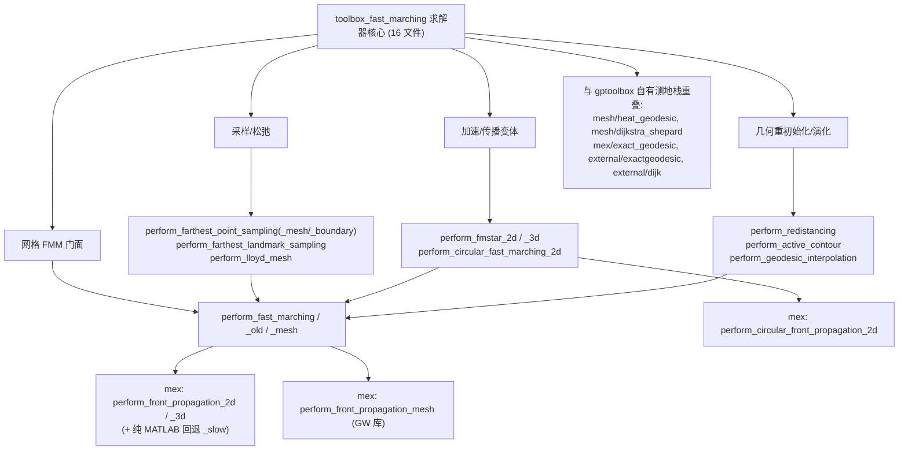

# 90.5 Toolbox Fast Marching — 求解器核心（第三方） / Fast Marching Solvers (Vendored)

> 本章逐文件覆盖 `external/toolbox_fast_marching/` 顶层（非 `toolbox/`、非 `tests/`）的 **16 个求解器驱动脚本** ——
> Gabriel Peyre 的 **Toolbox Fast Marching**（BSD，约 2004–2007）被 vendored 进 gptoolbox 的 MATLAB 接口层。
> 它们本身**大多是薄封装（dispatcher/wrapper）**：真正做窄带堆循环与 Eikonal 迎风更新的是
> `mex/` 下由 [compile_mex.m](file:///c:/VSWork/gptoolbox-1/external/toolbox_fast_marching/compile_mex.m#L1-L40)
> 编译出的 C/C++ **mex 二进制**（`perform_front_propagation_2d` / `_3d` / `_mesh` / `perform_circular_front_propagation_2d`）。
> 仅 [perform_front_propagation_2d_slow.m](file:///c:/VSWork/gptoolbox-1/external/toolbox_fast_marching/perform_front_propagation_2d_slow.m#L1-L199)
> 是**纯 MATLAB 回退**实现。所有 `.m` 文件头均标注 `Copyright (c) 2004–2007 Gabriel Peyre`。
>
> This chapter covers, file by file, the **16 solver driver scripts** at the top level of
> `external/toolbox_fast_marching/` — the MATLAB interface layer of Gabriel Peyre's **Toolbox Fast
> Marching** (BSD, ~2004–2007), vendored into gptoolbox. Most are **thin dispatchers/wrappers**: the
> real narrow-band heap loop and Eikonal upwind update live in the C/C++ **mex binaries** built by
> [compile_mex.m](file:///c:/VSWork/gptoolbox-1/external/toolbox_fast_marching/compile_mex.m#L1-L40).
> Only [perform_front_propagation_2d_slow.m](file:///c:/VSWork/gptoolbox-1/external/toolbox_fast_marching/perform_front_propagation_2d_slow.m#L1-L199)
> is a **pure-MATLAB fallback**.

- 语言 / Language：中英对照（中文为主）
- 相关章节 / See also：[90-external/README.md](README.md)、
  [90.3 MATLAB 环境与绘图辅助](03-matlab-environment-and-plotting.md)、
  [90.4 精确测地线工具箱](04-exactgeodesic-toolbox.md)、
  [10.13 距离与测地线](../10-mesh/13-distances-and-geodesics.md)、
  [appendices/03-doc-template.md](../appendices/03-doc-template.md)、
  [00-overview/05-dependency-map.md](../00-overview/05-dependency-map.md)
- 命名约定 / Notation：`W` 为**速度倒数（weight）矩阵**（越大越"慢"）；`start_points`/`end_points` 为
  `d x k` 索引矩阵（`d` 为维度）；`D` 距离场（far 点为 `Inf`）；`S` 状态（`-1` dead / `0` open / `1` far）；
  `Q` 最近种子索引（Voronoi，far 点为 `0`）；`L` = `constraint_map`；`H` = heuristic。
- 重要声明 / Disclaimer：`external/` 为**第三方 vendored 代码**；本目录**大量函数为 mex 薄封装**，脱离编译产物即
  报错。本节忠实记录文件头署名，并明确标注**哪些函数需编译 mex**、哪些是**纯 MATLAB 回退**，以及与
  gptoolbox 自有测地栈（`mesh/heat_geodesic`、`mesh/dijkstra_shepard`、`mex/exact_geodesic`、
  `external/exactgeodesic/`、`external/dijk`）的**功能重叠**。

---

## 本章概览 / Chapter Overview

**模块职责 / Module responsibility**

- 把 **Sethian 的 Fast Marching（FMM）** 与 **Eikonal 方程**的求解封装成"输入权重矩阵 → 输出距离场"的接口：
  二维/三维网格上的前向传播、三角网格上前向传播、圆环传播、**FM\*** 元稳定性加速、**最远点/地标采样**、
  **Lloyd 松弛**（CVT）、**重新初始化（redistancing）**、**活动轮廓**与**测地插值**。
- 计算后端分两类：**C 版 mex**（`perform_front_propagation_2d/3d`、`perform_circular_front_propagation_2d`，基于
  Fibonacci 堆 `mex/fheap/fib.cpp`）与 **C++ GW 测地库**（`mex/perform_front_propagation_mesh.cpp` +
  `mex/gw/**`）。

### 函数总表 / Function overview

| 函数 / Function | 算法 / Algorithm | 是否需 mex / Needs mex | 一句话功能 / One-line purpose |
|---|---|---|---|
| `perform_fast_marching` | Fast Marching (Sethian) + 窄带最小堆 | 是（2D 有 `_slow` 回退；3D 无回退） | 2D/3D 网格统一 FMM 入口（含各向异性分派） |
| `perform_fast_marching_old` | 同上（旧版） | 是（同上） | 旧版 FMM 入口，无 `dmax`、各向异性仅 2D |
| `perform_fast_marching_mesh` | Fast Marching on mesh (GW，Kimmel–Sethian) | 是（`perform_front_propagation_mesh`） | 三角网格顶点上的 FMM |
| `perform_front_propagation_2d` | Fast Marching（C，Fibonacci 堆） | 是（本文件即 mex 文档桩） | 2D FMM 的 mex 入口（无源文件，见 R8） |
| `perform_front_propagation_2d_slow` | Fast Marching（纯 MATLAB，线性扫 open 表） | **否**（纯 MATLAB 回退） | 2D FMM 的教学/回退实现 |
| `perform_fmstar_2d` | **FM\***（元稳定性，启发式加速） | 间接（→ FMM mex） | 2D FM\*：先算启发式再全量 FMM |
| `perform_fmstar_3d` | **FM\*** 3D（多分辨率启发式） | 间接（→ FMM mex） | 3D FM\*：粗网格启发式 + 全量 FMM |
| `perform_circular_fast_marching_2d` | 环形 Fast Marching | 是（`perform_circular_front_propagation_2d`） | 绕中心点弯曲的圆环传播 |
| `perform_farthest_point_sampling` | 最远点（测地）采样 | 间接（→ FMM mex） | 2D/3D 网格上迭代最远点采样 |
| `perform_farthest_point_sampling_mesh` | 最远点（测地）采样 | 间接（→ mesh FMM mex） | 三角网格上的最远点采样 |
| `perform_farthest_point_sampling_boundary` | 边界最远点采样 | **否**（欧氏距离，纯 MATLAB） | 在网格边界/全图上最远点采样 |
| `perform_farthest_landmark_sampling` | 最小误差地标采样（贪心） | 间接（→ FMM mex） | 以"最小插值误差"贪心选地标点 |
| `perform_lloyd_mesh` | **Lloyd 松弛**（CVT on mesh） | 间接（→ mesh FMM mex） | 网格上 Lloyd 弹性能量最小化 |
| `perform_redistancing` | 重新初始化（符号距离） | 间接（→ FMM mex） | 由水平集 D 重建同零集的符号距离 |
| `perform_active_contour` | 水平集活动轮廓（曲率流，显式/共轭梯度） | 间接（→ redistancing→FMM mex） | mean/affine/snake/chan-vese 等演化 |
| `perform_geodesic_interpolation` | 测地插值（powerlaw / gaussian） | 间接（→ FMM mex） | 由稀疏样本值按测地权重插值全图 |

### 模块关系图 / Module relationship diagram



---

## 共用 options 约定 / Shared option conventions

以下键在多个函数间**反复出现**，含义统一（`getoptions(options,name,default)` 读取，见
[toolbox/getoptions.m](file:///c:/VSWork/gptoolbox-1/external/toolbox_fast_marching/toolbox/getoptions.m#L1-L23)）。
各条目只列**该文件实际解析**的键，本表为总览。

| 键 名称 / Key | 默认 / Default | 含义 / Meaning |
|---|---|---|
| `options.nb_iter_max` | `Inf`（各文件内部另夹紧） | 窄带循环最大迭代数 / max FMM iterations |
| `options.end_points` | `[]` | 提前停止的目标点 / stop when these are reached |
| `options.values` | `[]` | 起点初始距离（默认 0）/ initial distance at seeds |
| `options.constraint_map` | `[]`（即无约束） | 约束图 `L`，令 `L=-Inf` 的点永不扩展 / exploration mask |
| `options.center_point` / `center` | 无（环形模式必填） | 环形传播的旋转中心 / center of circular flow |
| 距离度量标志 | 见注 | `'euclidean'` / `'quasi-euclidean'` / `'geodesic'`，由同族函数（如 `compute_eccentricity_transform`）解析 |

> **距离度量标志 / Metric flags**：这三个字符串在本目录的**元数据/度量选择类**函数中作为选项出现
> （如 [compute_eccentricity_transform.m#L50](file:///c:/VSWork/gptoolbox-1/external/toolbox_fast_marching/compute_eccentricity_transform.m#L50)
> `metric = 'geodesic'`），**本章 16 个求解器驱动文件不直接解析**该标志——它们总是用 FMM 求"测地"距离，
> 或（当 `std(W(:))<eps` 时）退化为**欧氏距离**（见 `perform_farthest_point_sampling` 内嵌 `my_eval_distance`）。

---

## 逐函数详解 / Per-function reference

### `perform_fast_marching` — 2D/3D 网格 Fast Marching 统一入口（dispatcher）
- **文件 / File**: [external/toolbox_fast_marching/perform_fast_marching.m](file:///c:/VSWork/gptoolbox-1/external/toolbox_fast_marching/perform_fast_marching.m#L1-L126)
- **署名 / Attribution**: Gabriel Peyre / Toolbox Fast Marching（BSD）—— 证据：文件头
  [perform_fast_marching.m#L37](file:///c:/VSWork/gptoolbox-1/external/toolbox_fast_marching/perform_fast_marching.m#L37) `%   Copyright (c) 2007 Gabriel Peyre`。
- **签名 / Signature**: `[D,S,Q] = perform_fast_marching(W, start_points, options)`
- **功能 / Purpose**: `EN: Dispatch to the Fast Marching backend by dimensionality (2D/3D grid, or anisotropic tensor field); return distance field D, point state S and nearest-seed index Q.` / 中文：按维度分派到 Fast Marching 后端（2D/3D 网格、或各向异性张量场），返回距离场 `D`、状态 `S`、最近种子索引 `Q`。
- **输入 / Inputs**:

  | 参数 | 尺寸/类型 | 含义 (中 / EN) |
  |---|---|---|
  | `W` | `n x n` 或 `n x n x n`（正数） | 速度倒数权重矩阵 / inverse-speed weight |
  | `start_points` | `d x k` | 起点索引（0-based 传 mex）/ seed indices |

- **输出 / Outputs**:

  | 参数 | 尺寸/类型 | 含义 |
  |---|---|---|
  | `D` | 同 `W` | 距离场；far 点为 `Inf`（`D>1e8` 归一为 `Inf`）/ distance field |
  | `S` | 同 `W` | 点状态 `-1/0/1`（anisotropic 分支返回 `[]`）/ state |
  | `Q` | 同 `W` | 最近种子索引（`+1`，far 点为 `0`）/ nearest-seed index |

- **可选参数 / Optional**:

  | 名称 | 取值 | 默认 | 含义 |
  |---|---|---|---|
  | `options.end_points` | `d x m` 索引 | `[]` | 到达即停 / stop points |
  | `options.nb_iter_max` | `int` | `Inf` → 夹紧 `1.2*max(size(W))^d` | 最大迭代 / max iterations |
  | `options.values` | 向量 | `[]` | 起点初值 / seed values |
  | `options.constraint_map` | 同 `W` | `[]` | `-Inf` 处禁扩展 / forbidden map |
  | `options.heuristic` | 同 `W` | `[]` | 到目标的剩余距离估计 / heuristic |
  | `options.verbose` | `0/1` | `1` | 冗余输出 / verbosity |
  | `options.dmax` | 正数 | `Inf` | 各向异性束最大距离 / max front distance |

- **变量流动 / Variable flow**: `W,start_points →(1 判维：d==4/5 各向异性 → 补第三维并 padding)→ W1 →(2 2D/3D 正常：L 中 ±Inf 夹紧为 ±1e9、nb_iter_max 夹紧)→(3 2D：exist('perform_front_propagation_2d')? mex : _slow→D,S,Q)→(4 Q=Q+1、D(D>1e8)=Inf)→ D,S,Q`
- **算法步骤 / Algorithm**:
  1. **Fast Marching（Sethian）**：C 版用**最小堆（Fibonacci 堆）**维护窄带，反复弹出 `D+H` 最小的 open 点，对其四/六邻域做**迎风 Eikonal 更新**（见 `_slow` 公式），命中的 far 点入堆并置 open，弹出处置 dead（`S=-1`）。
  2. **各向异性分支**（`d==4` 2×2 张量 / `d==5` 3×3 张量）：转成 6 分量张量并 padding，调用 `perform_front_propagation_anisotropic`（**compile_mex 未编译**，注释称"不存在"）。
  3. **2D**：`exist('perform_front_propagation_2d')~=0` 调 mex，否则回退 `perform_front_propagation_2d_slow`（此时 `Q=[]`）。
  4. **3D**：调 `perform_front_propagation_3d`（**无纯 MATLAB 回退**，缺 mex 即报错）。
  5. 迭代上限 `min(nb_iter_max, 1.2*max(size(W))^d)`（L110）；终止条件为 `end_points` 全部 dead 或达到上限。
- **流程图 / Flowchart**:

  ```mermaid
  flowchart TD
    A["输入 W,start_points,options"] --> B{"d 是 4 或 5 (各向异性) ?"}
    B -- 是 --> B1["张量重排 + padding → perform_front_propagation_anisotropic (未编译)"] --> Z
    B -- 否 --> C{"d 属于 2..3 ?"}
    C -- 否 --> C1["error: 仅支持 2D/3D"] 
    C -- 是 --> D["L 的 ±Inf 夹紧; nb_iter_max = min(nb_iter_max,1.2*max(size(W))^d)"]
    D --> E{"d == 2 ?"}
    E -- 是 --> F{"exist('perform_front_propagation_2d') ?"}
    F -- 是 --> F1["mex perform_front_propagation_2d → D,S,Q"]
    F -- 否 --> F2["_slow 回退 → D,S (Q=[])"]
    E -- 否 --> G["mex perform_front_propagation_3d → D,S,Q"]
    F1 --> H["Q = Q+1 ; D(D>1e8) = Inf"]
    F2 --> H
    G --> H
    H --> Z["输出 D,S,Q"]
  ```
- **依赖 / Dependencies**: `nb_dims`、`getoptions`；后端 **mex** `perform_front_propagation_2d`、`perform_front_propagation_3d`（由 [compile_mex.m#L2-L3](file:///c:/VSWork/gptoolbox-1/external/toolbox_fast_marching/compile_mex.m#L2-L3) 编译，基于 `mex/fheap/fib.cpp`）；回退 `perform_front_propagation_2d_slow`；各向异性 `perform_front_propagation_anisotropic`（**未编译**）。
- **See also**: `perform_fast_marching_mesh`, `perform_fmstar_2d`, `perform_redistancing`, `perform_farthest_point_sampling`
- **⚠️ 重叠 / 冲突标注**: 与 gptoolbox 自有测地栈**功能重叠但接口不同**——[mesh/heat_geodesic](file:///c:/VSWork/gptoolbox-1/mesh/heat_geodesic.m#L1)、[mesh/dijkstra_shepard](file:///c:/VSWork/gptoolbox-1/mesh/dijkstra_shepard.m#L1)、[mex/exact_geodesic](file:///c:/VSWork/gptoolbox-1/mex/exact_geodesic.m#L1)、[external/exactgeodesic](file:///c:/VSWork/gptoolbox-1/external/exactgeodesic.m#L1)、[external/dijk](file:///c:/VSWork/gptoolbox-1/external/dijk.m#L1)。**不遮蔽 MATLAB 内置**。

### `perform_fast_marching_old` — 旧版 2D/3D Fast Marching 入口
- **文件 / File**: [external/toolbox_fast_marching/perform_fast_marching_old.m](file:///c:/VSWork/gptoolbox-1/external/toolbox_fast_marching/perform_fast_marching_old.m#L1-L119)
- **署名 / Attribution**: Gabriel Peyre / Toolbox Fast Marching（BSD）—— 证据：[perform_fast_marching_old.m#L37](file:///c:/VSWork/gptoolbox-1/external/toolbox_fast_marching/perform_fast_marching_old.m#L37) `%   Copyright (c) 2007 Gabriel Peyre`。
- **签名 / Signature**: `[D,S,Q] = perform_fast_marching(W, start_points, options)`
- **功能 / Purpose**: `EN: Legacy dispatch of the Fast Marching backend; superseded by perform_fast_marching.m.` / 中文：旧版 Fast Marching 分派器，已被 `perform_fast_marching` 取代。
- **输入 / 输出**: 与 `perform_fast_marching` 完全相同（`W`, `start_points` → `D,S,Q`）。
- **可选参数 / Optional**: 与 `perform_fast_marching` 相同，但**无 `options.dmax`**：

  | 名称 | 取值 | 默认 | 含义 |
  |---|---|---|---|
  | `options.end_points` | 索引 | `[]` | 到达即停 |
  | `options.nb_iter_max` | `int` | `Inf` → 夹紧 `1.2*max(size(W))^d` | 最大迭代 |
  | `options.values` | 向量 | `[]` | 起点初值 |
  | `options.constraint_map` | 同 `W` | `[]` | 禁扩展图 |
  | `options.heuristic` | 同 `W` | `[]` | 启发式 |
  | `options.verbose` | `0/1` | `1` | 冗余输出 |

- **变量流动 / Variable flow**: `W,start_points →(1 判维 4/5 → 各向异性，仅 2D 张量做 padding)→(2 2D/3D → 夹紧 L/nb_iter_max)→(3 分派 mex 或 _slow)→(4 Q+1、D>1e8→Inf)→ D,S,Q`
- **算法步骤 / Algorithm**: 同 `perform_fast_marching`（Fast Marching + 最小堆迎风更新），差异在于：
  1. 各向异性分支**只支持 2D 张量场**（无 3D 张量、无 `dmax`），调用 `perform_front_propagation_anisotropic(W,L,alpha,start_points)`（4 参）。
  2. 其余 2D/3D 分派、`nb_iter_max` 夹紧、`D>1e8→Inf` 逻辑与新版逐行一致。
- **流程图 / Flowchart**:

  ```mermaid
  flowchart TD
    A["输入 W,start_points,options"] --> B{"d 是 4 或 5 ?"}
    B -- 是 --> B1["各向异性(仅 2D 张量) → perform_front_propagation_anisotropic(未编译)"] --> Z
    B -- 否 --> C{"d == 2 ?"}
    C -- 是 --> F{"exist('perform_front_propagation_2d') ?"}
    F -- 是 --> F1["mex 2D → D,S,Q"]
    F -- 否 --> F2["_slow 回退 → D,S"]
    C -- 否 --> G{"d == 3 ?"}
    G -- 是 --> G1["mex 3D → D,S,Q"]
    G -- 否 --> G2["error: 仅 2D/3D"]
    F1 --> H["Q = Q+1 ; D(D>1e8) = Inf"]
    F2 --> H
    G1 --> H
    H --> Z["输出 D,S,Q"]
  ```
- **依赖 / Dependencies**: `nb_dims`、`getoptions`；mex `perform_front_propagation_2d`/`_3d`；回退 `perform_front_propagation_2d_slow`。
- **See also**: `perform_fast_marching`, `perform_fast_marching_mesh`
- **备注 / Note**: 与 `perform_fast_marching` **高度重复**（近乎逐行相同），保留于仓库中作历史对照；调用方应以新版为准。

### `perform_fast_marching_mesh` — 三角网格上的 Fast Marching
- **文件 / File**: [external/toolbox_fast_marching/perform_fast_marching_mesh.m](file:///c:/VSWork/gptoolbox-1/external/toolbox_fast_marching/perform_fast_marching_mesh.m#L1-L71)
- **署名 / Attribution**: Gabriel Peyre / Toolbox Fast Marching（BSD）—— 证据：[perform_fast_marching_mesh.m#L32](file:///c:/VSWork/gptoolbox-1/external/toolbox_fast_marching/perform_fast_marching_mesh.m#L32) `%   Copyright (c) 2004-2006 Gabriel Peyr?`（文件头编码问题）。
- **签名 / Signature**: `[D,S,Q] = perform_fast_marching_mesh(vertex, faces, start_points, options)`
- **功能 / Purpose**: `EN: Run Fast Marching on a triangle-mesh's vertices (Kimmel–Sethian unfolding update), returning per-vertex distance, state and nearest seed.` / 中文：在三角网格顶点上做 Fast Marching（Kimmel–Sethian 展开更新），返回逐顶点距离 `D`、状态 `S`、最近种子 `Q`。
- **输入 / Inputs**:

  | 参数 | 尺寸/类型 | 含义 (中 / EN) |
  |---|---|---|
  | `vertex` | `#V by 3` | 顶点坐标 / vertex positions |
  | `faces` | `#F by 3` | 三角面索引 / triangle indices |
  | `start_points` | `k` 向量 | 起点顶点索引 / seed vertex indices |

- **输出 / Outputs**:

  | 参数 | 尺寸/类型 | 含义 |
  |---|---|---|
  | `D` | `#V by 1` | 距离场（far 点 `Inf`）/ distance field |
  | `S` | `#V by 1` | 状态 `-1/0/1` / state |
  | `Q` | `#V by 1` | 最近种子索引（`+1`）/ nearest-seed index |

- **可选参数 / Optional**:

  | 名称 | 取值 | 默认 | 含义 |
  |---|---|---|---|
  | `options.W` | `#V by 1` | `ones(nverts,1)` | 非均匀速度倒数 / per-vertex speed⁻¹ |
  | `options.end_points` | 顶点索引 | `[]` | 到达即停 |
  | `options.nb_iter_max` | `int` | `Inf` → 夹紧 `1.2*max(size(W))` | 最大迭代 |
  | `options.constraint_map` | 同 `W` | `[]` | 禁扩展图（`-Inf`→`-1e9`） |
  | `options.heuristic` | 同 `W` | `[]` | 启发式 |
  | `options.values` | 向量 | `[]` | 起点初值 |
  | `options.dmax` | 正数 | `1e9` | 束最大距离 |

- **变量流动 / Variable flow**: `vertex,faces,start_points →(1 统一行列方向：vertex/faces 转 3×#、start/end 拉直)→(2 L 的 ±Inf→±1e9、nb_iter_max 夹紧)→(3 mex perform_front_propagation_mesh)→(4 Q+1、D>1e8→Inf)→ D,S,Q`
- **算法步骤 / Algorithm**:
  1. **Fast Marching（Kimmel–Sethian 1998）**：在三角网格顶点上，用**最小堆**维护窄带；对每个被更新三角面，解**局部 Eikonal 二次方程**（顶点值 + 边长），取满足单调性的最小正根更新顶点距离。
  2. 弹出 open 顶点 → 置 dead，更新其环邻顶点；命中 far 顶点入堆。
  3. 由 C++ **GW 测地库**（`mex/gw/**`）实现，前 2 行做转置/拉直后调用 `perform_front_propagation_mesh`。
  4. 终止：`end_points` 全 dead 或达 `nb_iter_max`。
- **流程图 / Flowchart**:

  ```mermaid
  flowchart TD
    A["输入 vertex,faces,start_points,options"] --> B["统一行列: vertex/faces 转 3×N; start/end 拉直"]
    B --> C["L 的 ±Inf 夹紧; nb_iter_max = min(nb_iter_max,1.2*max(size(W)))"]
    C --> D{"exist('perform_front_propagation_2d') ?"}
    D -- 是 --> E["mex perform_front_propagation_mesh(vertex,faces-1,W,...)"]
    D -- 否 --> D1["error: 需先跑 compile_mex"]
    E --> F["Q = Q+1 ; D(D>1e8) = Inf"]
    F --> Z["输出 D,S,Q"]
  ```
- **依赖 / Dependencies**: `getoptions`；**mex** `perform_front_propagation_mesh`（由 [compile_mex.m#L16-L40](file:///c:/VSWork/gptoolbox-1/external/toolbox_fast_marching/compile_mex.m#L16-L40) 连同 `mex/gw/gw_core/*`、`mex/gw/gw_geodesic/*` 编译）。
- **See also**: `perform_fast_marching`, `perform_farthest_point_sampling_mesh`, `perform_lloyd_mesh`
- **⚠️ 重叠 / 冲突标注**: 与 [mesh/heat_geodesic](file:///c:/VSWork/gptoolbox-1/mesh/heat_geodesic.m#L1)、[mesh/dijkstra_shepard](file:///c:/VSWork/gptoolbox-1/mesh/dijkstra_shepard.m#L1)、[mex/exact_geodesic](file:///c:/VSWork/gptoolbox-1/mex/exact_geodesic.m#L1) **功能重叠**（均为网格测地距离），接口与精度取向不同。**不遮蔽 MATLAB 内置**。

### `perform_front_propagation_2d` [MEX] — 2D FMM 的 mex 入口（仅有文档桩）
- **文件 / File**: [external/toolbox_fast_marching/perform_front_propagation_2d.m](file:///c:/VSWork/gptoolbox-1/external/toolbox_fast_marching/perform_front_propagation_2d.m#L1-L14)
- **署名 / Attribution**: Gabriel Peyre / Toolbox Fast Marching（BSD）—— 证据：[perform_front_propagation_2d.m#L12](file:///c:/VSWork/gptoolbox-1/external/toolbox_fast_marching/perform_front_propagation_2d.m#L12) `%   Copyright (c) 2004 Gabriel Peyr?`。
- **签名 / Signature**: `[D,S] = perform_front_propagation_2d(W,start_points,end_points,nb_iter_max,H)`（源文件为**纯注释桩，无 `function` 行**；按 R8 标注 `[MEX]`）
- **功能 / Purpose**: `EN: Compiled C Fast Marching in 2D (Fibonacci-heap narrow band); the .m file is only a documentation stub — the implementation is the compiled mex.` / 中文：编译后的 **2D C 版 Fast Marching**（Fibonacci 堆窄带）；`.m` 仅文档桩，真正实现为 mex 二进制。
- **输入 / Inputs**:

  | 参数 | 尺寸/类型 | 含义 |
  |---|---|---|
  | `W` | `n x n` | 权重矩阵（速度倒数） |
  | `start_points` | `2 x k`（**0-based**） | 起点 / seeds (0-based) |
  | `end_points` | `2 x m`（0-based） | 停止点 |

- **输出 / Outputs**:

  | 参数 | 尺寸/类型 | 含义 |
  |---|---|---|
  | `D` | `n x n` | 距离场（`1e9` 表示 `Inf`，由调用方归一） |
  | `S` | `n x n` | 状态 `-1/0/1` |

- **可选参数 / Optional**（由 C 入口解析，见 `mex/perform_front_propagation_2d_mex.cpp`）:

  | 名称 | 取值 | 默认 | 含义 |
  |---|---|---|---|
  | `nb_iter_max` | `int` | `Inf`（调用方夹紧） | 最大迭代 |
  | `H` | `n x n` | `zeros` | 启发式（A\* 式） |
  | `L`（constraint） | `n x n` | 无 | 禁扩展图（新版额外参数） |
  | `values`（seed values） | 向量 | `0` | 起点初值 |

- **变量流动 / Variable flow**: `W,start_points(0-based),end_points,nb_iter_max,H →(C 内：初始化 D=1e9、起点置 0/open，建 Fibonacci 堆)→(弹出 D+H 最小 → 迎风更新 4 邻域并 push)→(死点锁定)→ D,S（`1e9`→调用方转 `Inf`）`
- **算法步骤 / Algorithm**:
  1. **Fast Marching（Sethian）**，**最小堆**为 `mex/fheap/fib.cpp` 的 **Fibonacci 堆**。
  2. 迎风二次更新：`(a-a1)^2+(a-a2)^2 = P^2`（`P=h/W`），当 `P^2>(a2-a1)^2` 取 `a=(a1+a2+sqrt(2P^2-(a2-a1)^2))/2`，否则退化为 `a=a1+P`（公式见纯 MATLAB 版 [perform_front_propagation_2d_slow.m#L150-L157](file:///c:/VSWork/gptoolbox-1/external/toolbox_fast_marching/perform_front_propagation_2d_slow.m#L150-L157)）。
  3. 迭代上限由调用方传入；终止于 `end_points` 全 dead 或达上限。
- **流程图 / Flowchart**:

  ```mermaid
  flowchart TD
    A["输入 W,start_points,end_points,nb_iter_max,H"] --> B["初始化 D=1e9; 起点 D=0/S=open; 建 Fibonacci 堆"]
    B --> C{"堆非空 且 迭代 < nb_iter_max 且 未命中所有 end_points ?"}
    C -- 是 --> D["弹出 D+H 最小的 open 点; 置 S=dead"]
    D --> E["对 4 邻域: 求 Upwind 二次根 a"]
    E --> F{"P^2 大于 (a2-a1)^2 ?"}
    F -- 是 --> F1["a = (a1+a2+sqrt(2P^2-(a2-a1)^2))/2"]
    F -- 否 --> F2["a = a1 + P"]
    F1 --> G["邻居 far→入堆/open; open→取更小值"]
    F2 --> G
    G --> C
    C -- 否 --> Z["输出 D,S (1e9 由调用方转 Inf)"]
  ```
- **依赖 / Dependencies**: **mex** 由 [compile_mex.m#L2](file:///c:/VSWork/gptoolbox-1/external/toolbox_fast_marching/compile_mex.m#L2) 编译：`mex/perform_front_propagation_2d.cpp` + `mex/perform_front_propagation_2d_mex.cpp` + `mex/fheap/fib.cpp`。
- **See also**: `perform_fast_marching`, `perform_front_propagation_2d_slow`, `perform_circular_front_propagation_2d`
- **备注 / Note**: 调用方 `perform_fast_marching` 通过 `exist('perform_front_propagation_2d')~=0` 探测该 mex 是否存在；缺则回退纯 MATLAB `_slow`。

### `perform_front_propagation_2d_slow` — 纯 MATLAB 版 2D Fast Marching（回退实现）
- **文件 / File**: [external/toolbox_fast_marching/perform_front_propagation_2d_slow.m](file:///c:/VSWork/gptoolbox-1/external/toolbox_fast_marching/perform_front_propagation_2d_slow.m#L1-L199)
- **署名 / Attribution**: Gabriel Peyre / Toolbox Fast Marching（BSD）—— 证据：[perform_front_propagation_2d_slow.m#L16](file:///c:/VSWork/gptoolbox-1/external/toolbox_fast_marching/perform_front_propagation_2d_slow.m#L16) `%   Copyright (c) 2004 Gabriel Peyr?`。
- **签名 / Signature**: `[D,S,father] = perform_front_propagation_2d_slow(W,start_points,end_points,nb_iter_max,H)`
- **功能 / Purpose**: `EN: Pure-MATLAB Fast Marching in 2D (linear scan of the open list instead of a heap), used as fallback when the mex is absent; also returns the back-pointer field.` / 中文：**纯 MATLAB** 版 2D Fast Marching（open 表线性扫描替代堆），缺 mex 时的回退；额外返回回溯父指针场 `father`。
- **输入 / Inputs**:

  | 参数 | 尺寸/类型 | 含义 |
  |---|---|---|
  | `W` | `n x n` | 权重矩阵 |
  | `start_points` | `2 x k`（**1-based**） | 起点 |
  | `end_points` | `2 x m` | 停止点（默认 `[]`） |
  | `nb_iter_max` | `int` | 最大迭代（默认 `round(1.2*size(W,1)^2)`） |
  | `H` | `n x n` | 启发式（默认 `W*0`） |

- **输出 / Outputs**:

  | 参数 | 尺寸/类型 | 含义 |
  |---|---|---|
  | `D` | `n x n` | 距离场 |
  | `S` | `n x n` | 状态 `-1/0/1` |
  | `father` | `n x n x 2` | 回溯父指针（用于提取路径）/ back-pointers |

- **可选参数 / Optional**: 非 options 结构，参数按位置给默认（`nargin<3/4/5`）；`verbose` 固定为 1（`waitbar` 进度条）。

- **变量流动 / Variable flow**: `W,start_points →(1 初始化 D=Inf、起点 D=0/open、father=0)→(2 while i<nb_iter_max 且 open 非空 且 end_points 未全 dead: perform_fast_marching_step)→(3 D,S,father)→ 输出`
- **算法步骤 / Algorithm**:
  1. **Fast Marching（Sethian）**，但最优点选择用 **`min(D(ind_O)+H)` 线性扫描**（无堆，每步 O(#open)）。
  2. **迎风二次更新**（子函数 `perform_fast_marching_step`，L71 起）：对 4 邻域取轴向较小值 `a1<=a2`，解 `(a-a1)^2+(a-a2)^2=P^2`（`P=h/W`，`h=1/n`）：若 `P^2>(a2-a1)^2` 则 `A1=(a1+a2+sqrt(2P^2-(a2-a1)^2))/2`，否则 `A1=a1+P`（L150–L157）。
  3. 按邻居状态分支（`case kClose/kOpen/kFar`）：far→入 open 并置值；open→若更小则更新并记 `father`；close→FM 中通常不变（可选的"重开"被 `if 0` 关闭）。
  4. **终止条件**：`i<nb_iter_max && ~isempty(O) && isempty(find(S(end_ind)==-1))`（L54）。
- **流程图 / Flowchart**:

  ```mermaid
  flowchart TD
    A["输入 W,start_points,end_points,nb_iter_max,H"] --> B["初始化 D=Inf; 起点 D=0/S=open; father=zeros"]
    B --> C{"i < nb_iter_max 且 open 非空 且 end_points 未全 dead ?"}
    C -- 是 --> D["线性扫描取 min(D+H) 的 open 点; 置 S=dead"]
    D --> E["对 4 邻域: 取 a1<=a2"]
    E --> F{"P^2 大于 (a2-a1)^2 ?"}
    F -- 是 --> F1["A1 = (a1+a2+sqrt(2P^2-(a2-a1)^2))/2"]
    F -- 否 --> F2["A1 = a1 + P"]
    F1 --> G{"邻居状态 S(ii,jj) ?"}
    F2 --> G
    G -- kFar --> G1["入 open; D=A1; 记 father"]
    G -- kOpen --> G2["A1 更小则更新 D 与 father"]
    G -- kClose --> G3["FM 中不变(重开被 if 0 关闭)"]
    G1 --> C
    G2 --> C
    G3 --> C
    C -- 否 --> Z["输出 D,S,father"]
  ```
- **依赖 / Dependencies**: **无**同库依赖（子函数 `perform_fast_marching_step` 内含）；内置 `sub2ind`/`waitbar`。**不需要任何 mex**。
- **See also**: `perform_fast_marching`, `perform_front_propagation_2d`
- **备注 / Note**: 复杂度 O(N²) 量级，仅作回退/教学；返回的 `father` 在 mex 版中不提供。

### `perform_fmstar_2d` — 2D FM\*（元稳定性启发式加速）
- **文件 / File**: [external/toolbox_fast_marching/perform_fmstar_2d.m](file:///c:/VSWork/gptoolbox-1/external/toolbox_fast_marching/perform_fmstar_2d.m#L1-L86)
- **署名 / Attribution**: Gabriel Peyre / Toolbox Fast Marching（BSD）—— 证据：[perform_fmstar_2d.m#L22](file:///c:/VSWork/gptoolbox-1/external/toolbox_fast_marching/perform_fmstar_2d.m#L22) `%   Copyright (c) 2004 Gabriel Peyr?`。
- **签名 / Signature**: `[D,S] = perform_fmstar_2d(W, start_points,end_points, options)`
- **功能 / Purpose**: `EN: FM* — build a 'distance-to-goal' heuristic (multiresolution or landmarks), then run a single weighted Fast Marching toward the goal (optionally circular).` / 中文：**FM\*** —— 先构造"到目标剩余距离"启发式（多分辨率或地标），再用带权 FMM 朝向目标一次传播（可选环形传播）。
- **输入 / Inputs**:

  | 参数 | 尺寸/类型 | 含义 |
  |---|---|---|
  | `W` | `n x n` | 权重矩阵（越大越慢） |
  | `start_points` | `2 x k` | 起点 |
  | `end_points` | `2 x 1` | 目标点 |

- **输出 / Outputs**:

  | 参数 | 尺寸/类型 | 含义 |
  |---|---|---|
  | `D` | `n x n` | 距离场 |
  | `S` | `n x n` | 状态 |

- **可选参数 / Optional**（源文件用 `isfield`）：

  | 名称 | 取值 | 默认 | 含义 |
  |---|---|---|---|
  | `options.heuristic` | 同 `W` | 无（自动算） | 显式启发式 |
  | `options.heuristic_type` | `'multiresolution'` / `'landmark'` | `'multiresolution'` | 自动启发式方式 |
  | `options.weight` | `0..1` | `0.6` | 启发式权重（乘以 `H`） |
  | `options.propagation_type` | `'normal'` / `'circular'` | `'normal'` | 传播模式 |
  | `options.center_point` | `2 x k` | — | 环形模式中心（缺失则回退 normal） |
  | `options.distance_to_landmarks` | 3D 数组 | — | 预计算地标距离 |
  | `options.landmarks` | `2 x m` | — | 地标点（无 DL 时用） |

- **变量流动 / Variable flow**: `W,start_points,end_points →(1 取 weight/propagation_type/heuristic)→(2 无 heuristic：heuristic_type='multiresolution'→compute_heuristic_multiresolution，或 'landmark'→逐个 FMM 得 DL→compute_heuristic_landmark)→ H →(3 FM: perform_fast_marching(...,H*weight) 或 perform_circular_fast_marching_2d)→ D,S`
- **算法步骤 / Algorithm**:
  1. **FM\*（Peyre）**：对 Eikonal 的到达时间做**元稳定性/启发式加速**——用粗尺度解或地标距离近似"到目标剩余距离" `H`，把它作为 A\* 风格启发式加到窄带优先级上。
  2. 启发式来源：`'multiresolution'` 调 `compute_heuristic_multiresolution`；`'landmark'` 对每个地标跑一次 FMM 得距离体 `DL`，再 `compute_heuristic_landmark`。
  3. 以 `options.nb_iter_max=Inf`、`options.end_points=end_points` 调用一次全量 FMM（`'normal'`）或环形 FMM（`'circular'`）。
  4. 终止条件：FMM 到达 `end_points`。
- **流程图 / Flowchart**:

  ```mermaid
  flowchart TD
    A["输入 W,start_points,end_points,options"] --> B{"提供 options.heuristic ?"}
    B -- 是 --> H0["H = options.heuristic"]
    B -- 否 --> C{"heuristic_type ?"}
    C -- multiresolution --> C1["H = compute_heuristic_multiresolution(W,end_points)"]
    C -- landmark --> C2["对每个地标跑 FMM → DL; H = compute_heuristic_landmark(DL,end_points)"]
    H0 --> D{"propagation_type == 'circular' ?"}
    C1 --> D
    C2 --> D
    D -- 是 --> E1["perform_circular_fast_marching_2d(W,start_points,center,H*weight)"]
    D -- 否 --> E2["perform_fast_marching(W,start_points,end_points, option, H*weight)"]
    E1 --> Z["输出 D,S"]
    E2 --> Z
  ```
- **依赖 / Dependencies**: `compute_heuristic_multiresolution`、`compute_heuristic_landmark`、`perform_fast_marching`（**间接需 2D FMM mex**）、`perform_circular_fast_marching_2d`（环形模式，需 mex）。
- **See also**: `perform_fmstar_3d`, `perform_fast_marching`, `perform_circular_fast_marching_2d`
- **⚠️ 缺陷标注 / Latent bugs**: ① L61 `nbr_landmarks = size(nbr_landmarks, 2)` 引用**未定义变量**（应为其上文的 `landmarks`），landmark 分支会报错；② L83/L85 以 **4 个实参** 调 `perform_fast_marching`（该函数只有 3 个形参），多出的 `H*weight` 被**静默忽略**——真正注入启发式需走两个文件支持的 3 参约定，此处为**失效的加速意图**。

### `perform_fmstar_3d` — 3D FM\*（多分辨率启发式加速）
- **文件 / File**: [external/toolbox_fast_marching/perform_fmstar_3d.m](file:///c:/VSWork/gptoolbox-1/external/toolbox_fast_marching/perform_fmstar_3d.m#L1-L55)
- **署名 / Attribution**: Gabriel Peyre / Toolbox Fast Marching（BSD）—— 证据：[perform_fmstar_3d.m#L15](file:///c:/VSWork/gptoolbox-1/external/toolbox_fast_marching/perform_fmstar_3d.m#L15) `%   Copyright (c) 2004 Gabriel Peyr?`。
- **签名 / Signature**: `[D,S] = perform_fmstar_3d(W, start_points,end_points, options)`
- **功能 / Purpose**: `EN: FM* in 3D — solve the Eikonal at a reduced resolution to obtain the heuristic H, upsample it, then run the full-resolution Fast Marching.` / 中文：**3D FM\*** —— 在**降采样网格**上解 Eikonal 得启发式 `H`，上采样后做全分辨率 FMM。
- **输入 / Inputs**:

  | 参数 | 尺寸/类型 | 含义 |
  |---|---|---|
  | `W` | `n x n x n` | 3D 权重矩阵 |
  | `start_points` | `3 x k` | 起点 |
  | `end_points` | `3 x 1` | 目标点 |

- **输出 / Outputs**:

  | 参数 | 尺寸/类型 | 含义 |
  |---|---|---|
  | `D` | `n x n x n` | 距离场 |
  | `S` | `n x n x n` | 状态 |

- **可选参数 / Optional**:

  | 名称 | 取值 | 默认 | 含义 |
  |---|---|---|---|
  | `options.weight` | `0..1` | `0.6` | 启发式权重 |
  | `options.reduc_factor` | `(0,1]` | `0.3` | 粗尺度降采样比 / coarse reduction |

- **变量流动 / Variable flow**: `W →(1 Ws = image_3d_resize(W, round(size(W)*reduc_factor)))→ Ws →(2 FMM on Ws from 上采样目标 start_points_small)→ Hs →(3 H = image_3d_resize(Hs, size(W)))→ H →(4 FMM(W,start_points, ..., H*weight))→ D,S`
- **算法步骤 / Algorithm**:
  1. **FM\*（Peyre）**：以 `reduc_factor` 把体数据缩到粗网格 `Ws`。
  2. 在 `Ws` 上以目标点（缩放到粗网格）为源跑一次 FMM（`nb_iter_max=10000000`）得粗距离 `Hs`。
  3. `H = image_3d_resize(Hs, size(W))` 上采样回全分辨率，作为启发式。
  4. 全分辨率 FMM：`H*weight` 加权（同 2D 版的参数传递瑕疵——`perform_fast_marching` 只接受 3 参，`H*weight` 被忽略）。
  5. 终止：FMM 到达 `end_points`（`options.nb_iter_max=10000000`）。
- **流程图 / Flowchart**:

  ```mermaid
  flowchart TD
    A["输入 W,start_points,end_points,options"] --> B{"reduc_factor 不等于 1 ?"}
    B -- 是 --> B1["Ws = image_3d_resize(W, round(size(W)*reduc_factor))"]
    B -- 否 --> B2["Ws = W"]
    B1 --> C["粗网格 FMM(Ws, round(end_points*reduc_factor)) → Hs"]
    B2 --> C
    C --> D{"reduc_factor 不等于 1 ?"}
    D -- 是 --> D1["H = image_3d_resize(Hs, size(W))"]
    D -- 否 --> D2["H = Hs"]
    D1 --> E["全分辨率 FMM(W,start_points,end_points,...) → D,S"]
    D2 --> E
    E --> Z["输出 D,S"]
  ```
- **依赖 / Dependencies**: `image_3d_resize`（粗化/上采样）、`perform_fast_marching`（**间接需 3D FMM mex**）。
- **See also**: `perform_fmstar_2d`, `perform_fast_marching`
- **备注 / Note**: 多分辨率启发式降低搜索代价，但**精度略降**；同 2D 版，加权启发式的第 4 实参被 `perform_fast_marching` 忽略。**⚠️ 被调用的 `image_3d_resize` 在仓库内无定义文件**（全库检索未见 `.m`），`reduc_factor~=1` 时运行会因缺函数报错。

### `perform_circular_fast_marching_2d` — 2D 环形 Fast Marching
- **文件 / File**: [external/toolbox_fast_marching/perform_circular_fast_marching_2d.m](file:///c:/VSWork/gptoolbox-1/external/toolbox_fast_marching/perform_circular_fast_marching_2d.m#L1-L67)
- **署名 / Attribution**: Gabriel Peyre / Toolbox Fast Marching（BSD）—— 证据：[perform_circular_fast_marching_2d.m#L20](file:///c:/VSWork/gptoolbox-1/external/toolbox_fast_marching/perform_circular_fast_marching_2d.m#L20) `%   Copyright (c) 2004 Gabriel Peyr?`。
- **签名 / Signature**: `[D,S] = perform_circular_fast_marching_2d(W, start_points, center_point, options, H)`
- **功能 / Purpose**: `EN: Fast Marching variant whose front is forced to turn around a given center (circular propagation), via a dedicated mex.` / 中文：让波前**绕给定中心点旋转**的 Fast Marching 变体（环形传播），由专用 mex 实现。
- **输入 / Inputs**:

  | 参数 | 尺寸/类型 | 含义 |
  |---|---|---|
  | `W` | `n x n` | 权重矩阵 |
  | `start_points` | `2 x k` | 起点 |
  | `center_point` | `2 x k` | 旋转中心 / center of flow |

- **输出 / Outputs**:

  | 参数 | 尺寸/类型 | 含义 |
  |---|---|---|
  | `D` | `n x n` | 距离场 |
  | `S` | `n x n` | 状态 |

- **可选参数 / Optional**:

  | 名称 | 取值 | 默认 | 含义 |
  |---|---|---|---|
  | `options.end_points` | `2 x m` | `[]` | 到达即停 |
  | `options.nb_iter_max` | `int` | `Inf` → 夹紧 `1.2*max(size(W))^2` | 最大迭代 |
  | `options.verbose` | `0/1` | `1` | 冗余输出 |
  | `H`（第 5 实参） | 同 `W` | 无 | 启发式（缺省时不传） |

- **变量流动 / Variable flow**: `W,start_points,center_point →(1 解析 end_points/verbose/nb_iter_max、夹紧)→(2 exist mex? perform_circular_front_propagation_2d(W,start-1,end-1,center-1,nb_iter_max[,H]))→(3 D(D>10000)=Inf)→ D,S`
- **算法步骤 / Algorithm**:
  1. 在标准 Fast Marching 基础上加入**环形（环绕中心）约束的波前更新**（C 实现，Fibonacci 堆）。
  2. 索引转 0-based 后调用 mex；第 5 实参 `H` 存在时才传入（`nargin<5` 分支）。
  3. 终止：`end_points` 到达或达 `min(nb_iter_max, 1.2*max(size(W))^2)`。
  4. 收尾把 C 端的 `1e9` 大值（此处阈值 `>10000`）替换为 `Inf`（L66–L67）。
- **流程图 / Flowchart**:

  ```mermaid
  flowchart TD
    A["输入 W,start_points,center_point,options[,H]"] --> B["解析 end_points/verbose/nb_iter_max 并夹紧"]
    B --> C{"exist('perform_front_propagation_2d') ?"}
    C -- 否 --> C1["error: You must compile the mex files."]
    C -- 是 --> D{"nargin < 5 (无 H) ?"}
    D -- 是 --> D1["perform_circular_front_propagation_2d(W,...,nb_iter_max)"]
    D -- 否 --> D2["perform_circular_front_propagation_2d(W,...,nb_iter_max,H)"]
    D1 --> E["D(D>10000) = Inf"]
    D2 --> E
    E --> Z["输出 D,S"]
  ```
- **依赖 / Dependencies**: **mex** `perform_circular_front_propagation_2d`（由 [compile_mex.m#L4](file:///c:/VSWork/gptoolbox-1/external/toolbox_fast_marching/compile_mex.m#L4) 编译：`mex/perform_circular_front_propagation_2d.cpp` + `mex/perform_front_propagation_2d.cpp` + `mex/fheap/fib.cpp`）。
- **See also**: `perform_fast_marching`, `perform_fmstar_2d`
- **备注 / Note**: L27–L37 **重复两次**相同的 `end_points` 解析块（冗余，无副作用）。

### `perform_farthest_point_sampling` — 2D/3D 网格最远点采样
- **文件 / File**: [external/toolbox_fast_marching/perform_farthest_point_sampling.m](file:///c:/VSWork/gptoolbox-1/external/toolbox_fast_marching/perform_farthest_point_sampling.m#L1-L130)
- **署名 / Attribution**: Gabriel Peyre / Toolbox Fast Marching（BSD）—— 证据：[perform_farthest_point_sampling.m#L10](file:///c:/VSWork/gptoolbox-1/external/toolbox_fast_marching/perform_farthest_point_sampling.m#L10) `%   Copyright (c) 2005 Gabriel Peyre`。
- **签名 / Signature**: `[points,D] = perform_farthest_point_sampling( W, points, npoints, options )`
- **功能 / Purpose**: `EN: Iteratively add the geodesically farthest point (or farthest Voronoi/Steiner point) as new seeds, yielding a well-spread sampling of a 2D/3D domain.` / 中文：迭代地把**测地最远点**（或最远 Voronoi/Steiner 点）作为新种子加入，得到均匀散布的采样点集。
- **输入 / Inputs**:

  | 参数 | 尺寸/类型 | 含义 |
  |---|---|---|
  | `W` | `n x n` / `n x n x n`（可各向异性） | 权重矩阵 |
  | `points` | `d x m` 或 `[]` | 已有采样点 |
  | `npoints` | `int` | 还要选的点数（默认 1） |

- **输出 / Outputs**:

  | 参数 | 尺寸/类型 | 含义 |
  |---|---|---|
  | `points` | `d x (m+npoints+1)` | 追加后的采样点 |
  | `D` | 同 `W` | 最终距离场 |

- **可选参数 / Optional**:

  | 名称 | 取值 | 默认 | 含义 |
  |---|---|---|---|
  | `options.constraint_map` | 同 `W` | `zeros(s)+Inf` | 域约束（`-Inf` 处排除）/ domain mask |
  | `options.verb` | `0/1` | `1` | 进度条开关 |
  | `options.nb_iter_max` | `int` | `Inf`（循环内设） | FMM 迭代上限 |
  | `options.Tmax` | 正数 | `Inf` | 传播时间上限 |

- **变量流动 / Variable flow**: `W,points,npoints →(空 points: 随机起点→取最远点，npoints-1)→(1 L=my_eval_distance(W,points)→L,Q)→(2 for i: options.constraint_map=L; D=my_eval_distance(W,末点); D=min(D,L); L=min(D,L1); 更新 Q)→(3 最远点 = max(D) 或 compute_saddle_points → points 追加)→ points,D`
- **算法步骤 / Algorithm**:
  1. **最远点（测地）采样**：维护"到已选点集的最近距离"场 `L`，每轮新增 `argmax L`。
  2. `my_eval_distance` 子函数：当 `std(W(:))<eps`（常数权重）走**欧氏距离**解析式，否则调 `perform_fast_marching` 求**测地距离**。
  3. 有 `Q`（Voronoi）时改用 `compute_saddle_points` 取"最远 Steiner 点"，使采样贴合 Voronoi 边界。
  4. 迭代 `npoints` 次；每轮 `L = min(D, L1)` 与约束图裁剪。
- **流程图 / Flowchart**:

  ```mermaid
  flowchart TD
    A["输入 W,points,npoints,options"] --> B{"points 为空 ?"}
    B -- 是 --> B1["随机起点 → 递归取最远点; npoints = npoints-1"]
    B -- 否 --> B2["L = my_eval_distance(W,points)"]
    B1 --> C["L1 = constraint_map; mask = (L1 不为 -Inf)"]
    B2 --> C
    C --> L{"i <= npoints ?"}
    L -- 是 --> D["D = my_eval_distance(W, 末点); Dold = D"]
    D --> E["D = min(D,L); L = min(D,L1); 更新 Voronoi Q"]
    E --> F{"Q 为空 ?"}
    F -- 是 --> F1["最远点 = argmax(D)"]
    F -- 否 --> F2["最远 Steiner 点 = compute_saddle_points(Q,D,mask)"]
    F1 --> G["points 追加新点"]
    F2 --> G
    G --> L
    L -- 否 --> Z["输出 points,D"]
  ```
- **依赖 / Dependencies**: `nb_dims`、`getoptions`、`compute_saddle_points`、`progressbar`、`perform_fast_marching`（**间接需 FMM mex**，除非常数权重走欧氏分支）。
- **See also**: `perform_farthest_point_sampling_mesh`, `perform_farthest_point_sampling_boundary`, `perform_lloyd_mesh`

### `perform_farthest_point_sampling_mesh` — 三角网格最远点采样
- **文件 / File**: [external/toolbox_fast_marching/perform_farthest_point_sampling_mesh.m](file:///c:/VSWork/gptoolbox-1/external/toolbox_fast_marching/perform_farthest_point_sampling_mesh.m#L1-L65)
- **署名 / Attribution**: Gabriel Peyre / Toolbox Fast Marching（BSD）—— 证据：[perform_farthest_point_sampling_mesh.m#L12](file:///c:/VSWork/gptoolbox-1/external/toolbox_fast_marching/perform_farthest_point_sampling_mesh.m#L12) `%   Copyright (c) 2007 Gabriel Peyre`。
- **签名 / Signature**: `[points,D] = perform_farthest_point_sampling_mesh( vertex,faces, points, nbr_iter, options )`
- **功能 / Purpose**: `EN: Farthest-point (geodesic) sampling on a triangle mesh — iteratively add the vertex farthest from the current seed set.` / 中文：三角网格上的**测地最远点采样**——迭代加入距已选种子集最远的顶点。
- **输入 / Inputs**:

  | 参数 | 尺寸/类型 | 含义 |
  |---|---|---|
  | `vertex` | `#V by 3` | 顶点坐标 |
  | `faces` | `#F by 3` | 三角面 |
  | `points` | `1 x m` 或 `[]` | 已有采样顶点 |
  | `nbr_iter` | `int` | 追加次数（默认 1） |

- **输出 / Outputs**:

  | 参数 | 尺寸/类型 | 含义 |
  |---|---|---|
  | `points` | `1 x k` | 采样顶点索引 |
  | `D` | `#V by 1` | 最终顶点距离场 |

- **可选参数 / Optional**:

  | 名称 | 取值 | 默认 | 含义 |
  |---|---|---|---|
  | `options.constraint_map` | `#V by 1` | `zeros(n,1)+Inf` | 顶点域约束 |
  | `options.nb_iter_max` | `int` | `Inf`（循环内设） | 网格 FMM 迭代上限 |

- **变量流动 / Variable flow**: `vertex,faces,points,nbr_iter →(1 check_face_vertex 规范化)→(2 空 points: 随机顶点→取最远点，nbr_iter-1)→(3 for: D=my_eval_distance(vertex,faces,末点); D=min(D,L); L=min(D,L1); points=[points, argmax(D)])→ points,D`
- **算法步骤 / Algorithm**:
  1. **最远点采样**：每轮以 `argmax D` 选距已有种子最远的顶点。
  2. `my_eval_distance`（子函数）对多源逐个调 `perform_fast_marching_mesh` 取最小（多源测地距离）。
  3. 迭代 `nbr_iter` 次；`nb_iter_max=Inf`，`L` 被约束图 `L1` 裁剪。
- **流程图 / Flowchart**:

  ```mermaid
  flowchart TD
    A["输入 vertex,faces,points,nbr_iter,options"] --> B["check_face_vertex 规范化"]
    B --> C{"points 为空 ?"}
    C -- 是 --> C1["随机顶点 → 递归取最远点; nbr_iter-1"]
    C -- 否 --> C2["L = min(Inf, L1)"]
    C1 --> D{"i <= nbr_iter ?"}
    C2 --> D
    D -- 是 --> E["D = my_eval_distance(vertex,faces,末点) (逐个种子跑 mesh FMM 取 min)"]
    E --> F["D = min(D,L); L = min(D,L1); points 追加 argmax(D)"]
    F --> D
    D -- 否 --> Z["输出 points,D"]
  ```
- **依赖 / Dependencies**: `check_face_vertex`、`getoptions`、`progressbar`、`perform_fast_marching_mesh`（**间接需 mesh FMM mex**）。
- **See also**: `perform_farthest_point_sampling`, `perform_fast_marching_mesh`, `perform_lloyd_mesh`
- **⚠️ 缺陷标注 / Latent bugs**: L16 `if nargin<3 nb_iter = nbr_iter`（拼写/形参名不一致，`nb_iter` 为局部变量，行为可疑）；L25 `if nargin<2 || isempty(points)` 的分支判断阈值（应为 `<3` 才与 `points` 对应）值得复核。

### `perform_farthest_point_sampling_boundary` — 边界最远点采样（欧氏）
- **文件 / File**: [external/toolbox_fast_marching/perform_farthest_point_sampling_boundary.m](file:///c:/VSWork/gptoolbox-1/external/toolbox_fast_marching/perform_farthest_point_sampling_boundary.m#L1-L50)
- **署名 / Attribution**: Gabriel Peyre / Toolbox Fast Marching（BSD）—— 证据：[perform_farthest_point_sampling_boundary.m#L9](file:///c:/VSWork/gptoolbox-1/external/toolbox_fast_marching/perform_farthest_point_sampling_boundary.m#L9) `%   Copyright (c) 2005 Gabriel Peyr?`。
- **签名 / Signature**: `points = perform_farthest_point_sampling_boundary( W, points, nbr_pts, method )`
- **功能 / Purpose**: `EN: Recursively pick the farthest point within a trial set (the image border by default, or the whole grid) using Euclidean distance.` / 中文：在候选集（默认图像**边框**，或全网格）内递归选**欧氏最远点**。
- **输入 / Inputs**:

  | 参数 | 尺寸/类型 | 含义 |
  |---|---|---|
  | `W` | `n x n` | 仅用于取尺寸 `n` / used for size only |
  | `points` | `2 x m` 或 `[]` | 已有采样点 |
  | `nbr_pts` | `int` | 点数 |

- **输出 / Outputs**:

  | 参数 | 尺寸/类型 | 含义 |
  |---|---|---|
  | `points` | `2 x k` | 采样点（含边界角点） |

- **可选参数 / Optional**:

  | 名称 | 取值 | 默认 | 含义 |
  |---|---|---|---|
  | `method` | `'boundary'` / 其它 | `'boundary'` | 候选集：边界 vs 全网格（64 采样线） |

- **变量流动 / Variable flow**: `W,points,nbr_pts →(nbr_pts>1: 递归调用自身 nbr_pts 次)→(空 points: 返回 [1;1])→(构造 trial 边界点集)→(D=compute_distance_to_points(points,trial)→取列最小 d→argmax→追加)→ points`
- **算法步骤 / Algorithm**:
  1. `nbr_pts>1` 时循环递归单点调用（每次加一个点）。
  2. 空输入返回左下角 `[1;1]`。
  3. 依据 `method` 构造候选 `trial`：`'boundary'` 为四条边上的 `n` 个点；否则为 64×64 全网格点。
  4. 计算到已选点的**欧氏距离**（`compute_distance_to_points`），取**逐列最小再取最大**的点作为新采样。
- **流程图 / Flowchart**:

  ```mermaid
  flowchart TD
    A["输入 W,points,nbr_pts,method"] --> B{"nbr_pts > 1 ?"}
    B -- 是 --> B1["循环递归调用自身(nbr_pts 次)"] --> Z
    B -- 否 --> C{"points 为空 ?"}
    C -- 是 --> C1["返回 [1;1]"] --> Z
    C -- 否 --> D{"method == 'boundary' ?"}
    D -- 是 --> D1["trial = 四条边上的 n 个点"]
    D -- 否 --> D2["trial = 64x64 全网格点"]
    D1 --> E["D = compute_distance_to_points(points,trial)"]
    D2 --> E
    E --> F["d = 逐列 min(D); argmax(d) → 追加新点"]
    F --> Z["输出 points"]
  ```
- **依赖 / Dependencies**: `compute_distance_to_points`（纯 MATLAB，欧氏平方距离）。**不需要任何 FMM mex**。
- **See also**: `perform_farthest_point_sampling`, `perform_farthest_landmark_sampling`
- **备注 / Note**: 唯一**完全不依赖 mex** 的采样函数——它用欧氏距离而非测地距离，仅适合规则网格/边界用途。

### `perform_farthest_landmark_sampling` — 最小误差地标采样（贪心）
- **文件 / File**: [external/toolbox_fast_marching/perform_farthest_landmark_sampling.m](file:///c:/VSWork/gptoolbox-1/external/toolbox_fast_marching/perform_farthest_landmark_sampling.m#L1-L51)
- **署名 / Attribution**: Gabriel Peyre / Toolbox Fast Marching（BSD）—— 证据：[perform_farthest_landmark_sampling.m#L10](file:///c:/VSWork/gptoolbox-1/external/toolbox_fast_marching/perform_farthest_landmark_sampling.m#L10) `%   Copyright (c) 2005 Gabriel Peyr?`。
- **签名 / Signature**: `landmark = perform_farthest_landmark_sampling( W, landmark, DL_landmark, base_points, DL_base, nbr_points )`
- **功能 / Purpose**: `EN: Greedy landmark selection that, among random trials, picks the one minimizing the geodesic-interpolation error against a base set — the seeding strategy behind FM* landmark heuristics.` / 中文：在随机候选中贪心选取使**测地插值误差最小**的地标点——FM\* 地标启发式的选点策略。
- **输入 / Inputs**:

  | 参数 | 尺寸/类型 | 含义 |
  |---|---|---|
  | `W` | `n x n` | 权重矩阵 |
  | `landmark` | `2 x m` 或 `[]` | 已有地标 |
  | `DL_landmark` | 3D 数组 | 到地标的距离体 |
  | `base_points` | `2 x p` | 基准点 |
  | `DL_base` | 3D 数组 | 到基准点的距离体 |
  | `nbr_points` | `int` | 还要选的地标数 |

- **输出 / Outputs**:

  | 参数 | 尺寸/类型 | 含义 |
  |---|---|---|
  | `landmark` | `2 x k` | 追加后的地标点 |

- **可选参数 / Optional**: 无 options 结构；内部固定 `nbr_trial = 50`（每次评估的随机候选数）。

- **变量流动 / Variable flow**: `W,landmark,DL_base,base_points →(for i=1:nbr_points)→(1 随机 trial=50 点)→(2 for k: D=perform_fast_marching(W,trial_k); DL=cat(3,DL_landmark,D); 对每个 base 点算 cummulative e=Σ(D1-DL_base)^2)→ err →(3 取 min(err) 的 trial 追加到 landmark)→ landmark`
- **算法步骤 / Algorithm**:
  1. 每次迭代生成 `nbr_trial=50` 个随机候选点。
  2. 对每个候选跑一次 FMM 得距离体 `D`，与已有 `DL_landmark` 拼成新距离体 `DL`。
  3. 用 `compute_distance_landmark(..., 'align')` 计算各基准点下的插值误差，累加得总误差 `e`。
  4. 取误差最小的候选作为新地标；重复 `nbr_points` 次。
- **流程图 / Flowchart**:

  ```mermaid
  flowchart TD
    A["输入 W,landmark,DL_landmark,base_points,DL_base,nbr_points"] --> B{"i <= nbr_points ?"}
    B -- 是 --> C["trial = 50 个随机候选点"]
    C --> D{"k <= 50 ?"}
    D -- 是 --> E["D = perform_fast_marching(W,trial(:,k)); DL = cat(3,DL_landmark,D)"]
    E --> F["对每个 base 点: D1 = compute_distance_landmark(...,'align'); e += sum((D1-DL_base).^2)"]
    F --> D
    D -- 否 --> G["取 min(err) 的候选追加到 landmark"]
    G --> B
    B -- 否 --> Z["输出 landmark"]
  ```
- **依赖 / Dependencies**: `perform_fast_marching`（**间接需 FMM mex**）、`compute_distance_landmark`。
- **See also**: `perform_farthest_point_sampling`, `perform_fmstar_2d`, `compute_heuristic_landmark`

### `perform_lloyd_mesh` — 网格上的 Lloyd 松弛（CVT）
- **文件 / File**: [external/toolbox_fast_marching/perform_lloyd_mesh.m](file:///c:/VSWork/gptoolbox-1/external/toolbox_fast_marching/perform_lloyd_mesh.m#L1-L65)
- **署名 / Attribution**: Gabriel Peyre / Toolbox Fast Marching（BSD）—— 证据：[perform_lloyd_mesh.m#L7](file:///c:/VSWork/gptoolbox-1/external/toolbox_fast_marching/perform_lloyd_mesh.m#L7) `%   Copyright (c) 2007 Gabriel Peyre`。
- **签名 / Signature**: `start_points = perform_lloyd_mesh(vertex,faces, start_points, options)`
- **功能 / Purpose**: `EN: One (or several) Lloyd relaxation steps on a mesh: recompute the geodesic Voronoi partition, then move each site to its cell's geodesic centroid.` / 中文：网格上的 **Lloyd 松弛**（CVT）：重算测地 Voronoi 分区，再把每个站点移到其胞元的测地重心。
- **输入 / Inputs**:

  | 参数 | 尺寸/类型 | 含义 |
  |---|---|---|
  | `vertex` | `#V by 3` | 顶点坐标 |
  | `faces` | `#F by 3` | 三角面 |
  | `start_points` | `k` 向量 | 采样站点 |

- **输出 / Outputs**:

  | 参数 | 尺寸/类型 | 含义 |
  |---|---|---|
  | `start_points` | `k x 1` | 松弛后的站点 |

- **可选参数 / Optional**:

  | 名称 | 取值 | 默认 | 含义 |
  |---|---|---|---|
  | `options.niter_lloyd` | `int` | `1` | Lloyd 迭代次数 |
  | `options.lambda` | 向量 | `[]` | 边上的重心参数（空则重算） |
  | `options.edges_id` | `2 x ne` | `[]` | Voronoi 边 |
  | `options.Q` | `#V by 1` | `[]` | 现有 Voronoi 分区 |
  | `options.values` | 向量 | 设置后被清空（死代码） | 起点初值 |

- **变量流动 / Variable flow**: `vertex,faces,start_points →(niter_lloyd>1: 循环调用自身并清 lambda)→(1 空 lambda/edges_id/Q: compute_voronoi_mesh→Q,DQ,ve,edges_id,lambda)→(2 由边重心参数算各顶点 values)→(3 D = perform_fast_marching_mesh(vertex,faces,unique(edges_id),options))→(4 对每个胞元取 max(D) 顶点作为新站点)→ start_points`
- **算法步骤 / Algorithm**:
  1. **Lloyd 松弛 / CVT**：迭代"分区 → 重心 → 重分区"。
  2. 用 `compute_voronoi_mesh` 得测地 Voronoi 分区 `Q` 及边界边上的重心参数 `lambda`。
  3. 由边长与 `lambda` 计算边界重心点，作为 FMM 起点初值，跑一次 `perform_fast_marching_mesh` 得每胞元内到重心的距离 `D`。
  4. 每胞元取 `argmax D`（距重心最远/即重心邻近顶点）作为新站点。
  5. `niter_lloyd>1` 时外层循环重复。
- **流程图 / Flowchart**:

  ```mermaid
  flowchart TD
    A["输入 vertex,faces,start_points,options"] --> B{"niter_lloyd > 1 ?"}
    B -- 是 --> B1["循环调用自身; 每轮清空 options.lambda"] --> Z
    B -- 否 --> C{"lambda/edges_id/Q 有空 ?"}
    C -- 是 --> C1["compute_voronoi_mesh → Q,DQ,ve,edges_id,lambda"]
    C -- 否 --> D
    C1 --> D["由边长与 lambda 计算各顶点 values (重心点初值)"]
    D --> E["D = perform_fast_marching_mesh(vertex,faces,unique(edges_id),options)"]
    E --> F{"i <= nstart ?"}
    F -- 是 --> F1["取胞元 Q==i 内 argmax(D) 作为新站点"]
    F1 --> F
    F -- 否 --> Z["输出 start_points"]
  ```
- **依赖 / Dependencies**: `getoptions`、`compute_voronoi_mesh`、`perform_fast_marching_mesh`（**间接需 mesh FMM mex**）。
- **See also**: `perform_farthest_point_sampling_mesh`, `compute_voronoi_mesh`, `perform_fast_marching_mesh`
- **⚠️ 缺陷标注 / Latent bugs**: ① L21 递归调用**缺分号**（会打印结果）；② L54–L55 先设 `options.values` 又立即置空（死代码）；③ 被调用的 `compute_voronoi_mesh` **在仓库内无定义文件**（全库检索未见 `.m`），运行时会因缺函数报错（同类调用见 [plot_fast_marching_mesh.m](file:///c:/VSWork/gptoolbox-1/external/toolbox_fast_marching/plot_fast_marching_mesh.m#L1)、[tests/test_voronoi_segmentation.m](file:///c:/VSWork/gptoolbox-1/external/toolbox_fast_marching/tests/test_voronoi_segmentation.m#L1)）。

### `perform_redistancing` — 水平集重新初始化（符号距离重建）
- **文件 / File**: [external/toolbox_fast_marching/perform_redistancing.m](file:///c:/VSWork/gptoolbox-1/external/toolbox_fast_marching/perform_redistancing.m#L1-L57)
- **署名 / Attribution**: Gabriel Peyre / Toolbox Fast Marching（BSD）—— 证据：[perform_redistancing.m#L13](file:///c:/VSWork/gptoolbox-1/external/toolbox_fast_marching/perform_redistancing.m#L13) `%   Copyright (c) 2007 Gabriel Peyre`。
- **签名 / Signature**: `D1 = perform_redistancing(D, options)`
- **功能 / Purpose**: `EN: Rebuild a signed distance function D1 with the same zero level set as D, by locating sign changes on the grid and propagating distance with Fast Marching.` / 中文：由水平集 `D` 重建**同零集**的符号距离 `D1`：在网格上定位符号变化处，用 Fast Marching 传播距离。
- **输入 / Inputs**:

  | 参数 | 尺寸/类型 | 含义 |
  |---|---|---|
  | `D` | `n x n` | 任意水平集函数 / level-set function |

- **输出 / Outputs**:

  | 参数 | 尺寸/类型 | 含义 |
  |---|---|---|
  | `D1` | `n x n` | 符号距离（1 像素 = 1）/ signed distance |

- **可选参数 / Optional**:

  | 名称 | 取值 | 默认 | 含义 |
  |---|---|---|---|
  | `options.use_interpolation` | `0/1` | `1` | 用插值算零点亚像素初值 / sub-pixel init |
  | `options.nb_iter_max` | `int` | `Inf`（函数内设） | FMM 迭代上限 |
  | `options.values` | 向量 | 由插值或空给出 | 零点初值 |

- **变量流动 / Variable flow**: `D →(1 水平/垂直找符号变化 P=(P1.*P2)<0、算插值零点 V)→(2 零点索引 start_points 与初值 vals=V/n)→(3 D1 = perform_fast_marching(ones(n),start_points,options); D1 = D1*n)→(4 D1(D<0) = -D1(D<0))→ D1`
- **算法步骤 / Algorithm**:
  1. 扫描行/列相邻像素，标记异号处 `P=(P1.*P2)<0`，由线性插值求零点的亚像素位置与距离值 `V`。
  2. 以零点为种子（`values = vals/n`，`use_interpolation=0` 时留空即 0），在**全 1 权重**上跑 `perform_fast_marching`（即等价欧氏距离变换）。
  3. 距离乘以 `n` 还原像素尺度（`1 pixel = 1`）。
  4. 用原始 `D` 的符号恢复内外（`D<0` 取负）。
- **流程图 / Flowchart**:

  ```mermaid
  flowchart TD
    A["输入 D,options"] --> B["水平方向: P1,P2 → P=(P1.*P2)<0; 插值零点 v1,v2"]
    B --> C["垂直方向: 同理得 Av,Vv"]
    C --> D["合并 Ah/Av 得零点集 V 与 start_points, vals=V"]
    D --> E{"use_interpolation ?"}
    E -- 是 --> E1["options.values = vals/n"]
    E -- 否 --> E2["options.values = []"]
    E1 --> F["D1 = perform_fast_marching(ones(n),start_points,options); D1 = D1*n"]
    E2 --> F
    F --> G["D1(D<0) = -D1(D<0)"]
    G --> Z["输出 D1"]
  ```
- **依赖 / Dependencies**: `getoptions`、`perform_fast_marching`（**间接需 FMM mex**；`ones(n)` 权重走 FMM 求欧氏距离）。
- **See also**: `perform_active_contour`, `compute_levelset_shape`, `perform_fast_marching`

### `perform_active_contour` — 水平集活动轮廓（曲率流演化）
- **文件 / File**: [external/toolbox_fast_marching/perform_active_contour.m](file:///c:/VSWork/gptoolbox-1/external/toolbox_fast_marching/perform_active_contour.m#L1-L203)
- **署名 / Attribution**: Gabriel Peyre / Toolbox Fast Marching（BSD）—— 证据：[perform_active_contour.m#L37](file:///c:/VSWork/gptoolbox-1/external/toolbox_fast_marching/perform_active_contour.m#L37) `%   Copyright (c) 2007 Gabriel eyre`（姓名笔误）。
- **签名 / Signature**: `D = perform_active_contour(D0, motion, options)`
- **功能 / Purpose**: `EN: Level-set active contour evolving D by mean-curvature-like flows (mean/affine/errosion/snake/chan-vese), explicit-Euler or conjugate-gradient, periodically redistanced.` / 中文：水平集**活动轮廓**，按平均曲率类流动（mean/affine/errosion/snake/chan-vese）演化 `D`，用显式 Euler 或共轭梯度求解，并周期性重新初始化。
- **输入 / Inputs**:

  | 参数 | 尺寸/类型 | 含义 |
  |---|---|---|
  | `D0` | `n x n`（可 `n x n x k`） | 初始水平集 / initial level set |
  | `motion` | `char` | `'mean'` / `'affine'` / `'errosion'` / `'snake'` / `'chan-vese'` / `'chan-vese-user'` |

- **输出 / Outputs**:

  | 参数 | 尺寸/类型 | 含义 |
  |---|---|---|
  | `D` | 同 `D0` | 演化后的水平集 |

- **可选参数 / Optional**:

  | 名称 | 取值 | 默认 | 含义 |
  |---|---|---|---|
  | `options.dt` | 正数 | `1000` | 时间步（需很小才稳定）/ time step |
  | `options.Tmax` | 正数 | `1000` | 最大演化时间（`niter=round(Tmax/dt)`） |
  | `options.display`（源码读 `'display'`） | `0/1` | `1` | 是否显示 |
  | `options.display_freq` | `int` | `20` | 显示频率 |
  | `options.redistance_freq` | `int` | `30` | 重新初始化频率 |
  | `options.lambda` | 正数 | `0.8` | chan-vese 权重 |
  | `options.update_c` | `0/1` | `1` | 自动更新 `c1/c2` |
  | `options.c1` / `options.c2` | 标量 | `0.1` / `0.8` | 内外区域均值初值 |
  | `options.E` | 图像/能量 | `0`（snake/chan-vese 时） | 能量图 |
  | `options.M` | 图像 | `E(:,:,1)` | 背景显示图 |
  | `options.solver` | `'cg'` / `'grad'` | `'cg'` | 求解器 |
  | `options.nb_svg` | `int` | `0` | 导出 SVG 数 |
  | `options.svg_path` | `char` | `''` | 导出路径 |

- **变量流动 / Variable flow**: `D0,motion →(1 解析参数；snake 预计算 dE=divgrad(E))→(2 niter=round(Tmax/dt)；循环 i=1..niter)→【算 g0=divgrad(D), d=|g0|+eps, g=g0/d → 分支按 motion 求 dD → D=D+dt*dD（grad）或 CG 解 (D-D0)/dt=C+曲率项（cg）】→(3 mod(i,redistance_freq)==0: D=perform_redistancing(D))→(4 显示 display_segmentation)→ D`
- **算法步骤 / Algorithm**:
  1. **水平集活动轮廓**：`Curv(D)=div(grad(D)/|grad(D)|)`，`D'` 按 `motion` 取不同流动（`mean`：`|∇D|·Curv`；`affine`：`Curv^(1/3)`；`errosion`：`max(Curv,0)^(1/3)`；`snake`：能量加权 + 数据项；`chan-vese`：`Curv - λ(E-c1)² + λ(E-c2)²`）。
  2. **`solver='grad'`**：显式 Euler `D = D + dt*dD`；**`solver='cg'`**（默认）：把流动离散为常系数漂移 `C`，用 `perform_conjugate_gradient`（经 `callback_active_contour`）解隐式步。
  3. 每 `redistance_freq` 步用 `perform_redistancing` 重新初始化水平集。
  4. **终止条件**：固定迭代 `niter=round(Tmax/dt)` 次（无自适应收敛判据）。
- **流程图 / Flowchart**:

  ```mermaid
  flowchart TD
    A["输入 D0,motion,options"] --> B["解析参数; niter=round(Tmax/dt); snake 预计算 dE"]
    B --> C{"i <= niter ?"}
    C -- 是 --> D["算 g0=divgrad(D); d=max(eps,|g0|); g=g0/d"]
    D --> E{"solver == 'grad' ?"}
    E -- 是 --> F["按 motion 求 dD; D = D + dt*dD"]
    E -- 否 --> G["按 motion 求漂移 C; CG 解隐式步 → D"]
    F --> H{"mod(i,redistance_freq) == 0 ?"}
    G --> H
    H -- 是 --> H1["D = perform_redistancing(D)"]
    H -- 否 --> I
    H1 --> I{"display 且 mod(i,display_freq)==1 ?"}
    I -- 是 --> I1["display_segmentation(D,A); 可选导出 SVG"]
    I -- 否 --> C
    I1 --> C
    C -- 否 --> Z["输出 D"]
  ```
- **依赖 / Dependencies**: `divgrad`、`perform_redistancing`（**间接需 FMM mex**）、`perform_conjugate_gradient`、`callback_active_contour`、`display_segmentation`、`num2string_fixeddigit`、`progressbar`、`getoptions`。
- **See also**: `perform_redistancing`, `display_segmentation`, `compute_levelset_shape`
- **⚠️ 缺陷标注 / Latent bugs**: ① 文件头列出的 motion 名为 `'snakes'`，但代码 `switch` 分支为 `'snake'`（**字符串不一致**，传 `'snakes'` 会落到 `error('Unknown motion')`）；② L160 `ptions.epsilon` 拼写错误（应为 `options`），该设置失效；③ `motion='chan-vese'` 需 `options.E`，否则 `E=0` 走退化路径。

### `perform_geodesic_interpolation` — 测地插值（powerlaw / gaussian）
- **文件 / File**: [external/toolbox_fast_marching/perform_geodesic_interpolation.m](file:///c:/VSWork/gptoolbox-1/external/toolbox_fast_marching/perform_geodesic_interpolation.m#L1-L61)
- **署名 / Attribution**: Gabriel Peyre / Toolbox Fast Marching（BSD）—— 证据：[perform_geodesic_interpolation.m#L11](file:///c:/VSWork/gptoolbox-1/external/toolbox_fast_marching/perform_geodesic_interpolation.m#L11) `%   Copyright (c) 2007 Gabriel Peyr?`。
- **签名 / Signature**: `[M,G] = perform_geodesic_interpolation(W,points,f,options)`
- **功能 / Purpose**: `EN: Interpolate sparse per-sample values f over the whole domain using geodesic-distance weights (power-law or Gaussian kernel).` / 中文：用**测地距离权重**（power-law 或 Gaussian 核）把稀疏样本值 `f` 插值到整个域。
- **输入 / Inputs**:

  | 参数 | 尺寸/类型 | 含义 |
  |---|---|---|
  | `W` | `n x n` | 权重矩阵 |
  | `points` | `2 x m` | 样本位置（四舍五入并 clamp） |
  | `f` | `s x m` | 样本值（`s` 维） |

- **输出 / Outputs**:

  | 参数 | 尺寸/类型 | 含义 |
  |---|---|---|
  | `M` | `n x n x s` | 插值结果 / interpolated field |
  | `G` | `n x n x 1 x m` | 到各样本的测地距离 / geodesic distances |

- **可选参数 / Optional**:

  | 名称 | 取值 | 默认 | 含义 |
  |---|---|---|---|
  | `options.method` | `'powerlaw'` / `'gaussian'` | `'powerlaw'` | 权重核 |
  | `options.sigma` | 正数 | `5/n` | 核宽度 / bandwidth |
  | `options.alpha` | 正数 | `3` | power-law 指数（**注意源码读取 bug**） |

- **变量流动 / Variable flow**: `W,points,f →(1 clamp/round points)→(2 for i: G(:,:,1,i)=perform_fast_marching(W,points(:,i)))→ G →(3 按 method 算权重 S)→(4 S 归一化(S./D)、与 f 相乘求和)→ M`
- **算法步骤 / Algorithm**:
  1. 对每个样本点跑一次 `perform_fast_marching`，得测地距离场 `G(:,:,1,i)`。
  2. **权重核**：`'powerlaw'` → `S = 1/(G^alpha + sigma^alpha)`；`'gaussian'` → `S = exp(-(G/sigma)^2)`。
  3. 逐样本权重归一化（除以各点权重和），与 `f` 相乘后沿样本维求和，得 `M`。
  4. 无迭代收敛判据（一次性闭式插值）。
- **流程图 / Flowchart**:

  ```mermaid
  flowchart TD
    A["输入 W,points,f,options"] --> B["round/clamp points 到网格"]
    B --> C{"i <= npoints ?"}
    C -- 是 --> C1["G(:,:,1,i) = perform_fast_marching(W,points(:,i))"]
    C1 --> C
    C -- 否 --> D{"method ?"}
    D -- powerlaw --> D1["S = 1 ./ (G.^alpha + sigma^alpha)"]
    D -- gaussian --> D2["S = exp(-(G/sigma).^2)"]
    D1 --> E["S 归一化; M = sum(S .* f, 4)"]
    D2 --> E
    E --> Z["输出 M,G"]
  ```
- **依赖 / Dependencies**: `clamp`、`progressbar`、`perform_fast_marching`（**间接需 FMM mex**）。
- **See also**: `perform_fast_marching`, `perform_distance_interpolation`(同族), `compute_distance_to_points`
- **⚠️ 缺陷标注 / Latent bugs**: L31 再次判断 `isfield(options,'sigma')`（应判断 `'alpha'`），导致 `alpha` **只能取默认 3**。

---

## 函数清单核对表 / Coverage Checklist

> 16 个文件逐一对应 16 个条目；锚点均可点击跳转至源码（行号为函数体实际范围）。

| # | 函数 / File | 锚点 / Anchor | 署名 / Attribution | 是否需 mex / Needs mex | 一句话用途 / One-line purpose |
|---|---|---|---|---|---|
| 1 | `perform_fast_marching` | [perform_fast_marching.m](file:///c:/VSWork/gptoolbox-1/external/toolbox_fast_marching/perform_fast_marching.m#L1-L126) | Gabriel Peyre (2007) | 是（2D 有 `_slow` 回退） | 2D/3D 网格 FMM 统一入口 |
| 2 | `perform_fast_marching_old` | [perform_fast_marching_old.m](file:///c:/VSWork/gptoolbox-1/external/toolbox_fast_marching/perform_fast_marching_old.m#L1-L119) | Gabriel Peyre (2007) | 是（同上） | 旧版 FMM 入口 |
| 3 | `perform_fast_marching_mesh` | [perform_fast_marching_mesh.m](file:///c:/VSWork/gptoolbox-1/external/toolbox_fast_marching/perform_fast_marching_mesh.m#L1-L71) | Gabriel Peyre (2004-2006) | 是（`perform_front_propagation_mesh`） | 三角网格顶点 FMM |
| 4 | `perform_front_propagation_2d` [MEX] | [perform_front_propagation_2d.m](file:///c:/VSWork/gptoolbox-1/external/toolbox_fast_marching/perform_front_propagation_2d.m#L1-L14) | Gabriel Peyre (2004) | 是（本文件即文档桩） | 2D FMM 的 mex 入口 |
| 5 | `perform_front_propagation_2d_slow` | [perform_front_propagation_2d_slow.m](file:///c:/VSWork/gptoolbox-1/external/toolbox_fast_marching/perform_front_propagation_2d_slow.m#L1-L199) | Gabriel Peyre (2004) | **否**（纯 MATLAB 回退） | 2D FMM 纯 MATLAB 实现 |
| 6 | `perform_fmstar_2d` | [perform_fmstar_2d.m](file:///c:/VSWork/gptoolbox-1/external/toolbox_fast_marching/perform_fmstar_2d.m#L1-L86) | Gabriel Peyre (2004) | 间接（→ FMM mex） | 2D FM\* 启发式加速 |
| 7 | `perform_fmstar_3d` | [perform_fmstar_3d.m](file:///c:/VSWork/gptoolbox-1/external/toolbox_fast_marching/perform_fmstar_3d.m#L1-L55) | Gabriel Peyre (2004) | 间接（→ FMM mex） | 3D FM\* 多分辨率启发式 |
| 8 | `perform_circular_fast_marching_2d` | [perform_circular_fast_marching_2d.m](file:///c:/VSWork/gptoolbox-1/external/toolbox_fast_marching/perform_circular_fast_marching_2d.m#L1-L67) | Gabriel Peyre (2004) | 是（`perform_circular_front_propagation_2d`） | 2D 环形传播 |
| 9 | `perform_farthest_point_sampling` | [perform_farthest_point_sampling.m](file:///c:/VSWork/gptoolbox-1/external/toolbox_fast_marching/perform_farthest_point_sampling.m#L1-L130) | Gabriel Peyre (2005) | 间接（→ FMM mex） | 2D/3D 最远点采样 |
| 10 | `perform_farthest_point_sampling_mesh` | [perform_farthest_point_sampling_mesh.m](file:///c:/VSWork/gptoolbox-1/external/toolbox_fast_marching/perform_farthest_point_sampling_mesh.m#L1-L65) | Gabriel Peyre (2007) | 间接（→ mesh FMM mex） | 三角网格最远点采样 |
| 11 | `perform_farthest_point_sampling_boundary` | [perform_farthest_point_sampling_boundary.m](file:///c:/VSWork/gptoolbox-1/external/toolbox_fast_marching/perform_farthest_point_sampling_boundary.m#L1-L50) | Gabriel Peyre (2005) | **否**（欧氏，纯 MATLAB） | 边界最远点采样 |
| 12 | `perform_farthest_landmark_sampling` | [perform_farthest_landmark_sampling.m](file:///c:/VSWork/gptoolbox-1/external/toolbox_fast_marching/perform_farthest_landmark_sampling.m#L1-L51) | Gabriel Peyre (2005) | 间接（→ FMM mex） | 最小误差地标采样 |
| 13 | `perform_lloyd_mesh` | [perform_lloyd_mesh.m](file:///c:/VSWork/gptoolbox-1/external/toolbox_fast_marching/perform_lloyd_mesh.m#L1-L65) | Gabriel Peyre (2007) | 间接（→ mesh FMM mex） | 网格 Lloyd 松弛（CVT） |
| 14 | `perform_redistancing` | [perform_redistancing.m](file:///c:/VSWork/gptoolbox-1/external/toolbox_fast_marching/perform_redistancing.m#L1-L57) | Gabriel Peyre (2007) | 间接（→ FMM mex） | 水平集重新初始化 |
| 15 | `perform_active_contour` | [perform_active_contour.m](file:///c:/VSWork/gptoolbox-1/external/toolbox_fast_marching/perform_active_contour.m#L1-L203) | Gabriel Peyre (2007) | 间接（→ redistancing→FMM mex） | 水平集活动轮廓演化 |
| 16 | `perform_geodesic_interpolation` | [perform_geodesic_interpolation.m](file:///c:/VSWork/gptoolbox-1/external/toolbox_fast_marching/perform_geodesic_interpolation.m#L1-L61) | Gabriel Peyre (2007) | 间接（→ FMM mex） | 测地权重插值 |

---

## 编译依赖与重叠汇总 / Mex & Overlap Summary

### 需由 `compile_mex.m` 编译的 mex（本机需手动构建）

| mex 名称 / Mex | 源文件 / Sources | 使用它的函数 |
|---|---|---|
| `perform_front_propagation_2d` | [mex/perform_front_propagation_2d.cpp](file:///c:/VSWork/gptoolbox-1/external/toolbox_fast_marching/mex/perform_front_propagation_2d.cpp#L1) + [mex/perform_front_propagation_2d_mex.cpp](file:///c:/VSWork/gptoolbox-1/external/toolbox_fast_marching/mex/perform_front_propagation_2d_mex.cpp#L1) + [mex/fheap/fib.cpp](file:///c:/VSWork/gptoolbox-1/external/toolbox_fast_marching/mex/fheap/fib.cpp#L1) | `perform_fast_marching`(2D), `perform_fast_marching_old`, `perform_redistancing`, `perform_farthest_point_sampling`, `perform_farthest_landmark_sampling`, `perform_geodesic_interpolation`, `perform_fmstar_2d` |
| `perform_front_propagation_3d` | `mex/perform_front_propagation_3d.cpp` + `..._3d_mex.cpp` + `mex/fheap/fib.cpp` | `perform_fast_marching`(3D), `perform_fast_marching_old`, `perform_fmstar_3d` |
| `perform_circular_front_propagation_2d` | [mex/perform_circular_front_propagation_2d.cpp](file:///c:/VSWork/gptoolbox-1/external/toolbox_fast_marching/mex/perform_circular_front_propagation_2d.cpp#L1) + `mex/perform_front_propagation_2d.cpp` + `mex/fheap/fib.cpp` | `perform_circular_fast_marching_2d` |
| `perform_front_propagation_mesh` | [mex/perform_front_propagation_mesh.cpp](file:///c:/VSWork/gptoolbox-1/external/toolbox_fast_marching/mex/perform_front_propagation_mesh.cpp#L1) + [mex/gw/](file:///c:/VSWork/gptoolbox-1/external/toolbox_fast_marching/mex/gw/gw_core/GW_Mesh.cpp#L1) 下 C++ 源 | `perform_fast_marching_mesh`, `perform_farthest_point_sampling_mesh`, `perform_lloyd_mesh` |
| （未编译）`perform_front_propagation_anisotropic` | 注释称"do not actually exist"（[compile_mex.m#L6-L9](file:///c:/VSWork/gptoolbox-1/external/toolbox_fast_marching/compile_mex.m#L6-L9)） | `perform_fast_marching`/`_old` 的各向异性（`d==4/5`）分支 |

### 纯 MATLAB（无需 mex）

| 函数 / Function | 说明 |
|---|---|
| `perform_front_propagation_2d_slow` | 缺 2D mex 时的回退实现 |
| `perform_farthest_point_sampling_boundary` | 使用欧氏距离（`compute_distance_to_points`） |

### 与 gptoolbox 自有测地栈的重叠 / Duplication

| 本目录实现 | gptoolbox 自有等价 / Equivalent | 说明 |
|---|---|---|
| `perform_fast_marching` / `_mesh` | [mesh/heat_geodesic](file:///c:/VSWork/gptoolbox-1/mesh/heat_geodesic.m#L1)、[mesh/dijkstra_shepard](file:///c:/VSWork/gptoolbox-1/mesh/dijkstra_shepard.m#L1)、[mex/exact_geodesic](file:///c:/VSWork/gptoolbox-1/mex/exact_geodesic.m#L1)、[external/exactgeodesic](file:///c:/VSWork/gptoolbox-1/external/exactgeodesic.m#L1)、[external/dijk](file:///c:/VSWork/gptoolbox-1/external/dijk.m#L1) | 均为"网格测地距离"，但**算法/接口/精度**不同（FMM vs 热方法 vs 精确 MMP vs 图最短路） |
| `perform_farthest_point_sampling*` | [mesh/farthest_points](file:///c:/VSWork/gptoolbox-1/mesh/farthest_points.m#L1)（同为最远点采样）、[mesh/random_points_on_mesh](file:///c:/VSWork/gptoolbox-1/mesh/random_points_on_mesh.m#L1)（随机采样） | 本目录版本基于**测地**最远点（FMM）；gptoolbox 侧 `farthest_points` 为**欧氏**最远点/随机采样的并行实现 |
| `perform_front_propagation_2d` 等 mex | `mex/` 下其它预编译 mex | 命名无冲突，但均属"外部 vendored mex" |
| **遮蔽 MATLAB 内置 / Shadowing** | —— | 本目录函数**未见遮蔽任何 MATLAB 内置**（`perform_*` 前缀无同名内置） |

---

## 交叉引用 / Cross references

- 本目录其它第三方文档：[90-external/README.md](README.md)、[90.3 MATLAB 环境与绘图辅助](03-matlab-environment-and-plotting.md)、
  [90.4 精确测地线工具箱](04-exactgeodesic-toolbox.md)
- 同族子系统：`external/toolbox_fast_marching/toolbox/`（`compute_*` 助手，见 05b）、
  绘图/拾取/显示/批处理（见 05c）、`toolbox/` 子目录（见 06）、`tests/` 子目录（见 07）
- gptoolbox 自有测地线与距离算法：[10.13 距离与测地线](../10-mesh/13-distances-and-geodesics.md)
- 全局依赖图：[00-overview/05-dependency-map.md](../00-overview/05-dependency-map.md)
- 文档写作规范：[appendices/03-doc-template.md](../appendices/03-doc-template.md)
