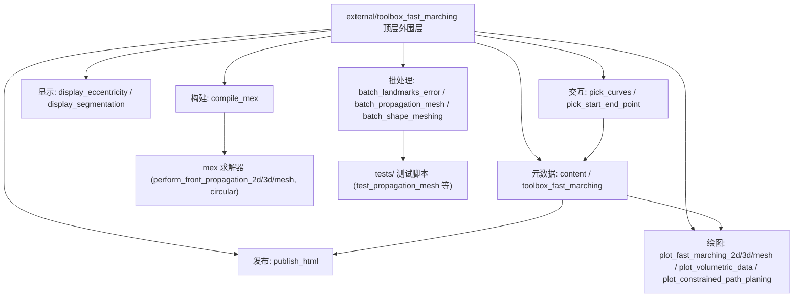

# 90.5c Toolbox Fast Marching — 绘图、交互与批处理（第三方） / Fast Marching Plotting, Interaction and Batch Tools (Vendored)

> 本章覆盖 `external/toolbox_fast_marching/`（Gabriel Peyre 的 *Toolbox Fast Marching*，BSD，
> 版权年份 2004–2009）**顶层**中**不参与数值求解**的**展示 / 交互 / 批处理 / 元数据**层：
> mex 构建脚本（`compile_mex`）、二维/三维/网格绘图（`plot_*`）、结果与分割显示（`display_*`）、
> 鼠标交互拾取（`pick_*`）、批处理驱动脚本（`batch_*`）、文档发布（`publish_html`）以及
> 工具箱元数据（`content`、`toolbox_fast_marching`）。真正的求解器见姊妹篇
> [90.5 核心求解器](05-fast-marching-solvers.md)，派生量见 [90.5b 派生量](05b-fast-marching-compute-helpers.md)；
> `toolbox/`、`tests/` 子目录分别见 `06-*`、`07-*`。
>
> This chapter covers the **presentation / interaction / batch / metadata layer** at the top level of
> `external/toolbox_fast_marching/` (Gabriel Peyre's *Toolbox Fast Marching*, BSD, © 2004–2009), which
> does **not** participate in the numerical solve: the mex build script (`compile_mex`), 2D/3D/mesh
> plotters (`plot_*`), result/segmentation displays (`display_*`), mouse pickers (`pick_*`), batch
> driver scripts (`batch_*`), the doc publisher (`publish_html`) and toolbox metadata
> (`content`, `toolbox_fast_marching`). Solvers live in the sibling `05-*`, derived quantities in
> `05b-*`; the `toolbox/` and `tests/` subfolders are covered by `06-*` and `07-*`.

- 语言 / Language：中英对照（中文为主）
- 相关章节 / See also：[90.5 核心求解器](05-fast-marching-solvers.md)、
  [90.5b 派生量计算](05b-fast-marching-compute-helpers.md)、
  [90.3 MATLAB 环境与绘图辅助](03-matlab-environment-and-plotting.md)、
  [90.4 精确测地线工具箱](04-exactgeodesic-toolbox.md)、
  [10.13 距离与测地线](../10-mesh/13-distances-and-geodesics.md)、
  [10.15 可视化与绘图](../10-mesh/15-visualization-and-plotting.md)、
  [appendices/03-doc-template.md](../appendices/03-doc-template.md)、
  [00-overview/05-dependency-map.md](../00-overview/05-dependency-map.md)
- 命名约定 / Notation：`W` 势场/速度倒数矩阵；`D` 距离场（未达点 `Inf`）；`S` 状态（`-1` dead / `0` open / `1` far）；
  `path` 测地曲线（`2 x npts` 或 `3 x npts`）；`start_points`/`end_points` 为 `d x k` 索引；
  `vertex`/`faces` 为 Peyre 约定（`dim x #V` / 见对应条目）；`ginput` 返回按钮码（左键 `1`、右键 `3`）。
- 重要声明 / Disclaimer：`external/` 为**第三方 vendored 代码**，署名/许可由**文件头**与同目录
  [license.txt](file:///c:/VSWork/gptoolbox-1/external/toolbox_fast_marching/license.txt#L1-L24)
  （`Copyright (c) 2009, Gabriel Peyre`，BSD 式）决定。本节忠实记录各文件头证据，并在发现
  **遮蔽 MATLAB 内置**、**依赖 Image Processing Toolbox** 或**与本库自有绘图栈重叠**时逐条标注。

---

## 本章概览 / Chapter Overview

**模块职责 / Module responsibility**

- 为 *Toolbox Fast Marching* 提供**"看得见、点得动、跑得批量、发得出文档"**的外围设施：
  它把求解器（`perform_fast_marching*`）算出的 `D`/`S`/`path` 变成图片与三维场景，让用户用鼠标
  在图上拾取起止点/曲线，批量跑参数扫描，并把 `content.m` 发布成 HTML。
- 其中 `compile_mex` 是**整个工具箱的前置构建步骤**：不编译 mex，绝大多数求解器无法运行。

### 函数总表 / Function overview

| 函数 / File | 类别 / Category | 一句话功能 / One-line purpose |
|---|---|---|
| `batch_landmarks_error` | 批处理 / Batch | 对 3 个势场名字循环跑 `test_distance_approximation` |
| `batch_propagation_mesh` | 批处理 / Batch | 对 5 个网格 × 5 档种子数循环跑 `test_propagation_mesh` |
| `batch_shape_meshing` | 批处理 / Batch | 对 `use_adaptive` × `p` 组合循环跑 `test_shape_meshing` |
| `compile_mex` | 构建 / Build | 用 `mex` 编译 2D/3D/圆环/网格/骨架/距离变换与 GW 测地库（**必需构建步**） |
| `content` | 元数据+发布脚本 / Metadata + publish script | 工具箱总演示/文档脚本（`%%` 单元，供发布成 HTML） |
| `display_eccentricity` | 显示 / Display | 以彩色或等值线显示离心率变换 |
| `display_segmentation` | 显示 / Display | 在背景图上叠加水平集分割轮廓 |
| `pick_curves` | 交互 / Interaction | 鼠标点选生成位图曲线集合 |
| `pick_start_end_point` | 交互 / Interaction | 鼠标拾取起点/终点/中心点 |
| `plot_constrained_path_planing` | 绘图 / Plotting | 绘制带朝向的小矩形沿路径的规划结果 |
| `plot_fast_marching_2d` | 绘图 / Plotting | 绘制 2D FM 距离场、等值线与测地曲线 |
| `plot_fast_marching_3d` | 绘图 / Plotting | 绘制 3D FM 体数据、等值面与三维曲线 |
| `plot_fast_marching_mesh` | 绘图 / Plotting | 在三角网格上绘制 FM 距离着色与测地线 |
| `plot_volumetric_data` | 绘图 / Plotting | 三正交切片显示三维体积 |
| `publish_html` | 文档 / Doc | 把脚本发布为 HTML 并用浏览器打开（封装内置 `publish`） |
| `toolbox_fast_marching` | 元数据 / Metadata | 纯注释的工具箱帮助/说明头文件（非函数） |

### 模块关系图 / Module relationship diagram



---

## 逐函数详解 / Per-function reference

### `batch_landmarks_error` — 地标误差近似批处理驱动
- **文件 / File**: [batch_landmarks_error.m](file:///c:/VSWork/gptoolbox-1/external/toolbox_fast_marching/batch_landmarks_error.m#L1-L10)
- **署名 / Attribution**: 文件头**无独立署名**，仅 `% batch test`（L1）；归属 Gabriel Peyre 的 *Toolbox Fast Marching*（同目录 [license.txt](file:///c:/VSWork/gptoolbox-1/external/toolbox_fast_marching/license.txt#L1) `Copyright (c) 2009, Gabriel Peyre`）。
- **性质 / Kind**: **脚本（script），非函数**；无输入/输出参数。
- **功能 / Purpose**: `EN: A batch driver that iterates over three potential-map names and runs the landmark distance-approximation test for each.` / 中文：批处理驱动——遍历 3 个势场名，逐个运行地标距离近似测试。
- **输入 / Inputs**: 无（脚本）。全程使用**共享工作区变量**：`name_list`、循环变量 `i`、`name`。
- **输出 / Outputs**: 无显式返回值；副作用由被调用脚本 `test_distance_approximation` 产生（通常为图窗/误差曲线）。
- **变量流动 / Variable flow**: `clear → name_list={'constant','mountain','road2'} → for i → name=name_list{i} → test_distance_approximation（读取 name）`
- **算法步骤 / Algorithm**:
  1. `clear` 清空工作区（L2）。
  2. 定义 `name_list = {'constant','mountain','road2'}`（L3）。
  3. `for i=1:length(name_list)`：取 `name = name_list{i}`，注释掉的 `% test_landmark_error;`（L7）说明曾用另一测试，当前调用 `test_distance_approximation`（L8）。
  4. 循环结束（L9）；各测试脚本通过共享变量 `name` 选择数据。
- **流程图 / Flowchart**:

  ```mermaid
  flowchart TD
    A["脚本开始: clear"] --> B["name_list = {'constant','mountain','road2'}"]
    B --> C{"i <= 3 ?"}
    C -- 是 --> D["name = name_list{i}"]
    D --> E["test_distance_approximation"]
    E --> C
    C -- 否 --> Z["脚本结束"]
  ```

- **依赖 / Dependencies**: 被调脚本 `test_distance_approximation`（`tests/`）；无同名库内函数。
- **See also**: `batch_propagation_mesh`, `batch_shape_meshing`, `test_distance_approximation`

### `batch_propagation_mesh` — 网格传播批处理驱动
- **文件 / File**: [batch_propagation_mesh.m](file:///c:/VSWork/gptoolbox-1/external/toolbox_fast_marching/batch_propagation_mesh.m#L1-L11)
- **署名 / Attribution**: 文件头**无独立署名**（L1 起即为变量定义）；归属同目录 *Toolbox Fast Marching*（BSD，[license.txt](file:///c:/VSWork/gptoolbox-1/external/toolbox_fast_marching/license.txt#L1)）。
- **性质 / Kind**: **脚本，非函数**。
- **功能 / Purpose**: `EN: Nested-loop batch driver sweeping five mesh models against five seed counts, printing progress and running the mesh-propagation test.` / 中文：双重循环批处理——把 5 个网格模型与 5 档种子数做笛卡尔积，打印进度并运行网格传播测试。
- **输入 / Inputs**: 无（脚本）。共享变量：`name_list`、`nstart`、`iname`、`name`。
- **输出 / Outputs**: 无返回值；经 `disp` 打印进度，副作用由 `test_propagation_mesh` 产生。
- **变量流动 / Variable flow**: `name_list={'bunny','elephant-50kv','david50kf','david_head','hand'} → for nstart∈[1 10 20 50 100] → for iname → name=name_list{iname} → disp 进度 → test_propagation_mesh`
- **算法步骤 / Algorithm**:
  1. 定义 5 个网格名 `name_list`（L1）。
  2. 外层 `for nstart=[1 10 20 50 100]`（L3）。
  3. 内层 `for iname=1:length(name_list)`：取 `name`，`disp(['----> Processing mesh ' name ' - ' num2str(nstart) '.'])` 打印进度（L6），调用 `test_propagation_mesh`（L7）。
  4. 内外循环结束后脚本结束（L11）。
- **流程图 / Flowchart**:

  ```mermaid
  flowchart TD
    A["脚本开始: name_list = 5 个网格"] --> B{"nstart <= 100 ?"}
    B -- 是 --> C{"iname <= 5 ?"}
    C -- 是 --> D["name = name_list{iname}"]
    D --> E["disp 打印进度"]
    E --> F["test_propagation_mesh"]
    F --> C
    C -- 否 --> B
    B -- 否 --> Z["脚本结束"]
  ```

- **依赖 / Dependencies**: 被调脚本 `test_propagation_mesh`（`tests/`）。
- **See also**: `batch_landmarks_error`, `batch_shape_meshing`, `test_propagation_mesh`

### `batch_shape_meshing` — 形状网格化批处理驱动
- **文件 / File**: [batch_shape_meshing.m](file:///c:/VSWork/gptoolbox-1/external/toolbox_fast_marching/batch_shape_meshing.m#L1-L6)
- **署名 / Attribution**: 文件头**无独立署名**（L1 即循环语句）；归属同目录 *Toolbox Fast Marching*（BSD）。
- **性质 / Kind**: **脚本，非函数**。
- **功能 / Purpose**: `EN: Tiny nested-loop driver sweeping the adaptive flag (0/1) against three resolution values and running the shape-meshing test.` / 中文：极简双重循环——对 `use_adaptive`∈{0,1} 与 `p`∈{200,400,1000} 的组合运行形状网格化测试。
- **输入 / Inputs**: 无（脚本）。共享变量：`use_adaptive`、`p`。
- **输出 / Outputs**: 无返回值；副作用由 `test_shape_meshing` 产生。
- **变量流动 / Variable flow**: `for use_adaptive=0:1 → for p∈[200 400 1000] → test_shape_meshing（读取 use_adaptive, p）`
- **算法步骤 / Algorithm**:
  1. 外层 `for use_adaptive=0:1`（L1）。
  2. 内层 `for p=[200 400 1000]`：调用 `test_shape_meshing`（L3）。
  3. 两层循环结束后脚本结束（L6）。
- **流程图 / Flowchart**:

  ```mermaid
  flowchart TD
    A["脚本开始"] --> B{"use_adaptive <= 1 ?"}
    B -- 是 --> C{"p <= 1000 ?"}
    C -- 是 --> D["test_shape_meshing"]
    D --> C
    C -- 否 --> B
    B -- 否 --> Z["脚本结束"]
  ```

- **依赖 / Dependencies**: 被调脚本 `test_shape_meshing`（`tests/`）。
- **See also**: `batch_propagation_mesh`, `test_shape_meshing`, `compute_levelset_shape`

### `compile_mex` — 构建全部 mex（工具箱前置步骤）
- **文件 / File**: [compile_mex.m](file:///c:/VSWork/gptoolbox-1/external/toolbox_fast_marching/compile_mex.m#L1-L40)
- **署名 / Attribution**: 文件头 `% compile mex file`（L1）；同目录 [license.txt](file:///c:/VSWork/gptoolbox-1/external/toolbox_fast_marching/license.txt#L1) 署名 `Copyright (c) 2009, Gabriel Peyre`（BSD）。
- **性质 / Kind**: **脚本，非函数**（顶层直接调用 `mex`）。**⚠️ 这是整个工具箱的必需构建步**：不运行它，`perform_front_propagation_2d/3d/_mesh`、`perform_circular_front_propagation_2d`、`skeleton`、`eucdist2` 均无二进制可调用，多数求解器将直接报错。
- **功能 / Purpose**: `EN: One-shot build script that compiles every mex target of the toolbox, passing the C++/C sources plus the Fibonacci-heap and GW-geodesic sources to mex.` / 中文：一次性编译脚本——把 2D/3D/圆环/网格前向传播、骨架、距离变换所需的 C/C++ 源（含 Fibonacci 堆与 GW 测地库）逐一交给 `mex` 构建。
- **输入 / Inputs**: 无（脚本）。运行前需 `mex -setup` 选好 C/C++ 编译器（见 [toolbox_fast_marching.m](file:///c:/VSWork/gptoolbox-1/external/toolbox_fast_marching/toolbox_fast_marching.m#L56-L59)、`readme` L69）。
- **输出 / Outputs**: 无返回值；副作用是生成各平台 mex 二进制（如 `perform_front_propagation_2d.mexw64`、`eucdist2.dll/.mexglx` 等）。
- **变量流动 / Variable flow**: `files 单元数组（17 个源文件）→ for i 拼接 'mex ' + rep + files{i} + ' ' → str → eval(str) → 生成网格 mex`
- **算法步骤 / Algorithm（列出真实 `mex` 调用）**:
  1. L2：`mex mex/perform_front_propagation_2d.cpp mex/perform_front_propagation_2d_mex.cpp mex/fheap/fib.cpp` → 生成 `perform_front_propagation_2d`。
  2. L3：`mex mex/perform_front_propagation_3d.cpp mex/perform_front_propagation_3d_mex.cpp mex/fheap/fib.cpp` → 生成 `perform_front_propagation_3d`。
  3. L4：`mex mex/perform_circular_front_propagation_2d.cpp mex/perform_front_propagation_2d.cpp mex/fheap/fib.cpp` → 生成 `perform_circular_front_propagation_2d`。
  4. L6–L9：**各向异性 FM 目标被整段注释**，作者注明 `these do not actually exist`（`anisotropic-fm/perform_front_propagation_anisotropic.cpp`、`anisotropic-fm-feth/fm2dAniso.cpp` 未编译）。
  5. L12：`mex mex/skeleton.cpp` → 生成 `skeleton`。
  6. L14：`mex mex/eucdist2.c` → 生成 `eucdist2`。
  7. L16：`disp('Compiling perform_front_propagation_mesh, might time some time.')`。
  8. L17–L35：`rep='mex/'`；`files` 列出 **17 个源**——`perform_front_propagation_mesh.cpp` + `gw/gw_core/`（`GW_Config`、`GW_FaceIterator`、`GW_SmartCounter`、`GW_VertexIterator`、`GW_Face`、`GW_Mesh`、`GW_Vertex`）+ `gw/gw_geodesic/`（`GW_GeodesicFace`、`GW_GeodesicMesh`、`GW_GeodesicPath`、`GW_GeodesicPoint`、`GW_TriangularInterpolation_Cubic`、`GW_GeodesicVertex`、`GW_TriangularInterpolation_Linear`、`GW_TriangularInterpolation_Quadratic`）。
  9. L36–L39：`str='mex '`，`for i` 拼接为单个命令串（注意此处用字符串拼接 + `eval`，而非直接 `mex(strsplit)`）；L40 `eval(str)` 执行编译网格 mex。
  10. **平台分支 / Platform branches**：**无**——脚本未使用 `ispc`/`ismac`/`isunix` 任何条件，逐条调用相同的 `mex`，跨平台由 `mex` 自身处理（`readme` 提到 Windows 提供预编译 `.dll`）。
- **流程图 / Flowchart**:

  ```mermaid
  flowchart TD
    A["脚本开始"] --> B["mex 2D: front_propagation_2d + _mex + fib.cpp"]
    B --> C["mex 3D: front_propagation_3d + _mex + fib.cpp"]
    C --> D["mex circular: circular + front_propagation_2d + fib.cpp"]
    D --> E["各向异性目标: 已注释 (源不存在)"]
    E --> F["mex skeleton.cpp"]
    F --> G["mex eucdist2.c"]
    G --> H["disp 提示 mesh 编译耗时"]
    H --> I["拼接 files(17 源) -> str = 'mex ...'"]
    I --> J{"eval(str) 成功 ?"}
    J -- 是 --> Z["生成 perform_front_propagation_mesh"]
    J -- 否 --> Y["mex 报错 (无平台分支/无回退)"]
  ```

- **依赖 / Dependencies**: `mex`、`eval`、`disp`、`length`（MATLAB 内置）；源文件：`mex/perform_front_propagation_2d.cpp`、`mex/perform_front_propagation_2d_mex.cpp`、`mex/perform_front_propagation_3d.cpp`、`mex/perform_front_propagation_3d_mex.cpp`、`mex/perform_circular_front_propagation_2d.cpp`、`mex/skeleton.cpp`、`mex/eucdist2.c`、`mex/perform_front_propagation_mesh.cpp`、`mex/fheap/fib.cpp`、`mex/gw/**`。
- **See also**: `perform_front_propagation_2d`, `perform_front_propagation_3d`, `perform_front_propagation_mesh`, `compute_geodesic_mesh`（均依赖本脚本产物）
- **⚠️ 构建/遮蔽标注**: 本脚本是**所有 mex 求解器的唯一前置**（[90.5](05-fast-marching-solvers.md) 中"需 mex"的函数）；`eucdist2` 会产出 `eucdist2.dll/.mexglx`，同名 `.m` 见 `05b-*`。

### `content` — 工具箱总演示 / 发布文档脚本
- **文件 / File**: [content.m](file:///c:/VSWork/gptoolbox-1/external/toolbox_fast_marching/content.m#L1-L375)
- **署名 / Attribution**: 文件头 `%% Toolbox Fast Marching - A toolbox for Fast Marching and level sets computations`（L1）与 `Copyright (c) 2008 Gabriel Peyre`（L3）。
- **性质 / Kind**: **脚本（script），非函数**。以 `%%` 分节的 **MATLAB cell 文档脚本**，其存在目的正是被 [publish_html](file:///c:/VSWork/gptoolbox-1/external/toolbox_fast_marching/publish_html.m#L1-L25) 发布为 HTML（`html/content.html` 即其产物）。
- **功能 / Purpose**: `EN: The toolbox's walkthrough/demo script: sets the path, documents and demonstrates 2D/3D/mesh FM, shape-restricted FM, farthest-point sampling and anisotropic FM in publishable sections.` / 中文：工具箱的总演示与文档脚本——配置路径，并按可发布分节演示 2D/3D/网格 FM、形状内 FM、最远点采样与各向异性 FM。
- **输入 / Inputs**: 无（脚本）。依赖同目录 `data/`（如 `road2`、`mountain`）与外部 `../toolbox_fast_marching_data/brain1-crop-256.mat`（L135）。
- **输出 / Outputs**: 无返回值；副作用为大量图窗与说明文本（发布成 HTML 时附带 `html/content_XX.png` 子图）。
- **变量流动 / Variable flow**: `path('toolbox/'),path('data/') → n=400 → [M,W]=load_potential_map('road2') → start/end_point → options.nb_iter_max=Inf → [D,S]=perform_fast_marching(W,start) → A=convert_distance_color(D) → gpath=compute_geodesic(D,end) → plot_fast_marching_2d(...) → …（循环扫 nlist、3D、网格、采样、各向异性各段）`
- **算法步骤 / Algorithm**:
  1. L48–L49：`path(path,'toolbox/'); path(path,'data/')` 加入子目录。
  2. L56–L59：以注释形式提示 `mex -setup` 与 `compile_mex`（两者均被注释，需用户手动开启）。
  3. **2D 段**（L61–L127）：`load_potential_map('road2',400)` → 设定 `start_point`/`end_point` → `perform_fast_marching` → `convert_distance_color` → `imageplot` → `compute_geodesic` → `plot_fast_marching_2d`；随后对 `mountain` 用 `nlist=linspace(0.05,1,8)*n^2` **循环**推进并 `imageplot(A,'',2,4)` 拼图。
  4. **3D 体数据段**（L129–L177）：`load ../toolbox_fast_marching_data/brain1-crop-256.mat` → `crop`/`rescale` → `mat2cell` 切片 `imageplot`；再 `options.center=.35` 做体积显示；构造 `W=abs(M-M(start))`、`rescale(-W,.001,1)` 后 `perform_fast_marching`。
  5. **网格段**（L180–L221）：`read_mesh('elephant-50kv')` → `plot_mesh` → `perform_fast_marching_mesh` → `compute_vertex_ring`/`compute_edge_face_ring` 预计算 → `compute_geodesic_mesh` → `plot_fast_marching_mesh`。
  6. **形状内 FM 段**（L223–L279）：载入 `chicken` 二值形状 → `options.constraint_map` 限制前沿 → `perform_fast_marching` → `compute_shape_boundary` 选边界终点 → `compute_geodesic` → 手工 `plot` 叠加路径。
  7. **最远点采样段**（L281–L310）：对 `mountain` 以 `perform_farthest_point_sampling` **循环**增加地标并显示。
  8. **各向异性段**（L312–L375）：用随机向量场经 `perform_vf_normalization`/`perform_blurring` 平滑 → `perform_tensor_recomp` 构造张量 → 对 `aniso_list` **循环** `perform_fast_marching` + `compute_geodesic` 并 `subplot(2,3,ianiso)` 显示。
- **流程图 / Flowchart**:

  ```mermaid
  flowchart TD
    A["脚本开始: 加入 toolbox/ data/ 路径"] --> B["提示 mex -setup / compile_mex (注释)"]
    B --> C["2D: load_potential_map -> FM -> compute_geodesic -> plot_fast_marching_2d"]
    C --> D{"nlist 循环还有阈值 ?"}
    D -- 是 --> D1["options.nb_iter_max=nlist(i); FM; imageplot"]
    D1 --> D
    D -- 否 --> E["3D: load .mat -> crop -> FM -> 体积显示"]
    E --> F["网格: read_mesh -> FM_mesh -> compute_geodesic_mesh -> plot_fast_marching_mesh"]
    F --> G["形状内: constraint_map -> FM -> compute_geodesic -> 叠加绘制"]
    G --> H{"最远点采样循环 ?"}
    H -- 是 --> H1["perform_farthest_point_sampling + 显示"]
    H1 --> H
    H -- 否 --> I{"aniso_list 循环 ?"}
    I -- 是 --> I1["构造张量 -> FM -> compute_geodesic -> subplot"]
    I1 --> I
    I -- 否 --> Z["脚本结束 (可由 publish_html 发布)"]
  ```

- **依赖 / Dependencies**: `load_potential_map`, `perform_fast_marching`, `perform_fast_marching_mesh`, `convert_distance_color`, `compute_geodesic`, `compute_geodesic_mesh`, `compute_shape_boundary`, `compute_vertex_ring`, `compute_edge_face_ring`, `perform_farthest_point_sampling`, `perform_vf_normalization`, `perform_blurring`, `perform_tensor_recomp`, `rescale`, `crop`（`toolbox/`）；`read_mesh`, `plot_mesh`, `imageplot`（`toolbox/`）；`plot_fast_marching_2d`/`_mesh`（本目录）。
- **See also**: `publish_html`, `pick_start_end_point`, `plot_fast_marching_2d`, `plot_fast_marching_mesh`, `perform_fast_marching`

### `display_eccentricity` — 显示离心率变换
- **文件 / File**: [display_eccentricity.m](file:///c:/VSWork/gptoolbox-1/external/toolbox_fast_marching/display_eccentricity.m#L1-L30)
- **署名 / Attribution**: 文件头 `Copyright (c) 2006 Gabriel Peyre`（L10）。
- **签名 / Signature**: `display_eccentricity(E, mode)`
- **功能 / Purpose**: `EN: Display an eccentricity transform E either as a false-colour image (mode 1) or as 40 iso-contours (mode 2).` / 中文：把离心率变换 `E` 以伪彩色图（mode 1）或 40 条等值线（mode 2）显示。
- **输入 / Inputs**:

  | 参数 | 尺寸/类型 | 含义 (中 / EN) |
  |---|---|---|
  | `E` | `n by n`（或 `by p`） | 离心率变换值 / eccentricity transform |
  | `mode` | `1 / 2` | 显示模式 / display mode（可选） |

- **输出 / Outputs**: 无 / None（绘制到当前坐标轴）。
- **可选参数 / Optional**:

  | 名称 | 取值 | 默认 | 含义 |
  |---|---|---|---|
  | `mode` | `1`（彩色）或 `2`（等值线） | `1`（`nargin<2` 时，L12–L14） | 显示模式 |

- **变量流动 / Variable flow**: `E,mode →(mode==1)→ I=find(E>0); A=E*0+256; A(I)=rescale(E(I),1,255) → image(A) → colormap(jet(256) 末行改白)`；`→(else)→ s=unique(E(:)); I=find(s>0.1); s=s(I); x=linspace(s(1),s(end),40) → contour(E,x)`
- **算法步骤 / Algorithm**:
  1. `nargin<2` → `mode=1`（L12–L14）。
  2. **mode==1**：`I=find(E>0)`，`A=E*0+256`，`A(I)=rescale(E(I),1,255)`；`image(A)`；取 `jet(256)` 并把最后一行置白 `a(end,:)=[1 1 1]` 作背景色；`colormap(a)`；`axis image; axis off`（L17–L24）。
  3. **否则（mode 2）**：`s=unique(E(:))`，保留 `>0.1` 的水平，`linspace(s(1),s(end),40)` 生成 40 层；`contour(E,x)`；`axis image; axis off; axis ij`（L25–L29）。
- **流程图 / Flowchart**:

  ```mermaid
  flowchart TD
    A["输入 E, mode"] --> B{"nargin < 2 ?"}
    B -- 是 --> B1["mode = 1"]
    B -- 否 --> C
    B1 --> C{"mode == 1 ?"}
    C -- 是 --> D["I=find(E>0); A=E*0+256; A(I)=rescale(E(I),1,255)"]
    D --> E["image(A); jet(256) 末行置白; colormap"]
    C -- 否 --> F["s=unique(E); x=linspace(s(1),s(end),40); contour(E,x)"]
    E --> Z["axis image/off"]
    F --> Z
  ```

- **依赖 / Dependencies**: `rescale`（`toolbox/`）；`find`, `unique`, `linspace`, `image`, `contour`, `colormap`, `jet`（内置）。
- **See also**: `compute_eccentricity_transform`, `display_segmentation`, `test_eccentricity`

### `display_segmentation` — 显示水平集分割
- **文件 / File**: [display_segmentation.m](file:///c:/VSWork/gptoolbox-1/external/toolbox_fast_marching/display_segmentation.m#L1-L51)
- **署名 / Attribution**: 文件头 `Copyright (c) 2007 Gabriel Peyre`（L12），并注明 `See also: perform_active_contour`（L10）。
- **签名 / Signature**: `display_segmentation(B, M)`
- **功能 / Purpose**: `EN: Overlay the zero level set(s) of a segmentation function B as red contours on a rescaled background image M, dimming the region inside (B<0).` / 中文：把分割函数 `B` 的零水平集以红色轮廓叠加在处理后的背景图 `M` 上，并压暗 `B<0` 的区域。
- **输入 / Inputs**:

  | 参数 | 尺寸/类型 | 含义 (中 / EN) |
  |---|---|---|
  | `B` | `n by n`（或 `n by n by 1/2`） | 分割水平集函数，**内部 `B<0`** / level set, negative inside |
  | `M` | `n by n` | 背景灰度图 / background image |

- **输出 / Outputs**: 无 / None（绘制到当前坐标轴）。
- **可选参数 / Optional**: 无（两参数均为必需）。
- **变量流动 / Variable flow**: `B,M →(min(B)>=0? 归一化: max(B)>2? B=cat(3,B>2,mod(B,2)); 逐层 rescale(-1,1))→ nb_phase=size(B,3); n; M=rescale(M) → 依 nb_phase(1/2) 构造 RGB: M,M1,M1 或 M,M1,M2 → imagesc(M) → for k contour(B(:,:,k),[0 0],'r') → colormap gray(256); axis ij`
- **算法步骤 / Algorithm**:
  1. 若 `min(B(:))>=0`（非标准符号）：`max(B(:))>2` 视为多相 → `B=cat(3,B>2,mod(B,2))`；再对每层 `rescale(-1,1)`（L14–L22）。
  2. `nb_phase=size(B,3)`；`n=size(B,1)`；`M=rescale(M)`（L24–L27）。
  3. 构造 RGB：`nb_phase==1` 时 `M1=M; M1(B<0)*=.2; M=cat(3,M,M1,M1)`；`nb_phase==2` 时分别对 `B(:,:,1)`/`B(:,:,2)` 压暗得到 `M1`/`M2` 并 `cat(3,M,M1,M2)`；否则 `error('Only 1/2 phase accepted')`（L29–L41）。
  4. `hold on; imagesc(M); axis image/off; axis([1 n 1 n])`（L43–L44）。
  5. `for k=1:nb_phase`：`[c,h]=contour(B(:,:,k),[0 0],'r')`，`set(h,'LineWidth',2)` 画零水平集（L45–L48）。
  6. `hold off; colormap gray(256); axis ij`（L49–L51）。
- **流程图 / Flowchart**:

  ```mermaid
  flowchart TD
    A["输入 B, M"] --> B{"min(B) >= 0 ?"}
    B -- 是 --> C{"max(B) > 2 ?"}
    C -- 是 --> C1["B = cat(3, B>2, mod(B,2))"]
    C -- 否 --> D
    C1 --> D["逐层 rescale(B, -1, 1)"]
    B -- 否 --> E["nb_phase=size(B,3); M=rescale(M)"]
    D --> E
    E --> F{"nb_phase"}
    F -- 1 --> F1["M1=M; M1(B<0)*=.2; M=cat(3,M,M1,M1)"]
    F -- 2 --> F2["M1,M2 分别压暗; M=cat(3,M,M1,M2)"]
    F -- 其它 --> F3["error('Only 1/2 phase accepted')"]
    F1 --> G["imagesc(M); axis image/off"]
    F2 --> G
    G --> H{"k <= nb_phase ?"}
    H -- 是 --> H1["contour(B(:,:,k),[0 0],'r'); LineWidth=2"]
    H1 --> H
    H -- 否 --> Z["colormap gray(256); axis ij"]
  ```

- **依赖 / Dependencies**: `rescale`（`toolbox/`）；`imagesc`, `contour`, `colormap`, `gray`, `axis`, `cat`, `mod`, `min`, `max`（内置）。
- **See also**: `perform_active_contour`, `display_eccentricity`, `test_segmentation`, `compute_levelset_shape`

### `pick_curves` — 鼠标拾取曲线集合
- **文件 / File**: [pick_curves.m](file:///c:/VSWork/gptoolbox-1/external/toolbox_fast_marching/pick_curves.m#L1-L40)
- **署名 / Attribution**: 文件头 `Copyright (c) 2007 Gabriel Peyr?`（L13，末字符为编码损坏的 `e`）。
- **签名 / Signature**: `sk = pick_curves(mask)`
- **功能 / Purpose**: `EN: Let the user draw curves on a background image by clicking; right-clicks extend the current curve, a left click ends it, another left click ends the process; returns the rasterized binary curve image.` / 中文：让用户在背景图上用鼠标画曲线——连点生成曲线，左键结束当前曲线，再左键结束整个过程；返回栅格化的二值曲线图。
- **输入 / Inputs**:

  | 参数 | 尺寸/类型 | 含义 (中 / EN) |
  |---|---|---|
  | `mask` | `n by n`（约 `[0,1]`） | 背景图 / background image |

- **输出 / Outputs**:

  | 参数 | 尺寸/类型 | 含义 |
  |---|---|---|
  | `sk` | `n by n` | 0/1 曲线位图 / rasterized curve mask |

- **可选参数 / Optional**: 无（单参数）。
- **变量流动 / Variable flow**: `mask → n=size(mask,1); sk=zeros(n); b=1 → while b(end)==1 { imagesc(mask+sk); [y1,x1,b]=ginput(1); while b==1 { [y2,x2,c]=ginput(1); c~=1? break; t=linspace(0,1,1000); x=round(x1*t+x2*(1-t)); y=round(y1*t+y2*(1-t)); sk(x+(y-1)*n)=1; x1=x2; y1=y2 } } → sk`
- **算法步骤 / Algorithm**:
  1. `n=size(mask,1)`；`sk=zeros(n)`；`b=1`（L16–L20）。
  2. **外层循环** `while b(end)==1`：`clf; imagesc(mask+sk); axis image; axis off; colormap gray(256)`；`[y1,x1,b]=ginput(1)` 取首个点与按钮码（L21–L26）。
  3. **内层循环** `while b==1`：重绘；`[y2,x2,c]=ginput(1)`；若 `c~=1`（非左键）`break` 结束该曲线（L27–L33）。
  4. 在 `(x1,y1)-(x2,y2)` 间以 `t=linspace(0,1,1000)` 线性插值，`x=round(x1*t+x2*(1-t))`、`y=round(y1*t+y2*(1-t))`，把 `sk(x+(y-1)*n)=1` 逐点置位（列优先索引）（L34–L37）。
  5. `x1=x2; y1=y2` 链表式前进（L38）；内层结束回到外层判定（L39）；`b` 转为非左键时整体结束（L40）。
- **流程图 / Flowchart**:

  ```mermaid
  flowchart TD
    A["输入 mask"] --> B["n=size(mask,1); sk=zeros(n); b=1"]
    B --> C{"外层: b(end)==1 ?"}
    C -- 是 --> D["clf; imagesc(mask+sk); [y1,x1,b]=ginput(1)"]
    D --> E{"内层: b==1 ?"}
    E -- 是 --> F["[y2,x2,c]=ginput(1)"]
    F --> G{"c ~= 1 ?"}
    G -- 是 --> C
    G -- 否 --> H["采样线段 -> sk(x+(y-1)*n)=1; x1=x2;y1=y2"]
    H --> E
    E -- 否 --> C
    C -- 否 --> Z["输出 sk"]
  ```

- **依赖 / Dependencies**: `ginput`, `imagesc`, `colormap`, `gray`, `clf`, `linspace`, `round`（内置）。
- **See also**: `pick_start_end_point`, `perform_active_contour`, `test_active_contour`, `callback_active_contour`

### `pick_start_end_point` — 鼠标拾取起止点/中心点
- **文件 / File**: [pick_start_end_point.m](file:///c:/VSWork/gptoolbox-1/external/toolbox_fast_marching/pick_start_end_point.m#L1-L65)
- **署名 / Attribution**: 文件头 `Copyright (c) 2005 Gabriel Peyr?`（L7，末字符编码损坏）。
- **签名 / Signature**: `[start_point,end_point,center_point] = pick_start_end_point(M, no_end_point, do_rounding)`
- **功能 / Purpose**: `EN: Interactively pick the start point (and optionally a centre point projection and an end point) on a displayed map M using ginput; returns 2x1 index columns.` / 中文：在显示的图像 `M` 上用 `ginput` 交互拾取起点（并按需拾取中心点投影与终点），返回 `2 x 1` 的索引列向量。
- **输入 / Inputs**:

  | 参数 | 尺寸/类型 | 含义 (中 / EN) |
  |---|---|---|
  | `M` | `n by n` 或 `[]` | 背景图；为空则只拾取不绘图 / background image |
  | `no_end_point` | `0 / 1` | 置 1 则不交互拾取终点 / skip end-point picking |
  | `do_rounding` | `0 / 1` | 是否对坐标取整 / round to integer indices |

- **输出 / Outputs**:

  | 参数 | 尺寸/类型 | 含义 |
  |---|---|---|
  | `start_point` | `2 by 1` | 起点索引列 / start index |
  | `end_point` | `2 by 1` | 终点索引列（`nargout>1` 时） |
  | `center_point` | `2 by 1` | 中心点索引列（`nargout>2` 时） |

- **可选参数 / Optional**:

  | 名称 | 取值 | 默认 | 含义 |
  |---|---|---|---|
  | `no_end_point` | `0/1` | `0`（L9–L11） | 不拾取终点 |
  | `do_rounding` | `0/1` | `1`（L12–L14） | 坐标取整 |

- **变量流动 / Variable flow**: `M,no_end_point,do_rounding → clf;hold on; imagesc(M'); axis image/off; gray(256); m=size(M) →(nargout>2) center_point=round(ginput(1))' 并绘制 → start_point=ginput(1)'，(do_rounding? round)，(nargout>2? start_point(2)=center_point(2)) 绘制 'rx' →(nargout>1)(no_end_point? end=start; end(2)-=3 : end=ginput(1)'; do_rounding? round) 绘制 'rs' → hold off`
- **算法步骤 / Algorithm**:
  1. 默认值：`no_end_point=0`、`do_rounding=1`（L9–L14）。
  2. `clf; hold on`；若 `~isempty(M)` 则 `imagesc(M'); axis image; axis off; colormap gray(256)`（L16–L23）；`m=size(M)`（L25）。
  3. **中心点**（`nargout>2`）：`disp('Pick center point.')`；`center_point=round(ginput(1))'`；画水平参考线到 `m(1)` 并标 `'ro'`（L29–L34）。
  4. **起点**：`disp('Pick starting point.')`；`start_point=ginput(1)'`；`do_rounding` 时 `round`；若 `nargout>2` 则把 `start_point(2)` 投影到 `center_point(2)`；标 `'rx'`（L38–L46）。
  5. **终点**（`nargout>1`）：`no_end_point` 时置 `end_point=start_point; end_point(2)=end_point(2)-3`；否则 `disp('Pick end point.')`、`ginput(1)'`、按需 `round`；标 `'rs'`（L51–L62）。
  6. `hold off`（L64）。
- **流程图 / Flowchart**:

  ```mermaid
  flowchart TD
    A["输入 M, no_end_point=0, do_rounding=1"] --> B["clf; hold on; imagesc(M'); axis image/off"]
    B --> C{"nargout > 2 ?"}
    C -- 是 --> C1["center_point=round(ginput(1))'; 画 'ro'"]
    C -- 否 --> D
    C1 --> D["disp 起点; start_point=ginput(1)'"]
    D --> E{"do_rounding ?"}
    E -- 是 --> E1["round(start_point)"]
    E -- 否 --> F
    E1 --> F{"nargout > 2 ?"}
    F -- 是 --> F1["start_point(2)=center_point(2)"]
    F -- 否 --> G
    F1 --> G["plot 'rx'"]
    G --> H{"nargout > 1 ?"}
    H -- 是 --> I{"no_end_point ?"}
    I -- 是 --> I1["end_point=start_point; end_point(2)-=3"]
    I -- 否 --> I2["disp 终点; end_point=ginput(1)'; 按需 round"]
    I1 --> J["plot 'rs'"]
    I2 --> J
    H -- 否 --> K
    J --> K["hold off"]
    K --> Z["输出 start/end/center_point"]
  ```

- **依赖 / Dependencies**: `ginput`, `imagesc`, `plot`, `clf`, `round`, `disp`, `colormap`, `gray`（内置）。
- **See also**: `pick_curves`, `content`, `test_fast_marching_2d`, `test_path_planing`

### `plot_constrained_path_planing` — 绘制约束路径规划结果
- **文件 / File**: [plot_constrained_path_planing.m](file:///c:/VSWork/gptoolbox-1/external/toolbox_fast_marching/plot_constrained_path_planing.m#L1-L57)
- **署名 / Attribution**: 文件头 `Copyright (c) 2004 Gabriel Peyr?`（L7）。
- **签名 / Signature**: `plot_constrained_path_planing(M, path, obj, nb_s, options)`
- **功能 / Purpose**: `EN: Visualize a constrained motion-planning result by drawing the potential map and, at evenly resampled waypoints, a small oriented rectangle of size obj and heading theta.` / 中文：可视化受约束运动规划结果——绘制势场图，并在等距重采样出的路点上画一个按朝向 `theta` 旋转、尺寸为 `obj` 的小矩形。
- **输入 / Inputs**:

  | 参数 | 尺寸/类型 | 含义 (中 / EN) |
  |---|---|---|
  | `M` | `n by n` | 势场图 / potential map |
  | `path` | `m by 3` | 路径点 `[x y theta]` / waypoints with heading |
  | `obj` | `1 by 2` | 矩形尺寸 `[宽 高]`（相对 `n`）/ rectangle size |
  | `nb_s` | 整数 | 重采样路点数 / number of resampled waypoints |
  | `options` | `struct` | 选项（`box_width`） / options |

- **输出 / Outputs**: 无 / None（绘制到当前坐标轴）。
- **可选参数 / Optional**:

  | 名称 | 取值 | 默认 | 含义 |
  |---|---|---|---|
  | `nb_s` | 整数 | `20`（L10–L12） | 重采样点数 |
  | `options.box_width` | 数值 | `2`（L13–L17） | 矩形线宽 |

- **变量流动 / Variable flow**: `M,path,obj,nb_s,options → n=size(M,1) → hold on; imagesc(1-M'); gray; axis image/square → path1=perform_curve_resampling(path,nb_s,'nbpts')' → for i: plot_box(path1(i,1:2), obj*n, path1(i,3),'r',box_width) → set XTick/YTick 空; hold off`
- **算法步骤 / Algorithm**:
  1. `options.null=1`；`nargin<4` → `nb_s=20`；按 `options.box_width` 取 `box_width`，默认 `2`（L9–L17）。
  2. `n=size(M,1)`；`hold on; imagesc(1-M'); colormap gray; axis image; axis square; set(gca,'box','on')`（L19–L27）。
  3. `path1=perform_curve_resampling(path,nb_s,'nbpts')'` 把路径**等距重采样**为 `nb_s` 个点（L33）。
  4. `for i=1:size(path1,1)`：`plot_box(path1(i,1:2), obj*n, path1(i,3), 'r', box_width)` 逐个画旋转矩形（L36–L38）。
  5. 关掉刻度（`XTick`/`YTick` 置空）并 `hold off`（L40–L43）。
  6. 子函数 `plot_box(c,obj,theta,str,box_width)`：以 `v=[cos,sin]*obj(1)/2`、`w=[-sin,cos]*obj(2)/2` 求四个角，调用 4 次 `plot_line` 连成矩形（L45–L52）；`plot_line` 用 `line(...,'LineWidth',box_width)` 并设红色（L54–L57）。
- **流程图 / Flowchart**:

  ```mermaid
  flowchart TD
    A["输入 M,path,obj,nb_s=20,options"] --> B["n=size(M,1); hold on; imagesc(1-M'); gray"]
    B --> C["path1 = perform_curve_resampling(path,nb_s) transpose"]
    C --> D{"i <= size(path1,1) ?"}
    D -- 是 --> E["plot_box(path1(i,1:2), obj*n, path1(i,3),'r',box_width)"]
    E --> D
    D -- 否 --> F["XTick/YTick 置空; hold off"]
    F --> Z["绘图完成"]
    E -.->|子函数| G["plot_box -> 4x plot_line -> line()"]
  ```

- **依赖 / Dependencies**: `perform_curve_resampling`（`toolbox/`）；子函数 `plot_box`、`plot_line`（同文件）；`imagesc`, `line`, `colormap`, `gray`, `axis`, `set`（内置）。
- **See also**: `generate_constrained_map`, `test_path_planing`, `plot_fast_marching_3d`

### `plot_fast_marching_2d` — 绘制 2D Fast Marching 结果
- **文件 / File**: [plot_fast_marching_2d.m](file:///c:/VSWork/gptoolbox-1/external/toolbox_fast_marching/plot_fast_marching_2d.m#L1-L99)
- **署名 / Attribution**: 文件头 `Copyright (c) 2004 Gabriel Peyr?`（L7）。
- **签名 / Signature**: `plot_fast_marching_2d(W, S, path, start_points, end_points, options)`
- **功能 / Purpose**: `EN: Render a 2D FM result: the potential/state map as an image with open/close frontier masked, the extracted front iso-curves in red, plus the geodesic path(s) and start/end markers.` / 中文：渲染 2D FM 结果——把势场/状态图作为底图（掩去已 / 未达前沿），叠画红色前沿等值线、测地路径与起终点标记。
- **输入 / Inputs**:

  | 参数 | 尺寸/类型 | 含义 (中 / EN) |
  |---|---|---|
  | `W` | `n by n`（或 `n by n by 3`） | 势场/速度图 / potential or colour image |
  | `S` | `n by n` | 状态图（`0` open / `-1` close）/ state map |
  | `path` | `2 x m` 或元胞 | 测地曲线（可多条）/ geodesic(s) |
  | `start_points` | `2 x k` | 起点 / start points |
  | `end_points` | `2 x k` | 终点 / end points |
  | `options` | `struct` | 选项 / options |

- **输出 / Outputs**: 无 / None（绘制到当前坐标轴）。
- **可选参数 / Optional**:

  | 名称 | 取值 | 默认 | 含义 |
  |---|---|---|---|
  | `options.path_width` | 数值 | `3`（L14） | 路径线宽 |
  | `options.point_size` | 数值或元胞 | `12`（L15） | 标记大小（自动扩展为 `{12,20}`） |
  | `options.start_point_style` | 字符串 | `'rx'`（L18–L22） | 起点样式 |
  | `options.end_point_style` | 字符串 | `'k*'`（L23–L27） | 终点样式（自动扩展为 `{'k*','k.'}`） |

- **变量流动 / Variable flow**: `W,S,path,start_points,end_points,options →(size(W,3)==1) Z=repmat(W',[1,1,3]) : Z=permute(W,[2 1 3]); S1=repmat(S',[1,1,3]); S1(:,:,1)=Inf → open_list=find(S1==0); close_list=find(S1==-1) → Z(close_list)=0 → imagesc(rescale(Z)) → c_list=perform_curve_extraction(S,0) 映射到像素并画红线 → 画 path（可元胞）→ 画 start/end 标记`
- **算法步骤 / Algorithm**:
  1. 取 `n=size(W,1)`，设默认 `options.null=0`，用 `getoptions` 取 `path_width`、`point_size`，并解析起终点样式（缺省自动补第二个样式与标记大小 `{point_size,20}`）（L10–L34）。
  2. 归一化底图：`size(W,3)==1` 时 `Z=repmat(W',[1,1,3])`，否则 `Z=permute(W,[2 1 3])`；`S1=repmat(S',[1,1,3]); S1(:,:,1)=Inf`；`open_list=find(S1==0); close_list=find(S1==-1)`（L36–L44）。
  3. `set(gca,'box','on'); hold on; Z(close_list)=0; imagesc(rescale(Z)); axis image; axis off`（L46–L53）。
  4. 前沿等值线：`c_list=perform_curve_extraction(S,0)`，对每个轮廓 `*(n-1)+1` 映射到像素坐标，用红色 `LineWidth=2` 画出（L55–L61）。
  5. 路径：`nargin>=3` 时若 `path` 非元胞则包成元胞，逐条转置为 `2 x m` 后 `plot(...,'-','LineWidth',path_width)`（L63–L74）。
  6. 起点（`nargin>=4 & ~isempty`）：确保 `start_points` 为 `2 x k`（否则报错），逐点 `plot(start_point_style,'MarkerSize',point_size{1})`（L77–L87）。
  7. 终点（`nargin>=5 & ~isempty`）：同上，逐点用 `end_point_style{1+(i>1)}` 与 `point_size{1+(i>1)}`（首点与其余点样式不同）；`hold off`（L88–L99）。
- **流程图 / Flowchart**:

  ```mermaid
  flowchart TD
    A["输入 W,S,path,start_points,end_points,options"] --> B["解析 path_width=3, point_size=12, 起/终点样式"]
    B --> C{"size(W,3) == 1 ?"}
    C -- 是 --> C1["Z = repmat(W',[1,1,3])"]
    C -- 否 --> C2["Z = permute(W,[2 1 3])"]
    C1 --> D["S1=repmat(S'); open_list; close_list"]
    C2 --> D
    D --> E["Z(close_list)=0; imagesc(rescale(Z)); axis image/off"]
    E --> F["c_list=perform_curve_extraction(S,0) -> 画红线"]
    F --> G{"nargin >= 3 且 path 非空 ?"}
    G -- 是 --> G1["逐条 path -> plot 折线"]
    G -- 否 --> H
    G1 --> H{"start_points 非空 ?"}
    H -- 是 --> H1["逐点 plot 起点标记"]
    H -- 否 --> I
    H1 --> I{"end_points 非空 ?"}
    I -- 是 --> I1["逐点 plot 终点标记 (首点样式不同)"]
    I -- 否 --> Z["hold off"]
    I1 --> Z
  ```

- **依赖 / Dependencies**: `getoptions`, `perform_curve_extraction`, `rescale`（`toolbox/`）；`repmat`, `permute`, `find`, `imagesc`, `plot`, `axis`, `set`（内置）。
- **See also**: `plot_fast_marching_3d`, `plot_fast_marching_mesh`, `perform_fast_marching`, `compute_geodesic`, `convert_distance_color`, `imageplot`

### `plot_fast_marching_3d` — 绘制 3D Fast Marching 结果
- **文件 / File**: [plot_fast_marching_3d.m](file:///c:/VSWork/gptoolbox-1/external/toolbox_fast_marching/plot_fast_marching_3d.m#L1-L118)
- **署名 / Attribution**: 文件头 `Copyright (c) 2004 Gabriel Peyr?`（L10）。
- **签名 / Signature**: `plot_fast_marching_3d(W, S, path, start_points, end_points, options)`
- **功能 / Purpose**: `EN: Render a 3D FM result: optional three-slice volume of W, the geodesic curve(s) and start/end markers in voxel coordinates, and a translucent iso-surface of the S=0.5 front.` / 中文：渲染 3D FM 结果——可选地三切片显示体数据 `W`，画出体素坐标下的测地曲线与起终点标记，并叠加 `S=0.5` 的等值面（半透明红色）。
- **输入 / Inputs**:

  | 参数 | 尺寸/类型 | 含义 (中 / EN) |
  |---|---|---|
  | `W` | `n by p by q` | 3D 体数据/势场 / volumetric data |
  | `S` | `n by p by q` | 状态场（等值面用）/ state field |
  | `path` | `m x 3` 或元胞 | 3D 曲线 / 3D curve(s) |
  | `start_points` | `3 x k` | 起点 / start points |
  | `end_points` | `3 x k` | 终点 / end points |
  | `options` | `struct` | 选项 / options |

- **输出 / Outputs**: 无 / None（绘制到当前坐标轴）。
- **可选参数 / Optional**:

  | 名称 | 取值 | 默认 | 含义 |
  |---|---|---|---|
  | `options.plot_isosurface` | `0/1` | `1`（L13–L17） | 是否画等值面 |
  | `options.plot_planes` | `0/1` | `1`（L18–L22） | 是否画体积切片 |
  | `options.path_width` | 数值 | `5`（L23–L27） | 路径线宽 |
  | `options.point_size` | 数值 | `16`（L28–L32） | 标记大小 |

- **变量流动 / Variable flow**: `W,S,path,start_points,end_points,options → [n,p,q]=size(W) → hold on →(plot_planes & ~isempty(W)) plot_volumetric_data(W) →(start_points) shift_array + plot3 蓝点 →(end_points) shift_array + plot3 红点 →(path) 逐条 shift_array + plot3 →(plot_isosurface) S=smooth3(S,'gaussian',5,1); F=isosurface(S,0.5); patch; isonormals; 红面 → 相机与光照`
- **算法步骤 / Algorithm**:
  1. 解析选项默认值：`plot_isosurface=1`、`plot_planes=1`、`path_width=5`、`point_size=16`（L12–L32）。
  2. `[n,p,q]=size(W); hold on`（L35–L37）。
  3. **体数据切片**：`~isempty(W) && plot_planes` 时调用 [plot_volumetric_data](file:///c:/VSWork/gptoolbox-1/external/toolbox_fast_marching/plot_volumetric_data.m#L1-L32)（`if 0` 块内的 open/close 掩码逻辑被禁用）（L39–L47）。
  4. **起点**（`nargin>=4 && ~isempty`）：确保 `3 x k`，`start_points=shift_array(start_points)` 后 `plot3(...,'o','MarkerFaceColor','b')`（L49–L60）。
  5. **终点**（`nargin>=5 && ~isempty`）：同上，`MarkerFaceColor='r'`（L62–L73）。
  6. **路径**（`nargin>=3 && ~isempty`）：`path` 若非元胞则包成元胞，逐条转置为 `m x 3`、`shift_array` 后 `plot3(...,'-','LineWidth',path_width)`（L75–L87）。
  7. **等值面**：`plot_isosurface` 时 `S=smooth3(S,'gaussian',5,1)`、`F=isosurface(S,0.5)`、`p=patch(F)`、`isonormals(S,p)`、`set(p,'FaceColor','red','EdgeColor','none')`（L89–L95）。（`smooth3` 依赖 **Image Processing Toolbox**。）
  8. 相机/外观：`box on`、三轴刻度置空、`lighting phong`、`alpha(0.7)`、`camproj('perspective')`、`view(3)`、`axis equal`、`axis([1 size(W,i) ...])`、`daspect([1 1 1])`、`camlight`，`hold off`（L97–L111）。
  9. 子函数 `shift_array`：把前两维调换（`[2 1 3]`）以适配 `plot3` 的 x/y/z 约定（L113–L118）。
- **流程图 / Flowchart**:

  ```mermaid
  flowchart TD
    A["输入 W,S,path,start/end_points,options"] --> B["解析 plot_isosurface=1, plot_planes=1, path_width=5, point_size=16"]
    B --> C["[n,p,q]=size(W); hold on"]
    C --> D{"plot_planes 且 W 非空 ?"}
    D -- 是 --> D1["plot_volumetric_data(W)"]
    D -- 否 --> E
    D1 --> E{"start_points 非空 ?"}
    E -- 是 --> E1["shift_array; plot3 蓝点"]
    E -- 否 --> F
    E1 --> F{"end_points 非空 ?"}
    F -- 是 --> F1["shift_array; plot3 红点"]
    F -- 否 --> G
    F1 --> G{"path 非空 ?"}
    G -- 是 --> G1["逐条 shift_array; plot3 曲线"]
    G -- 否 --> H
    G1 --> H{"plot_isosurface ?"}
    H -- 是 --> H1["smooth3; isosurface(S,0.5); patch; isonormals; 红面"]
    H -- 否 --> I
    H1 --> I["相机/光照: lighting phong; alpha .7; view(3); camlight; hold off"]
    I --> Z["绘图完成"]
  ```

- **依赖 / Dependencies**: `plot_volumetric_data`（本目录）；`shift_array`（同文件子函数）；`isosurface`, `isonormals`, `patch`, `slice`, `camproj`, `camlight`, `lighting`, `alpha`, `view`, `daspect`, `plot3`（内置）；**`smooth3` 需 Image Processing Toolbox**。
- **See also**: `plot_fast_marching_2d`, `plot_volumetric_data`, `perform_fast_marching`, `compute_geodesic`, `test_fast_marching_3d`

### `plot_fast_marching_mesh` — 在三角网格上绘制 FM 结果
- **文件 / File**: [plot_fast_marching_mesh.m](file:///c:/VSWork/gptoolbox-1/external/toolbox_fast_marching/plot_fast_marching_mesh.m#L1-L78)
- **署名 / Attribution**: 文件头 `Copyright (c) 2007 Gabriel Peyre`（L18），并注明 `See also perform_fast_marching_mesh, compute_geodesic_mesh, compute_voronoi_mesh`（L13）。
- **签名 / Signature**: `plot_fast_marching_mesh(vertex, faces, D, paths, options)`
- **功能 / Purpose**: `EN: Draw a triangulated mesh coloured by the distance field D (with optional wrapping/equalized colour transfer) plus black geodesic paths, red start/blue end markers and red Voronoi edges.` / 中文：按距离场 `D` 给三角网格着色（可选环绕 / 直方图均衡配色），并叠加黑色测地线、起点红 / 终点蓝标记与红色 Voronoi 边。
- **输入 / Inputs**:

  | 参数 | 尺寸/类型 | 含义 (中 / EN) |
  |---|---|---|
  | `vertex` | `3 x #V` | 顶点坐标 / vertex positions |
  | `faces` | `3 x #F` | 面索引 / face indices |
  | `D` | `#V x 1` | 距离场（顶点值）/ distance field |
  | `paths` | 元胞或 `3 x m` | 测地路径 / geodesic path(s) |
  | `options` | `struct` | 选项 / options |

- **输出 / Outputs**: 无 / None（绘制到当前坐标轴）。
- **可选参数 / Optional**:

  | 名称 | 取值 | 默认 | 含义 |
  |---|---|---|---|
  | `options.start_points` | 索引向量 | `[]`（L28） | 额外起点（红点） |
  | `options.voronoi_edges` | `6 x #E` | `[]`（L29） | Voronoi 边（红线段） |
  | `options.ms` | 数值 | `25`（L30） | 标记大小 |
  | `options.lw` | 数值 | `3`（L31） | 线宽 |
  | `options.colorfx` | `'none' / 'wrapping' / 'equalize'` | `'none'`（L33） | 配色效果 |

- **变量流动 / Variable flow**: `vertex,faces,D,paths,options → col=D; col(col==Inf)=0 →(wrapping: col=rescale(col); mod(col*20,2); 折叠)→(equalize: col=perform_histogram_equalization(col,linspace(0,1,length(col))))→ options.face_vertex_color=col → clf;hold on; plot_mesh(vertex,faces,options) → for each path: 画起/终点与黑色曲线 → for start_points: 红点 → for ve: 红线 → colormap jet(256); camlight`
- **算法步骤 / Algorithm**:
  1. `options.null=0`；`paths` 非元胞则包成元胞（L20–L23）。
  2. `col=D; col(col==Inf)=0` 把未达点置 0（L25–L26）。
  3. 用 `getoptions` 取 `start_points=[]`、`voronoi_edges=[]`、`ms=25`、`lw=3`、`colorfx='none'`（L28–L33）。
  4. 配色效果：`colorfx=='wrapping'` 时 `col=rescale(col)` 再 `mod(col*20,2)` 并折叠（往返色带）；`colorfx=='equalize'` 时 `col=perform_histogram_equalization(col, linspace(0,1,length(col)))`（L34–L41）。
  5. `options.face_vertex_color=col`；`clf; hold on; plot_mesh(vertex,faces,options)`（`toolbox/plot_mesh`）（L43–L46）。
  6. 对每条路径：`end_point=path(:,1)`、`start_point=path(:,end)`，分别画红色与蓝色点（`ms`），`plot3` 黑色测地线（`lw`）（L47–L62）。
  7. 对 `options.start_points` 中每个索引 `vertex(:,idx)` 画红点（L64–L68）。
  8. 对 `voronoi_edges` 每一列 `[ve(1,i) ve(4,i)]` 等两端点画红线段（`lw`）（L70–L75）。
  9. `hold off; colormap jet(256); camlight`（L76–L78）。
- **流程图 / Flowchart**:

  ```mermaid
  flowchart TD
    A["输入 vertex,faces,D,paths,options"] --> B["paths 转元胞; col=D; col(Inf)=0"]
    B --> C["getoptions: start_points,voronoi_edges,ms=25,lw=3,colorfx='none'"]
    C --> D{"colorfx"}
    D -- wrapping --> D1["rescale; mod(col*20,2) 折叠"]
    D -- equalize --> D2["perform_histogram_equalization"]
    D -- none --> E
    D1 --> E["options.face_vertex_color=col; plot_mesh"]
    D2 --> E
    E --> F{"每条路径 ?"}
    F -- 是 --> F1["画起点红/终点蓝/黑色测地线"]
    F1 --> F
    F -- 否 --> G{"start_points ?"}
    G -- 是 --> G1["plot3 红点"]
    G -- 否 --> H
    G1 --> H{"voronoi_edges ?"}
    H -- 是 --> H1["plot3 红线段"]
    H -- 否 --> Z["colormap jet(256); camlight"]
    H1 --> Z
  ```

- **依赖 / Dependencies**: `getoptions`, `plot_mesh`, `perform_histogram_equalization`, `rescale`（`toolbox/`）；`plot3`, `clf`, `colormap`, `jet`, `camlight`, `iscell`, `isempty`（内置）。
- **See also**: `perform_fast_marching_mesh`, `compute_geodesic_mesh`, `compute_voronoi_triangulation_mesh`, `plot_fast_marching_2d`, `compute_distance_landmark`
- **⚠️ 重叠标注**: 与 gptoolbox 自有三维网格绘制栈 [mesh/tsurf](file:///c:/VSWork/gptoolbox-1/mesh/tsurf.m#L1)、[mesh/plot_edges](file:///c:/VSWork/gptoolbox-1/mesh/plot_edges.m#L1)（10.15 可视化）职责重叠，均为"网格着色 + 曲线叠加"。

### `plot_volumetric_data` — 三正交切片显示体数据
- **文件 / File**: [plot_volumetric_data.m](file:///c:/VSWork/gptoolbox-1/external/toolbox_fast_marching/plot_volumetric_data.m#L1-L32)
- **署名 / Attribution**: 文件头 `Copyright (c) 2005 Gabriel Peyr?`（L7）。
- **签名 / Signature**: `plot_volumetric_data(W, nb_colors)`
- **功能 / Purpose**: `EN: Display a 3D data cube via three orthogonal mid-planes (slice at p/2, n/2, q/2) with interpolated shading, jet colourmap and phong lighting.` / 中文：用三个正交中间切片（在 `p/2`、`n/2`、`q/2` 处）显示三维数据立方体，采用插值着色、`jet` 色图与 phong 光照。
- **输入 / Inputs**:

  | 参数 | 尺寸/类型 | 含义 (中 / EN) |
  |---|---|---|
  | `W` | `n by p by q` | 三维体数据 / volumetric data |
  | `nb_colors` | 整数 | 色图级数 / colour levels |

- **输出 / Outputs**: 无 / None（绘制到当前坐标轴）。
- **可选参数 / Optional**:

  | 名称 | 取值 | 默认 | 含义 |
  |---|---|---|---|
  | `nb_colors` | 整数 | `256`（L9–L11） | `jet` 色图级数 |

- **变量流动 / Variable flow**: `W,nb_colors → [n,p,q]=size(W) → h=slice(W,p/2,n/2,q/2) → set(h,'FaceColor','interp','EdgeColor','none') → box on; 刻度置空 → colormap jet(nb_colors) → lighting phong; camlight infinite; camproj perspective → view(3); axis tight; axis equal`
- **算法步骤 / Algorithm**:
  1. `nargin<2` → `nb_colors=256`（L9–L11）。
  2. `[n,p,q]=size(W)`；`h=slice(W,p/2,n/2,q/2)` 取三正交中间切片；`set(h,'FaceColor','interp','EdgeColor','none')`（L13–L15）。
  3. `box on`；`XTick`/`YTick`/`ZTick` 置空（L17–L20）。
  4. `colormap(jet(nb_colors))`；`lighting phong; camlight infinite; camproj('perspective')`（L22–L26）。
  5. `view(3); axis tight; axis equal`（L29–L31）。
- **流程图 / Flowchart**:

  ```mermaid
  flowchart TD
    A["输入 W, nb_colors=256"] --> B["[n,p,q]=size(W)"]
    B --> C["h=slice(W, p/2, n/2, q/2); FaceColor=interp; EdgeColor=none"]
    C --> D["box on; XTick/YTick/ZTick 置空"]
    D --> E["colormap jet(nb_colors)"]
    E --> F["lighting phong; camlight infinite; camproj perspective"]
    F --> G["view(3); axis tight; axis equal"]
    G --> Z["绘图完成"]
  ```

- **依赖 / Dependencies**: `slice`, `colormap`, `jet`, `lighting`, `camlight`, `camproj`, `view`, `axis`, `set`（内置）。
- **See also**: `plot_fast_marching_3d`, `vol3d`（同目录，File Exchange 体积渲染器）
- **⚠️ 重叠标注**: 与本目录 `vol3d`（正交平面纹理映射的体积渲染）功能相近；`vol3d` **不是 MATLAB 内置**（无同名内置）。

### `publish_html` — 把脚本发布为 HTML
- **文件 / File**: [publish_html.m](file:///c:/VSWork/gptoolbox-1/external/toolbox_fast_marching/publish_html.m#L1-L25)
- **署名 / Attribution**: 文件头 `Copyright (c) 2008 Gabriel Peyre`（L7）。
- **签名 / Signature**: `publish_html(filename, outputDir, stylesheet)`
- **功能 / Purpose**: `EN: Thin wrapper over MATLAB's built-in publish: publish a script to an HTML directory with a given stylesheet, then open the result with web.` / 中文：MATLAB 内置 `publish` 的薄封装——把脚本按指定样式发布到 HTML 目录，再用 `web` 打开。
- **输入 / Inputs**:

  | 参数 | 尺寸/类型 | 含义 (中 / EN) |
  |---|---|---|
  | `filename` | 字符串 | 要发布的脚本名 / script to publish |
  | `outputDir` | 字符串 | 输出目录 / output directory |
  | `stylesheet` | 字符串或 `''` | XSL 样式表路径 / stylesheet |

- **输出 / Outputs**: 无 / None（打开浏览器）。
- **可选参数 / Optional**:

  | 名称 | 取值 | 默认 | 含义 |
  |---|---|---|---|
  | `filename` | 字符串 | `'content'`（L9–L11） | 默认发布 [content.m](file:///c:/VSWork/gptoolbox-1/external/toolbox_fast_marching/content.m#L1) |
  | `outputDir` | 字符串 | `'html'`（L12–L14） | 默认输出目录 |
  | `stylesheet` | 字符串 | `[outputDir '/gpeyre.xsl']`（L15–L17） | 默认样式表 |

- **变量流动 / Variable flow**: `filename='content', outputDir='html', stylesheet='html/gpeyre.xsl' → opts.outputDir=outputDir →(stylesheet 非空) opts.stylesheet=stylesheet → file=publish(filename,opts) → web(file)`
- **算法步骤 / Algorithm**:
  1. `nargin<1` → `filename='content'`；`nargin<2` → `outputDir='html'`；`nargin<3` → `stylesheet=[outputDir '/gpeyre.xsl']`（L9–L17）。
  2. `opts.outputDir=outputDir`；若 `~isempty(stylesheet)` 则 `opts.stylesheet=stylesheet`（L19–L22）。
  3. `file=publish(filename,opts)` 调用**内置 `publish`** 生成 HTML（L23）。
  4. `web(file)` 在浏览器打开（L25）。
- **流程图 / Flowchart**:

  ```mermaid
  flowchart TD
    A["输入 filename/outputDir/stylesheet"] --> B["默认: filename='content', outputDir='html', stylesheet='html/gpeyre.xsl'"]
    B --> C["opts.outputDir = outputDir"]
    C --> D{"stylesheet 非空 ?"}
    D -- 是 --> D1["opts.stylesheet = stylesheet"]
    D -- 否 --> E
    D1 --> E["file = publish(filename, opts)"]
    E --> F["web(file)"]
    F --> Z["浏览器打开 HTML"]
  ```

- **依赖 / Dependencies**: `publish`, `web`（MATLAB 内置）；`isempty`（内置）。
- **See also**: `content`, `publish`（内置）
- **⚠️ 遮蔽标注**: **不遮蔽** MATLAB 内置——内置函数名为 `publish`，本函数名 `publish_html` 为额外封装；仓库内无其它 `publish_html`。默认样式表 `html/gpeyre.xsl` 已随工具箱提供（`html/gpeyre.xsl`）。

### `toolbox_fast_marching` — 工具箱帮助/说明头文件（非函数）
- **文件 / File**: [toolbox_fast_marching.m](file:///c:/VSWork/gptoolbox-1/external/toolbox_fast_marching/toolbox_fast_marching.m#L1-L46)
- **署名 / Attribution**: 文件末行 `Copyright (c) 2005 Gabriel Peyr?`（L46，末字符编码损坏）。
- **性质 / Kind**: **非函数、亦无任何可执行语句**——整个文件由逐行 `%` 注释组成，等同 `Contents.m` 式的**工具箱帮助/说明文本**。调用它只会显示帮助，不产生任何计算。
- **功能 / Purpose**: `EN: A comments-only help/description file introducing the toolbox: the Fast Marching / Eikonal background, key references (Sethian 1999; Deschamps & Cohen 2000), the main functions and a note that the core runs in a mex file.` / 中文：纯注释的帮助/说明文件——介绍工具箱背景（Fast Marching、Eikonal 方程）、主要参考文献、核心函数说明及"核心由 mex 加速"的提示。
- **输入 / Inputs**: 无。
- **输出 / Outputs**: 无。
- **可选参数 / Optional**: 无。
- **变量流动 / Variable flow**: 无（纯注释，无可执行数据流）。
- **算法步骤 / Algorithm（文件内容概述）**:
  1. L1–L18：说明 Fast Marching 算法与 Eikonal 方程 `|grad(D)|=P`、距离场与 Dijkstra 类比。
  2. L20–L30：列出主要参考文献（Sethian 的书；Deschamps & Cohen 3D 综述）。
  3. L32–L40：介绍 `perform_fast_marching`、`compute_geodesic`、`perform_fmstar_2d/3d` 及对应测试脚本。
  4. L42–L44：提示核心计算在 **mex 文件**中完成（C++ 堆结构），Windows 提供预编译版本。
  5. L46：版权行。**注意该文件不是函数**，也无 `function` 关键字。
- **流程图 / Flowchart**:

  ```mermaid
  flowchart TD
    A["文件: 逐行 % 注释"] --> B["背景: Fast Marching / Eikonal |grad(D)|=P"]
    B --> C["参考文献: Sethian 1999; Deschamps & Cohen 2000"]
    C --> D["主要函数: perform_fast_marching / compute_geodesic / perform_fmstar_2d,3d"]
    D --> E["提示: 核心在 mex 中, Windows 有预编译"]
    E --> Z["无输出 (非函数, 不可执行)"]
  ```

- **依赖 / Dependencies**: 无（无函数调用）。
- **See also**: `content`, `compile_mex`, `readme`, `license.txt`
- **⚠️ 元数据标注**: 与 [content.m](file:///c:/VSWork/gptoolbox-1/external/toolbox_fast_marching/content.m#L1)（可发布演示脚本）不同，本文件**无 `%` 之外的语句、非函数、非脚本逻辑**，仅作文档/帮助使用。

---

## 函数清单核对表 / Coverage Checklist

> 16 个文件逐一对应 16 个条目；锚点均可点击跳转至源码，行号取自文件实际范围。

| # | 函数 / File | 锚点 / Anchor | 性质 / Kind | 一句话用途 / One-line purpose |
|---|---|---|---|---|
| 1 | `batch_landmarks_error` | [batch_landmarks_error.m](file:///c:/VSWork/gptoolbox-1/external/toolbox_fast_marching/batch_landmarks_error.m#L1-L10) | 脚本（非函数） | 3 个势场名循环跑距离近似测试 |
| 2 | `batch_propagation_mesh` | [batch_propagation_mesh.m](file:///c:/VSWork/gptoolbox-1/external/toolbox_fast_marching/batch_propagation_mesh.m#L1-L11) | 脚本（非函数） | 5 网格 x 5 种子数循环跑传播测试 |
| 3 | `batch_shape_meshing` | [batch_shape_meshing.m](file:///c:/VSWork/gptoolbox-1/external/toolbox_fast_marching/batch_shape_meshing.m#L1-L6) | 脚本（非函数） | adaptive x p 组合循环跑形状网格化测试 |
| 4 | `compile_mex` | [compile_mex.m](file:///c:/VSWork/gptoolbox-1/external/toolbox_fast_marching/compile_mex.m#L1-L40) | 脚本（非函数） | 编译全部 mex（**必需构建步**） |
| 5 | `content` | [content.m](file:///c:/VSWork/gptoolbox-1/external/toolbox_fast_marching/content.m#L1-L375) | 脚本（非函数，`%%` 单元） | 工具箱总演示/可发布文档 |
| 6 | `display_eccentricity` | [display_eccentricity.m](file:///c:/VSWork/gptoolbox-1/external/toolbox_fast_marching/display_eccentricity.m#L1-L30) | 函数 | 彩色或等值线显示离心率变换 |
| 7 | `display_segmentation` | [display_segmentation.m](file:///c:/VSWork/gptoolbox-1/external/toolbox_fast_marching/display_segmentation.m#L1-L51) | 函数 | 背景图上叠加水平集分割轮廓 |
| 8 | `pick_curves` | [pick_curves.m](file:///c:/VSWork/gptoolbox-1/external/toolbox_fast_marching/pick_curves.m#L1-L40) | 函数（交互） | 鼠标点选生成位图曲线集合 |
| 9 | `pick_start_end_point` | [pick_start_end_point.m](file:///c:/VSWork/gptoolbox-1/external/toolbox_fast_marching/pick_start_end_point.m#L1-L65) | 函数（交互） | 鼠标拾取起点/终点/中心点 |
| 10 | `plot_constrained_path_planing` | [plot_constrained_path_planing.m](file:///c:/VSWork/gptoolbox-1/external/toolbox_fast_marching/plot_constrained_path_planing.m#L1-L57) | 函数 | 绘制沿路径的小矩形规划结果 |
| 11 | `plot_fast_marching_2d` | [plot_fast_marching_2d.m](file:///c:/VSWork/gptoolbox-1/external/toolbox_fast_marching/plot_fast_marching_2d.m#L1-L99) | 函数 | 绘制 2D FM 距离场/等值线/曲线 |
| 12 | `plot_fast_marching_3d` | [plot_fast_marching_3d.m](file:///c:/VSWork/gptoolbox-1/external/toolbox_fast_marching/plot_fast_marching_3d.m#L1-L118) | 函数 | 绘制 3D FM 体数据/等值面/曲线 |
| 13 | `plot_fast_marching_mesh` | [plot_fast_marching_mesh.m](file:///c:/VSWork/gptoolbox-1/external/toolbox_fast_marching/plot_fast_marching_mesh.m#L1-L78) | 函数 | 网格上绘制 FM 着色与测地线 |
| 14 | `plot_volumetric_data` | [plot_volumetric_data.m](file:///c:/VSWork/gptoolbox-1/external/toolbox_fast_marching/plot_volumetric_data.m#L1-L32) | 函数 | 三正交切片显示三维体积 |
| 15 | `publish_html` | [publish_html.m](file:///c:/VSWork/gptoolbox-1/external/toolbox_fast_marching/publish_html.m#L1-L25) | 函数 | 发布脚本为 HTML（封装内置 `publish`） |
| 16 | `toolbox_fast_marching` | [toolbox_fast_marching.m](file:///c:/VSWork/gptoolbox-1/external/toolbox_fast_marching/toolbox_fast_marching.m#L1-L46) | **非函数**（纯注释帮助文本） | 工具箱帮助/说明头文件 |

---

## 遮蔽与重叠汇总 / Shadowing & Overlap Summary

| 类型 / Type | 条目 | 说明 |
|---|---|---|
| **非函数 / Not a function** | `content`, `toolbox_fast_marching`, `compile_mex`, `batch_*` | `content`/`compile_mex`/`batch_*` 为脚本；`toolbox_fast_marching.m` **纯注释、无任何可执行语句** |
| **必需构建步 / Required build step** | `compile_mex` | 编译 `perform_front_propagation_2d/3d/_mesh`、`perform_circular_front_propagation_2d`、`skeleton`、`eucdist2`；不运行则 [90.5](05-fast-marching-solvers.md) 多数求解器无二进制可用 |
| **与本库绘图栈重叠 / Overlaps plotting stack** | `plot_fast_marching_mesh`, `plot_volumetric_data`, `display_*` | 与 [mesh/tsurf](file:///c:/VSWork/gptoolbox-1/mesh/tsurf.m#L1)、[mesh/plot_edges](file:///c:/VSWork/gptoolbox-1/mesh/plot_edges.m#L1)（10.15）职责相近；图窗导出另有 [utility/figpng](file:///c:/VSWork/gptoolbox-1/utility/figpng.m#L1)、[utility/figgif](file:///c:/VSWork/gptoolbox-1/utility/figgif.m#L1)、[utility/figmp4](file:///c:/VSWork/gptoolbox-1/utility/figmp4.m#L1) |
| **内置封装 / Wraps builtin** | `publish_html` | 封装 MATLAB 内置 `publish`，**不遮蔽**（无内置 `publish_html`） |
| **同目录体渲染并存 / Coexisting volume renderer** | `plot_volumetric_data` vs `vol3d` | 本目录 `vol3d.m` 为 File Exchange 体积渲染器；`vol3d` **非 MATLAB 内置**，与 `plot_volumetric_data` 功能相近 |
| **图窗平铺重复 / Tiling duplicate** | （无） | 本目录**不含** `tilefigs`；同名函数在 [external/tilefigs.m](file:///c:/VSWork/gptoolbox-1/external/tilefigs.m#L1)（见 [90.3](03-matlab-environment-and-plotting.md)） |
| **依赖 MATLAB 工具箱 / Toolbox dependency** | `plot_fast_marching_3d` | 使用 `smooth3`（Image Processing Toolbox）；`plot_fast_marching_mesh` 依赖本库 `plot_mesh` |

---

## 交叉引用 / Cross references

- 本目录其它第三方文档：[90.5 核心求解器](05-fast-marching-solvers.md)、
  [90.5b 派生量计算](05b-fast-marching-compute-helpers.md)、
  [90.3 MATLAB 环境与绘图辅助](03-matlab-environment-and-plotting.md)、
  [90.4 精确测地线工具箱](04-exactgeodesic-toolbox.md)、[90-external/README.md](README.md)
- 测地线与距离算法：[10.13 距离与测地线](../10-mesh/13-distances-and-geodesics.md)
- 网格可视化与绘图：[10.15 可视化与绘图](../10-mesh/15-visualization-and-plotting.md)
- 绘图辅助与配色：[40.2 绘图辅助与配色](../40-utility/02-plotting-and-colors.md)
- 全局依赖图：[00-overview/05-dependency-map.md](../00-overview/05-dependency-map.md)
- 文档写作规范：[appendices/03-doc-template.md](../appendices/03-doc-template.md)
