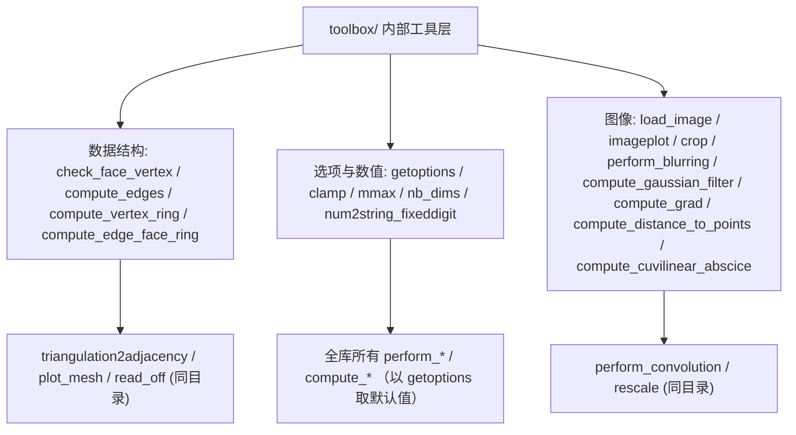

# 90.6a Toolbox Fast Marching — 内部工具：数据结构与选项（第三方） / Fast Marching Internals: Data Structures and Options (Vendored)

> 本章覆盖 `external/toolbox_fast_marching/toolbox/` 子目录中一层**与求解器无关的底层工具**：
> 网格/图数据结构（面-顶点校验、边表、顶点环、边-面环）、选项解析惯用法（`getoptions`）、
> 小数值助手（`clamp`、`mmax`、`nb_dims`、`num2string_fixeddigit`）、图像加载与绘图原语
> （`load_image`、`imageplot`）、以及高斯滤波/梯度/距离等基础算子。这 17 个文件是
> Gabriel Peyre *Toolbox Fast Marching*（BSD，约 2004–2007）的**内部支撑层**；同目录其余文件
> 由姊妹篇 `06b-fast-marching-internals-operators-and-io.md` 覆盖。
>
> This chapter covers a layer of **solver-agnostic low-level utilities** in
> `external/toolbox_fast_marching/toolbox/`: mesh/graph data structures (face/vertex validation,
> edge list, vertex ring, edge-face ring), the option-parsing idiom (`getoptions`), small numeric
> helpers (`clamp`, `mmax`, `nb_dims`, `num2string_fixeddigit`), image loading & plotting primitives
> (`load_image`, `imageplot`), plus basic Gaussian / gradient / distance operators. These 17 files
> are the **internal support layer** of Gabriel Peyre's *Toolbox Fast Marching* (BSD, ~2004–2007);
> the remaining files of this directory are covered by the sibling chapter
> `06b-fast-marching-internals-operators-and-io.md`.

- 语言 / Language：中英对照（中文为主）
- 相关章节 / See also：[90-external/README.md](README.md)、
  [90.3 MATLAB 环境与绘图](03-matlab-environment-and-plotting.md)、
  [90.5 求解器核心](05-fast-marching-solvers.md)、[90.5b 派生量计算](05b-fast-marching-compute-helpers.md)、
  [appendices/03-doc-template.md](../appendices/03-doc-template.md)
- 命名约定 / Notation：本目录沿用 Peyre 的**列优先**约定——`face` 常被 `check_face_vertex`
  规范为 `3 by #N`（**维度 × 个数**），与 gptoolbox `mesh/` 的 `#V by dim` 相反；`M` 为图像
  （`n by n` 或 `n by n by p`），`vring{i}` 为顶点 i 的一环邻居。
- 重要声明 / Disclaimer：本目录为**第三方 vendored 代码**，署名/许可由**文件头**决定（各条目
  "署名"一栏给出文件头行号证据）。发现**遮蔽 MATLAB 内置**或**与本库其它模块重叠**时逐条标注。

---

## 本章概览 / Chapter Overview

### 函数总表 / Function overview

| 函数 / Function | 类别 / Category | 一句话功能 / One-line purpose |
|---|---|---|
| `check_face_vertex` | 数据校验 | 把顶点/面表规范成"3 行"（维度 × 个数）方向，必要时转置 |
| `clamp` | 数值助手 | 把 `x` 逐元素夹到 `[a,b]`（默认 `[0,1]`） |
| `compute_cuvilinear_abscice` | 曲线几何 | 计算折线的累积弧长（curvilinear abscissa） |
| `compute_distance_to_points` | 距离计算 | 向量化计算 `X` 各列到 `seeds` 各列的**平方**欧氏距离 |
| `compute_edge_face_ring` | 邻接结构 | 由面表构造"边 → 相邻面"稀疏环矩阵 |
| `compute_edges` | 邻接结构 | 由面表构造**去重**的（无向）边表 |
| `compute_gaussian_filter` | 图像滤波 | 生成归一化的 1D/2D 采样高斯核 |
| `compute_grad` | 图像微分 | 用（中心/前向/后向）有限差分求图像梯度 |
| `compute_vertex_ring` | 邻接结构 | 由面表构造每个顶点的 1 环邻居元胞数组 |
| `crop` | 图像几何 | 以给定中心把图像/体数据裁到指定尺寸 |
| `getoptions` | 选项解析 | 从 `options` 结构取字段、否则回退默认值（全库惯用法） |
| `imageplot` | 图像显示 | 显示图像/图像元胞数组并加标题、可排子图 |
| `load_image` | 数据加载 | 生成或读取基准测试图像（合成 + 自然图） |
| `mmax` | 数值助手 | 矩阵最大元素 = `max(A(:))` |
| `nb_dims` | 数值助手 | "调试版 `ndims`"：行/列向量按 1 维计，空按 0 维计 |
| `num2string_fixeddigit` | 字符串助手 | 把数转成定长（零填充）数字字符串 |
| `perform_blurring` | 图像滤波 | 用可分离高斯核对图像做模糊 |

### 模块关系图 / Module relationship diagram



---

## 逐函数详解 / Per-function reference

### `check_face_vertex` — 顶点/面表尺寸与方向校验
- **文件 / File**: [toolbox/check_face_vertex.m](file:///c:/VSWork/gptoolbox-1/external/toolbox_fast_marching/toolbox/check_face_vertex.m#L1-L29)
- **署名 / Attribution**: Gabriel Peyre / Toolbox Fast Marching（BSD）。文件头证据：`%   Copyright (c) 2007 Gabriel Peyre`（L7）。
- **签名 / Signature**: `[vertex,face] = check_face_vertex(vertex,face, options)`
- **功能 / Purpose**: `EN: Normalize a vertex/face list so that the "3" dimension is along rows (3 by N), transposing when needed; accepts an unused third argument.` / 中文：把顶点/面表规范成**行数为 3**（`3 by #N`）的方向，按需转置；第三参 `options` 在函数体内**未被使用**（仅占位）。
- **输入 / Inputs**:

  | 参数 | 尺寸/类型 | 含义 (中 / EN) |
  |---|---|---|
  | `vertex` | `3 by #V` 或 `#V by 3` | 顶点坐标表 / vertex list |
  | `face` | `3 by #F` 或 `#F by 3` | 面索引表 / face list |
  | `options` | 任意 | **未使用**（占位）/ unused placeholder |

- **输出 / Outputs**:

  | 参数 | 尺寸/类型 | 含义 |
  |---|---|---|
  | `vertex` | `3 by #V` | 规范后的顶点表 / normalized vertices |
  | `face` | `3 by #F` | 规范后的面表 / normalized faces |

- **变量流动 / Variable flow**: `vertex,face → check_size(vertex) → vertex ; check_size(face) → face`（`check_size` 为局部子函数）。
- **算法步骤 / Algorithm**（子函数 `check_size`，L13–L29）:
  1. `isempty(a)` 直接返回（空表不处理）。
  2. `size(a,1)>size(a,2)` → 转置 `a=a'`（表已是横躺）。
  3. `size(a,1)<3 && size(a,2)==3` → 转置（补 3 行方向）。
  4. 退化平面三角形特例：`size(a,1)<=3 && size(a,2)>=3 && sum(abs(a(:,3)))==0` → 转置。
  5. `size(a,1)~=3` → `error('face or vertex is not of correct size')`。
- **流程图 / Flowchart**:

  ```mermaid
  flowchart TD
    A["输入 vertex,face"] --> B["a = check_size(vertex)"]
    B --> C["a = check_size(face)"]
    C --> D{"size(a,1) > size(a,2) ?"}
    D -- 是 --> E["a = a'"]
    D -- 否 --> F{"需补 3 行方向 / 退化三角 ?"}
    E --> F
    F -- 是 --> G["a = a'"]
    F -- 否 --> H{"size(a,1) == 3 ?"}
    G --> H
    H -- 否 --> I["error 尺寸错误"]
    H -- 是 --> Z["输出 vertex,face"]
  ```

- **依赖 / Dependencies**: 局部子函数 `check_size`；内置 `size`/`isempty`/`sum`/`abs`/`error`。
- **See also**: `compute_edges`, `compute_vertex_ring`, `compute_edge_face_ring`, `triangulation2adjacency`
- **⚠️ 重叠 / 冲突标注**: 无 MATLAB 内置同名。注意其**列优先**约定（`3 by #N`）与 gptoolbox `mesh/` 的 `#V by dim` 相反，跨库混用需转置；`options` 参为**死参数**。

### `clamp` — 数值夹取到区间
- **文件 / File**: [toolbox/clamp.m](file:///c:/VSWork/gptoolbox-1/external/toolbox_fast_marching/toolbox/clamp.m#L1-L19)
- **署名 / Attribution**: Gabriel Peyre / Toolbox Fast Marching（BSD）。文件头证据：`%   Copyright (c) 2004 Gabriel Peyr?`（L9，编码残留）。
- **签名 / Signature**: `y = clamp(x,a,b)`
- **功能 / Purpose**: `EN: Clamp every entry of x into [a,b]; defaults a=0, b=1.` / 中文：把 `x` 逐元素夹到区间 `[a,b]`，缺省 `[0,1]`。
- **输入 / Inputs**:

  | 参数 | 尺寸/类型 | 含义 (中 / EN) |
  |---|---|---|
  | `x` | 任意数值 | 被夹取值 / input values |
  | `a` | 标量 | 下界 / lower bound |
  | `b` | 标量 | 上界 / upper bound |

- **输出 / Outputs**:

  | 参数 | 尺寸/类型 | 含义 |
  |---|---|---|
  | `y` | 同 `x` | 夹取结果 / clamped values |

- **可选参数 / Optional**:

  | 名称 | 取值 | 默认 | 含义 |
  |---|---|---|---|
  | `a` | 标量 | `0` | 下界 / lower bound |
  | `b` | 标量 | `1` | 上界 / upper bound |

- **变量流动 / Variable flow**: `x,a,b → y=max(x,a) → y=min(y,b)`
- **算法步骤 / Algorithm**:
  1. `nargin<2` → `a=0`（L11–L13）。
  2. `nargin<3` → `b=1`（L14–L16）。
  3. `y=max(x,a)`，再 `y=min(y,b)`（L18–L19）。
- **流程图 / Flowchart**:

  ```mermaid
  flowchart TD
    A["输入 x,a,b"] --> B["a=0 若缺省; b=1 若缺省"]
    B --> C["y = max(x,a)"]
    C --> Z["y = min(y,b) → 输出"]
  ```

- **依赖 / Dependencies**: 内置 `max`/`min`。
- **See also**: `rescale`, `crop`
- **⚠️ 重叠 / 冲突标注**: 与 MATLAB 内置 `min(max(x,a),b)` **功能等价**（本库仅此一处便利封装；无内置 `clamp`）。

### `compute_cuvilinear_abscice` — 折线累积弧长
- **文件 / File**: [toolbox/compute_cuvilinear_abscice.m](file:///c:/VSWork/gptoolbox-1/external/toolbox_fast_marching/toolbox/compute_cuvilinear_abscice.m#L1-L19)
- **署名 / Attribution**: Gabriel Peyre / Toolbox Fast Marching（BSD）；`Copyright (c) 2004 Gabriel Peyr?`（L9）。
- **签名 / Signature**: `s = compute_cuvilinear_abscice(c)`
- **功能 / Purpose**: `EN: Compute the curvilinear abscissa (cumulative arc length) along a polyline given as a dims-by-npts matrix.` / 中文：给定 `dims by npts` 折线，计算其累积弧长（从 0 起）。
- **输入 / Inputs**:

  | 参数 | 尺寸/类型 | 含义 (中 / EN) |
  |---|---|---|
  | `c` | `dims by npts` | 折线各点坐标（列优先）/ curve points |

- **输出 / Outputs**:

  | 参数 | 尺寸/类型 | 含义 |
  |---|---|---|
  | `s` | `npts by 1` | 累积弧长（`s(1)=0`）/ cumulative arc length |

- **变量流动 / Variable flow**: `c →(行多于列则转置)→ c → D=c(:,2:end)-c(:,1:end-1) → s(2:end)=sqrt(sum(D.^2,1)) → s=cumsum(s)`
- **算法步骤 / Algorithm**:
  1. `size(c,1)>size(c,2)` → 转置为 `dims by npts`（L11–L13）。
  2. `npts=size(c,2)`；相邻差 `D=c(:,2:end)-c(:,1:end-1)`（L15–L16）。
  3. `s=zeros(npts,1)`，`s(2:end)=sqrt(sum(D.^2,1))` 为每段长度（L17–L18）。
  4. `s=cumsum(s)` 累积（L19）。
- **流程图 / Flowchart**:

  ```mermaid
  flowchart TD
    A["输入 c"] --> B{"size(c,1) > size(c,2) ?"}
    B -- 是 --> C["c = c'"]
    B -- 否 --> D
    C --> D["D = c(:,2:end)-c(:,1:end-1)"]
    D --> E["s(2:end) = sqrt(sum(D.^2,1))"]
    E --> Z["s = cumsum(s) → 输出"]
  ```

- **依赖 / Dependencies**: 内置 `size`/`sqrt`/`sum`/`zeros`/`cumsum`。
- **See also**: `compute_geodesic`, `perform_curve_resampling`
- **⚠️ 重叠 / 冲突标注**: 无内置同名；功能上与 gptoolbox `mesh/` 的曲线弧长/重采样辅助重叠（本文件中亦无同名 gptoolbox 函数）。

### `compute_distance_to_points` — 到一组点的平方距离
- **文件 / File**: [toolbox/compute_distance_to_points.m](file:///c:/VSWork/gptoolbox-1/external/toolbox_fast_marching/toolbox/compute_distance_to_points.m#L1-L21)
- **署名 / Attribution**: Gabriel Peyre / Toolbox Fast Marching（BSD）；`Copyright (c) 2004 Gabriel Peyr?`（L11）。
- **签名 / Signature**: `D = compute_distance_to_points(X,seeds)`
- **功能 / Purpose**: `EN: Vectorised squared Euclidean distance from each column of X to each seed column; D(i,j)=|X(:,j)-seeds(:,i)|^2 (squared, not the distance itself).` / 中文：计算 `X` 每列到 `seeds` 每列的**平方**欧氏距离（注意：返回平方值，非距离本身）。
- **输入 / Inputs**:

  | 参数 | 尺寸/类型 | 含义 (中 / EN) |
  |---|---|---|
  | `X` | `d by n` | 点集（`X(:,i)` 为 R^d 第 i 点）/ point set |
  | `seeds` | `d by k` | 种子点集 / seeds |

- **输出 / Outputs**:

  | 参数 | 尺寸/类型 | 含义 |
  |---|---|---|
  | `D` | `k by n` | `D(i,j)=` 第 j 点到第 i 个种子的平方距离 / squared distances |

- **变量流动 / Variable flow**: `X,seeds → nbCluster=size(seeds,2), n=size(X,2) → D=zeros(k,n) → 逐种子 k: D(k,:)=sum((X-repmat(seeds(:,k),1,n)).^2) → D`
- **算法步骤 / Algorithm**:
  1. 取 `nbCluster=size(seeds,2)`、`n=size(X,2)`、`d=size(X,1)`，预分配 `D=zeros(nbCluster,n)`（L13–L16）。
  2. `for k=1:nbCluster`：`repmat` 广播第 k 个种子后求逐分量平方和，写入第 k 行（L18–L21）。
- **流程图 / Flowchart**:

  ```mermaid
  flowchart TD
    A["输入 X,seeds"] --> B["D = zeros(k,n)"]
    B --> C{"k <= nbCluster ?"}
    C -- 是 --> D["D(k,:) = sum((X-seeds(:,k)).^2)"]
    D --> C
    C -- 否 --> Z["输出 D (平方距离)"]
  ```

- **依赖 / Dependencies**: 内置 `size`/`zeros`/`repmat`/`sum`。
- **See also**: `compute_distance_landmark`, `eucdist2`
- **⚠️ 重叠 / 冲突标注**: 与 **Statistics and Machine Learning Toolbox 的 `pdist2`** 及同目录姊妹篇中的 MEX 版距离变换 `eucdist2`（见 [90.5b](05b-fast-marching-compute-helpers.md)）**功能重叠**；gptoolbox `matrix/` 无直接对应（`matrix/` 无距离函数）。返回**平方距离**易被误用为距离。

### `compute_edge_face_ring` — 边-面环（相邻面）稀疏结构
- **文件 / File**: [toolbox/compute_edge_face_ring.m](file:///c:/VSWork/gptoolbox-1/external/toolbox_fast_marching/toolbox/compute_edge_face_ring.m#L1-L41)
- **署名 / Attribution**: Gabriel Peyre / Toolbox Fast Marching（BSD）；`Copyright (c) 2007 Gabriel Peyre`（L10）。
- **签名 / Signature**: `A = compute_edge_face_ring(face)`
- **功能 / Purpose**: `EN: Build a sparse ring such that A(i,j) and A(j,i) hold the ids of the two faces incident to edge (i,j); missing entries are set to -1.` / 中文：构造稀疏矩阵 `A`，`A(i,j)` 与 `A(j,i)` 存边 `(i,j)` 的两个相邻面编号，缺失处填 `-1`。
- **输入 / Inputs**:

  | 参数 | 尺寸/类型 | 含义 (中 / EN) |
  |---|---|---|
  | `face` | `#F by 3` | 三角面索引 / triangle faces |

- **输出 / Outputs**:

  | 参数 | 尺寸/类型 | 含义 |
  |---|---|---|
  | `A` | `#V by #V` 稀疏 | 对称边环，值为面编号或 `-1` / edge-face ring |

- **变量流动 / Variable flow**: `face → check_face_vertex([],face) →(3 by #F)→ n=max(face(:)), m=#F → i=[face(1,:) face(2,:) face(3,:)], j=[face(2,:) face(3,:) face(1,:)], s=面id → unique 区分正/反向 → 翻转重复项 i1,j1 → 再去重 → A=sparse(i1,j1,s,n,n) → 补 -1 → A`
- **算法步骤 / Algorithm**:
  1. `[tmp,face]=check_face_vertex([],face)` 规范为 `3 by #F`；`n=max(face(:))`、`m=size(face,2)`（L13–L16）。
  2. 取**有向边**：`i=[face(1,:) face(2,:) face(3,:)]`、`j=[face(2,:) face(3,:) face(1,:)]`、`s=[1:m 1:m 1:m]`（面 id 复制三份）（L17–L19）。
  3. `unique(i+(max(i)+1)*j)` 取每个有向边**首次出现**索引 `I`；`J=setdiff(1:length(s),I)` 为反向重复项（L22–L24）。
  4. 翻转重复项：`i1=[i(I) j(J)]`、`j1=[j(I) i(J)]`、`s=[s(I) s(J)]`（L27–L29）。
  5. 再次 `unique(i1+(max(i1)+1)*j1)` 彻底去重，得 `i1,j1,s`（L32–L33）。
  6. `A=sparse(i1,j1,s,n,n)`；对反向缺失处 `I=find(A'~=0); I=I(A(I)==0); A(I)=-1`（L35–L41）。
- **流程图 / Flowchart**:

  ```mermaid
  flowchart TD
    A["输入 face"] --> B["face = check_face_vertex([],face)"]
    B --> C["i,j = 有向边; s = 面 id"]
    C --> D["unique → I; J = 反向重复项"]
    D --> E["翻转: i1=[i(I) j(J)], j1=[j(I) i(J)]"]
    E --> F["再次 unique 去重"]
    F --> G["A = sparse(i1,j1,s,n,n)"]
    G --> H["反向缺失处 A(I) = -1"]
    H --> Z["输出 A"]
  ```

- **依赖 / Dependencies**: `check_face_vertex`（本文件 [toolbox/check_face_vertex.m](file:///c:/VSWork/gptoolbox-1/external/toolbox_fast_marching/toolbox/check_face_vertex.m#L1-L29)）；内置 `unique`/`setdiff`/`sparse`/`find`/`max`。
- **See also**: `compute_edges`, `compute_vertex_ring`, `triangulation2adjacency`, `plot_mesh`
- **⚠️ 重叠 / 冲突标注**: 任务提及 `mesh/edge_face_adjacency`、`mesh/oriented_edge_face_adjacency` 作对照——**经检索本库不存在这两个文件**（`mesh/` 仅有 [mesh/facet_adjacency_matrix.m](file:///c:/VSWork/gptoolbox-1/mesh/facet_adjacency_matrix.m#L1) 与 [mesh/quad_facet_adjacency_matrix.m](file:///c:/VSWork/gptoolbox-1/mesh/quad_facet_adjacency_matrix.m#L1)，均构造**面-面**相邻矩阵，语义不同）。故如实标注：本函数在 gptoolbox **无直接重名对应**，仅在"邻接结构构造"职责上与 `mesh/facet_adjacency_matrix` 相近。不遮蔽内置。

### `compute_edges` — 面表 → 唯一无向边表
- **文件 / File**: [toolbox/compute_edges.m](file:///c:/VSWork/gptoolbox-1/external/toolbox_fast_marching/toolbox/compute_edges.m#L1-L37)
- **署名 / Attribution**: Gabriel Peyre / Toolbox Fast Marching（BSD）；`Copyright (c) 2004 Gabriel Peyr?`（L7）。
- **签名 / Signature**: `edges = compute_edges(face)`
- **功能 / Purpose**: `EN: From a list of triangular faces, build the list of unique undirected edges (each pair sorted, output as 2-by-#E).` / 中文：由三角面表构造**去重**的无向边表（每对不同端点已排序，输出为 `2 by #E`）。
- **输入 / Inputs**:

  | 参数 | 尺寸/类型 | 含义 (中 / EN) |
  |---|---|---|
  | `face` | `#F by 3` | 三角面索引 / triangle faces |

- **输出 / Outputs**:

  | 参数 | 尺寸/类型 | 含义 |
  |---|---|---|
  | `edges` | `2 by #E` | 唯一无向边表 / unique undirected edges |

- **变量流动 / Variable flow**: `face →(空则返回 [])→ check_face_vertex →(3 by #F)→ for i=1:3: edges=[edges, face([i,mod(i,3)+1],:)] → 交换使每列小者在上 → id=edges(1,:)+m*edges(2,:) → unique(id) → edges=edges(:,I)`
- **算法步骤 / Algorithm**:
  1. `isempty(face)` → 返回 `edges=[]`（L9–L12）。
  2. `[tmp,face]=check_face_vertex([],face)` 规范；`size(face,1)~=3` 报错；`d=size(face,1)`（L14–L19）。
  3. `for i=1:d`：取边端点组合 `sel=[i,mod(i,d)+1]`，把 `face(sel,:)` 追加为两行（3 条边，每条一列）（L21–L25）。
  4. 每列**排序**：`I` 处 `edges(1,:)>edges(2,:)` 交换（`edges(end:-1:1,I)`），`J` 保持（L28–L30）。
  5. 唯一化：`m=max(edges(:))+100`，`id=edges(1,:)+m*edges(2,:)` 编码，(L33–L34) `unique(id)` 取索引 `I`，(L36) `edges=edges(:,I)`。
- **流程图 / Flowchart**:

  ```mermaid
  flowchart TD
    A["输入 face"] --> B{"isempty(face) ?"}
    B -- 是 --> B1["edges = [] 返回"]
    B -- 否 --> C["face = check_face_vertex([],face)"]
    C --> D["for i=1:3: 追加 face([i,mod(i,3)+1],:)"]
    D --> E["每列排序 (小者在上)"]
    E --> F["id = edges(1,:)+m*edges(2,:)"]
    F --> G["[tmp,I] = unique(id)"]
    G --> Z["输出 edges(:,I)"]
  ```

- **依赖 / Dependencies**: `check_face_vertex`（[toolbox/check_face_vertex.m](file:///c:/VSWork/gptoolbox-1/external/toolbox_fast_marching/toolbox/check_face_vertex.m#L1-L29)）；内置 `isempty`/`unique`/`max`/`mod`/`error`。
- **See also**: `compute_vertex_ring`, `compute_edge_face_ring`, `triangulation2adjacency`
- **⚠️ 重叠 / 冲突标注**: 与 gptoolbox [mesh/edges.m](file:///c:/VSWork/gptoolbox-1/mesh/edges.m#L1-L63) **功能重复**——`E = edges(F)` 同样返回每行排序的唯一无向边，但**输出方向相反**（`mesh/edges` 为 `#E by 2`，本函数为 `2 by #E`）。亦与 [mesh/adjacency_matrix.m](file:///c:/VSWork/gptoolbox-1/mesh/adjacency_matrix.m#L1-L26) 形成上游（后者由面/边表建邻接矩阵）。不遮蔽内置（无内置 `compute_edges`）。任务提到的 "meshgrid" 构造在本实现中**并未使用**——实际为 `mod` 组合 + `unique` 编码去重。

### `compute_gaussian_filter` — 采样高斯核（1D/2D）
- **文件 / File**: [toolbox/compute_gaussian_filter.m](file:///c:/VSWork/gptoolbox-1/external/toolbox_fast_marching/toolbox/compute_gaussian_filter.m#L1-L108)
- **署名 / Attribution**: Gabriel Peyre / Toolbox Fast Marching（BSD）；文件头及两处子函数头均为 `Copyright (c) 2004 Gabriel Peyr?`（L20、L54、L89）。
- **签名 / Signature**: `f = compute_gaussian_filter(n,s,N);`
- **功能 / Purpose**: `EN: Build a normalised 1D or 2D sampled Gaussian filter; x spans [-1/2,1/2] sampled by pixel-center offsets relative to a big signal/image of size N; the filter sums to 1.` / 中文：生成归一化的 1D 或 2D 采样高斯核；`x` 在 `[-1/2,1/2]` 上按相对大图尺寸 `N` 的像素中心采样，核元素**和为 1**。
- **输入 / Inputs**:

  | 参数 | 尺寸/类型 | 含义 (中 / EN) |
  |---|---|---|
  | `n` | 标量 或 `[n1 n2]` | 核尺寸（奇数无相位偏移）/ filter size |
  | `s` | 标量 或 `[s1 s2]` | 标准差 / std deviation |
  | `N` | 标量 或 `[N1 N2]` | 大信号/图像尺寸 / big image size |

- **输出 / Outputs**:

  | 参数 | 尺寸/类型 | 含义 |
  |---|---|---|
  | `f` | `n by 1` 或 `n1 by n2` | 归一化高斯核 / normalised kernel |

- **可选参数 / Optional**（无 `varargin`，以下为参数缺省行为）:

  | 名称 | 取值 | 默认 | 含义 |
  |---|---|---|---|
  | 维度 `nd` | `1` 或 `2` | `1`（当 `length(n)>1 && n(2)>1` 时取 `2`） | 由 `n` 推断 / dimension |
  | `s` | `[s1 s2]` | 标量时复制为 `[s s]` | 2D 下对称扩展 |
  | `N` | `[N1 N2]` | 子函数内 `nargin<3` 时 `N=n` | 大图尺寸缺省 |

- **变量流动 / Variable flow**: `n,s,N →(nd=2 if n(2)>1)→(2D 且标量则 s=[s s], N=[N N])→ build_gaussian_filter_1d / _2d → f`
- **算法步骤 / Algorithm**:
  1. `nd=1`；`length(n)>1 & n(2)>1` → `nd=2`（L22–L25）。
  2. 2D 且 `length(s)==1` → `s=[s s]`；`length(N)==1` → `N=[N N]`（L27–L32）。
  3. 分派 `build_gaussian_filter_1d` / `build_gaussian_filter_2d`（L34–L38）。
  4. **1D**（L91–L108）：`nargin<2` 报错；`nargin<3` → `N=n`；`s<=0` → 中心点 δ 核；否则 `x=((0:n-1)-(n-1)/2)/(N-1)`，`f=exp(-x.^2/(2*s^2))`，`f=f/sum(f(:))`。
  5. **2D**（L56–L82）：同上做 `N`/`s` 扩展；`meshgrid(y,x)` 后 `f=exp(-X.^2/(2*s(1)^2)-Y.^2/(2*s(2)^2))`，`f=f/sum(f(:))`（可分离指数）。
- **流程图 / Flowchart**:

  ```mermaid
  flowchart TD
    A["输入 n,s,N"] --> B{"length(n)>1 且 n(2)>1 ?"}
    B -- 是 --> C["nd = 2; s=[s s]; N=[N N]"]
    B -- 否 --> D["nd = 1"]
    C --> E{"nd == 1 ?"}
    D --> E
    E -- 是 --> F["build_gaussian_filter_1d"]
    E -- 否 --> G["build_gaussian_filter_2d"]
    F --> H{"s <= 0 ?"}
    G --> H
    H -- 是 --> I["中心 δ 核"]
    H -- 否 --> J["f = exp(-x^2/(2 s^2)); f = f/sum(f(:))"]
    I --> Z["输出 f"]
    J --> Z
  ```

- **依赖 / Dependencies**: 局部子函数 `build_gaussian_filter_1d`、`build_gaussian_filter_2d`；内置 `exp`/`sum`/`meshgrid`/`zeros`/`round`/`length`。
- **See also**: `perform_blurring`, `perform_convolution`, `load_image`
- **⚠️ 重叠 / 冲突标注**: 与 Image Processing Toolbox 的 `fspecial('gaussian',...)` **功能相近**（需 IPT）；无内置 `compute_gaussian_filter`。

### `compute_grad` — 图像有限差分梯度
- **文件 / File**: [toolbox/compute_grad.m](file:///c:/VSWork/gptoolbox-1/external/toolbox_fast_marching/toolbox/compute_grad.m#L1-L119)
- **署名 / Attribution**: Gabriel Peyre / Toolbox Fast Marching（BSD）；`Copyright (c) 2004 Gabriel Peyr?`（L22）。
- **签名 / Signature**: `grad = compute_grad(M,options)`
- **功能 / Purpose**: `EN: Compute the image gradient with (central / forward / backward) finite differences controlled by an options struct.` / 中文：按 `options` 指定的差分类型（中心/前向/后向）计算图像 `M` 的梯度。
- **输入 / Inputs**:

  | 参数 | 尺寸/类型 | 含义 (中 / EN) |
  |---|---|---|
  | `M` | `n by p` | 灰度/标量图像 / image |
  | `options` | `struct` | 步长与差分类型 / step sizes and type |

- **输出 / Outputs**:

  | 参数 | 尺寸/类型 | 含义 |
  |---|---|---|
  | `grad` | `n by p by 2` | 第 3 维为 x/y 方向导数 / gradients along X and Y |

- **可选参数 / Optional**:

  | 名称 | 取值 | 默认 | 含义 |
  |---|---|---|---|
  | `options.h` | 标量 | 无 | 同时设定 x/y 步长（覆盖 `h1`/`h2`） |
  | `options.h1` | 标量 | `1` | x 方向步长 / X step |
  | `options.h2` | 标量 | `1` | y 方向步长 / Y step |
  | `options.type` | `1`/`2`/`3` | `1` | `1` 中心差分，`2` 前向差分（带平均），`3` 后向差分 |

- **变量流动 / Variable flow**: `M,options → h1/h2 (或 h) → [n,p]=size(M) → type →(type==1: D1/D2 平移相减 + 边界三点公式)/(type==2/3: 先邻域平均 MM 再前/后向差)→ grad(:,:,1)/(:,:,2)`
- **算法步骤 / Algorithm**:
  1. `nargin<2` → `options.null=0`；`h1`、`h2` 缺省为 `1`；若存在 `options.h` 则 `h1=h2=h`（L24–L40）。
  2. `[n,p]=size(M)`；`type=options.type` 或 `1`（L42–L48）。
  3. `type==1`（中心差分）：X 向用 `D1=[M(2:end,:);M(end,:)]`、`D2=[M(1,:);M(1:end-1,:)]` 相减除以 `2*h1`，上下边界用三点公式 `(4*M(2,:)-3*M(1,:)-M(3,:))/(2*h1)` 等；Y 向同理（L53–L65）。
  4. `type==2`（前向差分）：先做邻域平均 `MM`，再前向差 `/h1`、`/h2`（L66–L80）。
  5. `type==3`（后向差分）：邻域平均后后向差；注意本分支用变量 `h`（L81–L95）——**仅当设置了 `options.h` 时才有定义，否则报"未定义 h"**。
  6. `else` → `error('This kind of differences is not supported.')`；其后 L102–L119 为 `return` 之后的**死代码**（中心/平方均值插值）。
- **流程图 / Flowchart**:

  ```mermaid
  flowchart TD
    A["输入 M,options"] --> B["h1=h2=1; 若 options.h 则 h1=h2=h"]
    B --> C{"type"}
    C -- 1 --> D["中心差分 + 边界三点公式 → grad(:,:,1/2)"]
    C -- 2 --> E["邻域平均 MM → 前向差 /h1,/h2"]
    C -- 3 --> F["邻域平均 → 后向差 /h (需 options.h)"]
    C -- 其它 --> G["error 不支持"]
    D --> Z["输出 grad"]
    E --> Z
    F --> Z
  ```

- **依赖 / Dependencies**: 内置 `size`/`isfield`/`error`。
- **See also**: `divgrad`, `compute_edge_energy`, `compute_gaussian_filter`
- **⚠️ 重叠 / 冲突标注**: 与 MATLAB 内置 `gradient`、与 gptoolbox [mesh/grad.m](file:///c:/VSWork/gptoolbox-1/mesh/grad.m#L1)（**网格上的有限元梯度算子**，接受 `V,F`）**用途重叠但接口/语义不同**（前者为图像网格差分，后者为网格微分矩阵）；`matrix/` 亦无同名函数。**不遮蔽内置**。源码 `type==3` 分支对 `h` 的引用为**潜在缺陷**。

### `compute_vertex_ring` — 顶点 1 环邻居
- **文件 / File**: [toolbox/compute_vertex_ring.m](file:///c:/VSWork/gptoolbox-1/external/toolbox_fast_marching/toolbox/compute_vertex_ring.m#L1-L24)
- **署名 / Attribution**: Gabriel Peyre / Toolbox Fast Marching（BSD）；`Copyright (c) 2004 Gabriel Peyr?`（L10）。
- **签名 / Signature**: `vring = compute_vertex_ring(face)`
- **功能 / Purpose**: `EN: Compute the 1-ring of every vertex; vring{i} is the list of vertices adjacent to vertex i.` / 中文：构造每个顶点的 1 环邻居；`vring{i}` 为与顶点 i 相邻的顶点集合。
- **输入 / Inputs**:

  | 参数 | 尺寸/类型 | 含义 (中 / EN) |
  |---|---|---|
  | `face` | `#F by 3` | 三角面索引 / triangle faces |

- **输出 / Outputs**:

  | 参数 | 尺寸/类型 | 含义 |
  |---|---|---|
  | `vring` | `1 by #V` cell | 各顶点邻居（**未排序**）/ vertex 1-rings |

- **变量流动 / Variable flow**: `face → check_face_vertex → nverts=max(max(face)) → A=triangulation2adjacency(face) → [i,j,s]=find(sparse(A)) → vring{nverts}=[] → for m: vring{i(m)}(end+1)=j(m) → vring`
- **算法步骤 / Algorithm**:
  1. `[tmp,face]=check_face_vertex([],face)`；`nverts=max(max(face))`（L12–L14）。
  2. `A=triangulation2adjacency(face)`；`[i,j,s]=find(sparse(A))` 转成三元组（L16–L17）。
  3. 预分配元胞 `vring{nverts}=[]`（L19–L20）。
  4. `for m=1:length(i)`：`vring{i(m)}(end+1)=j(m)` 逐个追加邻居（L22–L24）。
- **流程图 / Flowchart**:

  ```mermaid
  flowchart TD
    A["输入 face"] --> B["face = check_face_vertex([],face)"]
    B --> C["A = triangulation2adjacency(face)"]
    C --> D["[i,j,s] = find(sparse(A))"]
    D --> E["vring{nverts} = []"]
    E --> F{"m <= length(i) ?"}
    F -- 是 --> G["vring{i(m)}(end+1) = j(m)"]
    G --> F
    F -- 否 --> Z["输出 vring"]
  ```

- **依赖 / Dependencies**: `check_face_vertex`、`triangulation2adjacency`（均在 [toolbox/](file:///c:/VSWork/gptoolbox-1/external/toolbox_fast_marching/toolbox/triangulation2adjacency.m#L1)）；内置 `max`/`find`/`sparse`。
- **See also**: `compute_edges`, `compute_edge_face_ring`, `triangulation2adjacency`
- **⚠️ 重叠 / 冲突标注**: 与 gptoolbox [mesh/adjacency_matrix.m](file:///c:/VSWork/gptoolbox-1/mesh/adjacency_matrix.m#L1-L26)（能否建顶点邻接）+ [mesh/edges.m](file:///c:/VSWork/gptoolbox-1/mesh/edges.m#L1) **职责重叠**；注意任务提及的 `mesh/vertex_ring` **经检索在本库不存在**。不遮蔽内置。

### `crop` — 图像/体数据裁剪
- **文件 / File**: [toolbox/crop.m](file:///c:/VSWork/gptoolbox-1/external/toolbox_fast_marching/toolbox/crop.m#L1-L58)
- **署名 / Attribution**: Gabriel Peyre / Toolbox Fast Marching（BSD）；`Copyright (c) 2007 Gabriel Peyre`（L10）。
- **签名 / Signature**: `M = crop(M,n,c)`
- **功能 / Purpose**: `EN: Crop an image (2D) or volume (3D, >3 channels) around center c down to size n, clipping indices to bounds.` / 中文：以中心 `c` 把图像（2D）或体数据（第 3 维 >3 的多维数组）裁到尺寸 `n`，越界索引自动裁剪。
- **输入 / Inputs**:

  | 参数 | 尺寸/类型 | 含义 (中 / EN) |
  |---|---|---|
  | `M` | 数组 | 原图像/体数据 / input array |
  | `n` | 标量 或 `1 by 3` | 目标尺寸 / target size |
  | `c` | 标量 或 `1 by 3` | 裁剪中心 / center |

- **输出 / Outputs**:

  | 参数 | 尺寸/类型 | 含义 |
  |---|---|---|
  | `M` | ≤ `n` | 裁剪结果 / cropped array |

- **可选参数 / Optional**:

  | 名称 | 取值 | 默认 | 含义 |
  |---|---|---|---|
  | `n` | 标量/向量 | `round(n0/2)` | 目标尺寸；为空则原样返回 |
  | `c` | 标量/向量 | `round(n0/2)` | 裁剪中心 / center |

- **变量流动 / Variable flow**: `M,n,c → n0=size(M) → d=2 (若 size(M,3)>3 取 3) → 补默认 n,c → 标量扩展 repmat → c=round(c) → selx/sely/selz 索引区间 → 去越界 → M=M(selx,sely,selz)`
- **算法步骤 / Algorithm**:
  1. `n0=size(M); n0(3)=size(M,3)`；`d=2`，若 `size(M,3)>3` → `d=3`（多维体数据）（L12–L19）。
  2. `nargin<2` → `n=round(n0/2)`；`nargin<3` 或 `isempty(c)` → `c=round(n0/2)`（L21–L26）。
  3. `isempty(n)` → 直接返回（L28–L30）。
  4. 标量 `n`/`c` 用 `repmat(...,d,3)` 扩展；`c=round(c)`；`length(n)<3` → `n(3)=1`（L32–L41）。
  5. 以中心 ± `ceil/floor(n/2)` 生成 `selx`/`sely`/`selz`；`d==2` 时 `selz=1:size(M,3)`（L43–L49）。
  6. 去掉越界索引（`selx(selx<1)=[]` 等）（L51–L56），`M=M(selx,sely,selz)`（L58）。
- **流程图 / Flowchart**:

  ```mermaid
  flowchart TD
    A["输入 M,n,c"] --> B["n0 = size(M); d = 2 或 3"]
    B --> C["补默认 n,c (round(n0/2))"]
    C --> D{"isempty(n) ?"}
    D -- 是 --> D1["原样返回"]
    D -- 否 --> E["标量扩展 repmat; c=round(c); n(3)=1"]
    E --> F["selx/sely/selz = 中心 ± n/2"]
    F --> G["去除越界索引"]
    G --> Z["M = M(selx,sely,selz) → 输出"]
  ```

- **依赖 / Dependencies**: 内置 `size`/`round`/`repmat`/`ceil`/`floor`。
- **See also**: `rescale`, `perform_image_resize`
- **⚠️ 重叠 / 冲突标注**: 与 Image Processing Toolbox 的 `imcrop` **功能重叠**（需 IPT；`imcrop` 走交互/矩形框接口，本函数走中心+尺寸接口）；无内置 `crop`（注意其名与 OpenCV/NumPy 同名但语义不同）。

### `getoptions` — 选项字段回退取值（全库惯用法）
- **文件 / File**: [toolbox/getoptions.m](file:///c:/VSWork/gptoolbox-1/external/toolbox_fast_marching/toolbox/getoptions.m#L1-L23)
- **署名 / Attribution**: Gabriel Peyre / Toolbox Fast Marching（BSD）；`Copyright (c) 2007 Gabriel Peyre`（L13）。
- **签名 / Signature**: `v = getoptions(options, name, v, mendatory)`
- **功能 / Purpose**: `EN: Retrieve options.<name> if present, otherwise keep the supplied default v; if the field is missing and mandatory is set, raise an error. This is the toolbox-wide option idiom (a struct is passed, defaults are merged in-field).` / 中文：若 `options` 含字段 `name` 则取出，否则保留默认 `v`；若字段缺失且 `mendatory` 为真则报错。这是**整个工具箱通用的选项惯用法**（以结构体传参、在函数内逐字段合并默认值）。
- **输入 / Inputs**:

  | 参数 | 尺寸/类型 | 含义 (中 / EN) |
  |---|---|---|
  | `options` | `struct` | 选项结构体 / options struct |
  | `name` | `char` | 字段名（可用点号取嵌套）/ option name |
  | `v` | 任意 | **默认值**（字段缺失时原样返回）/ default |
  | `mendatory` | `logical`/`double` | 是否必填 / mandatory flag |

- **输出 / Outputs**:

  | 参数 | 尺寸/类型 | 含义 |
  |---|---|---|
  | `v` | 任意 | 字段值或默认值 / resolved value |

- **可选参数 / Optional**:

  | 名称 | 取值 | 默认 | 含义 |
  |---|---|---|---|
  | `mendatory` | `0`/`1` | `0` | 缺失时报错开关 / mandatory |

- **契约 / Contract（完整语义）**: 调用 `v = getoptions(options, 'entry', v0)` **等价于**
  `if isfield(options,'entry'); v = options.entry; else; v = v0; end`；
  若第 4 参 `mendatory` 为真且字段缺失，则 `error(['You have to provide options.' name '.'])`。
  由于采用 `eval(['options.' name ';'])` 取值，`name` 可含点号以访问**嵌套字段**（如 `'sub.field'`）。
- **变量流动 / Variable flow**: `options,name,v,mendatory →(nargin<4→mendatory=0)→ isfield(options,name) ? v=eval(['options.' name]) : (mendatory ? error : v 保持默认)`
- **算法步骤 / Algorithm**:
  1. `nargin<4` → `mendatory=0`（L15–L17）。
  2. 若 `isfield(options,name)` → `v=eval(['options.' name ';'])`（支持嵌套名）（L19–L20）。
  3. 否则若 `mendatory` → `error(['You have to provide options.' name '.'])`（L21–L22）。
  4. 否则直接返回传入的默认 `v`。
- **流程图 / Flowchart**:

  ```mermaid
  flowchart TD
    A["输入 options,name,v,mendatory"] --> B{"nargin < 4 ?"}
    B -- 是 --> B1["mendatory = 0"]
    B -- 否 --> C
    B1 --> C{"isfield(options,name) ?"}
    C -- 是 --> D["v = eval('options.name')"]
    C -- 否 --> E{"mendatory ?"}
    E -- 是 --> F["error 需提供 options.name"]
    E -- 否 --> G["v 保持传入默认值"]
    D --> Z["输出 v"]
    G --> Z
  ```

- **依赖 / Dependencies**: 内置 `nargin`/`isfield`/`eval`/`error`。
- **See also**: 全库所有 `perform_*` / `compute_*`（以本函数合并默认选项）
- **⚠️ 重叠 / 冲突标注**: 无内置同名；与 gptoolbox `mesh/` 惯用的 `varargin` Name/Value 解析**风格不同**（本库用 `options.null=0` 起手 + `isfield`/`getoptions`）。使用 `eval` 取值，注意 `name` 需为合法标识符串。

### `imageplot` — 图像显示与子图排版
- **文件 / File**: [toolbox/imageplot.m](file:///c:/VSWork/gptoolbox-1/external/toolbox_fast_marching/toolbox/imageplot.m#L1-L155)
- **署名 / Attribution**: Gabriel Peyre / Toolbox Fast Marching（BSD）；主函数 `Copyright (c) 2007 Gabriel Peyre`（L15），文件内子函数 `nb_dims` 为 `Copyright (c) 2004 Gabriel Peyr?`（L145）。
- **签名 / Signature**: `h1 = imageplot(M,str, a,b,c)`
- **功能 / Purpose**: `EN: Display an image (or a cell array of images) with an optional title, inside subplot(a,b,c); handles gray/color/complex images and 3D volumes (via vol3d), and links the axes.` / 中文：显示图像（或图像元胞数组）并可加标题、放入 `subplot(a,b,c)`；支持灰度/彩色/复数图像与 3D 体数据（经 `vol3d`），并链接各子图坐标轴。
- **输入 / Inputs**:

  | 参数 | 尺寸/类型 | 含义 (中 / EN) |
  |---|---|---|
  | `M` | 图像 / cell | 图像数据或图像元胞数组 / image(s) |
  | `str` | `char` / `struct` | 标题；若为结构体则视为 `options` / title or options |
  | `a`,`b`,`c` | 标量 | `subplot(a,b,c)` 参数 / subplot dims |

- **输出 / Outputs**:

  | 参数 | 尺寸/类型 | 含义 |
  |---|---|---|
  | `h1` | handle / cell | 图形句柄（元胞输入时返回元胞）/ graphic handle(s) |

- **可选参数 / Optional**:

  | 名称 | 取值 | 默认 | 含义 |
  |---|---|---|---|
  | `str` | 字符串/结构体 | `[]` | 标题或 options 结构体 |
  | `a` | 整数 | 元胞时 `ceil(q/4)` | 子图行数 |
  | `b` | 整数 | 元胞时 `ceil(q/a)` | 子图列数 |
  | `c` | 整数 | 元胞时 `1` | 起始子图位置 |

- **变量流动 / Variable flow**: `M,str,a,b,c →(nargin<2→str=[])→(isstruct(str)→options=str,str='')→ nbdims=nb_dims(M) →(cell: 递归 imageplot 收集 h; linkaxes(axlist))→(nargin==5: subplot(a,b,c) 并维护全局 axlist/imageplot_size)→ nbdims==1? plot : size(M,3)<=3? imagesc(rescale(M)) : vol3d(...) → title(str) → h1`
- **算法步骤 / Algorithm**:
  1. `nargin<2` → `str=[]`；`options.null=0`，若 `isstruct(str)` → `options=str; str=''`（L17–L25）。
  2. `nbdims=nb_dims(M)`（L27）。
  3. **元胞输入**（L29–L66）：按 `a/b/c` 缺省推算网格，逐个递归 `imageplot(M{i},...)` 收集 `h`，最后 `global axlist` + `linkaxes`；`nargout>0` 返回 `h1=h`。
  4. `nargin==5` → `subplot(a,b,c)`，并按 `imageplot_size` 管理全局 `axlist`（L68–L78）。
  5. 显示：`nbdims==1` → `plot`；`size(M,3)<=3` → 灰/彩/复数处理 + `imagesc(rescale(M))` + `gm(256)/jet(256)` 色图（L80–L101）；否则体数据走 `vol3d('cdata',rescale(M),'texture','2D')` + `view(3)`（L102–L120）。
  6. `title(str)`；`nargout>0` 返回句柄；`nargin==5 && c==a*b` 时 `linkaxes(axlist,'xy')`（L121–L136）。
- **流程图 / Flowchart**:

  ```mermaid
  flowchart TD
    A["输入 M,str,a,b,c"] --> B{"isstruct(str) ?"}
    B -- 是 --> B1["options=str; str=''"]
    B -- 否 --> C
    B1 --> C{"iscell(M) ?"}
    C -- 是 --> D["逐个递归 imageplot; linkaxes"]
    C -- 否 --> E{"nargin == 5 ?"}
    E -- 是 --> E1["subplot(a,b,c); 维护 axlist"]
    E -- 否 --> F
    E1 --> F{"nb_dims(M)"}
    F -- 1 --> G["plot(M)"]
    F -- 2/3通道 --> H["imagesc(rescale(M)) + 色图"]
    F -- 体积 --> I["vol3d(...) + view(3)"]
    G --> Z
    H --> Z
    I --> Z["title(str) → 输出 h1"]
    D --> Z
  ```

- **依赖 / Dependencies**: 文件内子函数 `nb_dims`；`rescale`、`compute_alpha_map`（见 [90.5b](05b-fast-marching-compute-helpers.md)）、[vol3d](file:///c:/VSWork/gptoolbox-1/external/toolbox_fast_marching/vol3d.m#L1)（FM 顶层，同 vendored 包内）；内置 `subplot`/`imagesc`/`plot`/`title`/`axis`/`colormap`/`cat`/`isreal`/`linkaxes`/`global`。
- **See also**: `load_image`, `perform_blurring`, `plot_mesh`
- **⚠️ 重叠 / 冲突标注**: 与 MATLAB 内置 `imagesc`/`imshow`(IPT) 及 gptoolbox 的网格显示函数族（如 `mesh/tsurf`、[40.2 绘图](../40-utility/02-plotting-and-colors.md)）**职责相近**，但专为 Peyre 的 2D/3D 图像 demo 设计（含全局变量 `axlist`/`imageplot_size` 的副作用）。不遮蔽内置。文件内**重复定义了子函数 `nb_dims`**（与独立 [toolbox/nb_dims.m](file:///c:/VSWork/gptoolbox-1/external/toolbox_fast_marching/toolbox/nb_dims.m#L1-L18) 逻辑一致）。

### `load_image` — 基准测试图像生成/读取
- **文件 / File**: [toolbox/load_image.m](file:///c:/VSWork/gptoolbox-1/external/toolbox_fast_marching/toolbox/load_image.m#L1-L726)
- **署名 / Attribution**: Gabriel Peyre / Toolbox Fast Marching（BSD）；主函数 `Copyright (c) 2004 Gabriel Peyre`（L16），子函数含 `(c) 2004/2003 Gabriel Peyr?`（L586、L619、L676）。
- **签名 / Signature**: `M = load_image(type, n, options)`
- **功能 / Purpose**: `EN: Generate synthetic benchmark images (chessboard, disk, lines, noise, phantom, ...) or read a natural image file from disk, optionally blurred; returns a double image scaled to [0,256].` / 中文：生成合成基准图（棋盘/圆盘/线条/噪声/phantom 等）或从磁盘读取自然图像（可选模糊），返回缩放到 `[0,256]` 的 `double` 图像。
- **输入 / Inputs**:

  | 参数 | 尺寸/类型 | 含义 (中 / EN) |
  |---|---|---|
  | `type` | `char` | 图像类型名 / image type name |
  | `n` | 标量 | 图像边长（默认 512）/ size |
  | `options` | `struct` | 参数结构体 / options |

- **输出 / Outputs**:

  | 参数 | 尺寸/类型 | 含义 |
  |---|---|---|
  | `M` | `n by n`（或读入尺寸） | `double` 图像（`rescale(M)*256`）/ image |

- **可选参数 / Optional**（`options` 字段，逐类型按需使用）:

  | 名称 | 取值 | 默认 | 含义 |
  |---|---|---|---|
  | `eta` | 标量 | `0.1` | 平移量（line 系列）/ translation |
  | `gamma` | 标量 | `1/sqrt(2)` | 斜率 / slope |
  | `radius` | 标量 | 视类型 | 半径 / radius |
  | `center` / `center1` | `1 by 2` | 视类型 | 圆心 / center(s) |
  | `sigma` | 标量 | `0` | 额外模糊宽度 / blur sigma |
  | `eccentricity` | 标量 | `1.3` | 椭圆离心参数 |
  | `tube_width` | 标量 | `0.06` | 方管宽度 |
  | `nb_points` | 标量 | `9` | 多边形边数 |
  | `scaling` | 标量 | `1` | 多边形缩放 |
  | `theta` | 标量 | 视类型 | 角度 |
  | `frequency` / `freq` | 标量 | `30`/`0.2` | 频率 |
  | `width` | 标量 | `n/16`/`0.3` | 条纹宽 |
  | `alpha` | 标量 | `1` | 1/f^alpha 噪声指数 |
  | `stripe_width` | 标量 | `5` | 黑白条纹宽 |
  | `black_prop` | 标量 | `0.5` | 黑占比 |
  | `c` | 标量 | `0.1` | 抛物线曲率 |
  | `nbr_periods` | 标量 | `8` | periodic_bumps 周期数 |
  | `skew` | 标量 | `1/sqrt(2)` | 剪切量 |

- **变量流动 / Variable flow**: `type,n,options →(n<2→n=512; options.null=0; type=lower)→ eta,gamma 等参数 → switch type → 合成图 M 或 imread 文件 → M=double(M) →(sigma>0: compute_gaussian_filter + perform_convolution)→ M=rescale(M)*256`
- **算法步骤 / Algorithm**:
  1. `nargin<2` → `n=512`；`options.null=0`；`type=lower(type)`（L18–L23）。
  2. 设定几何参数 `eta=0.1`、`gamma=1/sqrt(2)`，可用 `options` 覆盖；`line_*` 变体改写 `eta/gamma`（如 `line_horizontal` 用 `gamma=Inf`）（L27–L57）。
  3. `sigma` 缺省 `0`（L62–L65）。
  4. `switch lower(type)`（L68–L496）：对 `chessboard1/chessboard/square/disk/quarterdisk/ellipse/parabola/sin/grating/polygon/pacman/square-tube/3contours/line_circle/fnoise/gaussiannoise/grating/phantom/periodic_bumps/noise/...` 等分别用 `meshgrid`/`draw_rectangle`/`draw_polygons`/`gen_noisy_image`/`phantom` 合成，部分递归调用自身（如 `ellipse-thin`）；`otherwise` 分支按扩展名 `gif/png/jpg/bmp/tiff/pgm/ppm` 试 `exist` 后 `imread`，必要时 `image_resize(M,n,n)`，找不到报错。
  5. `M=double(M)`（L498）。
  6. `sigma>0` → `h=compute_gaussian_filter([9 9],sigma/(2*n),[n n])`，`M=perform_convolution(M,h)`（L500–L503）。
  7. `M=rescale(M)*256` 归一到 `[0,256]`（L505）。
  - 文件内局部子函数：`create_letter`、`draw_polygons`、`draw_line`、`gen_noisy_image`、`gen_signal_2d`（含 `gen_signal` 调用与 `return` 后**死代码**，且 `gen_signal` **未定义**）、`image_resize`、`draw_rectangle`。
- **流程图 / Flowchart**:

  ```mermaid
  flowchart TD
    A["输入 type,n,options"] --> B["n=512 若缺省; type=lower(type)"]
    B --> C["设定 eta,gamma,... (可被 options 覆盖)"]
    C --> D{"switch type 命中?"}
    D -- 合成类型 --> E["meshgrid / draw_* / gen_noisy_image 合成 M"]
    D -- otherwise --> F{"磁盘存在 type.ext ?"}
    F -- 是 --> G["imread → double → 可选 image_resize"]
    F -- 否 --> H["error: Image 不存在"]
    E --> I["M = double(M)"]
    G --> I
    I --> J{"sigma > 0 ?"}
    J -- 是 --> K["compute_gaussian_filter + perform_convolution"]
    J -- 否 --> L
    K --> L["M = rescale(M)*256"]
    L --> Z["输出 M"]
  ```

- **依赖 / Dependencies**: `rescale`、`compute_gaussian_filter`、`perform_convolution`（同目录）；文件内局部子函数 `create_letter`/`draw_polygons`/`draw_line`/`gen_noisy_image`/`gen_signal_2d`/`image_resize`/`draw_rectangle`；内置 `meshgrid`/`linspace`/`imread`/`double`/`lower`/`exist`/`error`；`phantom`（**需 Image Processing Toolbox**）。
- **See also**: `imageplot`, `perform_blurring`, `compute_gaussian_filter`, `perform_convolution`
- **⚠️ 重叠 / 冲突标注**: 无内置同名（gptoolbox 的加载器为 `readOBJ`/`readOFF`/`load` 等，职责不同）。**依赖 IPT `phantom`**。源码含未定义的 `gen_signal` 与 `return` 后死代码（`gen_signal_2d` 分支不可达，属无害遗留）。

### `mmax` — 矩阵最大元素
- **文件 / File**: [toolbox/mmax.m](file:///c:/VSWork/gptoolbox-1/external/toolbox_fast_marching/toolbox/mmax.m#L1-L9)
- **署名 / Attribution**: Gabriel Peyre / Toolbox Fast Marching（BSD）；`Copyright (c) 2004 Gabriel Peyr?`（L7）。
- **签名 / Signature**: `m = mmax(A)`
- **功能 / Purpose**: `EN: Return the largest entry of a matrix (max over all elements).` / 中文：返回矩阵 `A` 的最大元素（对所有元素取 `max`）。
- **输入 / Inputs**:

  | 参数 | 尺寸/类型 | 含义 (中 / EN) |
  |---|---|---|
  | `A` | 任意数值数组 | 输入矩阵 / input matrix |

- **输出 / Outputs**:

  | 参数 | 尺寸/类型 | 含义 |
  |---|---|---|
  | `m` | 标量 | 最大元素 / global max |

- **变量流动 / Variable flow**: `A → m=max(A(:))`
- **算法步骤 / Algorithm**:
  1. 单行实现：`m = max(A(:))`（L9）。
- **流程图 / Flowchart**:

  ```mermaid
  flowchart TD
    A["输入 A"] --> Z["m = max(A(:)) → 输出"]
  ```

- **依赖 / Dependencies**: 内置 `max`。
- **See also**: `maxnz`, `minnz`
- **⚠️ 重叠 / 冲突标注**: 与 MATLAB 内置 `max(A(:))` **完全等价**（纯便利封装；无内置 `mmax`）。与 gptoolbox [matrix/maxnz.m](file:///c:/VSWork/gptoolbox-1/matrix/maxnz.m#L1)（**非零**元素最大）语义不同但同族。

### `nb_dims` — 非平凡维度计数
- **文件 / File**: [toolbox/nb_dims.m](file:///c:/VSWork/gptoolbox-1/external/toolbox_fast_marching/toolbox/nb_dims.m#L1-L18)
- **署名 / Attribution**: Gabriel Peyre / Toolbox Fast Marching（BSD）；`Copyright (c) 2004 Gabriel Peyr?`（L7）。
- **签名 / Signature**: `d = nb_dims(x)`
- **功能 / Purpose**: `EN: "Debugged version of ndims": count significant (non-singleton) dimensions, treating row/column vectors as 1-D and empty arrays as 0-D.` / 中文：`ndims` 的"修正版"：统计**非平凡维度**——行/列向量按 1 维计，空数组按 0 维计。
- **输入 / Inputs**:

  | 参数 | 尺寸/类型 | 含义 (中 / EN) |
  |---|---|---|
  | `x` | 任意 | 输入数组 / input array |

- **输出 / Outputs**:

  | 参数 | 尺寸/类型 | 含义 |
  |---|---|---|
  | `d` | 标量 | 维度计数 / dimension count |

- **变量流动 / Variable flow**: `x →(isempty→d=0 返回)→ d=ndims(x) →(d==2 且有一维为 1 → d=1)→ d`
- **算法步骤 / Algorithm**:
  1. `isempty(x)` → `d=0; return`（L9–L12）。
  2. `d=ndims(x)`（L14）。
  3. `d==2 && (size(x,1)==1 || size(x,2)==1)` → `d=1`（L16–L17）。
- **流程图 / Flowchart**:

  ```mermaid
  flowchart TD
    A["输入 x"] --> B{"isempty(x) ?"}
    B -- 是 --> Z0["d = 0 → 输出"]
    B -- 否 --> C["d = ndims(x)"]
    C --> D{"d==2 且某一维为 1 ?"}
    D -- 是 --> E["d = 1"]
    D -- 否 --> Z["输出 d"]
    E --> Z
  ```

- **依赖 / Dependencies**: 内置 `isempty`/`ndims`/`size`。
- **See also**: `imageplot`（内含其副本）
- **⚠️ 重叠 / 冲突标注**: **行为上扩展/偏离 MATLAB 内置 `ndims`**（名字不同故非严格"遮蔽"：`ndims` 恒返回 ≥2）。同一实现亦作为私有子函数**重复出现**于 `imageplot.m` 末尾（见该条）。

### `num2string_fixeddigit` — 定长零填充数字串
- **文件 / File**: [toolbox/num2string_fixeddigit.m](file:///c:/VSWork/gptoolbox-1/external/toolbox_fast_marching/toolbox/num2string_fixeddigit.m#L1-L20)
- **署名 / Attribution**: Gabriel Peyre / Toolbox Fast Marching（BSD）；`Copyright (c) 2004 Gabriel Peyr?`（L9）。
- **签名 / Signature**: `str = num2string_fixeddigit(num, d)`
- **功能 / Purpose**: `EN: Convert a number to a string padded with leading zeros to (at most) d digits; longer numbers are not truncated (overflow keeps all digits).` / 中文：把数转成（至多）`d` 位的**前导零填充**字符串；超出位数的数不截断（保留全部数字）。
- **输入 / Inputs**:

  | 参数 | 尺寸/类型 | 含义 (中 / EN) |
  |---|---|---|
  | `num` | 标量 | 待转换的数（先 `round`）/ number |
  | `d` | 标量 | 目标位数 / target digits |

- **输出 / Outputs**:

  | 参数 | 尺寸/类型 | 含义 |
  |---|---|---|
  | `str` | `char` | 零填充字符串 / padded string |

- **变量流动 / Variable flow**: `num,d → num=round(num) → str=num2str(num) → for i=1:d-1: (num<10^i ? str=['0' str]) → str`
- **算法步骤 / Algorithm**:
  1. `num=round(num)`（L12）。
  2. `str=num2str(num)`（L14）。
  3. `for i=1:d-1`：若 `num<10^i` 则前置 `'0'`（L16–L20）。示例（`d=3`）：`12.3→'012'`、`99→'099'`、`1200→'1200'`。
- **流程图 / Flowchart**:

  ```mermaid
  flowchart TD
    A["输入 num,d"] --> B["num = round(num); str = num2str(num)"]
    B --> C{"i <= d-1 ?"}
    C -- 是 --> D{"num < 10^i ?"}
    D -- 是 --> E["str = ['0' str]"]
    D -- 否 --> C
    E --> C
    C -- 否 --> Z["输出 str"]
  ```

- **依赖 / Dependencies**: 内置 `round`/`num2str`。
- **See also**: `sprintf`, `num2str`
- **⚠️ 重叠 / 冲突标注**: 与 MATLAB 内置 `sprintf('%0*d', d, num)`（如 `sprintf('%03d',...)`）**功能重复**；无内置 `num2string_fixeddigit`。

### `perform_blurring` — 可分离高斯模糊
- **文件 / File**: [toolbox/perform_blurring.m](file:///c:/VSWork/gptoolbox-1/external/toolbox_fast_marching/toolbox/perform_blurring.m#L1-L20)
- **署名 / Attribution**: Gabriel Peyre / Toolbox Fast Marching（BSD）；`Copyright (c) 2007 Gabriel Peyre`（L10）。
- **签名 / Signature**: `M = perform_blurring(M, sigma, options)`
- **功能 / Purpose**: `EN: Gaussian-blur an image: build an odd, size-capped 2D Gaussian kernel from sigma (in pixels) and convolve.` / 中文：对图像做高斯模糊——按像素宽度 `sigma` 生成奇数、尺寸受限的 2D 高斯核并卷积。
- **输入 / Inputs**:

  | 参数 | 尺寸/类型 | 含义 (中 / EN) |
  |---|---|---|
  | `M` | 图像 | 原始数据 / input image |
  | `sigma` | 标量 | 模糊宽度（像素）/ blur width in pixels |
  | `options` | `struct` | 透传给卷积 / passed to convolution |

- **输出 / Outputs**:

  | 参数 | 尺寸/类型 | 含义 |
  |---|---|---|
  | `M` | 同输入 | 模糊后图像 / blurred image |

- **可选参数 / Optional**:

  | 名称 | 取值 | 默认 | 含义 |
  |---|---|---|---|
  | `options` | `struct` | `options.null=0` | 预留/透传给 `perform_convolution` |

- **变量流动 / Variable flow**: `M,sigma,options → n=size(M,1) → eta=4; p=round((sigma*eta)/2)*2+1; p=min(p,round(n/2)*2-1) → h=compute_gaussian_filter(p*[1 1],sigma/(2*n),[n n]) → M=perform_convolution(M,h,options)`
- **算法步骤 / Algorithm**:
  1. `options.null=0`；`n=size(M,1)`（L12–L13）。
  2. `eta=4`；核宽 `p=round((sigma*eta)/2)*2+1`（保证奇数），并 `p=min(p,round(n/2)*2-1)` 限制到图像尺寸内（L15–L17）。
  3. `h=compute_gaussian_filter(p*[1 1],sigma/(2*n),[n n])` 构造 2D 核（L19）。
  4. `M=perform_convolution(M,h,options)` 卷积完成模糊（L20）。
- **流程图 / Flowchart**:

  ```mermaid
  flowchart TD
    A["输入 M,sigma,options"] --> B["n = size(M,1); eta = 4"]
    B --> C["p = round((sigma*eta)/2)*2+1; p = min(p, n/2*2-1)"]
    C --> D["h = compute_gaussian_filter(p*[1 1], sigma/(2n), [n n])"]
    D --> Z["M = perform_convolution(M,h,options) → 输出"]
  ```

- **依赖 / Dependencies**: `compute_gaussian_filter`（[toolbox/compute_gaussian_filter.m](file:///c:/VSWork/gptoolbox-1/external/toolbox_fast_marching/toolbox/compute_gaussian_filter.m#L1-L108)）、`perform_convolution`（同目录，由姊妹篇 06b 覆盖）；内置 `size`/`round`/`min`。
- **See also**: `compute_gaussian_filter`, `perform_convolution`, `load_image`, `imageplot`
- **⚠️ 重叠 / 冲突标注**: 与 Image Processing Toolbox 的 `imfilter` + `fspecial('gaussian',...)` **功能相近**（需 IPT）；无内置同名。

---

## 函数清单核对表 / Coverage Checklist

> 17 个文件逐一对应 17 个条目；锚点均可点击跳转至源码（行号取函数体实际范围）。

| # | 函数 / File | 锚点 / Anchor | 来源 / 署名 | 一句话用途 / One-line purpose |
|---|---|---|---|---|
| 1 | `check_face_vertex` | [toolbox/check_face_vertex.m](file:///c:/VSWork/gptoolbox-1/external/toolbox_fast_marching/toolbox/check_face_vertex.m#L1-L29) | Gabriel Peyre (BSD, 2007) | 顶点/面表尺寸与方向校验 |
| 2 | `clamp` | [toolbox/clamp.m](file:///c:/VSWork/gptoolbox-1/external/toolbox_fast_marching/toolbox/clamp.m#L1-L19) | Gabriel Peyre (BSD, 2004) | 数值夹取到 `[a,b]` |
| 3 | `compute_cuvilinear_abscice` | [toolbox/compute_cuvilinear_abscice.m](file:///c:/VSWork/gptoolbox-1/external/toolbox_fast_marching/toolbox/compute_cuvilinear_abscice.m#L1-L19) | Gabriel Peyre (BSD, 2004) | 折线累积弧长 |
| 4 | `compute_distance_to_points` | [toolbox/compute_distance_to_points.m](file:///c:/VSWork/gptoolbox-1/external/toolbox_fast_marching/toolbox/compute_distance_to_points.m#L1-L21) | Gabriel Peyre (BSD, 2004) | 到一组点的平方距离 |
| 5 | `compute_edge_face_ring` | [toolbox/compute_edge_face_ring.m](file:///c:/VSWork/gptoolbox-1/external/toolbox_fast_marching/toolbox/compute_edge_face_ring.m#L1-L41) | Gabriel Peyre (BSD, 2007) | 边-面环稀疏结构 |
| 6 | `compute_edges` | [toolbox/compute_edges.m](file:///c:/VSWork/gptoolbox-1/external/toolbox_fast_marching/toolbox/compute_edges.m#L1-L37) | Gabriel Peyre (BSD, 2004) | 面表 → 唯一无向边表 |
| 7 | `compute_gaussian_filter` | [toolbox/compute_gaussian_filter.m](file:///c:/VSWork/gptoolbox-1/external/toolbox_fast_marching/toolbox/compute_gaussian_filter.m#L1-L108) | Gabriel Peyre (BSD, 2004) | 采样高斯核（1D/2D） |
| 8 | `compute_grad` | [toolbox/compute_grad.m](file:///c:/VSWork/gptoolbox-1/external/toolbox_fast_marching/toolbox/compute_grad.m#L1-L119) | Gabriel Peyre (BSD, 2004) | 图像有限差分梯度 |
| 9 | `compute_vertex_ring` | [toolbox/compute_vertex_ring.m](file:///c:/VSWork/gptoolbox-1/external/toolbox_fast_marching/toolbox/compute_vertex_ring.m#L1-L24) | Gabriel Peyre (BSD, 2004) | 顶点 1 环邻居 |
| 10 | `crop` | [toolbox/crop.m](file:///c:/VSWork/gptoolbox-1/external/toolbox_fast_marching/toolbox/crop.m#L1-L58) | Gabriel Peyre (BSD, 2007) | 图像/体数据裁剪 |
| 11 | `getoptions` | [toolbox/getoptions.m](file:///c:/VSWork/gptoolbox-1/external/toolbox_fast_marching/toolbox/getoptions.m#L1-L23) | Gabriel Peyre (BSD, 2007) | 选项字段回退取值（全库惯用法） |
| 12 | `imageplot` | [toolbox/imageplot.m](file:///c:/VSWork/gptoolbox-1/external/toolbox_fast_marching/toolbox/imageplot.m#L1-L155) | Gabriel Peyre (BSD, 2007；内含 2004 子函数) | 图像显示与子图排版 |
| 13 | `load_image` | [toolbox/load_image.m](file:///c:/VSWork/gptoolbox-1/external/toolbox_fast_marching/toolbox/load_image.m#L1-L726) | Gabriel Peyre (BSD, 2004) | 基准测试图像生成/读取 |
| 14 | `mmax` | [toolbox/mmax.m](file:///c:/VSWork/gptoolbox-1/external/toolbox_fast_marching/toolbox/mmax.m#L1-L9) | Gabriel Peyre (BSD, 2004) | 矩阵最大元素 |
| 15 | `nb_dims` | [toolbox/nb_dims.m](file:///c:/VSWork/gptoolbox-1/external/toolbox_fast_marching/toolbox/nb_dims.m#L1-L18) | Gabriel Peyre (BSD, 2004) | 非平凡维度计数 |
| 16 | `num2string_fixeddigit` | [toolbox/num2string_fixeddigit.m](file:///c:/VSWork/gptoolbox-1/external/toolbox_fast_marching/toolbox/num2string_fixeddigit.m#L1-L20) | Gabriel Peyre (BSD, 2004) | 定长零填充数字串 |
| 17 | `perform_blurring` | [toolbox/perform_blurring.m](file:///c:/VSWork/gptoolbox-1/external/toolbox_fast_marching/toolbox/perform_blurring.m#L1-L20) | Gabriel Peyre (BSD, 2007) | 可分离高斯模糊 |

---

## 遮蔽与重叠汇总 / Shadowing & Overlap Summary

| 类型 / Type | 函数 | 说明 |
|---|---|---|
| **功能等价内置 / Equivalent to builtin** | `clamp`, `mmax`, `num2string_fixeddigit` | 分别等价于 `min(max(x,a),b)`、`max(A(:))`、`sprintf('%0*d',...)`；均为便利封装 |
| **行为偏离内置 / Diverges from builtin** | `nb_dims` | 名字不同于 `ndims` 但语义刻意修正（向量按 1 维、空按 0 维）；同一实现**重复**于 `imageplot.m` 内 |
| **与本库模块重叠 / Overlaps other module** | `compute_edges` | 与 [mesh/edges.m](file:///c:/VSWork/gptoolbox-1/mesh/edges.m#L1) 重复，且输出方向相反（`2 by #E` vs `#E by 2`）；亦为 [mesh/adjacency_matrix.m](file:///c:/VSWork/gptoolbox-1/mesh/adjacency_matrix.m#L1) 的上游 |
| **与本库模块重叠 / Overlaps other module** | `compute_vertex_ring` | 与 `mesh/edges` + `mesh/adjacency_matrix` 职责重叠；**本库无 `mesh/vertex_ring.m`** |
| **与本库模块重叠 / Overlaps other module** | `compute_edge_face_ring` | **本库无 `mesh/edge_face_adjacency.m` / `mesh/oriented_edge_face_adjacency.m`**；仅在"邻接结构"职责上与 [mesh/facet_adjacency_matrix.m](file:///c:/VSWork/gptoolbox-1/mesh/facet_adjacency_matrix.m#L1)（面-面）相近 |
| **与本库模块重叠 / Overlaps other module** | `compute_grad` | 与 [mesh/grad.m](file:///c:/VSWork/gptoolbox-1/mesh/grad.m#L1)（网格有限元梯度）及内置 `gradient` 用途重叠；**本库无 `matrix/grad.m`** |
| **与本库模块重叠 / Overlaps other module** | `compute_distance_to_points` | 与 `pdist2`（Statistics Toolbox）、同包 `eucdist2`（见 [90.5b](05b-fast-marching-compute-helpers.md)）重叠；返回**平方**距离 |
| **需 Image Processing Toolbox / Needs IPT** | `crop`, `load_image` | `crop` 对标 IPT `imcrop`；`load_image` 的 `phantom` 分支**需 IPT**；`compute_gaussian_filter`/`perform_blurring` 对标 `fspecial`/`imfilter` |
| **`external/` 内重名 / Duplicate in external** | `progressbar`（**不在本章范围**） | 同目录 `toolbox/progressbar.m`（Gabriel Peyre，旧版）与 [external/progressbar.m](file:///c:/VSWork/gptoolbox-1/external/progressbar.m#L1)（见 [90.3](03-matlab-environment-and-plotting.md)）**同名冲突**；MATLAB 路径顺序决定生效者 |
| **源码遗留 / Source quirks** | `check_face_vertex`, `compute_grad`, `load_image` | 依次：`options` 参未使用；`type==3` 分支引用未定义 `h`；`gen_signal_2d` 调用未定义的 `gen_signal` 且 `return` 后有死代码 |

---

## 交叉引用 / Cross references

- 同目录姊妹篇：`06b-fast-marching-internals-operators-and-io.md`（`toolbox/` 其余文件）
- 上层求解器与派生量：[90.5 求解器核心](05-fast-marching-solvers.md)、[90.5b 派生量计算](05b-fast-marching-compute-helpers.md)
- 第三方环境与绘图：[90.3 MATLAB 环境与绘图辅助](03-matlab-environment-and-plotting.md)（含 `progressbar` 冲突记录）
- gptoolbox 自定义网格结构：[mesh/edges.m](file:///c:/VSWork/gptoolbox-1/mesh/edges.m#L1)、[mesh/adjacency_matrix.m](file:///c:/VSWork/gptoolbox-1/mesh/adjacency_matrix.m#L1)、[mesh/grad.m](file:///c:/VSWork/gptoolbox-1/mesh/grad.m#L1)
- 文档写作规范：[appendices/03-doc-template.md](../appendices/03-doc-template.md)
