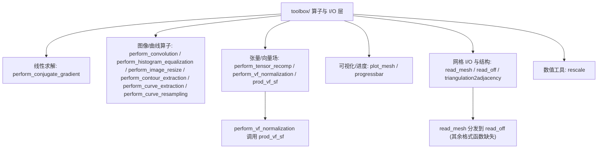

# 90.6b Toolbox Fast Marching — 内部工具：算子与 I/O（第三方） / Fast Marching Internals: Operators and I/O (Vendored)

> 本章覆盖 `external/toolbox_fast_marching/toolbox/` 中**面向算子与 I/O** 的内部工具层：
> 矩阵无关线性求解（`perform_conjugate_gradient`）、图像/曲线处理算子（卷积、直方图均衡、
> 图像缩放、轮廓/曲线提取与重采样）、张量与向量场助手（`perform_tensor_recomp`、
> `perform_vf_normalization`、`prod_vf_sf`）、三维网格绘制与命令行进度（`plot_mesh`、
> `progressbar`），以及网格读取与结构转换（`read_mesh`、`read_off`、
> `triangulation2adjacency`）和数值重标（`rescale`）。
>
> This chapter covers the **operator & I/O oriented** internal utility layer of
> `external/toolbox_fast_marching/toolbox/`: a matrix-free linear solver
> (`perform_conjugate_gradient`), image/curve operators (convolution, histogram equalization,
> image resize, contour/curve extraction and resampling), tensor- and vector-field helpers
> (`perform_tensor_recomp`, `perform_vf_normalization`, `prod_vf_sf`), 3D mesh plotting and a
> command-line progress bar (`plot_mesh`, `progressbar`), plus mesh reading and structural
> conversion (`read_mesh`, `read_off`, `triangulation2adjacency`) and a numeric rescale
> (`rescale`).
>
> 本节与该工具箱的**数据结构层**条目互补（数据结构见姊妹章节
> [90.6a Fast Marching — 数据结构](06a-fast-marching-internals-data-structures.md)）。

- 语言 / Language：中英对照（中文为主）
- 相关章节 / See also：[90-external/README.md](README.md)、
  [90.5 Fast Marching 求解器](05-fast-marching-solvers.md)、
  [90.5b 计算辅助](05b-fast-marching-compute-helpers.md)、
  [90.6a 数据结构](06a-fast-marching-internals-data-structures.md)、
  [appendices/03-doc-template.md](../appendices/03-doc-template.md)、
  [00-overview/05-dependency-map.md](../00-overview/05-dependency-map.md)
- 命名约定 / Notation：`x`/`y` 为通用数组或图像；`M` 为二维图像；`c`/`c_list` 为曲线（`2 by #pts`）
  或曲线元胞；`bound` 为边界条件；`e1/e2/l1/l2` 为特征向量/特征值；`p` 为进度百分比、
  `w` 为进度条宽度、`pprev` 为进度条全局状态。
- 重要声明 / Disclaimer：`external/` 为**第三方 vendored 代码**；本目录所有文件头均署名
  **Gabriel Peyré**（Toolbox Fast Marching，以 **BSD** 发布），本节忠实记录文件头所述年份与行号，
  并在发现**遮蔽 MATLAB 内置**、**同名冲突**或**功能重叠**时明确标注。

---

## 本章概览 / Chapter Overview

**模块职责 / Module responsibility**

- 本层是 Toolbox Fast Marching 的"内部工具箱"：算法主程序（快速行进、快速扫描、
  各向异性/测地求解）依赖这里的算子来构建与后处理数据。
- 文件**均为 Gabriel Peyré 原作**（版权行见各条目），命名/许可源自文件头；部分依赖**未随仓库附带**
  的同工具箱函数（如 `read_ply`、`read_smf`、`read_wrl`、`read_obj`、`read_tet`、`read_mfile`、
  `load_gim`、`convert_gim2mesh`、`compute_base_mesh`），本节在 `read_mesh` 条目中明确标注。

### 函数总表 / Function overview

| 函数 / Function | 类别 / Category | 一句话功能 / One-line purpose |
|---|---|---|
| `perform_conjugate_gradient` | 线性求解 / Linear solver | 矩阵无关共轭梯度求解 `A*x=y`，可并行多右端 |
| `perform_convolution` | 图像算子 / Image operator | 居中滤波器的对称/周期边界 1D/2D 卷积 |
| `perform_histogram_equalization` | 图像算子 / Image operator | 基于排序映射（CDF）的强度重映射 |
| `perform_image_resize` | 图像算子 / Image operator | 双三次插值缩放灰度/彩色/体图像 |
| `perform_contour_extraction` | 曲线提取 / Curve extraction | 提取单条黑轮廓的采样几何 |
| `perform_curve_extraction` | 曲线提取 / Curve extraction | 从图像提取多条水平集曲线 |
| `perform_curve_resampling` | 曲线处理 / Curve processing | 按点数或弧长重采样曲线 |
| `perform_tensor_recomp` | 张量场 / Tensor field | 由特征值/特征向量重组 2×2 张量场 |
| `perform_vf_normalization` | 向量场 / Vector field | 逐点归一化向量场（单位长度） |
| `prod_vf_sf` | 向量场 / Vector field | 向量场与标量场逐点乘积 |
| `plot_mesh` | 可视化 / Plotting | 绘制三维三角网格（含法线/颜色） |
| `progressbar` | 进度显示 / Progress | 命令行内联进度条（`w=20`，`.`/`*`） |
| `read_mesh` | 网格 I/O / Mesh I/O | 按扩展名分发读取多种网格格式 |
| `read_off` | 网格 I/O / Mesh I/O | 解析 OFF 网格文件 |
| `rescale` | 数值工具 / Numeric | 把数据线性重标到 `[a,b]` |
| `triangulation2adjacency` | 邻接结构 / Adjacency | 三角剖分 → 稀疏邻接矩阵 |

### 模块关系图 / Module relationship diagram



---

## 逐函数详解 / Per-function reference

### `perform_conjugate_gradient` — 矩阵无关共轭梯度线性求解
- **文件 / File**: [toolbox/perform_conjugate_gradient.m](file:///c:/VSWork/gptoolbox-1/external/toolbox_fast_marching/toolbox/perform_conjugate_gradient.m#L1-L94)
- **署名 / Attribution**: 文件头 `Copyright (c) 2007 Gabriel Peyre`（L26）；属 Toolbox Fast Marching（Gabriel Peyré，BSD）。
- **签名 / Signature**: `[x,err,it] = perform_conjugate_gradient(A,y,options)`
- **功能 / Purpose**: `EN: Solve A*x=y with a matrix-free conjugate-gradient iteration; A may be a matrix or a callback, and multiple right-hand sides are solved in parallel.` / 中文：以**矩阵无关**的共轭梯度迭代求解 `A*x=y`；`A` 可为矩阵或回调函数，多个右端可并行求解。
- **输入 / Inputs**:

  | 参数 | 尺寸/类型 | 含义 (中 / EN) |
  |---|---|---|
  | `A` | 数值矩阵 或 function handle | 系数算子（`y=A(x,options)`）/ matrix or callback operator |
  | `y` | `N by 1` 或 `N by K` | 右端项（可多列并行）/ right-hand side |

- **输出 / Outputs**:

  | 参数 | 尺寸/类型 | 含义 |
  |---|---|---|
  | `x` | 同 `y` 的行数 | 解 / solution |
  | `err` | `1 by (#iter+1)` | 残差平方和轨迹 / residual-sum trace |
  | `it` | 标量 | 实际迭代次数 / iterations |

- **可选参数 / Optional**:

  | 名称 | 取值 | 默认 | 含义 |
  |---|---|---|---|
  | `options.niter_max` | 正整数 | `100` | 最大迭代数 / max iterations |
  | `options.epsilon` | 正实数 | `1e-5` | 收敛阈值（相对 `norm(y)`）/ tolerance |
  | `options.x` | 同 `y` | `zeros` | 初值 / initial guess |
  | `options.ncols` | 正整数 | 无 | 回调模式下必须给出方程列数 / #cols for callback |

- **变量流动 / Variable flow**: `A,y,options →(niter=100,epsilon=1e-5)→ use_callback=not(isnumeric(A)) →(x: options.x 或 zeros)→ normb=epsilon*sum(y.^2) → r=y-A*x → r0=sum(r.^2), err=[r0] →【it=1:niter】 beta=r0./rprev; p=r+beta.*p → w=A*p → d=sum(p.*w); d(|d|<eps)=1 → alpha=r0./d → x=x+alpha.*p; r=r-alpha.*w → r0=sum(r.^2); err(end+1)=r0 →(err(end)<normb? return)→ x,err,it`
- **算法步骤 / Algorithm**:
  1. 解析 `niter_max`/`epsilon`；判断 `A` 是否为回调（非数值即回调）（L28–L35）。
  2. 初始化 `x`：优先 `options.x`；回调模式且无 `ncols` 时报错（L36–L48）。
  3. 计算收敛阈值 `normb`（`y` 零向量时退化为 `epsilon`）（L51–L55）。
  4. 计算初始残差 `r=y-A*x` 与 `r0=sum(r.^2)`，`err` 记录之（L57–L63）。
  5. **主循环 `it=1:niter`**：首次取 `p=r`，否则 `beta=r0./rprev`、搜索方向 `p=r+beta.*p`（L64–L71）。
  6. 计算 `w=A*p`、`d=sum(p.*w)`（防除零 `d(|d|<eps)=1`）、最优步长 `alpha=r0./d`，更新 `x`、`r`（L72–L82）。
  7. 更新残差能量 `r0`，追加 `err`；若 `err(end)<normb` 提前返回（L83–L88）。
- **流程图 / Flowchart**:

  ```mermaid
  flowchart TD
    A["输入 A,y,options"] --> B{"isnumeric(A) ?"}
    B -- 否 --> B1["use_callback = 1"]
    B -- 是 --> B2["use_callback = 0"]
    B1 --> C["初始化 x (options.x / zeros)"]
    B2 --> C
    C --> D["normb; r = y - A*x; r0 = sum(r.^2); err = [r0]"]
    D --> E{"it <= niter ?"}
    E -- 是 --> E1{"it == 1 ?"}
    E1 -- 是 --> E2["p = r"]
    E1 -- 否 --> E3["beta = r0/rprev; p = r + beta.*p"]
    E2 --> F["w = A*p; d = sum(p.*w); alpha = r0./d"]
    E3 --> F
    F --> G["x = x + alpha.*p; r = r - alpha.*w; r0 = sum(r.^2); err(end+1) = r0"]
    G --> H{"err(end) < normb ?"}
    H -- 是 --> Z["return x, err, it"]
    H -- 否 --> E
    E -- 否 --> Z
  ```
- **依赖 / Dependencies**: `getoptions`（[toolbox/getoptions.m](file:///c:/VSWork/gptoolbox-1/external/toolbox_fast_marching/toolbox/getoptions.m#L1)）；内置 `norm`/`zeros`/`sum`/`repmat`/`find`/`eps`/`isfield`/`isnumeric`。
- **See also**: `perform_tensor_recomp`, `getoptions`
- **备注 / Note**: 仅适用于**半正定**矩阵；L96–L118 存在一段 `return` 之后的**不可达旧代码**（`k`/`kmax`/`sqrt(r0)` 变体），本条目只描述可达路径。**不遮蔽 MATLAB 内置**（无内置 `perform_conjugate_gradient`）。

### `perform_contour_extraction` — 提取单条黑轮廓的采样几何
- **文件 / File**: [toolbox/perform_contour_extraction.m](file:///c:/VSWork/gptoolbox-1/external/toolbox_fast_marching/toolbox/perform_contour_extraction.m#L1-L34)
- **署名 / Attribution**: 文件头 `Copyright (c) 2004 Gabriel Peyr[e]`（L10）；Toolbox Fast Marching（BSD）。
- **签名 / Signature**: `c = perform_contour_extraction(M, t)`
- **功能 / Purpose**: `EN: Extract the geometry of a single dark contour from image M and return it as a curve sampled in the unit square [0,1]x[0,1].` / 中文：从图像 `M` 中提取**单条**深色轮廓的几何，返回在单位方形 `[0,1]×[0,1]` 上的采样曲线。
- **输入 / Inputs**:

  | 参数 | 尺寸/类型 | 含义 (中 / EN) |
  |---|---|---|
  | `M` | `n by n` | 待提取轮廓的（方形）图像 / square image |

- **输出 / Outputs**:

  | 参数 | 尺寸/类型 | 含义 |
  |---|---|---|
  | `c` | `2 by #pts` | 归一化坐标曲线（已交换 X/Y）/ sampled curve |

- **可选参数 / Optional**:

  | 名称 | 取值 | 默认 | 含义 |
  |---|---|---|---|
  | `t` | 标量阈值 | `mean(M(:))` | 轮廓水平集值 / level value |

- **变量流动 / Variable flow**: `M,t →(nargin<2? t=mean(M(:)))→(M(1)<t? M=2*t-M 反相)→ n=size(M,1); x=0:1/(n-1):1 → c=contourc(x,x,M,[t,t]) → lc=c(2,1)（首段长度）→ c=c(:,2:end) → 交换坐标 c=[c(2,:);c(1,:)] →(size(c,2)>lc+1? warning)→ c`
- **算法步骤 / Algorithm**:
  1. 未给 `t` 时取全图均值作为阈值；若图像首元素小于阈值则整体**反相**使轮廓为暗色（L12–L18）。
  2. 构造归一化网格 `x`，调用内置 `contourc` 在水平 `[t,t]` 上做**行进方形/等值线提取**（L20–L23）。
  3. 读取首段长度 `lc`，去掉头部信息列 `c(:,2:end)`（L24–L25）。
  4. **交换 X/Y**（因 `contourc` 按矩阵坐标返回）（L28）。
  5. 若点列数超过单段长度则警告"检测到多条曲线"（L30–L32）。
- **流程图 / Flowchart**:

  ```mermaid
  flowchart TD
    A["输入 M,t"] --> B{"nargin < 2 ?"}
    B -- 是 --> B1["t = mean(M(:))"]
    B -- 否 --> C
    B1 --> C{"M(1) < t ?"}
    C -- 是 --> C1["M = 2*t - M (反相)"]
    C -- 否 --> D
    C1 --> D["x = 0:1/(n-1):1; c = contourc(x,x,M,[t,t])"]
    D --> E["lc = c(2,1); c = c(:,2:end); 交换 X/Y"]
    E --> F{"size(c,2) > lc+1 ?"}
    F -- 是 --> F1["warning: 多条曲线"]
    F -- 否 --> Z["输出 c"]
    F1 --> Z
  ```
- **依赖 / Dependencies**: 内置 `contourc`/`mean`/`size`。**无本库依赖**。
- **See also**: `perform_curve_extraction`, `perform_curve_resampling`
- **备注 / Note**: L36–L104 为 `return` 之后的**不可达旧实现**（逐行扫描 + 小波对齐），本条目只描述可达路径。**不遮蔽 MATLAB 内置**。

### `perform_convolution` — 居中滤波器的 1D/2D 卷积（对称/周期边界）
- **文件 / File**: [toolbox/perform_convolution.m](file:///c:/VSWork/gptoolbox-1/external/toolbox_fast_marching/toolbox/perform_convolution.m#L1-L89)
- **署名 / Attribution**: 文件头 `Copyright (c) 2004 Gabriel Peyr[e]`（L16）；Toolbox Fast Marching（BSD）。
- **签名 / Signature**: `y = perform_convolution(x,h, bound)`
- **功能 / Purpose**: `EN: Convolve 1D/2D data with a centred filter h, using either symmetric-boundary spatial convolution or periodic FFT convolution; 3D color images are processed per channel.` / 中文：用**居中**滤波器 `h` 对 1D/2D 数据卷积；`'sym'` 走对称边界空间卷积，`'per'` 走周期边界 FFT 卷积，彩色图逐通道处理。
- **输入 / Inputs**:

  | 参数 | 尺寸/类型 | 含义 (中 / EN) |
  |---|---|---|
  | `x` | 向量 / 矩阵 / 三维数组 | 输入信号或图像（彩色图 3 维）/ signal, image or color image |
  | `h` | 向量 / 矩阵 | 居中滤波器（奇数长中心为 0）/ centred filter |

- **输出 / Outputs**:

  | 参数 | 尺寸/类型 | 含义 |
  |---|---|---|
  | `y` | 同 `x` | 卷积结果 / convolution result |

- **可选参数 / Optional**:

  | 名称 | 取值 | 默认 | 含义 |
  |---|---|---|---|
  | `bound` | `'sym'` / `'per'` | `'sym'` | 边界条件：对称扩展 / 周期扩展 / boundary condition |

- **变量流动 / Variable flow**: `x,h,bound →(nargin<3? bound='sym')→(size(x,3)>1? 逐通道递归)→ 判 nd（任一维为 1 → 1D）→(bound=='sym': d1=floor(p/2); d2=p-d1-1 → xx=对称填充 → y=conv(xx,h)/conv2(xx,h) → y=y(p:end-p+1) 裁剪)→(bound=='per': d=floor((p-1)/2) → h 循环移位 → y=real(ifft(fft(x).*fft(h))) / real(ifft2(fft2(x).*fft2(h))))→ y`
- **算法步骤 / Algorithm**:
  1. 默认 `bound='sym'`；若为彩色图（第 3 维 > 1）逐通道递归调用后返回（L18–L29）。
  2. 取尺寸 `n=size(x)`、`p=size(h)`；`bound` 小写；判定维度 `nd`（任一行/列为单元素则按 1D 处理）（L31–L43）。
  3. **对称边界 `'sym'`**：算前后填充量 `d1/d2`，对 `x` 做**对称镜像扩展** `xx`，`conv`/`conv2` 后**裁剪**出中心 `n` 区间（L45–L68）。
  4. **周期边界 `'per'`**：要求 `p<=n`；对 `h` 做**循环移位对齐**（首尾重排 + 补零），用 `fft.*fft → ifft`（2D 用 `fft2/ifft2`）实现（L70–L87）。
- **流程图 / Flowchart**:

  ```mermaid
  flowchart TD
    A["输入 x,h,bound"] --> B{"size(x,3) > 1 ?"}
    B -- 是 --> B1["逐通道 perform_convolution; return"]
    B -- 否 --> C["判 nd (任一行/列为 1 则 1D)"]
    C --> D{"bound == 'sym' ?"}
    D -- 是 --> E["d1,d2 = 填充量; xx = 对称镜像扩展"]
    E --> F["y = conv/conv2(xx,h); y = y(p:end-p+1)"]
    D -- 否 --> G{"p > n ?"}
    G -- 是 --> G1["error: h 比 x 长"]
    G -- 否 --> H["h 循环移位对齐"]
    H --> I{"nd == 1 ?"}
    I -- 是 --> I1["y = real(ifft(fft(x).*fft(h)))"]
    I -- 否 --> I2["y = real(ifft2(fft2(x).*fft2(h)))"]
    F --> Z["输出 y"]
    I1 --> Z
    I2 --> Z
  ```
- **依赖 / Dependencies**: 内置 `conv`/`conv2`/`fft`/`fft2`/`ifft`/`ifft2`/`ndims`/`floor`/`real`/`lower`/`strcmp`。**无其它库依赖**。
- **See also**: `perform_blurring`, `compute_gaussian_filter`
- **备注 / Note**: 文件头声明"For 2D the matrix have to be square"，但实现按 `nd` 分支处理（非方阵仍走 2D 路径）。**不遮蔽 MATLAB 内置**（无内置 `perform_convolution`）。

### `perform_curve_extraction` — 从图像提取多条水平集曲线
- **文件 / File**: [toolbox/perform_curve_extraction.m](file:///c:/VSWork/gptoolbox-1/external/toolbox_fast_marching/toolbox/perform_curve_extraction.m#L1-L74)
- **署名 / Attribution**: 文件头 `Copyright (c) 2004 Gabriel Peyr[e]`（L17）；Toolbox Fast Marching（BSD）。
- **签名 / Signature**: `c_list = perform_curve_extraction(M, t, options)`
- **功能 / Purpose**: `EN: Extract all level-set curves at value t from image M as a cell array of 2D curves, optionally keeping only the nb longest and dropping curves shorter than min_length.` / 中文：从图像 `M` 提取水平 `t` 上的**全部**水平集曲线（元胞数组），可选只保留最长的 `nb` 条并丢弃短于 `min_length` 的曲线。
- **输入 / Inputs**:

  | 参数 | 尺寸/类型 | 含义 (中 / EN) |
  |---|---|---|
  | `M` | `nx by ny` | 输入图像 / input image |

- **输出 / Outputs**:

  | 参数 | 尺寸/类型 | 含义 |
  |---|---|---|
  | `c_list` | `1 by k` cell | 每条为 `2 by #pts` 的曲线 / cell of curves |

- **可选参数 / Optional**:

  | 名称 | 取值 | 默认 | 含义 |
  |---|---|---|---|
  | `t` | 标量 | `0` | 水平集值 / level value |
  | `options.max_nb` | 正整数 | 不设限 | 只保留最长的 `nb` 条 / keep nb longest |
  | `options.min_length` | 正整数（像素） | 不设限 | 最小曲线长度 / min length in pixels |

- **变量流动 / Variable flow**: `M,t,options →(nargin<2? t=0)→(nargin<3? options.null=0)→ [nx,ny]=size(M) → x=0:1/(nx-1):1; y=(0:1/(ny-1):1)*((ny-1)/(nx-1)) → c=contourc(x,y,M',[t,t]) →【while p<size(c,2)】 lc=c(2,p); cc=c(:,(p+1):(p+lc)); p=p+lc+1; c_list{k}=cc →(options.max_nb? 按长度降序取前 nb)→(options.min_length? 仅保留 l>=min_length)→ c_list`
- **算法步骤 / Algorithm**:
  1. 默认 `t=0`、`options` 为空结构；构造归一化坐标网格（图像落在 `[0,1]×[0,(ny-1)/(nx-1)]`）（L19–L28）。
  2. 用 `contourc(x,y,M',[t,t])` 一次性做**行进方形/等值线提取**（L29）。
  3. **循环切分**：`while p<size(c,2)` 逐段读取长度 `lc`、截取该段点列、`p` 前移 `lc+1`，存入 `c_list{k}`（L34–L40）。
  4. 可选**按条数过滤**：算各曲线长度，排序后取最长的 `min(max_nb,n)` 条（L45–L59）。
  5. 可选**按长度过滤**：只保留 `l>=min_length` 的曲线（L62–L73）。
- **流程图 / Flowchart**:

  ```mermaid
  flowchart TD
    A["输入 M,t,options"] --> B["t 默认 0; 归一化坐标网格; c = contourc(x,y,M',[t,t])"]
    B --> C{"p < size(c,2) ?"}
    C -- 是 --> C1["lc = c(2,p); cc = c(:,(p+1):(p+lc)); p = p+lc+1; c_list{k}=cc"]
    C1 --> C
    C -- 否 --> D{"有 options.max_nb ?"}
    D -- 是 --> D1["按长度降序取前 nb 条"]
    D -- 否 --> E
    D1 --> E{"有 options.min_length ?"}
    E -- 是 --> E1["仅保留 l >= min_length"]
    E -- 否 --> Z["输出 c_list"]
    E1 --> Z
  ```
- **依赖 / Dependencies**: 内置 `contourc`/`size`/`sort`/`length`/`isfield`；`reverse`（MATLAB **无**此内置，源码取自 Psychtoolbox/external，**仓库内未见定义**，可能导致运行报错）。
- **See also**: `perform_contour_extraction`, `perform_curve_resampling`
- **备注 / Note**: 潜在缺陷：按条数过滤后 `n` 未更新，长度过滤循环仍以旧 `n` 索引 `c_list1`（L62–L73），越界风险；`reverse` 依赖外部函数。**不遮蔽 MATLAB 内置**。

### `perform_curve_resampling` — 按点数或弧长重采样曲线
- **文件 / File**: [toolbox/perform_curve_resampling.m](file:///c:/VSWork/gptoolbox-1/external/toolbox_fast_marching/toolbox/perform_curve_resampling.m#L1-L45)
- **署名 / Attribution**: 文件头 `Copyright (c) 2005 Gabriel Peyr[e]`（L14）；Toolbox Fast Marching（BSD）。
- **签名 / Signature**: `c1 = perform_curve_resampling(c, s, mode, interp_type)`
- **功能 / Purpose**: `EN: Resample a 2D curve either to a new number of points ('nbpts') or at a fixed curvilinear spacing ('dist'), by linear interpolation along arc length.` / 中文：沿**弧长**把二维曲线重采样到指定点数（`'nbpts'`）或指定弧长间隔（`'dist'`）。
- **输入 / Inputs**:

  | 参数 | 尺寸/类型 | 含义 (中 / EN) |
  |---|---|---|
  | `c` | `2 by #pts`（或转置） | 输入曲线 / input curve |
  | `s` | 标量 | `'nbpts'`：新点数；`'dist'`：弧长间隔 / count or spacing |

- **输出 / Outputs**:

  | 参数 | 尺寸/类型 | 含义 |
  |---|---|---|
  | `c1` | `2 by n` | 重采样曲线 / resampled curve |

- **可选参数 / Optional**:

  | 名称 | 取值 | 默认 | 含义 |
  |---|---|---|---|
  | `mode` | `'nbpts'` / `'dist'` | `'nbpts'` | 重采样模式 / resampling mode |
  | `interp_type` | `interp1` 方法名 | `'linear'` | 插值类型（**源码最终未使用**）/ interpolation type (unused) |

- **变量流动 / Variable flow**: `c,s,mode,interp_type →(nargin<3? mode='nbpts')→(nargin<4? interp_type='linear')→(size(c,2)<size(c,1)? c=c')→ cabs=compute_cuvilinear_abscice(c) →(mode=='dist'? n=round(cabs(end)/s)+1 : n=s)→ cabs_i=(0:cabs(end)/(n-1):cabs(end))' →【k=1:2】 c1(k,:)=interp1(cabs,c(k,:),cabs_i) → c1`
- **算法步骤 / Algorithm**:
  1. 解析 `mode`（默认 `'nbpts'`）与 `interp_type`（默认 `'linear'`）（L17–L22）。
  2. 若曲线非"2 行"布局则转置（L25–L27）。
  3. 计算**弧长参数化** `cabs=compute_cuvilinear_abscice(c)`（L30）。
  4. `'dist'` 模式：由总弧长与间隔 `s` 推算点数 `n`；`'nbpts'` 模式：直接取 `n=s`（L32–L36）。
  5. 生成等弧长采样点 `cabs_i`，对每个坐标分量 `interp1` 线性插值得 `c1`（L38–L45）。
- **流程图 / Flowchart**:

  ```mermaid
  flowchart TD
    A["输入 c,s,mode,interp_type"] --> B["mode 默认 'nbpts'; interp_type 默认 'linear'"]
    B --> C{"size(c,2) < size(c,1) ?"}
    C -- 是 --> C1["c = c'"]
    C -- 否 --> D
    C1 --> D["cabs = compute_cuvilinear_abscice(c)"]
    D --> E{"mode == 'dist' ?"}
    E -- 是 --> E1["n = round(cabs(end)/s)+1"]
    E -- 否 --> E2["n = s"]
    E1 --> F["cabs_i = 0:cabs(end)/(n-1):cabs(end)"]
    E2 --> F
    F --> G{"k = 1:2 ?"}
    G -- 是 --> G1["c1(k,:) = interp1(cabs, c(k,:), cabs_i)"]
    G1 --> G
    G -- 否 --> Z["输出 c1"]
  ```
- **依赖 / Dependencies**: `compute_cuvilinear_abscice`（[toolbox/compute_cuvilinear_abscice.m](file:///c:/VSWork/gptoolbox-1/external/toolbox_fast_marching/toolbox/compute_cuvilinear_abscice.m#L1)）；内置 `interp1`/`round`/`size`/`zeros`。
- **See also**: `perform_curve_extraction`, `compute_cuvilinear_abscice`
- **备注 / Note**: `interp_type` 被解析但最终 `interp1` 调用**未传入该方法**（L44），实际恒为线性插值。**不遮蔽 MATLAB 内置**。

### `perform_histogram_equalization` — 基于排序映射的直方图均衡
- **文件 / File**: [toolbox/perform_histogram_equalization.m](file:///c:/VSWork/gptoolbox-1/external/toolbox_fast_marching/toolbox/perform_histogram_equalization.m#L1-L111)
- **署名 / Attribution**: 文件头 `Copyright (c) 2006 Gabriel Peyre`（L23）；Toolbox Fast Marching（BSD）。
- **签名 / Signature**: `x = perform_histogram_equalization(x,y,options)`
- **功能 / Purpose**: `EN: Remap the values of x so that its sorted values match the sorted values of y (CDF/quantile matching), optionally toward a Gaussian or uniform density, and optionally per column/row/3rd dimension or on absolute values.` / 中文：重映射 `x` 使其**排序后的值**与 `y` 的排序值一致（CDF/分位数匹配），可指定目标为高斯或均匀分布，可按列/行/第 3 维或仅对绝对值操作。
- **输入 / Inputs**:

  | 参数 | 尺寸/类型 | 含义 (中 / EN) |
  |---|---|---|
  | `x` | 任意数组 / cell | 待变换数据 / data to remap |
  | `y` | 同 `x` / `'gaussian'` / `'linear'` | 参考分布或样本 / reference data or density name |

- **输出 / Outputs**:

  | 参数 | 尺寸/类型 | 含义 |
  |---|---|---|
  | `x` | 同输入 | 均衡后的数据 / equalized data |

- **可选参数 / Optional**:

  | 名称 | 取值 | 默认 | 含义 |
  |---|---|---|---|
  | `options.absval` | `0` / `1` | `0` | 只对绝对值操作 / operate on abs values |
  | `options.cols` | `0` / `1` | `0` | 逐列操作 / per column |
  | `options.rows` | `0` / `1` | `0` | 逐行操作 / per row |
  | `options.dim3` | `0` / `1` | `0` | 逐第 3 维操作 / per 3rd dim |
  | `options.histinterp` | `[0,1]` | `1` | 与原始直方图插值系数 / histogram interpolation |

- **变量流动 / Variable flow**: `x,y,options →(iscell(x)? 逐元素递归)→ absval,cols,rows,dim3,lambda=histinterp →(cols/rows/dim3? 逐列/行/层递归)→ sx=size(x); x=x(:) →(isstr(y)? 'gaussian'→randn / 'linear'→linspace(0,1,·))→ y=y(:) →(absval? s=sign(x); x=abs(x); y=abs(y))→ [vx,Ix]=sort(x); [vy,Iy]=sort(y) → ax=linspace(1,ny,nx)'; ay=(1:ny)' → vx=interp1(ay,vy,ax) → x(Ix)=(1-lambda)*x(Ix)+lambda*vx →(absval? x=x.*s)→ x=reshape(x,sx)`
- **算法步骤 / Algorithm**:
  1. 若 `x` 为元胞则逐元素递归（L29–L34）。
  2. 读取选项；`cols` 与 `rows` 互斥（同真报错）；逐列/逐行/逐第 3 维时对每个切片递归并校验维数一致（L36–L70）。
  3. 展平 `x`；若 `y` 为字符串则生成目标密度：`'gaussian'`→`randn`、`'linear'`→`linspace(0,1,·)`（L72–L86）。
  4. `absval` 时记录符号并取绝对值（L89–L93）。
  5. **排序匹配**：分别排序得 `vx`/`vy`；把 `vy` 通过 `interp1(ay,vy,ax)` 重采样到 `x` 的长度，实现**分位数（CDF）映射**（L95–L103）。
  6. 用 `histinterp=λ` 在"原值"与"映射值"间线性混合；恢复符号；`reshape` 回原尺寸（L104–L111）。
- **流程图 / Flowchart**:

  ```mermaid
  flowchart TD
    A["输入 x,y,options"] --> B{"iscell(x) ?"}
    B -- 是 --> B1["逐元素递归; return"]
    B -- 否 --> C{"cols/rows/dim3 指定 ?"}
    C -- 是 --> C1["逐列/行/层递归"]
    C -- 否 --> D{"isstr(y) ?"}
    D -- 是 --> D1["'gaussian'→randn 或 'linear'→linspace"]
    D -- 否 --> E
    D1 --> E["x=x(:); y=y(:)"]
    E --> F{"absval ?"}
    F -- 是 --> F1["s=sign(x); x=abs(x); y=abs(y)"]
    F -- 否 --> G
    F1 --> G["[vx,Ix]=sort(x); [vy,Iy]=sort(y)"]
    G --> H["ax=linspace(1,ny,nx); vx=interp1(ay,vy,ax)"]
    H --> I["x(Ix) = (1-lambda)*x(Ix) + lambda*vx"]
    I --> J{"absval ?"}
    J -- 是 --> J1["x = x.*s"]
    J -- 否 --> K
    J1 --> K["x = reshape(x, sx)"]
    K --> Z["输出 x"]
  ```
- **依赖 / Dependencies**: `getoptions`（[toolbox/getoptions.m](file:///c:/VSWork/gptoolbox-1/external/toolbox_fast_marching/toolbox/getoptions.m#L1)）；内置 `sort`/`interp1`/`linspace`/`randn`/`sign`/`reshape`/`isstr`/`iscell`。
- **See also**: `rescale`, `perform_histogram_matching`
- **备注 / Note**: 结果取决于**排序**而非逐元素，输入无重复时等价于分位数匹配。**不遮蔽 MATLAB 内置**（无内置 `perform_histogram_equalization`）。

### `perform_image_resize` — 双三次插值图像缩放（函数名 `image_resize`）
- **文件 / File**: [toolbox/perform_image_resize.m](file:///c:/VSWork/gptoolbox-1/external/toolbox_fast_marching/toolbox/perform_image_resize.m#L1-L53)
- **署名 / Attribution**: 文件头 `Copyright (c) 2004 Gabriel Peyr[e]`（L11）；Toolbox Fast Marching（BSD）。
- **签名 / Signature**: `newimg = image_resize(img, p1, q1, r1)`（**文件名为 `perform_image_resize.m`，但内部函数名为 `image_resize`**，二者不一致）
- **功能 / Purpose**: `EN: Resize grayscale/color/3D images to a new size using bicubic interpolation (interp2 for 2D, interp3 for volumetric, per-channel recursion for RGB).` / 中文：用**双三次插值**把灰度/彩色/三维图像缩放到新尺寸（2D 用 `interp2`，体数据用 `interp3`，彩色逐通道递归）。
- **输入 / Inputs**:

  | 参数 | 尺寸/类型 | 含义 (中 / EN) |
  |---|---|---|
  | `img` | 2D / 3D 数组 | 输入图像 / input image |
  | `p1` | 标量 或 `[p1 q1 r1]` | 目标行数，或整体目标尺寸 / target rows or size vector |
  | `q1` | 标量 | 目标列数 / target cols |
  | `r1` | 标量 | 目标层数 / target slices |

- **输出 / Outputs**:

  | 参数 | 尺寸/类型 | 含义 |
  |---|---|---|
  | `newimg` | `p1 by q1 [by r1]` | 缩放后图像 / resized image |

- **可选参数 / Optional**:

  | 名称 | 取值 | 默认 | 含义 |
  |---|---|---|---|
  | `q1` | 标量 | 无（或取自 `p1(2)`） | 目标列数 / target cols |
  | `r1` | 标量 | `size(img,3)` | 目标层数 / target slices |

- **变量流动 / Variable flow**: `img,p1,q1,r1 →(nargin==2? q1=p1(2); r1=p1(3) 或 size(img,3); p1=p1(1))→(nargin<4? r1=size(img,3))→(ndims∉[2,3]? error)→(ndims==3 且 通道<4? 逐通道 image_resize)→(ndims==3 体数据? meshgrid 归一坐标 → interp3(...,'cubic'))→(2D? meshgrid 归一坐标 → interp2(...,'cubic'))→ newimg`
- **算法步骤 / Algorithm**:
  1. 若只给一个尺寸向量（`nargin==2`）则从中解析 `q1`/`r1`（L13–L22）。
  2. 缺 `r1` 时取 `size(img,3)`；维度非 2/3 报错（L24–L30）。
  3. **彩色图分支**（`ndims==3 && size(img,3)<4`）：分配输出并对每个通道递归调用自身（L32–L38）。
  4. **体数据分支**（`ndims==3`）：用 `meshgrid` 生成归一化坐标 `[0,1]`，`interp3(...,'cubic')` 三线性/双三次重采样（L39–L47）。
  5. **2D 分支**：`meshgrid` 归一化坐标，`interp2(...,'cubic')` 双三次插值（L49–L53）。
- **流程图 / Flowchart**:

  ```mermaid
  flowchart TD
    A["输入 img,p1,q1,r1"] --> B{"nargin == 2 ?"}
    B -- 是 --> B1["q1=p1(2); r1=p1(3)/size(img,3); p1=p1(1)"]
    B -- 否 --> C
    B1 --> C{"nargin < 4 ?"}
    C -- 是 --> C1["r1 = size(img,3)"]
    C -- 否 --> D{"ndims(img) 在 {2,3} ?"}
    C1 --> D
    D -- 否 --> D1["error: 仅支持灰度/彩色图"]
    D -- 是 --> E{"ndims == 3 且 通道 < 4 ?"}
    E -- 是 --> E1["逐通道 image_resize; return"]
    E -- 否 --> F{"ndims == 3 体数据 ?"}
    F -- 是 --> F1["meshgrid 归一坐标 → interp3 'cubic'"]
    F -- 否 --> G["meshgrid 归一坐标 → interp2 'cubic'"]
    F1 --> Z["输出 newimg"]
    G --> Z
  ```
- **依赖 / Dependencies**: 内置 `interp2`/`interp3`/`meshgrid`/`ndims`/`size`/`zeros`。**无其它库依赖**。
- **See also**: `image_resize`（MATLAB 内置 `imresize`）, `perform_convolution`
- **备注 / Note**: **文件名与函数名不一致**（`perform_image_resize.m` 内定义 `image_resize`），无独立 `toolbox/image_resize.m`；`image_resize` 是**非内置名**，故**不遮蔽** MATLAB 内置 `imresize`（两者接口不同：内置 `imresize(img,scale|size,method)`）。旧版 `imresize`（图像处理工具箱）与此实现同名竞争时需注意搜索路径。

### `perform_tensor_recomp` — 由特征分解重组张量场
- **文件 / File**: [toolbox/perform_tensor_recomp.m](file:///c:/VSWork/gptoolbox-1/external/toolbox_fast_marching/toolbox/perform_tensor_recomp.m#L1-L22)
- **署名 / Attribution**: 文件头 `Copyright (c) 2004 Gabriel Peyr[e]`（L15）；Toolbox Fast Marching（BSD）。
- **签名 / Signature**: `T = perform_tensor_recomp(e1,e2,l1,l2)`
- **功能 / Purpose**: `EN: Reconstruct a symmetric 2x2 tensor field from its eigendecomposition: T = l1*e1*e1' + l2*e2*e2'.` / 中文：由特征分解重组对称 2×2 张量场：`T = l1*e1*e1' + l2*e2*e2'`。
- **输入 / Inputs**:

  | 参数 | 尺寸/类型 | 含义 (中 / EN) |
  |---|---|---|
  | `e1` | `ny by nx by 2` | 主特征向量（最大特征值方向）/ main eigenvector |
  | `e2` | `ny by nx by 2` | 次特征向量 / second eigenvector |
  | `l1` | `ny by nx` | 最大特征值 / largest eigenvalue |
  | `l2` | `ny by nx` | 最小特征值 / smallest eigenvalue |

- **输出 / Outputs**:

  | 参数 | 尺寸/类型 | 含义 |
  |---|---|---|
  | `T` | `ny by nx by 2 by 2` | 对称张量场 / symmetric tensor field |

- **可选参数 / Optional**: 无 / None
- **变量流动 / Variable flow**: `e1,e2,l1,l2 → T=zeros([size(l1),2,2]) → T(:,:,1,1)=l1.*e1(:,:,1).^2+l2.*e2(:,:,1).^2 → T(:,:,1,2)=l1.*e1(:,:,1).*e1(:,:,2)+l2.*e2(:,:,1).*e2(:,:,2) → T(:,:,2,1)=T(:,:,1,2)（对称）→ T(:,:,2,2)=l1.*e1(:,:,2).^2+l2.*e2(:,:,2).^2 → T`
- **算法步骤 / Algorithm**:
  1. 按尺寸 `[size(l1),2,2]` 预分配输出 `T`（L18）。
  2. 逐分量写外积加权和：对角元 `T11`/`T22` 与上三角 `T12`（L19–L20）。
  3. 令下三角 `T21=T12` 保证**对称性**（L21）。
  4. 写 `T22` 完成 2×2 张量（L22）。
- **流程图 / Flowchart**:

  ```mermaid
  flowchart TD
    A["输入 e1,e2,l1,l2"] --> B["T = zeros([size(l1),2,2])"]
    B --> C["T11 = l1*e1x^2 + l2*e2x^2"]
    C --> D["T12 = l1*e1x*e1y + l2*e2x*e2y"]
    D --> E["T21 = T12 (对称)"]
    E --> F["T22 = l1*e1y^2 + l2*e2y^2"]
    F --> Z["输出 T (ny×nx×2×2)"]
  ```
- **依赖 / Dependencies**: 内置 `zeros`/`size`。**无其它库依赖**。
- **See also**: `perform_vf_normalization`, `compute_tensor_field`, `perform_tensor_eigendecomposition`
- **备注 / Note**: 纯**向量化**实现，无循环；要求 `e1/e2` 已按特征值顺序给出。**不遮蔽 MATLAB 内置**。

### `perform_vf_normalization` — 逐点归一化向量场
- **文件 / File**: [toolbox/perform_vf_normalization.m](file:///c:/VSWork/gptoolbox-1/external/toolbox_fast_marching/toolbox/perform_vf_normalization.m#L1-L13)
- **署名 / Attribution**: 文件头 `Copyright (c) 2004 Gabriel Peyr[e]`（L7）；Toolbox Fast Marching（BSD）。
- **签名 / Signature**: `v2 = perform_vf_normalization(v1)`
- **功能 / Purpose**: `EN: Renormalize a vector field so that each vector has unit (Euclidean) length; zero vectors are left unchanged.` / 中文：将向量场逐点归一化为**单位长度**，零向量保持不变。
- **输入 / Inputs**:

  | 参数 | 尺寸/类型 | 含义 (中 / EN) |
  |---|---|---|
  | `v1` | `ny by nx by 2` | 输入向量场 / input vector field |

- **输出 / Outputs**:

  | 参数 | 尺寸/类型 | 含义 |
  |---|---|---|
  | `v2` | 同 `v1` | 单位向量场 / normalized vector field |

- **可选参数 / Optional**: 无 / None
- **变量流动 / Variable flow**: `v1 → n=sum(v1.^2,3)（逐点模方）→ I=find(n<eps); n(I)=1（防除零）→ prod_vf_sf(v1, 1./sqrt(n)) → v2`
- **算法步骤 / Algorithm**:
  1. 沿第 3 维求模方 `n=sum(v1.^2,3)`（L10）。
  2. 找出近零模 `n<eps` 并将其置 1，避免除零（L11–L12）。
  3. 用 `prod_vf_sf` 把向量场按 `1./sqrt(n)` 逐点缩放，得单位向量场（L13）。
- **流程图 / Flowchart**:

  ```mermaid
  flowchart TD
    A["输入 v1"] --> B["n = sum(v1.^2,3)"]
    B --> C{"n < eps ?"}
    C -- 是 --> C1["n(I) = 1 (防除零)"]
    C -- 否 --> D
    C1 --> D["v2 = prod_vf_sf(v1, 1./sqrt(n))"]
    D --> Z["输出 v2 (单位向量场)"]
  ```
- **依赖 / Dependencies**: `prod_vf_sf`（[toolbox/prod_vf_sf.m](file:///c:/VSWork/gptoolbox-1/external/toolbox_fast_marching/toolbox/prod_vf_sf.m#L1)）；内置 `sum`/`sqrt`/`find`/`eps`。
- **See also**: `prod_vf_sf`, `perform_tensor_recomp`
- **备注 / Note**: 仅适用于**2 分量**向量场（第 3 维 = 2）；3D 向量场需改 `sum(...,3)` 的用法。**不遮蔽 MATLAB 内置**。

### `plot_mesh` — 绘制三维三角网格
- **文件 / File**: [toolbox/plot_mesh.m](file:///c:/VSWork/gptoolbox-1/external/toolbox_fast_marching/toolbox/plot_mesh.m#L1-L89)
- **署名 / Attribution**: 文件头 `Copyright (c) 2004 Gabriel Peyr[e]`（L16）；Toolbox Fast Marching（BSD）。
- **签名 / Signature**: `h = plot_mesh(vertex,face,options)`
- **功能 / Purpose**: `EN: Plot a 3D triangular mesh via patch with configurable face/edge colors or per-vertex/face colors, gray colormap, phong lighting, perspective camera, and optional normal-vector quiver.` / 中文：用 `patch` 绘制三维三角网格，可选单色或逐顶点/逐面着色，配灰色色图、Phong 光照、透视相机，可选 `quiver3` 显示法线。
- **输入 / Inputs**:

  | 参数 | 尺寸/类型 | 含义 (中 / EN) |
  |---|---|---|
  | `vertex` | `#V by 3`（或 `3 by #V`） | 顶点坐标 / vertex positions |
  | `face` | `#F by 3`（或 `3 by #F`） | 三角面索引 / triangle indices |

- **输出 / Outputs**:

  | 参数 | 尺寸/类型 | 含义 |
  |---|---|---|
  | `h` | patch handle | 绘制的 patch 句柄 / patch handle |

- **可选参数 / Optional**:

  | 名称 | 取值 | 默认 | 含义 |
  |---|---|---|---|
  | `options.normal` | `#V by 3` | `[]` | 顶点法线（非空则 `quiver3` 绘制）/ vertex normals |
  | `options.face_color` | 标量 | `0.7` | 面灰度 / face gray level |
  | `options.edge_color` | 标量 | `0` | 边灰度 / edge gray level |
  | `options.face_vertex_color` | `#V by 1` 或 `#F by 1` | `zeros(#V,1)` | 逐顶点/逐面颜色 / per-vertex or per-face color |

- **变量流动 / Variable flow**: `vertex,face,options →(nargin<2? error)→(nargin<3? options.null=0)→ 按尺寸转置修正 vertex/face → 校验格式 → normal/face_color/edge_color/face_vertex_color 取默认 →(face_vertex_color 空? patch 单色 : 按 #V 选 shading 'interp'/'flat' + FaceVertexCData)→ colormap gray(256); lighting phong; camlight infinite; camproj perspective; axis square/off →(normal 非空? quiver3 绘制法线)→ axis tight/equal; cameramenu → h`
- **算法步骤 / Algorithm**:
  1. 参数不足报错；默认 `options` 为空结构（L19–L24）。
  2. **容错转置**：按 `size` 判断并转置 `vertex`/`face` 到"行=元素"布局；再校验 `face` 为 3 列、`vertex` 为 2/3 列（L27–L37）。
  3. 解析 `normal`/`face_color`/`edge_color`/`face_vertex_color` 及其默认值（L40–L58）。
  4. 绘制：颜色为空→单色 `patch`；否则按颜色行数判定 `'interp'`（逐顶点）/`'flat'`（逐面）并传 `FaceVertexCData`（L61–L72）。
  5. 统一外观：`gray(256)` 色图、`phong` 光照、`camlight infinite`、透视投影、`axis square/off`（L73–L78）。
  6. 若有法线则 `hold on` + `quiver3(...,0.8)` 叠加（L80–L85）。
  7. 收尾 `axis tight/equal` 并打开 `cameramenu`（L87–L89）。
- **流程图 / Flowchart**:

  ```mermaid
  flowchart TD
    A["输入 vertex,face,options"] --> B{"nargin < 2 ?"}
    B -- 是 --> B1["error: 参数不足"]
    B -- 否 --> C["默认 options 各字段"]
    C --> D["按尺寸转置 vertex/face 并校验格式"]
    D --> E{"face_vertex_color 为空 ?"}
    E -- 是 --> E1["patch 单色 (face/edge color)"]
    E -- 否 --> E2{"颜色行数 == #V ?"}
    E2 -- 是 --> E3["shading 'interp'"]
    E2 -- 否 --> E4["shading 'flat'"]
    E3 --> F["patch(..., FaceVertexCData)"]
    E4 --> F
    E1 --> G["gray(256); phong; camlight; camproj; axis"]
    F --> G
    G --> H{"normal 非空 ?"}
    H -- 是 --> H1["hold on; quiver3 法线; hold off"]
    H -- 否 --> I
    H1 --> I["axis tight/equal; cameramenu"]
    I --> Z["输出 h (patch handle)"]
  ```
- **依赖 / Dependencies**: 内置 `patch`/`quiver3`/`colormap`/`lighting`/`camlight`/`camproj`/`axis`/`hold`/`cameramenu`/`zeros`/`size`/`isfield`。
- **See also**: `mesh/tsurf`, `plot_mesh`(fast marching 另版), `perform_curve_extraction`
- **备注 / Note**: 与 gptoolbox 自有 [`mesh/tsurf`](file:///c:/VSWork/gptoolbox-1/mesh/tsurf.m#L1) **功能重叠**（均为三角网格三维绘制，`tsurf` 直接吃 `(F,V,C)`）。**不遮蔽 MATLAB 内置**（无内置 `plot_mesh`）。

### `prod_vf_sf` — 向量场与标量场的逐点乘积
- **文件 / File**: [toolbox/prod_vf_sf.m](file:///c:/VSWork/gptoolbox-1/external/toolbox_fast_marching/toolbox/prod_vf_sf.m#L1-L16)
- **署名 / Attribution**: 文件头 `Copyright (c) 2004 Gabriel Peyr[e]`（L9）；Toolbox Fast Marching（BSD）。
- **签名 / Signature**: `v2 = prod_vf_sf(v1,s)`
- **功能 / Purpose**: `EN: Compute the pointwise product of a vector field by a scalar field, scaling each component at every location.` / 中文：计算向量场与标量场的**逐点乘积**，在每个位置缩放各分量。
- **输入 / Inputs**:

  | 参数 | 尺寸/类型 | 含义 (中 / EN) |
  |---|---|---|
  | `v1` | `ny by nx by d` | 输入向量场 / input vector field |
  | `s` | `ny by nx`（可广播） | 标量场 / scalar field |

- **输出 / Outputs**:

  | 参数 | 尺寸/类型 | 含义 |
  |---|---|---|
  | `v2` | 同 `v1` | 缩放后的向量场 / scaled vector field |

- **可选参数 / Optional**: 无 / None
- **变量流动 / Variable flow**: `v1,s → v2=zeros(size(v1)) →【i=1:size(v1,3)】 v2(:,:,i)=v1(:,:,i).*s → v2`
- **算法步骤 / Algorithm**:
  1. 按 `v1` 尺寸预分配输出 `v2`（L12）。
  2. **逐分量循环**（`i=1:size(v1,3)`）：把每个切片与标量场 `s` 逐点相乘（L14–L16）。
- **流程图 / Flowchart**:

  ```mermaid
  flowchart TD
    A["输入 v1,s"] --> B["v2 = zeros(size(v1))"]
    B --> C{"i = 1:size(v1,3) ?"}
    C -- 是 --> C1["v2(:,:,i) = v1(:,:,i).*s"]
    C1 --> C
    C -- 否 --> Z["输出 v2"]
  ```
- **依赖 / Dependencies**: 内置 `zeros`/`size`。**无其它库依赖**。
- **See also**: `perform_vf_normalization`, `perform_tensor_recomp`
- **备注 / Note**: 本层**最基础的向量场算子**，被 `perform_vf_normalization` 调用。**不遮蔽 MATLAB 内置**。

### `progressbar` — 命令行内联进度条（`w=20`，`.`/`*` 变体）
- **文件 / File**: [toolbox/progressbar.m](file:///c:/VSWork/gptoolbox-1/external/toolbox_fast_marching/toolbox/progressbar.m#L1-L45)
- **署名 / Attribution**: 文件头 `Copyright (c) Gabriel Peyr[e] 2006`（L11）；Toolbox Fast Marching（BSD）。
- **签名 / Signature**: `progressbar(n,N,w)`
- **功能 / Purpose**: `EN: Display an inline command-line progress bar for step n out of N; unchanged percentages are not reprinted, previous output is erased with backspaces, and a newline is emitted at completion.` / 中文：显示"第 `n` / 共 `N`"步的命令行内联进度条；百分比未变则不重绘，靠退格清除上一次输出，完成时换行。
- **输入 / Inputs**:

  | 参数 | 尺寸/类型 | 含义 (中 / EN) |
  |---|---|---|
  | `n` | 正整数 | 当前进度（应自 1 起）/ current step |
  | `N` | 正整数 | 总步数 / total steps |

- **输出 / Outputs**: 无 / None（`fprintf` 到命令窗）
- **可选参数 / Optional**:

  | 名称 | 取值 | 默认 | 含义 |
  |---|---|---|---|
  | `w` | 正整数 | `20` | 进度条**宽度**（字符数）/ bar width in chars |
  | `global pprev` | 标量 | `-1`（首次） | **跨调用全局状态**，保存上一次百分比，用于"仅在百分比变化时重绘" / persistent last percentage |

- **变量流动 / Variable flow**: `n,N,w →(nargin<3? w=20)→ cprog='.', cprog1='*', cbeg='[', cend=']' → p=min(floor(n/N*(w+1)),w) → global pprev（空则 -1）→(p≠pprev? ps=repmat('.',1,w); ps(1:p)='*'; ps=['[' ps ']']; n>1? 先 fprintf 退格清行; fprintf(ps))→(p≠pprev? pprev=p)→(n==N? fprintf('\n'))`
- **算法步骤 / Algorithm**:
  1. 未给 `w` 时取 `w=20`；定义进度字符 `'.'`/`'*'` 与括号 `[` `]`（L13–L23）。
  2. 由 `n/N` 换算进度百分比 `p`（`floor`, 上限 `w`）（L25）。
  3. 读取全局 `pprev`；**仅当 `p~=pprev` 时重绘**：构造 `'.'` 串并把前 `p` 个替换为 `'*'`，加括号，`n>1` 时先 `fprintf` 一串退格清除上一行，再打印（L27–L41）。
  4. 更新 `pprev=p`；当 `n==N` 时输出换行（L42–L45）。
- **流程图 / Flowchart**:

  ```mermaid
  flowchart TD
    A["输入 n,N,w"] --> B{"nargin < 3 ?"}
    B -- 是 --> B1["w = 20"]
    B -- 否 --> C
    B1 --> C["p = min(floor(n/N*(w+1)), w); 读 global pprev"]
    C --> D{"p != pprev ?"}
    D -- 是 --> D1["构造 ps ('.'→前 p 个 '*', 加 [ ])"]
    D1 --> D2{"n > 1 ?"}
    D2 -- 是 --> D3["fprintf 退格清行"]
    D2 -- 否 --> D4
    D3 --> D4["fprintf(ps)"]
    D4 --> E["pprev = p"]
    D -- 否 --> E
    E --> F{"n == N ?"}
    F -- 是 --> F1["fprintf('\\n')"]
    F -- 否 --> Z["结束"]
    F1 --> Z
  ```
- **依赖 / Dependencies**: 全局变量 `pprev`；内置 `fprintf`/`repmat`/`floor`/`min`/`isempty`。**无其它库依赖**。
- **See also**: `external/progressbar`（同层重名）, `waitbar`, `mmax`, `nb_dims`
- **⚠️ 冲突标注 / Collision**: **本文件与 [`external/progressbar.m`](file:///c:/VSWork/gptoolbox-1/external/progressbar.m#L1) 同名**，二者均为 Gabriel Peyré，但**默认宽度与字符不同**：本版本 `w=20`、字符 `'.'`/`'*'`、带 `[ ]` 括号；`external/progressbar.m` 为 `w=80`、字符 `'□'`/`'■'`、**不带**括号。在同一搜索路径下**后者会遮蔽前者**（或反之，取决于路径顺序），调用时需明确目标版本。

### `read_mesh` — 按扩展名分发读取多种网格格式
- **文件 / File**: [toolbox/read_mesh.m](file:///c:/VSWork/gptoolbox-1/external/toolbox_fast_marching/toolbox/read_mesh.m#L1-L81)
- **署名 / Attribution**: 文件头 `Copyright (c) 2007 Gabriel Peyre`（L13）；Toolbox Fast Marching（BSD）。
- **签名 / Signature**: `[vertex,face,normal, uv, sphparam] = read_mesh(file)`
- **功能 / Purpose**: `EN: Dispatch mesh reading by file extension (.off/.ply/.smf/.wrl/.obj/.tet/.m/.gim), or build a named base mesh; returns vertices, faces and optionally normals/UV/spherical parameters.` / 中文：按文件扩展名（`.off/.ply/.smf/.wrl/.obj/.tet/.m/.gim`）分发读取，或按名称生成基础网格；返回顶点、面，可选法线/UV/球面参数。
- **输入 / Inputs**:

  | 参数 | 尺寸/类型 | 含义 (中 / EN) |
  |---|---|---|
  | `file` | `char` | 文件名/路径，或基础网格名 / filename or base-mesh name |

- **输出 / Outputs**:

  | 参数 | 尺寸/类型 | 含义 |
  |---|---|---|
  | `vertex` | `#V by 3` | 顶点坐标 / vertex positions |
  | `face` | `#F by 3` | 面索引 / face indices |
  | `normal` | `#V by 3` | 法线（部分格式）/ normals (some formats) |
  | `uv` | `#V by 2` | 纹理坐标（`.m` 格式）/ texture coords |
  | `sphparam` | `#V by 2` | 球面参数（`.m` 格式）/ spherical params |

- **可选参数 / Optional**: 无 Name/Value 接口；`nargin==0` 时弹出文件选择对话框（**实际不可达**，见备注）。
- **变量流动 / Variable flow**: `file →(file 属于 {'triangle','square','square1','L','L1','tetra','oct','ico','rand'}? compute_base_mesh→check_face_vertex→return)→(nargin==0? uigetfile 取 file)→ 解析扩展名 ext/name → switch ext: off→read_off; ply→read_ply; smf→read_smf; wrl→read_wrl; obj→read_obj(,normal); tet→read_tet; gim/m→load_gim→convert_gim2mesh →(name=='mannequin'? vertex=-vertex)→ vertex,face[,normal,uv,sphparam]`
- **算法步骤 / Algorithm**:
  1. 若 `file` 为基础网格名，调用 `compute_base_mesh` 并 `check_face_vertex` 后返回（L15–L20）。
  2. `nargin==0` 时用 `uigetfile` 交互选文件（L22–L25）。
  3. 解析扩展名与基名 `name`（缺扩展名时逐一探测候选扩展）（L27–L47）。
  4. **按扩展名分发**：`.off`→`read_off`，`.ply`→`read_ply`，`.smf`→`read_smf`，`.wrl`→`read_wrl`，`.obj`→`read_obj`，`.tet`→`read_tet`，`.gim`/`.m`→`load_gim`+`convert_gim2mesh`（L49–L77）。
  5. 文件名含 `mannequin` 时对顶点取负（L79–L81）。
- **流程图 / Flowchart**:

  ```mermaid
  flowchart TD
    A["输入 file"] --> B{"file 是基础网格名 ?"}
    B -- 是 --> B1["compute_base_mesh; check_face_vertex; return"]
    B -- 否 --> C{"nargin == 0 ?"}
    C -- 是 --> C1["uigetfile 取 file"]
    C -- 否 --> D
    C1 --> D["解析扩展名 ext / 基名 name"]
    D --> E{"ext ?"}
    E -- "off" --> E1["read_off"]
    E -- "ply" --> E2["read_ply"]
    E -- "smf/wrl/obj/tet" --> E3["read_smf / read_wrl / read_obj / read_tet"]
    E -- "gim/m" --> E4["load_gim → convert_gim2mesh"]
    E1 --> F
    E2 --> F
    E3 --> F
    E4 --> F{"name == 'mannequin' ?"}
    F -- 是 --> F1["vertex = -vertex"]
    F -- 否 --> Z["输出 vertex,face[,normal,uv,sphparam]"]
    F1 --> Z
  ```
- **依赖 / Dependencies**: `compute_base_mesh`、`check_face_vertex`（[toolbox/check_face_vertex.m](file:///c:/VSWork/gptoolbox-1/external/toolbox_fast_marching/toolbox/check_face_vertex.m#L1)）、`read_off`（[toolbox/read_off.m](file:///c:/VSWork/gptoolbox-1/external/toolbox_fast_marching/toolbox/read_off.m#L1)）、`read_ply`、`read_smf`、`read_wrl`、`read_obj`、`read_tet`、`read_mfile`、`load_gim`、`convert_gim2mesh`；内置 `uigetfile`/`strfind`/`exist`/`strcmp`/`lower`。
- **See also**: `read_off`, `mesh/load_mesh`, `mesh/readOFF`, `mesh/readPLY`, `mesh/readOBJ`
- **备注 / Note**: 两点需注意：(1) 顶部 `switch file` 在 `nargin==0` 检查**之前**执行，故"无参弹对话框"分支实际**不可达**；(2) **绝大多数被调函数不在仓库内**——仅 `check_face_vertex`、`read_off` 存在，`read_ply`/`read_smf`/`read_wrl`/`read_obj`/`read_tet`/`read_mfile`/`load_gim`/`convert_gim2mesh`/`compute_base_mesh` **缺失**，故实际仅 `.off` 与基础网格名可用；`.m`/`.gim` 分支还引用了**未定义**的 `options`。与 gptoolbox 自有 [`mesh/load_mesh`](file:///c:/VSWork/gptoolbox-1/mesh/load_mesh.m#L1)、[`mesh/readOFF`](file:///c:/VSWork/gptoolbox-1/mesh/readOFF.m#L1) 功能重叠。

### `read_off` — 解析 OFF 网格文件
- **文件 / File**: [toolbox/read_off.m](file:///c:/VSWork/gptoolbox-1/external/toolbox_fast_marching/toolbox/read_off.m#L1-L45)
- **署名 / Attribution**: 文件头 `Copyright (c) 2003 Gabriel Peyr[e]`（L10）；Toolbox Fast Marching（BSD）。
- **签名 / Signature**: `[vertex,face] = read_off(filename)`
- **功能 / Purpose**: `EN: Read a plain OFF file, returning vertex coordinates and triangle faces (drops the leading per-face count and converts to 1-based indices).` / 中文：读取朴素 OFF 文件，返回顶点坐标与三角面（去掉每行首个面顶点数并转为 1 基索引）。
- **输入 / Inputs**:

  | 参数 | 尺寸/类型 | 含义 (中 / EN) |
  |---|---|---|
  | `filename` | `char` | OFF 文件路径 / OFF file path |

- **输出 / Outputs**:

  | 参数 | 尺寸/类型 | 含义 |
  |---|---|---|
  | `vertex` | `3 by #V`（源码为 3 行） | 顶点坐标 / vertex coordinates |
  | `face` | `3 by #F` | 三角面索引（1 基）/ face indices (1-based) |

- **可选参数 / Optional**: 无 / None
- **变量流动 / Variable flow**: `filename → fid=fopen(filename,'r')（==-1? error）→ str=fgets(fid)（首 3 字符须为 'OFF'）→ str=fgets(fid); nvert/nface 解析 → [A,cnt]=fscanf(fid,'%f %f %f',3*nvert); A=reshape(A,3,cnt/3); vertex=A → [A,cnt]=fscanf(fid,'%d %d %d %d\n',4*nface); A=reshape(A,4,cnt/4); face=A(2:4,:)+1 → fclose → vertex,face`
- **算法步骤 / Algorithm**:
  1. `fopen` 打开；失败报错（L13–L17）。
  2. 读首行校验前 3 字符为 `OFF`，否则报错（L19–L22）。
  3. 读第二行，用 `strtok`/`str2num` 解析顶点数 `nvert` 与面数 `nface`（L24–L26）。
  4. **读顶点**：`fscanf` 读 `3*nvert` 个浮点数，`reshape` 成 `3 by nvert`（数量不符则 `warning`）（L30–L35）。
  5. **读面**：`fscanf` 读 `4*nface` 个整数（每行 `面顶点数 + 3 索引`），`reshape` 成 `4 by nface`，取第 2:4 行并 **+1** 转 1 基（L37–L42）。
  6. `fclose`（L44）。
- **流程图 / Flowchart**:

  ```mermaid
  flowchart TD
    A["输入 filename"] --> B{"fopen 成功 ?"}
    B -- 否 --> B1["error: 无法打开文件"]
    B -- 是 --> C{"首 3 字符 == 'OFF' ?"}
    C -- 否 --> C1["error: 非法 OFF 文件"]
    C -- 是 --> D["读 nvert, nface"]
    D --> E["fscanf 3*nvert 浮点; reshape(3,·) → vertex"]
    E --> F["fscanf 4*nface 整数; reshape(4,·); face = A(2:4,:)+1"]
    F --> G["fclose(fid)"]
    G --> Z["输出 vertex, face"]
  ```
- **依赖 / Dependencies**: 内置 `fopen`/`fgets`/`fscanf`/`fclose`/`strtok`/`str2num`/`strcmp`/`reshape`/`warning`/`error`。
- **See also**: `read_mesh`, `mesh/readOFF`, `mesh/load_mesh`
- **备注 / Note**: 与 gptoolbox 自有 [`mesh/readOFF`](file:///c:/VSWork/gptoolbox-1/mesh/readOFF.m#L1) **功能重叠**；本版本为**简洁版**——只支持**纯 OFF**（不解析顶点法线/颜色/纹理），忽略面行中的多边（仅取前 3 个索引），且输出为 `3 by #V`/`3 by #F`（**列主**布局，与常见"行=元素"约定不同，文件头文字与实现不一致）。**不遮蔽 MATLAB 内置**。

### `rescale` — 把数据线性重标到 `[a,b]`
- **文件 / File**: [toolbox/rescale.m](file:///c:/VSWork/gptoolbox-1/external/toolbox_fast_marching/toolbox/rescale.m#L1-L24)
- **署名 / Attribution**: 文件头 `Copyright (c) 2004 Gabriel Peyr[e]`（L7）；Toolbox Fast Marching（BSD）。
- **签名 / Signature**: `y = rescale(x,a,b)`
- **功能 / Purpose**: `EN: Affinely rescale data so its min/max map to a/b; returns x unchanged when the range is degenerate (M-m<eps).` / 中文：把数据**仿射重标**使最小/最大值映射到 `a`/`b`；当极差退化（`M-m<eps`）时原样返回。
- **输入 / Inputs**:

  | 参数 | 尺寸/类型 | 含义 (中 / EN) |
  |---|---|---|
  | `x` | 任意数组 | 输入数据 / input data |

- **输出 / Outputs**:

  | 参数 | 尺寸/类型 | 含义 |
  |---|---|---|
  | `y` | 同 `x` | 重标后数据 / rescaled data |

- **可选参数 / Optional**:

  | 名称 | 取值 | 默认 | 含义 |
  |---|---|---|---|
  | `a` | 标量 | `0` | 目标下界 / target lower bound |
  | `b` | 标量 | `1` | 目标上界 / target upper bound |

- **变量流动 / Variable flow**: `x,a,b →(nargin<2? a=0)→(nargin<3? b=1)→ m=min(x(:)); M=max(x(:)) →(M-m<eps? y=x : y=(b-a)*(x-m)/(M-m)+a)→ y`
- **算法步骤 / Algorithm**:
  1. 缺省 `a=0`、`b=1`（L9–L14）。
  2. 求全局最小 `m`、最大 `M`（L16–L17）。
  3. 若极差 `<eps`（常量数据）则直接返回 `x`；否则做**仿射映射** `y=(b-a)*(x-m)/(M-m)+a`（L19–L23）。
- **流程图 / Flowchart**:

  ```mermaid
  flowchart TD
    A["输入 x,a,b"] --> B["a 默认 0; b 默认 1"]
    B --> C["m = min(x(:)); M = max(x(:))"]
    C --> D{"M - m < eps ?"}
    D -- 是 --> D1["y = x (常量, 原样返回)"]
    D -- 否 --> D2["y = (b-a)*(x-m)/(M-m) + a"]
    D1 --> Z["输出 y"]
    D2 --> Z
  ```
- **依赖 / Dependencies**: 内置 `min`/`max`/`eps`。**无其它库依赖**。
- **See also**: `perform_histogram_equalization`
- **⚠️ 遮蔽标注 / Shadowing**: **本文件遮蔽 MATLAB 内置 `rescale`**（内置自 **R2017b** 起提供）。二者同名。语义相近均为 `[l,u]` 线性映射，但**接口/行为不同**：内置 `rescale(X,l,u)` 支持沿指定维度 `rescale(X,l,u,'InputMin',...,'InputMax',...)`、逐列操作、`NaN` 处理且**不**在被除零时短路；本 vendored 版仅接受 `(x,a,b)`、对常量输入短路返回，且默认 `[0,1]`。在 R2017b+ 上若 `external/toolbox_fast_marching/toolbox` 位于搜索路径前列，`rescale` 会解析到此版本；如需内置应使用 `builtin('rescale',...)` 或调整路径顺序。

### `triangulation2adjacency` — 三角剖分转稀疏邻接矩阵
- **文件 / File**: [toolbox/triangulation2adjacency.m](file:///c:/VSWork/gptoolbox-1/external/toolbox_fast_marching/toolbox/triangulation2adjacency.m#L1-L22)
- **署名 / Attribution**: 文件头 `Copyright (c) 2005 Gabriel Peyr[e]`（L10）；Toolbox Fast Marching（BSD）。
- **签名 / Signature**: `A = triangulation2adjacency(face,vertex)`
- **功能 / Purpose**: `EN: Build the sparse (unweighted) vertex adjacency matrix of a triangulation from its face list; the optional vertex argument is documented but unused in the reachable path.` / 中文：由面索引构建三角剖分的**稀疏（无权）顶点邻接矩阵**；可选 `vertex` 参数在**可达路径中未被使用**（加权行为仅在不可达旧代码里）。
- **输入 / Inputs**:

  | 参数 | 尺寸/类型 | 含义 (中 / EN) |
  |---|---|---|
  | `face` | `#F by 3`（或 `3 by #F`） | 三角面索引 / triangle indices |
  | `vertex` | `dim by #V` | 顶点坐标（**可达路径未使用**）/ vertex positions (unused) |

- **输出 / Outputs**:

  | 参数 | 尺寸/类型 | 含义 |
  |---|---|---|
  | `A` | `#V by #V` sparse | 对称 0/1 邻接矩阵 / symmetric 0/1 adjacency |

- **可选参数 / Optional**: 无 Name/Value；第二位置参数 `vertex` 可选（源码文档称加它得**加权图**，但可达路径忽略之）。
- **变量流动 / Variable flow**: `face,vertex → [tmp,face]=check_face_vertex([],face) → f=double(face)' → A=sparse([f1;f1;f2;f2;f3;f3], [f2;f3;f1;f3;f1;f2], 1.0)（6 组有向边，含双向）→ A=double(A>0)（去重，>1 的重复边归一）→ return → A`
- **算法步骤 / Algorithm**:
  1. 用 `check_face_vertex` 规范化面索引（L13）。
  2. 取 `f=double(face)'`（转置便于向量取列）（L14）。
  3. 以**三个顶点对的 6 组有向边**一次性 `sparse` 组装邻接矩阵（每条无向边按两个方向各记一次，自然对称）（L16–L18）。
  4. `A=double(A>0)` **去重**（同一对顶点被多个面共享时权重会 >1，此处全部归 1）（L20）。
  5. 提前 `return` 输出 `A`（L22）。
- **流程图 / Flowchart**:

  ```mermaid
  flowchart TD
    A["输入 face,vertex"] --> B["[tmp,face] = check_face_vertex([],face)"]
    B --> C["f = double(face)'"]
    C --> D["A = sparse(6 组有向边, 1.0)"]
    D --> E["A = double(A>0) (去重→0/1)"]
    E --> F["return"]
    F --> Z["输出 A (对称稀疏邻接)"]
  ```
- **依赖 / Dependencies**: `check_face_vertex`（[toolbox/check_face_vertex.m](file:///c:/VSWork/gptoolbox-1/external/toolbox_fast_marching/toolbox/check_face_vertex.m#L1)）；内置 `sparse`/`double`/`size`。
- **See also**: `mesh/adjacency_matrix`, `compute_vertex_ring`, `compute_edge_face_ring`
- **备注 / Note**: L25–L41 为 `return` 之后的**不可达旧实现**（含"按顶点距离加权"分支与 `max(A,A')` 对称化），即**文档所述加权功能未在可达代码中实现**。与 gptoolbox 自有 [`mesh/adjacency_matrix`](file:///c:/VSWork/gptoolbox-1/mesh/adjacency_matrix.m#L1) **功能重叠**（后者吃边表/面表/四面体表，返回 `#V by #V` 稀疏邻接）。**不遮蔽 MATLAB 内置**。

---

## 函数清单核对表 / Coverage Checklist

> 16 个文件逐一对应 16 个条目；锚点均可点击跳转至源码。

| # | 函数 / File | 锚点 / Anchor | 署名 / Attribution | 一句话用途 / One-line purpose |
|---|---|---|---|---|
| 1 | `perform_conjugate_gradient` | [toolbox/perform_conjugate_gradient.m](file:///c:/VSWork/gptoolbox-1/external/toolbox_fast_marching/toolbox/perform_conjugate_gradient.m#L1-L94) | Gabriel Peyré (2007) | 矩阵无关共轭梯度解 `A*x=y` |
| 2 | `perform_contour_extraction` | [toolbox/perform_contour_extraction.m](file:///c:/VSWork/gptoolbox-1/external/toolbox_fast_marching/toolbox/perform_contour_extraction.m#L1-L34) | Gabriel Peyré (2004) | 提取单条黑轮廓几何 |
| 3 | `perform_convolution` | [toolbox/perform_convolution.m](file:///c:/VSWork/gptoolbox-1/external/toolbox_fast_marching/toolbox/perform_convolution.m#L1-L89) | Gabriel Peyré (2004) | 居中滤波器的对称/周期卷积 |
| 4 | `perform_curve_extraction` | [toolbox/perform_curve_extraction.m](file:///c:/VSWork/gptoolbox-1/external/toolbox_fast_marching/toolbox/perform_curve_extraction.m#L1-L74) | Gabriel Peyré (2004) | 提取多条水平集曲线 |
| 5 | `perform_curve_resampling` | [toolbox/perform_curve_resampling.m](file:///c:/VSWork/gptoolbox-1/external/toolbox_fast_marching/toolbox/perform_curve_resampling.m#L1-L45) | Gabriel Peyré (2005) | 按点数/弧长重采样曲线 |
| 6 | `perform_histogram_equalization` | [toolbox/perform_histogram_equalization.m](file:///c:/VSWork/gptoolbox-1/external/toolbox_fast_marching/toolbox/perform_histogram_equalization.m#L1-L111) | Gabriel Peyré (2006) | 排序映射（CDF）强度重映射 |
| 7 | `perform_image_resize`（`image_resize`） | [toolbox/perform_image_resize.m](file:///c:/VSWork/gptoolbox-1/external/toolbox_fast_marching/toolbox/perform_image_resize.m#L1-L53) | Gabriel Peyré (2004) | 双三次插值图像缩放 |
| 8 | `perform_tensor_recomp` | [toolbox/perform_tensor_recomp.m](file:///c:/VSWork/gptoolbox-1/external/toolbox_fast_marching/toolbox/perform_tensor_recomp.m#L1-L22) | Gabriel Peyré (2004) | 由特征分解重组张量场 |
| 9 | `perform_vf_normalization` | [toolbox/perform_vf_normalization.m](file:///c:/VSWork/gptoolbox-1/external/toolbox_fast_marching/toolbox/perform_vf_normalization.m#L1-L13) | Gabriel Peyré (2004) | 逐点归一化向量场 |
| 10 | `plot_mesh` | [toolbox/plot_mesh.m](file:///c:/VSWork/gptoolbox-1/external/toolbox_fast_marching/toolbox/plot_mesh.m#L1-L89) | Gabriel Peyré (2004) | 绘制三维三角网格 |
| 11 | `prod_vf_sf` | [toolbox/prod_vf_sf.m](file:///c:/VSWork/gptoolbox-1/external/toolbox_fast_marching/toolbox/prod_vf_sf.m#L1-L16) | Gabriel Peyré (2004) | 向量场×标量场逐点乘积 |
| 12 | `progressbar` | [toolbox/progressbar.m](file:///c:/VSWork/gptoolbox-1/external/toolbox_fast_marching/toolbox/progressbar.m#L1-L45) | Gabriel Peyré (2006) | 命令行内联进度条（`w=20`） |
| 13 | `read_mesh` | [toolbox/read_mesh.m](file:///c:/VSWork/gptoolbox-1/external/toolbox_fast_marching/toolbox/read_mesh.m#L1-L81) | Gabriel Peyré (2007) | 按扩展名分发读取网格 |
| 14 | `read_off` | [toolbox/read_off.m](file:///c:/VSWork/gptoolbox-1/external/toolbox_fast_marching/toolbox/read_off.m#L1-L45) | Gabriel Peyré (2003) | 解析 OFF 网格文件 |
| 15 | `rescale` | [toolbox/rescale.m](file:///c:/VSWork/gptoolbox-1/external/toolbox_fast_marching/toolbox/rescale.m#L1-L24) | Gabriel Peyré (2004) | 线性重标到 `[a,b]`（**遮蔽内置**） |
| 16 | `triangulation2adjacency` | [toolbox/triangulation2adjacency.m](file:///c:/VSWork/gptoolbox-1/external/toolbox_fast_marching/toolbox/triangulation2adjacency.m#L1-L22) | Gabriel Peyré (2005) | 三角剖分→稀疏邻接矩阵 |

---

## 遮蔽与重叠汇总 / Shadowing & Overlap Summary

| 类型 / Type | 函数 | 说明 |
|---|---|---|
| **遮蔽内置 / Shadows builtin** | `rescale` | 遮蔽 MATLAB **R2017b+** 内置 `rescale`；本文件仅 `(x,a,b)`、常量短路，内置支持按维度与 `NaN` 处理 |
| **同名冲突 / Name collision** | `progressbar` | 与 [external/progressbar.m](file:///c:/VSWork/gptoolbox-1/external/progressbar.m#L1) 同名（均 Gabriel Peyré）；本版 `w=20`、`.`/`*`、带括号，另一版 `w=80`、`□`/`■`、无括号，路径顺序决定遮蔽 |
| **与本库模块重叠 / Overlaps other module** | `read_off`, `read_mesh` | 与 [mesh/readOFF](file:///c:/VSWork/gptoolbox-1/mesh/readOFF.m#L1)、[mesh/load_mesh](file:///c:/VSWork/gptoolbox-1/mesh/load_mesh.m#L1)、[mesh/readPLY](file:///c:/VSWork/gptoolbox-1/mesh/readPLY.m#L1)、[mesh/readOBJ](file:///c:/VSWork/gptoolbox-1/mesh/readOBJ.m#L1) 功能重叠 |
| **与本库模块重叠 / Overlaps other module** | `triangulation2adjacency` | 与 [mesh/adjacency_matrix](file:///c:/VSWork/gptoolbox-1/mesh/adjacency_matrix.m#L1) 功能重叠（均产出稀疏邻接矩阵） |
| **与本库模块重叠 / Overlaps other module** | `plot_mesh` | 与 [mesh/tsurf](file:///c:/VSWork/gptoolbox-1/mesh/tsurf.m#L1) 的三维网格绘制职责重叠 |
| **文件名≠函数名 / File vs function** | `perform_image_resize` | 文件名为 `perform_image_resize.m`，内部函数名为 `image_resize`；**无**独立 `toolbox/image_resize.m`，且不遮蔽内置 `imresize` |
| **不可达代码 / Dead code** | `perform_conjugate_gradient`, `perform_contour_extraction`, `triangulation2adjacency` | `return` 之后均存在旧实现；`triangulation2adjacency` 的**加权图**功能即在不可达段 |
| **缺失依赖 / Missing dependencies** | `read_mesh` | `read_ply`/`read_smf`/`read_wrl`/`read_obj`/`read_tet`/`read_mfile`/`load_gim`/`convert_gim2mesh`/`compute_base_mesh` **仓库内缺失**，实际仅 `.off` 与基础网格名可用 |
| **外部函数依赖 / External dep** | `perform_curve_extraction` | 使用 `reverse`（非 MATLAB 内置，仓库内未见定义），潜在运行期报错 |

---

## 交叉引用 / Cross references

- Toolbox Fast Marching 其它部分：[90.5 求解器](05-fast-marching-solvers.md)、[90.5b 计算辅助](05b-fast-marching-compute-helpers.md)、[90.6a 数据结构](06a-fast-marching-internals-data-structures.md)
- 本目录其它第三方文档：[90.1 色图与颜色](01-colormaps-and-color.md)、[90.2 数值与线性代数](02-numeric-linear-algebra.md)、[90.2b 几何与格式助手](02b-geometry-and-format-helpers.md)、[90.3 MATLAB 环境与绘图](03-matlab-environment-and-plotting.md)、[90.4 exactgeodesic](04-exactgeodesic-toolbox.md)、[90-external/README.md](README.md)
- gptoolbox 网格 I/O 与结构：[mesh/readOFF](file:///c:/VSWork/gptoolbox-1/mesh/readOFF.m#L1)、[mesh/load_mesh](file:///c:/VSWork/gptoolbox-1/mesh/load_mesh.m#L1)、[mesh/adjacency_matrix](file:///c:/VSWork/gptoolbox-1/mesh/adjacency_matrix.m#L1)
- 网格可视化：[10.15 可视化与绘图](../10-mesh/15-visualization-and-plotting.md)
- 全局依赖图：[00-overview/05-dependency-map.md](../00-overview/05-dependency-map.md)
- 文档写作规范：[appendices/03-doc-template.md](../appendices/03-doc-template.md)
