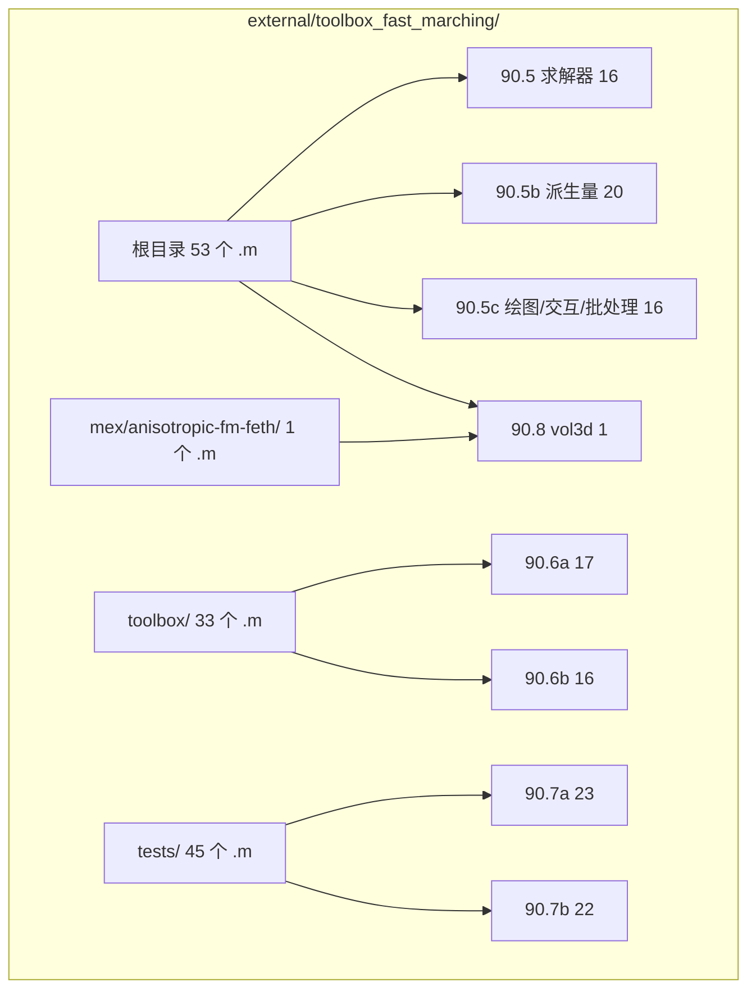
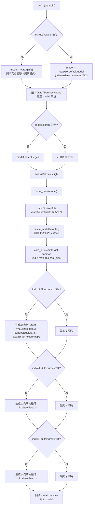
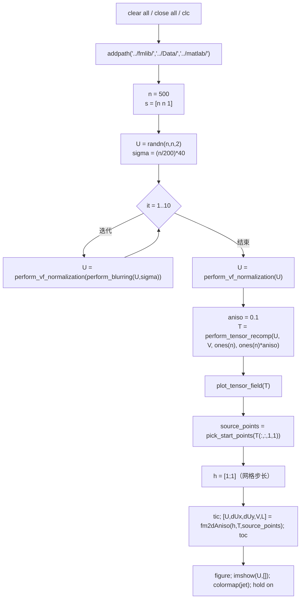

# 90.8 体积渲染与各向异性 FMM 示例（第三方） / Volume Rendering and Anisotropic FMM Demo (Vendored)

> 本章收录 `external/toolbox_fast_marching/` 中**未归入 90.5–90.7 三组**的最后 2 个 `.m` 文件：
> 根目录的体积渲染器 `vol3d`，以及 `mex/anisotropic-fm-feth/` 各向异性快速行进
> 编译目录下唯一的 `.m` 示例脚本。至此 `toolbox_fast_marching/` 的 **132 个 `.m` 全部有据可查**。
>
> This chapter covers the last two `.m` files of `external/toolbox_fast_marching/` not
> assigned to chapters 90.5–90.7: the root-level volume renderer `vol3d` and the single
> `.m` demo inside the anisotropic fast-marching mex build folder. With these two, all
> **132 `.m` files** of `toolbox_fast_marching/` are accounted for.

- 语言 / Language：中英对照（中文为主）
- 覆盖 / Coverage：2 / 2（`toolbox_fast_marching/` 内剩余全部 `.m`）

模块归属图：

| 文件 | 路径 | 类别 | 一句话功能 |
|---|---|---|---|
| [`vol3d`](file:///c:/VSWork/gptoolbox-1/external/toolbox_fast_marching/vol3d.m) | `toolbox_fast_marching/vol3d.m` | 体积渲染 | 用正交切面纹理映射在 OpenGL 中渲染 3-D 体数据 |
| [`testFM2dAniso`](file:///c:/VSWork/gptoolbox-1/external/toolbox_fast_marching/mex/anisotropic-fm-feth/testFM2dAniso.m) | `toolbox_fast_marching/mex/anisotropic-fm-feth/testFM2dAniso.m` | 示例脚本 | 驱动 `fm2dAniso` 各向异性 mex 的演示脚本 |

---

### `vol3d` — 3-D 体数据的正交切面体渲染

- **文件 / File**: [external/toolbox_fast_marching/vol3d.m](file:///c:/VSWork/gptoolbox-1/external/toolbox_fast_marching/vol3d.m#L1-L174)
- **签名 / Signature**: `[model] = vol3d(varargin)`
- **功能 / Purpose**:
  - EN: Volume-render 3-D data by mapping orthogonal 2-D texture slices onto `surface` objects; `vol3d(H)` refreshes an existing model when the view rotates.
  - 中文：以「正交平面 2-D 纹理映射」方式把 3-D 体数据渲染为一叠 `surface` 切片，并支持通过 `vol3d(H)` 在相机旋转后刷新切片选择。
- **署名 / Attribution**: `% Copyright Joe Conti, 2004`（[L58](file:///c:/VSWork/gptoolbox-1/external/toolbox_fast_marching/vol3d.m#L58)）；未附许可证文本，源自 MATLAB File Exchange 的体积渲染器。
- **输入 / Inputs**:

| 参数 | 类型 | 说明 |
|---|---|---|
| `varargin{1}` | struct 或 cell | 若为 struct 则视为既有 `model` 句柄（刷新模式）；否则为 `Name,Value` 序列 |

- **输出 / Outputs**:

| 输出 | 类型 | 说明 |
|---|---|---|
| `model` | struct | 伪体渲染对象，字段 `cdata/xdata/ydata/zdata/parent/handles/texture` |

- **可选参数 / Optional**:

| 名 | 默认 | 说明 |
|---|---|---|
| `'CData'` | `[]` | 3-D 体数据数组 |
| `'Parent'` | `gca` | 目标坐标轴句柄 |
| `'texture'` | `'2D'` | `'2D'`：仅渲染最接近当前视线方向的一组正交切片，旋转后需 `vol3d(h)` 刷新；`'3D'`：同时渲染 x/y/z 三组切片，无需刷新但要求更强的 OpenGL |

- **变量流动 / Variable flow**:
  `varargin →(1 isstruct 判定：句柄模式 or 新建 default model)→ model →(2 解析 'CData'/'Parent'/'texture' 写入 model)→ model →(3 model.parent 为空则 gca，设 vis3d/tight)→ ax →(4 local_draw：camtarget-campos 取主视轴 ind=max(abs(cam_dir)))→ ind →(5 按 ind/3D 生成 z/x/y 切片序列 surface(...,'facecolor','texture','facealpha','texturemap'))→ handles →(6 回填 model.handles)→ model`

- **算法步骤 / Algorithm**:

1. 判定调用形态：首参为 `struct` 即**刷新模式**（复用已有 `model`），否则用 `localGetDefaultModel` 新建默认模型（`texture='2D'`）。
2. 按步长 2 遍历 `varargin`，只识别 `'CData'` / `'Parent'` / `'texture'` 三个键（`switch` 无 `otherwise`，**未知键被静默忽略**）。
3. `model.parent` 缺省取 `gca`，随后 `axis vis3d` + `axis tight` 固定为三维等比例视图。
4. `local_draw` 中：用 `cdata` 尺寸补齐 `xdata/ydata/zdata` 的缺省范围，`delete(model.handles)` 清掉上一帧。
5. 计算相机方向 `cam_dir = camtarget - campos`，取绝对值最大的分量 `ind` 作为**主视轴**。
6. 若 `ind==3` 或 `texture=='3D'`，沿 z 逐层生成 `surface`（`facecolor='texture'`、`facealpha='texturemap'`、`tag='vol3d'`）；同理处理 x（`ind==1`）与 y（`ind==2`）方向。切片位置按范围/层数均匀增量推进。
7. 记录所有 `surface` 句柄于 `model.handles`，返回 `model` 供下次刷新使用。

- **依赖 / Dependencies**:
  - gptoolbox 内部：无。
  - MATLAB：`isstruct`、`axis`、`camtarget`/`campos`、`surface`、`findobj`、`squeeze`、`gca`（均为内置，无需额外工具箱）。
  - 渲染层面依赖 **OpenGL**（`texture` 映射与 `facealpha='texturemap'`）；文档鼓励配合 `vol3dtool` 调整 `colormap`/`alphamap`（`vol3dtool` **不在本仓库**）。
- **备注 / Notes**:
  - 与同目录 `plot_volumetric_data`（见 90.5c）功能相近：后者是 Peyre 工具箱的体数据绘制入口，本文件是通用的体渲染器。
  - `vol3d` **不是 MATLAB 内置函数**，因此不构成内置遮蔽。
  - 仅识别 3 个 `Name,Value` 键；`'xdata'/'ydata'/'zdata'` 在文档头中被提及但**代码未解析**，只能通过传入完整 `model` 结构体设置。
- **See also**: [`plot_volumetric_data`](file:///c:/VSWork/gptoolbox-1/external/toolbox_fast_marching/plot_volumetric_data.m)、[`plot_fast_marching_3d`](file:///c:/VSWork/gptoolbox-1/external/toolbox_fast_marching/plot_fast_marching_3d.m)、[90.5c 绘图、交互与批处理](05c-fast-marching-plotting-and-tools.md)

---

### `testFM2dAniso` — 各向异性快速行进 mex 演示脚本

- **文件 / File**: [external/toolbox_fast_marching/mex/anisotropic-fm-feth/testFM2dAniso.m](file:///c:/VSWork/gptoolbox-1/external/toolbox_fast_marching/mex/anisotropic-fm-feth/testFM2dAniso.m#L1-L38)
- **类型 / Type**: **脚本（无输入/输出参数）/ script**；工作区变量：`library_directory`、`data_directory`、`matlab_directory`、`n`、`s`、`U`、`sigma`、`aniso_list`、`aniso`、`V`、`T`、`source_points`、`h`、`dUx`、`dUy`、`L`
- **功能 / Purpose**:
  - EN: Demo script that synthesises a smooth 2-D vector/tensor field and runs the anisotropic Fast Marching mex `fm2dAniso` from picked source points.
  - 中文：构造平滑 2-D 向量场并合成各向异性张量场，交互式拾取源点后调用各向异性快速行进 mex `fm2dAniso`，可视化得到的距离场 `U`、梯度 `dUx/dUy`、本征向量场 `V` 与张量 `L`。
- **署名 / Attribution**: 无可考署名 / no attribution in header（文件无版权行）。所属目录源自 Fethallah Benmansour 的各向异性快速行进实现。
- **被驱动的函数 / Functions exercised**: `perform_vf_normalization`、`perform_blurring`、`perform_tensor_recomp`、`plot_tensor_field`、`pick_start_points`、`fm2dAniso`（mex）
- **输入 / Outputs**: 无（脚本）
- **变量流动 / Variable flow**:
  `n=500 →(1 s=[n n 1], U=randn(n,n,2))→ U →(2 10 次 perform_vf_normalization(perform_blurring(U,sigma)) 平滑)→ U →(3 V=cat(3,-U(:,:,2),U(:,:,1)); T=perform_tensor_recomp(U,V,ones(n),ones(n)*aniso))→ T →(4 plot_tensor_field(T); pick_start_points(T(:,:,1,1)) 交互拾取)→ source_points,h →(5 fm2dAniso(h,T,source_points))→ U,dUx,dUy,V,L →(6 imshow(U,[]) + jet 可视化)`

- **算法步骤 / Algorithm**:

1. `clear all; close all; clc;`，并把 `../fmlib/`、`../Data/`、`../matlab/` 临时加入搜索路径——这三个目录**在本仓库中不存在**，路径添加会产生警告。
2. 生成 `500×500×2` 高斯噪声向量场 `U`，`sigma = (n/200)*40 = 100`。
3. 迭代 10 次「模糊 → 归一化」，得到平滑的旋转场 `U`。
4. 由 `U` 构造正交向量场 `V = cat(3, -U(:,:,2), U(:,:,1))`，再以 `perform_tensor_recomp(U,V, ones(n), ones(n)*aniso)` 合成各向异性张量场 `T`（本征值 1 与 `aniso=0.1`）。
5. `plot_tensor_field(T)` 绘出张量椭球场；`pick_start_points` 交互式拾取源点。
6. `h=[1;1]` 指定网格步长，调用 mex `fm2dAniso(h,T,source_points)` 返回距离场 `U`、梯度 `dUx/dUy`、本征向量场 `V` 与张量 `L`，并用 `tic/toc` 计时。
7. `imshow(U,[])+jet` 显示距离场。
8. 脚本另定义了 `aniso_list = [.01 .05 .1 .2 .5 1]` 供逐级各向异性对比（本文件中未继续展开）。

- **依赖 / Dependencies**:
  - 本目录 mex：`fm2dAniso`（源码 [fm2dAniso.cpp](file:///c:/VSWork/gptoolbox-1/external/toolbox_fast_marching/mex/anisotropic-fm-feth/fm2dAniso.cpp) / 头 [fm.h](file:///c:/VSWork/gptoolbox-1/external/toolbox_fast_marching/mex/anisotropic-fm-feth/fm.h)），仓库随附预编译件 `fm2dAniso.mexmaci`（**仅 macOS**）。
  - toolbox_fast_marching：`perform_vf_normalization`（见 90.6b）、`perform_blurring`（见 90.6a）、`perform_tensor_recomp`（见 90.6b）。
  - **缺失依赖**：`plot_tensor_field`、`pick_start_points` **全库无定义**；`../fmlib/`、`../Data/`、`../matlab/` 三个 `addpath` 目标目录不存在。
- **备注 / Notes**:
  - 因此本脚本**不可直接运行**：先缺 `plot_tensor_field`，再缺 `pick_start_points`，且 mex 仅在 macOS 预编译。
  - 顶层 `compile_mex.m`（见 90.5c）中**各向异性目标被整段注释**，作者注明 "these do not actually exist"；本目录是其残留的历史实现。
  - `imshow` 需 **Image Processing Toolbox**。
- **See also**: [90.5c 绘图、交互与批处理](05c-fast-marching-plotting-and-tools.md)、[compile_mex](file:///c:/VSWork/gptoolbox-1/external/toolbox_fast_marching/compile_mex.m)、[90.7a 测试与示例 A](07a-fast-marching-tests-a.md)（其中多个 `test_anisotropic*` 同样命中 `plot_tensor_field` 缺失）

---

## 函数清单核对表 / Coverage Checklist

| # | 文件 | 锚点 | 一句话功能 |
|---|---|---|---|
| 1 | `vol3d.m` | [L1-L174](file:///c:/VSWork/gptoolbox-1/external/toolbox_fast_marching/vol3d.m#L1-L174) | 正交切面纹理映射的 3-D 体渲染，支持刷新模式 |
| 2 | `mex/anisotropic-fm-feth/testFM2dAniso.m` | [L1-L38](file:///c:/VSWork/gptoolbox-1/external/toolbox_fast_marching/mex/anisotropic-fm-feth/testFM2dAniso.m#L1-L38) | 各向异性 FMM mex `fm2dAniso` 的演示脚本（缺依赖不可运行） |

**统计**：2 条条目 / 2 个 mermaid 流程图 + 1 张模块归属图。

---

## 交叉引用 / Cross references

- 本模块总索引：[90-external/README.md](README.md)
- 求解器：[90.5](05-fast-marching-solvers.md)｜派生量：[90.5b](05b-fast-marching-compute-helpers.md)｜绘图与交互：[90.5c](05c-fast-marching-plotting-and-tools.md)
- 内部工具：[90.6a](06a-fast-marching-internals-data-structures.md)、[90.6b](06b-fast-marching-internals-operators-and-io.md)
- 测试与示例：[90.7a](07a-fast-marching-tests-a.md)、[90.7b](07b-fast-marching-tests-b.md)
- 文档写作规范：[appendices/03-doc-template.md](../appendices/03-doc-template.md)
