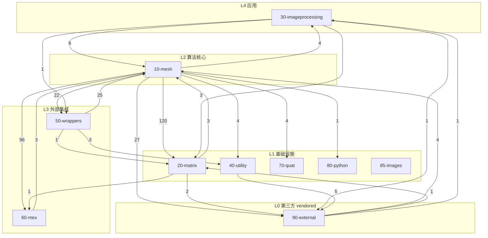

# 附录 B：全局依赖关系图 / Appendix B — Global Dependency Graph

> 本附录以**逐函数条目的 `依赖 / Dependencies` 字段**为唯一数据源，聚合出全库的
> **模块级依赖图（带权重）**、**库内函数扇入排行**与**未解析名字（MATLAB 内置 / 工具箱 /
> 第三方 / 外部二进制）分布**。与 [00-overview/05-dependency-map.md](../00-overview/05-dependency-map.md)
> 的区别：05 是**人工挑选的主干与代表边**（讲解用途），本附录是**全量自动聚合**（审计用途）。
>
> This appendix aggregates the `Dependencies` field of every per-function entry into a **weighted module-level graph**, **in-repo fan-in ranking**, and the distribution of **unresolved names**. 05-dependency-map.md is curated/narrative; this appendix is exhaustive/audit.

- 语言 / Language：中英对照（中文为主）
- 数据源 / Source：`docs/` 下 978 个函数条目的 `依赖` 字段
- 解析口径 / Resolution：依赖名先在**全库 `*.m` 文件名**中解析；命中则计入库内依赖，否则归入“未解析”。

---

## 0. 统计口径 / Measurement

```text
# 依赖名 → 模块：以 <模块源目录>/<name>.m 是否存在为准
for each entry: for each dep in 依赖列表: resolve dep against 全库 *.m 文件名
```

- 去重：同一函数条目内的重复依赖名只计一次（`dict.fromkeys`）。
- 自环：`模块 → 自身模块` 的边不进入模块图（用于看模块间耦合）；模块内复用另见 §4。
- 依赖列表中非标识符的 token（如 `.m`、`matrix/`）已被剔除；`[MEX]`、`[IPT]` 等方括号标记保留并计入“未解析”。

---

## 1. 模块级依赖图 / Module-level graph（带权重）

边权 = 该方向的**库内调用点条数**（不是文件数）。



### 1.1 边表 / Edge table

| # | 边 / Edge | 权重 / Weight |
|---|---|---|
| E1 | `10-mesh` → `20-matrix` | 120 |
| E2 | `10-mesh` → `60-mex` | 96 |
| E3 | `10-mesh` → `90-external` | 27 |
| E4 | `50-wrappers` → `10-mesh` | 25 |
| E5 | `10-mesh` → `50-wrappers` | 22 |
| E6 | `30-imageprocessing` → `10-mesh` | 6 |
| E7 | `40-utility` → `90-external` | 5 |
| E8 | `10-mesh` → `40-utility` | 4 |
| E9 | `10-mesh` → `30-imageprocessing` | 4 |
| E10 | `10-mesh` → `70-quat` | 4 |
| E11 | `90-external` → `10-mesh` | 4 |
| E12 | `20-matrix` → `10-mesh` | 3 |
| E13 | `30-imageprocessing` → `20-matrix` | 3 |
| E14 | `50-wrappers` → `40-utility` | 3 |
| E15 | `60-mex` → `10-mesh` | 3 |
| E16 | `20-matrix` → `90-external` | 2 |
| E17 | `10-mesh` → `80-python` | 1 |
| E18 | `20-matrix` → `60-mex` | 1 |
| E19 | `30-imageprocessing` → `90-external` | 1 |
| E20 | `30-imageprocessing` → `50-wrappers` | 1 |
| E21 | `50-wrappers` → `20-matrix` | 1 |
| E22 | `90-external` → `30-imageprocessing` | 1 |
| E23 | `90-external` → `20-matrix` | 1 |

### 1.2 模块依赖矩阵 / Adjacency matrix

行 = 依赖方（caller），列 = 被依赖方（callee）；`0` = 无调用，对角（同模块自环）不列。

| caller \ callee | matrix | imageprocessing | utility | wrappers | mex | quat | python | images | external |
|---|---|---|---|---|---|---|---|---|---|
| **10-mesh** | 120 | 4 | 4 | 22 | 96 | 4 | 1 | 0 | 27 |
| **20-matrix** | 0 | 0 | 0 | 0 | 1 | 0 | 0 | 0 | 2 |
| **30-imageprocessing** | 3 | 0 | 0 | 1 | 0 | 0 | 0 | 0 | 1 |
| **40-utility** | 0 | 0 | 0 | 0 | 0 | 0 | 0 | 0 | 5 |
| **50-wrappers** | 1 | 0 | 3 | 0 | 0 | 0 | 0 | 0 | 0 |
| **60-mex** | 0 | 0 | 0 | 0 | 0 | 0 | 0 | 0 | 0 |
| **70-quat** | 0 | 0 | 0 | 0 | 0 | 0 | 0 | 0 | 0 |
| **80-python** | 0 | 0 | 0 | 0 | 0 | 0 | 0 | 0 | 0 |
| **85-images** | 0 | 0 | 0 | 0 | 0 | 0 | 0 | 0 | 0 |
| **90-external** | 1 | 1 | 0 | 0 | 0 | 0 | 0 | 0 | 0 |

---

## 2. 库内高扇入函数 / In-repo high fan-in

口径：依赖名字命中库内 `*.m` 的**条目数**（同一条目内同名依赖只计一次）；`其中跨模块` 为被依赖方模块 ≠ 依赖方模块的条目数（即 §1 模块图边的强度）。

| 排名 | 函数 | 归属模块 | 库内被依赖 | 其中跨模块 | 源文件 |
|---|---|---|---|---|---|
| 1 | `normalizerow` | 20-matrix | 49 | 49 | [matrix/normalizerow.m](../matrix/normalizerow.m) |
| 2 | `doublearea` | 10-mesh | 37 | 0 | [mesh/doublearea.m](../mesh/doublearea.m) |
| 3 | `remove_unreferenced` | 10-mesh | 35 | 1 | [mesh/remove_unreferenced.m](../mesh/remove_unreferenced.m) |
| 4 | `barycenter` | 10-mesh | 29 | 0 | [mesh/barycenter.m](../mesh/barycenter.m) |
| 5 | `adjacency_matrix` | 10-mesh | 29 | 0 | [mesh/adjacency_matrix.m](../mesh/adjacency_matrix.m) |
| 6 | `remove_duplicate_vertices` | 10-mesh | 27 | 0 | [mesh/remove_duplicate_vertices.m](../mesh/remove_duplicate_vertices.m) |
| 7 | `outline` | 10-mesh | 27 | 0 | [mesh/outline.m](../mesh/outline.m) |
| 8 | `cotmatrix` | 10-mesh | 27 | 1 | [mesh/cotmatrix.m](../mesh/cotmatrix.m) |
| 9 | `massmatrix` | 10-mesh | 26 | 1 | [mesh/massmatrix.m](../mesh/massmatrix.m) |
| 10 | `normrow` | 20-matrix | 25 | 24 | [matrix/normrow.m](../matrix/normrow.m) |
| 11 | `edges` | 10-mesh | 20 | 1 | [mesh/edges.m](../mesh/edges.m) |
| 12 | `normals` | 10-mesh | 20 | 0 | [mesh/normals.m](../mesh/normals.m) |
| 13 | `edge_lengths` | 10-mesh | 18 | 0 | [mesh/edge_lengths.m](../mesh/edge_lengths.m) |
| 14 | `winding_number` | 60-mex | 17 | 17 | [mex/winding_number.m](../mex/winding_number.m) |
| 15 | `boundary_faces` | 10-mesh | 15 | 0 | [mesh/boundary_faces.m](../mesh/boundary_faces.m) |
| 16 | `min_quad_with_fixed` | 20-matrix | 15 | 11 | [matrix/min_quad_with_fixed.m](../matrix/min_quad_with_fixed.m) |
| 17 | `conncomp` | 10-mesh | 13 | 2 | [mesh/conncomp.m](../mesh/conncomp.m) |
| 18 | `repdiag` | 20-matrix | 13 | 12 | [matrix/repdiag.m](../matrix/repdiag.m) |
| 19 | `axisangle2matrix` | 10-mesh | 12 | 0 | [mesh/axisangle2matrix.m](../mesh/axisangle2matrix.m) |
| 20 | `on_boundary` | 10-mesh | 12 | 1 | [mesh/on_boundary.m](../mesh/on_boundary.m) |
| 21 | `volume` | 10-mesh | 12 | 0 | [mesh/volume.m](../mesh/volume.m) |
| 22 | `getoptions` | 90-external | 12 | 0 | [external/getoptions.m](../external/getoptions.m) |
| 23 | `progressbar` | 90-external | 11 | 6 | [external/progressbar.m](../external/progressbar.m) |
| 24 | `connected_components` | 10-mesh | 11 | 1 | [mesh/connected_components.m](../mesh/connected_components.m) |
| 25 | `point_mesh_squared_distance` | 60-mex | 11 | 11 | [mex/point_mesh_squared_distance.m](../mex/point_mesh_squared_distance.m) |

### 2.1 各模块扇出规模 / Fan-out per module

| 模块 | 库内依赖引用条数 | 其中跨模块 |
|---|---|---|
| `10-mesh` | 1186 | 278 |
| `20-matrix` | 21 | 6 |
| `30-imageprocessing` | 23 | 11 |
| `40-utility` | 9 | 5 |
| `50-wrappers` | 44 | 29 |
| `60-mex` | 7 | 3 |
| `70-quat` | 0 | 0 |
| `80-python` | 0 | 0 |
| `85-images` | 0 | 0 |
| `90-external` | 287 | 6 |

---

## 3. 循环依赖 / Cycles

模块级双向边（A→B 且 B→A）——均属**函数级复用导致的模块互引**，非文件级死锁：

| 循环 / Cycle | A→B | B→A |
|---|---|---|
| `10-mesh` ⇄ `20-matrix` | 120 | 3 |
| `10-mesh` ⇄ `30-imageprocessing` | 4 | 6 |
| `10-mesh` ⇄ `50-wrappers` | 22 | 25 |
| `10-mesh` ⇄ `60-mex` | 96 | 3 |
| `10-mesh` ⇄ `90-external` | 27 | 4 |
| `20-matrix` ⇄ `90-external` | 2 | 1 |
| `30-imageprocessing` ⇄ `90-external` | 1 | 1 |

---

## 4. 依赖名字分布 / Name distribution

对全部依赖引用按“能否在库内 `*.m` 中解析”分类：

| 类别 / Class | 引用条数 | 占比 | 说明 |
|---|---|---|---|
| 库内函数（同模块） | 1239 | 39.7% | 模块内复用；不计入 §1 的模块间边 |
| 库内函数（跨模块） | 338 | 10.8% | 构成 §1 的模块图边 |
| 未解析（MATLAB 内置 / 工具箱 / 第三方 / 外部二进制） | 1540 | 49.4% | 见 §4.1 |
| **合计** | **3117** | 100% | — |

### 4.1 未解析名字 Top 40 / Top unresolved names

| 名字 | 次数 | 典型归属 |
|---|---|---|
| `find` | 33 | MATLAB 内置 / 第三方（未在库内定义） |
| `sparse` | 31 | MATLAB 内置 / 第三方（未在库内定义） |
| `reshape` | 25 | MATLAB 内置 / 第三方（未在库内定义） |
| `size` | 25 | MATLAB 内置 / 第三方（未在库内定义） |
| `max` | 24 | MATLAB 内置 / 第三方（未在库内定义） |
| `zeros` | 24 | MATLAB 内置 / 第三方（未在库内定义） |
| `repmat` | 22 | MATLAB 内置 / 第三方（未在库内定义） |
| `linspace` | 19 | MATLAB 内置 / 第三方（未在库内定义） |
| `min` | 19 | MATLAB 内置 / 第三方（未在库内定义） |
| `unique` | 18 | MATLAB 内置 / 第三方（未在库内定义） |
| `[IPT]` | 18 | 文档标记：依赖 Image Processing Toolbox |
| `meshgrid` | 15 | MATLAB 内置 / 第三方（未在库内定义） |
| `interp1` | 15 | MATLAB 内置 / 第三方（未在库内定义） |
| `im2double` | 14 | MATLAB 内置 / IPT |
| `colormap` | 14 | MATLAB 绘图 |
| `sort` | 13 | MATLAB 内置 / 第三方（未在库内定义） |
| `rand` | 12 | MATLAB 内置 / 第三方（未在库内定义） |
| `sum` | 12 | MATLAB 内置 / 第三方（未在库内定义） |
| `system` | 12 | MATLAB 内置（调外部进程） |
| `round` | 12 | MATLAB 内置 / 第三方（未在库内定义） |
| `bsxfun` | 11 | MATLAB 内置 / 第三方（未在库内定义） |
| `speye` | 10 | MATLAB 内置 / 第三方（未在库内定义） |
| `sqrt` | 10 | MATLAB 内置 / 第三方（未在库内定义） |
| `isempty` | 10 | MATLAB 内置 / 第三方（未在库内定义） |
| `eigs` | 9 | MATLAB 内置稀疏特征值 |
| `trisurf` | 9 | MATLAB 绘图 |
| `plot` | 9 | MATLAB 内置 / 第三方（未在库内定义） |
| `plot3` | 9 | MATLAB 内置 / 第三方（未在库内定义） |
| `exist` | 9 | MATLAB 内置 / 第三方（未在库内定义） |
| `disp` | 9 | MATLAB 内置 / 第三方（未在库内定义） |
| `knnsearch` | 8 | Statistics/IPT |
| `surf2patch` | 8 | MATLAB 绘图 |
| `axis` | 8 | MATLAB 内置 / 第三方（未在库内定义） |
| `fspecial` | 8 | IPT 滤波器 |
| `strcmp` | 8 | MATLAB 内置 / 第三方（未在库内定义） |
| `set` | 7 | MATLAB 内置 / 第三方（未在库内定义） |
| `setdiff` | 7 | MATLAB 内置 / 第三方（未在库内定义） |
| `sprintf` | 7 | MATLAB 内置 / 第三方（未在库内定义） |
| `fopen` | 7 | MATLAB 内置 / 第三方（未在库内定义） |
| `fclose` | 7 | MATLAB 内置 / 第三方（未在库内定义） |

---

## 5. 结论 / Summary

- 模块图的主轴：`10-mesh` 同时扇出到 `20-matrix`/`50-wrappers`/`60-mex`/`90-external`，是唯一连接 L0–L3 的枢纽；`20-matrix`（尤其 `min_quad_with_fixed`）是重型算法的共同下游。
- 循环全部集中在 `10-mesh` 与其它模块之间，成因为**函数级复用**（如 wrappers 需 mesh 的 I/O）；重建时按**函数**而非文件解耦即可。
- 未解析名字占比高，说明文档忠实记录了直接使用的 MATLAB 内置/工具箱与第三方能力；重建时这部分依赖必须由运行环境（MATLAB + IPT/Statistics + MOSEK + 外部二进制）提供。

> 配套阅读：模块与主干讲解见 [00-overview/05-dependency-map.md](../00-overview/05-dependency-map.md)；
> 函数→文件→章节的定位见 [01-global-function-index.md](01-global-function-index.md)。
